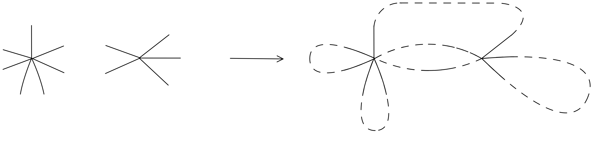
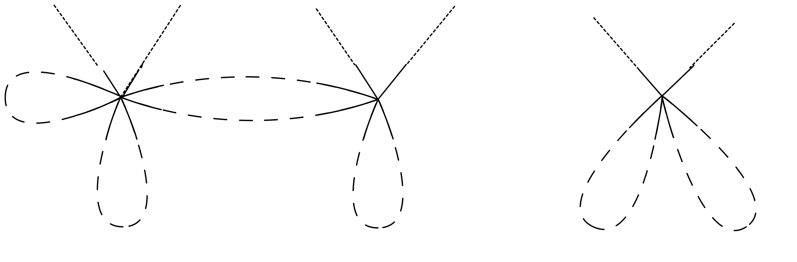
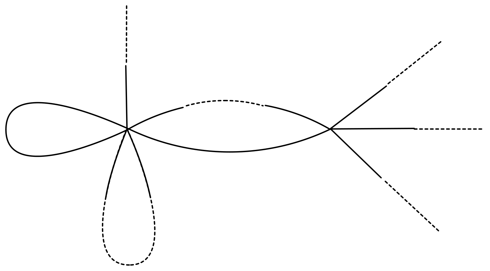
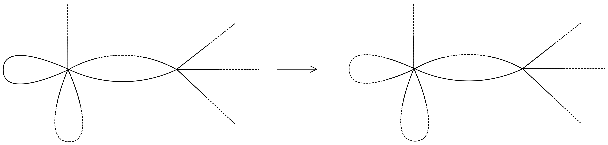

\newpage

**西北大学（Northwestern University）**

\begin{center}
{\LARGE\bfseries 几何朗兰兹对应的规范场论面向}

{\large Gauge Theoretic Aspects of the Geometric Langlands Correspondence}
\end{center}

学位论文

提交研究生院，作为哲学博士学位部分要求之满足

学科：数学

作者：Chris Elliott

伊利诺伊州埃文斯顿

2016 年 6 月

> **译注**：本译注本据作者 2016 年在西北大学数学系提交的博士论文全文译出。原文 228 页（正文 203 页、参考文献 11 页、附录 13 页）。译文保留原文的章节编号、公式编号、定理—定义—例编号与文献引用标记，公式一律重排为 LaTeX；凡属译者所加的背景说明，均以「译注」标出，与原作者的文字严格区分。作者导师为 David Nadler 与 Kevin Costello；论文第 7–10 章及附录的工作是与 Philsang Yoo 合作的成果（见致谢）。原文标题中的 "Gauge Theoretic" 直译为「规范理论的」，此处沿用既有译名「规范场论面向」。

\newpage

# 摘要

**几何朗兰兹对应的规范场论面向**

Chris Elliott

在 2006 年那篇具有革命性的论文中，Kapustin 与 Witten 描述了几何表示论与超对称规范场量子理论之间一座引人入胜的桥梁。他们说明了：作一次适当的拓扑扭转，就能把全纯 $G$-丛与平坦 $G$-丛的模叠上的层范畴实现为超对称规范场论中的边界条件范畴；他们并且说明了，物理上的 S-对偶现象何以应当给出一个范畴等价，即所谓的几何朗兰兹对应。

本论文着手把 Kapustin–Witten 以及其他理论物理学家引入的若干结构在数学上严格化，最终目标是系统地利用理论物理文献中那一整套超对称规范场论所蕴含的巨量结构，为几何表示论引出新洞见。

本论文的工作由两条彼此独立的进路组成。第一，我借助因子化代数（factorization algebra）这一数学结构，构造出阿贝尔规范场论的一种推广，并说明这些理论的 S-对偶可以描述为某种 Fourier 变换。第二，我说明如何用导出代数几何来构造经典超对称规范场论，为此类理论引入恰当的扭转概念，并证明 Kapustin 与 Witten 所引入的扭转恰好给出几何朗兰兹对应所关心的那些模叠。

\newpage

# 致谢

我首先要归功于 Philsang Yoo：本项研究的相当一部分是与他在紧密而持续的合作中共同完成的。本论文第 7 至第 10 章以及附录的材料，来自我们合作的预印本《由导出代数几何看 $N=4$ 规范场论的几何朗兰兹扭转》[EY15]；第 13 章讨论的想法则属于正在进行中的合作工作。与 Philsang 共事极为愉快——愿未来还有更多年富有成果的合作。

我要感谢研究生期间支持过我的所有人，没有他们，这一切都无从完成。首先是我的导师：先是 David Nadler，后是 Kevin Costello。虽然我们在地理上已分隔有时，但在我于西北大学的整段时间里，他们的学识、建议与鼓励始终弥足珍贵。

我还要特别提到几位好友，他们听我倾诉，在我工作的每个阶段帮我渡过难关。Saul Glasman 是我最老的朋友之一，他坚定的支持与鼓励、无尽的热情，过去是、现在仍是我灵感的惊人来源。Thel Seraphim 帮我提出了启动这项工作的一些想法，并在各种事情上给了我宝贵的建议与建设性的批评。希望我们很快再见。

在这项研究中，我与许多数学家有过愉快的交谈，也得到了他们的解释与建议。我要特别感谢 David Ben-Zvi、Damien Calaque、Ryan Grady、Michael Gröchenig、Sam Gunningham、Owen Gwilliam、Boris Hanin、Aron Heleodoro、Theo Johnson-Freyd、Clemens Koppensteiner、Kobi Kremnitzer、Ian Le、Toly Preygel、Nick Rozenblyum、Pavel Safronov、Claudia Scheimbauer、Jack Shotton、Brian Williams 与 Jesse Wolfson，与他们的讨论直接帮助了本论文所呈现的工作。

在数学之外，我在芝加哥及其他地方的朋友们始终以酒、以善意、以情谊相伴。仅举几例：我要感谢 Cheryl 与 Brendan（还有 Bailey）、Carl、Leah 与 Nathan、Joel、Paul、Erik、Kym、Ness、过节时的那一群人（尤其是 Nick 与 Rosie）、Chris 与 Liz、Laurel 与 Hannah，感谢我们共度的所有美好时光。我还要感谢 Hugo，在我需要他时他总在身边，而且总有一句恰到好处的话。

当然，若无家人一生的支持，我绝不可能走到今天。谢谢你们为我做的一切，谢谢你们在我所有选择上站在我这一边。

最后，也是最重要的，我要感谢 Claire：没有她的爱，我不知自己会在何处。

本研究部分得到圆周理论物理研究所（Perimeter Institute for Theoretical Physics）的资助。圆周理论物理研究所的研究由加拿大政府（通过工业部）与安大略省（通过经济发展与创新部）资助。

> **译注**：致谢中的人名一律保留原文，不音译。

\newpage

# 第 1 章　引言

## 1.1　S-对偶引论

<!-- p.010 -->

本论文将以一种略显哲学的方式开场：先讨论一对量子场论「互为对偶」究竟应当意味着什么。粗略地说，物理学家所说的对偶，指的是这样一对**前量子场论**——即配上了某些额外数据的经典场论，这些数据包括一个具体的作用量泛函以及各耦合常数的取值，从而确定了一种量子化的选择——连同它们量子化之间的一个等价。例如，从物理的观点，可以给出如下对偶的定义。

**定义 1.1.1**［Tes16］　设两套理论 $(\Phi,\tau,S_\tau)$ 与 $(\Phi',\tau',S'_{\tau'})$ 由一个场空间以及一个依赖于某些辅助参数 $\tau$ 或 $\tau'$ 的作用量泛函给出。若存在一个量子场论的模空间 $M$，它带有边界点 $z_0$ 与 $z'_0$、以及 $M$ 在这两个边界点附近的坐标 $\tau_0$ 与 $\tau'_0$，并且存在从 $z_0$ 与 $z'_0$ 附近的局部可观测量出发的映射
$$
f\colon \mathrm{Obs}\longrightarrow O(\Phi),\qquad
f'\colon \mathrm{Obs}'\longrightarrow O(\Phi'),
$$
使得在 $z_0$ 与 $z'_0$ 附近分别有渐近展开的等价：
$$
\langle O\rangle_z \;\cong\; \int D\varphi\, e^{-S_{\tau_0}(\varphi)}\, f(O)(\varphi,\tau_0),
$$
$$
\langle O\rangle_z \;\cong\; \int D\varphi'\, e^{-S'_{\tau'_0}(\varphi')}\, f'(O)(\varphi',\tau'_0),
$$
则称这两套理论**互为对偶**。

要把这个定义讲严格，依赖的东西不少：首先得有量子场论本身的恰当定义，其次还要说明
<!-- p.011 -->
上式右端这些路径积分表达式究竟意味着什么。尽管如此，它毕竟抓住了「一个对偶应当是什么样的东西」这一想法：一对表面上彼此不同的前量子场论，在量子化之后却描述等价的物理。若暂且接受其中不严格的部分，那么在模空间 $M$ 退化为单点的情形下，定义 1.1.1 有一个相当简洁的简化形式。

**例 1.1.2**　一对前量子理论 $(\Phi,\tau,S_\tau)$ 与 $(\Phi',\tau',S'_{\tau'})$ 互为对偶，如果存在一个对应
$$
\mathrm{Obs}\xrightarrow{\;f\;}\mathrm{Obs}_\Phi,\qquad
\mathrm{Obs}\xrightarrow{\;f'\;}\mathrm{Obs}_{\Phi'},
$$
其中 $\mathrm{Obs}_\Phi$ 与 $\mathrm{Obs}_{\Phi'}$ 分别是两个经典理论的量子化，并且对每个可观测量 $O\in\mathrm{Obs}$，$f(O)$ 与 $f'(O)$ 具有相同的期望值。

> **译注**：原书此处是一张三角形图表：$\mathrm{Obs}$ 在顶点，两条斜边分别为 $f$ 与 $f'$，底边两端为 $\mathrm{Obs}_\Phi$ 与 $\mathrm{Obs}_{\Phi'}$。这里改用并列的两支映射表述，含义不变。

本论文试图以数学上严格的方式，刻画某个特定对偶——**S-对偶**——的若干侧面。S-对偶与几何表示论这一领域中的诸多现代研究课题深深交织。本节余下的部分，先介绍 S-对偶的想法与其部分历史；然后转向几何表示论，更具体地说，是几何朗兰兹纲领，以及 Kapustin 与 Witten 所引入的、这两个看似不相干的领域之间的联系。

关于 S-对偶（又称电磁对偶，或 Montonen–Olive 对偶）的综述，文献中已经很多，例如 [Kap08, Vec97, Oli96, Har96, FO98, Kne99]。我不打算在这篇引言里复述完整的故事，但会尽力说清经典的想法究竟是什么——S-对偶是什么、人们为什么会猜测它存在——并提示这一理论的若干较现代的发展。

<!-- p.012 -->

### 1.1.1　经典电磁对偶

我们的故事必须从真空中 Maxwell 方程的熟悉形式讲起[^1]：
$$
\nabla\cdot\mathbf{E}=0,\qquad
\nabla\cdot\mathbf{B}=0,\qquad
\nabla\times\mathbf{E}=-\frac{\partial\mathbf{B}}{\partial t},\qquad
\nabla\times\mathbf{B}=\frac{\partial\mathbf{E}}{\partial t},
$$
其中 $\mathbf{E}$ 与 $\mathbf{B}$ 是电场与磁场，即 $\mathbb{R}^3$ 上依赖于时间的向量场。用 $\mathbb{R}^3$ 的度量把 $\mathbf{E}$ 与 $\mathbf{B}$ 分别等同于 $\mathbb{R}^3$ 上依赖于时间的 1-形式与 2-形式，就可以等价地把这些方程改写成电磁场强——即 2-形式
$$
F=\mathbf{E}\wedge dt+\mathbf{B}\in\Omega^2(\mathbb{R}^4)
$$
——所满足的形式[^2]：
$$
dF=0,\qquad d*F=0.
$$

容易看出，这些方程具有一个非常自然的对称性，即
$$
\mathbf{E}\mapsto\mathbf{B},\qquad \mathbf{B}\mapsto-\mathbf{E},
$$
或者等价地说，Hodge 星算子 $*\colon\Omega^2(\mathbb{R}^4)\to\Omega^2(\mathbb{R}^4)$。然而，一旦引入背景电荷分布与电流分布 $\rho$、$\mathbf{j}$，这一对称性就被破坏了：Gauss 定律变为 $\nabla\cdot\mathbf{E}=\rho$，Ampère 定律变为 $\nabla\times\mathbf{B}=\frac{\partial\mathbf{E}}{\partial t}+\mathbf{j}$。

如果进一步引入与磁场耦合的磁荷分布 $\mu$ 与磁流分布 $\mathbf{k}$，并要求该对称性同时把 $\rho\mapsto\mu$、$\mu\mapsto-\rho$、$\mathbf{j}\mapsto\mathbf{k}$、$\mathbf{k}\mapsto-\mathbf{j}$，那么这个被破坏的对称性就可以修复。这尤其意味着，$\mathbf{B}$ 在空间中任一球面上的积分不必再为零，从而允许磁单极子的存在。

一个自然的问题是：这种同时带有电荷与磁荷的规范场与粒子理论，能否容许一种量子化？更进一步，如果容许，那么基于这一经典对称性，是否存在一个量子场论层面的对偶？更具体地说，用定义 1.1.1 的术语：是否存在一个对偶，使得 $f'(O)=*\circ f(O)$，其中 $*$ 是沿经典理论的这一对称性的前推？这个问题至少从 1930 年代起就有人考虑：Dirac 发表过一篇影响深远的论文 [Dir31]，其中说明，如果试图量子化一个带电荷 $e$ 的单个带电粒子在经典电磁势中的理论，而该势对应一个磁荷为 $f$ 的磁单极子（即 Maxwell 方程的一个解，其磁荷分布 $\mu$ 为 $f$ 乘以位于原点的 delta 函数），那么量子化存在的必要条件是两个荷之积 $ef$ 落在格 $2\pi\mathbb{Z}$ 中。

在回答上述问题的第二部分之前，我们先说明如何把这个故事推广到非阿贝尔规范群的 Yang–Mills 理论。

[^1]: 此处以及全篇引言中，我们一律采用自然单位制 $c=\hbar=1$。
[^2]: 若从 Lorentz 力定律出发——它规定以速度 $\mathbf{v}$ 运动的粒子所受的力由与 1-形式 $\iota_{\mathbf{v}}F$ 对偶的向量场给出——上述解释是自然的。

<!-- p.013 -->

### 1.1.2　Montonen 与 Olive 的提议

Dirac 在经典电磁学中构造磁单极子态的做法相当直接；但要证明非阿贝尔规范理论中此类态的存在，则需要更多巧思。一个漂亮的构造最初（相互独立地）归功于 't Hooft [tH74] 与 Polyakov [Pol74]，他们当时处理的是规范群 $SU(2)$（或 $SO(3)$）的情形。下面我按照 di Vecchia 与 Figueroa-O'Farrill 的综述 [Vec97, FO98] 中的表述，简要说明这个解是如何产生的。

我们考虑一个经典 Yang–Mills–Higgs 理论：即规范群为 $SU(2)$ 的 Yang–Mills 理论，耦合一个伴随值标量场 $\varphi$，其势为
$$
V(\varphi)=\frac{\lambda}{4}\left(|\varphi|^2-\alpha^2\right)^2,
$$
其中 $\lambda$ 与 $\alpha$ 是非零常数（即「墨西哥帽」势）。Higgs 机制把规范对称性破缺到一个极大环面 $H\subseteq SU(2)$。可以观察到，对称性破缺之后，$SU(2)$ 规范玻色子分裂为一个无质量的 $U(1)$ 规范玻色子——我们不妨称之为光子——以及两个荷为 $1$ 与 $-1$、质量为 $\alpha e$ 的玻色子，称为 W 玻色子。这里 $e$ 是规范耦合常数。

<!-- p.014 -->

Polyakov 与 't Hooft 用一个特殊的球对称拟设（ansatz）给出了该理论经典运动方程的一个解。我们用分量记号写出它。这里 $a=1,2,3$ 标记 $\mathfrak{su}(2)$ 的一组基，$i,j=1,2,3$ 标记时空中一个余维 1 子空间的一组基：
$$
\varphi^a(x)=\frac{x^a}{e|x|^2}\,H(\xi),\qquad
A^0_a(x)=0,\qquad
A^a_i(x)=-\frac{x^j}{e|x|^2}\,\varepsilon_{aij}\left(1-K(\xi)\right),
$$
其中
$$
\xi=\alpha e|x|.
$$
这里 $H$ 与 $K$ 是 $\xi$ 的光滑实值函数，满足某些自然的边界条件，约束它们在 $\xi\to0$ 与 $\xi\to\infty$ 时的行为，从而保证满足此拟设的解总能量有限。把该拟设代入运动方程，可得到一对耦合的二阶常微分方程：
$$
\xi^2\frac{d^2K}{d\xi^2}=KH^2+K(K^2-1),
$$
$$
\xi^2\frac{d^2H}{d\xi^2}=2K^2H+\frac{\lambda}{e^2}H\left(H^2-\xi^2\right).
$$
这些方程一般没有闭式解，但 Jaffe 与 Taubes [JT80] 证明了：它们确实存在满足适当边界条件的解。这样的解通常称为 **'t Hooft–Polyakov 磁单极子**。

**例 1.1.3**　在 $\lambda\to0$ 的极限下（有时称为「Prasad–Sommerfield 极限」），我们得到一个可以用闭式表达的特殊例子。此时利用 't Hooft–Polyakov 拟设，可得运动方程的一个解：
$$
H(\xi)=\xi\coth(\xi)-1,\qquad K(\xi)=\xi\,\mathrm{cosech}(\xi).
$$
这个解有时称为 **BPS 磁单极子**，原因我们很快就会说明。

<!-- p.015 -->

要看为什么 't Hooft–Polyakov 解描述一个磁单极子，只需注意到：对应于光子的那部分规范场可以取为点积 $A^a\varphi^a$。$A^0_a$ 恒为零这一条件，保证了该位形的电场为零。然而，在 $\xi\to\infty$ 的极限下，总电磁场强趋于
$$
F_{ij}=\frac{1}{\alpha}\varphi^a\partial_jA^a_i
\longrightarrow-\frac{1}{e}\frac{x^a}{|x|}\partial_j\left(\frac{x^k}{|x|^2}\right)\varepsilon_{aik}
=-\frac{x^k}{e|x|^3}\varepsilon_{ijk},
$$
这里用到了 $\xi\to\infty$ 时 $K\to0$ 与 $H/\xi\to0$ 这两个条件。这正具有区分磁单极子的性质：电场为零；而计算磁通量穿过围绕原点的任一球面时，得到一个正数，且当半径趋于无穷时它收敛到
$$
f=\frac{4\pi}{e}.
$$
注意这个磁荷自动满足 Dirac 量子化条件，因为 $fe=4\pi\in2\pi\mathbb{Z}$。

这些磁单极子解被设计成具有有限能量（等价地，有限质量）。这个质量有一个下界，称为 **Bogomol'nyi–Prasad–Sommerfield（BPS）界**。具体地，可以验证
$$
\begin{aligned}
E&=\int_{\mathbb{R}^3}\left(\frac{1}{2}E^a_iE^a_i+B^a_iB^a_i+\partial_0\varphi^a\partial_0\varphi^a+\partial_i\varphi^a\partial_i\varphi^a\right)+V(\varphi)\,dx\\
&\ge\int_{\mathbb{R}^3}\frac{1}{2}\left(B^a_iB^a_i+\partial_i\varphi^a\partial_i\varphi^a\right)dx\\
&\ge\int_{\mathbb{R}^3}\partial_i\left(B^a_i\varphi^a\right)dx,
\end{aligned}
$$
其中 $B$ 是磁场强度。由 Stokes 定理并用我们的拟设中 $\varphi$ 的表达式，末式可以看成面积分
$$
\alpha\int_{S^2_\infty}\mathbf{B}\cdot d\mathbf{s},
$$
其中 $S^2_\infty$ 是「无穷远处的球面」（更精确地说，这个积分等于半径递增的球面上面积分之极限）。于是，BPS 界告诉我们
$$
E\ge\alpha f=\frac{4\pi\alpha}{e},
$$
这正是上一段的观察。BPS 界何时被取到，也是容易看出的：当且仅当 $E=\partial_0\varphi=B^a_i-\partial_i\varphi^a=0$ 且 $\lambda=0$。这也就解释了为什么例 1.1.3 中的解被称为 BPS 磁单极子：它的质量取到 BPS 界，等于 $\alpha f$。

<!-- p.016 -->

既然说明了 $G=SU(2)$ 时磁单极子的构造，我们来说明如何推广到其他规范群。对一般的约化群 $G$，可以完全按 $SU(2)$ 的方式来分析 Yang–Mills–Higgs 理论中的粒子谱。Higgs 机制仍然把规范对称性破缺到一个极大环面 $H\subseteq G$，留下 $r=\operatorname{rank}(G)$ 个无质量玻色子，以及 $\dim(G)-r$ 个有质量的 W 玻色子。这些 W 玻色子带有 $H$-规范对称性的荷：每个根对应一个 W 玻色子，其（电）荷由 $H$ 在根空间上的对角作用给出。W 玻色子的质量由 $\alpha e|q|$ 给出，其中 $q\in\mathfrak{h}^*$ 是该玻色子的电荷。

给定一个李代数同态 $c\colon\mathfrak{su}(2)\hookrightarrow\mathfrak{g}$，就可以构造规范群为 $G$ 的 Yang–Mills–Higgs 理论的 't Hooft–Polyakov 磁单极子解。做法是：先取 $SU(2)$ 的磁单极子解，再取它在由 $SU(2)$ 规范场与伴随值标量到 $G$-值对象的诱导映射下的像（不过我们可能需要修改这个解，以确保它仍满足适当的边界条件，Weinberg [Wei80] 就是这样做的）。给定这样一个嵌入，磁荷对应于 Cartan 子代数 $\mathfrak{h}$ 中的一个元素——把 $SU(2)$ 的磁荷在受限嵌入 $\mathfrak{u}(1)\hookrightarrow\mathfrak{h}$ 下的像取出来即可。Dirac 量子化条件保证这个磁荷不是 $\mathfrak{h}$ 中的任意元素，而是**余根格**中的元素。

对一般规范群，BPS 界说质量（或能量）有一个下界
$$
E\ge\alpha|m|,
$$
其中 $m$ 是磁单极子态的磁荷。于是我们把关于规范群 $G$ 的 Yang–Mills–Higgs 理论中 W 玻色子与 BPS 磁单极子所知的内容总结成表 1.1。

<!-- p.017 -->

| | W 玻色子 | BPS 磁单极子 |
|---|---|---|
| 荷 | 根 $q\in\mathfrak{h}^*$ | 余根 $m\in\mathfrak{h}$ |
| 质量 | $\alpha e\lvert q\rvert$ | $\alpha f\lvert m\rvert$ |

**表 1.1**　带电荷与带磁荷的状态的质量与荷。这里 $f=\frac{4\pi}{e}$。

Montonen 与 Olive 观察到：BPS 磁单极子的质量与荷，恰好与对偶理论中 W 玻色子的质量与荷相匹配——那个对偶理论仍是 Yang–Mills–Higgs 理论，但规范群换成**朗兰兹对偶群** $G^\vee$（使得 $G^\vee$ 的余根格等于 $G$ 的根格、反之亦然的那个李群），并且电耦合 $e$ 与磁耦合 $f$ 互换。这个群由下述定理刻画，其证明可在标准代数群教材中找到，例如 Springer [Spr98]。

**定义 1.1.4**　一个**根数据**（root datum）是一个四元组 $(X^*,\Delta,X_*,\Delta^\vee)$，其中 $X^*$ 是有限秩格、$X_*$ 是其对偶格，$\Delta\subseteq X^*$ 与 $\Delta^\vee\subseteq X_*$ 是有限子集，并带有一个双射 $\Delta\to\Delta^\vee$（记作 $\alpha\mapsto\alpha^\vee$），满足下列条件：
1. 对每个 $\alpha\in\Delta$，$\langle\alpha,\alpha^\vee\rangle=2$；
2. 对每个 $\alpha\in\Delta$，映射 $\beta\mapsto\beta-\langle\beta,\alpha^\vee\rangle\alpha$ 置换 $\Delta$ 的元素；类似地，映射 $\beta^\vee\mapsto\beta^\vee-\langle\beta^\vee,\alpha\rangle\alpha^\vee$ 置换 $\Delta^\vee$ 的元素。

若进一步对任何 $\alpha\in\Delta$，$\Delta$ 都不含 $2\alpha$，则称该根数据是**约化的**。

> **译注**：根数据（root datum）与根系（root system）是两回事：前者把特征格与余特征格连同根、余根一并打包，后者只记录根之间的夹角关系。旧译作「根系数据」，容易与根系混淆，此处改从「根数据」。

**定理 1.1.5**　对每个约化根数据 $(X^*,\Delta,X_*,\Delta^\vee)$，都可以联系一个唯一的复约化代数群 $G$，使得 $X^*$ 是特征格（即群同态 $G\to U(1)$ 所成之群），其中含根 $\Delta\subseteq X^*$；而 $X_*$ 是余特征格（即群同态 $U(1)\to G$ 所成之群），其中含余根 $\Delta^\vee\subseteq X_*$。

**定义 1.1.6**　设群 $G$ 的根数据为 $(X^*,\Delta,X_*,\Delta^\vee)$，则其**朗兰兹对偶**（物理文献中也称 GNO 对偶或磁对偶）是具有根数据 $(X_*,\Delta^\vee,X^*,\Delta)$ 的那个唯一群 $G^\vee$。

回忆每个复约化代数群都有唯一的紧形式（在同构意义下），而每个紧连通李群都这样得到；因此我们完全可以同样地把紧连通李群的朗兰兹对偶，理解为与它相伴的复约化群的朗兰兹对偶。

> **译注**：定义 1.1.6 中两个格互换了位置——这正是「朗兰兹对偶把特征格与余特征格对调」的精确表述，也解释了为什么它把单连通形式与伴随形式互换。

<!-- p.018 -->

表 1.2 列出了若干紧群与复群的朗兰兹对偶。从表中可以看出一个普遍现象，例如：朗兰兹对偶交换与一个单李代数相关联的单连通形式与伴随形式。

| 复群 $G$ | 紧形式 $G$ | 紧对偶 $G^\vee$ | 复对偶群 $G^\vee_{\mathbb{C}}$ |
|---|---|---|---|
| $GL(n;\mathbb{C})$ | $U(n)$ | $U(n)$ | $GL(n;\mathbb{C})$ |
| $SL(n;\mathbb{C})$ | $SU(n)$ | $PSU(n)$ | $PGL(n;\mathbb{C})$ |
| $SL(mn;\mathbb{C})/C_m$ | $SU(mn)/C_m$ | $SU(mn)/C_n$ | $SL(mn;\mathbb{C})/C_n$ |
| $SO(2n+1;\mathbb{C})$ | $SO(2n+1)$ | $Sp(n)$ | $Sp(2n;\mathbb{C})$ |
| $SO(2n;\mathbb{C})$ | $SO(2n)$ | $SO(2n)$ | $SO(2n;\mathbb{C})$ |
| $Spin(2n+1;\mathbb{C})$ | $Spin(2n+1)$ | $Sp(n)/C_2$ | $Sp(2n;\mathbb{C})/C_2$ |
| $Spin(4n;\mathbb{C})$ | $Spin(4n)$ | $Spin(4n)/(C_2\times C_2)$ | $Spin(4n;\mathbb{C})/(C_2\times C_2)$ |
| $Spin(4n+2;\mathbb{C})$ | $Spin(4n+2)$ | $Spin(4n+2)/C_4$ | $Spin(4n+2;\mathbb{C})/C_4$ |
| $Spin(8n;\mathbb{C})/C_2^{(1)}$ | $Spin(8n)/C_2^{(1)}$ | $Spin(8n)/C_2^{(1)}$ | $Spin(8n;\mathbb{C})/C_2^{(1)}$ |
| $Spin(8n;\mathbb{C})/C_2^{(2)}$ | $Spin(8n)/C_2^{(2)}$ | $Spin(8n)/C_2^{(2)}$ | $Spin(8n;\mathbb{C})/C_2^{(2)}$ |
| $Spin(8n+4;\mathbb{C})/C_2^{(1)}$ | $Spin(8n+4)/C_2^{(1)}$ | $Spin(8n+4)/C_2^{(2)}$ | $Spin(8n+4;\mathbb{C})/C_2^{(2)}$ |
| $E_6$ | $E_6$ | $E_6/C_3$ | $E_6/C_3$ |
| $E_7$ | $E_7$ | $E_7/C_2$ | $E_7/C_2$ |
| $E_8$ | $E_8$ | $E_8$ | $E_8$ |
| $F_4$ | $F_4$ | $F_4$ | $F_4$ |
| $G_2$ | $G_2$ | $G_2$ | $G_2$ |

**表 1.2**　紧连通与复约化群及其朗兰兹对偶。这里 $C_n$ 表示 $n$ 阶循环群。群 $Spin(4n)$ 的中心为 $C_2\times C_2$，我们把两个因子记作 $C_2^{(1)}$ 与 $C_2^{(2)}$；$SO(4n)$ 是模掉对角子群的商。本表依 Figueroa-O'Farrill 的讲义 [FO98, 表 6.4] 改编。

> **译注**：原表还含 $Spin(8n+4;\mathbb{C})/C_2^{(2)}$ 一行以及若干「$C_2^{(1)}$ 与 $C_2^{(2)}$ 互换」的配对行；为版面计，这里只保留能体现对偶规律的各行，完整对照见 [FO98, 表 6.4]。

现在可以陈述 Montonen 与 Olive 的猜想了。

**猜想 1.1.7（Montonen–Olive 对偶）**　在 BPS 极限 $\lambda\to0$ 下，量子化规范群为 $G$ 与 $G^\vee$ 的经典 Yang–Mills–Higgs 理论所得的量子场论之间，存在一个对偶。该对偶把对应于 W 玻色子的量子态与对应于 BPS 磁单极子的量子态互换。

<!-- p.019 -->

### 1.1.3　超对称规范场论中的 S-对偶

Montonen 与 Olive 的对偶是否成立，有两个潜在的障碍：一是磁单极子似乎没有正确的自旋（若要匹配对偶理论中的规范玻色子，自旋须为 1）；二是粒子与磁单极子的质量可能被重整化。本节将说明，当我们考虑的不是普通的 Yang–Mills–Higgs 理论、而是超对称的 Yang–Mills 理论时，这两个问题如何都被解决。

在 Wilson 形式化的微扰路径积分进路中，经典 Yang–Mills–Higgs 理论的一种量子化，其数据包括每个能标上的一族有效理论，且与重整化群流相容。特别地，诸如粒子质量这样的参数会收到量子修正——在任一给定的有效理论中，通常都必须修改这些参数的取值，以保持与重整化群相容。要使 Montonen–Olive 对偶成立，带电荷与带磁荷状态的质量相等这一性质，就不应只在经典理论中成立，而应在不同能标的有效理论中都成立。然而，并没有理由认为这一点可以被安排妥当。

把我们所处理的经典理论加以扩充，可以绕过这个困难。在超对称理论中，质量公式的量子修正可能消失——即 W 玻色子与磁单极子态的质量可能不随重整化流动——这个想法最早由 d'Adda、Horsley 与 di Vecchia [dHDV78] 讨论，他们描述了 $N=2$ 超 Yang–Mills 中的 BPS 磁单极子解，并证明其质量在单圈层次上不接受量子修正。Witten 与 Olive [OW78] 推广了他们的结果，证明这些 $N=2$ 理论中的质量谱在任何圈阶上都不接受量子修正：经典公式精确成立。这样一来，上面讨论的困难便不再出现。

<!-- p.020 -->

关于超对称 Yang–Mills 理论究竟是什么，我们留到第 8 章（尤其是本论文第二部分中的 8.2 节）详细描述。粗略地说，超 Yang–Mills 理论是 Yang–Mills 理论的扩充：我们引入额外的场，把 Poincaré 群的作用提升为「超庞加莱群」的作用，后者是由旋量表示所作的一个 $\mathbb{Z}/2$-分次扩张。在 $N=2$ 的理论中（即旋量表示有两个不可约直和项的那些理论），场中包含一个 $\mathfrak{g}$-值标量，带四次势，它扮演普通 Yang–Mills–Higgs 理论中 Higgs 场的角色。

问题仍然在于：即使在 $N=2$ 理论中，W 玻色子态与 BPS 磁单极子态似乎也有不同的自旋——即它们在超庞加莱群作用下的变换方式不同——这意味着 Montonen 与 Olive 的猜想仍不能成立（细节可参看 Figueroa-O'Farrill [FO98] 的 2.3.3 与 2.3.4 节）。Osborn [Osb79] 指出，如果我们从 $N=2$ 过渡到 $N=4$ 超 Yang–Mills 理论，这个问题同样得到解决。这就促使人们把 Montonen 与 Olive 的猜想改进为如下形式。

Montonen–Olive 对偶较现代、超对称的表述，更常被称为「S-对偶」（这一术语由 Schwarz 与 Sen [SS93] 于 1993 年在弦论语境中使用，但这个名称的来源可能更早）。这里的「S」是「强–弱」（strong–weak）的缩写：由于 S-对偶把规范耦合常数取逆，强耦合理论可以有弱耦合的对偶，从而允许用微扰方法计算强耦合理论中的关联函数。

**猜想 1.1.8（S-对偶）**　量子化规范群为 $G$ 与 $G^\vee$ 的经典 $N=4$ 超 Yang–Mills 理论所得的量子场论之间，存在一个对偶。

### 1.1.4　阿贝尔对偶

当规范群 $G$ 是阿贝尔群时，纯 Yang–Mills 理论是自由的，于是即使没有超对称，也不必担心质量公式的量子修正；人们猜测：规范群为环面 $H$ 的 Yang–Mills 理论与规范群为对偶环面 $H^\vee$ 的 Yang–Mills 理论之间存在一个对偶。这个电磁对偶的简单实例被 Witten 在 1995 年讨论此事的论文 [Wit95a] 中称为**阿贝尔对偶**；在那篇论文中，他论述了紧致 4-流形上阿贝尔纯 Yang–Mills 理论的配分函数之间的关系。这一关系及其到更高次形式的推广，也由 Verlinde 在 [Ver95] 中研究过。

<!-- p.021 -->

这一对偶在低维的类比也在物理文献中被研究过，例如 2-流形上以对偶环面为靶空间的 sigma 模型之间的 T-对偶，以及 3-流形上 sigma 模型与阿贝尔规范理论之间的对偶（这些在 [Wit99] 中有描述。三维中配分函数对偶的显式计算由 Prodanov 与 Sen [PS00] 以及 Broda 与 Duniec [BD04] 完成；对更一般的可观测量的对偶的细致分析，最近由 Beasley [Bea14b, Bea14a] 给出）。

这些理论是一列理论中维数最低的例子，这列理论的场模拟高次环面丛上的联络；Freed [Fre00] 用普通微分上链（differential cochain）模拟场，描述了这类模型。这些理论的量子化进一步由 Barbón [Bar95] 研究，他讨论了更高次理论中配分函数的阿贝尔对偶；Kelnhofer [Kel09] 则说明了如何用普通微分上链的语言，计算这些理论中规范不变可观测量的真空期望值。

在本论文第一部分，我们将为这族理论证明一个阿贝尔对偶的版本。我们建立的陈述遵循例 1.1.2 的范式：把量子场论建模为**因子化代数**，使用 Costello 与 Gwilliam 的技术 [Gwi12, CG15]。

**定理 1.1.9**　设 $X$ 是紧致黎曼 $n$-流形。则存在如下形式的因子化代数对应：
$$
\mathrm{Obs}^q_{p,R}\ \longleftarrow\ (\mathrm{Obs}^{\Omega^p})^0\ \longrightarrow\ \mathrm{Obs}^q_{n-p,\frac{1}{2R}},
$$
其中 $\mathrm{Obs}^q_{p,R}$ 是某一广义 Maxwell 理论中经典可观测量因子化代数的量子化，该理论的场是群 $R/2\pi R\mathbb{Z}$ 的 $(p-2)$-gerbe 上的联络。彼此关联（incident）的可观测量——即 $(\mathrm{Obs}^{\Omega^p})^0(U)$ 中的同一可观测量经两个映射所得的像——具有相同的期望值。

<!-- p.022 -->

在第 6 章中，我们将说明 $(\mathrm{Obs}^{\Omega^p})^0$ 究竟是什么、映射 $r$ 与 $r'$ 是什么，并论证一大族有趣的可观测量（Wilson 圈算子与 't Hooft 圈算子的推广）落在 $r$ 与 $r'$ 的像中。

> **译注**：定理 1.1.9 的上图即原书的对应图，其中左、右两支分别是 $r$ 与 $r'$。原书正文随后用 $r$、$r'$ 称呼这两个映射。

### 1.1.5　现代议题

本节最后，我们简要讨论一下 $N=4$ 规范理论的 S-对偶猜想自 1970 年代末首次提出以来的发展。这一主题的大量进展依赖于弦论中的想法；事实上，人们相信 S-对偶是弦论之间某种对偶的低能极限。本引言不打算解释这些想法（因为我自己也不理解它们）；我们只聚焦于那些可以纯从场论观点理解的主题。

首先，S-对偶变换可以提升为以模群 $SL(2;\mathbb{Z})$ 为指标的一族对称性。为此，注意到可以在超 Yang–Mills 作用量泛函中加上形如
$$
\theta\int F_A\wedge F_A
$$
的拓扑项，而不影响经典运动方程。这些理论的量子化之间便多了一个平凡的对称性，对应于经典理论中 $\theta\mapsto\theta+1$ 的对称性。把通常的 Yang–Mills 耦合常数 $e$ 与新参数 $\theta$ 合并成复上半平面中的单个元素
$$
\tau=\frac{\theta}{2\pi}+i\,\frac{4\pi}{e},
$$
就会发现 S-对偶与这个新的平凡对称性合起来生成一个 $SL(2;\mathbb{Z})$ 的拷贝，其中这两个对称性分别对应矩阵
$$
t=\begin{pmatrix}0&1\\-1&0\end{pmatrix},\qquad
u=\begin{pmatrix}1&1\\0&1\end{pmatrix}\in SL(2;\mathbb{Z}).
$$

> **译注**：原书把 $\tau$ 写作 $\tau=\frac{\theta}{2\pi}+i\frac{4\pi}{e}$。按规范场论的通行约定（取 $\frac{1}{4e^2}\int F\wedge*F+\frac{\theta}{2\pi}\int F\wedge F$ 型作用量），应为 $\tau=\frac{\theta}{2\pi}+i\frac{4\pi}{e^2}$；原书这里的分母当系笔误，译文照录原文，读者与其它文献对照时需注意耦合常数的归一化。

<!-- p.023 -->

Kapustin 与 Witten 的工作（我们将在后面讨论）有一个重要的前身，即 Vafa 与 Witten 1994 年的论文 [VW94]。该文为 S-对偶提供证据：它论证 S-对偶对完整超对称理论的某个扭转成立。扭转一个经典场论的想法（我们在第 8 章详述）由 Witten 在更早的一篇论文 [Wit88a] 中引入。Witten 的想法是：在超对称场论中，若选取一个满足 $[Q,Q]=0$ 的超荷 $Q$，并把注意力限制在可观测量代数的 $Q$-上同调上，那么所有形如 $[Q,Q']$ 的对称性都会平凡地作用。若 $Q$ 选得恰当，所有平移都取这种形式，于是 $Q$-上同调中的可观测量是平移不变的；由此得到的可观测量理论在物理上相对简单，在数学上则常常与已被深入研究过的拓扑不变量理论密切相关。

Vafa 与 Witten 论证：在 $N=4$ 超 Yang–Mills 理论的某个扭转中，配分函数等于瞬子模空间 Euler 示性数的生成函数。他们随后对不同的规范群、不同的 4-流形研究这些 Euler 示性数，并证明它们是模的，即 $SL(2;\mathbb{Z})$-不变的。这为 S-对偶猜想提供了一些证据；但就本论文的目的而言更重要的是，它建立了规范理论的 S-对偶与模空间几何这一主题之间的早期联系。

关于 S-对偶之起源，Witten 于 1995 年首次提出一个引人入胜的构想 [Wit95b]，并在其后若干论文 [Wit04a, Wit09] 中加以阐发。Witten 提出：应当存在一个六维 $(2,0)$-超共形量子场论，其中含一个带半单、单链规范群 $G$ 的「自对偶高次规范场」——数学家近来开始把该理论称为「理论 X」[^3]。这个量子场论一般并不以通常意义上的经典场论之量子化的形式出现：它不容许作用量泛函。从数学的观点看，这个六维理论高度思辨，目前对它的几乎任何一个方面都还没有令人满意的数学描述。尽管如此，若假定它存在，我们就能开始猜测许多有趣性质的存在。

> **译注**：「自对偶高次规范场」指满足 $\pm F=\star F$ 的中间次形式场，而不是「自对偶的高次规范场论」：维数须为 $4k+2$，且约束之后作用量恒为零，该理论没有直接的拉氏描述。（nLab: [[self-dual higher gauge field]]）

[^3]: 例如 2012 年美国国家科学基金会资助项目 DMS-1342948 的申请书中即如此使用该名称，项目题为「In and Around Theory X」。

<!-- p.024 -->

……以及低维量子场论之间的对偶。例如，把理论 X 沿环面作维数约化，就得到 $N=4$ 超 Yang–Mills 理论。Witten 提出：此类理论的 S-对偶应当这样产生——沿**不同的**环面作维数约化，我们得到一族四维量子场论，其参数空间是上半平面，可以看作 Teichmüller 空间 $\mathcal{T}_{1,0}$。在上半平面内取 $SL(2;\mathbb{Z})$ 的一个基本域，则该群的每个元素都给出边界点之间的一个对偶，正如定义 1.1.1 所述。特别地，标准生成元 $t$ 与 $u\in SL(2;\mathbb{Z})$ 分别对应于 S-对偶变换与拓扑项的平移。立刻可以看出：沿更高亏格的曲线对理论 X 作维数约化，就得到对应于一般映射类群（mapping class group）元素的一大族 S-对偶。这些对偶最早由 Gaiotto [Gai12] 讨论，它们关联的是具有 $N=2$ 超对称、称为 **class $\mathcal{S}$ 理论**的规范理论；除非规范群 $G$ 的所有单因子秩都为 1，这些理论一般不容许拉格朗日描述。

最后，我们还应简要提及 Gaiotto 与 Witten 的近期工作，他们把 S-对偶解释为四维理论之间的一个三维畴壁 [GW09b, GW09a]。在 [GW09b] 中，Gaiotto 与 Witten 在 $N=4$ 超 Yang–Mills 理论中构造了恰在一半超对称下不变的边界条件（半 BPS 边界条件），它由某些数据刻画，其中包括规范群李代数中的一个 $\mathfrak{sl}_2$-三元组。在 [GW09a] 中，他们进而讨论 $N=4$ 理论中边界条件的 S-对偶，所用的是一个带余维 1 缺陷的理论；该缺陷同样恰在一半超对称下不变，称为「Janus 壁」，最早由 Bak、Gutperle 与 Hirano [BGH03] 利用 AdS/CFT 对偶引入。

## 1.2　几何朗兰兹纲领引论

从历史上看，几何朗兰兹猜想的原始动机来自数论：人们试图在复几何的世界里，为 Langlands 互反猜想找到恰当的类比物。由于所关心的对象在几何背景下表现更好，人们能以更干净的方式证明更强的结果，并希望最终把某些想法从几何搬回数论。Ngô 用 Hitchin 系统的几何证明基本引理（fundamental lemma）[Ngô10]，就是这一纲领取得惊人成功的一个例子（Nadler 的综述文章 [Nad12] 对此作了解释）。本节先回顾 Beilinson 与 Drinfeld 引入的几何朗兰兹猜想的启发式范畴陈述，并试图说明其动机；随后描述 Arinkin 与 Gaitsgory [AG12] 把这一猜想表述得更精确的近期工作。

我不打算完整叙述几何朗兰兹纲领从数论起源的历史，也不打算全面描述范畴朗兰兹纲领的研究现状。关于几何朗兰兹纲领的起源及其与量子场论的某些联系，最好的综述莫过于 Frenkel 的出色文章 [Fre07, Fre10]；关于几何朗兰兹猜想现代表述的细节，参见 Arinkin 与 Gaitsgory [AG12]；关于 $GL(2)$ 情形的证明，以及专家们希望用以建立完整猜想的纲领，参见 Gaitsgory [Gai13]。

### 1.2.1　来自数论的动机

<!-- p.025 -->

综述数论中 Langlands 纲领的文章很多，例如 [Tay04, Kna97]。本节给出一个简短的概述，用以说明几何版本猜想的动机。从远处看，Langlands 纲领描述的是两类表示对象之间的关系——这两类对象都可以从数域 $F$（或数论所关心的许多其他类型的域；Langlands 对应有很多版本）构造出来。其中一类对象带有纯粹代数的风味，另一类则用泛函分析的技术来定义和研究。与此同时，该对应把用约化代数群 $G$ 定义的一侧表示论对象，与用其朗兰兹对偶 ${}^LG$ 定义的一侧联系起来[^4]。

出现在 Langlands 对应中的代数对象，至少在最简单的层面上，是取值于群 ${}^LG$ 的绝对 Galois 群 $\mathrm{Gal}(\overline{F}/F)$ 的表示。Galois 表示在数论中无处不在（例如来自 $\overline{F}$ 上代数簇的 étale 上同调），但它们的抽象结构先验地难以触及，因此人们希望有结果能把它们的结构与另一类对象联系起来。

<!-- p.026 -->

较具分析风味的那类对象先验地稍难说明动机，但它们与数论中经典研究的对象——例如数域的理想类群、模形式环——密切相关。这类对象称为**自守表示**（automorphic representation），我们不会仔细定义，但会尽量给出其风味。对整体域 $F$，定义其**阿代尔环**（adele ring）为限制乘积
$$
\mathbb{A}_F=\prod_p{}' F_p,
$$
其中乘积遍历 $F$ 的所有素点（place）$p$，而 $F_p$ 是 $F$ 在 $p$ 处的形式完备化（例如 $F=\mathbb{Q}$、$p$ 为素数时，$F_p$ 就是 $p$-进数）。所谓限制乘积，指的是：一个阿代尔在投影 $\mathbb{A}_F\to F_p$ 下的像，除有限多个 $p$ 外都必须落在局部环 $\mathcal{O}_p\subseteq F_p$ 中。在阿代尔环内部，可以定义整数环 $\mathcal{O}\subseteq\mathbb{A}_F$ 为乘积 $\prod_p\mathcal{O}_p$。与域 $F$ 相伴的**自守商**（automorphic quotient）是双商
$$
G(F)\backslash G(\mathbb{A}_F)/G(\mathcal{O}).
$$

<!-- p.027 -->

如下文将要论证的，这个双商有一个自然的几何解释：它是 G-丛某个模空间的一个版本。非常粗略地说，一个自守表示是 $G(\mathbb{A}_F)$-模 $L^2_\chi(G(F)\backslash G(\mathbb{A}_F))$ 的一个不可约酉子商——这里 $L^2_\chi$ 指被 $Z(\mathbb{A}_F)$ 的一个特征 $\chi$ 扭过的 $L^2$ 函数空间，$Z$ 是 $G$ 中极大的 $F$-分裂中心环面——并且该商要配以适当的测度。这些表示可以归入「$L$-包」（$L$-packet）：即在几乎所有的素点 $v$ 上都作为 $G(F_v)$-表示同构的那些表示所构成的集合。

有了这套设置，就可以陈述 Langlands 互反猜想的一个（不精确的）版本。

**元猜想 1.2.1（Langlands 互反）**　设 $F$ 是数域，$G$ 是 $F$ 上分裂的约化代数群。存在一个双射
$$
\left\{\begin{array}{c}\text{取值于 }{}^{L}G\text{ 的 }\mathrm{Gal}(\overline{F}/F)\text{ 的}\\ \ell\text{-进表示}\end{array}\right\}
\;\overset{\sim}{\longleftrightarrow}\;
\left\{\begin{array}{c}G(\mathbb{A}_F)\text{ 的自守表示的}\\ L\text{-包}\end{array}\right\},
$$
并使两侧的自然对称性相互交织。

把它称为「元猜想」，是要表明：它不必被照字面接受，而应看作大量更精确猜想的一个指导原则（关于 $G=GL_n$ 的精确版本，例如见 Clozel [Clo90]；关于一般群的精确版本，见 Buzzard–Gee [BG14]）。至少，要把它精确化，我们得先定义所有术语，并确定两侧的「自然对称性」究竟应当是什么。

**注 1.2.2**　在 Langlands 互反猜想更仔细的表述中，人们也许应当考虑的不是 $\mathrm{Gal}(\overline{F}/F)$ 的表示，而是 $\mathrm{Gal}(\overline{F}/F)\times SL(2;\mathbb{C})$ 的表示。同态 $SL(2;\mathbb{C})\to G^\vee$ 是额外的数据，称为「Arthur 参数」；只在这个参数上有差别的元素所成的集合称为「Arthur 包」。

<!-- p.028 -->

从数论中的 Langlands 纲领过渡到几何朗兰兹纲领，靠的是一个有时被称为「Weil 的罗塞塔石碑」的类比 [Wei79]。其想法如下。整体域有两类：数域，以及整体函数域——即定义在有限域 $\mathbb{F}_q$ 上的代数曲线 $\Sigma$ 的函数域。Weil 的类比以整体函数域为桥，把这些域的代数性质与定义在复数域 $\mathbb{C}$ 上的代数曲线的几何性质联系起来：

- 数域的素点对应于代数曲线的闭点（注意：数域的无穷素点集合没有显然的几何类比物）。
- 数域在素点 $v$ 处的完备化，对应于代数曲线在点 $p$ 处的局部域——即 $p$ 的形式去心邻域上的函数域；其整数环对应于局部环——$p$ 的形式（不去心）邻域上的函数环。
- 数域的自守商 $G(F)\backslash G(\mathbb{A}_F)/G(\mathbb{A}_F^f)$ 对应于 $\Sigma$ 上全纯 G-丛的模空间 $\mathrm{Bun}_G(\Sigma)$。要看出这一点，先注意任何全纯 G-丛都可以在有限点集之外平凡化。换言之，取 $\Sigma$ 中有限点集 $x_1,\dots,x_k$ 周围的小圆盘，连同其补集 $\Sigma\backslash\{x_1,\dots,x_k\}$，就得到一个平凡化覆盖。在该覆盖上平凡化了的 G-丛之集合，与双陪集集合
$$
G(\Sigma\backslash\{x_1,\dots,x_k\})\Big\backslash\prod_{i=1}^{k}G(D_{x_i}^{\times})\Big/\prod_{i=1}^{k}G(D_{x_i})
$$
之间存在双射：丛由其转移函数确定，而不同的平凡化选择则取商。这等价地可以写成
$$
G(\Sigma\backslash\{x_1,\dots,x_k\})\Big\backslash\left(\prod_{i=1}^{k}G(D_{x_i}^{\times})\times\prod_{x\neq x_i\in\Sigma}G(D_x^{\times})\right)\Big/\prod_{x\in\Sigma}G(D_x).
$$
现在，让集合 $\{x_1,\dots,x_k\}$ 遍历 $\Sigma$ 的所有有限子集，并把圆盘换成形式圆盘，我们就得到 $\Sigma$ 上所有 G-丛之集合作为双陪集集合的描述。

<!-- p.029 -->

具体说，这一描述取如下形式：
$$
G(\Sigma\backslash\{x_1,\dots,x_k\})\Big\backslash\prod_{x\in\Sigma}{}'G(D_x^{\times})\Big/\prod_{x\in\Sigma}G(D_x),
$$
其中限制乘积指：该 G-值函数除有限多个点外都可越过去心点延拓。由于可以把 $G(D_x^{\times})$ 看作取值于 $x$ 处局部域的 G 之点集、把 $G(D_x)$ 看作取值于局部环的 G 之点集，我们看到这个集合与自守商的点集完全类似。
- 数域 $F$ 的 Galois 扩张对应于曲线 $\Sigma$ 的 Galois 覆盖。
- $F$ 的绝对 Galois 群对应于 $\Sigma$ 的基本群。
- $F$ 的 $G^\vee$-值 Galois 表示对应于 $\Sigma$ 基本群的 $G^\vee$-值表示，等价地，对应于 $\Sigma$ 上带 $G^\vee$-结构的局部常值层。

<!-- p.030 -->

至此我们为 Langlands 猜想中出现的主要对象找到了几何类比物。从 Langlands 互反猜想过渡到几何朗兰兹猜想还需要一个要素，即 Grothendieck 的「函数—层」字典（function–sheaf dictionary）。这是范畴化的一个例子：我们把自守商上的函数替换为可构造层或 D-模。在复数域上，集合论层面的几何朗兰兹对应取如下形式。

**猜想 1.2.3**　存在一个自然的双射
$$
\{\Sigma\text{ 上不可约 }G^\vee\text{-局部系统}\}\;\overset{\sim}{\longleftrightarrow}\;\{\mathrm{Bun}_G(\Sigma)\text{ 上的 Hecke 特征层}\},
$$
把 $L$ 送到以 $L$ 为特征值的特征层。

这里的 Hecke 特征层是满足某个特定方程的 D-模，该方程规定了局部「Hecke」算子的作用方式。关于 Hecke 特征层究竟是什么，参见 Frenkel [Fre07] 的阐述——我们很快就会给出该猜想的另一种更强的形式，并精确地陈述它。猜想 1.2.3 的一个版本可追溯到 Drinfeld，他在 $G=GL_2$ 的情形下陈述并证明了它 [Dri83]；随后 Laumon 对 $GL_n$ 表述了该猜想 [Lau87]。$GL_n$ 情形由 L. Lafforgue [Laf02] 证明；后来 Frenkel、Gaitsgory 与 Vilonen 的工作 [FGV02] 结合 Gaitsgory 的一个结果 [Gai04]，在无分歧情形下对每个不可约局部系统显式构造出了相应的 Hecke 特征层。更晚近地，V. Lafforgue 对一般约化群 $G$ 表述了该猜想，并给出了从左侧到右侧的一个映射的构造 [Laf12]。

> **译注**：「Hecke 特征层」的「特征」取本征值（eigen）义，与特征标（character）无关：它是 $\mathrm{Bun}_G(\Sigma)$ 上的 D-模，使每个 Hecke 算子都按相应表示作用，如同以某个局部系统为特征值的本征对象。（nLab: [[geometric Langlands correspondence]]）

[^4]: 需要小心：由于这些群未必定义在复数域上，上一节中朗兰兹对偶的定义并不完全正确。要使按字面写下的定义成立，我们需要假定群 $G$ 是分裂的（即含有分裂的极大环面）；即便有此假定，也还要与 $F$ 的绝对 Galois 群作半直积。由于这一差别，并且为了与数论文献相容，仅在本节中我们用 ${}^LG$ 表示 $G$ 的朗兰兹对偶群。

### 1.2.2　范畴化的提法

上述故事为几何版本的 Langlands 猜想提供了动机；而在这里——得益于函数—层对应——我们可以要求的就不仅是集合之间的双射，而是范畴之间的等价。我们先陈述几何朗兰兹猜想最乐观的版本。我们把它视为一个「元猜想」而非真正的猜想：一个鼓舞人心的故事，我们希望它能引出一个真正的陈述。Beilinson 与 Drinfeld 提出了如下命题。

**元猜想 1.2.4（「Drinfeld 的至佳希望」）**　存在一个 dg-等价
$$
D(\mathrm{Bun}_G(\Sigma))\;\simeq\;\mathrm{QC}(\mathrm{Loc}_{G^\vee}(\Sigma)),
$$
即 $\mathrm{Bun}_G(\Sigma)$ 上 D-模的 dg-范畴与 $\mathrm{Loc}_{G^\vee}(\Sigma)$ 上拟凝聚层的 dg-范畴之间的等价，并使两侧的自然对称性相互交织。

**注 1.2.5**　在下文中，我们有时把这个等价式的左、右两端分别称为对应的**自守侧**与**谱侧**。在下一节解释了它与 S-对偶及镜像对称的联系之后，我们还会把它们分别称为 **A-侧**与 **B-侧**。

关于这里所说的「自然对称性」究竟指什么，我们下面会讲得更精确。这个陈述推广了几何朗兰兹对应较早的集合论陈述——后者主张：$\Sigma$ 上 $G^\vee$-局部系统 $L$（即右侧的摩天楼层）与 $\mathrm{Bun}_G(\Sigma)$ 上以 $L$ 为特征值的 Hecke 特征层之间存在双射。

<!-- p.031 -->

当 $G$ 是阿贝尔群时，这个「至佳希望」陈述完全正确，并由 Laumon [Lau96] 与 Rothstein [Rot96] 各自独立证明。人们可以用一种改造过的 Fourier–Mukai 变换构造阿贝尔几何朗兰兹范畴之间的等价。设 $A$ 是阿贝尔簇，记 $A^\natural$ 为 $A$ 上带平坦联络的 $G_m$-丛的模空间。与普通 Fourier–Mukai 变换一样，$A\times A^\natural$ 上存在一个 Poincaré 层——一个带平坦联络的线丛——它限制到 $A\times\{(L,\nabla)\}$ 上就是 $(L,\nabla)$。Laumon 与 Rothstein 证明：与 Poincaré 层相伴随的积分变换给出范畴等价
$$
\mathrm{QC}(A^\natural)\longrightarrow D(A),
$$
取 $A=\mathrm{Jac}(\Sigma)$（$\Sigma$ 的 Jacobi 簇）即得阿贝尔几何朗兰兹对应的一个版本。要得到「至佳希望」猜想，只需作小的修改：在 A-侧，$\mathrm{Bun}_{G_m}(\Sigma)=\mathrm{Jac}(\Sigma)\times\mathbb{Z}\times BG_m$；在 B-侧，$\mathrm{Loc}_{G_m}(\Sigma)=\mathrm{Jac}(\Sigma)^\natural\times(\mathrm{pt}\times_{\mathbb{A}^1}\mathrm{pt})\times BG_m$。于是，只要注意到 $D(\mathbb{Z})\cong\mathrm{QC}(BG_m)$ 与 $D(BG_m)\cong\mathrm{QC}(\mathrm{pt}\times_{\mathbb{A}^1}\mathrm{pt})$，就得到阿贝尔几何朗兰兹对应。

然而结果发现，阿贝尔情形是「至佳希望」猜想按字面成立的唯一例子。本节余下部分我们讨论 $\Sigma=\mathbb{P}^1$ 的例子，等价地，讨论几何朗兰兹对应的局部算子范畴。V. Lafforgue [Laf09] 证明：当 $\Sigma=\mathbb{P}^1$ 而 $G$ 非阿贝尔时，范畴 $\mathrm{QC}(\mathrm{Loc}_{G^\vee}(\mathbb{P}^1))$ 等价于 $D(\mathrm{Bun}_G(\Sigma))$ 的一个真子范畴。$D(\mathrm{Bun}_G(\mathbb{P}^1))$ 中的「大」对象——包括 D-模 $D_{\mathrm{Bun}_G(\mathbb{P}^1)}$——无法对应到 $\mathrm{Loc}_{G^\vee}(\mathbb{P}^1)$ 上的任何拟凝聚层。这个结果来自对猜想局部版本的细致讨论，该局部版本通常称为**几何 Satake 对应**。在这个讨论中，我们会说明上面提到的自然对称性究竟是什么。

<!-- p.032 -->

先从 Mirković 与 Vilonen [MV07] 给出的几何 Satake 对应的原始版本谈起。

**定义 1.2.6**　$G$ 的**仿射 Grassmann 簇**（affine Grassmannian）是 ind-概形 $G(K)/G(O)$，其中 $K=\mathbb{C}((t))$、$O=\mathbb{C}[[t]]$。它确实由某个 ind-概形表示，其证明可见 Görtz 的讲义 [Gör10]。

> **译注**：仿射 Grassmann 簇是 ind-概形而非有限型概形：nLab 视之为环路群的旗簇，$GL_n$ 情形即 $k(\!(t)\!)^n$ 中格的模空间；因其不是通常的簇，也有文献称「流形」，本书统一用「簇」。（nLab: [[affine Grassmannian]]）

**定理 1.2.7（未导出几何 Satake）**［MV07］　存在阿贝尔范畴的等价
$$
D^b_{G(O)}(\mathrm{Gr}_G)^\heartsuit\;\xrightarrow{\ \sim\ }\;\mathrm{Rep}(G^\vee),
$$
其中 $D^b_{G(O)}(\mathrm{Gr}_G)^\heartsuit$ 是仿射 Grassmann 簇上 $G(O)$-等变 D-模的有界复形所成的阿贝尔范畴[^5]（$G(O)$ 按左乘作用），$\mathrm{Rep}(G^\vee)$ 是 $G^\vee$ 的有限维表示范畴。范畴 $D^b_{G(O)}(\mathrm{Gr}_G)^\heartsuit$ 带有由卷积给出的幺半结构，使该等价成为幺半等价。

Mirković 与 Vilonen 证明这个定理的方式是：先说明左端范畴是中性 Tannaka 的——按 Deligne 的一个定理，这意味着它等价于某个群概形的表示范畴；再分析左端范畴的结构，说明这个群概形实际上是约化代数群；然后说明其不可约表示以 $G$ 的支配余权（dominant coweight）为参数。由此便可证明这个未知的约化群实际上同构于朗兰兹对偶群 $G^\vee$。

**注 1.2.8**　「几何 Satake」之名来自数论中一个类似的定理——Satake 同构。该定理说：若 $K$ 是非阿基米德局部域、$O$ 其整数环，则 $G(K)$ 上具有紧支集、且对两侧 $G(O)$ 作用不变的函数之集合，可以自然地做成一个环，同构于朗兰兹对偶群的表示环。这个环称为 $G$ 的**球面 Hecke 代数**（spherical Hecke algebra）。

[^5]: 这里写 $\heartsuit$ 表示自然 t-结构的核心（heart）。

<!-- p.033 -->

人们自然会试图把 Mirković–Vilonen 定理提升为导出范畴（或 dg-范畴）的等价，但结果发现这相当微妙。特别地，虽然可以取定理 1.2.7 中阿贝尔范畴的导出范畴，从而得到导出范畴的等价，但如此得到的范畴并不是在几何朗兰兹范畴上自然局部作用的那两个范畴。几何 Satake 对应的正确导出版本由 Bezrukavnikov 与 Finkelberg [BF08] 证明，并由 Arinkin 与 Gaitsgory [AG12, 第 12 节] 详细讨论。具体地说，他们证明：「谱 Hecke 叠」
$$
\mathrm{Hecke}^{\mathrm{spec}}_{G^\vee}=BG^\vee\times_{\mathfrak{g}^\vee/G^\vee}BG^\vee
$$
上的某个层范畴，作为带卷积幺半结构的幺半范畴，等价于 dg-范畴 $D_{G(O)}(\mathrm{Gr}_G)$。我们在此陈述该定理，不过其中某些记号要到下一节才会引入。

**定理 1.2.9（导出几何 Satake）**［AG12, 12.5.5］　存在幺半 dg-范畴的典范等价
$$
\mathrm{Sat}\colon D_{G(O)}(\mathrm{Gr}_G)\longrightarrow \mathrm{IndCoh}_N\!\left(\mathrm{Hecke}^{\mathrm{spec}}_{G^\vee}\right).
$$

要看出为什么这种形式的陈述是自然的，我们来解释这些范畴为何自然地作用在几何朗兰兹范畴上。记 $D=\operatorname{Spec}O$、$D^\times=\operatorname{Spec}K$，即形式圆盘与形式去心圆盘。用两个形式圆盘沿一个形式去心圆盘粘合所得的推出 $B=D\sqcup_{D^\times}D$，称为「形式气泡」。导出几何 Satake 对应是几何朗兰兹对应的局部版本，因为
$$
\mathrm{Bun}_G(B)=G(O)\backslash G(K)/G(O),
$$
而
$$
\mathrm{Loc}_{G^\vee}(B)\cong \mathrm{Loc}_{G^\vee}(D)\times_{\mathrm{Loc}_{G^\vee}(D^\times)}\mathrm{Loc}_{G^\vee}(D)\cong BG^\vee\times_{\mathfrak{g}^\vee/G^\vee}BG^\vee=\mathrm{Hecke}^{\mathrm{spec}}_{G^\vee}.
$$
于是导出几何 Satake 给出 $D(\mathrm{Bun}_G(B))$ 与 $\mathrm{Loc}_{G^\vee}(B)$ 上（某类，下面会详细说明）层之间的等价。

<!-- p.034 -->

若在 $\Sigma$ 中取一个 $\mathbb{C}$-点 $x$，并在 $x$ 附近多粘一个形式邻域，就得到导出叠的图表
$$
\begin{array}{ccc}
B & & \\
& \searrow & \\
\Sigma\times_{D^\times_x}D & \longrightarrow & \Sigma,
\end{array}
$$
其中箭头都由自然嵌入给出（有两个嵌入 $\Sigma\hookrightarrow\Sigma\times_{D^\times_x}D$，对应于 $x$ 的两个邻域）。取代数 G-丛，或平坦 $G^\vee$-丛，这个结构就给出如下形式的图表
$$
\begin{array}{ccccc}
\mathrm{Bun}_G(B) & & & & \mathrm{Hecke}^{\mathrm{spec}}_{G^\vee}\\
& \searrow & & \swarrow & \\
& & \mathrm{Bun}_G(\Sigma\times_{D^\times_x}D) & & \\
& \swarrow & & \searrow & \\
\mathrm{Bun}_G(\Sigma) & & & & \mathrm{Bun}_G(\Sigma),
\end{array}
$$
以及
$$
\begin{array}{ccccc}
\mathrm{Hecke}^{\mathrm{spec}}_{G^\vee} & & & & \\
& \searrow & & \swarrow & \\
& & \mathrm{Loc}_{G^\vee}(\Sigma\times_{D^\times_x}D) & & \\
& \swarrow & & \searrow & \\
\mathrm{Loc}_{G^\vee}(\Sigma) & & & & \mathrm{Loc}_{G^\vee}(\Sigma).
\end{array}
$$
因此，对 $D_{G(O)}(\mathrm{Gr}_G)$ 或 $\mathrm{IndCoh}_N(\mathrm{Hecke}^{\mathrm{spec}}_{G^\vee})$ 中的任一对象，通过自然卷积都得到 $\mathrm{Bun}_G(\Sigma)$ 或 $\mathrm{Loc}_{G^\vee}(\Sigma)$ 的一个自函子。这就使几何朗兰兹范畴成为（对每个点 $x\in\Sigma$ 的）幺半几何 Satake 范畴的模：我们称这些为点 $x$ 处的**局部算子**。

有了这个结构，就可以说明猜想 1.2.4 中所说的「自然对称性」指什么了。导出几何 Satake 对应 1.2.9 使两侧都成为（比如说）$D_{G(O)}(\mathrm{Gr}_G)$ 的模。我们要求几何朗兰兹等价是关于这个结构的模范畴等价。

**注 1.2.10**　V. Lafforgue [Laf09] 由几何 Satake 对应导出了 $\Sigma=\mathbb{P}^1$ 情形下几何朗兰兹对应的一个版本。他证明 $\mathbb{P}^1$ 的几何朗兰兹范畴是几何 Satake 范畴的挠子（torsor）：即，若在几何朗兰兹范畴中取一个对象，几何 Satake 范畴在这个对象上的作用就定义了一个 dg-范畴的等价。Lafforgue 的结果并不完全是定理 1.2.9 的形式，而是用了 $\mathrm{QC}(\mathrm{Loc}_{G^\vee}(B))$ 与 $D(\mathrm{Bun}_G(B))$ 中满足某个支撑条件的对象所成子范畴之间的等价。

<!-- p.035 -->

### 1.2.3　Arinkin 与 Gaitsgory 的猜想

本节说明几何朗兰兹猜想的一个修正形式，它由 Arinkin 与 Gaitsgory [AG12] 提出，并用到上面描述的导出几何 Satake 对应。

Arinkin 与 Gaitsgory 的修正，动机来自与几何朗兰兹对应应当具有的另一项结构的相容性：与**几何 Eisenstein 级数函子**的相容性。

设 $P\subseteq G$ 是抛物子群，$L=P/U$ 是相应的 Levi 子群，其中 $U$ 是 $P$ 的幂幺根（unipotent radical）。在 $L$ 与 $G$ 的 Langlands 对应自守侧的范畴之间，可以构造一个自然的函子。

**定义 1.2.11**　**几何 Eisenstein 级数函子** $\mathrm{Eis}_P\colon D(\mathrm{Bun}_L(\Sigma))\to D(\mathrm{Bun}_G(\Sigma))$ 是与图表
$$
\mathrm{Bun}_P(\Sigma)\ \xrightarrow{\ q\ }\ \mathrm{Bun}_L(\Sigma),\qquad \mathrm{Bun}_P(\Sigma)\ \xrightarrow{\ p\ }\ \mathrm{Bun}_G(\Sigma)
$$
相伴随的 D-模拉回—前推算子 $p_!q^*$。

这个函子有一个朗兰兹对偶：存在抛物子群 $P^\vee\subseteq G^\vee$，其相伴 Levi 子群为 $L^\vee$，从而可以作如下定义。

**定义 1.2.12**　**几何 Eisenstein 级数函子** $\mathrm{Eis}^{\mathrm{spec}}_{P^\vee}\colon \mathrm{QC}(\mathrm{Loc}_{L^\vee}(\Sigma))\to \mathrm{QC}(\mathrm{Loc}_{G^\vee}(\Sigma))$ 是与图表
$$
\mathrm{Loc}_{P^\vee}(\Sigma)\ \xrightarrow{\ q_{\mathrm{spec}}\ }\ \mathrm{Loc}_{L^\vee}(\Sigma),\qquad \mathrm{Loc}_{P^\vee}(\Sigma)\ \xrightarrow{\ p_{\mathrm{spec}}\ }\ \mathrm{Loc}_{G^\vee}(\Sigma)
$$
相伴随的层拉回—前推算子 $p_{\mathrm{spec},*}q_{\mathrm{spec}}^!$。

由数论中 Langlands 函子性的一个例子所启发，几何朗兰兹对应的一个预期性质是：它把这两个几何 Eisenstein 级数函子相互交织。然而，这个条件立刻带来一个问题：自守侧的 Eisenstein 函子把紧对象送到紧对象（这由 Drinfeld 与 Gaitsgory [DG11] 证明），而谱侧的函子却不具有这一性质。因此，不可能存在如「至佳希望」猜想 1.2.4 那样的、同时交织 Eisenstein 级数函子的等价。

<!-- p.036 -->

因此，仿照 Arinkin 与 Gaitsgory，我们采取的第一步是把拟凝聚层替换为「ind-凝聚层」。ind-凝聚层范畴 $\mathrm{IndCoh}(X)$ 是 $X$ 上凝聚层范畴的 ind-完备化（Gaitsgory 在多处详细讨论过，例如 [Gai11a]）。这一步的主要好处是：对奇异叠（例如 $\mathrm{Loc}_G(\Sigma)$）而言，$\mathrm{IndCoh}$ 的结构——例如与叠的态射相伴随的拉回与前推函子——比 $\mathrm{QC}$ 的结构表现更好。例如，对 $\mathrm{IndCoh}$（而非 $\mathrm{QC}$）存在与 $*$-前推右伴随的 $!$-拉回函子，它把紧对象送到紧对象。作此修改的动机在 Gaitsgory 关于此主题的文章 [Gai11a] 以及 Arinkin 与 Gaitsgory 的论文中有广泛讨论。

> **译注**：「ind-凝聚层」的 ind 指 ind-完备化，即取滤过余极限，故不译「归纳凝聚层」，以免与归纳极限、归纳维数相混；它是凝聚层范畴的 ind-对象范畴。（nLab: [[ind-coherent sheaves]]）

这一修改解决了紧对象生成的问题，但由前面讨论过的 $\mathbb{P}^1$ 例子（V. Lafforgue 的结果）可知，范畴 $\mathrm{IndCoh}(\mathrm{Loc}_{G^\vee}(\Sigma))$ 太大，无法与 $D(\mathrm{Bun}_G(\Sigma))$ 等价。Arinkin 与 Gaitsgory 用**奇异支撑**（singular support）理论修正了这一点：他们找到 $\mathrm{IndCoh}(\mathrm{Loc}_{G^\vee}(\Sigma))$ 的一个极小子范畴，使几何 Eisenstein 级数函子在该子范畴上表现良好。这个子范畴由 $\mathrm{QC}(\mathrm{Loc}_{L^\vee}(\Sigma))$ 在几何 Eisenstein 级数函子下的像生成，其中用到了 $\mathrm{QC}$ 到 $\mathrm{IndCoh}$ 的一个恰当的（而非朴素的）嵌入 [AG12, 推论 13.3.9]。

**定理 1.2.13**［AG12, 推论 13.3.9］　范畴 $\mathrm{QC}(\mathrm{Loc}_{G^\vee}(\Sigma))$ 与 $\mathrm{QC}(\mathrm{Loc}_{L^\vee}(\Sigma))$ 在真抛物子群的几何 Eisenstein 级数函子下的像，共同生成 $\mathrm{Loc}_{G^\vee}(\Sigma)$ 上具有幂零奇异支撑的 ind-凝聚层范畴。

$\mathrm{IndCoh}(X)$ 中一个层的**奇异支撑**，是移位余切丛的次数 0 部分 $\mathrm{Sing}(X)=H^0(T^*[-1]X)$（即 $X$ 的奇点概形）中的一个锥形 Zariski 闭子集。Arinkin 与 Gaitsgory 基于 Benson、Iyengar 与 Krause [BIK08] 的工作，引入了「由 dg-代数作用的任意三角范畴的支撑」这一概念：一个 ind-凝聚层的奇异支撑，就是它作为 $X$ 的**偶 Hochschild 上同调**上的模的支撑，而这个 Hochschild 上同调带有一个来自 $\mathcal{O}(\mathrm{Sing}(X))$ 的典范映射。

> **译注**：分析学中的奇异支撑指分布在其邻域内都不光滑的点集，其微观精细化是记录余向量方向的波前集；此处的奇异支撑把同一「方向」信息代数化，落在 $\mathrm{Sing}(X)=H^0(T^*[-1]X)$ 的锥内。（nLab: [[singular support]]）

<!-- p.037 -->

当 $X=\mathrm{Loc}_{G^\vee}(\Sigma)$ 时，奇点概形可以显式描述：其闭点集形如
$$
\mathrm{Sing}(\mathrm{Loc}_{G^\vee}(\Sigma))=\left\{(P,\nabla,\varphi):(P,\nabla)\in\mathrm{Loc}_{G^\vee}(\Sigma),\ \varphi\text{ 是 }\mathfrak{g}_P\text{ 的平坦截面}\right\}.
$$
于是，具有幂零奇异支撑的层所成子范畴，就是奇异支撑落在**整体幂零锥**内的层所成的全子范畴——整体幂零锥即 $\mathrm{Sing}(\mathrm{Loc}_{G^\vee}(\Sigma))$ 中要求 $\varphi$ 幂零的那个锥形子空间。

**注 1.2.14**　这个子范畴可以从数论上得到（部分的）动机，Arinkin 与 Gaitsgory 在其论文引言中作了说明。如注 1.2.2 所述，在 Langlands 互反猜想中，人们也许不仅要选取一个 Galois 表示，还要选取一个同态 $SL(2;\mathbb{C})\to G^\vee$。特别地，这个同态对应于李代数 $\mathfrak{g}^\vee$ 中一个幂零元的选择（即标准元 $e\in\mathfrak{sl}(2;\mathbb{C})$ 的像）。因此，当发展 Langlands 对应谱侧的几何类比物时，人们会猜测：不仅需要选取一个平坦 $G^\vee$-丛，还需要选取一个幂零截面。ind-凝聚层范畴自动包含了这些数据——因为奇异支撑落在参数化这类数据的叠上——但幂零性条件必须手工加诸其上。

## 1.3　Kapustin 与 Witten 的进路

<!-- p.038 -->

本节回顾 Kapustin 与 Witten 的工作 [KW06] 中的一些主要想法。他们的工作为 $N=4$ Yang–Mills 理论的 S-对偶与几何朗兰兹对应之间搭起了一座明确的桥梁。可以把他们的进路拆成几步。

1. 首先，$N=4$ 理论容许一族以 Riemann 球面 $\mathbb{CP}^1$ 上的点为指标的拓扑扭转。S-对偶通过作用在对径映射上来交换这些扭化理论，但它作用的不是标记扭转的那个球面，而是标记「扭转参数与耦合常数的有理组合」的那个球面。Kapustin 与 Witten 把这个组合参数称为**典范参数**（canonical parameter），记作 $\Psi$。在特殊值 $\Psi=0$ 与 $\Psi=\infty$ 处，扭化理论不依赖于耦合常数。
2. 对应于这些特殊值的扭化理论之间的 S-对偶，归结为在 Riemann 曲面 $\Sigma$ 上紧致化所得二维拓扑量子场论之间的一个对偶。这些理论恰好是以 Hitchin 系统为靶空间、配以两种不同复结构的 A-模型与 B-模型。
3. 于是，S-对偶在 Hitchin 模空间上交换 A-膜与 B-膜（在这两种结构中，并针对朗兰兹对偶的规范群）。A-膜与 B-膜的范畴可以分别等同于 $D(\mathrm{Bun}_G(\Sigma))$ 与 $\mathrm{QC}(\mathrm{Loc}_{G^\vee}(\Sigma))$，因此 S-对偶给出这两个范畴的等价。
4. 在 $\Sigma$ 中选取一点 $x$ 之后，两个扭化理论中穿过 $x$ 的线算子会作用在边界条件范畴上，而 S-对偶把这两个作用相互交织。这两个作用可以分别等同于 Hecke 算子与张量算子的作用。

从数学的观点看，Kapustin 与 Witten 的工作中有许多令人不满意之处（除了这样一个事实：像 $N=4$ 超 Yang–Mills 这样的非微扰量子场论，目前还不是具有完整数学模型的数学对象）。下面我们讨论其中一些问题。

<!-- p.039 -->

### 1.3.1　Kapustin–Witten 扭转族

Witten 在 $N=2$ 规范理论的语境中引入了拓扑量子场论、以及经典或量子场论的拓扑扭转这两个概念 [Wit88a]；不过扭转的物理视角由 Eguchi 与 Yang [EY90] 作了代数上的形式化。一个理论若其可观测量的取值只依赖于时空作为光滑流形的结构、而不（例如）依赖于度量的选取，便称为**拓扑的**。这可能是、但并不必然是由于作用量泛函明显与度量无关。Witten 的想法是：在平坦时空上，只要存在一个对称性 $Q$，使得所有平移对称性都形如 $[Q,Q']$[^6]，就可以通过过渡到可观测量的 $Q$-上同调，从一般理论构造出拓扑场论。在这个扭化理论中，所有平移都必然平凡地作用，使理论必然与度量无关，而这样的理论可以延拓为弯曲时空上与度量无关的理论。至于在 $\mathbb{R}^n$ 上扭转一个经典场论一般意味着什么，我们将在第 8 章以抽象的方式讨论。

<!-- p.040 -->

用来扭转的对称性 $Q$ 的主要来源是超对称。通过分析超对称代数，可以精确地确定哪些超对称具有所需性质——所有平移都是 $Q$-恰当的——从而刻画超对称经典场论的可能扭转。Kapustin 与 Witten 在 $N=4$ 超对称代数中找出一族以 $\mathbb{CP}^1$ 为指标的特殊的扭转：即找出两个线性无关的对称性 $Q_A$ 与 $Q_B$，使得任意线性组合 $\lambda Q_A+\mu Q_B$ 都具有所需性质。扭化理论只依赖于 $Q$ 到相差一个标量倍，因此可以把这些扭转看作在 $\mathbb{CP}^1$ 中变动。我们把扭转的选取记作射影直线中的参数 $t$。

把 $t$ 与我们超 Yang–Mills 理论的耦合常数合并起来会比较方便。若 $\tau=\frac{\theta}{2\pi}+i\frac{4\pi}{e}$ 是复化耦合常数（关于此式，见 1.1.5 节译注），则定义**典范参数** $\Psi$ 为
$$
\Psi=\frac{\tau+\bar{\tau}}{2}+\frac{\tau-\bar{\tau}}{2}\cdot\frac{t-t^{-1}}{t+t^{-1}}.
$$
Kapustin 与 Witten 论证：扭化理论并不独立地依赖于 $t$ 与 $\tau$，而只依赖于这个复化耦合常数。他们还论证：S-对偶以「取对径」的方式交换扭化规范理论，即它交换规范群互为对偶、且参数分别为 $\Psi$ 与 $-\frac{1}{\Psi}$ 的理论[^7]。

[^6]: Witten 用略有不同的语言表述这一点：他谈的是应力—能量张量是 $Q$-恰当的。
[^7]: 严格说来，这仅在 $G$ 是单链（simply laced）时成立。对一般群，S-对偶预期交换 $\Psi$ 与 $-\frac{1}{n_g\Psi}$，其中 $n_g$ 是链数（lacing number），即最长根与最短根长度之比。

<!-- p.041 -->

从几何朗兰兹的观点看，我们特别关心特殊值 $\Psi=0$ 与 $\Psi=\infty$。由 $\Psi$ 的定义可以看出：当 $\Psi=\infty$ 时 $t=\pm i$，而 $\tau$ 不受约束；同样，若 $\Psi=0$，并额外假定 $\theta=0$，则 $t=\pm1$ 而 $e$ 不受约束。因此，若不在理论中引入拓扑项，这些特殊的扭化理论便不依赖于耦合常数 $e$。

### 1.3.2　紧致化到二维

Kapustin 与 Witten 的第二个想法是：把这些扭化理论沿紧致 Riemann 曲面 $\Sigma$ 紧致化，并把所得二维理论辨认出来——它们是具有某个有趣的靶空间的拓扑扭化超对称 sigma 模型。紧致化的想法很直接：给定纤维化 $p\colon X\to Y$ 以及 $X$ 上的经典场论，就得到 $Y$ 上的经典场论，其在开集 $U\subseteq Y$ 上的相空间就是原理论在 $p^{-1}(U)$ 上的相空间（我们在第 9 章开头讨论这一点）。原来的 $N=4$ 理论只在平坦空间上有定义，但扭转之后它在更一般的 4-流形上也有意义。特别地，可以在 $\Sigma\times U$ 上定义扭化理论，并沿投影 $\Sigma\times U\to U$ 紧致化。

从几何表示论的观点看，所得的二维理论非常有意思。Kapustin 与 Witten 论证：沿这个映射把拓扑扭化 $N=4$ 理论的那个 $\mathbb{CP}^1$ 紧致化，得到拓扑扭化 $N=(2,2)$ 超对称 sigma 模型的 $\mathbb{CP}^1$，其靶空间为 $M_G(\Sigma)$，即 Hitchin 模空间。扭化理论依赖于该模空间上一个 Kähler 结构的选取。随着 $\Psi$ 变化，这个 Kähler 结构也在可用结构的 $\mathbb{CP}^1$ 中变动（因为 Hitchin 空间是超 Kähler 的）。

在特殊点 $\Psi=0$ 与 $\Psi=\infty$，所选取的结构分别把 $M_G(\Sigma)$ 等同于 $\Sigma$ 上 Higgs 丛的模空间 $T^*\mathrm{Bun}_G(\Sigma)$，以及带平坦联络的主 $G$-丛的模空间 $\mathrm{Loc}_G(\Sigma)$。在这些特殊点所得的扭化理论

<!-- p.042 -->

分别就是 A-模型与 B-模型，二者最初由 Witten 于 1988 年定义 [Wit88b]。因此，扭转并紧致化之后，S-对偶把靶空间为 $T^*\mathrm{Bun}_G(\Sigma)$ 的 A-模型与靶空间为 $\mathrm{Loc}_{G^\vee}(\Sigma)$ 的 B-模型联系起来。这两个模空间应当是 T-对偶的，于是 S-对偶紧致化成了 Hitchin 纤维化的 T-对偶，即镜像对称（Strominger、Yau 与 Zaslow 解释了这两个概念之间的关系 [SYZ96]）。把几何朗兰兹看作 Hitchin 纤维化的（同调）镜像对称之推论，这一想法早于 Kapustin 与 Witten 的工作：它最早由 Hausel 与 Thaddeus [HT03] 提出，并由 Donagi 与 Pantev [DP12] 继续推进——后者从这一观点证明了几何朗兰兹对应的一个经典极限。

> **译注**：Hitchin 纤维化是从 Higgs 丛模空间（即 $T^*\mathrm{Bun}_G$）到 Hitchin 基的典范映射，纤维是谱曲线上的 Prym 簇；此处的 T-对偶即对这些阿贝尔纤维逐点取对偶，SYZ 镜像对称正适用于此。（nLab: [[Hitchin fibration]]）

### 1.3.3　膜与线算子

尚需说明如何从这些二维量子场论中恢复几何朗兰兹对应中出现的范畴。Kapustin 与 Witten 论证：这些范畴作为两个理论中的**膜范畴**出现，即：对叠 $T^*\mathrm{Bun}_G(\Sigma)$ 的 A-膜，以及对 $\mathrm{Loc}_{G^\vee}(\Sigma)$ 的 B-膜。

量子场论中「膜」的概念，按启发式的说法，是对朴素的边界条件想法的一种加强。在经典场论中（暂时把它看作一个微分方程系统），可以考虑带边流形上运动方程解的可能边界条件之集合（二维理论中一般考虑半平面）。此外，还可以设想把运动方程与边界上定义的辅助理论耦合起来（关于这意味着什么，例如可参看 [HKK+03, 第 19 章]）。

给定 $n$ 维量子场论中与 $(n-2)$-流形 $M$ 相伴的一对膜 $B_1,B_2$，可以考虑 $M\times[0,1]$ 上的态 Hilbert 空间 $H_{B_1,B_2}$：在 $M\times[0,1]$ 的两个边界分支上分别施加边界条件，并与 $B_1$、$B_2$ 对应的边界理论耦合。

<!-- p.043 -->

不仅如此，把两个这样的流形上的态粘合起来，可以得到线性映射 $H_{B_1,B_2}\otimes H_{B_2,B_3}\to H_{B_1,B_3}$。其想法（在物理文献中归功于 Douglas [Dou01]）是：这些 Hilbert 空间与结构映射将组合成一个膜的线性范畴，其中 $H_{B_1,B_2}$ 是从 $B_1$ 到 $B_2$ 的态射空间。

另一种——在数学上更严格——的视角由**扩张拓扑量子场论**提供，它主要由 Lurie [Lur09b] 在 Lawrence [Law93]、Freed 与 Quinn [FQ93, Fre93]、以及 Baez 与 Dolan [BD95] 的想法基础上发展起来。在扩张的 $n$ 维 TQFT 中，人们给 $(n-2)$-流形配一个范畴，把它看作沿某个指定边界类型的膜范畴；特别地，在二维情形下，点被配上唯一一个范畴。按配边假设（cobordism hypothesis，见 [Lur09b]），整个二维 TQFT 都可以由点所配范畴的数据重构出来。

我们并不指望上面描述的二维理论能完全装进这个数学框架——它们似乎并不是数学意义上真正的拓扑理论。人们预期它们更接近于 Eguchi 与 Yang [EY90] 意义下的「拓扑共形场论」（TCFT）；确实，Costello 已经展示如何从 A-模型与 B-模型构造 TCFT [Cos07]。然而，对于像 $\mathrm{Loc}_{G^\vee}(\Sigma)$ 这样既非光滑又非紧致的靶空间，就连这个结构大概也过于严格。我将在第 12 章讨论把这些量子场论公理化的一些进路，尤其是在 B-侧。

那么，暂时接受我们不会严格定义这些理论中的膜范畴这一点，从物理观点看，这些范畴应当是什么？在 B-侧有一个标准的答案：相干层（在 sigma 模型靶空间上）的导出范畴。存在对应于 Dirichlet 边界条件的基本 B-膜——要求场的支撑落在边界的一个（复的、闭的）子空间中。通过耦合边界上的规范理论，这些对象还涉及在此子空间上选取一个向量丛。因此，相干层范畴被看作基本 B-膜的自然范畴，它尤其包含向量丛沿闭嵌入的前推。

<!-- p.044 -->

Douglas [Dou01] 为导出范畴的出现给出了物理解释，这正是 Kontsevich 在其同调镜像对称猜想中提出的。从数学观点看，这一进路有一个问题：尚不清楚如何区分在「泛函分析」上不同的范畴。我的意思是：很难为层复形的 perfect、拟凝聚、凝聚、ind-凝聚等不同版本之间的差别提供动机——人们只能作一个选择，而这个选择未必与对偶相容。

在 A-侧，同样存在对应于 Dirichlet 边界条件的标准对象：它们与靶空间的拉格朗日子空间相伴，并耦合某类规范理论。通常的物理论证说，A-模型中与一对膜相伴的 Hilbert 空间由 Floer 上同调群给出，因此 A-膜范畴是 Fukaya 范畴的一个版本。Kapustin 与 Witten 在其论文中论证：事实上，在从四维维数约化所得的理论中，可以把 A-膜范畴等同于 $\mathrm{Bun}_G(\Sigma)$ 上的 D-模范畴——大致做法是先把该范畴等同于某个「典范余各向同性膜」的模范畴，再把这个膜等同于微分算子层。当然，正如 B-侧一样，这里也有泛函分析的问题：必须确切地选定考虑哪一种模范畴。

我们注意到，S-对偶所蕴含的等价，与同调镜像对称引导我们得到的等价是一致的。镜像对称 A-侧的范畴是 Fukaya 范畴的一个版本，而 Nadler–Zaslow [NZ09] 与 Nadler [Nad09] 的一个定理给出了实解析流形 $X$ 的余切丛 $T^*X$ 的 Fukaya 范畴（的某个版本）与 $X$ 上 D-模范畴之间的等价。因此，无论是对扭化 $N=4$ 规范理论的 S-对偶，还是对扭化超对称 sigma 模型的镜像对称，都会导致几何朗兰兹猜想——至少是其「至佳希望」形式。

Kapustin 与 Witten 还解释了几何朗兰兹猜想中最重要的结构之一如何来自四维规范理论：即我们上文 1.2.2 节讨论过的、在点 $x\in\Sigma$ 处局部范畴（Hecke 算子与张量算子）的作用。他们论证

<!-- p.045 -->

这个作用对应于沿穿过 $x$ 且与 $\Sigma$ 正交的直线的线算子的作用。具体地说，他们论证范畴 $\mathrm{Rep}(G^\vee)$ 等同于 B-扭化理论中 Wilson 算子的范畴，而球面 Hecke 范畴等同于 A-扭化理论中 't Hooft 算子的范畴。值得注意的是，这一描述从四维超对称规范理论的观点看才是自然的，而不是从维数约化后的二维理论的观点看；这正是把几何朗兰兹看作源自四维规范理论的 S-对偶、而非二维超对称 sigma 模型到 Hitchin 系统的 T-对偶的主要好处之一。

### 1.3.4　遗留的数学问题

尽管 Kapustin 与 Witten 的论证深刻而富有启发性，但任何从它出发研究几何朗兰兹纲领的数学进路，都必须处理一些问题。

1. 我们上文在谈论 B-膜范畴定义中的「泛函分析」问题时，已经暗示了一个问题。Kapustin 与 Witten 的进路暗示着一个沿「至佳希望」猜想 1.2.4 路线的等价。然而我们已经看到，至佳希望猜想是错的；要得到合理的猜想，就必须修改所用的层范畴，例如按我们在 1.2.3 节讨论过的 Arinkin 与 Gaitsgory 所提议的方式修改。修正这一点，需要在膜范畴的构造中作出恰当的泛函分析选择，但看起来在 S-对偶的两侧必须作出不同的选择。我们在第 13 章讨论一些想法与进行中的工作。
2. Kapustin 与 Witten 讨论的整个故事基本上生活在解析几何的世界里，例如他们的 A-膜是 Riemann 曲面上解析 G-丛模空间上的 D-模。由于这个原因，他们不区分平坦联络的模空间与局部系统的模空间——这两个模空间并不是复代数同构的。另一方面，几何朗兰兹对应中的范畴确实依赖于代数曲线的代数结构，而特征簇（character variety）、或更一般地 G-局部系统的模叠，并不以同样方式依赖它。因此，若不加入某些额外的代数输入，我们就不能指望从 Kapustin 与 Witten 的论证推出通常表述的几何朗兰兹对应。我们在本论文第二部分处理这个问题：把 Kapustin–Witten 扭化 $N=4$ 理论的经典模空间构造为导出代数叠。特别地，我们从一个经典场论的构造出发重新得到几何朗兰兹纲领中出现的模空间，并连带得到它们的代数结构。我们看到一个有趣的现象：$N=4$ 理论自然地分裂成 $2+2$ 个（实的）方向，即我们作维数约化所沿的方向与其余方向。我们构造的理论涉及一个选择：把这些方向看作复代数的（de Rham 方向），还是看作实的、拓扑的（Betti 方向）。从物理观点看，保持所有方向为 de Rham 最为自然；而要恢复通常的几何朗兰兹对应，看起来最自然的是把其中两个方向取为 Betti（尽管我们对此没有很好的物理动机）。人们也可以尝试把四个方向全取 Betti：我们预期所得的故事将对应于 Ben-Zvi–Nadler [BZN16] 与 Ben-Zvi–Brochier–Jordan [BZBJ15] 最近提出的「Betti Langlands」对应。

<!-- p.046 -->

### 1.3.5　推广与延伸

自 2006 年的论文以来，Kapustin 与 Witten 的想法被两位作者以及许多其他研究者以多种方式推广和阐发。本节讨论其中一些阐发，尤其是那些与几何朗兰兹纲领或与本论文所讲主题特别相关的。

一个极为重要、但迄今为止我们几乎未涉及的主题是**分歧**（ramification）的想法。从几何观点看，分歧意味着我们允许 $\Sigma$ 上不只是普通的 G-丛，还允许在一离散点集上带有某种奇性的丛。最简单的可能是这些奇性为单极点，于是——例如——平坦截面在极点附近有多项式增长（我们说这些丛在有限点集上具有抛物结构）。这类分歧称为**驯顺的**（tame），它类似于数论中的条件：Langlands 参数 $\mathrm{Gal}(\overline{F}/F)\to G^\vee$ 通过 Galois 群模去野惯性子群的商分解。

Gukov 与 Witten [GW06] 描述了 S-对偶进路到几何朗兰兹的一个推广，用以解释带驯顺分歧的几何朗兰兹对应。他们讨论在与 Riemann 曲面 $\Sigma$ 横截的曲面 $N$ 上带有某些**曲面算子**时的 S-对偶。经典地看，这些算子是 't Hooft 型的：要求对应于 Higgs 场的标量场沿 $N$ 有单极点，且留数固定。在维数约化后的量子理论中，这会把超对称 sigma 模型靶空间中的 Hitchin 系统替换为另一个模空间——在有限点集上带抛物结构的模空间。Gukov 与 Witten 论证 S-对偶交换具有不同留数的这类理论；他们讨论的理论令人想起 Simpson 在带抛物结构的曲线上的非阿贝尔 Hodge 理论 [Sim90]。Gukov 与 Witten 还讨论了驯顺分歧理论中的局部算子。这个理论（在 A-侧）已被 Gaitsgory [Gai01] 在几何表示论中研究过，他描述了无分歧局部算子对驯顺分歧局部算子的作用。

<!-- p.047 -->

Witten 还有一个提议，可以分析更一般的「野」分歧（即允许阶数大于 1 的极点）下的对偶 [Wit08]。Witten 的想法是推广上述构造：沿 2-流形 $N$ 引入曲面算子，此时要求 Higgs 场 $\varphi$ 沿 $N$ 的奇性不仅有固定留数，还有固定的 $z^{-k}$ 项，

<!-- p.048 -->

其中 $1\le k\le n$，且要求这些项落在规范李代数的一个固定 Cartan 子代数中。这些高阶留数可以用 Stokes 数据来解释。

在另一个方向上、但与本论文更直接相关的是，Kapustin [Kap06] 描述了本节所讨论的 Kapustin–Witten 论证的一个 $N=2$ 版本。他研究了一个特殊的扭转，它是自对偶的、并且是全纯–拓扑的，即在两个方向上是拓扑的、在另外两个方向上是全纯的。我们在 10.3 节处理 A-扭转时本质地用到这种形式的扭转。我们还在第 14 章讨论把这个进路推广到 $N=2$ 理论的几何朗兰兹、以及它与 class $\mathcal{S}$ 理论的 Gaiotto 对偶的联系的一些想法。

最后，应当提及 Kapustin、Setter 与 Vyas 2010 年的工作 [KSV10]：他们描述了 B-扭化 $N=4$ 理论中、以及阿贝尔 A-扭化理论中线算子与曲面算子的完整范畴（另见 K. Setter 的学位论文 [Set13]）。

## 1.4　本论文梗概

本论文第一部分研究阿贝尔对偶。我们将定义广义 Maxwell 理论中量子可观测量的因子化代数，并证明对偶理论之间存在一个保持可观测量的期望值的对应。第 3 章先描述我们用以从场的层与作用量泛函出发构造量子可观测量的因子化代数的一般形式。这个形式（基于 Batalin–Vilkovisky 形式）由 Costello 与 Gwilliam [CG15][Gwi12] 发展出来，把物理文献中常见的量子化技术（例如 Witten 的阐述性短文 [Wit90] 中所述）表述为同调代数。虽然我们在这里只把这个理论用于自由理论（他们的方法也可用于研究相互作用理论的微扰部分），但我们的确需要容许既非线性也不连通的场空间，因此我们比较仔细地过一遍这个形式。

<!-- p.049 -->

建立了抽象理论之后，我们在第 4 章构造主要研究对象：广义 Maxwell 理论中可观测量的因子化代数。这些是自由量子场论，其场模拟高次主环面丛上的联络，其作用量泛函推广了 Yang–Mills 作用量。这些理论与更简单的自由理论——场就是 p-形式、作用量就是 $L^2$ 范数——密切相关：把联络映到其曲率即可。所关心的可观测量（例如阿贝尔 Yang–Mills 中的 Wilson 算子与 't Hooft 算子）会通过曲率分解，因此某种意义上「来自」这个更简单的理论。于是我们可以在纯曲率的世界里证明关于可观测量期望值的结果。

期望值理论自然地由因子化代数形式产生。第 5 章描述如何抽象地定义规范不变可观测量的期望值：把可观测量看作生活在一个上同调可典范平凡化的上链复形中。为计算期望值，我们使用经典物理技术：Feynman 图与正则化。由于理论是自由的，这些方法表现极好，并且编码了关于有限维 Gauss 积分收敛序列的结果。

为结束第一部分，第 6 章把理论中可观测量的阿贝尔对偶作为 **Fourier 对偶**引入。它同样容许图解式的描述，但我们用每一正则化层面的 Plancherel 定理证明对偶保持期望值。值得一提的是，要使广义 Maxwell 理论中可观测量的 Fourier 对偶有意义，需要三个不同「层次」的因子化代数。对偶本身是对「场由所有 p-形式组成」的理论定义的，但在这一层次上对偶并不保持期望值。该理论中的一个可观测量限制到「场只由闭 p-形式组成」的理论中仍是可观测量，而在这一层次上对偶确实保持期望值。然而，为了定义对偶，我们现在需要选择一个从作用于闭 p-形式的可观测量到作用于所有 p-形式的可观测量的延拓。我们可以用因子化代数的对应来表述这一点：可观测量的两个元素如果是一对限制映射（分别到闭 p-形式理论及其对偶）下同一可观测量的像，就称为**关联的**（incident）。第三个层次是我们真正关心的

<!-- p.050 -->

广义 Maxwell 理论。在一个开集上，可以构造从闭 p-形式理论的可观测量到广义 Maxwell 理论的可观测量的映射；例如当该开集可缩时，它是因子化代数局部截面的同构。这就给我们一个方法，用以定义原广义 Maxwell 理论中局部可观测量的对偶。

本论文第二部分专门处理 $N=4$ 超 Yang–Mills 理论。我们给出一套（此时是经典的）$N=4$ 理论扭转的构造，它包含 Kapustin 与 Witten 的那个 $\mathbb{CP}^1$ 拓扑扭转族，并证明这些理论中经典运动方程解的模空间恰好恢复几何朗兰兹中出现的模空间。我们从第 8 章开始，建立本论文其余部分要用的超对称场论扭转的形式。我们描述四维 $N=4$ 超对称代数及其平方为零的超荷：使一半平移恰当的全纯超荷，以及使所有平移恰当的拓扑超荷。特别地，我们描述 A 与 B 两种拓扑超荷，Kapustin 与 Witten 讨论的正是它们对应的扭转。A 超荷可由一族以 $\mathbb{C}^\times$ 为指标的全纯–拓扑超荷逼近，后者使三个平移方向恰当。作全纯扭转之后，这些超荷都可以描述为形如 $\mathbb{C}^{2|3}$ 的超空间上的向量场——我们将会描述这一点——从而把扭化理论推广为弯曲流形上的经典场论。我们所引用的超对称代数背景见附录 A。

接着，我们用导出代数几何的语言定义经典场论，既局部地也整体地。我们讨论用一个超群 $\mathbb{C}^\times\ltimes\Pi\mathbb{C}$ 的作用来扭转经典场论意味着什么；这类扭转数据的例子自然地来自超对称场论中的平方为零超荷。非微扰场论的扭转被定义为一参数形变，当限制到切复形上时，它与 Costello [Cos11a] 所描述的微扰扭转相容。利用 Gaitsgory 与 Rozenblyum 的结果——把导出叠等同于从基导出叠 $X$ 出发的形式映射、连同 $X$ 上的李代数胚（Lie algebroid）——可以自然地构造扭转。

<!-- p.051 -->

第 9 章回顾 $N=4$ 超对称规范理论的主要构造。我们先引入经典场论的紧致化与（非形式的）维数约化的语言。第一个构造在较低严格程度上给出梗概：从 $\mathbb{R}^{10}$ 上 $N=1$ 超 Yang–Mills 理论作维数约化。更严格的是从 $N=4$ 扭量空间上的全纯 Chern–Simons 理论作紧致化，尽管仍有源于相关扭量映射非全纯性的微妙之处。我们回顾扭量理论的一些背景，然后证明：全纯 Chern–Simons 中的线性化 BV 复形，在紧致化下给出 $N=4$ 反自对偶超 Yang–Mills 理论的线性化 BV 复形。

第二部分的主要结果出现在第 10 章：我们从扭量空间的观点出发，把 $N=4$ 超 Yang–Mills 理论的全纯扭转、B-扭转与 A-扭转计算为导出叠。我们得到如下结果。

**定理 1.4.1**　设 $\Sigma$ 是紧致曲线。$N=4$ 超 Yang–Mills 理论的 B-扭转中，运动方程的解在 $\Sigma\times S^1$ 附近的各种芽所构成的模空间，作为 0-移位辛导出叠，等价于
$$
\mathrm{EOM}_B(\Sigma\times S^1)\cong T^*\left(L\,\mathrm{Loc}_G(\Sigma)\right),
$$
其中 $L\,\mathrm{Loc}_G(\Sigma)$ 是 $\mathrm{Loc}_G(\Sigma)$ 的导出环路空间。

**定理 1.4.2**　设 $\Sigma$ 是紧致曲线。$N=4$ 超 Yang–Mills 理论的 A-扭转中，运动方程的解在 $\Sigma\times S^1$ 附近的各种芽所构成的模空间，作为 0-移位辛导出叠，等价于
$$
\mathrm{EOM}_A(\Sigma\times S^1)\cong T^*\left((L\,\mathrm{Bun}_G(\Sigma))_{\mathrm{dR}}\right),
$$
其中 $X_{\mathrm{dR}}$ 是 $X$ 的 de Rham 预叠。

<!-- p.052 -->

最后我们讨论进行中的工作、以及与这两个主题相关的未来方向。第 11 章讨论把第一部分的定理推广到包含超对称阿贝尔规范理论，特别是在四维的情形。这类理论的对偶应当以几何朗兰兹对应的阿贝尔版本——有时称为「几何类域论」——作为推论，前提是能恰当理解对偶与扭转参数之间的相互作用。第 12 章讨论从第二部分所讨论的拓扑经典场论出发构造拓扑量子场论的一些进路，尤其是：几何朗兰兹对应两侧范畴的 Hochschild 同调应如何作为这些对偶理论的 Hilbert 空间得到。第 13 章讨论目前进行中的工作：通过只考虑与某个特定真空条件相容的边界条件，从物理上解释 Arinkin 与 Gaitsgory 那里出现的奇异支撑条件。最后，第 14 章讨论一些目前非常思辨的想法：class $\mathcal{S}$ 理论的 Gaiotto 对偶应当如何产生几何表示论中的新猜想。

## 1.5　约定

主要为了本论文第二部分的需要，我们有必要固定一些关于导出代数几何的约定与记号。全篇我们都在 $(\infty,1)$-范畴中工作：两个对象之间的态射构成一个拓扑空间——或单纯集。我们不会使用任何依赖于模型的论证；为具体起见，读者可以设想用拟范畴（quasi-category）的表述，它由 Lurie [Lur09a] 发展得最为充分。此后，除非另有说明，我们通常就直接说「范畴」而意指 $(\infty,1)$-范畴，用「函子」指 $(\infty,1)$-范畴的函子，用「极限」指 $(\infty,1)$-范畴中的极限，等等。正如本主题中的惯例，要作微妙的论证，必须陈述大量技术性细节；为简明起见，我们尽量能省则省。

<!-- p.053 -->

此外，全篇（自第 4 章起）我们都在复数域 $\mathbb{C}$ 上工作，尽管大多数形式论证在更宽松的假设下也成立。

我们不会对所要使用的导出代数几何框架作详尽阐述。这样做的理由是：我们的论证主要是形式的，并未用到任何有深刻代数几何内容的定理；而且已有一些很好的参考文献，例如 Gaitsgory [Gai11b][Gai11c] 与 Toën [Toë05][Toë14]。为方便读者，我们在附录 B 中总结了全篇所利用的形式导出代数几何的若干方面。

<!-- p.054 -->

- 所谓（超）cdga $R$，我们总是指 $\mathbb{C}$ 上的（超）交换微分分次代数。把这类对象所成范畴记作 $\mathbf{cdga}$。我们还考虑（普通范畴的）函子 $(-)^\natural\colon\mathbf{cdga}\to\mathbf{cdga}$，$R\mapsto R^\natural$，其中 $R^\natural$ 是忘掉微分之后得到的底层分次交换代数。我们使用上同调分次，并据此引入全子范畴 $\mathbf{cdga}^{\le0}\subset\mathbf{cdga}$，由上同调集中在下非正次数的 cdga 组成。把 $\mathbf{cdga}^{\le0}$ 的对偶范畴记作 $\mathbf{dAff}$，称为**仿射导出概形**范畴；把对象 $R\in\mathbf{cdga}^{\le0}$ 看作空间 $\operatorname{Spec}R$ 上的函数环。特别地，经典仿射概形也是仿射导出概形。
- 所谓**导出概形**，我们指一个环层空间 $(X,\mathcal{O}_X)$，其中 $\mathcal{O}_X$ 是取值于 $\mathbf{cdga}^{\le0}$ 的层，使得 $(X,H^0(\mathcal{O}_X))$ 是经典概形，且 $H^i(\mathcal{O}_X)$ 是概形 $(X,H^0(\mathcal{O}_X))$ 上的拟凝聚层。按定义，概形与仿射导出概形都以显然的方式构成导出概形；导出概形给出经典概形作为其经典截断 $X_{\mathrm{cl}}:=(X,H^0(\mathcal{O}_X))$。注意，仿射导出概形本来也可以定义为经典截断为仿射概形的导出概形。我们把导出概形范畴记作 $\mathbf{dSch}$。
- **预叠** $X$ 是一个函子
$$
X\colon \mathbf{cdga}^{\le0}\longrightarrow \mathbf{sSet},
$$
其中 $\mathbf{sSet}$ 是单纯集范畴。**导出叠**是满足关于 étale 拓扑的下降条件的预叠，把导出叠范畴记作 $\mathbf{dSt}$。特别地，任何单纯集都给出一个常导出叠；任何导出概形都通过其点函子定义一个导出叠：若 $X$ 是导出概形，则相应的导出叠的 $R$-点是由 $i$-单形为 $\mathrm{Hom}_{\mathbf{dSch}}\left(\operatorname{Spec}(R\otimes\Omega^\bullet_{\mathrm{alg}}(\Delta^i)),X\right)$ 的单纯集给出，其中 $\Omega^\bullet_{\mathrm{alg}}(\Delta^i)$ 是标准 $i$-单形 $\Delta^i$ 上的代数 de Rham 形式环。预叠 $X$ 的**约化部分** $X_{\mathrm{red}}$ 是从约化交换环出发的函子 $\mathbf{cRing}_{\mathrm{red}}\to\mathbf{sSet}$，由沿函子 $\mathbf{cRing}_{\mathrm{red}}\to\mathbf{cdga}^{\le0}$ 的限制得到。
- 一个导出叠若是仿射导出概形，则称其为**导出 0-Artin 叠**；若它可实现为导出 $(n-1)$-Artin 叠的光滑群胚的余极限，则称其为**导出 $n$-Artin 叠**。若一个导出叠对某个 $n$ 是导出 $n$-Artin 叠，则称其为**导出 Artin 叠**。对涉及移位辛结构的论证，我们需要把注意力限制在局部有限表现的导出 Artin 叠上——这保证余切复形是完美的，从而是可对偶的。
- 对任意两个导出叠 $X,Y$，可以定义**映射叠** $\mathrm{Map}(X,Y)\colon\mathbf{dAff}^{\mathrm{op}}\to\mathbf{sSet}$，$U\mapsto\mathrm{Map}_{\mathbf{dSt}}(X\times U,Y)$。作为映射叠的一个例子，$X$ 的 $k$-移位切空间定义为 $T[k]X:=\mathrm{Map}(\operatorname{Spec}\mathbb{C}[\varepsilon],X)$，其中 $\varepsilon$ 是上同调次数为 $-k$、满足 $\varepsilon^2=0$ 的参数。另一个例子：定义**环路空间** $LX:=\mathrm{Map}(S^1_B,X)$，其中 Betti 圆 $S^1_B$ 是把 $S^1$ 看作导出叠所得的单纯集。
- 对导出叠 $X$，定义其拟凝聚层范畴为极限
  $$
  \mathrm{QC}(X):=\lim_{U\in(\mathbf{dAff}_{/X})^{\mathrm{op}}}\mathrm{QC}(U),
  $$
  取遍 $X$ 上仿射导出概形范畴的对偶范畴 $(\mathbf{dAff}_{/X})^{\mathrm{op}}$；其中 $\mathrm{QC}(\operatorname{Spec}R)$ 定义为 $R$ 上 dg 模范畴 $R\text{-}\mathbf{mod}$。类似地，用有限生成 dg-模定义完美复形范畴 $\mathrm{Perf}(X)$；<!-- p.055 -->用上同调凝聚的有界复形定义凝聚层范畴 $\mathrm{Coh}(X)$。最后，定义 $X$ 上 ind-凝聚层范畴 $\mathrm{IndCoh}(X)$ 为 $\mathrm{Coh}(X)$ 的 ind-完备化。
- 每个导出 Artin 叠 $X$ 都有余切复形 $L_X\in\mathrm{QC}(X)$［TV08，2.2.3.3］。由于假定 $X$ 局部有限表现，$L_X$ 是完美复形，从而可对偶，于是可以定义切复形 $T_X:=L_X^*$。这个切复形可以从前面定义的切空间概念 $T[k]X$ 恢复［TV08，1.4.1.9］。移位切复形 $T_X[k]$ 取为对象 $T[k]X\times_X U$ 在所有 $U\in\mathbf{dAff}_{/X}$ 上的极限；每个这样的对象在 $U$ 上仿射且有限生成，故落在 $\mathrm{Perf}(U)$ 中，因此该极限定义 $\mathrm{Perf}(X)$ 中的一个对象。于是可以定义 $k$-移位余切叠为相对谱 $T^*[k]X:=\operatorname{Spec}_X\left(\mathrm{Sym}(T_X[-k])\right)$。
- 对预叠 $X$，定义其 **de Rham 预叠** $X_{\mathrm{dR}}$ 为函子 $R\mapsto X(R_{\mathrm{red}})$。对预叠的态射 $X\to Y$，引入 $Y$ 沿 $X$ 的**形式完备化** $Y^\wedge_X:=X_{\mathrm{dR}}\times_{Y_{\mathrm{dR}}}Y$。注意当 $X\to Y$ 是普通概形的闭浸入时，这恢复通常的概念，故有此名。若 $Y=\mathrm{pt}$，则得到 de Rham 预叠 $X_{\mathrm{dR}}$。若 $Y=T^*[k]X$ 是 $k$-移位余切叠，则记 $T^*_{\mathrm{form}}[k]X:=(T^*[k]X)^\wedge_X$，即 $X$ 在 $T^*[k]X$ 中的形式邻域。
- **inf-概形**［GRb］是指这样的预叠 $X$：其约化部分 $X_{\mathrm{red}}$ 是约化概形，并且它容许［GRa］意义下的形变理论（特别地，局部有限表现的导出 Artin 叠都容许形变理论）。预叠的态射 $X\to Y$ 称为 **inf-概形的**，如果沿任意仿射导出概形的基变换 $X\times_Y\operatorname{Spec}R$ 都是 inf-概形。例如，任何预叠的态射 $X\to Y$ 都诱导 inf-概形的态射 $X\to Y^\wedge_X$。

\newpage

\begin{center}
\vspace*{0.28\textheight}
{\Large\bfseries 第 1 部分}

\vspace{0.8em}
{\Huge 阿贝尔对偶}

\vspace{1.2em}
{\large Part 1 · Abelian Duality}
\end{center}

\addcontentsline{toc}{section}{第 1 部分　阿贝尔对偶}

\newpage
# 第 2 章　引言与动机

<!-- p.057 -->

本部分的目的，是在一个非常简单的情形里细致地讲述 S-对偶这一现象——把它看成自由量子场论族之间的对偶，而且采取一种能让人显式地理解并计算对偶局部结构的讲法。

在这些广义 Maxwell 理论的语境里，阿贝尔对偶指的是 $n$-流形 $X$ 上广义 Maxwell 理论的如下现象：

**定理 2.0.1**　对次数为 $k$、规范群为 $T$ 的广义 Maxwell 理论中每个规范不变的可观测量 $O$，我们都能造出次数为 $n-k$、规范群为 $T^\vee$ 的理论中一个规范不变的对偶可观测量 $\widetilde{O}$，使两者的真空期望值相等：
$$
\langle O\rangle_{R,T}=\big\langle \widetilde{O}\big\rangle_{\frac{1}{2R},T^\vee}.
$$

我们并不要求 $X$ 紧致，所以阿贝尔对偶对局部可观测量同样有意义。正因如此，我们把阿贝尔对偶描述成一对因子化代数（factorization algebra）之间的关系，这两个因子化代数分别是两个量子场论中局部量子可观测量的模型。该对偶与因子化代数里的结构映射相容，却不延拓成因子化代数之间的态射——在非可缩开集上定义对偶可观测量有障碍：在那种开集上，可观测量未必完全由场的曲率决定。于是，对偶以因子化代数之间的一个**对应**（correspondence）的形式出现。

尽管这些理论是自由的，可观测量的对偶仍是一个值得研究的非平凡现象。一个规范不变可观测量，它的对偶在性质上可能与原可观测量截然不同。例如，在阿贝尔 Yang–Mills 理论中我们会验证：阿贝尔 Wilson 算子（即绕一个圈的和乐算子）的对偶<!-- p.058 -->是一个 't Hooft 算子（对应于对绕圈处的场施加一个奇异性条件）。

# 第 3 章　自由场论的 BV 形式

## 3.1　BV 形式的思想

<!-- p.059 -->

Batalin–Vilkovisky 形式（下文简称 BV 形式）为经典场论中运动方程的解空间——也就是模空间——提供了一种描述，而这种描述特别适合量子化。一旦按 BV 的处方去做量子化，我们就会看到：在自由理论的情形里，可观测量的期望值那种费曼路径积分式的描述会自然而然地掉出来。这一量子化程序可以延拓到有相互作用的理论，细节见 [Cos11b] 与 [CG15]。

我们先粗略地描述经典 BV 形式，并说明它的动机。在最简单的形式下，一个经典场论由两部分组成：一个场空间 $\Phi$（它常常是某个流形 $X$ 上某个层的整体截面，这个 $X$ 我们称为时空），以及一个映射 $S\colon\Phi\to\mathbb{R}$，即作用量泛函。这个经典系统里的物理态，应当是使作用量取极值的那些态，也就是 $S$ 的**临界轨迹**（critical locus）：$\Phi$ 中满足 $dS=0$ 的点的集合。这个集合可以写成一个交，具体说来是
$$
\operatorname{Crit}(S)=\Gamma_{dS}\cap X,
$$
其中 $\Gamma_{dS}$ 是 $dS$ 在余切丛 $T^*X$ 中的图像，$X$ 指零截面。经典 BV 形式给出的是 $S$ 的**导出临界轨迹**（derived critical locus）上函数的一个模型：也就是说，我们并不止于取这个交在空间范畴中给出的拉回，而是在空间的某个同伦范畴中取导出拉回，再考虑它的函数环。

> **译注**：经典 BV 复形 $\bigl(\wedge^\bullet\Gamma(TX),\iota_{dS}\bigr)$ 正是 $S$ 的导出临界轨迹：负次数部分给出临界轨迹的 Koszul–Tate 消解，正次数部分给出规范对称性的 Chevalley–Eilenberg 复形。（nLab: [[Batalin-Vilkovisky formalism]]）

我们可以把导出临界轨迹上的函数环显式地写成一个导出张量积，办法是把 $\mathcal{O}(\Gamma_{dS})$ 作为 $\mathcal{O}(T^*X)$-模来消解。我们取 Koszul 分解。

<!-- p.060 -->

具体说来，它写成
$$
\mathcal{O}(\Gamma_{dS})\ \simeq\ \Big(\cdots\longrightarrow
\mathcal{O}(T^*X)\otimes_{\mathcal{O}(X)}\wedge^2 T_X
\longrightarrow
\mathcal{O}(T^*X)\otimes_{\mathcal{O}(X)} T_X
\longrightarrow
\mathcal{O}(T^*X)\Big),
$$
其中 $T_X$ 记向量场构成的模；微分是从映射 $\mathcal{O}(T^*X)\otimes_{\mathcal{O}(X)}T_X\to\mathcal{O}(T^*X)$（$f\otimes v\mapsto fv-f\iota_{dS}(v)$）出发，作为关于楔积的导子延拓出来的。把这个复形与 $\mathcal{O}(X)$ 作张量积，我们就得到 $X$ 上**多重向量场**的复形 $\mathrm{PV}(X)$：也就是把向量场环的外幂放在非正次数上，微分取从向量场到函数的 $-\iota_{dS}$，并把它作为楔积的导子延拓成整个复形上的微分。导出临界轨迹上函数的这个模型，就是拉格朗日场论中**经典可观测量**代数的 BV 模型。

下面我们用一个玩具例子来说明**量子** BV 形式的动机。设 $\Phi$ 是有限维向量空间，$S$ 是这个向量空间上的一个二次型。在这个玩具例子里，量子场论（在欧氏号差下）归结为计算高斯积分
$$
\langle \mathcal{O}\rangle
=\frac{\int_\Phi \mathcal{O}(\varphi)\,e^{-S(\varphi)/\hbar}\,d\varphi}
{\int_\Phi e^{-S(\varphi)/\hbar}\,d\varphi}
=\frac{1}{Z}\int_\Phi \mathcal{O}(\varphi)\,e^{-S(\varphi)/\hbar}\,d\varphi,
$$
其中 $\mathcal{O}$ 是 $\Phi$ 上的多项式函数（$Z$ 记归一化因子 $\int e^{-S(\varphi)/\hbar}d\varphi$）。这里 $\hbar$ 是正实数，$d\varphi$ 是 $\Phi$ 上的一个体积形式。等价地，我们可以把这件事看成是在一个**扭化 de Rham 复形**里计算一个最高次元素 $\mathcal{O}\,d\varphi$ 的上同调类：该复形由多项式微分形式 $\Omega^*_{\mathrm{poly}}(\Phi)$ 配上微分 $d-\frac{1}{\hbar}(\wedge dS)$ 构成。最后，与最高次形式 $d\varphi$ 作缩并，给出分次向量空间的一个同构 $\mathrm{PV}(\Phi)[-\dim\Phi]\to\Omega^*(\Phi)$；只要给多重向量场空间配上微分 $D-\frac{1}{\hbar}\iota_{dS}$，它就成为一个复形的同构，其中 $D$ 是 BV 算子，由沿映射 $\iota_{d\varphi}$ 移送外微分得到。具体地，设 $x_1,\dots,x_n$ 构成 $\Phi$ 的一组基，$\partial_1,\dots,\partial_n$ 是 $T_0\Phi$ 上对应的基，<!-- p.061 -->并设 $d\varphi=dx_1\wedge\cdots\wedge dx_n$，则
$$
D=\sum_{i=1}^{n}\frac{\partial}{\partial x_i}\frac{\partial}{\partial(\partial_i)}.
$$

若 $\Phi$ 是无穷维的，那么原来的高斯积分（虽然原则上可以作为一个适当的极限算出来）、以及扭化 de Rham 复形中的「最高次」形式，就都不再有直接的意义了。但是，次数 $\le 0$ 的复形 $\mathrm{PV}(\Phi)$ 配上微分 $D-\frac{1}{\hbar}\iota_{dS}$ 仍然有意义，我们仍然可以计算一个零次元素的上同调类，从而直接定义它的期望值。更进一步，如果改而考虑同构的、微分为 $\hbar D-\iota_{dS}$ 的复形，那么在 $\hbar\to0$ 的「经典」极限下，我们就重新得到经典可观测量代数的 BV 描述。于是这就显式地给出了该代数的一个量子化。这个量子化不再是微分分次代数：Leibniz 律会收到一个正比于 $\hbar$ 的修正项，它来自经典 Poisson 括号。

因此，一般的 BV 形式按上述纲要，为自由拉格朗日场论（即作用量为二次型的理论）提供了经典与量子可观测量的模型。经典可观测量被构造成配以微分 $\iota_{dS}$ 的多重向量场代数；量子化则靠用一个类似于上面的 BV 算子去形变这个微分而得到。造这个算子的办法是：近似地辨认出场的（移位）余切丛上的 Darboux 坐标，再用一个类似上式的公式来定义算子。描述这件事更省事的办法，是利用移位余切丛上函数之间的 Poisson 括号（即所谓**反括号**），再按次数用归纳公式把它延拓成 BV 算子。

## 3.2　由上链复形得到的导出空间

在流形 $X$ 上定义经典场论时，究竟该用什么样的对象来定义拉格朗日场论在 $X$ 上的「场层」，并不完全清楚。我们可以<!-- p.062 -->从向量空间的上链复形出发造一个经典场论（这是 Costello 与 Gwilliam 采用的进路 [CG15]），但这样做就排除了对许多有意思的非线性例子（例如 sigma 模型）最自然的处理方式。它也不允许场空间里出现离散数据，比如 Yang–Mills 理论中场的 $G$-丛的选取。Witten 关于阿贝尔对偶的工作 [Wit95a] 表明：这一离散不变量对于对偶现象的存在是必要的——只有在把所有拓扑扇区都求和之后，才能在阿贝尔规范理论的配分函数里看到 theta 函数。

我们要采用的是下面这个经典拉格朗日场论的定义。它虽然不是可能的最一般定义，却允许场里含有离散的、非线性的部分，足以涵盖我们将要考虑的自由理论。

**定义 3.2.1**　流形 $X$ 上的一个经典拉格朗日场论由以下数据组成：$X$ 上一个单纯阿贝尔代数群的层 $\Phi$（即**场**），以及一个单纯概形层之间的态射
$$
L\colon\Phi\longrightarrow \mathrm{Dens}
$$
（即**作用量泛函**），其中 $\mathrm{Dens}$ 表示 $X$ 上的密度层，看作阿贝尔群层。

若 $X$ 紧致，我们就可以对整体密度作积分。由此得到的映射 $S\colon\Phi(X)\to\mathbb{R}$ 称为作用量泛函。同样地，我们可以对 $\Phi$ 的紧支局部截面作积分，从而定义一个局部作用量泛函。下一章我将说明如何由这些数据造出经典可观测量的因子化空间；但在此之前，先说明由更朴素的资料造出这样一个单纯阿贝尔群的若干途径。

> **译注**：原书此处说「下一章」，但经典可观测量的因子化空间其实是在本章 3.3 节构造的，译文照字面保留。另外，同一句所称的「因子化空间」，3.3 节实际定义的是「因子化代数」（定义 3.3.5）。

**注 3.2.2**　注意，定义 3.2.1 把流形的世界与概形的世界混在了一起，而这两类几何扮演的角色很不相同。对别的应用来说，我们其实可以放宽 $X$ 是光滑流形这个条件，改而允许它是任意一个位点（site）。相反，「开集 $U$ 上的局部截面 $\Phi(U)$ 构成一个（单纯）概形」这个条件将是本质性的。

<!-- p.063 -->

**注 3.2.3**　值得一提的是，我们也可以允许 $\Phi$ 是单纯阿贝尔**超**代数群的层，从而定义一个含费米子的理论。本论文的例子不需要这样的普遍性。

现在假定 $\Phi$ 不再是单纯代数群的层，而是位点
$$
\mathrm{Open}(X)\times \mathrm{Zar}/\mathbb{R}
$$
上的单纯阿贝尔群层，其中 $\mathrm{Zar}/\mathbb{R}$ 记 $\mathbb{R}$-代数的大 Zariski 位点（等价地说，$\Phi$ 是 $X$ 上的一个层，取值于单纯阿贝尔群的层构成的范畴）。此时可以用下述程序造出 $X$ 上一个单纯代数群的层 $\widetilde{\Phi}$：固定开集 $U\subseteq X$，考虑从概形到 $\Phi(U)$ 的一切单纯层映射，并在单纯概形范畴中取这个图表的同伦余极限。把结果记作 $\widetilde{\Phi}(U)$，就容易看出：让 $U$ 变动，便得到 $X$ 上所需的单纯阿贝尔代数群层。我们也可以把同样的构造放在 $\mathbb{C}$ 上而不是 $\mathbb{R}$ 上做（或者放在更一般的域上）；事实上我们所考虑的例子中有许多都是复值理论。

**例 3.2.4**　设 $V$ 是 $X$ 上取值于非正次数、由向量空间的上链复形构成的层。应用 Dold–Kan 对应，我们可以把它看成单纯向量空间的层 $\mathrm{DK}(V)$。在乘积位点 $\mathrm{Open}(X)\times\mathrm{Zar}/\mathbb{R}$ 上，它诱导出一个单纯向量空间层，只需置
$$
\Phi(U,R)=\mathrm{DK}\big(V(U)\otimes_{\mathbb{R}} R\big).
$$
我们注意到：固定 $U$ 之后，这个层已经可以由 dg-概形 $\operatorname{Spec}(\operatorname{Sym}(V^\vee))$ 表示，不必再取一次同伦余极限。也就是说，在所有映入 $\Phi$ 的 dg-概形上取的同伦余极限是平凡的。

**例 3.2.5（Yang–Mills 理论）**　设 $G$ 是紧连通李群。在 $\mathrm{Open}(X)\times\mathrm{Zar}/\mathbb{R}$ 上定义一个单纯群的层 $\Phi$，用来建模主 $G$-丛上联络的模叠：
<!-- p.064 -->
$$
\Phi(U,R)=\bigoplus_{P}\Big(\Omega^0(U;\mathfrak{g}_P)\otimes_{\mathbb{R}}R[1]\longrightarrow \Omega^1(U;\mathfrak{g}_P)\otimes_{\mathbb{R}}R\Big),
$$
其中求和遍历主 $G$-丛 $P\to X$ 的同构类。由 Dold–Kan 对应，对每个 $U$ 这给出一个单纯层，取同伦余极限后便得到一个单纯概形。这个单纯概形随后给出主 $G$-丛上联络的模叠的一个模型，并使我们能够定义经典 Yang–Mills 理论。当 $G$ 是阿贝尔群时，我们将推广这一构造。

**例 3.2.6（高次 Maxwell 理论）**　本论文的主要研究对象是一族理论，它们推广了规范群为 $U(1)$ 的 Yang–Mills 理论；我们按 [Fre00] 中用普通微分上链给出的广义 Maxwell 理论描述来处理它们。这类理论中的场应当描述「带联络的圆 $(p-1)$-丛」，其中 $p$ 是某个正整数（我们用 $p-1$ 的理由稍后就会明白：这类理论中场的「曲率」将是一个 $p$-形式）。描述这些理论的出发点是**光滑 Deligne 复形**：流形 $X$ 上的阿贝尔群上链复形层
$$
\begin{aligned}
\mathbb{Z}(p)_D(U)&=\ \Big[\ \mathbb{Z}[p]\ \longleftarrow\ \Omega^0(U)[p-1]\ \xrightarrow{d}\ \Omega^1(U)[p-2]\ \xrightarrow{d}\ \cdots\ \xrightarrow{d}\ \Omega^{p-1}(U)\Big]\\[1mm]
&\cong\ \Big[\ C^{\infty}(U,\mathbb{R}/\mathbb{Z})[p-1]\ \xrightarrow{-i\,d\log}\ \Omega^1(U)[p-2]\ \xrightarrow{d}\ \cdots\ \xrightarrow{d}\ \Omega^{p-1}(U)\Big],
\end{aligned}
$$
或它的复化版本
$$
\mathbb{Z}(p)_{D,\mathbb{C}}(U)=\Big[C^{\infty}(U,\mathbb{C}^{\times})[p-1]\xrightarrow{-i\,d\log}\Omega^1(U;\mathbb{C})[p-2]\xrightarrow{d}\cdots\xrightarrow{d}\Omega^{p-1}(U;\mathbb{C})\Big].
$$
我们可以把这个复形扩充成一个阿贝尔群上链复形层（或者由 Dold–Kan，扩充成单纯阿贝尔群层），使其 $\mathbb{C}$-点恰为复化的 Deligne 复形。具体地，对一个 $\mathbb{C}$-代数 $R$，定义上链复形
$$
C^{\infty}(U;R^{\times})[p-1]\longrightarrow\big(\Omega^1(U;\mathbb{C})\otimes_{\mathbb{C}}R\big)[p-2]\longrightarrow\cdots\longrightarrow \Omega^{p-1}(U;\mathbb{C})\otimes_{\mathbb{C}}R,
$$
<!-- p.065 -->其中第一个映射由 $-i\,d\log$ 给出，后面那些映射则简单地是第一个变量上的 de Rham 微分。上述余极限程序在 $U$ 上造出一个单纯代数群的层。

我们可以把这些复化的场想成带联络的高次主 $\mathbb{C}^{\times}$ 丛，或者想成带联络的高次复线丛。

## 3.3　作用量泛函与经典因子化空间

一旦有了场层 $\Phi$，我们就可以施行经典 BV 程序，为作用量的导出临界轨迹造一个便于量子化的模型。第一步是把移位余切丛 $T^*[-1]\Phi$ 描述成一个导出叠；或者——为避免从导出代数几何中引入太多形式化的东西——把函数代数 $\mathcal{O}(T^*[-1]\Phi)$ 描述成一个上链复形。固定开集 $U\subseteq X$，局部场 $\Phi=\Phi(U)$ 构成一个单纯阿贝尔代数群，因此（移位）余切丛理应可平凡化。也就是说，我们定义
$$
T^*[-1]\Phi\ \simeq\ T^*_0\Phi[-1]\times\Phi,
$$
于是
$$
\mathcal{O}(T^*[-1]\Phi)\ \simeq\ \mathcal{O}(T^*_0\Phi[-1])\otimes\mathcal{O}(\Phi),
$$
其中第一行只是启发式的（不过借助导出代数几何的机器，应当可以把这一点严格化）。移位余切纤维上的函数容易描述，因为余切纤维是一个（dg-）向量空间。对任何 $\Phi$ 我们都可以定义
$$
\mathcal{O}(T^*_0\Phi[-1])\ \simeq\ \operatorname{Sym}\big((T_0\Phi)[1]\big),
$$
所以只需描述复形 $T_0\Phi$。例如，若 $\Phi$ 是阿贝尔簇，则有
$$
\mathcal{O}(T^*[-1]\Phi)\ \simeq\ \operatorname{Sym}\big((\Phi\otimes_{\mathbb{Z}}\mathbb{R})[1]\big)\otimes\mathcal{O}(\Phi).
$$
本论文所关心的那些例子中的 $T_0\Phi$，我们将在第 4 章描述。这个计算使环 $\mathcal{O}(T^*[-1]\Phi)$ 自然地解释为 $\Phi$ 上多重向量场的环。事实上，<!-- p.066 -->dg-向量空间 $T_0\Phi\otimes\mathcal{O}(\Phi)$ 恰好描述 $\Phi$ 上的向量场。把这个空间放在次数 $-1$，再取分次对称幂（也就是按通常的符号规则取交错幂），我们就得到 $\Phi$ 上多重向量场的代数。

**注 3.3.1**　本论文中一切涉及拓扑向量空间的代数构造，都在核 Fréchet 空间（或其上链复形）的范围内进行。例如，向量空间 $V$ 的对偶空间 $V^\vee$ 一律指配以强拓扑的连续对偶，张量积一律指完备化射影张量积。同样地，虽然我们把空间 $V$ 上的代数函数环等同于对称代数 $\operatorname{Sym}(V^\vee)$，我们的一切构造都将延拓到完备化的对称代数上。

现在引入作用量。回忆一下：除了场之外，我们的拉格朗日场论数据还包括一个从 $\Phi$ 到 $X$ 上密度层的层映射。一般来说，由此得到的局部密度无法积分，但这一「局部作用量泛函」的**第一变分**还是可以定义的。人们由此在 $\Phi$ 上定义一个紧支 1-形式 $dS$，即元素
$$
dS\in T^*_0\Phi_c\otimes\mathcal{O}(\Phi)\ \cong\ \operatorname{Hom}(T_0\Phi_c,\mathcal{O}(\Phi)),
$$
其中 $T_0\Phi_c$ 记紧支切向量：也就是说，$T_0\Phi$ 描述 $X$ 上的一个上链复形层，而我们考虑的是手头这个 $U$ 上的紧支截面。于是 $dS$ 就是把一个紧支切方向 $v$ 送到泛函
$$
\varphi\ \mapsto\ \int_U L(\mathcal{L}_v(\varphi))
$$
的那个线性映射，其中 $\mathcal{L}_v(\varphi)$ 表示 $\varphi$ 沿向量场 $v$ 的李导数。紧支条件保证了 $L(\mathcal{L}_v(\varphi))$ 是紧支密度，所以积分是良定义的。

作用量泛函 $S$ 通过修改函数上的内蕴微分，描述移位余切丛的一个修正版本。在把移位余切丛上的函数等同于多重向量场之后，1-形式 $dS$ 自然地定义一个次数为 $1$ 的线性算子，即<!-- p.067 -->内乘
$$
\iota_{dS}\colon\mathcal{O}(T^*[-1]\Phi)\longrightarrow\mathcal{O}(T^*[-1]\Phi).
$$
更明确地说，这个算子是从算子 $T_0\Phi_c\otimes\mathcal{O}(\Phi)\to\mathcal{O}(\Phi)$——即把向量场与 1-形式 $dS\in T^*_0\Phi_c\otimes\mathcal{O}(\Phi)$ 配对——作为导子延拓而来的。

**注 3.3.2**　若场 $\Phi$ 由上链复形（而不是更一般的单纯概形或 dg-概形）描述，那么我们还可以更直接地描述多重向量场的复形 $\mathcal{O}(T^*[-1]\Phi)$ 与经典微分 $\iota_{dS}$。此时整体函数构成对称代数
$$
\mathcal{O}(T^*[-1]\Phi)\ \simeq\ \operatorname{Sym}\big(\Phi^\vee\oplus\Phi[1]\big),
$$
它由 $\Phi$ 上的线性函数与线性向量场生成。稍后我们会在自由理论的一些例子里看到这一点，那里作用量由一个次数为 $1$ 的线性算子 $\Phi\to\Phi^\vee$ 编码。

上面的讨论都是在固定的开集 $U\subseteq X$ 上进行的。现在来说明不同开集上的经典可观测量之间的关系。我们按 [CG15] 中发展的因子化代数机器来刻画局部性。先回顾基本定义。

<!-- p.068 -->

**定义 3.3.3**　空间 $X$ 上、取值于具有小余极限的对称幺半范畴 $\mathcal{C}$ 的一个**预因子化代数**（prefactorization algebra）$F$，是 $X$ 上一个 $\mathcal{C}$-值预余层，并配有一族 $S_k$-等变同构
$$
F(U_1)\otimes\cdots\otimes F(U_k)\longrightarrow F(U_1\sqcup\cdots\sqcup U_k),
$$
对每一族两两不交的开集 $U_1,\dots,U_k\subseteq X$ 各给一个。

空间 $X$ 的一个开覆盖 $\{U_i\}$ 称为**因子化的**，如果对 $U$ 的每个有限子集 $\{x_i,\dots,x_\ell\}$，覆盖中都存在一族两两不交的集合 $U_{i_1},\dots,U_{i_\ell}$，使得 $\{x_i,\dots,x_\ell\}\subseteq U_{i_1}\cup\cdots\cup U_{i_\ell}$。

给定 $X$ 的一个开覆盖以及 $X$ 上的预余层 $F$，我们可以造出 $\mathcal{C}$ 中一个单纯对象，称为 $F$ 的 **Čech 复形**，定义为
$$
\check{C}(U,F)=\bigoplus_{k=1}^{\infty}\left(\bigoplus_{U_{i_1},\dots,U_{i_k}}F\big(U_{i_1}\cap\cdots\cap U_{i_k}\big)[k-1]\right),
$$
并配以通常的 Čech 映射。

一个预因子化代数称为**因子化代数**，如果对每个开集 $U\subseteq M$ 以及 $U$ 的每个因子化覆盖 $\{U_i\}$，自然映射 $\operatorname{colim}\check{C}(U,F)\to F(U)$ 都是 $\mathcal{C}$ 中的同构。

**注 3.3.4**　我们将讨论的例子全都是取值于上链复形同伦范畴的预因子化代数，因此这里的同构指的是复形之间的拟同构。

> **译注**：预因子化代数只要求两两不交的开集上有乘法，相当于因子化 operad 上的代数；因子化代数还要求沿因子化覆盖的 Čech 构造收敛到 $F(U)$，即满足余层条件。（nLab: [[factorization algebra]]）

**定义 3.3.5**　联系于经典拉格朗日理论 $(\Phi,L)$ 的**经典可观测量因子化代数**，是取值于上链复形的因子化代数 $\mathrm{Obs}^{\mathrm{cl}}_\Phi(U)$，它在 $U$ 上的截面由复形 $\mathcal{O}(T^*[-1]\Phi)$ 给出，微分为 $\mathcal{O}(\Phi)$ 上的内蕴微分 $d_\Phi$ 加上经典微分 $-\iota_{dS}$。

它确实构成因子化代数（而不只是预因子化代数），这是 [Gwi12] 中的定理 4.5.1。这来自如下事实：$\Phi$ 构成一个层，因此整体函数 $\mathcal{O}(\Phi)$ 构成一个余层。

最后，我们还需要处理经典可观测量上的 Poisson 结构。这就是 [Gwi12] 中的定义 2.1.3。

**定义 3.3.6**　一个 **P0-因子化代数**是取值于上链复形的因子化代数 $F$，使得每个 $F(U)$ 都配有一个交换乘法，以及一个次数为 $1$ 的反称映射 $\{\ ,\}\colon F(U)\otimes F(U)\to F(U)$；后者是该乘法的双导子，满足恒等式
$$
d\{x,y\}=\{dx,y\}+(-1)^{|x|}\{x,dy\},
$$
并与预因子化结构相容。

<!-- p.069 -->

我们预期经典可观测量上会有这样的结构，它来自移位余切丛上的移位辛结构；不过我们也可以回顾一个熟悉的具体描述（即多重向量场上众所周知的 Schouten 括号）。首先，有一个求值映射
$$
T_0\Phi\otimes\mathcal{O}(\Phi)\longrightarrow\mathcal{O}(\Phi),
$$
把元素 $v\otimes f$ 送到 $df(v)\in\mathcal{O}(\Phi)$（这里把切向量 $v\in T_0\Phi$ 看成 $\Phi$ 上的常向量场）。我们用它来在低次多重向量场上定义 Schouten 括号：
$$
\begin{aligned}
\{1\otimes f_1,\ 1\otimes f_2\}&=0,\\
\{v_1\otimes f_1,\ 1\otimes f_2\}&=1\otimes df_2(v_1)\cdot f_1,\\
\{v_1\otimes f_1,\ v_2\otimes f_2\}&=v_2\otimes df_2(v_1)\cdot f_1-v_1\otimes df_1(v_2)\cdot f_2.
\end{aligned}
$$
这个括号作为关于多重向量场楔积（一如既往）的双导子，唯一地延拓为整个多重向量场代数上的次数 $1$ 反称配对。

## 3.4　自由因子化代数的量子化

从现在起，我们把注意力限制在自由场论上——对这类理论，我们可以使用 3.1 节所描述的那种直观的、非微扰的 BV 量子化概念。非正式地说，一个经典拉格朗日场论是**自由**的，如果其作用量泛函是二次型，从而作用量泛函的导数是线性的。

**定义 3.4.1**　一个经典拉格朗日场论称为**自由**的，如果经典微分 $\iota_{dS}$ 把多项式次数升高一。也就是说，若我们按多项式次数过滤 $\mathcal{O}(\Phi)$，并把第 $k$ 个过滤分片记作 $F^k\mathcal{O}(\Phi)$，则算子 $\iota_{dS}$ 把次数升高一：
$$
\iota_{dS}\colon \operatorname{Sym}^{i}(T_0\Phi[1])\otimes F^{j}\mathcal{O}(\Phi)\longrightarrow \operatorname{Sym}^{i-1}(T_0\Phi[1])\otimes F^{j+1}\mathcal{O}(\Phi).
$$

<!-- p.070 -->

现在，设 $(\Phi,L)$ 是一个自由经典理论，而 $\mathrm{Obs}^{\mathrm{cl}}(\Phi(U))$ 是开集 $U$ 上经典可观测量的复形。我们将通过在这个复形的微分上添一项来量子化局部可观测量：这一项就是 **BV 算子**，我们记作 $D$。这个算子由经典可观测量上的 P0-代数结构造出，办法遵循 [Gwi12] 中所述自由理论的形变量子化方法。

定义 BV 算子 $D\colon\mathcal{O}(T^*[-1]\Phi(U))\to\mathcal{O}(T^*[-1]\Phi(U))$，作法是延拓一个由 Poisson 括号构造的算子。令 $D$ 在 $\mathcal{O}(\Phi(U))$ 上为零，并在次数 $1$ 处由 Poisson 括号给出：$D=\{\ ,\}\colon T_0\Phi(U)\otimes\mathcal{O}(\Phi(U))\to\mathcal{O}(\Phi(U))$，也就是上面描述为「求值」的那个映射。然后按公式
$$
D(\varphi\cdot\psi)=D(\varphi)\cdot\psi+(-1)^{|\varphi|}\varphi\cdot D(\psi)+\{\varphi,\psi\}
$$
把它延拓为整个经典可观测量复形上的算子。

一个配有微分 $D$ 与 Poisson 括号 $\{\ ,\}$、并满足这类公式的代数，称为 **Beilinson–Drinfeld 代数**，或 **BD 代数**：Beilinson 与 Drinfeld 在 [BD04] 中构造了形式圆盘上的一族运算子（operad），它在原点的纤维恰为 P0 运算子。这里给出的 BD 代数结构，描述的是与那一族类似、但定义在整个 $\mathbb{C}$ 上（而不只是原点的形式邻域上）的那一族运算子的一个一般纤维上的代数。

**例 3.4.2**　若 $\Phi$ 是一个向量空间复形，从而经典可观测量由 $\operatorname{Sym}(\Phi[1]\oplus\Phi^\vee)$ 给出，那么我们可以更直接地构造 BV 算子。限制在 $\operatorname{Sym}^{\le 2}$ 上的 Poisson 括号，由求值映射 $\Phi\otimes\Phi^\vee\to\mathbb{C}$（从 $\operatorname{Sym}^2$ 到 $\operatorname{Sym}^0$）给出，在别处为零。它如上述 BD 结构那样，唯一地延拓为整个经典可观测量复形上一次数为 $1$、把 $\operatorname{Sym}$ 次数降低 $2$ 的算子。

配备了这个算子之后，我们现在可以定义量子可观测量了。

<!-- p.071 -->

**定义 3.4.3**　自由理论 $(\Phi,L)$ 的**量子可观测量因子化代数**，是这样一个因子化代数：它在 $U$ 上的局部截面由上链复形
$$
\mathrm{Obs}^{\mathrm{q}}(U)=\big(\mathcal{O}(T^*[-1]\Phi(U)),\ d_\Phi-\iota_{dS}+D\big)
$$
给出，其中 $d_\Phi$ 是来自 $\Phi$ 上内蕴微分的微分，$\iota_{dS}$ 是经典 BV 微分，$D$ 是上面定义的量子 BV 微分。

这一程序确实定义了一个因子化代数，这在 [Gwi12] 中有证明。

**注 3.4.4**　更标准的写法会考虑微分 $d_\Phi-\iota_{dS}+\hbar D$，并让 BV 算子 $D$ 由如下形式的公式定义：
$$
D(\varphi\cdot\psi)=D(\varphi)\cdot\psi+(-1)^{|\varphi|}\varphi\cdot D(\psi)+\hbar\{\varphi,\psi\},
$$
其中我们把一个形式参数 $\hbar$ 添进了经典可观测量代数。这样我们就会得到一个在 $\mathbb{R}[[\hbar]]$ 上平坦的模，令 $\hbar=0$ 便回到经典可观测量。我没有这样做，因为在只处理自由理论时，我们可以完全非微扰地工作，即在 $\hbar$ 的非零取值处作计算。我所研究的对偶现象只在非微扰意义下（把一切拓扑扇区都考虑进来）才可见，所以这样做是必要的；但代价是，我们失去了考虑任何非自由理论之量子可观测量的能力。

## 3.5　抹平可观测量

> **译注**：原书本节标题作「Smearing Observables」，正文亦作 smeared（或 smooth）observables；「抹平」沿用全书统一译名（术语表以 shearing 立目，英文原词实为 smearing）。按原意，这是把取值于分布的场与光滑的紧支检验截面作配对，即把可观测量「涂抹」开，使之成为性质良好的光滑对象；若单看英文，译作「涂抹可观测量」亦通。

为在第 5 章描述期望值，我们需要在经典可观测量中找出一稠密的子因子化代数，使其元素性质良好。为此我们限制到一个特殊情形：场上的函数代数 $\mathcal{O}(\Phi(U))$ 是某个向量空间上链复形上的自由交换 dg 代数。这包括例如 $\Phi(U)$ 由向量空间复形建模的例子，或者由向量空间复形与一个紧阿贝尔<!-- p.072 -->簇的乘积建模的例子。于是我们可以写
$$
\mathcal{O}(\Phi(U))=\operatorname{Sym}(V)
$$
对某个复形 $V$ 成立，从而
$$
\mathcal{O}(T^*[-1]\Phi(U))=\operatorname{Sym}\big(T_0\Phi(U)[1]\oplus V\big).
$$
注意实际上 $V\le T^*_0\Phi$。确实，$\operatorname{Sym}(T^*_0\Phi)=\mathcal{O}(T_0\Phi)$，而它接受一个来自 $\mathcal{O}(\Phi)$ 的单射（取整体代数函数的 $\infty$-jet）。

现在进一步假定理论是自由的。那么作为这个对称代数上的算子，经典微分 $\iota_{dS}$ 关于 $\operatorname{Sym}$ 次数不增。通过配方（差一个常数因子），可以把它变成保持 $\operatorname{Sym}$ 次数的算子，因此它可以描述为其线性部分的延拓——我们把线性部分记作
$$
Q\colon T_0\Phi(U)\to V,
$$
并按导子延拓到整个复形。于是经典可观测量本身就由某个复形上的自由交换 dg 代数给出，即复形 $T_0\Phi(U)[1]\xrightarrow{Q}V$。我们来分析这个复形。

**例 3.5.1**　若 $\Phi(U)$ 是（次数 $\le 0$ 的）向量空间上链复形，则经典可观测量的复形是上链复形
$$
\Phi(U)[1]\xrightarrow{\ Q\ }\Phi(U)^\vee
$$
上的自由代数。

**抹平的**（smeared）或**光滑的**经典可观测量构成 $\mathrm{Obs}^{\mathrm{cl}}(U)$ 的一个稠密子代数，其定义用到场上一个不变配对的数据。也就是说，我们要求一个上同调次数为 $-1$ 的反称层映射
$$
\langle-,-\rangle\colon\Phi\otimes\Phi\longrightarrow\mathrm{Dens},
$$
它在茎上是非退化配对。这个配对通过在 $U$ 上积分，定义一个非退化配对 $\Phi_c(U)\otimes\Phi_c(U)\to\mathbb{C}$，从而给出一个嵌入 $T_0\Phi(U)_c\hookrightarrow T^*_0\Phi(U)$：<!-- p.073 -->把一个紧支向量场送到泛函「与该向量场配对」。由于自然地有 $V\subseteq T^*_0\Phi(U)$，我们可以把 $V^{\mathrm{sm}}$ 定义为交 $V\cap T_0\Phi(U)_c\le T^*_0\Phi(U)$（更精确地说，是在向量空间上链复形范畴中取拉回）。

**定义 3.5.2**　开集 $U$ 上的**经典抹平可观测量**（或光滑可观测量）定义为自由交换 dg 代数
$$
\mathrm{Obs}^{\mathrm{sm},\mathrm{cl}}_{\Phi}(U)=\operatorname{Sym}\Big(T_0\Phi_c(U)[1]\xrightarrow{\ Q\ }V^{\mathrm{sm}}\Big).
$$

若对每个开集 $U\subseteq X$，$\mathcal{O}(\Phi(U))$ 都是自由交换 dg 代数，则光滑可观测量构成 $\mathrm{Obs}^{\mathrm{cl}}_\Phi$ 的一个子因子化代数，且在每个次数上都稠密。

**注 3.5.3**　再考虑 $\Phi(U)$ 是向量空间上链复形的情形。此时光滑可观测量通过由配对诱导的复形包含
$$
\Big(\Phi(U)_c[1]\xrightarrow{Q}\Phi(U)\Big)\ \hookrightarrow\ \Big(\Phi_c(U)[1]\xrightarrow{Q}\Phi(U)^\vee\Big)
$$
映入全部经典可观测量之中。

**定义 3.5.4**　一个配了不变配对的自由经典场论称为**椭圆的**（elliptic），如果对每个 $U$，$\mathrm{Obs}^{\mathrm{cl}}(U)$ 都是自由交换 dg 代数，且由此得到的线性抹平可观测量的复形
$$
E(X)=T_0\Phi_c(X)[1]\xrightarrow{\ Q\ }V^{\mathrm{sm}}
$$
在整个流形 $X$ 上是椭圆复形（elliptic complex）。

这是一个相当轻微的假设，在紧可定向流形上，大多数现实的自由物理理论都满足它（而且该理论还可以延拓去描述有相互作用理论中的经典可观测量，见 [CG15] 与 [Cos11a]）。我们给出一些自由的例子（它们全都有 Costello 与 Gwilliam 所描述的有相互作用的延拓）。

**例 3.5.5**

（1）**标量场论**　设 $\Phi(U)=C^{\infty}(U)$，即紧流形上光滑函数的层；并设 $L$ 是<!-- p.074 -->质量为 $m$ 的自由标量场的拉格朗日密度，即
$$
L(\varphi)=d\varphi\wedge *d\varphi-m^2\varphi\wedge *\varphi.
$$
该理论中的抹平经典可观测量由椭圆复形
$$
C^{\infty}(X)[1]\xrightarrow{\ Q\ }C^{\infty}(X),\qquad Q=\Delta-m^2
$$
生成。

（2）**阿贝尔 Chern–Simons 理论**　设 $T$ 是环面，$P\to X^3$ 是紧 3-流形上的主 $T$-丛，并设 $\Phi(U)$ 是描述 $P$ 上联络的层（其中我们通过选取一个固定的参考联络来平凡化这个 torsor）。这个固定丛上的 Chern–Simons 理论由复形 $\Omega^*(U;\mathfrak{t})$ 描述，其中 $\mathfrak{t}$ 是 $T$ 的（阿贝尔）李代数。若在复流形上取 Dolbeault 复形以代替 de Rham 复形，描述的则是**全纯** Chern–Simons 理论（而且，在这种语言里，在任何维数中把 Chern–Simons 理论定义为「经典可观测量代数由这个复形造出的理论」都是讲得通的）。

（3）**阿贝尔 Yang–Mills 理论**　设 $T$ 是环面，$P\to X^4$ 是紧黎曼 4-流形上的主 $T$-丛，并设 $\Phi(U)$ 如上描述 $P$ 上的联络。这个固定丛上的 Yang–Mills 理论，由描述 $P$ 上反自对偶联络的 Atiyah–Singer–Donaldson 复形的移位余切描述，即复形
$$
\Omega^0(U;\mathfrak{t})\xrightarrow{\ d\ }\Omega^1(U;\mathfrak{t})\xrightarrow{\ d_+}\Omega^2_+(U;\mathfrak{t}),
\qquad
\Omega^2_+(U;\mathfrak{t})\xrightarrow{\ d\ }\Omega^3(U;\mathfrak{t})\xrightarrow{\ d\ }\Omega^4(U;\mathfrak{t}),
$$
次数从 $-1$ 到 $2$。这里 $\Omega^2_+(U;\mathfrak{t})$ 表示自对偶 2-形式的空间，而 $d_+$ 是 $d$ 与到该空间投影的复合。

> **译注**：原书把这个复形排成两行：上行为 $\Omega^0\xrightarrow{d}\Omega^1\xrightarrow{d_+}\Omega^2_+$，下行为 $\Omega^2_+\xrightarrow{d}\Omega^3\xrightarrow{d}\Omega^4$，并用一支标以 $1$ 的箭头把两行里的两个 $\Omega^2_+$ 连起来，表示它们是同一个项；译文按此结构把五项串成一个行间公式，两段之间以逗号与空白隔开。又，原书说该复形「位于次数 $-1$ 到 $2$」，但按其列出的五项，末项 $\Omega^4$ 应落在次数 $3$，此处疑原文有误，译文照录，识之以备考。

我们很快就会看到 $p$-形式理论中同样适合这个框架的例子。

<!-- p.075 -->

**定义 3.5.6**　开集 $U$ 上的**量子抹平可观测量**由这样一个上链复形给出：它底层的分次阿贝尔群与经典抹平可观测量相同，但微分为 $\operatorname{Sym}(Q)+D$，其中 $D$ 是抹平 BV 算子：它由被限制到 $E(U)$ 上的不变配对给出算子 $\operatorname{Sym}^2(E(U))\to\operatorname{Sym}^0(E(U))$，再按 BD 乘积公式
$$
D(\varphi\cdot\psi)=D(\varphi)\cdot\psi+(-1)^{|\varphi|}\varphi\cdot D(\psi)+\{\varphi,\psi\}
$$
延拓到整个复形上。

量子抹平可观测量作为子复形嵌入全部量子可观测量的复形，且在每个次数上都稠密。要看出这一点，只需验证量子 BV 算子与这个包含映射交换，而这直接由定义可得。

# 第 4 章　作为因子化代数的广义 Maxwell 理论

<!-- p.076 -->

一般的形式体系既已交代完毕，接下来我说明我们将要研究的具体理论：广义 Maxwell 理论。这一族理论包含两个最简单的例子：以环面为目标的 sigma 模型，以及阿贝尔纯 Yang–Mills 理论。

## 4.1　广义 Maxwell 理论

### 4.1.1　经典因子化代数

上一章例 3.2.6 中，我们已经讨论过广义 Maxwell 理论里的场：由一个通常的微分上同调复形 $\mathbb{Z}(p)_D$ 出发，我们造出了单纯阿贝尔代数群的层 $\Phi_p$。它们就是我们感兴趣的那些理论中的场。紧流形上的作用量，则定义为场的曲率的 $L^2$-范数。

**定义 4.1.1**　**曲率映射**是单纯代数群层之间的映射 $F\colon\Phi_p\to\Omega^p_{\mathrm{cl}}$，它由外微分（看作上链复形层之间的映射 $\mathbb{Z}(p)_D\to\Omega^p_{\mathrm{cl}}$）借同伦余极限的泛性质诱导而来。

有了这个，我们把局部场 $\varphi\in\Phi_p(U)$ 的拉格朗日密度定义为
$$
L(\varphi)=R^2F(\varphi)\wedge *F(\varphi),
$$
其中 $R$ 是正实数，这里用的是 $U$ 上的黎曼度量。若该密度可积，所得积分正是 $F(\varphi)$ 的 $L^2$-范数。我们把这里的数 $R$ 称为**耦合常数**，并把它看成（复化之前的）规范群圆周的半径。我们本来也可以通过重新定义场来得到这个标度：在 Deligne 复形里，本可以把格 $2\pi R\mathbb{Z}$ 而非 $\mathbb{Z}$ 包含进去，这样在上同调中就会得到半径为 $R$ 的圆周。

> **译注**：原文说「所得积分正是 $F(\varphi)$ 的 $L^2$-范数」。按上面给出的 $L(\varphi)$，该积分实为 $R^2\|F(\varphi)\|^2$，作者略去了 $R^2$ 因子；译文照录，读者按公式理解即可。

<!-- p.077 -->

**注 4.1.2**　我们可以把这个设定从圆周（在复化的版本里则是 $\mathbb{C}^\times$）推广到更高秩的环面 $T\cong V/L$，其中 $L$ 是实赋范向量空间 $V$ 中的满秩格。令 $V_{\mathbb{C}}=V\otimes_{\mathbb{R}}\mathbb{C}$；$V_{\mathbb{C}}$ 与 $T_{\mathbb{C}}$ 分别是 $V$ 与 $T$ 的复化。上面所述理论中的场可以立刻推广：取映入 $T_{\mathbb{C}}$ 的代数映射，并取以 $V_{\mathbb{C}}$ 为值的代数 de Rham 复形。此时有一个取值于 $\Omega^p_{\mathrm{cl}}\otimes V_{\mathbb{C}}$ 的曲率映射，而我们把拉格朗日密度泛函定义为
$$
L(\varphi)=\|F(\varphi)\wedge *F(\varphi)\|^2,
$$
其中 $\|-\|$ 是 $V_{\mathbb{C}}$ 上的范数。

在这个描述里，耦合常数来自格 $L\le V$ 的选取：例如取 $2\pi R\mathbb{Z}\le\mathbb{R}$，就得到上面那个耦合常数为 $R$ 的理论。

上一章的构造由上述数据给出经典可观测量的因子化代数。局部截面我可以描述得相当具体。我们从多重向量场的代数出发：
$$
\mathrm{PV}\big(\Phi_p(U)\big)=\operatorname{Sym}\big(T_0\Phi_p(U)\big)\otimes\mathcal{O}\big(\Phi_p(U)\big).
$$

> **译注**：按后文 p.082 中出现的 $\operatorname{Sym}(T_0\Phi_c(U)[1])\otimes\mathcal{O}(\Phi(U))$，以及 BV 形式的惯例，$T_0$ 上应带有平移 $[1]$。此处抽取文本中未见 $[1]$，故照录旧式，存疑待核。

我们逐项来看。Deligne 复形 $\Phi_p(U)$ 上的函数是以抽象的同伦余极限给出的，因此不容易直接描述。不过切纤维 $T_0\Phi_p(U)$ 要容易接近得多，因为它来自一个真正的向量空间复形。我们算得
$$
T_0\Phi_p(U)=\Omega^0(U;\mathbb{C})[p-1]\to\Omega^1(U;\mathbb{C})[p-2]\to\cdots\to\Omega^{p-1}(U;\mathbb{C}),
$$
即移位的截断 de Rham 复形；更确切地说，是如例 3.2.4 中那样与之相伴的单纯代数群。Poincaré 引理告诉我们：作为上链复形层，它经由外微分拟同构于闭 $p$-形式层。

<!-- p.078 -->

现在来描述来自作用量泛函（或它的第一变分 $dS$）的经典微分。这是一个算子 $T_0\Phi_p(U)_c\to\mathcal{O}(\Phi_p(U))$；用上面的描述来说，就是一个在恰当形式上取值为零的算子 $\Omega^{p-1}_c(U;\mathbb{C})\to\mathcal{O}(\Phi_p(U))$（也就是说，从移位截断 de Rham 复形出发的一个上链映射）。我们借曲率映射 $F\colon\Phi_p(U)\to\Omega^p_{\mathrm{cl}}(U)$ 来定义这样的算子。它诱导拉回映射 $F^*\colon\mathcal{O}(\Omega^p_{\mathrm{cl}}(U))\to\mathcal{O}(\Phi_p(U))$。与曲率映射复合之后，只需把经典微分定义成下面这个映射 $\Omega^{p-1}_c(U;\mathbb{C})\to\mathcal{O}(\Omega^p_{\mathrm{cl}}(U;\mathbb{C}))\xrightarrow{F^*}\mathcal{O}(\Phi_p(U))$：
$$
\alpha\ \longmapsto\ \Big(\beta\mapsto\int_U\beta\wedge *d\alpha\Big)
\ \longmapsto\ \Big(A\mapsto\int_U F_A\wedge *d\alpha\Big)=\iota_{dS}(\alpha).
$$
这个泛函把场 $A$ 送到 $\int_U F_A\wedge *d\alpha$，显然还原出了所需作用量泛函的第一变分。

### 4.1.2　量子因子化代数

现在我们抽象地知道如何量子化这个因子化代数了，但还应当看看它在这个语境里实际意味着什么。有一个求值映射 $\Omega^{p-1}_c(U;\mathbb{C})\otimes\mathcal{O}(\Phi_p(U))\to\mathcal{O}(\Phi_p(U))$，它同样是通过曲率映射定义的。我们还会把场上的 1-形式 $\Omega^1(\Phi_p(U))$ 与拟同构的复形 $\mathcal{O}(\Phi_p(U))\otimes\Omega^p_{\mathrm{cl}}(U;\mathbb{C})^\vee$ 等同起来。求值映射由把 $\Phi_p(U)$ 上的向量场与 1-形式配对给出。我们可以分两步把它写清楚：

1. 从 $\chi\otimes f\in\Omega^{p-1}_c(U;\mathbb{C})\otimes\mathcal{O}(\Phi)$ 出发。先对 $\chi$ 与 $f$ 取外微分，得到

    $$
    d\chi\otimes df\in\Omega^p_{c,\mathrm{cl}}(U;\mathbb{C})\otimes\Omega^1(\Phi(U))\cong\Omega^p_{c,\mathrm{cl}}(U;\mathbb{C})\otimes\mathcal{O}(\Phi_p(U))\otimes\Omega^p_{\mathrm{cl}}(U;\mathbb{C})^\vee.
    $$

2. 用 $\Omega^p_{\mathrm{cl}}(U;\mathbb{C})^\vee$ 与 $\Omega^p_{c,\mathrm{cl}}(U;\mathbb{C})$ 之间的求值配对（也就是场上线性向量场与线性 1-形式之间的配对），缩并出所需的元素 $df(d\chi)\in\mathcal{O}(\Phi_p(U))$。

<!-- p.079 -->

这个求值映射随后按 BD 算子公式延拓为整个可观测量复形上的微分：这就是广义 Maxwell 理论中的量子微分。

从现在起，我写 $\mathrm{Obs}^{\mathrm{q}}(U)$ 时，特指广义 Maxwell 理论中的量子可观测量（究竟是哪一个理论，通常从上下文就能看清）。我会用 $\mathrm{Obs}^{\mathrm{q}}(U)_0$ 特指规范不变的零次（degree zero）可观测量：即上链复形中对应通常意义上「真正的」可观测量的那部分，而不是编码可观测量之间关系的那部分。这个记号并不指上链复形的整个零次部分，而是指子复形 $\mathcal{O}(H^0(\Phi(U)))\le\mathrm{Obs}^{\mathrm{q}}_\Phi(U)$，其中投影 $\Phi(U)\to H^0(\Phi(U))$ 诱导拉回映射 $\mathcal{O}(H^0(\Phi(U)))\to\mathcal{O}(\Phi(U))$。

具体到广义 Maxwell 理论，局部零次可观测量由 Deligne 复形第 0 个超上同调上的函数给出（按我们的次数约定，它就是 $p$ 次微分上同调群 $\widehat{H}^p(U)$）。我们用与层的短正合列
$$
0\to\tau_{<p}\Omega^*_{\mathbb{C}}[p-1]\to\mathbb{Z}(p)_{D,\mathbb{C}}\to 2\pi R\mathbb{Z}[p]\to 0
$$
相伴的超上同调长正合列来计算它，得到 $H^0(U;\mathbb{Z}(p)_D)$ 同构于一个环面（其上没有非常值的整体函数，因此尽可放心略去）与闭 $p$-形式群 $\Omega^p_{\mathrm{cl},\mathbb{Z}}(U;\mathbb{C})$ 的乘积，后者的上同调类落在子群 $H^p(U;2\pi R\mathbb{Z})\le H^p(U;\mathbb{C})$ 中。这一计算在 [Bry93] 定理 1.5.3 中有描述。

## 4.2　由 $p$-形式得到的自由理论

为了对 Maxwell 理论作计算，我们要把它们与容易得多的自由场论联系起来：后者的场是 $p$-形式层。直观上，这相当于只考虑那些经过曲率映射 $\widehat{H}^p(U)\to\Omega^p_{\mathrm{cl}}(U)$ 分解的可观测量。这些理论

<!-- p.080 -->

特别容易处理，因为其作用量泛函完全不含导数，所以经典 BV 算子只是一个标量。

**定义 4.2.1**　像前面一样固定 $0<p<n$。$X$ 上耦合常数为 $R$ 的**自由 $p$-形式理论**，指的是这样的拉格朗日场论：其场层为向量空间层 $\Omega^p$，作用量泛函为
$$
S_R(\alpha)=\frac{R^2\|\alpha\|^2}{2}=\frac{R^2}{2}\int_X\alpha\wedge *\alpha,
$$
其中 $\|\alpha\|^2$ 由 $L^2$-范数给出。耦合常数为 $R$ 的**自由闭 $p$-形式理论**，则是场层取 $\Omega^p_{\mathrm{cl}}$——即闭 $p$-形式层——而作用量泛函相同的子理论。

由这些数据直接造出经典与量子因子化代数，是上述 BV 形式一个非常容易的应用：我把它们记作 $\mathrm{Obs}^{\mathrm{cl}}_{\Omega^p}$、$\mathrm{Obs}^{\mathrm{q}}_{\Omega^p}$ 等等，其中 $R$ 的选取略去不写。对一般的 $p$-形式理论，我们算得
$$
\mathrm{Obs}^{\mathrm{cl}}_{\Omega^p}(U)=\operatorname{Sym}\Big(\Omega^p_c(U)[1]\xrightarrow{\ R^2\iota\ }\Omega^p(U)^\vee\Big),
$$
其中 $\iota$ 是由 $L^2$-配对给出的包含 $\Omega^p_c(U)\hookrightarrow\Omega^p(U)^\vee$。这直接来自第 3.3 节中作用量泛函的构造：这个算子描述作用量泛函的第一变分。

量子 BV 算子 $D$ 由求值配对 $\Omega^p_c(U)\otimes\Omega^p(U)^\vee\to\mathbb{R}$ 诱导而来。利用来自 $X$ 上黎曼度量的 $p$-形式的标准 $L^2$-配对，我们可以造出抹平的量子可观测量复形。也就是说，局部抹平量子可观测量由
$$
\Big(\operatorname{Sym}\big(\Omega^p_c(U)[1]\oplus\Omega^p_c(U)\big),\ \operatorname{Sym}(\cdot R^2)+D\Big)
$$
给出，其中 $\cdot R^2$ 现在只是一个标量乘法算子，而 $D$ 是按通常的 BD 公式从 $L^2$-配对延拓为映射 $\operatorname{Sym}^2\to\operatorname{Sym}^0$ 的算子。对每个 $U$，这个复形都拟同构于 $\mathbb{R}$。事实上，由谱序列的论证，只需对经典可观测量验证这一点，而那里我们是在计算一个可缩复形的 $\operatorname{Sym}$。

<!-- p.081 -->

闭 $p$-形式理论的情形与此类似，直到我们做抹平这一步为止。也就是说，量子因子化代数由复形
$$
\mathrm{Obs}^{\mathrm{q}}_{\Omega^p_{\mathrm{cl}}}(U)=\Big(\operatorname{Sym}\big(\Omega^p_{c,\mathrm{cl}}(U)[1]\oplus\Omega^p_{\mathrm{cl}}(U)^\vee\big),\ \operatorname{Sym}(R^2\iota)+D\Big)
$$
给出，其中 $D$ 如上由求值配对诱导。抹平之后，这个理论就不完全相同了：特别地，它不再是局部可缩的。抹平版本的因子化代数现在是
$$
\mathrm{Obs}^{\mathrm{sm}}_{\Omega^p_{\mathrm{cl}}}(U)=\Big(\operatorname{Sym}\big(\Omega^p_{c,\mathrm{cl}}(U)[1]\oplus\Omega^p_c(U)/d^*\Omega^{p+1}_c(U)\big),\ \operatorname{Sym}(R^2\pi)+D\Big),
$$
其中 $\pi$ 现在是投影 $\Omega^p_c(U)\to\Omega^p_c(U)/d^*\Omega^{p+1}_c(U)$，而 $D$ 由 $L^2$-配对诱导。嵌入 $\Omega^p_c(U)/d^*\Omega^{p+1}_c(U)\to\Omega^p_{\mathrm{cl}}(U)^\vee$ 一如往常由度量给出，这里用到的事实是：局部闭形式与局部余恰当形式关于 $L^2$-配对正交。这个复形只在整体上才拟同构于 $\mathbb{R}$，即在紧的 $U$ 上——那里可以用 Hodge 理论把闭形式等同于余恰当形式的正交补。

> **译注**：原文写作 $d^*\Omega^{p+1}_c(U)$，其中 $d^*$ 是余微分，故此式即「余微分作用在紧支 $(p+1)$-形式上的像」。「余恰当形式」（coexact form）指的就是这类形式，因此商复形 $\Omega^p_c(U)/d^*\Omega^{p+1}_c(U)$ 是模去余恰当形式。

这一整套论述对复值形式同样成立，我们从现在起就用复值形式。闭 $p$-形式理论的复化，按设计，与 $p$ 阶广义 Maxwell 理论密切相关：两者的可观测量复形在某些开集上同构，并且对任意 $U$，零次可观测量上都有一个自然映射 $\mathrm{Obs}^{\mathrm{q}}_{\Omega^p_{\mathrm{cl}}}(U;\mathbb{C})_0\to\mathrm{Obs}^{\mathrm{q}}_p(U)_0$。这个映射应当看成是把那些经过曲率映射分解的可观测量包含进来。具体地说，该映射由上链复形层之间的映射
$$
F\colon\mathbb{Z}(p)_D(A)\to\Omega^p_{\mathrm{cl}}\otimes_{\mathbb{C}}A
$$
诱导而来（即曲率映射，其中 $A$ 是交换 $\mathbb{C}$-代数），而这一映射由外微分诱导。取同伦余极限后，它给出单纯代数群层之间的映射。若 $U\subseteq X$ 可缩，则复形之间的映射 $F$ 在开集 $U$ 上是拟同构，于是诱导的单纯代数群映射是同伦等价。

<!-- p.082 -->

映射 $F$ 可以提升为因子化代数的态射。事实上，我们先借拉回多重向量场，把零次映射延拓为全部经典可观测量上的映射。具体地，这就是映射
$$
F\colon\ \operatorname{Sym}\big(\Omega^p_{c,\mathrm{cl}}(U;\mathbb{C})[1]\big)\otimes\operatorname{Sym}\big(\Omega^p_{\mathrm{cl}}(U;\mathbb{C})^\vee\big)\ \longrightarrow\ \operatorname{Sym}\big(T_0\Phi_c(U)[1]\big)\otimes\mathcal{O}(\Phi(U)),
$$
它在第一个因子上由上链复形余层之间拟同构 $d\colon T_0\Phi_c\to\Omega^p_{c,\mathrm{cl}}$ 的拟逆 $d^{-1}$ 给出，在第二个因子上由 $F^*$ 给出。

> **译注**：原文这两处都写作「in the second factor」（在第二个因子上），其中第一处应为「第一个因子」：$d^{-1}$ 把 $\operatorname{Sym}(\Omega^p_{c,\mathrm{cl}}[1])$ 送到 $\operatorname{Sym}(T_0\Phi_c[1])$，$F^*$ 才作用在第二个因子 $\operatorname{Sym}((\Omega^p_{\mathrm{cl}})^\vee)$ 上。旧译把两个因子对调，此处按数学含义更正。

具体而言，在整体截面上，我们可以用 Hodge 分解来定义 $d^{-1}\colon\Omega^p_{\mathrm{cl}}(X;\mathbb{C})\to T_0\Phi(X)$。这个映射保持形式的支撑集，因此限制到开集 $U$ 上的紧支局部截面，并在可缩开集上给出复形拟同构的一个拟逆。

需要验证它与经典 BV 算子 $Q$ 相容，这就要求我们看出方块
$$
\begin{array}{ccc}
\Omega^p_{c,\mathrm{cl}}(U;\mathbb{C}) & \longrightarrow & \mathcal{O}\big(\Omega^p_{\mathrm{cl}}(U;\mathbb{C})\big)\\[1mm]
{\scriptstyle d^{-1}}\Big\downarrow & & \Big\downarrow{\scriptstyle F^*}\\[1mm]
T_0\Phi_c(U) & \longrightarrow & \mathcal{O}(\Phi(U))
\end{array}
$$
交换，其中水平箭头正是那些定义 Poisson 括号的映射。进一步，若开集 $U$ 可缩，则这个映射给出经典可观测量的一个拟同构。

然后我们需要验证我们的映射与量子 BV 算子交换；也就是说，验证三角形
$$
\begin{array}{ccc}
\Omega^p_{c,\mathrm{cl}}(U;\mathbb{C})\otimes\Omega^p_{\mathrm{cl}}(U;\mathbb{C}) & \xrightarrow{\ \langle-,-\rangle\ } & \mathbb{C}\\[1mm]
{\scriptstyle d^{-1}\otimes F^*}\Big\downarrow & \ \ \ {\scriptstyle D}\nearrow & \\[1mm]
T_0\Phi_p(U)\otimes\mathcal{O}(\Phi(U)) & &
\end{array}
$$
交换，其中 $D$ 是广义 Yang–Mills 理论中的量子 BV 算子。由映射 $D$ 的定义，这很清楚：它先对线性向量场与线性泛函取外微分，再用 $L^2$-配对把结果配对起来。同样地，若 $U$ 事实上可缩，则所得的局部可观测量上的映射就确实是一个拟同构。

> **译注**：原文此处写「generalized Yang-Mills theory」（广义 Yang–Mills 理论），按上下文应即本章的广义 Maxwell 理论；为存原文面貌，译文保留原词。

# 第 5 章　期望值

<!-- p.083 -->

本章要说明：在自由理论中如何计算可观测量的真空期望值。这里考虑的自由理论，其场由向量空间的上链复形给出——上一章引入的闭 $p$-形式理论就是一例。对于场空间更复杂的自由理论，这一方法并不直接适用；不过我们会说明，期望值可以用泛函积分算出，而泛函积分可以推广到更复杂的情形，例如广义 Maxwell 理论。

## 5.1　由自由量子因子化代数计算期望值

对一个椭圆理论 $(\Phi,L)$，考虑整体经典可观测量的复形 $\mathrm{Obs}(X)$，其底层的分次向量空间为 $O(T^*[-1]\Phi)$。这个 cdga 由上链复形自由生成；它的抹平版本，则如第 3.5 节所述，被假定为由某个椭圆复形 $E$ 自由生成。Hodge 理论给出拉普拉斯算子 $\Delta\colon E\to E$，以及每个次数上的分裂
$$
E_i=H_i\oplus H_i^{\perp},
$$
其中 $H_i$ 记第 $i$ 次调和元构成的有限维向量空间。特别地，可把这用于零次元素 $E_0$：$E_0$ 表示我们理论中（零次）场空间的线性化。

**定义 5.1.1**　Hodge 分解给出分裂
$$
E_0=M\oplus M^{\perp},
$$
其中 $M$ 是调和场构成的有限维空间。称 $M$ 为该理论的**无质量模**（massless modes）空间，$M^{\perp}$ 为**有质量模**（massive modes）空间。

<!-- p.084 -->

**注 5.1.2**　用 Costello 关于微扰论的工作中的术语，无质量模提供了一个「非传播自由度」的例子，见 [Cos11b, Definition 13.1.1]。这一术语出自自由标量场这个例子。

**例 5.1.3**　设 $\Phi(U)=C^{\infty}(U)$，作用量取质量为 $m\ge0$ 的自由标量场的作用量，即
$$
S(\varphi)=\int_X\left(\varphi\,\Delta\varphi-m^2|\varphi|^2\right)d\mathrm{vol}.
$$
如第 3.5.5 节所述，此处抹平的整体量子可观测量的复形，底层分次向量空间为 $\operatorname{Sym}(C^{\infty}(X)[1]\oplus C^{\infty}(X))$，经典微分为 $\operatorname{Sym}(\Delta-m^2)$，量子微分由函数上的 $L^2$ 配对诱导。于是相应的椭圆复形是两步复形
$$
C^{\infty}(X)\xrightarrow{\ \Delta-m^2\ }C^{\infty}(X),
$$
位于次数 $-1$ 与 $0$。由于假定 $X$ 紧致，这个复形的上同调是有限维的；也就是说，拉普拉斯算子的 $m^2$-特征空间有限维（或者直接由复形是椭圆的、用 Hodge 理论得到）。

下面专注 $m=0$ 的情形。此时 Hodge 分解把 $C^{\infty}(X)$ 在每个次数上拆成 $\Delta^2$ 的特征空间之和，等价地，拆成 $\Delta$ 的特征空间之和。这些特征空间是方程 $\Delta\varphi=\lambda\varphi$ 的解空间；我们把它看成场空间中能量为 $\sqrt{\lambda}$ 的各个片段（类比于 Lorentz 号差下的 Klein–Gordon 方程）。上同调于是由调和／无质量的那一部分代表。

从今往后，我们始终假定复形 $E$ 在零次之外没有上同调。我们并不认为这个假设是必要的；但加上它会使下面的论证更简单，而且本论文所研究的理论都满足它。若放宽这一条件，期望值就要先投影到子空间 $\operatorname{Sym}(H_0(E))\le H^0(\operatorname{Sym}E)$ 上，即投影到对应于整体零次可观测量的那一部分。

<!-- p.085 -->

现在假定所考虑的理论没有无质量模；例如，可以限制到零次部分为 $M^{\perp}$ 的子复形。此时椭圆复形 $E$ 可缩，因此 $\mathrm{Obs}^{\mathrm{sm}}=\operatorname{Sym}(E)$ 的上同调在零次同构于 $\operatorname{Sym}(0)=\mathbb{C}$。要说明这对抹平量子可观测量同样成立，我们用一个简单的谱序列（spectral sequence）论证：按 $\operatorname{Sym}$ 次数过滤该复形。BV 算子由 $L^2$ 配对从 $\operatorname{Sym}^2\to\operatorname{Sym}^0$ 的映射延拓而来，因此一般把 $\operatorname{Sym}$ 次数降低 $2$。谱序列的 $E_1$ 页计算抹平可观测量的经典复形的上同调（即只对微分中不改变 $\operatorname{Sym}$ 次数的那一部分取上同调），而谱序列收敛到光滑量子可观测量复形的上同调（即对整个微分取上同调）。既然 $E_1$ 页在零次拟同构于 $\mathbb{C}$，$E_\infty$ 页也必然如此。最后注意到：从 $U$ 上这个光滑可观测量的复形到 $\mathbb{C}$ 的拟同构是唯一的，其特征性质是 $\operatorname{Sym}^0$ 中的 $1$ 映到 $1$。我们称之为**期望值映射**：它取一个零次抹平量子可观测量，返回一个数。

> **译注**：原文此处说 $E_1$ 页是「只关于微分中 $\operatorname{Sym}$ 次数为 $0$ 的那部分」取的上同调。按上下文，谱序列按 $\operatorname{Sym}$ 次数过滤，故 $E_1$ 页只保留微分中不改变 $\operatorname{Sym}$ 次数的部分——这正是经典微分（BV 部分把 $\operatorname{Sym}$ 次数降 $2$，落在更高阶的页上）。译文按此读法写出。

**注 5.1.4**　读者可能觉得这个假设来得突然，因为广义 Maxwell 理论远不是这种类型。然而，确实存在从某个闭 $p$-形式理论到广义 Maxwell 理论的一个映射，而该闭 $p$-形式理论是一个没有无质量模的椭圆理论；这个映射的像在可缩开集上稠密。本论文最后一部分将借助关于闭 $p$-形式理论的上述假设，为此映射之像中的可观测量定义期望值与对偶。

**注 5.1.5**　在我们所用的这套设定中，「没有无质量模」这一点是本质的。无质量模对应于 $E_0$ 中作用量泛函取零的轨迹，也就是指数化后的作用量退化之处。由于我们将把期望值作为有限维高斯积分的极限来计算，确保没有无质量模——从而高斯积分非退化、有限维高斯积分给出有限答案——就很重要。

<!-- p.086 -->

在某种略为不同的形式体系中，或许可以处理非线性的场空间：把它拆成有质量模的线性空间与无质量模的紧致有限维模空间。那时，可以在无质量模空间的每一点上，把有质量模的空间积掉（用我们下面要描述的形式体系），从而得到一个秩 $1$ 局部系统的截面。若这个局部系统事实上可平凡化，那么这个截面就可以积分成一个数。平凡化的失效，将是自由场论中反常（anomaly）的一个例子。

## 5.2　计算期望值

本章的想法并非原创，只是把熟悉的物理技巧在当下语境中复述一遍——对这些技巧的分析早已充分理解。泛函积分、费曼图与同调代数之间关系的一个现代数学论述，见 [GJF12]。

### 5.2.1　自由理论的费曼图

于是，固定一个场为 $\Phi$、没有无质量模的自由椭圆理论：例如紧流形 $X$ 上的 $p$-形式理论或闭 $p$-形式理论。费曼图展开的想法，是用组合的办法计算理论中可观测量的期望值。我们用来确认「这件事可以做」的关键想法是：对抹平可观测量而言，期望值映射是由唯一性刻画的。也就是说，对抹平可观测量，从整体抹平可观测量到 $\mathbb{C}$、并把 $1$ 送到 $1$ 的拟同构是唯一的。因此，要检验某个计算期望值的程序有效，只需检验它是一个非平凡的拟同构，然后再重新标度，使该映射得到适当的归一化。

<!-- p.087 -->

取一个规范不变的整体零次抹平可观测量 $O\in\operatorname{Sym}(\Phi(X)_0)$。也就是说，我们考虑那些能写成线性可观测量之积的可观测量
$$
O=O_1^{n_1}O_2^{n_2}\cdots O_k^{n_k},
$$
其中 $O_1,\dots,O_k$ 是 $\Phi(X)_0$ 中线性无关的线性抹平可观测量（它们本身不必规范不变），并且 $O$ 在抹平可观测量的经典复形（等价地，量子复形）中是闭的。这与规范不变性相对应，因为无论在经典还是量子的抹平可观测量复形中，从零次可观测量出发的微分都只来自 $\Phi$ 上底层微分的 $\operatorname{Sym}$。闭元素就是 $\operatorname{Sym}(d^\vee)$ 的核中的可观测量，其中 $d\colon\Phi_{-1}\to\Phi_0$ 是底层微分，而伴随 $d^\vee$ 借助场上的不变配对定义在 $\Phi_0$ 上。$d^\vee$ 的核恰好对应 $d$ 的余核，而后者正是我们认为在规范变换下不变的零次可观测量空间。

一般地，规范不变的多项式可观测量是这种形状的单项式可观测量的和；而计算对偶的程序是按线性延拓的，所以只需考虑这种形状的 $O$。

> **译注**：原文此处作「the procedure of computing duals」。按上下文，本段讨论的是期望值的计算，「对偶」一词疑为「期望值」之误。译文保留原文字面，以免擅改。

$O$ 的期望值按如下组合方式计算。把 $O$ 画成一张图：$k$ 个顶点，第 $i$ 个顶点上挂 $n_i$ 条半边。$\langle O\rangle$ 这样算：按规定的方式把边粘到这个骨架上，再把所得的各项求和。具体地说，接上**传播子**（propagator）边——它把两条这样的半边连起来——使得最后不剩下任何自由的半边。线性可观测量 $O_i$ 与 $O_j$ 之间的传播子，通过配对
$$
\frac{1}{2}\int_X\left\langle O_i,\ Q^{-1}O_j\right\rangle
$$
获得权重，其中 $Q$ 是经典 BV 算子，$Q^{-1}$ 通过在相应拉普拉斯算子的每个特征空间上把 $Q$ 取逆来定义（这里用到无质量模不存在），$\langle-,-\rangle$ 是抹平可观测量上的不变配对。一张图由所有这些边权之积加权。期望值就是这些权重对一切此种图的求和。

<!-- p.088 -->

**图 5.1**　计算形如 $O_1^7O_2^5$ 的可观测量的期望值时，费曼图展开中的一项。左图是起点，带有多条半边；右图是用传播子边（以虚线表示）把这些半边连接起来的一种方式。

要检验这确实算出了期望值，必须证明它非零，并且它在量子可观测量复形中微分的像上取零。前者容易：可观测量 $1$ 的期望值为 $1$（所以我们其实已经做了适当的归一化）。至于后者，我们将说明：$\mathrm{Obs}^{\mathrm{q}}(U)_0$ 中零次整体可观测量的路径积分计算，是有限维高斯积分的极限；而量子 BV 微分的像都是散度（divergence），因此由 Stokes 定理为零。

### 5.2.2　正则化与路径积分

理论中线性可观测量的经典复形是椭圆的，因此在 $E_0$ 上诱导出拉普拉斯算子 $\Delta$，其谱离散：$0<\lambda_1<\lambda_2<\cdots$，特征空间有限维。令 $F^kH^0(\Phi(X))$ 记前 $k$ 个特征空间之和：这用有限维子空间给出整体零次（线性化）场的一个过滤。下面回忆一个关于无穷维高斯积分的标准结果。

**命题 5.2.1**　设 $O$ 是抹平的整体可观测量。有限维高斯积分
$$
\frac{1}{Z_k}\int_{F^kH^0(\Phi(X))}O(a)\,e^{-S(a)}\,da,
$$
其中 $Z_k$ 是体积 $\int_{F^kH^0(\Phi(X))}e^{-S(a)}da$，当 $k\to\infty$ 时收敛到一个实数 $I(O)$；这个数与用费曼图方法算出的期望值一致。

<!-- p.089 -->

**证明**　我们验证：对每个 $k$，该高斯积分容许一个图解描述；并观察到，这些图所算出的表达式收敛到我们想要的那个表达式。如常可假定 $O$ 分解为线性抹平可观测量之积 $O=O_1^{n_1}O_2^{n_2}\cdots O_\ell^{n_\ell}$。这些 $O_i$ 描述各个过滤片上的线性算子。借助生成函数，可把高斯积分写成
$$
\int_{F^kH^0(\Phi(X))}O(a)e^{-S(a)}da
=\left.\frac{\partial^{n_1+\cdots+n_\ell}}{\partial t_1^{n_1}\cdots\partial t_\ell^{n_\ell}}\right|_{t_1=\cdots=t_\ell=0}
\int_{F^kH^0(\Phi(X))}e^{-\int_X\langle a,Qa\rangle+t_1O_1(a)+\cdots+t_\ell O_\ell(a)}\,da,
$$
只要 $k$ 足够大，使得投影到 $F^kH^0(\Phi(X))$ 之后这些 $O_i$ 仍线性无关即可。把这个投影记作 $O_i^{(k)}$。配方之后，上述表达式进一步化简为
$$
Z_k\left.\frac{\partial^{n_1+\cdots+n_\ell}}{\partial t_1^{n_1}\cdots\partial t_\ell^{n_\ell}}\right|_{t_1=\cdots=t_\ell=0}
e^{\frac{1}{2}\int_X\left\langle\left(t_1O_1^{(k)}+\cdots+t_\ell O_\ell^{(k)}\right),\,Q^{-1}\left(t_1O_1^{(k)}+\cdots+t_\ell O_\ell^{(k)}\right)\right\rangle},
$$
这里把线性抹平可观测量与微分形式等同了起来。现在可以图解地计算这个高斯积分。生成函数的 $t_1^{n_1}\cdots t_\ell^{n_\ell}$ 项，就是如上所述的一切费曼图之和，其中一张图由对应于各条边的矩阵元 $\frac{1}{2}\int_X\langle O_i^{(k)},Q^{-1}O_j^{(k)}\rangle$ 之积加权。可见当 $k\to\infty$ 时，这与我们预期的权重一致。$\square$

> **译注**：以下用到的记号：$d_\Phi$ 是沿场方向的外微分（经典 BV 微分），$D$ 是量子 BV 算子，$\iota_{dS}$ 是与作用量微分 $dS$ 的内乘。因此 $O$ 落在 $D-\iota_{dS}$ 的像中，正是「$Oe^{-S}$ 可写成某个向量场的散度」的代数表述。

现在可以说明为什么期望值在量子微分的像上取零。设 $O\in\mathrm{Obs}^{\mathrm{sm}}_\Phi(X)_0$ 是抹平的零次整体可观测量，并设 $O=d_\Phi V+(D-\iota_{dS})W$ 落在量子微分的像中。恰当项 $d_\Phi V$ 在场的 $H^0$ 中为零，所以只需考虑 $W$ 那一项。$W$ 限制到某个过滤片上，是向量空间 $F^kH^0(\Phi(X))$ 上的向量场，其散度可算：
$$
\mathrm{div}\left(e^{-S(a)}W\right)=O\,e^{-S(a)},
$$
记号中省略了到过滤片上的限制。于是 $O$ 的期望值是一族散度之积分的极限；由 Stokes 定理，这些积分为零，故期望值

<!-- p.090 -->

为零。这意味着上述程序确实在典范平凡化的上同调中，算出了整体抹平可观测量的上同调类。

> **译注**：按 nLab 对 BV 形式的标准表述，期望值本身就可以等同于 BV 复形中的一个上同调类——不必真的对测度积分。本节末的论证正是这一想法：期望值映射是到 $\mathbb{C}$ 的典范拟同构，因而在「典范平凡化的上同调」中取值。

# 第 6 章　多项式可观测量的傅里叶对偶

<!-- p.091 -->

在最简单的形式下，傅里叶对偶是自由 $p$-形式理论中零次可观测量上的同构：
$$
\mathrm{Obs}^{\mathrm{q}}_{\Omega^p,R}(U)_0\cong\mathrm{Obs}^{\mathrm{q}}_{\Omega^{n-p},1/2R}(U)_0 .
$$
它不会在这些理论中延拓成任何种类的上链映射，特别地不会与期望值映射相容；不过我们将说明：在限制到闭 $p$-形式理论、即经 $\mathrm{Obs}^{\mathrm{q}}_{\Omega^p,R}\to\mathrm{Obs}^{\mathrm{q}}_{\Omega^p_{\mathrm{cl}},R}$ 之后，它与期望值是相容的。

## 6.1　傅里叶对偶的费曼图

我们将用费曼图以显式的组合方式构造傅里叶变换，具体做法是把计算期望值的那个费曼图表达式延拓过来。取一个抹平的单项式可观测量 $O\in\mathrm{Obs}^{\mathrm{sm}}_{\Omega^p,R}(U)_0$。像上面那样，把 $O$ 写成
$$
O=O_1^{n_1}O_2^{n_2}\cdots O_k^{n_k},
$$
其中 $O_1,\dots,O_k$ 是 $\Omega^p_c(U)$ 中线性无关的线性抹平可观测量。

我们用与计算期望值类似的办法，图解地算出 $O$ 的傅里叶对偶。把 $O$ 画成一张有 $k$ 个顶点的图，第 $i$ 个顶点上挂着 $n_i$ 条半边。现在可以像以前那样接上任意多条传播子边，也可以接上任意多个**源项**（source term）——源项接在一条初始半边上、并留下一条自由的半边——只要最后不剩下任何一条初始半边未被用到。源项的作用是把线性项 $O_i$ 换成它的 Hodge 对偶 $*O_i$，也就是与 Hodge 星算子复合而得到的可观测量。

<!-- p.092 -->

结果是新的可观测量
$$
(*O_1)^{m_1}(*O_2)^{m_2}\cdots(*O_k)^{m_k},
$$
其中 $m_i$ 是接在第 $i$ 个顶点上的源边条数；它现在可以看作 $\mathrm{Obs}^{\mathrm{sm}}_{\Omega^{n-p},1/2R}(U)_0$ 中的一个零次可观测量。

**定义 6.1.1**　**总傅里叶对偶**可观测量 $\widetilde O$ 是这些可观测量对一切此种图的求和，其中每个可观测量都按相应图中所有边的如下权重之积加权：

- 线性可观测量 $O_i$ 与 $O_j$ 之间的传播子，权重为
$$
\frac{1}{2R^2}\langle O_i,O_j\rangle=\frac{1}{2R^2}\int_X O_i\wedge *O_j .
$$
- 接在线性可观测量 $O$ 上的源项，权重为 $i/2R^2$。

**图 6.1**　形如 $O_1^8O_2^6O_3^6$ 的可观测量的傅里叶对偶中，对应于一个 6 次项的那张费曼图。传播子以虚线表示，源以点线表示。

从路径积分的观点看，这些项都有自然的解释。$O$ 的傅里叶变换可以看成形如 $Oe^{i\langle a,\tilde a\rangle}$ 的可观测量的期望值，其中 $a$ 是场，$\tilde a$ 是它的傅里叶对偶变量。另一种看法是，它可以看成形如 $e^{-S(a)+i\langle a,\tilde a\rangle}$ 的指数函数的泛函导数。传播子项来自把泛函导数作用到作用量那一项上，源项则来自把它作用到第二项上，从而实现傅里叶对偶。源项中的 Hodge 星算子来自 $p$-形式理论中特定的配对，即 $L^2$ 配对 $\int a\wedge*\tilde a$。

<!-- p.093 -->

**例 6.1.2**　为演示这一想法，我们取 $O$ 是一个线性抹平可观测量，计算 $O^4$ 的傅里叶对偶可观测量。有一项不含传播子边而有四个源，六项含一条传播子边和两个源，三项含两条传播子边而不含源。于是对偶为
$$
\widetilde{O^4}=\frac{1}{16R^8}(*O)^4-\frac{6}{8R^6}\|O\|^2(*O)^2+\frac{3}{4R^4}\|O\|^4 .
$$
若 $R^2=1/2$ 且 $\|O\|=1$，这就还原出四次 Hermite 多项式 $\mathrm{He}_4(*O)$。

一般整体可观测量的对偶，可以先抹平、再取对偶来算：结论是，对每一种抹平的选取，一个可观测量都有唯一确定的抹平对偶。为了比较一个可观测量与其对偶的期望值，我们要用的关键工具是 Plancherel 公式，而我们可以借助费曼图把它重新推出。第一步是在这套语言里证明傅里叶反演公式。这样做时我们需要记住：取过一次对偶之后，新的可观测量生活在对偶理论中，作用量不同；因此赋给各条边的权重也不同，对应于参数 $R$ 的另一个取值。

我们还将采用这样的约定：傅里叶变换的第二次作用就是傅里叶逆变换，它给源边赋权 $-i/2R^2$，除此之外完全相同。

**命题 6.1.3**　抹平可观测量 $O$ 等于它的傅里叶双重对偶 $\widetilde{\widetilde O}$。

**证明**。如上设 $O=O_1^{n_1}O_2^{n_2}\cdots O_k^{n_k}$。$O$ 的傅里叶双重对偶按如下方式计算：对带有两类边的图求和，一类边来自第一次对偶，另一类来自第二次对偶。我们将说明，除不含传播子边的那张图以外，这些图都会自然地两两相消。我们把这类图画成：实线边来自第一次对偶，点线边来自第二次对偶。

<!-- p.094 -->

**图 6.2**　形如 $O_1^7O_2^5$ 的可观测量的傅里叶双重对偶中，某一个被求和的项所对应的图。

于是任取一张至少含一条传播子的图 $D$，并在这张图里选定一条传播子边。我们把这条传播子边由实线改成点线、或由点线改成实线，得到一张新图 $D'$。

**图 6.3**　在这张图中，我们选了最左边那个实线传播子圈（来自第一次对偶），并用两个源项（实线）连上一圈来自第二次对偶的点线传播子来替代它。

只需说明赋给新图的权重是赋给原图权重的 $-1$ 倍，两者便相消。这很容易看出来：第一次对偶中的那条传播子贡献权重
$$
\frac{1}{2R^2}\int_X O_i\wedge *O_j .
$$
在第二次对偶中，权重一方面来自原理论中的源项，另一方面来自对偶理论中的传播子——它按对偶理论贡献权重
$$
\frac{1}{2(1/2R)^2}\int_X O_i\wedge *O_j=2R^2\int_X O_i\wedge *O_j .
$$
于是总权重为
$$
2R^2\left(\frac{i}{2R^2}\right)^2\int_X O_i\wedge *O_j ,
$$
这正等于另一张图权重的 $-1$ 倍，如所要求。

> **译注**：原文此句在抽取文本中残缺（「……but the propagator in the dual theory, which contributes a weight using the dual theory」），从句法看，漏掉的是对偶理论中传播子的具体权重。译文按紧随其后的总权重式 $2R^2\bigl(i/2R^2\bigr)^2\int_X O_i\wedge*O_j$ 补出该权重为 $1/\bigl(2(1/2R)^2\bigr)=2R^2$，与 p.95 末尾「两个源项复合」的因子 $\bigl(i/2R^2\bigr)\bigl(-i/(2(1/2R)^2)\bigr)=1$ 一致。

<!-- p.095 -->

最后我们指出：在傅里叶双重对偶中，不含传播子边的那张图所赋的权重是 $1$。事实上，在每一条自由边上我们都有一个由两个源项构成的复合，贡献因子
$$
\left(\frac{i}{2R^2}\right)\left(\frac{-i}{2(1/2R)^2}\right)=1.\qquad\square
$$

为了进一步说明这些权重选取的合理性，我们应当把这个组合的傅里叶对偶与用泛函积分（对整体抹平可观测量）算出的对偶作比较。我们将通过在过滤分片上定义一串高斯积分、并验证它们收敛到一个与上述组合描述相符的傅里叶对偶，来做这项检验。如前，$F^k\Omega^p(X)$ 指按拉普拉斯算子的特征空间给出的过滤，只不过这次是在全部 $p$-形式的空间上，而不只是在闭 $p$-形式上。

**命题 6.1.4**　设 $O$ 是抹平的整体可观测量。有限维高斯积分
$$
\widetilde O(\tilde a)=\left(\frac{1}{Z_k}\int_{F^k\Omega^p(X)}O(a)\,e^{-S_R(a)+i\int_X\tilde a\wedge a}\,da\right)e^{S_{1/2R}(\tilde a)},
$$
其中 $\tilde a$ 是一个 $(n-p)$-形式，收敛到一个抹平的整体可观测量，它与用费曼图方法算出的傅里叶对偶可观测量一致。

**证明**。我们沿用 5.2.1 的证明方法，把积分写成生成函数的导数。具体地，对 $O=O_1^{n_1}O_2^{n_2}\cdots O_\ell^{n_\ell}$，展开
$$
\begin{aligned}
&\frac{1}{Z_k}\int_{F^k\Omega^p(X)}O(a)\,e^{-S_R(a)+i\int_X\tilde a\wedge a}\,da\\
&\quad=\frac{\partial^{n_1+\cdots+n_\ell}}{\partial t_1^{n_1}\cdots\partial t_\ell^{n_\ell}}\Big|_{t_1=\cdots=t_\ell=0}
\frac{1}{Z_k}\int_{F^k\Omega^p(X)}e^{-S_R(a)+\sum_i t_i\int_X O_i\wedge *a+i\int_X\tilde a\wedge a}\,da\\
&\quad=\frac{\partial^{n_1+\cdots+n_\ell}}{\partial t_1^{n_1}\cdots\partial t_\ell^{n_\ell}}\Big|_{t_1=\cdots=t_\ell=0}
e^{-S_{1/2R}(\tilde a)}\,
e^{\frac{1}{4R^2}\int_X(t_1O^{(k)}_1+\cdots+t_\ell O^{(k)}_\ell)\wedge*(t_1O^{(k)}_1+\cdots+t_\ell O^{(k)}_\ell)+\frac{i}{2R^2}\int_X(t_1O^{(k)}_1+\cdots+t_\ell O^{(k)}_\ell)\wedge\tilde a}
\end{aligned}
$$
（这一步用了配方），然后取出 $t_1^{n_1}\cdots t_\ell^{n_\ell}$ 项。我们再次用 $O^{(k)}_i$ 记 $O_i$ 到第 $k$ 个过滤分片 $F^k\Omega^p(X)$ 上的投影。我们选取过滤中的层次足够大，

> **译注**：上面第二个积分的被积函数在原文排作 $e^{-S_R(a)+\sum_i t_i\int_X O_i\wedge*a+i\int_X\tilde a\wedge a}$，抽取文本把 $S_R$ 前的负号丢了（旧译亦从之）。命题本身及配方的结果（$e^{-S_{1/2R}(\tilde a)}$）都要求这里的权重是 $e^{-S_R(a)}$，译文据以补上负号。

<!-- p.096 -->

使得投影到该分片之后这些形式 $O_i$ 仍线性无关。随后可以观察到：当 $k\to\infty$ 时，所关心的项由按上述方式描述、且权重正确的一族图之和给出。$\square$

现在，对任意开集 $U\subseteq X$ 我们都有零次局部可观测量之间的限制映射
$$
r(U)\colon\ \mathrm{Obs}^{\mathrm{sm}}_{\Omega^p}(U)_0\longrightarrow\mathrm{Obs}^{\mathrm{sm}}_{\Omega^p_{\mathrm{cl}}}(U)_0,
$$
它由投影 $\Omega^p_c(U)\to\Omega^p_c(U)/d^*\Omega^{p+1}_c(U)$ 诱导。这给出闭 $p$-形式理论中对偶性概念的一个候选。于是我们可以取 $r(U)$ 的像中的一个零次可观测量，选一个原像，算出它的对偶，然后再限制一次。当然，这并不完全典范，因为 $r(U)$ 不是单射：所得的对偶可观测量可能依赖于我们对原像的选取。不过在有些情形下，我们也许能选出一套自洽的选取原像的方案，从而得到典范的对偶映射。我们将在 6.3 节给出这样一个例子；但首先我们要证明：无论怎样选取提升，所得 $\Omega^p_{\mathrm{cl}}$ 理论中的对偶可观测量都与原理论中的有相同的期望值。

**注 6.1.5**　我们也可以考虑系数在向量空间 $V$ 中的闭 $p$-形式理论的对偶性，以及——正如我们很快会看到的——规范群为更高秩环面 $T=V/L$ 的广义 Maxwell 理论的对偶性，如第 4 章所述。这一理论以自然的方式推广：规范群为 $T$ 的 $p$-形式理论，对偶于规范群为对偶环面 $\widehat T$ 的 $(n-p)$-形式理论。事实上，规范群为更高秩环面的广义 Maxwell 理论，与某个闭 $p$-形式理论之间有完全相同的联系，只是那里形式取值于一个向量丛，而经典 BV 算子由描述格 $L$ 的矩阵给出。把这个矩阵对角化，系统就分解为若干秩一理论之和；单项式抹平可观测量同样分解为各秩一理论中单项式可观测量的乘积，可以逐个取对偶。

<!-- p.097 -->

## 6.2　傅里叶对偶与期望值

至此，对抹平可观测量的傅里叶变换与期望值映射，我们各有了两种等价的想法：一种用费曼图（它使我们能局部地描述对偶），另一种用泛函积分（它使我们能作计算，但只能整体地作）。我们将用泛函积分的计算来比较对偶可观测量的期望值，其中限制到**闭** $p$-形式这一点将是关键的。

为了得到上面所说的那种期望值的真正相等，我们必须把可观测量限制在可缩开集 $U$ 上。回忆一下，正是在这种设定下，闭 $p$-形式理论中的局部可观测量才与原广义 Maxwell 理论中的可观测量一致。在更一般的开集上，高次圆丛上的联络只与那些具有**整周期**的闭 $p$-形式有关。因此，对任意 $U$ 都有零次可观测量上的映射 $\mathrm{Obs}^{\mathrm{sm}}_{\Omega^p_{\mathrm{cl}},R}(U)_0\to\mathrm{Obs}^{\mathrm{q}}_R(U)_0$，它把紧支闭 $p$-形式 $a$ 送到局部可观测量
$$
A\mapsto\int_U F_A\wedge *a .
$$
不过这一般不是同构。尽管如此，从泛函积分的观点看，即使 $X$ 的 $p$ 次上同调不为零，我们也可以在广义 Maxwell 理论中定义这种可观测量的期望值。给定 $O\in\mathrm{Obs}^{\mathrm{sm}}_{\Omega^p_{\mathrm{cl}},R}(U)_0$，我们把 $O$ 延拓为整体的零次可观测量，并定义它的**期望值**为
$$
\langle O\rangle_R=\lim_{k\to\infty}\int_{F^k\Omega^p_{\mathrm{cl},\mathbb{Z}}(X)}O(a)\,e^{-S_R(a)}\,da .
$$

> **译注**：原文此处没有写出归一化因子 $1/Z_k$，而命题 6.1.4 及其证明中是写了的（p.99 末尾重新算同一极限时也带有 $1/Z_k$）。译文照原文保留，读者可自行补上理解。

这里回忆一下：$\Omega^p_{\mathrm{cl},\mathbb{Z}}(X)$ 是我们对具有整周期的闭 $p$-形式的记号。它是一个有限秩格与一个向量空间之积，而我们的过滤是这个子群与先前定义的过滤 $F^k\Omega^p_{\mathrm{cl}}(X)$ 的交；这个交性状良好，因为格那一部分包含在调和形式之中，从而包含在所有过滤分片的交里。我们注意到：若 $H^p(U)=0$，则这个定义与我们在 5.2.1 节所用的定义一致，因此

<!-- p.098 -->

特别地极限收敛。一般地，被积函数在绝对值意义下被「对全部闭 $p$-形式积分」的被积函数所控制，而后者我们已知收敛（因为 5.2.1 的证明在把 $O_i$ 换成 $|O_i|$ 之后仍然适用）。

利用这个定义（并记住它在某些开集上与上面考虑过的期望值概念的关系），我们将证明与对偶性的主要相容性。

**定理 6.2.1**　设 $O$ 是 $\mathrm{Obs}^{\mathrm{sm}}_{\Omega^p,R}(U)_0$ 中的局部可观测量，$\widetilde O\in\mathrm{Obs}^{\mathrm{sm}}_{\Omega^{n-p},1/2R}(U)_0$ 是它的傅里叶对偶可观测量。设 $r(O)$ 与 $r(\widetilde O)$ 分别是它们到 $\mathrm{Obs}^{\mathrm{sm}}_{\Omega^p_{\mathrm{cl}}}(U)_0$ 与 $\mathrm{Obs}^{\mathrm{sm}}_{\Omega^{n-p}_{\mathrm{cl}}}(U)_0$ 中局部可观测量的限制。那么计算 $r(O)$ 与 $r(\widetilde O)$ 的期望值，我们得到
$$
\langle r(O)\rangle_R=\big\langle r(\widetilde O)\big\rangle_{\frac{1}{2R}} .
$$

**注 6.2.2**　利用上面讨论过的映射，我们同样可以把 $r(O)$ 与 $r(\widetilde O)$ 看作相应广义 Maxwell 理论中的可观测量。

**证明**。由 6.1.3 我们知道 $O=\widetilde{\widetilde O}$，特别地 $\langle r(O)\rangle_R=\big\langle r(\widetilde{\widetilde O})\big\rangle_R$。由命题 6.1.4 中的计算，我们可以把这个期望值写成 $k\to\infty$ 时如下高斯积分的极限：
$$
\begin{aligned}
\frac{1}{Z_k}\int_{F^k\Omega^p_{\mathrm{cl},\mathbb{Z}}(X)}O(a)\,e^{-S_R(a)}da
&=\frac{1}{Z_k}\int_{F^k\Omega^p_{\mathrm{cl},\mathbb{Z}}(X)}\widetilde{\widetilde O}(a)\,e^{-S_R(a)}da\\
&=\frac{1}{Z_k}\int_{F^k\Omega^p_{\mathrm{cl},\mathbb{Z}}(X)}\int_{F^k\Omega^{n-p}(X)}\widetilde O(\tilde a)\,e^{-S_{1/2R}(\tilde a)-i\int_X\tilde a\wedge a}\,d\tilde a\,da\\
&=\frac{1}{Z_k}\int_{F^k\Omega^p(X)}\int_{F^k\Omega^{n-p}(X)}\widetilde O(\tilde a)\,e^{-S_{1/2R}(\tilde a)-i\int_X\tilde a\wedge a}\,\delta_{\Omega^p_{\mathrm{cl},\mathbb{Z}}(X)}(a)\,d\tilde a\,da .
\end{aligned}
$$
最后一行需要略作解释。分布 $\delta_{\Omega^p_{\mathrm{cl},\mathbb{Z}}(X)}$ 是支在「全部 $p$-形式之中那些闭且整周期的 $p$-形式」上的 delta 函数（限制在过滤分片上）：与这个分布配对、并在分片中的全部 $p$-形式上积分，等于只在相关的子群上积分。

<!-- p.099 -->

现在，对固定的 $k$，我们可以交换积分次序，重新解释上面最后的积分。这算的是 delta 函数 $\delta_{\Omega^p_{\mathrm{cl},\mathbb{Z}}(X)}$ 的傅里叶对偶，然后沿 Hodge 星算子作前推。delta 函数的傅里叶对偶是 $\delta_{\Omega^p_{\mathrm{cocl},\mathbb{Z}}(X)}$，即支在「具有整 $d^*$-上同调类的余闭 $p$-形式」群上的 delta 函数。也就是说，它是外积
$$
\delta_{d^*\Omega^{p+1}(X)}\boxtimes\delta_{H^p_{\mathbb{Z}}},
$$
其中 $H^p_{\mathbb{Z}}$ 是调和 $p$-形式空间中、经 Hodge 理论对应于整上同调的那个格。把这个分布沿 Hodge 星算子前推，就得到支在具有整周期的闭 $(n-p)$-形式上的 delta 函数 $\delta_{\Omega^{n-p}_{\mathrm{cl},\mathbb{Z}}(X)}$。因此
$$
\begin{aligned}
\langle r(O)\rangle_R&=\lim_{k\to\infty}\frac{1}{Z_k}\int_{F^k\Omega^{n-p}(X)}\widetilde O(\tilde a)\,e^{-S_{1/2R}(\tilde a)}\,\delta_{\Omega^{n-p}_{\mathrm{cl},\mathbb{Z}}(X)}\,d\tilde a\\
&=\lim_{k\to\infty}\frac{1}{Z_k}\int_{F^k\Omega^{n-p}_{\mathrm{cl},\mathbb{Z}}(X)}\widetilde O(\tilde a)\,e^{-S_{1/2R}(\tilde a)}\,d\tilde a=\big\langle r(\widetilde O)\big\rangle_{\frac{1}{2R}},
\end{aligned}
$$
如所要求。$\square$

于是总结起来，对偶性给我们这些理论中量子可观测量的因子化代数赋予如下结构：

- 对每个开集 $U$，零次局部可观测量空间里有一个子代数 $\mathrm{Obs}^{\mathrm{sm}}_{\Omega^p_{\mathrm{cl}},R}(U)_0\le\mathrm{Obs}^{\mathrm{q}}_R(U)_0$。若 $U$ 可缩（例如对一点的小邻域中的局部可观测量），这个子代数是稠密的。
- 对这个子代数中的局部可观测量 $O$，我们可以在 $\mathrm{Obs}^{\mathrm{sm}}_{\Omega^{n-p}_{\mathrm{cl}},1/2R}(U)_0$ 中定义它的傅里叶对偶可观测量。这一对偶依赖于把 $O$ 延拓成全部 $p$-形式（而不只是闭 $p$-形式）上的泛函的选取。
- 无论选哪一个对偶可观测量，我们都可以在原理论及其对偶理论中计算它们的期望值，而两者相等。若 $H^p(U)=0$，则这个期望值映射与从因子化代数观点出发的一个自然构造一致。

<!-- p.100 -->

我们可以用因子化代数的语言重新表述这个定理。注意，随 $U$ 变化，$\mathrm{Obs}^{\mathrm{sm}}_{\Omega^p}(U)_0$ 与 $\mathrm{Obs}^{\mathrm{sm}}_{\Omega^p_{\mathrm{cl}}}(U)_0$ 本身就构成因子化代数，且集中在零次。包含映射 $\mathrm{Obs}^{\mathrm{sm}}_{\Omega^p}(U)_0\to\mathrm{Obs}^{\mathrm{sm}}_{\Omega^p}(U)$ 与 $\mathrm{Obs}^{\mathrm{sm}}_{\Omega^p_{\mathrm{cl}}}(U)_0\to\mathrm{Obs}^{\mathrm{sm}}_{\Omega^p_{\mathrm{cl}}}(U)$ 是上链映射，因为目标复形集中在非正次数；它们也是因子化代数映射，因为因子化代数的结构映射保持零次部分。同样地，限制映射 $\mathrm{Obs}^{\mathrm{sm}}_{\Omega^p}(U)_0\to\mathrm{Obs}^{\mathrm{sm}}_{\Omega^p_{\mathrm{cl}}}(U)_0$ 显然与因子化代数结构映射交换，因此定义一个因子化代数映射。

也很容易看出，傅里叶对偶映射 $\mathrm{Obs}^{\mathrm{sm}}_{\Omega^p,R}(U)_0\to\mathrm{Obs}^{\mathrm{sm}}_{\Omega^{n-p},\frac{1}{2R}}(U)_0$ 是一个因子化代数映射：零次可观测量不过是某个向量空间余层的局部截面上的自由 cdga，所以结构映射不过是余层结构映射在自由代数上诱导的映射。于是结构映射由通常的乘法
$$
\begin{aligned}
&\operatorname{Sym}\big(\Omega^p_c(U_1)/d^*\Omega^{p+1}_c(U_1)\big)\otimes\operatorname{Sym}\big(\Omega^p_c(U_2)/d^*\Omega^{p+1}_c(U_2)\big)\longrightarrow\operatorname{Sym}\big(\Omega^p_c(V)/d^*\Omega^{p+1}_c(V)\big)\\
&(O_1\cdots O_n)\otimes(O'_1\cdots O'_m)\longmapsto O_1\cdots O_n\cdot O'_1\cdots O'_m
\end{aligned}
$$
给出，其中 $O_i$ 与 $O'_j$ 是局部线性抹平可观测量：分别是紧支于不交开集 $U_1$ 与 $U_2$ 中的 $\Omega^p_c/d^*\Omega^{p+1}_c$ 的截面。支集不交的可观测量之积的傅里叶变换，等于它们傅里叶变换之积：因为若 $O$ 与 $O'$ 支集不交，则它们的 $L^2$ 内积为零，于是所有在两组顶点之间连有传播子边的费曼图都贡献零权重。因此对偶性在「只由零次可观测量构成的因子化代数」上给出一个因子化代数映射。

把上述一切合起来，我们得到如下形状的因子化代数之间的一个对应：

$$
\begin{array}{ccc}
\big(\mathrm{Obs}^{\mathrm{sm}}_{\Omega^p,R}\big)_0 & \xleftrightarrow{\ \sim\ } & \big(\mathrm{Obs}^{\mathrm{sm}}_{\Omega^{n-p},\frac{1}{2R}}\big)_0\\[1mm]
{\scriptstyle r_R}\Big\downarrow & & \Big\downarrow{\scriptstyle r_{\frac{1}{2R}}}\\[1mm]
\mathrm{Obs}^{\mathrm{sm}}_{\Omega^p_{\mathrm{cl}},R} & & \mathrm{Obs}^{\mathrm{sm}}_{\Omega^{n-p}_{\mathrm{cl}},\frac{1}{2R}}\\[1mm]
{\scriptstyle F_R}\Big\downarrow & & \Big\downarrow{\scriptstyle F_{\frac{1}{2R}}}\\[1mm]
\mathrm{Obs}^{\mathrm{q}}_{p,R} & & \mathrm{Obs}^{\mathrm{q}}_{n-p,\frac{1}{2R}}
\end{array}
$$

<!-- p.101 -->

其中顶部的箭头是傅里叶对偶给出的同构，斜向的箭头则先由限制、再由把零次可观测量包含进全部可观测量的映射给出。

> **译注**：原文此处是一张六边形交换图：顶部一条水平箭头（傅里叶对偶给出的同构），两侧各有一条斜向箭头（限制后接包含）。由于两条斜边互不相交、底部没有箭头，这里改排成梯状图，箭头指向与各行含义（同构—限制—包含）与原文一致。

我们说，$\mathrm{Obs}^{\mathrm{q}}_{p,R}(U)$ 与 $\mathrm{Obs}^{\mathrm{q}}_{n-p,\frac{1}{2R}}(U)$ 中的一对局部可观测量 $O$、$O'$ 是**关联的**（incident），如果它们分别是傅里叶对偶的零次可观测量在限制映射下的像。用这套语言，定理 6.2.1 可以改述如下。

**推论 6.2.3**　若 $O$ 与 $O'$ 是对偶的广义 Maxwell 理论中关联的局部可观测量，则 $\langle O\rangle_R=\langle O'\rangle_{\frac{1}{2R}}$。

在下一章末尾我们将看到：不可能以任何自然的方式，把这个陈述从「一个对应」改进为「因子化代数之间的映射」（哪怕是闭 $p$-形式理论中的因子化代数之间的映射）。

## 6.3　Wilson 算子与 't Hooft 算子

本节将给出一个具体例子，说明广义 Maxwell 理论中存在具有典范对偶的可观测量，它们对应于通常 Maxwell 理论（即 $p=2$ 的情形）中熟悉的那些可观测量。特别地，对于 4 维中的 Wilson 算子与 't Hooft 算子，它们在阿贝尔对偶下的行为在 Kapustin 与 Tikhonov 的一篇论文 [KT09] 中有讨论。

在规范群为任意紧群 $G$ 的 Yang–Mills 理论中，Wilson 算子与 't Hooft 算子都可以经典地定义，即作为场空间上的泛函（对阿贝尔规范群，我们将由此造出经典与量子可观测量）。那么暂且设 $X$ 是一个黎曼 4-流形。

**定义 6.3.1**　设 $\rho$ 是 $G$ 的一个不可约表示。绕 $X$ 中定向闭圈 $\gamma$ 的 **Wilson 算子** $W_{\gamma,\rho}$，是主 $G$-丛上联络空间上的泛函，它把联络 $A$ 送到
$$
W_{\gamma,\rho}(A)=\operatorname{Tr}\big(\rho(\mathrm{Hol}_\gamma(A))\big),
$$

<!-- p.102 -->

其中 $\mathrm{Hol}_\gamma(A)$ 记该联络绕闭圈 $\gamma$ 的和乐。等价地，我们可以把 Wilson 算子算成路径有序指数
$$
W_{\gamma,\rho}(A)=\operatorname{Tr}\Big(\rho\big(Pe^{i\oint_\gamma A}\big)\Big).
$$

> **译注**：nLab 以 Wilson loop 立条：它是规范联络沿闭圈的和乐之迹，即路径有序指数；本书的「Wilson 算子」正是固定圈 $\gamma$ 后的这一泛函，故「圈」「线」「算子」指同一对象。（nLab: [[Wilson loop]]）
设 $\gamma$ 围出一个圆盘 $D$。在这种情形下，存在 Wilson 算子的一个候选对偶可观测量。

**定义 6.3.2**　设 $\mu\colon U(1)\to G$ 是群 $G$ 的一个余特征标（cocharacter）。绕 $X$ 中闭圈 $\gamma$ 的 **'t Hooft 算子** $T_{\gamma,\mu}$，是主 $G$-丛上联络空间上的泛函，它把联络 $A$ 送到
$$
T_{\gamma,\mu}(A)=e^{i\int_D\mu^*(*F_A)},
$$
其中 $F_A$ 是 $A$ 的曲率，$*F_A$ 是它的 Hodge 星，而 $\mu^*\colon\Omega^2(X;\mathfrak{g}^*)\to\Omega^2(X)$ 是沿余特征标的拉回。

这两类算子之间的关系在阿贝尔情形下最清楚，所以设 $G=U(1)$（稍作改动，对任意环面也成立）。$U(1)$ 的不可约表示由 $n$ 次幂映射 $z\mapsto z^n$（$n\in\mathbb{Z}$）给出，于是我们可以把 Wilson 算子写成
$$
W_{\gamma,n}(A)=e^{in\oint_\gamma A}=e^{in\int_D F_A},
$$
这里如上假定 $\partial D=\gamma$。余特征标同样由整数标号，所以类似地可以把 't Hooft 算子写成
$$
T_{\gamma,m}(A)=e^{im\int_D *F_A}.
$$
如上面所述，在阿贝尔 Yang–Mills 理论中，我们这样计算一个可观测量的对偶：先把它看成全部 2-形式上的泛函并取傅里叶对偶，然后与 Hodge 星算子复合。平面波的傅里叶对偶仍是平面波，所以我们应当预期 Wilson 可观测量与 't Hooft 可观测量互为对偶。本章余下部分就来证明这一点，并把它推广到更高次的理论。

<!-- p.103 -->

考虑 $n$-流形 $X$ 上耦合常数为 $R$ 的 $p$ 次广义 Maxwell 理论。我先来描述与一个复数 $r$ 和一个奇异链 $C\in C_p(U)$（$U\subseteq X$ 是开集）相伴的零次规范不变可观测量。回忆一下：局部零次可观测量由 $O(H^0(\Phi(U)))\le O(T^*[-1]\Phi(U))$ 给出，而在这种情形下零次上同调 $H^0(\Phi)$ 由具有整周期的闭 $p$-形式群 $\Omega^p_{\mathrm{cl},\mathbb{Z}}(U;\mathbb{C})$ 给出（周期落在格 $H^p(U;2\pi R\mathbb{Z})$ 中）。于是仿照上面的做法，我们定义一个 Wilson 型算子
$$
W_{C,r}(\alpha)=e^{ir\int_C\alpha}.
$$
类似地，若 $C$ 换成 $C_{n-p}(U)$ 中的链，我们可以先作用 Hodge 星算子，再定义一个 't Hooft 型算子
$$
T_{C,r}(\alpha)=e^{ir\int_C*\alpha}.
$$

**注 6.3.3**　这些算子并不完全来自我们的定义：它们不是线性可观测量的多项式函数。不过，取 Taylor 级数的有限多项，就可以用多项式任意好地逼近它们。这里要么应当指出：我们的构造（其中可观测量由对称代数描述）可以延拓到完备化的对称代数；要么等价地，把关于这些可观测量对偶性的断言，解释为关于它们在各个次数上的这些多项式逼近的断言。

现在我们来考察这些可观测量的对偶性。首先，设 $U$ 是满足 $H^p(U)=0$ 的开集，于是「具有整周期」这个条件就是平凡的。此时上面定义的可观测量立刻提升为闭 $p$-形式理论中的可观测量，并且有到「场为全部 $p$-形式」的理论中可观测量的典范延拓（由完全相同的公式给出）。我们也可以考察这些可观测量用抹平可观测量的逼近。在 $p$-链 $C$ 上的积分可以写成与某个特定流（current）的 $L^2$ 配对，即 delta 函数 $\delta_C$。而这个流又可以用支在 $C$ 的小邻域上的 $p$-形式在 $L^2$ 中逼近。

<!-- p.104 -->

于是我们来考察抹平可观测量
$$
O_\beta(a)=e^{ir\int_X a\wedge*\beta}
$$
的傅里叶对偶，其中 $\beta$ 是一个 $p$-形式。我们将在正则化的层面上用泛函积分计算这个对偶：
$$
\begin{aligned}
\widetilde O_{\beta,r}(\tilde a)&=\lim_{k\to\infty}\frac{1}{Z_k}\left(\int_{F^k\Omega^p(X)}e^{-S_R(a)+i\int_X\tilde a\wedge a+ir\int_X a\wedge*\beta}\,da\right)e^{S_{1/2R}(\tilde a)}\\
&=e^{-\frac{r^2}{4R^2}\|\beta\|^2}\,e^{-\frac{r}{2R^2}\int_X\tilde a\wedge\beta}\\
&=e^{-\frac{r^2}{4R^2}\|\beta\|^2}\cdot O_{*\beta,\,ir/2R^2}(\tilde a).
\end{aligned}
$$
这个计算使我们能够通过把越来越好的光滑逼近逐个取对偶，来得到原 Wilson 算子的对偶。我们得到
$$
\widehat{W_{C,r}}=e^{-\frac{r^2}{4R^2}\|C\|^2}\,T_{C,\,ir/2R^2},
$$
其中 $\|C\|$ 是链 $C$ 的 $L^2$-范数：即它在 Poincaré 对偶下的像、关于度量的通常 $L^2$ 范数。

总结起来，关于（广义）Wilson 算子与 't Hooft 算子的对偶性告诉我们：

**推论 6.3.4**　在广义 Maxwell 理论中，如下期望值等式成立：
$$
\langle W_{C,r}\rangle_R=e^{-\frac{r^2}{4R^2}\|C\|^2}\big\langle T_{C,\,ir/2R^2}\big\rangle_{\frac{1}{2R}} .
$$

**注 6.3.5**　我们用从「作用在闭 $p$-形式上的算子」到「作用在全部 $p$-形式上的算子」的一个自然的提升选取，为 Wilson 算子与 't Hooft 算子描述了典范对偶。自然要问：能否对所有可观测量都这样做，从而把阿贝尔对偶从一个对应提升为因子化代数之间真正的映射？然而结果是不可能。我们将用一个具体的例子来演示。

<!-- p.105 -->

设 $X$ 是满足 $H^p(X)=0$ 的 $2p$-流形，于是 $\Omega^p(X)$ 分裂为 $d\Omega^{p-1}(X)\oplus d^*\Omega^{p+1}(X)$。我们来讨论 $X$ 上闭 $p$-形式理论中整体的线性抹平可观测量。这样的可观测量是 $\big(d\Omega^{p-1}(X)\big)^\vee$ 中的一个元素，由与某个恰当 $p$-形式的 $L^2$ 配对给出。把一个闭 $p$-形式理论中的可观测量延拓为全 $p$-形式理论中的可观测量，等价于指定提升后的可观测量在余恰当 $p$-形式上的作用；因此，为所有线性抹平可观测量选取这样一个延拓，就是给一个映射
$$
f\colon d\Omega^{p-1}(X)\longrightarrow d^*\Omega^{p+1}(X).
$$
指定了这样的映射之后，对闭 $p$-形式理论中的每个线性可观测量，我们都得到典范的对偶可观测量。把这个对偶程序作用两次，应当把我们带回出发时的可观测量，即 $*f*f=\mathrm{id}$，这特别意味着 $f$ 必须是同构。

然而，我们还需要与上面为 Wilson 算子与 't Hooft 算子构造的典范对偶相容。设 $I$ 是形如「在一个 $p$-闭链上积分」的线性可观测量，并设 $\alpha_i\to I$ 是一列逼近 $I$ 的抹平可观测量。形如 $e^I$ 的 Wilson 可观测量的对偶由线性可观测量的对偶决定，因为 $e^x$ 在傅里叶变换下自对偶；而为了得到 Wilson 算子所需的对偶，我们需要对 $I$ 选取平凡的提升，即需要 $f(\alpha_i)\to0$。但这样一来 $*f*f(\alpha_i)\to0$，于是 $\alpha_i\to0$，这是不对的。所以不存在与 Wilson 算子、't Hooft 算子的自然对偶相容的典范提升 $f$；特别地，没有办法把阿贝尔对偶改进为真正的映射，而不只是一个对应。

\newpage

\begin{center}
\vspace*{0.28\textheight}
{\Large\bfseries 第 2 部分}

\vspace{0.8em}
{\Huge $N=4$ 超对称规范场论的扭转}

\vspace{1.2em}
{\large Part 2 · Twists of $N=4$ Supersymmetric Gauge Theory}
\end{center}

\addcontentsline{toc}{section}{第 2 部分　$N=4$ 超对称规范场论的扭转}

\newpage
# 第 7 章　引言

<!-- p.107 -->

这一部分的材料，取自我们与 Philsang Yoo 合作的论文《Geometric Langlands Twists of N = 4 Gauge Theory from Derived Algebraic Geometry》[EY15]。

在这一部分中，我们直接处理 Kapustin 与 Witten 的工作 [KW06]，构造 $N=4$ 超对称规范场论的**经典几何朗兰兹扭转**。为此我们发展一套技术装置：借助 Gaitsgory 与 Rozenblyum 所发展的导出代数几何方法，在经典运动方程的解所构成的导出空间这一层次上，弄清「扭转一个经典超对称场论」究竟意味着什么。有了这套装置，我们将证明下述定理。

**定理 7.0.6**　经典 $N=4$ 超对称 Yang–Mills 理论容许一个全纯扭转，它定义在任意复代数曲面 $X$ 上；该理论的运动方程的解构成的模空间形如
$$
\mathrm{EOM}_{\mathrm{hol}}(X)\cong T^*_{\mathrm{form}[-1]}\mathrm{Bun}_G(X).
$$
该理论容许一族以 $\mathbb{CP}^1$ 为指标的拓扑扭转。特别地，B-扭转的经典模空间等价于
$$
\mathrm{EOM}_B(X)\cong T^*_{\mathrm{form}[-1]}\mathrm{Loc}_G(X),
$$
而 A-扭转的经典模空间等价于
$$
\mathrm{EOM}_A(X)\cong \mathrm{Bun}_G(X)_{\mathrm{dR}}.
$$

> **译注**：原文此处只出现编号 7.0.6，本章此前并无 7.0.1–7.0.5。这是原稿自身的编号（应沿用 [EY15] 的编号），译文照录。

<!-- p.108 -->

A-扭转的理论还带有一些额外的结构：它是一族「全纯–拓扑扭转」中的特殊点。我们利用这一结构，以另一种方式辨认代数曲线之积 $\Sigma_1\times\Sigma_2$ 上的模空间。特别地，我们借此对每个经拓扑扭转的理论的 Hilbert 空间给出具体的描述。

# 第 8 章　经典 $N=4$ 理论及其扭转

<!-- p.109 -->

本章讨论超对称规范场论的基础构造，以及「扭转」超对称理论的一般形式。为简单起见，从第 8.1.1 节起，我们只考虑黎曼号差下的四维理论；但这里讨论的许多构造（尤其是那些只涉及超对称代数的纯代数构造）在其它维数都有自然的类比。例如，用维数约化在四维构造 $N=4$ 超对称规范场论，可以纳入一族自然的构造，这族构造由赋范可除代数（normed division algebra）的理论给出；Anastasiou、Borsten 等人 [ABD+13] 对此有漂亮的解释。本章通篇将引用附录 A 中关于超对称代数的一般构造。

## 8.1　全纯扭转与拓扑扭转

超对称代数——或超对称场论——的扭转这一想法，源自 [Wit88a]。在那里，它是一种构造一般超对称场论的拓扑「扇区」（sector）的程序；但扭转的意义可以远比这更一般。对任意满足 $[Q,Q]=0$ 的超荷 $Q$（即超对称代数中的费米子元素），都可以构造超对称代数 $\mathcal{A}$ 的一个扭转，以及作用其上的理论的一个扭转。扭化超对称代数的定义直截了当。

设 $\mathcal{A}$ 是 $n$ 维的复化超对称代数，它联系于 $\mathrm{Spin}(n)$ 的一个旋量复表示 $\Sigma$、一个非退化配对 $\Gamma\colon\Sigma\otimes\Sigma\to V_{\mathbb{C}}$（其中 $V_{\mathbb{C}}$ 为 $n$ 维向量表示），以及 R 对称性的一个子代数 $\mathfrak{g}_R$。我们最关心的例子，是联系于有限维复向量空间<!-- p.110 --> $W$ 的四维超对称代数，它由下式给出
$$
\mathcal{A}_W=(\mathfrak{so}(4;\mathbb{C})\ltimes\mathbb{C}^4)\oplus\mathfrak{g}_R\oplus\Pi\big((S_+\otimes W)\oplus(S_-\otimes W^*)\big),
$$
其中 $\mathfrak{g}_R=\mathfrak{sl}(4;\mathbb{C})$，如附录 A 所述。

**定义 8.1.1**　设 $Q\in\mathcal{A}$ 是满足 $[Q,Q]=0$ 的费米子元素。与之相伴的**扭化超对称代数**，是 $\mathcal{A}$ 关于微分 $[Q,-]$ 的上同调。

更微妙的概念是超对称场论的扭转。应当把它理解为原理论的导出 $Q$-不变量，其上带有扭化超对称代数的作用。这样的扭化理论会从超荷 $Q$ 的性质中继承某些性质，即某些自然对称性之下的不变性。我们要讨论两类这样的性质：拓扑不变性与全纯不变性。

最重要的一类扭转大概是**拓扑扭转**。文献中的定义是：这种扭转来自 $\mathrm{Spin}(n)$-不变的超荷 $Q\in\Pi(\Sigma)$。当然，这样的 $Q$ 一般并不存在。例如在四维，$N=1$ 超对称代数的奇部会分解成若干个二维不可约 $\mathrm{Spin}(4)$-表示之和。然而，只要适当修改复化旋转代数 $\mathfrak{so}(n;\mathbb{C})$ 在超荷空间上的作用，使 $Q$ 在这一新作用下 $\mathrm{Spin}(n)$-不变，便已足够。下面我们先把话说得更精确：先给出一个更自然的定义，再说明上述想法为何蕴含这个更自然的条件。

**定义 8.1.2**　满足 $[Q,Q]=0$ 的超荷 $Q$ 称为**拓扑的**，如果映射
$$
[Q,-]\colon\Sigma\longrightarrow V_{\mathbb{C}}
$$
是满射。

**注 8.1.3**　上述定义对有未复化超对称代数作用的理论同样有意义。实的超荷 $Q$ 同样称为拓扑的，如果映射 $[Q,-]$ 满射到实平移空间 $V_{\mathbb{R}}$ 上。

<!-- p.111 -->

稍后我们会看到，对拓扑超荷 $Q$，这意味着所有平移在 $Q$-扭化理论上的作用都是平凡的。

> **译注**：「拓扑扭转」指一个程序——由超对称而非拓扑的理论造出拓扑理论——而不是某一类理论的名称；判据正是存在拓扑超荷，使 $Q$-上同调中所有平移平凡地作用。（nLab: [[topological twist]]）

现在来复原拓扑扭转的经典概念。若 $\varphi\colon\mathfrak{so}(n;\mathbb{C})\to\mathfrak{g}_R$ 是李代数同态，就可以定义 $\mathfrak{so}(n;\mathbb{C})$ 在 $\Sigma$ 上的 $\varphi$-扭化作用。事实上，$\Sigma$ 总取 $S\otimes W$ 的形式（奇数维），或 $S_+\otimes W_1\oplus S_-\otimes W_2$ 的形式（偶数维）；其中 $W,W_1,W_2$ 都是受 R 对称性作用的有限维向量空间。据此，对 $X\in\mathfrak{so}(n;\mathbb{C})$，我们按维数分别定义其扭化作用
$$
X(s\otimes w)=X(s)\otimes\varphi(X)(w),
$$
或
$$
X(s_+\otimes w_1+s_-\otimes w_2)=X(s_+)\otimes\varphi(X)(w_1)+X(s_-)\otimes\varphi(X)^*(w_2).
$$

**命题 8.1.4**　设 $Q$ 是 $n$ 维中非零的超荷，满足 $[Q,Q]=0$，并且存在同态 $\varphi\colon\mathfrak{so}(n;\mathbb{C})\to\mathfrak{g}_R$，使得 $Q$ 在 $\mathfrak{so}(n;\mathbb{C})$ 的 $\varphi$-扭化作用下不变。则 $Q$ 是拓扑的。

**证明**　我们可以把超对称代数换成为 $\varphi$ 所扭化的版本，其括号作如下修改：

- 旋转代数 $\mathfrak{so}(n;\mathbb{C})$ 按 $\varphi$-扭化作用作用于 $\Sigma$；
- 旋转与 $\mathfrak{g}_R$ 中元素的括号，取为它们在嵌入 $\varphi$ 下的像。

两个奇元素的括号不变，故只需验证 $Q$ 在这个扭化代数中是拓扑的。在此代数中，$Q$ 张成一个不可约 $\mathfrak{so}(n;\mathbb{C})$-表示，故 $[Q,-]$ 在 $V_{\mathbb{C}}$ 中的像也应是一个不可约子表示，于是或为 $0$，或为 $V_{\mathbb{C}}$ 本身。由于配对 $\Gamma$ 非退化，当 $Q\neq 0$ 时 $[Q,-]$ 绝不为零，故其像恰为整个 $V_{\mathbb{C}}$，如所要求。$\square$

**注 8.1.5**　本命题的逆一般不成立。作为反例，考虑 $n=8$ 维中 $N=1$ 超对称代数的情形：此时正螺旋 Weyl 旋量表示与向量表示由 triality 相联系（即<!-- p.112 -->通过 $\mathfrak{so}(8;\mathbb{C})$ 的一个外自同构作预复合）。R 对称群只是 $\mathbb{C}^\times$，故扭转同态只是特征标。我们观察到：$\mathfrak{so}(8;\mathbb{C})$ 的向量表示按任一特征标扭化之后都没有非零不变向量；扭化之后的 Weyl 旋量表示亦然。然而，八维的正 Weyl 旋量表示中确实存在拓扑超荷。在八维，任何 Weyl 旋量 $Q_+$ 在 $\Gamma$-配对下与自身配对为零；并且若 $Q_+$ 不纯——即它在 Clifford 乘法下于 $\mathbb{C}^8$ 中的零空间维数不为 $4$——则映射 $\Gamma(Q_+,-)\colon S_8^-\to\mathbb{C}^8$ 是满射。

**注 8.1.6**　在四维——本论文主要关心的情形——给出拓扑扭转的扭转同态 $\varphi$ 已有分类 [Loz99]。我们将研究来自所谓「Kapustin–Witten」扭转同态的扭转；该同态在下一小节开头定义。

拓扑扭转的概念提示了全纯扭转的自然定义：我们应当要求 $[Q,-]$ 这个把超对称代数奇部映入偶部的映射，其像恰好包含全部平移的一半。为使这一要求有意义，设 $n$ 为偶数。

**定义 8.1.7**　满足 $[Q,Q]=0$ 的超荷 $Q$ 称为**全纯的**，如果存在一个 $\mathbb{C}$-线性同构 $V_{\mathbb{C}}\cong\mathbb{C}^{n/2}\otimes_{\mathbb{R}}\mathbb{C}$，使得 $[Q,-]$ 在 $V_{\mathbb{C}}$ 中的像张成全纯子空间 $\mathbb{R}^{n/2}\otimes_{\mathbb{R}}\mathbb{C}$。

换一种说法：$Q$ 全纯，是指我们可以把平移代数分裂为全纯方向与反全纯方向，使得 $[Q,-]$ 的像恰为反全纯的那一半。构造全纯扭转有一个自然的程序，类似于上面构造拓扑扭转的程序；它在四维可以直截了当地描述。该程序依赖于一个嵌入 $SU(2)\to SU(2)_+\times SU(2)_-$ 的选取；在复化李代数的层面，则是 $\mathfrak{so}(3;\mathbb{C})\to\mathfrak{so}(4;\mathbb{C})$ 的选取。这个嵌入通过限制 $S_+\otimes S_-$ 上的张量积作用，定义了 $SU(2)$ 在 $V_{\mathbb{C}}$ 上的一个作用；再取不变向量，就得到 $V_{\mathbb{C}}$ 的一个子空间。<!-- p.113 -->我们希望由此得到的是一个实子空间（即半维子空间），因此必须把注意力限制在两个因子各自的嵌入 $\iota_1$ 与 $\iota_2$ 上。

> **译注**：原文在定义 8.1.7 中说 $[Q,-]$ 的像张成的是「全纯子空间」，紧接着又说该像恰为「反全纯的那一半」；8.1.1 节讨论 $Q_{\mathrm{hol}}$ 时也把像称为「反全纯」平移。原文在这一点上用语不统一，译文照录，读者按各处的定义理解即可。

**命题 8.1.8**　设 $Q$ 是非零超荷，$[Q,Q]=0$，并设存在同态 $\varphi\colon\mathfrak{so}(4;\mathbb{C})\to\mathfrak{g}_R$，使得 $Q$ 在 $\iota_i(\mathfrak{so}(3;\mathbb{C}))$ 的 $\varphi$-扭化作用下不变，其中 $i=1$ 或 $2$。则 $Q$ 或给出全纯扭转，或给出拓扑扭转。

**证明**　这与命题 8.1.4 的证明非常相似。我们同样可以把超对称代数换为其 $\varphi$-扭化版本；但此时 $[Q,-]$ 在平移空间中的像是 $V_{\mathbb{C}}$ 的一个 $\iota_i(\mathfrak{so}(3;\mathbb{C}))$-子表示。作为该代数的模，$V_{\mathbb{C}}$ 分解为两个二维不可约表示之和。于是 $[Q,-]$ 的像或为零、或为半维、或为全维。如前面一样，$\Gamma$ 的非退化性保证它非零，故 $Q$ 或是全纯的，或是拓扑的。$\square$

### 8.1.1　$N=4$ 超对称代数的扭转

本论文余下的绝大部分内容，我们都将专门处理四维情形与 $W=\mathbb{C}^4$ 的情形，即 $N=4$ 超对称。我们取 R 对称代数为 $\mathfrak{g}_R=\mathfrak{sl}(4;\mathbb{C})\subseteq\mathfrak{gl}(4;\mathbb{C})$。作用于超对称规范场论的正是这个 R 对称代数：因为我们要定义的那些理论需要固定 $\det\mathbb{C}^4$ 的一个平凡化。下面考虑 $N=4$ 超对称规范场论的若干全纯扭转与拓扑扭转，先就这些扭转在超对称代数层面作一讨论：
$$
\mathcal{A}_{N=4}=(\mathfrak{so}(4;\mathbb{C})\oplus\mathfrak{g}_R\oplus V_{\mathbb{C}})\oplus\Pi\big(S_+\otimes W\oplus S_-\otimes W^*\big),
$$
其中 $W=\mathbb{C}^4$，且 $\mathfrak{g}_R$ 通过其基本表示作用于 $W$。

<!-- p.114 -->

我们先分析此超对称代数的一族全纯扭转。固定一个特定的扭转同态 $\varphi$，即 **Kapustin–Witten 扭转**，定义为复合
$$
\varphi_{\mathrm{KW}}\colon\mathfrak{so}(4;\mathbb{C})\xrightarrow{\ \sim\ }\mathfrak{sl}(2;\mathbb{C})\oplus\mathfrak{sl}(2;\mathbb{C})\longrightarrow\mathfrak{sl}(4;\mathbb{C}),
$$
其中第一个映射是四维的例外同构，第二个映射是块对角嵌入。对 $SU(2)_+\times SU(2)_-$ 的每个因子，我们都将得到一个全纯超荷空间，下面把它们具体写出。为超荷空间选取一组 $\mathbb{C}$-基，即按下述方式为其各组成部分选基：
$$
S_+=\langle\alpha_1,\alpha_2\rangle,\qquad
S_-=\langle\alpha_1^\vee,\alpha_2^\vee\rangle,
$$
$$
W=\langle e_1,e_2,f_1,f_2\rangle,\qquad
W^*=\langle e_1^*,e_2^*,f_1^*,f_2^*\rangle,
$$
其中 $\mathfrak{so}(4;\mathbb{C})$ 经 $\varphi_{\mathrm{KW}}$-扭转作用于 $W$，使得 $\{e_i\}$ 与 $\{f_i\}$ 分别是两个半旋量因子的基（即 $SU(2)_+$ 与 $SU(2)_-$ 分别作用的两个直和项的基）；$W^*$ 的基取为 $W$ 的基的对偶基。基元素作张量积，给出 $S_+\otimes W\oplus S_-\otimes W^*$ 的一组基。考虑嵌入 $\iota_2\colon SU(2)\hookrightarrow SU(2)_+\times SU(2)_-$，即包含第二个因子。由此得到的不变超荷，正是 $S_+\otimes\langle e_1,e_2\rangle$ 中的那些元素。今后我们固定一个参考全纯超荷
$$
Q_{\mathrm{hol}}=\alpha_1\otimes e_1.
$$
现在来计算 $N=4$ 超对称代数的 $Q_{\mathrm{hol}}$-上同调，即上链复形
$$
\mathfrak{so}(4;\mathbb{C})\oplus\mathfrak{g}_R
\xrightarrow{\ [Q_{\mathrm{hol}},-]\ }
\Pi\big(S_+\otimes W\oplus S_-\otimes W^*\big)
\xrightarrow{\ [Q_{\mathrm{hol}},-]\ }
V_{\mathbb{C}}
$$
的上同调。

<!-- p.115 -->

逐项来看。

- 在平移项中，我们预期在 $[Q_{\mathrm{hol}},-]$ 的余核里找到一族半维的「反全纯」平移。事实上，它落在平移空间中的像，由 $\Gamma(\alpha_1,\alpha_1^\vee)$ 与 $\Gamma(\alpha_1,\alpha_2^\vee)$ 张成，而这两者线性无关。今后我们在 $V_{\mathbb{C}}$ 上采用由
$$
\frac{\partial}{\partial z^i}=\Gamma(\alpha_1,\alpha_i^\vee),\qquad
\frac{\partial}{\partial\bar z^i}=\Gamma(\alpha_2,\alpha_i^\vee)
$$
定义的坐标。
- 在其余的玻色子项中，$[Q_{\mathrm{hol}},-]$ 的核由 $\mathfrak{so}(3;\mathbb{C})_-=\mathfrak{su}(2)_-\otimes\mathbb{C}$ 与 $\mathrm{Ann}(e_1)\cong\mathfrak{p}$ 张成，其中 $\mathfrak{p}$ 是 $\mathfrak{sl}(4;\mathbb{C})$ 的一个抛物子代数，其 Levi 子代数为 $\mathfrak{sl}(3;\mathbb{C})$。
- 在费米子项中，两个直和项分开考虑。先看 $S_+\otimes W$。这些元素全都 $[Q_{\mathrm{hol}},-]$-闭；而恰当元素恰为由 $S_+\otimes\langle e_1\rangle$ 与 $\langle\alpha_1\rangle\otimes W$ 生成的五维子空间。于是上同调为
$$
\langle\alpha_2\otimes e_2,\ \alpha_2\otimes f_1,\ \alpha_2\otimes f_2\rangle.
$$
最后看 $S_-\otimes W^*$。此子空间中没有恰当元素，而闭元素由
$$
S_-\otimes\langle e_2^*,\ f_1^*,\ f_2^*\rangle
$$
给出。

> **译注**：原文抽取文本把上面两式写成了同一记号 $\partial/\partial z^i$；按上下文（像由 $\Gamma(\alpha_1,\alpha_i^\vee)$ 张成，其余核即反全纯方向），第二式应为 $\partial/\partial\bar z^i$，译文据此恢复。

于是一总地，扭化超对称代数具有如下形式
$$
\mathfrak{so}(3;\mathbb{C})\oplus\mathfrak{p}\oplus\left\langle\frac{\partial}{\partial z^1},\frac{\partial}{\partial z^2}\right\rangle
\oplus\Pi\Big(\langle\alpha_2\otimes e_2,\alpha_2\otimes f_1,\alpha_2\otimes f_2\rangle\oplus S_-\otimes\langle e_2^*,f_1^*,f_2^*\rangle\Big),
$$
其中 $\mathfrak{so}(3;\mathbb{C})$ 通过其旋量表示作用于 $S_-$；$\mathfrak{sl}(3;\mathbb{C})\subseteq\mathfrak{p}$ 则分别通过基本表示与反基本表示作用于 $\langle e_2,f_1,f_2\rangle$ 及其对偶空间。

现在，我们真正关心的扭转，都是这种全纯扭转的进一步扭转。也就是说，它们由超荷 $Q=Q_{\mathrm{hol}}+Q'$ 决定，其中 $Q'$ 与 $Q_{\mathrm{hol}}$ 交换，但不是经由某个对称性的作用从 $Q_{\mathrm{hol}}$ 得到的，因而在 $Q_{\mathrm{hol}}$-扭转中存活下来。所有这样的<!-- p.116 -->超荷都是全纯的或更强的（即至少一半的平移是 $Q$-恰当的）；事实上，$[Q,-]$ 在 $V_{\mathbb{C}}$ 中的像包含 $[Q_{\mathrm{hol}},-]$ 的像。

**注 8.1.9**　对我们的进一步扭转，有同构
$$
H^\bullet(\mathcal{A}_{N=4};Q_{\mathrm{hol}}+Q')\cong H^\bullet\big(H^\bullet(\mathcal{A}_{N=4};Q_{\mathrm{hol}});Q'\big).
$$
当 $Q'$ 完全落在超对称代数空间的 $S_-$ 直和项中时，这一点是清楚的：它可由 $\mathcal{A}_{N=4}$ 的双复形谱序列的退化推出，那里 $S_+$ 置于双次 $(1,0)$、$S_-$ 置于双次 $(0,1)$。反之，若 $Q'$ 完全落在 $S_+$ 直和项中，则复形 $(\mathcal{A}_{N=4},Q_{\mathrm{hol}}+Q')$ 与 $(H^\bullet(\mathcal{A}_{N=4},Q_{\mathrm{hol}}),Q')$ 在 $0,1,2$ 次上都分裂为两个两步复形之和。对形如 $Q'=\alpha_2\otimes w$（$w\in W$）的进一步扭转，逐一检查这两个两步复形的上同调，即得结论。

我们要考察这样的超荷 $Q$ 中哪些是拓扑的。仍用上面的扭转同态 $\varphi_{\mathrm{KW}}$：需要检查上述上同调中哪些超荷在扭化后的 $SU(2)_-$-作用下不变（它们本来已对 $SU(2)_+$ 不变）。在 $S_+\otimes W$ 中，这样的超荷只是 $\alpha_2\otimes e_2$ 的倍数。在另一个因子 $S_-\otimes W^*$ 中，群 $SU(2)_-$ 在 $[Q_{\mathrm{hol}},-]$-上同调上的作用给出模 $S_-\otimes(\mathbb{C}\oplus S_-)\cong\operatorname{Sym}^2(S_-)\oplus\mathbb{C}$，其中不变的那一部分由超荷 $\alpha_1^\vee\otimes f_1^*-\alpha_2^\vee\otimes f_2^*$ 生成。因此，$\mathbb{CP}^1$ 族超荷
$$
Q_{(\mu:\nu)}=Q_{\mathrm{hol}}+\Big(\mu\,(\alpha_1^\vee\otimes f_1^*-\alpha_2^\vee\otimes f_2^*)+\nu\,(\alpha_2\otimes e_2)\Big),
\qquad (\mu:\nu)\in\mathbb{CP}^1
$$
全是拓扑的。这就是 [KW06] 所考虑的 Kapustin–Witten 族拓扑扭转。我们最感兴趣的是 $(\mu:\nu)=(0:1)$ 与 $(1:0)$ 两种情形，分别称之为 **A-扭转** $Q_A$ 与 **B-扭转** $Q_B$。

> **译注**：按 $SU(2)_-$-模分解，$S_-\otimes(\mathbb{C}\oplus S_-)$ 应同构于 $S_-\oplus\operatorname{Sym}^2(S_-)\oplus\mathbb{C}$；原文只写 $\operatorname{Sym}^2(S_-)\oplus\mathbb{C}$，略去了 $S_-$ 这一项（该项不含不变向量，故不影响下文结论）。译文照录原文。

最后，我们还关心一族逼近 $Q_A$ 的超荷：它们介于拓扑与全纯之间；对这些超荷<!-- p.117 -->的作用，有一个三维的平移族是恰当的。具体地，对每个 $\lambda\in\mathbb{C}$ 可考虑超荷
$$
Q_\lambda=Q_{\mathrm{hol}}+\lambda\,(\alpha_2^\vee\otimes f_2^*)+(\alpha_2\otimes e_2).
$$
这些**全纯–拓扑扭转**（如此称呼，是因为我们把它看作在两个实维——即一个复维——上全纯、在其余两个实维上拓扑）当 $\lambda\to0$ 时收敛到 $Q_A$。这种形式的扭转最初由 Kapustin [Kap06] 研究过。

### 8.1.2　超空间形式

上述形式使我们能在 $\mathbb{R}^4$ 上某些理论的层面定义超对称代数的作用，并造出具有所需对称性质的拓扑扭化版本与全纯扭化版本。然而，对我们而言重要的是把这些理论推广到在比 $\mathbb{R}^4$ 更一般的流形上定义的理论。做法是**整体化**扭化超对称代数，即把它们实现为流形上某些超向量丛全空间上的无穷小对称性，从而局部地作用。为建立这套所谓「超空间形式」，我们需要一些超几何的语言。所谓**超环**（super-ring），我们指一个 $\mathbb{Z}/2\mathbb{Z}$-分次交换环。我们要考虑的是适当的「超空间」，其局部函数构成这样的超环。

**定义 8.1.10**　维数为 $n|m$ 的**超流形**是一个环化空间 $(M,C^\infty_M)$，它局部同构于 $(\mathbb{R}^n,\ C^\infty(\mathbb{R}^n;\mathbb{C})[\varepsilon_1,\dots,\varepsilon_m])$，其中 $\varepsilon_i$ 是奇变量。

**注 8.1.11**　注意我们把超流形的结构层定义为由复值函数组成。这样的对象有时称为复超对称（complex supersymmetric，简称 cs）超流形，例如 Witten [Wit12] 就这样称呼它。

我们要考虑的一类典型超流形，是奇向量丛的全空间。它可以如下定义。

<!-- p.118 -->

**例 8.1.12**　设 $M$ 是实流形，$E$ 是 $M$ 上的复向量丛。则我们如下定义超流形 $(\Pi E,C^\infty_{\Pi E})$：对每个开集 $U\subset M$，令 $C^\infty_{\Pi E}(U)=C^\infty(U,\wedge^\bullet E^*)$。特别地，若 $E=TM$ 是 $M$ 的切丛，则 $U\subset\Pi E$ 上光滑函数的层就是 $U$ 上光滑微分形式的空间 $\Omega^\bullet(U)$。与这种形式的超流形微分同胚的超流形，称为**分裂的**（split）。

我们也可以定义代数版本。

**定义 8.1.13**　维数为 $n|m$ 的**超代数簇**是一个环化空间 $(X,\mathcal{O}_X)$，它局部同构于 $(\operatorname{Spec}R,\ R[\varepsilon_1,\dots,\varepsilon_m])$，其中 $R$ 是 Krull 维数为 $n$ 的约化 $\mathbb{C}$-代数。

注意每个光滑超代数簇都自然地给出一个超流形。我们的向量丛例子在代数意义下同样成立。

**例 8.1.14**　设 $X$ 是光滑复代数簇，$E$ 是 $X$ 上的代数向量丛。则我们如下定义超代数簇 $(\Pi E,\mathcal{O}_{\Pi E})$：令 $\mathcal{O}_{\Pi E}(U)=\mathcal{O}(U,\wedge^\bullet E^*)$。与这种形式的超代数簇同构的超代数簇，称为**分裂超代数簇**。

**注 8.1.15**　光滑情形与代数情形之间有本质差别。在光滑情形，Batchelor 的一个定理 [Bat79] 说所有超流形都是分裂的。在复代数情形则远非如此，存在许多非分裂超代数簇。所幸下文需要处理的所有例子都是分裂的，故这一微妙之处不会起作用。

**例 8.1.16**　这种形式的一个自然例子，是复超射影空间 $\mathbb{CP}^{n|m}$，它模拟超流形 $\mathbb{C}^{n+1|m}\setminus\{0\}$ 在 $\mathbb{C}^\times$ 按伸缩作用下的商。具体地，$\mathbb{CP}^{n|m}$ 是 $\mathbb{CP}^n$ 上奇代数向量丛 $\Pi(\mathcal{O}(1)\otimes\mathbb{C}^m)$ 的全空间；只要分析仿射卡之间奇坐标的转移函数，便可验证这一点。

<!-- p.119 -->

如果要在超流形上做微积分，我们需要超流形上典范丛的类比物。

**定义 8.1.17**　对 $E\to M$ 给出的分裂超流形 $\Pi E$，定义其 **Berezinian** 为 $\Pi E$ 上的超向量丛 $\mathrm{Ber}_{\Pi E}=\det(T^*_M\oplus E^*)$。类似地，对 $E\to X$ 给出的分裂超代数簇 $\Pi E$，定义其 Berezinian 为 $\Pi E$ 上的代数超向量丛 $\mathrm{Ber}_{\Pi E}=\det(T^*_X\oplus E^*)$，其中 $T_X$ 表示 $X$ 的代数切丛。

**例 8.1.18**　设 $\Sigma$ 是光滑曲线，$L$ 是 $\Sigma$ 上的线丛。对 $\Sigma$ 上的超代数簇 $\Pi L$，设投影映射为 $p\colon\Pi L\to\Sigma$，则其 Berezinian 是 $\Pi L$ 上的丛 $\mathrm{Ber}_{\Pi L}=p^*(K_\Sigma\otimes L^*)$。

**定义 8.1.19**　超代数簇 $X$ 上的 **Calabi–Yau 结构**是其 Berezinian 的一个平凡化，即从 $\mathrm{Ber}_X$ 到平凡丛的一个复向量丛同构。

现在我们在超几何的语言中整体化 Kapustin–Witten 族拓扑扭转。为此，我们要找到 $\mathbb{C}^2$ 上的一个奇向量丛 $\Pi E$，以及超对称代数的 $Q_{\mathrm{hol}}$-上同调在 $\Pi E$ 上的一个作用，它延拓玻色对称性 $\mathfrak{so}(3;\mathbb{C})\oplus\left\langle\frac{\partial}{\partial z^1},\frac{\partial}{\partial z^2}\right\rangle$ 的自然作用。由于奇对称性的空间是 $9$ 维的，$\Pi E$ 的一个自然选择是超空间 $\mathbb{C}^{2|3}\to\mathbb{C}^2$（它有 $9$ 维的奇向量场空间）。为此超空间取坐标 $(z^1,z^2,\varepsilon,\varepsilon_1,\varepsilon_2)$，其中复化旋转 $\mathfrak{so}(3;\mathbb{C})$ 通过其旋量表示作用于玻色坐标，R 对称性 $\mathfrak{sl}(3;\mathbb{C})$ 作用于费米坐标。在这些坐标下，我们用下列奇向量场定义超对称的作用：
$$
\begin{aligned}
\alpha_2\otimes e_2 &= \frac{\partial}{\partial\varepsilon}, &
\alpha_2\otimes f_i &= (-1)^{i+1}\frac{\partial}{\partial\varepsilon_i},\\
\alpha_j^\vee\otimes e_2^* &= \varepsilon\,\frac{\partial}{\partial z^j}, &
\alpha_j^\vee\otimes f_i^* &= (-1)^{i+1}\varepsilon_i\,\frac{\partial}{\partial z^j}.
\end{aligned}
$$

## 8.2　扭化超对称场论

<!-- p.120 -->

现在来讨论我们所说的经典场论是什么意思，以及扭转这样一个对象又意味着什么。本章的定义将建立在 Costello 于 [Cos11a] 中给出的微扰定义之上，但推广到整体的、非微扰的框架。

<!-- p.121 -->

这样做之后我们会发现：拓扑扭转与全纯扭转确实分别给出拓扑场论与全纯场论，名实相符（这里所谓**全纯场论**，指的是可观测量只依赖于时空上复结构的选取、而不依赖于度量选取的那些理论；在二维情形，这与（手征）共形场论的概念相合）。我们想用来扭转的超荷 $Q$ 生成一个奇维数为 $1$ 的阿贝尔超代数 $\mathbb{C}Q$；而扭化理论——在微扰意义下——将被定义为与未扭化理论的导出 $\mathbb{C}Q$-不变量非常接近的东西。

整体地，我们可以把关于 $Q$ 的扭转定义成 $\mathbb{A}^1$ 上的一族导出叠，使得在某个截面的相对切丛上，我们重新得到 $0$ 处纤维关于 $Q$ 的微扰扭转。一般说来，没有理由认为这样的整体扭转唯一；但在许多例子中我们会看到，Gaitsgory 与 Rozenblyum 的定理提供了一个自然的选择。

### 8.2.1　经典场论

Costello 与 Gwilliam [CG15] 给「适宜量子化、并可显式计算的微扰经典场论」这一概念作了一套漂亮的公理化。我们要给的定义是此定义的整体推广；但为了做任何计算（尤其是量子化），我们将限于微扰论的范围，并使用他们的语言。应当把我们的定义看成是在编码一个理论中运动方程解的模空间，而把 Costello–Gwilliam 的定义看成是在描述该模空间中一点的形式邻域。我们先简要回顾微扰经典场论的定义。

**注 8.2.1**　本章中，「向量空间」一律指核 Fréchet 空间的上链复形。我们用 $E^\vee$ 表示向量空间的强对偶，用 $E\otimes F$ 表示完备化投射张量积，用 $\widehat{\operatorname{Sym}}(E)$ 表示以该张量积造出的完备化对称代数。

对空间 $X$ 上的向量丛 $E$，我们用花体字母 $\mathcal{E}$ 表示其截面层，用 $\mathcal{E}_c$ 表示相应的紧支集截面层。记 $E^{!}$ 为<!-- p.122 -->扭化对偶丛 $E^\vee\otimes\operatorname{Dens}_X$，其中 $\operatorname{Dens}_X$ 是密度丛；于是有向量丛的自然配对 $E\otimes E^{!}\to\operatorname{Dens}_X$。

**定义 8.2.2**　拓扑空间 $X$ 上的**椭圆 $L_\infty$-代数**（elliptic $L_\infty$-algebra）$\mathcal{E}$，是指 $X$ 上的一个局部 $L_\infty$-代数（见附录 B），它作为上链复形是椭圆的。**微扰经典场论**，是指一个椭圆 $L_\infty$-代数 $\mathcal{E}$，再配上一个非退化、不变、对称的双线性配对
$$
\langle-,-\rangle\colon\mathcal{E}\otimes\mathcal{E}[3]\longrightarrow\operatorname{Dens}_X,
$$
其中 $\operatorname{Dens}_X$ 表示 $X$ 上的密度丛。这里「不变」的意思是：在紧支集截面层上诱导出的配对
$$
\int_X\langle-,-\rangle\colon\mathcal{E}_c\otimes\mathcal{E}_c[3]\longrightarrow\mathbb{C}
$$
是不变的。

> **译注**：$L_\infty$ 代数是李代数的同伦推广：雅可比恒等式只在上同调意义下成立，更高元括号 $\ell_n$（$n\ge3$）正度量其失效的程度；「椭圆」则是加在底复形上的分析条件，与代数结构无关。（nLab: [[L-infinity algebra]]）

从这种意义上的微扰经典场论出发，可以造出更几何的对象。事实上，形变理论基本定理（见附录 B）使我们能把一个局部 $L_\infty$-代数 $\mathcal{E}$ 对应到一个形式模问题（formal moduli problem）的层 $B\mathcal{E}$，而这一对应给出范畴等价。若 $L_\infty$-代数 $\mathcal{E}$ 配有 $k$ 次配对，我们就说形式模问题 $B\mathcal{E}$ 继承了一个 $k+2$ 次的预辛形式（presymplectic form）。我们借此在导出代数几何的语言中引出一个一般定义，所依据的是在极一般情形下都适用的移位辛结构理论。

> **译注**：本节有两个容易混的译名：**扭转**（twist，指由超荷 $Q$ 所定义的构造，及其给出的「扭化理论」）与**形变**（deformation，指 $\mathbb{A}^1$ 上的平坦族）。二者在原文中是两件事——扭转是沿 $Q$ 方向取上同调，形变则是把一个对象拉成一族；下文严格分开这两个词。

Pantev、Toën、Vaquié 与 Vezzosi 在 2013 年的论文 [PTVV13] 中定义了导出 Artin 叠上**移位辛结构**（shifted symplectic structure）的概念。细节请参看他们的论文以及 Calaque 的论文 [Cal13]；但应当注意：$\mathcal{M}$ 上的 $k$-辛结构在切复形 $T_{\mathcal{M}}$ 上诱导一个非退化的 $k$ 次配对，从而在移位切复形 $T_{\mathcal{M}}[-1]$ 上诱导一个 $k-2$ 次配对。在其续篇 [CPT+15] 中，Calaque、Pantev、Toën、Vaquié 与 Vezzosi 把这一概念推广为**移位 Poisson 结构**，并证明：

<!-- p.123 -->

在加上非退化条件之后，这就恢复了移位辛结构的概念（仅对 Deligne–Mumford 叠的另一证明，也出现在 Pridham 较早的预印本 [Pri15] 中）。

我们先给出一个理想的非微扰经典场论的定义，我们认为它最能抓住运动方程之局部经典解的结构。

**定义 8.2.3**　光滑流形 $X$ 上的**经典场论**，是一个 $(-1)$-移位 Poisson 导出叠的层 $\mathcal{M}$，使得对每个开集 $U\subset X$ 以及闭点 $p\in\mathcal{M}(U)$，移位切复形 $T_p[-1]\mathcal{M}(U)$ 在配上由移位 Poisson 括号诱导的 $-3$ 次配对之后，同伦等价于一个微扰经典场论。

**注 8.2.4**　我们假定：在代数情形下，Costello 的椭圆性假设总是成立；依据是主要例子——de Rham 形式 $\Omega^\bullet_{\mathrm{alg}}(X)$ 经 Dolbeault 消解之后，在解析拓扑下变为椭圆的。为了处理代数微扰理论的量子化，或许需要对代数情形下的椭圆性作更细致的定义，但这超出本论文的范围。

实践中，本论文需要使用此定义的一个修改过的代数版本，理由有几点。

1. 由于我们最终希望把几何朗兰兹纲领中关心的那些模空间描述成某个经典场论中的局部解，我们需要一个依赖于时空流形上代数结构的模型。因此，我们无法在一般的解析开集上理解经典解，而需要一个其开嵌入都是代数映射的拓扑。
2. 我们要构造的理论，将用时空的映射空间来建造。一般地，若一块时空片 $U$ 不是真的（proper），这些映射空间就是无穷型的，于是在其上描述移位 Poisson 结构在技术上会有困难。与其陷进这些泛函分析问题，我们干脆只要求<!-- p.124 -->整体截面上有一个移位辛结构（同时理解为：更精细的分析也应当能恢复出 Costello–Gwilliam 所用局部 Poisson 括号的整体版本）。

**注 8.2.5**　我们预期，在解析拓扑下应当存在理论的另一个版本，使用适当的解析导出叠概念，例如基于 Carchedi 与 Roytenberg 的 $C^\infty$ dg-流形 [CR12]、Joyce 的 d-流形 [Joy11]，或 Ben-Bassat 与 Kremnizer 的一个形式体系（待发表），后者把他们的非阿基米德解析几何 [BBK13] 推广到复解析情形。

**定义 8.2.6**　光滑真（proper）代数簇 $X$ 上的**代数经典场论**，是对每个 Zariski 开集 $U\subseteq X$ 指派一个导出叠 $\mathcal{M}(U)$，并在整体截面的空间 $\mathcal{M}(X)$ 上带一个 $(-1)$-移位辛结构，使得其移位切复形 $T_{\mathcal{M}(X)}[-1]$ 在配上由移位辛配对诱导的 $-3$ 次配对之后，同伦等价于某个微扰经典场论的整体截面。

**注 8.2.7**

1. 我们有意没有把定义中「指派」的确切性质写清楚，尽管我们预期正确的定义应当是导出叠的层。构造限制映射、寻找辛结构——很像在开集上研究移位 Poisson 结构——都会涉及无穷维叠上 Verdier 对偶的微妙泛函分析问题，这超出本论文的范围。本论文的主要定理涉及确定光滑真簇上经典场论的整体截面，我们预计它们需要作调整才能推广到导出叠的层。我们希望另文讨论这一点。
2. 下文中，我们有时会考虑定义在未必为真（proper）的簇上的理论，例如 $\mathbb{C}^n$ 上的理论。对一般情形下导出叠的这种指派，我们也非正式地称为代数经典场论，即使没有分析移位 Poisson 结构。
3. <!-- p.125 -->我们本来也可以用一个更精细的拓扑（例如 étale 拓扑）来作这个定义，但对本论文中的例子而言，Zariski 开集已经足够一般。

这个定义背后的直觉——如前所述——是编码运动方程解的导出模空间这一想法。整体地，给定场空间与作用量泛函，我们可以取该作用量泛函的导出临界轨迹，从而得到一个移位辛的导出叠。局部地，由于边界的存在，会有一些微妙之处（例如 Deligne 与 Freed 在他们关于经典场论的笔记 [DF99] 中讨论过）：仍然可以确定运动方程，但导出解的空间充其量只有移位 Poisson 结构。

下文中我们将挑出一族特殊的代数经典场论，它适宜用来讨论超 Yang–Mills 理论的扭转。这些理论所模拟的，是经典场中包含一个 $1$-形式场的理论：该 $1$-形式场在壳（on-shell）上被约束为描述 $G$-丛上的一个代数结构，而其余的场全由形式数据决定。

**定义 8.2.8**　光滑簇 $X$ 上的**形式代数规范理论**（formal algebraic gauge theory），是 $X$ 上的一个代数经典场论 $\mathcal{M}$，并对每个 Zariski 开集 $U\subseteq X$ 带有一个映射 $\sigma\colon\operatorname{Bun}_G(U)\to\mathcal{M}(U)$，使得 $\sigma$ 是 inf-概形的（inf-schematic），且诱导约化部分的等价 $\operatorname{Bun}_G(U)_{\mathrm{red}}\to\mathcal{M}(U)_{\mathrm{red}}$。若形式代数规范理论 $\mathcal{M}$ 还对每个 $U$ 容许这样的映射 $\pi\colon\mathcal{M}(U)\to\operatorname{Bun}_G(U)$、使 $\sigma$ 是 $\pi$ 的截面，则称 $\mathcal{M}$ 是**纤维形式的**（fiberwise formal）。

**注 8.2.9**　在我们的例子中会看到，存在一些并非这种形式本性的超对称规范场论的自然扭转，例如本身就是 $\operatorname{Bun}_G$ 上某个（dg）向量丛全空间的那些扭转。我们会把这些例子看作形式代数规范理论的自然扩充，以理解其来历；但它们本质上并不落在上述定义之内。我们把该定义视为一件工具，借以计算超对称规范场论的扭转。

<!-- p.126 -->

**例 8.2.10**　给定任意导出叠的层 $\mathcal{M}$，其切复形是椭圆的、且 $\mathcal{M}(X)$ 有限表现，则取形式移位余切空间 $T^*_{\mathrm{form}[-1]}\mathcal{M}$ 便得到一个代数经典场论。在微扰层面，若 $\mathcal{E}$ 是椭圆 $L_\infty$-代数，这相当于取 $L_\infty$-代数的直和 $\mathcal{E}\oplus\mathcal{E}^{!}[-3]$，其不变配对由求值配对 $\mathcal{E}\otimes\mathcal{E}^{!}\to\operatorname{Dens}_X$ 诱导。若 $\mathcal{M}$ 容许一个满足定义 8.2.8 假设的映射 $\sigma\colon\operatorname{Bun}_G\to\mathcal{M}$，则 $T^*_{\mathrm{form}[-1]}\mathcal{M}$ 定义一个形式代数规范理论，所用的是与形式移位余切空间相伴的零截面映射。同样，若 $\mathcal{M}$ 还容许一个映射 $\pi\colon\mathcal{M}\to\operatorname{Bun}_G$、使 $\sigma$ 如定义 8.2.8 那样是截面，则投影映射使 $T^*_{\mathrm{form}[-1]}\mathcal{M}$ 成为一个纤维形式代数规范理论。

给出了经典场论的定义之后，我们来考察扭转这样的对象意味着什么。我们先解释扭转一个微扰经典场论是什么意思，再用它给出形式代数规范理论之扭转的非微扰定义——这对我们的例子已经够用。

### 8.2.2　微扰扭转

**定义 8.2.11**　空间 $X$（例如 $\mathbb{R}^n$）上带超庞加莱代数作用的经典场论 $\mathcal{E}$ 称为**超对称的**，如果它容许超李代数
$$
\mathfrak{so}(n,\mathbb{C})\ltimes\mathbb{C}^4\oplus\Pi\big((S_+\otimes W)\oplus(S_-\otimes W^*)\big)
$$
的作用延拓庞加莱代数的自然作用，其中 $W$ 是某个向量空间（局部 $L_\infty$-代数上超代数作用的定义，见附录 B 定义 B.2）。

> **译注**：原书此处的平移部分印作 $\mathbb{C}^4$，这与定义所针对的四维情形相符；若对一般的 $n$ 陈述，则应为 $\mathbb{C}^n$。译文照原书保留 $\mathbb{C}^4$。

我们关心的是这样的超对称场论：其作用可以延拓为对某个 R-对称性选取下完整超对称代数的作用。在 $N=4$ 的例子中，这由保持行列式丛平凡化的（复化）R-对称性的子代数 $\mathfrak{sl}(4,\mathbb{C})\subseteq\mathfrak{gl}(4,\mathbb{C})$ 实现。

<!-- p.127 -->

扭转一个经典场论所需的数据，是某个超群的作用。定义超群
$$
H=\mathbb{C}^\times\ltimes\Pi\mathbb{C},
$$
其中 $\mathbb{C}^\times$ 以权 $1$ 作用。此群正是奇复线的自同构群。

**定义 8.2.12**　空间 $X$ 上经典场论 $\Phi$ 的**扭转数据**，是对所有 $U$ 而言 $\Phi(U)$ 上的一个 $H$-局部作用 $(\alpha,Q)$。也就是说：在微扰情形，$\Phi$ 是带 $H$-模结构的 $L_\infty$-代数层；在非微扰情形，$\Phi$ 是带 $H$-作用的导出叠族。在我们的记号中，$\alpha$ 是一个 $\mathbb{C}^\times$ 作用，$Q$ 是一个 $\alpha$-权为 $1$ 的奇无穷小对称性。

扭转数据的一个重要来源是超对称作用。设 $Q$ 是满足 $[Q,Q]=0$ 的超荷，$\alpha$ 是使 $Q$ 的权为 $1$ 的 $\mathbb{C}^\times$ 作用（把 R-对称性代数的作用指数化为 R-对称性群的作用之后，总可以在 R-对称性群中选取适当的 $\mathbb{C}^\times$ 做到这一点）。由于 $[Q,Q]=0$，$Q$ 生成一个同构于 $\Pi\mathbb{C}$ 的子代数，它作用于任何带相应超对称作用的理论；再与 $\alpha$ 合起来，就定义了超群 $H$ 的一个作用。

**引理 8.2.13**　有范畴等价
$$
\{\text{带 }H\text{-作用的超向量空间}\}\;\cong\;\{\text{超上链复形}\}.
$$
这里分次由 $\mathbb{C}^\times$ 作用下的权给出，微分由 $\Pi\mathbb{C}$ 的作用给出。我们利用这一事实，对数据 $(\alpha,Q)$ 定义扭化理论。

**定义 8.2.14**　设 $\mathcal{E}$ 是带超群 $H$ 作用的微扰经典场论。**扭化理论** $\mathcal{E}_Q$（其中 $Q$ 是 $\Pi\mathbb{C}$ 的生成元）是指：按上一引理在 $\mathcal{E}$ 上引入新的微分分次结构，并就这个新分次与上同调分次取总复形，所得的那个理论。

<!-- p.128 -->

**注 8.2.15**　扭化理论 $\mathcal{E}_Q$ 落在一族形变 $\mathcal{E}$ 的经典场论之中——即 $\mathbb{A}^1$ 上的一个微扰场论层——其在 $\lambda$ 处的纤维，是把扭转构造施行于膨胀后的扭转数据 $(\lambda Q,\alpha)$ 所得到的理论。

**注 8.2.16**　这个定义需要展开一下。我们应当解释直觉上想做什么，尤其是作用 $\alpha$ 的角色。

- 在函数——即可观测量——的层面上，我们最初的想法是取 $Q$-余不变量。把可观测量等同于它们在 $Q$ 下的轨道，就迫使所有 $Q$-恰当的对称性平凡地作用；于是，若选取的是全纯或拓扑超荷，我们就对扭化理论中的可观测量施加了很强的对称性条件。实现这一程序的朴素做法，是取经典场论关于由 $Q$ 生成的群 $\Pi\mathbb{C}$ 的导出不变量。
- 这固然好，但要记得 $\Pi\mathbb{C}$-作用实际意味着什么：它是空间 $B(\Pi\mathbb{C})$ 上的一族经典场论、其零纤维为 $\mathcal{E}$，也就是说，是一个 $\mathbb{C}[[t]]$-模，其中 $t$ 是费米性的 $1$ 次参数。人们真正想做的是把兴趣限制到这族理论的一般纤维上。
- 为此，我们限制到奇的形式去心圆盘上，等价地说，把参数 $t$ 取逆，然后对 $\mathbb{C}^\times$ 的作用 $\alpha$（$t$ 的权为 $1$）取不变量，从而提取出「一般」纤维，而不是 $0$ 处的特殊纤维。这是同伦 $\Pi\mathbb{C}$ 作用 $Q$ 的 Tate 构造的一个实例。把范围限制在形式去心圆盘上是重要的，因为并非所有这些不变的场都能穿过零点延拓：若只在 $\mathcal{E}[[t]]$ 中取 $\mathbb{C}^\times$ 不变量，我们会得到 $\mathcal{E}$ 中形如 $\varphi t^k$ 的元素，其中 $\varphi$ 的权为 $-k$；尤其是，这样一来我们会把 $\mathcal{E}$ 中一切具有正 $\mathbb{C}^\times$-权的东西统统丢掉。
- 而这个程序恰与我们上面的定义相同。取导出 $Q$-不变量，相当于取带微分 $d_{\mathcal{E}}+tQ$ 的复形 $\mathcal{E}[[t]]$；再把 $t$ 取逆并对作用 $\alpha$ 取不变量，就等于把 $\alpha$-权加到原分次上、把算子 $Q$ 加到原微分 $d_{\mathcal{E}}$ 上，与我们的定义一致。

<!-- p.129 -->

**命题 8.2.17**　扭化理论 $\mathcal{E}_Q$ 在配上从 $\mathcal{E}$ 继承的配对之后，仍是经典场论。

**证明**　先注意 $\mathcal{E}_Q$ 仍是椭圆 $L_\infty$-代数。按场论上群作用的定义，理论取 $\Pi\mathbb{C}$-不变量所得的复形——即复形 $(\mathcal{E}[[t]],d_{\mathcal{E}}+tQ)$——被要求具有椭圆 $L_\infty$-代数的结构。把 $t$ 取逆保持这一结构；取 $\mathbb{C}^\times$-不变量也保持它，理由同样是 $\alpha$ 是一个局部 $L_\infty$-作用。

剩下要在 $\mathcal{E}_Q$ 上构造一个次数正确的不变配对（这里沿用 Costello [Cos11a, 13.1] 的做法）。$\mathcal{E}$ 上的配对诱导出一个 $-3$ 次配对
$$
\langle-,-\rangle_Q\colon\mathcal{E}[[t]]\otimes\mathcal{E}[[t]][3]\longrightarrow\operatorname{Dens}_X[[t]],
$$
由 $\langle e_1t^{k_1},e_2t^{k_2}\rangle_Q=\langle e_1,e_2\rangle t^{k_1+k_2}$ 给出。我们只需验证它与微分 $d_{\mathcal{E}}+tQ$ 相容，即左端的恰当项在配对映射下消失；更精确地说，要验证
$$
\big(\langle d_{\mathcal{E}}f_1,f_2\rangle+\langle f_1,d_{\mathcal{E}}f_2\rangle\big)t^{k_1+k_2}
+\big(\langle Qf_1,f_2\rangle+\langle f_1,Qf_2\rangle\big)t^{k_1+k_2+1}=0.
$$
第一项因 $d_{\mathcal{E}}$ 与配对相容而消失，第二项因 $Q$ 是经典场论的对称性而消失。把 $t$ 取逆之后，这个配对给出一个取值于 $\operatorname{Dens}_X((t))$ 的不变配对。按构造，这些配对关于 $\mathbb{C}^\times$ 对 $t$ 的伸缩作用是等变的，因此下降为配对
$$
\langle-,-\rangle_Q\colon\big(\mathcal{E}((t))\otimes\mathcal{E}((t))[3]\big)^{\mathbb{C}^\times}\longrightarrow\operatorname{Dens}_X((t))^{\mathbb{C}^\times}=\operatorname{Dens}_X.
$$
这个配对仍然不变，于是使 $\mathcal{E}_Q$ 具有经典场论的结构。$\square$

<!-- p.130 -->

### 8.2.3　整体扭转

现在设 $\mathcal{M}$ 是 $\mathbb{C}^n$ 上的一个非微扰代数经典场论，并设 $\mathcal{M}$ 容许一个延拓平移作用的超对称代数作用。如上，选取满足 $[Q,Q]=0$ 的超荷 $Q$，以及 $\mathcal{M}$ 上的 $\mathbb{C}^\times$ 作用 $\alpha$，使 $Q$ 的 $\alpha$-权为 $1$。

**定义 8.2.18**　导出叠 $X$ 的**形变**，是一个沿仿射直线平坦的导出叠 $\pi\colon X'\to\mathbb{A}^1$，连同一个浸入 $X\hookrightarrow X'_0$，以及一个等价 $X'|_{\mathbb{G}_m}\cong X'_1\times\mathbb{G}_m$，其中 $X'_t$ 表示 $t$ 处的纤维。

我们先给出一个原型性的形变例子，为启发目的写得稍不正式。稍后（8.2.28）我们会给这个例子更概念化、更一般的处理。

**例 8.2.19**　设 $X$ 是光滑真簇。定义环化空间 $X_{\mathrm{Dol}}:=(X,\mathcal{O}_{T[1]X})$，其中结构层 $\mathcal{O}_{T[1]X}$ 等价于 $\operatorname{Sym}_X(\mathbb{L}_X[-1])=\Omega^\bullet_{\mathrm{alg},X}$。由于在解析拓扑下有拟同构 $\Omega^p_{\mathrm{alg},X}\simeq(A^{p,\bullet}_X,\bar\partial)$，把 $X_{\mathrm{Dol}}$ 称为 $X$ 的 **Dolbeault 叠**是合理的。类似地，定义 $X_{\lambda\text{-}\mathrm{dR}}$ 为环化空间 $(X,(\Omega^\bullet_{\mathrm{alg},X},\lambda\partial))$。当然，$X_{\mathrm{dR}}:=X_{1\text{-}\mathrm{dR}}$ 称为 $X$ 的 **de Rham 叠**，因为在解析拓扑下有
$$
(\Omega^\bullet_{\mathrm{alg},X},\partial)\simeq(A^{\bullet,\bullet}_X,\partial+\bar\partial)\simeq(A^\bullet_X,d).
$$
有时把 $X_{\mathrm{Dol}}$ 写成 $X_{0\text{-}\mathrm{dR}}$ 会很方便。

存在环化空间 $X_{\mathrm{Hod}}$ 与映射 $X_{\mathrm{Hod}}\to\mathbb{A}^1$，使得 $\lambda$ 处的纤维是 $(X,(\Omega^\bullet_{\mathrm{alg},X},\lambda\partial))$。也就是说，下图中两个方块都是纤维积方块：
$$
\begin{array}{ccccc}
X_{\mathrm{Dol}} & \longrightarrow & X_{\mathrm{Hod}} & \longleftarrow & X_{\lambda\text{-}\mathrm{dR}}\\[4pt]
\big\uparrow & & \big\uparrow & & \big\uparrow\\[4pt]
\{0\} & \longrightarrow & \mathbb{A}^1 & \longleftarrow & \{\lambda\}
\end{array}
$$
特别地，$X_{\mathrm{Hod}}$ 是 $X_{\mathrm{Dol}}$ 的一个形变。

> **译注**：原书此图是「之字形」的两个方块：$X_{\mathrm{Dol}}$ 与 $X_{\lambda\text{-}\mathrm{dR}}$ 分别是 $X_{\mathrm{Hod}}\to\mathbb{A}^1$ 在 $0$ 与 $\lambda$ 处的纤维。译文把两个方块并成一张五列的图，使 $X_{\mathrm{Hod}}$ 只出现一次，交换关系不变。

现在我们要把这些信息写成便于推广到其他情形的形式。首先注意，$X_{\mathrm{Dol}}$ 与 $X_{\lambda\text{-}\mathrm{dR}}$ 有相同的闭点，因此二者只相差原空间 $X$ 的一个无穷小加厚。

<!-- p.131 -->

为使这一点更精确，引入典范映射 $\sigma_\lambda\colon X\to X_{\lambda\text{-}\mathrm{dR}}$。于是我们想对每个 $x\in X$ 比较 $T_{\sigma_0(x)}X_{\mathrm{Dol}}$ 与 $T_{\sigma_\lambda(x)}X_{\lambda\text{-}\mathrm{dR}}$。比较它们的一个办法，是找一条截面 $s\colon\mathbb{A}^1\to X_{\mathrm{Hod}}$，使两者都实现为 $s^*T_{X_{\mathrm{Hod}}/\mathbb{A}^1}$ 的纤维。若确有这样的截面，就宣布 $X_{\mathrm{dR}}$ 是 $X_{\mathrm{Dol}}$ 的一个扭转。

另一方面，一般说来可能并没有映射扮演 $\sigma_\lambda$ 的角色，即使我们一开始有一个在闭点层面为等价的映射 $\sigma_0$。这时合理的做法是对每个点 $x_1\in X_{\mathrm{dR}}$ 要求相容性。也就是说，对闭点 $x_1\in X_{\mathrm{dR}}$，我们要求存在截面 $s\colon\mathbb{A}^1\to X_{\mathrm{Hod}}$，使得

1. $s(0)=\sigma_0(x)$，其中 $x\in X$；
2. $s(\lambda)=x_\lambda$，其中 $x_\lambda\in X_{\lambda\text{-}\mathrm{dR}}$；
3. $s^*T_{X_{\mathrm{Hod}}/\mathbb{A}^1}$ 是 $T_{\sigma_0(x)}X_{\mathrm{Dol}}$ 的一个形变。

即便只有这个较弱的要求，我们也把 $X_{\mathrm{dR}}$ 看作 $X_{\mathrm{Dol}}$ 的一个扭转。

在定义形式代数规范理论的扭转时，还要引入两个小的复杂化。第一，给定扭转数据 $(\alpha,Q)$ 之后，在用 $Q$ 扭转之前，需要先处理按 $\alpha$ 下的 $\mathbb{C}^\times$-权对分次的修改。

**定义 8.2.20**　设 $\sigma\colon\operatorname{Bun}_G\to\mathcal{M}$ 关于 $\operatorname{Bun}_G$ 上的平凡作用是等变的。形式代数规范理论 $\mathcal{M}$ 关于 $\mathbb{C}^\times$ 作用 $\alpha$ 的**重分次**（regrading），是一个形式代数规范理论 $\sigma_\alpha\colon\operatorname{Bun}_G\to\mathcal{M}_\alpha$，使得限制切复形 $\sigma_\alpha^*T_{\mathcal{M}_\alpha}[-1]$ 作为李代数层，等价于 $\mathcal{M}$ 的限制切复形，但次数作如下修改：把 $\alpha$-权加到上同调次数上，把 $\alpha$-权模 $2$ 加到费米子次数上。

第二个复杂化是：微扰经典场论所含的数据不止一个上链复形，而我们的扭转必须在每个切复形的层面上保留这些额外信息；其意义见上一小节关于微扰场论扭转的讨论。

> **译注**：原文此处作「the previous chapter on twists of perturbative field theorys」（上一章）。但第 7 章是本部分的引言，并不讨论微扰理论的扭转；按上下文，所指应是上一小节 8.2.2「微扰扭转」。译文按后者处理。

<!-- p.132 -->

记住这两点，并仿照把 $X$ 换成 $\operatorname{Bun}_G$ 的那个启发例子，就得到如下定义。

**定义 8.2.21**　经典非微扰场论 $\mathcal{M}_Q$ 是形式代数规范理论 $\mathcal{M}$ 关于扭转数据 $(\alpha,Q)$ 的**扭转**，如果存在重分次 $\mathcal{M}_\alpha$ 的一个形变 $\pi\colon\mathcal{M}'\to\mathbb{A}^1$，其一般纤维等价于 $\mathcal{M}_Q$，并且对每个闭点 $x_1\in\mathcal{M}_Q$，存在 $\pi$ 的截面 $s\colon\mathbb{A}^1\to\mathcal{M}'$ 满足

1. $s(0)=\sigma_\alpha(x)$，其中 $x\in\operatorname{Bun}_G$；
2. $s(\lambda)=x_\lambda$，其中 $x_\lambda\in\mathcal{M}_{\lambda Q}$；
3. $s^*T_{\mathcal{M}'/\mathbb{A}^1}$ 是 $T_{\sigma(x)}\mathcal{M}$ 关于给定扭转数据的微扰扭转，如注 8.2.15 所述。

**注 8.2.22**　只要更一般的经典场论能看作某个固定基叠（在上述定义中扮演 $\operatorname{Bun}_G$ 的角色）的形式扩充，就可以定义它们的扭转。例如，可以把 $\operatorname{Bun}_G$ 换成到 $BG$ 以外的某个靶空间的映射空间，以描述超对称 sigma 模型的扭转；又如，若 $\mathcal{M}_Q=T^*[-1]B$ 是余切理论，则可以用基空间 $B$。

**注 8.2.23**　应当可以从「点的函子」视角显式造出扭化场论，做法沿 Grady 与 Gwilliam [GG14] 所解释的一个构造。设 $L$ 是概形 $M$ 上的 $L_\infty$-空间（关于 $L_\infty$-空间的理论，读者可参看 Grady–Gwilliam 或 Costello [Cos11a]），其纤维有限生成且集中在非负次数；又设 $L$ 在其纤维上带一个 $-3$ 次不变配对，使之成为微扰经典场论的层。于是我们可以尝试如下由 $L$ 造出非微扰经典场论。令 $L_{>0}$ 为正次数截断——一个幂零 $L_\infty$-空间——并令 $L_0$ 为次数 $0$ 的那一块——一个李代数层。我们可以尝试用 Maurer–Cartan 程序在 $M$ 上构造导出叠的层 $\mathcal{M}$。为此，选取 $L_0$ 到代数群层 $\mathcal{G}$ 的一个指数化。对集中在非正次数的 cdga $R$，定义 $\mathcal{M}$ 在 $U$ 上的 $R$-点为
<!-- p.133 -->
$$
\mathcal{M}(U)(R)=\operatorname{MC}\big(L_{>0}(U)\otimes R\big)/\mathcal{G}(U)(R).
$$
我们可以容易地算出点 $p\in\mathcal{M}$ 处的移位切复形，因为
$$
T_p[-1]\mathcal{M}=T_p[-1]\big(\operatorname{MC}(L_{>0})/\mathcal{G}\big)
\;\cong\;(L_0)_p\longrightarrow(L_{>0})_p
=L_p,
$$
于是恢复了微扰理论。Grady 与 Gwilliam [GG14] 证明，这个构造满足一个下降条件，尽管它比我们对导出叠所要求的条件要弱。我们预期：把这一构造施用于某个微扰经典场论的扭转，会得到非微扰的扭化理论，并与本论文别处构造的例子相容。

我们将在下文第 9 章构造所关心的 $N=4$ 理论的扭转。但关于指定扭转数据的扭化理论，为什么应当是良定义的？原因是：对我们所考虑类型的许多理论，可以从以 $\operatorname{Bun}_G$ 为参数的一族微扰理论恢复出完整的非微扰理论；这由 Gaitsgory 与 Rozenblyum 的一个定理 [GRd] 推出。即便这个形式程序失效，我们也会看到，Gaitsgory–Rozenblyum 对应常常提供扭转的一个自然选择。

下面的定义同样属于 Gaitsgory 与 Rozenblyum [GRc]，它在导出代数几何中为附录 B 所描述的那类形式模问题族建模：该族定义在基导出叠 $X$ 之上，并一致地配有基点。

**定义 8.2.24**　导出叠 $X$ 上的**带基点的形式模问题** $Y$，是预叠的一个 inf-概形态射 $\pi\colon Y\to X$，连同一个 inf-概形截面 $\sigma\colon X\to Y$，使得诱导映射 $\pi_{\mathrm{red}}\colon Y_{\mathrm{red}}\to X^{\mathrm{red}}$ 是同构。我们把 $X$ 上带基点形式模问题的范畴记作 $\operatorname{Ptd}(\operatorname{FormMod}_{/X})$。

<!-- p.134 -->

**定理 8.2.25**（Gaitsgory–Rozenblyum [GRc, 1.6.4] [GRd, 3.1.4]）　对局部几乎有限型的导出叠 $X$，存在等价
$$
F\colon\operatorname{Ptd}(\operatorname{FormMod}_{/X})\xrightarrow{\ \sim\ }\operatorname{LieAlg}\big(\operatorname{IndCoh}(X)\big),
$$
其中 $\operatorname{LieAlg}(\operatorname{IndCoh}(X))$ 是 $X$ 上 ind-凝聚层中李代数对象的范畴。

现在可以更简洁地说：纤维形式代数规范理论，就是把 $X$ 的开集指派为 $\operatorname{Bun}_G$ 上的带基点形式模问题、并在其全空间上带有代数经典场论结构的那种指派。于是定理 8.2.25 说，纤维形式代数规范理论完全由 $\operatorname{Bun}_G$ 上的层中的李代数对象决定。我们将利用这一点，用这层李代数来定义纤维形式代数规范理论的扭转。

把定理中的函子究竟是什么展开一下是有用的。它由两个等价复合而成：
$$
\operatorname{Ptd}(\operatorname{FormMod}_{/X})\xrightarrow{\ \Omega_X\ }\operatorname{Grp}(\operatorname{FormMod}_{/X})\xrightarrow{\ \operatorname{Lie}\ }\operatorname{LieAlg}\big(\operatorname{IndCoh}(X)\big),
$$
其中 $\operatorname{Grp}(\operatorname{FormMod}_{/X})$ 表示 $\operatorname{FormMod}_{/X}$ 中群对象的范畴。这里 $\Omega_X$ 是基环路空间函子 $Y\mapsto\Omega_XY=X\times_YX$，$\operatorname{Lie}$ 是由 $H\mapsto T_{H/X}|_X$ 给出的函子；因此就底层的 ind-凝聚层而言，复合不过是 $Y\mapsto T_{Y/X}|_X[-1]$。换言之，可以写 $F=\sigma^*T_{/X}[-1]$，即限制后的相对移位切复形。

现在来讨论纤维形式代数规范理论之扭转的构造。为了给出尽可能一般的构造，我们需要考虑比定理 8.2.25 更强的 Gaitsgory–Rozenblyum 对应形式，它同样归功于 Gaitsgory–Rozenblyum。这是因为纤维形式代数规范理论在扭转之后未必仍是纤维形式的：

<!-- p.135 -->

一般而言，扭转数据不会保持投影映射 $\pi$ 的纤维，所以这一结构在扭转时就丢失了。考虑交换图
$$
\begin{array}{ccccc}
\operatorname{Ptd}(\operatorname{FormMod}_{/X}) & \xrightarrow{\ \Omega_X\ } & \operatorname{Grp}(\operatorname{FormMod}_{/X}) & \xrightarrow{\ \operatorname{Lie}\ } & \operatorname{LieAlg}(\operatorname{IndCoh}(X))\\[4pt]
\big\downarrow & & \big\downarrow & & \big\downarrow\\[4pt]
\operatorname{FormMod}_{X/} & \xrightarrow{\ \Omega_X\ } & \operatorname{FormGrpoid}(X) & \xrightarrow{\ \operatorname{Lie}\ } & \operatorname{LieAlgebroid}(X),
\end{array}
$$
其竖直箭头是遗忘函子。这里 $\operatorname{FormMod}_{X/}$ 表示 $X$ 之下的形式模问题的范畴，于是形式代数规范理论恰是 $X=\operatorname{Bun}_G$ 之下、由一族形式模问题给出的代数经典场论。其余范畴也在 Gaitsgory–Rozenblyum 中有定义；但对我们来说，只需注意：滥用的记号 $\Omega_X$ 与 $\operatorname{Lie}$ 仍实现等价，而从 $\operatorname{Ptd}(\operatorname{FormMod}_{/X})$ 到 $\operatorname{FormMod}_{X/}$ 的遗忘函子由自然等同 $\operatorname{Ptd}(\operatorname{FormMod}_{/X})=(\operatorname{FormMod}_{X/})_{/X}$ 给出。现在陈述定理 8.2.25 所需的推广。

**定理 8.2.26**（Gaitsgory–Rozenblyum [GRc, 2.3.2] [GRe, 2.1]）　对局部几乎有限型的任意导出叠 $X$，函子
$$
\operatorname{Lie}\circ\Omega_X\colon\operatorname{FormMod}_{X/}\longrightarrow\operatorname{LieAlgebroid}(X)
$$
是等价。

我们在这里不定义李代数胚的一般概念，请读者参看 Gaitsgory–Rozenblyum [GRe]。本论文中本质上只会出现两类李代数胚的例子：$\operatorname{LieAlgebroid}(X)$ 中的始对象与终对象。因此，我们用锚映射（anchor map）给出一种更具体的理解方式，即使用遗忘函子
$$
\operatorname{Anch}\colon\operatorname{LieAlgebroid}(X)\longrightarrow\operatorname{IndCoh}(X)_{/T_X},
$$

<!-- p.136 -->

它把形式模问题 $X\to Y$（由定理 8.2.26 视为一个李代数胚）送到 $T_{X/Y}\to T_X$，其中映射由恒等 $T_X\to T_X$ 诱导。特别地，$\operatorname{Anch}(X\to X)=(0\to T_X)$，我们称之为**零李代数胚**；而 $\operatorname{Anch}(X\to X_{\mathrm{dR}})=(\mathrm{id}\colon T_X\to T_X)$，称为**切李代数胚**。

至此我们引入主要的例子：作为形式 $1$-移位切丛之形变而出现的 de Rham 预叠。在这样做之前，先引入若干相关的几何对象，它们最初由 Simpson [Sim97, Sim98, Sim09] 构造。

**定义 8.2.27**　光滑复簇 $X$ 上代数 $G$-丛 $P$ 的 **$\lambda$-联络**，是一个映射
$$
\partial_\lambda\colon\Omega^0_{\mathrm{alg}}(X;\mathfrak{g}_P)\longrightarrow\Omega^1_{\mathrm{alg}}(X;\mathfrak{g}_P),
$$
使得 $\partial_\lambda(f\cdot s)=\lambda(\partial f)s+f\partial_\lambda s$，其中 $f\in\mathcal{O}_X$，$s\in\Omega^0_{\mathrm{alg}}(X;\mathfrak{g}_P)$。若 $\partial_\lambda^2=0$，则称 $\lambda$-联络 $\partial_\lambda$ 是**平坦的**；这里 $\partial_\lambda$ 自然地延拓为对一切 $i$ 的映射 $\Omega^i_{\mathrm{alg}}(X;\mathfrak{g}_P)\to\Omega^{i+1}_{\mathrm{alg}}(X;\mathfrak{g}_P)$。

> **译注**：原文此处把 $s$ 的取值范围印作 $\Omega^1_{\mathrm{alg}}(X;\mathfrak{g}_P)$。但 $s$ 是 $\partial_\lambda$ 的自变量，按定义应为 $\Omega^0$ 中的截面，同句的 $\partial_\lambda(f\cdot s)$ 也只对 $0$-形式有意义。译文按 $\Omega^0$ 写出。

特别地，若 $\lambda\neq0$ 而 $\partial_\lambda$ 是平坦 $\lambda$-联络，则 $\lambda^{-1}\partial_\lambda$ 是代数 $G$-丛上的代数平坦联络。若 $\lambda=0$，则平坦 $\lambda$-联络就是 $\Omega^1_{\mathrm{alg}}(X;\mathfrak{g}_P)$ 的一个截面 $\varphi$，满足 $[\varphi,\varphi]=0$：一个 **Higgs 场**。

**例 8.2.28**　设 $X$ 是导出 Artin 叠。我们可以定义预叠 $X_{\mathrm{Hod}}$，即 $X$ 的 **Hodge 预叠**，作为形式 $1$-移位切丛 $T_{\mathrm{form}[1]}X$ 的一个形变。按定义，这样的形变是一个平坦态射 $\pi\colon Y\to\mathbb{A}^1$，满足 $Y_0=T_{\mathrm{form}[1]}X$ 且 $Y|_{\mathbb{G}_m}\cong Y_1\times\mathbb{G}_m$。

我们先在 $X\times\mathbb{A}^1$ 之下构造一个形式模问题。用定理 8.2.26 把 $T_{\mathrm{form}[1]}X$ 看作 $\operatorname{FormMod}_{X/}$ 的一个对象、其相伴李代数胚为 $0\colon T_X\to T_X$ 之后，就容易在李代数胚的范畴中把它设想为由 $\lambda\in\mathbb{A}^1$ 参数化的形变 $\lambda Q$，其中 $Q=\mathrm{id}\colon T_X\to T_X$：这给出 $X\times\mathbb{A}^1$ 之下的一个形式模问题。剩下要构造下降到 $\mathbb{A}^1$ 的映射；对此请参看 Gaitsgory–Rozenblyum [GRf]，那里把这个映射作为更一般的「伸缩」构造的一个实例来构造，施用于预叠 $X_{\mathrm{dR}}$。

<!-- p.137 -->

把 $X_{\mathrm{Hod}}$ 在点 $\lambda\in\mathbb{C}$ 上的纤维记作 $X_{\lambda\text{-}\mathrm{dR}}$。$\lambda=1$ 处的纤维是通常的 de Rham 预叠 $X_{\mathrm{dR}}$——因为 $X$ 之下的形式模问题 $X_{\mathrm{dR}}$ 对应于切李代数胚 $\mathrm{id}\colon T_X\to T_X$——而 $\lambda=0$ 处的纤维也称为 **Dolbeault 叠**，记作 $X_{\mathrm{Dol}}$。把映到 $BG$ 的映射叠记作
$$
\operatorname{Map}(X_{\lambda\text{-}\mathrm{dR}},BG)=\operatorname{Loc}^\lambda_G(X).
$$
当 $X$ 是光滑簇时，它表示 $X$ 上的平坦 $\lambda$-联络。当 $\lambda=0$ 时，我们得到群 $G$ 在 $X$ 上 Higgs 丛的模叠。

**注 8.2.29**　Simpson [Sim09] 最初在 $X$ 为概形的情形给出了另一个定义，把 $X_{\mathrm{Hod}}$ 模型化为生活在 $\mathbb{A}^1$ 之上的概形中的群胚。先取对角映射 $\Delta\colon X\hookrightarrow X\times X$ 向法锥的形变。这是一个生活在 $\mathbb{A}^1$ 之上的 $\mathbb{G}_m$-等变概形：其在 $\lambda\neq0$ 处的纤维就是 $X\times X$（$X$ 沿对角嵌入），在 $0$ 处的纤维是切空间 $T_X$（$X$ 作为零截面嵌入）。在这个全空间内取 $X\times\mathbb{A}^1$ 的形式完备化。它带有由两个投影 $X\times X\to X$ 继承而来的两个到 $X\times\mathbb{A}^1$ 的映射：
$$
\operatorname{Def}(\Delta)^\wedge_{X\times\mathbb{A}^1}\ \rightrightarrows\ X\times\mathbb{A}^1 .
$$
Hodge 预叠 $X_{\mathrm{Hod}}$ 等价于这两个箭头在叠范畴中的余等化子。对 $\lambda=1$，它与 de Rham 预叠 $X_{\mathrm{dR}}$ 的通常定义一致。对 $\lambda=0$，平凡作用 $T_{\mathrm{form}}X\rightrightarrows X$ 的余等化子，是 $X$ 上形式群层 $T_{\mathrm{form}}X$ 的相对分类空间 $B_XT_{\mathrm{form}}X$；而由定理 8.2.25 之后的讨论，这又等同于 $T_{\mathrm{form}[1]}X$：两个预叠来自同一个李代数。

有了这套工具，只要扭转数据与结构映射 $\sigma\colon\operatorname{Bun}_G\to\mathcal{M}$ 相容（从而扭转存在于形式代数规范理论的范畴之内），就可以构造纤维形式代数规范理论的扭转。设 $\mathcal{M}$ 是受扭转数据 $(\alpha,Q)$ 作用的纤维形式代数规范理论，且该扭转数据保持 $\sigma$ 的纤维。这一条件对于在形式代数规范理论内部存在自然扭转是必要的。我们先把话说清楚：形式代数规范理论的结构映射与 $H$-作用之间，究竟要求怎样的相容性。

<!-- p.138 -->

**定义 8.2.30**　设 $f\colon X\to Y$ 是导出叠的态射，并设超群 $H$ 作用于 $Y$。若映射 $df\colon T_X\to f^*T_Y$ 的像在 $H$-作用下不变，则称 $H$-作用**保持映射 $f$ 的纤维**。特别地，这使相对切复形 $T_{X/Y}$ 成为一个 $H$-表示的层。

我们的做法是：先分别就「扭转数据同时保持 $\sigma$ 与 $\pi$」以及「扭转数据只保持 $\sigma$」两种情形定义典范扭转，再证明这两者相容。

**定义 8.2.31（纤维形式代数规范理论的扭转）**　设 $\mathcal{M}$ 是带 $\sigma\colon\operatorname{Bun}_G\to\mathcal{M}$ 与 $\pi\colon\mathcal{M}\to\operatorname{Bun}_G$ 的纤维形式代数规范理论。我们总假设 $H$ 对 $\operatorname{Bun}_G$ 的作用平凡。

1. 设扭转数据 $(\alpha,Q)$ 保持 $\sigma$ 与 $\pi$ 两者的纤维。则由定理 8.2.25，$\mathcal{M}$ 可看作 $\operatorname{IndCoh}(\operatorname{Bun}_G)$ 中的李代数对象；由命题 8.2.17，它在同一范畴中有扭转 $\mathcal{M}_Q$，而后者又可由定理 8.2.25 等同于一个纤维形式代数规范理论。
2. 设扭转数据 $(\alpha,Q)$ 保持 $\sigma$ 的纤维。$H$-等变映射 $\sigma\colon\operatorname{Bun}_G\to\mathcal{M}$ 给出一个带 $H$-作用的 ind-凝聚层 $T_{\operatorname{Bun}_G/\mathcal{M}}$；而 $\operatorname{Bun}_G$ 之下的 $H$-等变映射 $\mathcal{M}\to(\operatorname{Bun}_G)_{\mathrm{dR}}$，由定理 8.2.26 给出带 $H$-作用的 ind-凝聚层之间的映射 $T_{\operatorname{Bun}_G/\mathcal{M}}\to T_{\operatorname{Bun}_G}$。因此，我们可以把**扭化锚映射**定义为 $\operatorname{anch}(T_{\operatorname{Bun}_G/\mathcal{M}})$ 的扭转；它仍是 $\operatorname{IndCoh}(\operatorname{Bun}_G)_{/T_{\operatorname{Bun}_G}}$ 的对象。

注意在第一种情形仍保留李代数结构，由定理 8.2.25，它给出 $\operatorname{Bun}_G\times\mathbb{A}^1$ 上的带基点形式模问题。注意，到 $\mathbb{A}^1$ 的投影按 8.2.21 的意义提供了扭转所需的结构；所需的截面，由把基点映射与 $\operatorname{Bun}_G$ 的一个闭点所对应的映射 $\mathbb{A}^1\to\mathbb{A}^1\times\operatorname{Bun}_G$ 复合而得。在第二种情形，我们只得到带锚映射到 $T_{\operatorname{Bun}_G}$ 的 ind-凝聚层。

<!-- p.139 -->

扭转的这两个定义是相容的。

**命题 8.2.32**　给定纤维形式代数规范理论 $\mathcal{M}$，若扭转数据保持 $\sigma$ 与 $\pi$ 两者的纤维，则扭化理论的锚映射 $\operatorname{anch}(T_{\operatorname{Bun}_G/\mathcal{M}_Q})$ 等价于 $\operatorname{anch}(T_{\operatorname{Bun}_G/\mathcal{M}})$ 的扭转。

**证明**　由于扭转 $\mathcal{M}_Q$ 仍是纤维形式代数规范理论，其锚映射为零。把函子 $\operatorname{anch}$ 施用于扭化理论 $\mathcal{M}_Q$ 所得的理论，与扭转 $\operatorname{anch}(T_{\operatorname{Bun}_G/\mathcal{M}})$ 所得的理论，二者底层的 ind-凝聚层相同；因此只需验证：若扭转数据关于 $\pi$ 等变，则定义 8.2.31 第 (2) 款中定义的扭化锚映射为零。此时，作为 $H$-表示的映射，我们可以让锚映射 $T_{\operatorname{Bun}_G/\mathcal{M}}\to T_{\operatorname{Bun}_G}$ 通过零分解：把定理 8.2.26 的函子施用于 $\operatorname{Bun}_G$ 之下形式模问题中的图表
$$
\mathcal{M}\xrightarrow{\ \pi\ }\operatorname{Bun}_G\xrightarrow{\qquad}(\operatorname{Bun}_G)_{\mathrm{dR}},
$$
其中还带有截面 $\sigma\colon\operatorname{Bun}_G\to\mathcal{M}$。由于这些映射是 $H$-等变的，从 $T_{\operatorname{Bun}_G/\mathcal{M}}$ 的扭转出发的扭化锚映射仍通过零丛分解，故为零映射。$\square$

> **译注**：原文此处是一个三角形图表：$\mathcal{M}$ 在顶点，$\pi$ 与到 $(\operatorname{Bun}_G)_{\mathrm{dR}}$ 的映射是两条边，$\sigma$ 是回到 $\mathcal{M}$ 的截面。译文按同一交换关系（$\mathcal{M}\to(\operatorname{Bun}_G)_{\mathrm{dR}}$ 经 $\pi$ 分解）写成链式。

记住这一命题，我们将滥用记号，总把扭化锚映射记作 $T_{\operatorname{Bun}_G/\mathcal{M}_Q}$，即使扭转数据并不保持 $\pi$ 的纤维。在某些例子里，我们可以把这个锚映射提升为唯一确定的李代数胚，从而提升为唯一确定的形式代数规范理论。

**定义 8.2.33**　导出叠 $X$ 上李代数胚 $L$ 的**形变** $L'$，是指 $X\times\mathbb{A}^1$ 上的一个李代数胚，使得：由定理 8.2.26 与 $L$ 对应的 $X$ 之下的模问题，与把 $L'$ 对应的模问题限制到 $X\times\{0\}$ 所得的 $X$ 之下的模问题，二者相同。

<!-- p.140 -->

**引理 8.2.34**　若 $\lambda\in\mathbb{A}^1$ 的扭化族 $T_{\operatorname{Bun}_G/\mathcal{M}_{\lambda Q}}\in\operatorname{IndCoh}(\operatorname{Bun}_G)_{/T_{\operatorname{Bun}_G}}$ 是 $\operatorname{LieAlgebroid}(\operatorname{Bun}_G)$ 中某个形变（它形变的是与 $\mathcal{M}$ 对应的那个李代数胚）在函子 $\operatorname{Anch}$ 下的像，则关于扭转数据 $(\alpha,Q)$，存在 $\mathcal{M}\times\mathbb{A}^1$ 之下的一个形式模问题 $\mathcal{M}'$，它对应于李代数胚的一个形变。若此对象 $\operatorname{Anch}^{-1}(T_{\operatorname{Bun}_G/\mathcal{M}_Q})$ 在等价意义下唯一，则扭化导出叠 $\mathcal{M}_Q$ 在形式代数规范理论之中也是唯一的。

**证明**　这是定理 8.2.26 的直接应用。$\square$

**注 8.2.35**　此外，若能找到映射 $\mathcal{M}'\to\mathbb{A}^1$，使得对 $\operatorname{Bun}_G$ 的每个闭点 $P$，复合 $\mathbb{A}^1\to\mathbb{A}^1\times\operatorname{Bun}_G\to\mathcal{M}'\to\mathbb{A}^1$ 都是恒等，则 $\mathcal{M}'$ 具有定义 8.2.21 中扭转的结构。我们已在 8.2.31 之后指出：当 $\mathcal{M}$ 是纤维形式的、且扭转数据保持 $\sigma$ 的纤维时，这样的映射自动存在。对由 Hodge 叠造出的例子，也自然存在这样的映射。当这样的扭转存在且本质唯一时，我们称之为**典范扭转**（canonical twist）。

为了后文引用，我们应当把对纤维形式理论——即扭转一个李代数对象、且扭化理论不产生非平凡锚映射的情形——所证明的东西精确写出。

**推论 8.2.36**　若 $\mathcal{M}$ 是受扭转数据 $(\alpha,Q)$ 作用的纤维形式代数规范理论，且该扭转数据保持映射 $\pi\colon\mathcal{M}\to\operatorname{Bun}_G$ 的纤维，则存在典范扭转 $\mathcal{M}_Q$，它本身也是纤维形式代数规范理论。

除了纤维形式理论与保持 $\pi$ 的纤维的扭转数据，我们还将对下面这个简单例子使用引理 8.2.34。对锚映射函子更深入的理解，将给出更一般的定理，保证纤维形式代数规范理论的典范扭转存在，即把李代数层扭成李代数胚。

<!-- p.141 -->

**例 8.2.37**　若 $\mathcal{M}=T[1]\operatorname{Bun}_G$，且扭转数据以一个非零的 $1$ 次向量场作用，则 $\mathcal{M}_Q=(\operatorname{Bun}_G)_{\mathrm{dR}}$。这是因为该向量场作为 $\operatorname{Bun}_G$ 上的 ind-凝聚层就是 $\mathrm{id}\colon T_{\operatorname{Bun}_G}\to T_{\operatorname{Bun}_G}$。注意此对象是 $\operatorname{IndCoh}(\operatorname{Bun}_G)_{/T_{\operatorname{Bun}_G}}$ 中的终对象，故是某个唯一李代数胚在函子 $\operatorname{Anch}$ 下的像。此时存在自然映射 $(\operatorname{Bun}_G)_{\mathrm{Hod}}\to\mathbb{A}^1$，把 $(\operatorname{Bun}_G)_{\mathrm{dR}}$ 实现为 $T[1]\operatorname{Bun}_G$ 的一个扭转。

定义了纤维形式代数规范理论的扭转程序之后，我们来考察这些扭化理论所具有的性质。扭化理论 $\mathcal{M}_Q$ 只保留有限量的超对称：完整超对称代数的 $Q$-上同调作用于其上。更精确地说，在微扰层面有如下陈述；它立刻给出非微扰层面的类似结果。

**命题 8.2.38**　设扭转数据 $(\alpha,Q)$ 来自超对称代数 $\mathcal{A}$ 的作用。Chevalley–Eilenberg 上链 $C^\bullet(\mathcal{A})$ 对理论 $\mathcal{E}$ 的作用，定义了 $C^\bullet\big(H^\bullet(\mathcal{A},Q)\big)$ 对扭化理论 $\mathcal{E}_Q$ 的作用；这里我们把 $Q$ 看作 $\mathcal{A}$ 上——从而 $C^\bullet(\mathcal{A})$ 上——费米性的、上同调次数为 $0$ 的自同态。此外，平移代数的作用通过这个代数的作用分解。

**注 8.2.39**　特别地，这说明 $Q$-恰当的平移在扭化理论中平凡地作用。

**证明**　我们用到这样一个事实：由于 $\mathcal{A}$ 以对称性的方式作用，有 $[A,B](\varphi)=A(B(\varphi))-B(A(\varphi))$。

先证 $\mathcal{E}$ 上的 $\mathcal{A}$-作用诱导出 $\mathcal{E}_Q$ 上的一个 $\mathcal{A}$-作用，后者在 $Q$-恰当的对称性意义下良定义。设 $\varphi$ 与 $\varphi+Q\psi$ 是 $\mathcal{E}_Q$ 中等价的场，并设 $A\in C^1(\mathcal{A})$ 是一个对称性。$A$ 对 $\varphi+Q\psi$ 的作用为
$$
\begin{aligned}
A(\varphi+Q\psi)
&=A\varphi+AQ\psi\\
&=A\varphi+QA\psi-[Q,A]\psi\\
&=A\varphi-[Q,A]\psi
\end{aligned}
$$

<!-- p.142 -->

因为在 $\mathcal{E}_Q$ 中 $QA\psi=0$。这个表达式又在超对称代数的 $Q$-恰当元素的意义下等于 $A\varphi$，于是给出 $\mathcal{A}$ 中 $Q$-闭对称性的一个良定义的作用。

再设 $A=[Q,\lambda]\in C^1(\mathcal{A})$ 是一个 $Q$-恰当的对称性。$A$ 对 $\mathcal{E}_Q$ 中一个场 $[\varphi]$ 的作用为
$$
\begin{aligned}
A[\varphi]
&=[Q,\lambda][\varphi]\\
&=Q\lambda[\varphi]-\lambda Q[\varphi]\\
&=0-\lambda(0)=0,
\end{aligned}
$$
因为在 $\mathcal{E}_Q$ 中 $Q\lambda\varphi$ 与 $Q\varphi$ 都消失。注意这里用的是上一段中 $Q$-闭对称性在 $\mathcal{E}_Q$ 上的良定义作用，故若 $\varphi\in\mathcal{E}$ 有 $Q$-上同调类 $[\varphi]$，则 $[\lambda[\varphi]]=\lambda[\varphi]$。特别地，$Q[\varphi]=[Q\varphi]=[0]$。于是我们证明了 $Q$-恰当的对称性平凡地作用，这意味着如所需，$H^\bullet(\mathcal{A},Q)$ 在 $\mathcal{E}_Q$ 上的作用是良定义的。

对最后一句，只需注意：平移沿时空的无穷小对称性作前推而对 $\mathcal{E}_Q$ 的作用，与这里给出的平移作用（它是良定义的，因为所有平移都是 $Q$-闭的）一致——这一点由扭转的构造即可看出。$\square$

现在把注意力集中在我们主要感兴趣的两种扭转上：全纯扭转与拓扑扭转。

**定义 8.2.40**　$\mathbb{R}^n$ 上的经典微扰场论 $\mathcal{E}$ 称为**拓扑的**，如果它是平移不变的；也就是说，平移给出的李代数 $\mathbb{R}^n$ 对层 $\mathcal{E}$ 的作用在同伦意义下平凡。若对 $\mathbb{R}^n$ 上某个指定的复结构，全纯向量场的李代数满足类似条件，则称 $\mathcal{E}$ 是**全纯的**。

**命题 8.2.41**　若 $Q$ 是拓扑（相应地，全纯）超荷，则扭化微扰理论 $\mathcal{E}_Q$ 是拓扑（相应地，全纯）的。

<!-- p.143 -->

**证明**　若 $Q$ 是拓扑的，则按定义所有平移都是 $Q$-恰当的，故在 $Q$-上同调中消失。平移的作用由 Chevalley–Eilenberg 上同调到 $\operatorname{End}(\mathcal{E}_Q(\mathbb{R}^n))$ 的上链映射
$$
a\colon C^\bullet(\mathbb{C}^n)\longrightarrow\operatorname{End}\big(\mathcal{E}_Q(\mathbb{R}^n)\big)
$$
给出。这个作用通过完整超对称代数的作用分解，即通过由投影到超对称代数中的平移所诱导的映射 $C^\bullet(\mathbb{C}^n)\to C^\bullet(\mathcal{A})$ 分解。现在应用命题 8.2.38，并注意所有平移都必平凡地作用。

全纯情形完全类似。$\square$

# 第 9 章　构造超对称规范场论

<!-- p.144 -->

我们将讨论在四维中构造超对称规范场论的两种程序：从十维作维数约化（dimensional reduction），以及从超扭量空间（supertwistor space）作紧化。本章将对 $N=4$ 理论回顾这两种构造（尽管类似的构造也能给出四维之外维度中的理论，以及超对称更少的理论）。维数约化的想法由 Cremmer 与 Scherk [CS76]、以及 Scherk 与 Schwarz [SS79] 在 1970 年代发展起来；而我们最关心的应用，是 Brink、Schwarz 与 Scherk [BSS77] 从十维 $N=1$ 规范理论出发构造四维 $N=4$ 超对称规范场论。目前，对我们这套经典场论的概念还没有完全严格的维数约化定义，因此「从十维作维数约化」这一构造应当看成启发性的；而「从扭量空间作紧化」这一构造，则应当看成真正的定义。

## 9.1　紧化与维数约化

在进入具体细节之前，我们先回顾经典场论中紧化与维数约化背后的一般想法。本章中，经典场论 $\mathcal{M}$ 一律指一族导出叠，其整体截面上带有定义 8.2.6 意义下的移位辛结构。

**定义 9.1.1**　设 $p\colon X\to Y$ 是光滑复簇之间的光滑真（proper）映射。则 $X$ 上经典场论 $\mathcal{M}$ 沿 $p$ 的**紧化**（compactification）指前推指派 $p_*\mathcal{M}$。

<!-- p.145 -->

**命题 9.1.2**　经典场论 $\mathcal{M}$ 的紧化仍是经典场论。

**证明**　只需注意两点：紧化理论的整体截面仍带有与结构映射相容的移位辛结构；一点处的移位切复形仍是微扰经典场论。移位辛结构在沿 $p\colon X\to Y$ 的紧化下得以存活，这是显然的，因为按定义 $p_*\mathcal{M}(Y)=\mathcal{M}(p^{-1}Y)=\mathcal{M}(X)$。移位切复形当然保留由这个辛配对给出的不变配对，也保留椭圆 $L_\infty$-代数结构，因此构成一个微扰场论。$\square$

**定义 9.1.3（定义草案）**　设 $X$ 是光滑簇，$p\colon X\to Y$ 是纤维丛，其纤维是代数群 $G$ 的齐性空间。$X$ 上经典场论 $\mathcal{M}$ 沿 $p$ 的**维数约化**，是 $Y$ 上的经典场论：它在开集 $U\subseteq Y$ 上的截面，取为 $\mathcal{M}(p^{-1}U)$ 中在 $G$-作用下的不变量，而该 $G$-作用由 $p$ 的纤维上的 $G$-作用诱导。

这个定义目前不能令人满意。我们预期还需对理论与纤维化施加额外条件，才能保证取不变量之后得到的理论仍是经典理论。因此，我们只在非正式的意义上使用「维数约化」一词。

**注 9.1.4**　Costello [Cos11a, 19.2.1] 用「维数约化」一词指我们所称的「紧化」，并且额外要求一份结构。他要求微扰经典场论作为某个有限生成向量丛复形的截面出现，而这一点会被前推破坏。于是他把紧化定义成：一个有限生成向量丛复形，其截面带有我们这里所定义的微扰经典场论结构，并且带有到 $X$ 上某个微扰经典场论之前推的同伦等价。对我们来说不需要这个有限性条件，所以这一微妙之处不会出现。

<!-- p.146 -->

弄懂紧化与扭转之间的关系也很重要。若紧化理论 $p_*\mathcal{M}$ 如 8.1.2 节那样是局部超对称的，则原理论 $\mathcal{M}$ 也容许超对称代数的作用，其作用由保持纤维的四维局部等距给出。若 $\mathcal{M}$ 是纤维形式代数规范理论，则紧化 $p_*\mathcal{M}$ 仍定义 $\mathrm{Bun}_G$ 上的一族带基点形式模问题，即存在一对映射 $p_*\mathcal{M}(U)\rightleftarrows\mathrm{Bun}_G(p^{-1}U)$，满足定义 8.2.8 的假设。

因此，若我们有 $\mathcal{M}$ 的扭转数据 $(\alpha,Q)$，则无论扭转原理论、还是扭转紧化理论，都说得通。把这两个扭化理论分别记作 $\mathcal{M}_Q$ 与 $(p_*\mathcal{M})_Q$。下面在微扰层面描述二者的关系。

**引理 9.1.5**　设 $\sigma\colon\mathrm{Bun}_G\rightleftarrows\mathcal{M}\colon\pi$ 是纤维形式代数规范理论，$\mathcal{M}_Q$ 是 $\mathcal{M}$ 关于某扭转数据的扭转，而该扭转数据保持 $\pi$ 与 $\sigma$ 的纤维。则存在经典场论的拟同构
$$
p_*(\mathcal{M}_Q)\;\simeq\;(p_*\mathcal{M})_Q .
$$

**证明**　由推论 8.2.36，只需在 $Y$ 上微扰场论的层面验证这一点，即把移位相对切复形取作 $\mathrm{Bun}_G$ 上（$Y$ 上）的 dg 李代数层。把这两层记作 $p_*(\mathcal{E}_Q)$ 与 $(p_*\mathcal{E})_Q$。固定基中的开集 $U\subseteq Y$：按定义，$p_*(\mathcal{E}_Q)(U)$ 由局部截面 $\mathcal{E}_Q(p^{-1}U)$ 得到。同样，$(p_*\mathcal{E})_Q(U)$ 的得到方式是：取局部截面的空间 $\mathcal{E}(p^{-1}U)$，关于指定的扭转数据施行扭转程序；而后者同样恢复出局部截面的空间 $\mathcal{E}_Q(p^{-1}U)$。故这两层相同，整体导出叠也就相同。$\square$

## 9.2　十维 $N=1$ 超 Yang–Mills 理论

现在给出十维超对称场论的一个非正式描述：用场与作用量泛函来写，同时尽可能清楚地解释超对称代数的作用（如<!-- p.147 -->附录 A 所述）。设 $G$ 是李代数为 $\mathfrak{g}$ 的复约化群（我们要描述的是通常超 Yang–Mills 理论的复化）。有两个场 $A$ 与 $\Psi$：$A$ 等同于一个 $\mathfrak{g}$-值 $1$-形式，$\Psi$ 是外尔费米子，即丛 $S_{10+}\otimes\mathfrak{g}$ 的截面。拉格朗日密度可以写成
$$
\mathcal{L}(A,\Psi)=\mathrm{Tr}\left(\frac12F_A\wedge *F_A+\Psi\wedge *\not{D}_A\Psi\right),
$$
其中 $F_A=dA+\frac12[A,A]$，$D_A\Psi=d\Psi+[A,\Psi]$，而 Dirac 算子 $\not{D}_A$ 用 Clifford 乘法定义。这里迹由 $G$ 的一个指定的忠实有限维表示给出。定义 $\rho$ 为 Clifford 乘法映射，把它看作向量丛的映射 $T^*\mathbb{C}^{10}\otimes S_{10+}\otimes\mathfrak{g}\to S_{10-}\otimes\mathfrak{g}$，其中用度量把切丛与余切丛等同起来。我们令 $\not{D}_A=\rho\circ D_A$。这里的迹配对隐含了两件事：李代数上的不变配对，以及十维旋量配对 $S_{10-}\otimes S_{10+}\to\mathbb{C}$。

可以在第 8.2 节的同调形式中描述 $N=1$ 超 Yang–Mills 理论：把Yang–Mills 理论在二阶形式下更熟悉的定义，展开到 $N=1$ 向量多重态。考虑椭圆复形
$$
\begin{aligned}
&\Omega^0_{\mathbb{C}}(\mathbb{R}^{10};\mathfrak{g}_P)\xrightarrow{\ d\ }\Omega^1_{\mathbb{C}}(\mathbb{R}^{10};\mathfrak{g}_P)\xrightarrow{\ d^*d\ }\Omega^9_{\mathbb{C}}(\mathbb{R}^{10};\mathfrak{g}_P)\xrightarrow{\ d\ }\Omega^{10}_{\mathbb{C}}(\mathbb{R}^{10};\mathfrak{g}_P)\\
&\Omega^0_{\mathbb{C}}(\mathbb{R}^{10};S_{10+}\otimes\mathfrak{g}_P)\xrightarrow{\ *\not{D}\ }\Omega^{10}_{\mathbb{C}}(\mathbb{R}^{10};S_{10-}\otimes\mathfrak{g}_P),
\end{aligned}
$$
分别位于次数 $0,1,2,3$ 上；其中记 $\Omega^i_{\mathbb{C}}(\mathbb{R}^{10})$ 为复化 $\Omega^i(\mathbb{R}^{10})\otimes_{\mathbb{R}}\mathbb{C}$。这个复形带有一个不变配对，它由形式上的楔积–积分配对、以及 $S_{10+}$ 与 $S_{10-}$ 之间的十维旋量配对构造而成。存在一个来自作用量的自然 $L_\infty$-结构，配对关于它不变。唯一的非平凡括号有三类：$\Omega^0_{\mathbb{C}}(\mathbb{C}^{10};\mathfrak{g}_P)$ 在一切对象上的作用，以及下面两个二次括号与一个三次括号。

<!-- p.148 -->

二次括号为
$$
\ell_2^{\mathrm{Bos}}\colon\Omega^1_{\mathbb{C}}(\mathbb{R}^{10};\mathfrak{g}_P)\otimes\Omega^1_{\mathbb{C}}(\mathbb{R}^{10};\mathfrak{g}_P)\longrightarrow\Omega^9_{\mathbb{C}}(\mathbb{R}^{10};\mathfrak{g}_P),\qquad A\otimes B\mapsto A\wedge *dB,
$$
$$
\ell_2^{\mathrm{Fer}}\colon\Omega^1_{\mathbb{C}}(\mathbb{R}^{10};\mathfrak{g}_P)\otimes\Omega^0_{\mathbb{C}}(\mathbb{R}^{10};S_{10+}\otimes\mathfrak{g}_P)\longrightarrow\Omega^{10}_{\mathbb{C}}(\mathbb{R}^{10};S_{10-}\otimes\mathfrak{g}_P),\qquad A\otimes\Psi\mapsto *\not{A}\Psi,
$$
三次括号为
$$
\ell_3\colon\Omega^1_{\mathbb{C}}(\mathbb{R}^{10};\mathfrak{g}_P)\otimes\Omega^1_{\mathbb{C}}(\mathbb{R}^{10};\mathfrak{g}_P)\otimes\Omega^1_{\mathbb{C}}(\mathbb{R}^{10};\mathfrak{g}_P)\longrightarrow\Omega^9_{\mathbb{C}}(\mathbb{R}^{10};\mathfrak{g}_P),\qquad A\otimes B\otimes C\mapsto A\wedge *(B\wedge C).
$$

现在必须定义超对称代数的作用。玻色部分通过 $\mathbb{C}^{10}$ 自身的等距作用，对场则按拉回作用。费米部分 $S_{10+}$ 给出超对称作用：取 $\varepsilon\in S_{10+}$，考虑由 $\varepsilon$ 给出的无穷小对称性 $(A,\Psi)\mapsto(A+\delta A,\Psi+\delta\Psi)$。令
$$
\delta A=\Gamma(\Psi,\varepsilon),\qquad \delta\Psi=\rho_2(F_A\otimes\varepsilon),
$$
其中 $\Gamma$ 是通常的配对 $S_{10+}\otimes S_{10+}\to\mathbb{C}^{10}$（逐纤维进行，并同样用度量把向量场与 $1$-形式等同起来），$\rho_2$ 表示复合映射
$$
\Omega^2_{\mathbb{C}}(\mathbb{R}^{10})\otimes S_{10+}\longrightarrow\Omega^1_{\mathbb{C}}(\mathbb{R}^{10})^{\otimes 2}\otimes S_{10+}\longrightarrow\Omega^1_{\mathbb{C}}(\mathbb{R}^{10})\otimes S_{10-}\longrightarrow S_{10+},
$$
第一个映射是自然包含，后两个映射是 Clifford 乘法。这样给出的确实是超对称代数（至少在壳上）的良定义作用，且拉格朗日量是超对称的，这两点都在 [ABD$^+$13] 中证明。

<!-- p.149 -->

**注 9.2.1**　这里的在壳（on-shell）条件若要严格处理，还需一些小心。超对称关系并不在场上给出一个良定义的李代数作用，而只在「相差一些在施加运动方程后消失的项」的意义下成立。先验地看，这应当在运动方程解空间的导出空间上给出一个良定义的同伦作用。对这一作用的细致分析超出本论文的范围。

现在，由上面的计算可知：考虑沿某个叶层的叶不变的场（该叶层由六维仿射子空间构成），所成的子空间给出一个具有 $N=4$ 超对称的四维理论。这个理论称为四维的（纯）$N=4$ 超 Yang–Mills 理论。对这个维数约化理论，可以显式写出其场与作用量泛函 [BSS77]：规范场 $A$ 分裂为一个四维规范场（我们仍记作 $A$）与六个标量场 $\varphi_1,\dots,\varphi_6$；外尔旋量 $\Phi$ 分裂为四个四维 Dirac 旋量 $\chi_1,\dots,\chi_4$。当我们从扭量空间的观点构造 $N=4$ 理论时，会看到场的内容完全相同（也可以在超扭量空间上定义一个作用量，恢复出这里的维数约化作用量泛函；这由 Boels、Mason 与 Skinner [BMS07] 完成）。

> **译注**：第 147 页把费米场记作 $\Psi$，本页原文改记为 $\Phi$。两个记号指同一个外尔费米子，译文照原文分别保留。

## 9.3　扭量空间形式

扭量空间（twistor space）是一个复流形，其几何与（紧化）Minkowski 空间的几何密切相关。追根溯源，扭量空间 $PT$ 就是复流形 $\mathbb{CP}^3$；但我们可以换一种方式来描述它，从而看出它为何会与 $\mathbb{R}^{1,3}$ 的几何相关。在符号差 $(1,3)$ 下，把 Dirac 旋量表示 $S=S_-\oplus S_+$ 记作 $T$，这是一个四维复向量空间。这个新记号是为了与扭量文献相容而取的。扭量空间 $PT$ 于是就是 $T$ 中复直线的空间。

> **译注**：扭量（twistor）与旋量（spinor）不同：扭量是旋量对再模去整体复缩放，即旋量空间的射影化，故扭量空间的点对应的是复化 Minkowski 空间中的光线而非点。（nLab: [[twistor space]]）

**注 9.3.1**　在别处讨论四维旋量时，我们用的是欧氏符号差；确实，由于这里只讨论复旋量表示，我们的经典场<!-- p.150 -->理论并不依赖于符号差的选取。上面构造扭量空间时之所以用 Lorentz 符号差的语言，是因为扭量理论还有若干别的方面出现在文献中——例如零扭量空间与复化 Minkowski 空间之间的 Penrose 对应——这些方面提示：扭量其实最自然地与 Lorentz 几何相关。

在 Weyl 旋量空间 $S_+$ 上固定一个 Hermite 内积。于是 $T=S_-\oplus S_+$ 通过
$$
\big((\alpha_1,\beta_1),(\alpha_2,\beta_2)\big)\longmapsto\langle\alpha_1,\beta_2\rangle+\langle\beta_1,\alpha_2\rangle
$$
获得一个伪 Hermite 结构，这里用到了典范同构 $S_-\cong S_+$；注意其符号差为 $(2,2)$。这称为**扭量范数**（twistor norm）。

扭量范数为零的扭量所成的空间记作 $N\subseteq T$，它是七实维子流形。考察 $N$ 中包含的复直线，便定义出 $PN\subseteq PT$，这是一个五实维紧子流形。去掉这个子流形，$PT$ 分裂成两个连通分支 $PT_+$ 与 $PT_-$，分别对应扭量范数为正与为负的扭量。

有两个与扭量空间相伴的自然映射值得一述。首先，取与四元数的等同 $S_+\cong\mathbb{H}$，定义 **Penrose 映射**
$$
p\colon PT\cong\mathbb{CP}^3\longrightarrow\mathbb{HP}^1\cong S^4,
$$
其纤维同构于 $\mathbb{CP}^1$（即扭量线）。零扭量空间 $PN$ 映到赤道 $S^3\subseteq S^4$。我们在 $p(PN)$ 中取一点作为「无穷远点」。其补集的原像 $PT\setminus\mathbb{CP}^1$ 作为光滑流形同构于 $\mathbb{CP}^1\times\mathbb{R}^4$。

为具体起见，在 $T$ 上取齐次坐标 $Z_0,Z_1,Z_2,Z_3$。Penrose 映射此时由
$$
(Z_0:Z_1:Z_2:Z_3)\longmapsto(Z_0+jZ_1:Z_2+jZ_3)
$$
给出。

<!-- p.151 -->

设无穷远点为 $(1:0)\in\mathbb{HP}^1$。无穷远处那条扭量线的补集，是集合 $\{(Z_0:Z_1:Z_2:Z_3)\mid Z_2$ 与 $Z_3$ 不同时为零$\}$。这使我们能定义全纯映射
$$
\pi\colon PT\setminus\mathbb{CP}^1\longrightarrow\mathbb{CP}^1,\qquad (Z_0:Z_1:Z_2:Z_3)\longmapsto(Z_2:Z_3).
$$
用更少坐标的语言，可以把 $PT\setminus\mathbb{CP}^1$ 等同于秩 $2$ 全纯向量丛 $\mathcal{O}(1)\oplus\mathcal{O}(1)\to\mathbb{P}(S_+)$ 的全空间。映射 $\pi$ 就是这个丛的丛映射。

**注 9.3.2**　这是 Atiyah、Hitchin 与 Segal [AHS78] 的一个更一般构造的实例；该构造从任何满足某个曲率条件的伪黎曼四维流形 $X$ 出发都有意义。简言之：取 $X$ 上射影化的负 Weyl 旋量丛 $\mathbb{P}(S_+)$ 的全空间，用 Clifford 乘法在此全空间上给出一个典范的殆复结构；若施加适当的曲率条件，这个殆复结构可积。当 $X=\mathbb{R}^{1,3}$ 为 Minkowski 空间时，得到的是平凡 $\mathbb{P}(S_+)$-丛的全空间，而所定义的复结构恰是上面在 $PT\setminus\mathbb{CP}^1$ 上定义的那个复结构。

扭量空间本身容许一个超对称扩充。

**定义 9.3.3**　与复向量空间 $W$ 相伴的**超扭量空间**，是奇向量丛
$$
PT_W=\Pi\big(\mathcal{O}(1)\otimes W\big)\longrightarrow PT
$$
的全空间。

若限制到 Penrose 映射 $p$ 下 $\mathbb{R}^4$ 的原像，便得到一个超空间，它容许超对称代数 $\mathcal{A}_W$ 的自然作用（其中 R 对称性平凡地作用）。我们将通过在 $\mathbb{R}^4$ 上从扭量空间上的理论作紧化，来构造超对称场论；那些理论带有显式的（manifest）超对称作用。

## 9.4　超扭量空间上的全纯 Chern–Simons 理论

<!-- p.152 -->

扭量空间形式的力量，在于它能把涉及（超）扭量空间的全纯或代数几何的理论，与四维流形的度量几何联系起来。我们先回顾两类为全纯主丛理论建模的理论。首先设 $X=(\Pi E\to X_{\mathrm{even}})$ 是复维数为 $n$ 的分裂代数超流形，$G$ 是复约化群，$P$ 是 $X_{\mathrm{even}}$ 上的主 $G$-丛。

下面这个取值为 $BG$ 的全纯映射理论在 [Cos11a, 11.2 节] 中讨论过（作为更一般的、映到复靶叠的全纯映射理论的一个实例）。它将是一个解析微扰场论，即复流形 $X$ 上关于其解析拓扑的复形层。由于缺乏好的导出解析几何理论，我们无法把它真正提升为非微扰场论，只能借助代数丛与 Zariski 拓扑描述一个类似的理论。

**定义 9.4.1**　$X$ 上（靶为 $BG$）在点 $P$（一个全纯 $G$-丛）附近的**带曲率 βγ 系统**（curved βγ system），是定义 8.2.10 意义下的余切理论，其基底为椭圆 $L_\infty$-代数
$$
\big(\Omega^{0,\bullet}(X_{\mathrm{even}};\mathcal{O}_{\Pi E}\otimes\mathfrak{g}_P),\ \bar\partial\big).
$$
于是其底层的椭圆复形是
$$
\big(\Omega^{0,\bullet}(X_{\mathrm{even}};\mathcal{O}_{\Pi E}\otimes\mathfrak{g}_P)\oplus\Omega^{n,\bullet}(X_{\mathrm{even}};\mathcal{O}_{\Pi E}^\vee\otimes\mathfrak{g}_P^*[n-3]),\ (\bar\partial,\bar\partial)\big),
$$
而不变配对由 $\mathfrak{g}$ 与 $\mathfrak{g}^*$ 之间、$E$ 与 $E^\vee$ 之间的典范配对，以及形式上的楔积配对给出。

> **译注**：原文此处写作 *definition 8.2.10*，但本论文中编号 8.2.10 的对象是**例**（Example 8.2.10），不是定义。译文照原文保留「定义」一词，编号不改。

这一微扰描述应当作为「$X$ 上全纯 $G$-丛模空间的余切理论」的描述而出现，因为以 $\mathfrak{g}_P$ 为系数的 Dolbeault 复形控制着 $X$ 上全纯 $G$-丛的形变。这就提示出该经典场论在代数、非微扰层面的类似版本。

<!-- p.153 -->

**定义 9.4.2**　$X$ 上（靶为 $BG$）的（代数）**带曲率 βγ 系统**是余切理论，它在 $U\subseteq X$ 上的局部截面由导出叠 $T^*[-1]\mathrm{Bun}_G(U)$ 给出。若 $X$ 光滑且真——从而 $\mathrm{Bun}_G(U)$ 有限表现——则其整体截面带有自然的移位辛结构。

**注 9.4.3**　对一般的 $U$，$\mathrm{Bun}_G(U)$ 并非局部有限表现，故其余切复形一般不是完美的，因而不能按「约定」一节那样定义（移位）余切丛。另一方面，我们总可以用下面的模问题来定义 $X$ 上给定拟凝聚层 $\mathcal{F}$ 的全空间：其 $R$-点由映射 $f\colon\mathrm{Spec}\,R\to X$ 连同截面 $\Gamma(\mathrm{Spec}\,R,f^*\mathcal{F})$ 组成。我们不在此把这个技术性定义精确化；我们最关心的是描述光滑射影簇 $X$ 上经典场论的整体截面。此后凡出现并非局部有限表现的导出叠之余切空间，都应同样应用本注。

在解析或代数两种情形下，我们都可以改取一个更一般的理论：映到任意靶的全纯或代数映射理论——这将定义更一般的带曲率 βγ 系统。从 $N=1$ 与 $N=2$ 超扭量空间出发，可以通过在超扭量空间 $PT_{N=1}$ 或 $PT_{N=2}$ 中一条扭量线的补集上取带曲率 βγ 系统，来构造超对称规范场论。但对 $N=4$ 超 Yang–Mills 理论，我们要做的是另一件事：我们注意到，当 $X$ 是 $N=4$ 超扭量空间中那条线的补集（即把定义超扭量空间的奇向量丛限制到 $PT\setminus\mathbb{CP}^1\subseteq PT$）时，复形 $\Omega^{0,\bullet}(X;\mathfrak{g}_P)$ 已经带有一个 $-3$ 次不变配对，从而定义一个场论。这是一个更一般的理论族的实例。

<!-- p.154 -->

**例 9.4.4**　设 $X$ 是复维数为 $n|m$ 的紧超 Calabi–Yau 簇，如定义 8.1.19。则复形 $\Omega^{0,\bullet}(X;\mathfrak{g}_P)$ 由 $\mathfrak{g}$ 上的不变配对与形式上的楔积配对带有一个 $-n$ 次不变配对。这个配对接自然落入 Berezinian，而借助 Calabi–Yau 结构——向量丛的同构 $\mathrm{Ber}(X)\to\mathbb{C}$——便得到密度。若 $n=3$，这在 $X$ 上定义一个微扰场论，我们称之为**全纯 Chern–Simons 理论**。这个微扰理论容许一个代数的非微扰类似物，如上所述。可以考虑非微扰代数经典场论 $\mathrm{EOM}(U)=\mathrm{Bun}_G(U)$，其 $(-1)$-移位辛结构由导出 AKSZ 形式 [PTVV13, 定理 2.5] 从 $BG$ 上的 $2$-移位辛结构与 $X$ 上的 Calabi–Yau 结构产生。

**注 9.4.5**　这些经典场论的术语有一定程度的含混。我们称为「靶为 $BG$ 的带曲率 βγ 系统」的理论，本身在 [Cos10] 中就被叫作全纯 Chern–Simons 理论。当 $X$ 是超 Calabi–Yau 三维簇时，这两个理论密切相关：（按我们的术语）全纯 Chern–Simons 理论以带曲率 βγ 系统作为其余切理论，如 Costello 与 Gwilliam 的书 [CG15] 所述。

现在设 $X=PT_{N=4}\setminus\mathbb{CP}^1$，即 $N=4$ 超扭量空间中一条线的补集。人们观察到（Witten [Wit04b] 曾指出）通过计算 Berezinian 可知此空间是超 Calabi–Yau 的。更一般地，超射影空间 $\mathbb{CP}^{n|m}$ 的 Berezinian 算得为
$$
\mathrm{Ber}\,\mathbb{CP}^{n|m}\cong K_{\mathbb{CP}^n}\otimes_{\mathcal{O}}\wedge^m(\mathcal{O}(1)\otimes\mathbb{C}^m)\cong\mathcal{O}(-n-1)\otimes\mathcal{O}(m)\cong\mathcal{O}(m-n-1)
$$
（这里用了 $\wedge^m\mathbb{C}^m$ 的一个平凡化选取），它平凡当且仅当 $m=n+1$，例如 $n=3$、$m=4$ 的情形。

**注 9.4.6**　应当指出：虽然 $\mathbb{CP}^{3|4}\setminus\mathbb{CP}^1$ 是超 Calabi–Yau 的，但它不是紧超 Calabi–Yau。虽然 $PT_{N=4}$ 上的全纯 Chern–Simons 理论是定义 8.2.6 意义下的真正经典场论（其整体解空间 $\mathrm{Bun}_G(PT_{N=4})$ 上带有由导出 AKSZ 形式给出的移位辛结构），<!-- p.155 -->但移位辛形式在一条线的补集上不再良定义。我们预期至少移位 Poisson 结构会在这里存活下来；但既然下文对未扭转的 $N=4$ 模空间并不需要这个移位辛结构——我们将在 $\mathbb{R}^4$ 上构造所关心的扭化理论，再类比推广到任意光滑代数曲面——本论文就忽略这一微妙之处。

我们来试着理解沿映射 $p\colon PT_{N=4}\setminus\mathbb{CP}^1\to\mathbb{R}^4$ 作紧化时得到的理论。具体地说，我们验证场的内容与 9.2 节末尾描述的那些场一致。我们的论证将沿用 Movshev [Mov08] 对通常 Penrose–Ward 对应的论证，以及 Ward 与 Wells 的书 [WW91] 第 7.2 节中的上同调计算。我们用「线性化全纯 Chern–Simons」与「$N=4$ 超 Yang–Mills」这两个说法，指把 $L_\infty$-结构中的括号忘掉、只留下一个上链复形所得的微扰场论。这个计算将针对解析的微扰理论进行。

**注 9.4.7**　注意，我们需要平凡化 $\wedge^4\mathbb{C}^4$ 才能定义超 Calabi–Yau 结构。这一选取把完整的 R 对称群 $\mathfrak{gl}(4;\mathbb{C})$ 破坏为 $\mathfrak{sl}(4;\mathbb{C})$，正如我们在 8.1.1 节所述。

**命题 9.4.8**　线性化全纯 Chern–Simons 理论沿 Penrose 映射 $p$ 的紧化，等价于线性化的反自对偶（anti-self-dual）$N=4$ 超 Yang–Mills 理论。

**证明**　为证明这一点，需要把全纯 Chern–Simons 理论中经典运动方程的解层沿 $p$ 前推。这个层就是复形 $\Omega^{0,\bullet}(X;\mathfrak{g}_P)$，其中 $X$ 是<!-- p.156 -->$N=4$ 超扭量空间中那条线的补集。也就是说，该复形为
$$
\begin{aligned}
&\bigoplus_{i\ge 0}\Omega^{0,\bullet}\big(PT\setminus\mathbb{CP}^1;\operatorname{Sym}^i(\Pi\mathcal{O}(-1)^4)\otimes_{\mathcal{O}}\mathfrak{g}_P\big)\\
&\qquad\cong\bigoplus_{i\ge 0}\Omega^{0,\bullet}\big(PT\setminus\mathbb{CP}^1;\wedge^i(\mathcal{O}(-1)^4)\otimes_{\mathcal{O}}\mathfrak{g}_P\big)\\
&\qquad\cong\Omega^{0,\bullet}\big(PT\setminus\mathbb{CP}^1;(\mathcal{O}\oplus\mathcal{O}(-4))\otimes_{\mathcal{O}}\mathfrak{g}_P\big)\\
&\qquad\qquad\oplus\Omega^{0,\bullet}\big(PT\setminus\mathbb{CP}^1;(\mathcal{O}(-1)\oplus\mathcal{O}(-3))\otimes_{\mathcal{O}}\mathfrak{g}_P\big)^{\oplus 4}\\
&\qquad\qquad\oplus\Omega^{0,\bullet}\big(PT\setminus\mathbb{CP}^1;\mathcal{O}(-2)\otimes_{\mathcal{O}}\mathfrak{g}_P\big)^{\oplus 6}.
\end{aligned}
$$
我们在这里有意作了分组——它们将分别给出 9.2 节见到的规范场、四个旋量场与六个标量场（连同各自对应的反场）。为验证这一点，必须计算这些项的超上同调，并把 $\mathfrak{so}(4;\mathbb{C})$ 代数在其中的作用一并算上。在把 $PT\setminus\mathbb{CP}^1$ 与秩 $2$ 全纯向量丛 $\mathcal{O}(1)\otimes S_-\to\mathbb{P}(S_+)$ 的全空间等同之后，这件事会稍微简单一些。此外，$\mathbb{P}(S_+)$ 上的丛 $\mathcal{O}(k)$ 在映射 $\pi$ 下的拉回，恰恰是从 $PT=\mathbb{CP}^3$ 限制所得的向量丛 $\mathcal{O}(k)$。从这个观点可以等同
$$
\Omega^{0,\bullet}\big(PT\setminus\mathbb{CP}^1;\mathcal{O}(k)\otimes\mathfrak{g}_P\big)\cong\pi^*\left(\bigoplus_{i+j=\bullet}\Omega^{0,i}\big(\mathbb{P}(S_+);\mathcal{O}(k)\otimes\mathfrak{g}_P\otimes\wedge^j(\mathcal{O}(1)\otimes S_-)\big)\right),
$$
于是作为 $\mathbb{R}^4$ 上的层
$$
p_*\big(\Omega^{0,\bullet}(PT\setminus\mathbb{CP}^1;\mathcal{O}(k)\otimes\mathfrak{g}_P)\big)\cong\Omega^0(\mathbb{R}^4)\otimes\left(\bigoplus_{i+j=\bullet}\Omega^{0,i}\big(\mathbb{P}(S_+);\mathcal{O}(k)\otimes\mathfrak{g}_P\otimes\wedge^j(\mathcal{O}(1)\otimes S_-)\big)\right).
$$
接着计算右端的超上同调；它不过是带一个额外微分的系数凝聚层<!-- p.157 -->的上同调。确实，可以把该复形按 $i$ 与 $j$ 两个分次作双分次，而系数凝聚层的上同调恰是双复形谱序列的 $E_1$ 页。这一页的形状是
$$
\left(
\begin{array}{l}
H^0\big(\mathbb{P}(S_+);\mathcal{O}(k)\otimes\mathfrak{g}_P\big)\longrightarrow H^0\big(\mathbb{P}(S_+);\mathcal{O}(k+1)\otimes S_-\otimes\mathfrak{g}_P\big)\longrightarrow H^0\big(\mathbb{P}(S_+);\mathcal{O}(k+2)\otimes\mathfrak{g}_P\big)\\[4pt]
H^1\big(\mathbb{P}(S_+);\mathcal{O}(k)\otimes\mathfrak{g}_P\big)\longrightarrow H^1\big(\mathbb{P}(S_+);\mathcal{O}(k+1)\otimes S_-\otimes\mathfrak{g}_P\big)\longrightarrow H^1\big(\mathbb{P}(S_+);\mathcal{O}(k+2)\otimes\mathfrak{g}_P\big)
\end{array}
\right)\otimes C^\infty(\mathbb{R}^4).
$$

> **译注**：原书此处把该页排成两行三列的方阵（$i=0,1$ 两行，$j=0,1,2$ 三列），行内箭头依次为 $\mathcal{O}(k)\to\mathcal{O}(k+1)\otimes S_-\to\mathcal{O}(k+2)$。文本抽取丢掉了列的对齐，译文按此结构重排为两行链式，请对照原文第 157 页。

这一页集中在单独一行，所以除非 $k=-2$，谱序列就在 $E_2$ 页收敛；在 $k=-2$ 的情形还有一个额外的微分（从 $(i,j)=(1,0)$ 到 $(0,2)$），复形在 $E_3$ 页收敛。

我们从第一行开始（这是通常的、非超对称的 Penrose–Ward 对应中关心的项，也是 Movshev [Mov08] 所考虑的项）。系数层同构于
$$
\big((\mathcal{O}\oplus(\mathcal{O}(1)\otimes S_-)[-1]\oplus\mathcal{O}(2)[-2])\oplus(\mathcal{O}(-4)\oplus(\mathcal{O}(-3)\otimes S_-)[-1]\oplus\mathcal{O}(-2)[-2])\big)\otimes\mathfrak{g}_P,
$$
其上同调为
$$
\mathfrak{g}_P\oplus\mathfrak{g}_P[-1]\otimes(S_-\otimes S_+\oplus\operatorname{Sym}^2S_+)\oplus\mathfrak{g}_P[-2]\otimes(\operatorname{Sym}^2S_+\oplus S_-\otimes S_+)\oplus\mathfrak{g}_P[-3].
$$
于是前推层中相应的项为
$$
\Omega^0\big(\mathbb{R}^4;\mathfrak{g}_P\otimes(\mathbb{C}\oplus(V\oplus\operatorname{Sym}^2S_+)[-1]\oplus(V\oplus\operatorname{Sym}^2S_+)[-2]\oplus\mathbb{C}[-3])\big),
$$
其中 $V\cong S_+\otimes S_-$ 是 $\mathfrak{so}(4;\mathbb{C})$ 的向量表示。为计算微分，我们从该前推层中的第一个直和项 $\Omega^0(\mathbb{R}^4)\otimes H^0(\mathcal{O}\oplus(\mathcal{O}(1)\otimes S_-)[-1]\oplus\mathcal{O}(2)[-2])$ 开始。这是上述双复形谱序列的 $E_1$ 页，而微分是 $\partial$ 算子的像。具体地，在坐标下这个算子具有形式 $\sum_i\partial_ie^i$，其中 $x^i$ 是 $\mathbb{R}^4$ 的一组基，$\partial_i=\frac{\partial}{\partial x^i}$，而 $e^i$ 是 $H^0(\mathcal{O}\oplus(\mathcal{O}(1)\otimes S_-)[-1]\oplus\mathcal{O}(2)[-2])$ 上对应于 $x^i$ 的一个 $1$ 次算子。这个算子来自把 $H^0(\mathcal{O}(1)\otimes S_-)$ 与 $V=\mathbb{R}^4\otimes_{\mathbb{R}}\mathbb{C}$ 作典范等同，使得 $\mathcal{O}(1)\otimes S_-$ 的每个整体截面，都通过自然映射 $\wedge^\bullet(H^0(\mathcal{O}(1)\otimes S_-))\to H^0(\wedge^\bullet(\mathcal{O}(1)\otimes S_-))$ 给出 $H^0(\wedge^\bullet(\mathcal{O}(1)\otimes S_-))$ 上的一个 $1$ 次算子。展开<!-- p.158 -->这套计算，我们恰好得到控制反自对偶联络的 Atiyah–Singer–Donaldson 复形中的微分
$$
\Omega^0(\mathbb{R}^4)\xrightarrow{\ d\ }\Omega^1(\mathbb{R}^4)\xrightarrow{\ d_+\ }\Omega^2_+(\mathbb{R}^4).
$$
剩下的直和项是第一个直和项的 Serre 对偶，因此总的复形就是控制反自对偶Yang–Mills场的复形，正是所要求者。

类似地，我们分析第二行。此时系数层同构于
$$
\big((\mathcal{O}(-1)\oplus(\mathcal{O}\otimes S_-)[-1]\oplus\mathcal{O}(1)[-2])\oplus(\mathcal{O}(-3)\oplus(\mathcal{O}(-2)\otimes S_-)[-1]\oplus\mathcal{O}(-1)[-2])\big)\otimes\mathfrak{g}_P,
$$
其上同调为 $\mathfrak{g}_P[-1]\otimes(S_-\oplus S_+)\oplus\mathfrak{g}_P[-2]\otimes(S_-\oplus S_+)$，其中 $\mathfrak{so}(4;\mathbb{C})$ 的作用如记号所示。于是前推层中相应的项为
$$
\big(\Omega^0(\mathbb{R}^4;\mathfrak{g}_P\otimes(S[-1]\oplus S[-2]))\big)^{\oplus 4},
$$
其中 $S=S_+\oplus S_-$。我们以上面类似的方式分析微分，聚焦于第一个直和项 $\Omega^0(\mathbb{R}^4)\otimes H^0(S_-[-1]\oplus\mathcal{O}(1)[-2])$（另一项是它的 Serre 对偶）。同样，在选定的一组基下，微分具有形式 $\sum_i\partial_ie^i$，只不过现在 $e^i$ 按 $x^i\in H^0(\mathcal{O}(1)\otimes S_-)$ 在复形 $H^0(\operatorname{Sym}^\bullet(\mathcal{O}(1)\otimes S_-)\otimes\mathcal{O}(-1))$ 上的作用而作用。展开来看，这个作用映射（从 $\operatorname{Sym}^1$ 到 $\operatorname{Sym}^2$）由复合
$$
S_-\xrightarrow{\ x^i\otimes 1\ }V\otimes S_-\cong S_+\otimes S_-\otimes S_-\twoheadrightarrow S_+\otimes\wedge^2S_-\cong S_+
$$
给出。这个复合恰是沿向量 $x^i$ 的 Clifford 乘法 $\rho(x^i)$，所以我们的总体微分是 $\sum_i\partial_i\rho(x^i)$。这正是 Dirac 算子 $\not{\partial}$；于是把这一项与其 Serre 对偶合并，就得到位于次数一与次数二的复形
$$
\Omega^0(\mathbb{R}^4;S)\xrightarrow{\ \not{\partial}\ }\Omega^0(\mathbb{R}^4;S),
$$
这正是控制四个 Dirac 旋量的线性化 BV 复形。

<!-- p.159 -->

最后分析最后一行。它在代数上最简单，但它的微分比其余几行稍微微妙一些。系数层同构于 $(\mathcal{O}(-2)\oplus(\mathcal{O}(-1)\otimes S_-)[-1]\oplus\mathcal{O}[-2])\otimes\mathfrak{g}_P$，其上同调为 $\mathfrak{g}_P[-1]\oplus\mathfrak{g}_P[-2]$，$\mathfrak{so}(4;\mathbb{C})$ 的作用平凡。于是前推层中相应的项为
$$
\big(\Omega^0(\mathbb{R}^4;\mathfrak{g}_P[-1]\oplus\mathfrak{g}_P[-2])\big)^{\oplus 6}.
$$
为计算微分，我们得比前几项多做一点：此时谱序列的 $E_1$ 页与 $E_2$ 页重合，但 $E_2$ 页上有一个把 $j$ 次数提高 $2$ 的微分。这个微分具有形式 $D=\sum_{i,j}\partial_i\partial_j(e^i\partial^{-1}e^j)$，其中算子 $e^i\partial^{-1}e^j$ 来自复合
$$
\begin{array}{ccc}
H^0(S_-(1))\otimes\Gamma\big(\Omega^{0,0}_{\mathbb{CP}^1}(-1)\otimes S_-\big) & \longrightarrow & \Gamma(\Omega^{0,0}\otimes\wedge^2S_-)\cong H^0(\Omega^{0,0}_{\mathbb{CP}^1})\\[3pt]
{\scriptstyle 1\otimes\partial^{-1}}\big\uparrow & & \\[3pt]
H^0(S_-(1))^{\otimes 2}\otimes\Gamma\big(\Omega^{0,1}_{\mathbb{CP}^1}(-2)\big) & \longrightarrow & H^0(S_-(1))\otimes\Gamma\big(\Omega^{0,1}_{\mathbb{CP}^1}(-1)\otimes S_-\big),
\end{array}
$$
（这里我们用 $\Gamma$ 表示无限型向量丛 $\Omega^{i,j}$ 的整体截面，以强调所考虑的是所有形式而不只是 Dolbeault 上同调；并写 $S_-(1)$ 表示 $S_-\otimes\mathcal{O}(1)$），它作用于 $x^i\otimes x^j\in H^0(S_-(1))^{\otimes 2}$ 与 $H^{0,1}(\mathbb{CP}^1;\mathcal{O}(-2))$ 中某个上同调类的代表元。这里我们用到：算子 $\partial\colon\Omega^{0,0}_{\mathbb{CP}^1}(-1)\to\Omega^{0,1}_{\mathbb{CP}^1}(-1)$ 在 $H^0$ 上诱导同构。为计算算子 $e^i\partial^{-1}e^j$，我们沿用 [WW91, 定理 7.2.5] 的方法。存在复形的映射
$$
\begin{array}{ccccccccc}
0 & \longrightarrow & \mathcal{O}(-2) & \xrightarrow{\ e^i\ } & \mathcal{O}(-1)\otimes S_- & \xrightarrow{\ e^i\ } & \mathcal{O}\otimes\wedge^2S_- & \longrightarrow & 0\\[6pt]
& & & & & & \big\downarrow{\scriptstyle \delta_{ij}} & & \\[6pt]
& & \mathcal{O}(-2) & \xrightarrow{\ e^i\ } & \mathcal{O}(-1)\otimes S_- & \xrightarrow{\ e^j\ } & \mathcal{O}\otimes\wedge^2S_-
\end{array}
$$
其中上一行正合，由此得到计算两行超上同调的谱序列之间的一个映射。

> **译注**：原书第 159 页下方的复形图与第 160 页顶部的交换方块，其箭头标签在文本抽取中位置错乱（$\delta_{ij}$ 与 $1\otimes\partial^{-1}$ 分属相邻两幅图）。译文按抽取结果与上下文（以及 [WW91, 定理 7.2.5] 的论证）把竖向对照映射标为 $\delta_{ij}$、把复合中的竖向映射标为 $1\otimes\partial^{-1}$，请对照原书第 159–160 页。

在这些谱序列的 $E_2$ 页上，这个映射只<!-- p.160 -->给出交换方块
$$
\begin{array}{ccc}
H^0\big(\Omega^{0,1}_{\mathbb{CP}^1}(-2)\big) & \xrightarrow{\ \mathrm{id}\ } & H^0(\Omega^{0,0}\otimes\wedge^2S_-)\\[3pt]
& & \big\downarrow{\scriptstyle \delta_{ij}}\\[3pt]
H^0\big(\Omega^{0,1}_{\mathbb{CP}^1}(-2)\big) & \xrightarrow{\ e^i\partial^{-1}e^j\ } & H^0(\Omega^{0,0}\otimes\wedge^2S_-),
\end{array}
$$
而上方箭头是同构，因为相应的复形序列正合；于是算子 $e^i\partial^{-1}e^j$ 可由 $\delta_{ij}$ 经坐标变换得到，而二阶算子 $D$ 与 Laplacian 共轭，正如所要求。$\square$

**注 9.4.9**　在上述计算中，我们把 $\mathbb{R}^4$ 上微扰经典场论的 BV 复形只算成了一个带配对的上链复形，并没有描述 $L_\infty$ 结构的前推。换言之，我们验证了作用量中会出现反自对偶 $N=4$ 规范理论所预期的二次项，却没有检查正确的相互作用项是否出现。在下文中，我们把全纯 Chern–Simons 理论在扭量空间上作紧化所得的理论，当作未扭转的 $N=4$ 反自对偶超 Yang–Mills 理论的定义。我们不会详细研究其作用量，但全纯 Chern–Simons 作用量泛函在沿扭量线紧化之后，确实给出一个反自对偶超 Yang–Mills 理论。还有一项可以额外引入作用量，其形式为
$$
S_2(A)=\int_{\mathbb{R}^{4|8}}d\mu\,\log\det\big(\partial|_{p^{-1}(\mu)}\big).
$$
Boels、Mason 与 Skinner [BMS07] 证明：把这一额外项纳入作用量之后，$N=4$ 超扭量空间上的全纯 Chern–Simons 理论在沿扭量线紧化时，能还原出 $N=4$ 超 Yang–Mills 理论。

**注 9.4.10**　当我们试图通过沿扭量纤维紧化来非微扰地定义未扭转的 $N=4$ 超 Yang–Mills 理论时，就会遇到麻烦：因为对 $\mathbb{R}^4$ 上的任何复结构，Penrose 映射 $p$ 都不是全纯的。所以 $\mathbb{C}^2$ 的 Zariski 开集 $U\subseteq\mathbb{C}^2$ 不能<!-- p.161 -->抬升为 Zariski 集 $p^{-1}(U)\subseteq PT\setminus\mathbb{CP}^1$。这在解析情形下不是问题：复流形的任何开集都带有典范的复结构，但一般没有代数结构。遇到这类问题并不特别令人惊讶：没有理由认为像未扭转的 $N=4$ 规范理论这样依赖度量的理论，会容许一个纯粹用代数几何来描述的形式。

# 第 10 章　扭化理论中的运动方程

<!-- p.162 -->

下面我们考察：把全纯扭转与拓扑扭转作用到这个 $N=4$ 理论上，所得的经典场论究竟是什么样子。概念上，全纯扭转是最简单的一个：全纯扭转数据与 $\mathrm{Bun}_G(PT_{N=4})$ 作为 $PT\setminus\mathbb{CP}^1$ 上逐纤维的形式代数规范理论（fiberwise formal algebraic gauge theory）的结构相容，因此由推论 8.2.36，存在典范的全纯扭转；它可以自然地看成 $\mathbb{C}^2$ 上的纤维形式代数规范理论，并且可以推广，用来描述紧复代数曲面 $X$ 上的纤维形式代数规范理论，其整体截面由
$$
\mathrm{EOM}_{\mathrm{hol}}(X)\cong T_{\mathrm{form}[1]}\mathrm{Map}(\Pi TX,BG)
$$
给出。A-扭转与 B-扭转这两个拓扑扭转要更微妙，因为它们各自都破坏了在全纯扭转下存活下来的结构：B-扭转破坏截面 $\mathrm{Bun}_G(U)\to\mathrm{EOM}_{\mathrm{hol}}(U)$，而 A-扭转破坏投影映射 $\mathrm{EOM}_{\mathrm{hol}}(U)\to\mathrm{Bun}_G(U)$。不过，我们将借助例 8.2.28 构造出自然的扭转：A-扭转把外层的移位切丛形变为 de Rham 预叠，B-扭转则把映射叠的来源形变为 $X_{\mathrm{dR}}$，从而给出 $G$-局部系统模空间的余切理论。

## 10.1　全纯扭转

首先回顾：按超空间的形式，要定义全纯扭化理论，我们得先在某个 $4$-流形上指定一个复结构。这一计算的微扰部分已包含在 Costello 2011 年的论文 [Cos11a] 中，但为方便读者，仍在此写出。回顾：复簇 $X$ 上的 **$G$-Higgs 丛**是一个代数 $G$-丛 $P$，<!-- p.163 -->配有截面 $\varphi\in H^0(X,T_X^*\otimes\mathfrak{g}_P)$，使得 $[\varphi,\varphi]=0$。我们用 $\mathrm{Higgs}_G(X)$ 记 $G$-Higgs 丛的模叠，用 $\mathrm{Higgs}^{\mathrm{fer}}_G(X)$ 记把 Higgs 场放在费米次数上所得的 $G$-Higgs 丛模叠（其底层的玻色部分就是 $\mathrm{Bun}_G(X)$）。这个模空间由映射叠 $\mathrm{Map}(\Pi TX,BG)$ 描述。

Penrose–Ward 对应告诉我们：$N=4$ 反自对偶超 Yang–Mills 理论对应于把超扭量空间上的全纯 Chern–Simons 理论沿 Penrose 映射 $p$ 作紧化，其中丛被要求沿扭量线可平凡化。如 9.4.10 所述，在代数地工作时这会出问题，因为 $p$ 不是全纯映射，于是紧化没有良定义。我们将通过计算全纯 Chern–Simons 理论的扭转，来为「全纯扭化的 $N=4$ 理论」这一概念提供动机（因为由引理 9.1.5，这一扭转的紧化正是所需的 $N=4$ 理论扭转）。

我们用一个技巧：找闭嵌入 $\iota\colon Z\subseteq PT\setminus\mathbb{CP}^1$，使 Penrose 映射 $p$ 把 $Z$ 微分同胚地映满 $\mathbb{R}^4$。于是我们**定义**代数规范理论沿 $p$ 的紧化为该理论到 $Z$ 的限制。

先验证一点：我们一直在讨论的扭转数据保持推论 8.2.36 中那些映射（从 $\mathrm{Bun}_G$ 出发的 $\sigma$ 与到 $\mathrm{Bun}_G$ 的 $\pi$）的纤维，从而扭转仍然保持纤维形式。

**命题 10.1.1**　对开集 $U\subseteq\mathbb{C}^2$，与全纯扭转相伴的扭转数据保持零截面映射 $\sigma\colon\mathrm{Bun}_G(U)\to\mathrm{EOM}(U)$ 与投影映射 $\pi\colon\mathrm{EOM}(U)\to\mathrm{Bun}_G(U)$ 的纤维，如定义 8.2.30 所述。

**证明**　可以在超扭量空间层面验证全纯扭转保持纤维。对超扭量空间上的全纯 Chern–Simons 理论，相关的映射
$$
\pi\colon\mathrm{Bun}_G(PT_{N=4}\setminus\mathbb{CP}^1)\to\mathrm{Bun}_G(PT\setminus\mathbb{CP}^1)
$$
由沿超向量丛 $\Pi\mathcal{O}(-1)^4$ 的零截面作拉回给出。扭转数据通过与 $\mathcal{O}(1)$ 的一个截面作配对而作用，该截面落在 $(\mathcal{O}(-1)^4)^*$ 中、对偶于第一个因子；<!-- p.164 -->在系数 $\operatorname{Sym}(\Pi\mathcal{O}(-1)^4)$ 中，它在纤维上的作用就是乘以这个截面。特别地，纤维被保持，所以扭转数据在 $d\pi$ 的像上平凡地作用。此外，与这样的截面作配对保持 $PT$ 上该丛的零截面，因而保持截面 $\sigma$ 的像，于是扭转数据在 $d\sigma$ 的像上也平凡地作用。$\square$

> **译注**：原文此处把系数写作 $\operatorname{Sym}(\Pi(\mathcal{O}(1)^4))$，而 p166 及全章其余各处一律作 $\operatorname{Sym}(\Pi\mathcal{O}(-1)^4)$；参与配对的截面又是 $\mathcal{O}(-1)^4$ 第一个因子的对偶，故译文按后者写出。

如此，我们就可以这样计算全纯扭转：把限制后的相对移位切复形作为 $\mathrm{Bun}_G$ 上的层算出来，对纤维作扭转，再按推论 8.2.36 应用 Gaitsgory–Rozenblyum 定理。

**定理 10.1.2**　在开集 $U$ 附近，$\mathbb{C}^2$ 上全纯扭化的 $N=4$ SYM 理论中运动方程的解由
$$
\mathrm{EOM}_{\mathrm{hol}}(U)\cong T^*_{\mathrm{form}[-1]}\mathrm{Higgs}^{\mathrm{fer}}_G(U)
$$
给出。

注意：对本定理而言，注 9.4.3 对一般开集 $U$ 仍然适用。我们所做的全纯超荷选取，对应于 Penrose 映射的底空间 $\mathbb{R}^4$ 上一个复结构的选取。具体地说，设 $P$ 是 $U\subset\mathbb{C}^2$ 上的全纯 $G$-丛，把它看成 Higgs 场平凡的 Higgs 丛，则有
$$
T_P[-1]\mathrm{Higgs}^{\mathrm{fer}}_G(U)\cong\mathcal{O}(U;\mathfrak{g}_P)\oplus\Omega^{\ge1}_{\mathrm{alg}}(U;\mathfrak{g}_P)\cong\Omega^{\natural}_{\mathrm{alg}}(U;\mathfrak{g}_P),
$$
微分为零；其中 $\Omega^p_{\mathrm{alg}}$ 自然地处于费米次数 $p\bmod 2$、上同调次数 $0$。此复形的第一个直和项描述全纯丛 $P$ 的形变，第二个直和项描述 Higgs 场 $0\in\Pi\Omega^1_{\mathrm{alg}}(U;\mathfrak{g}_P)$ 的形变。我们将在证明中看到，全纯扭化理论就是以 $\mathrm{Higgs}^{\mathrm{fer}}_G(U)$ 为底空间的余切理论，即
$$
T_P[-1]\mathrm{EOM}_{\mathrm{hol}}(U)=\Omega^{\natural}_{\mathrm{alg}}(U;\mathfrak{g}_P)\oplus\Omega^{\natural}_{\mathrm{alg}}(U;\mathfrak{g}_P)^\vee[-3],
$$
<!-- p.165 -->其李代数结构是：底空间以典范方式作用在移位余切纤维上。

**注 10.1.3**　先验地，完整的 $N=4$ 超 Yang–Mills 理论的扭转，与其反自对偶部分的扭转可能不同。但事实并非如此。在 Costello 关于超对称场论的论文 [Cos11a] 的附录中证明了：微扰 $N=4$ 反自对偶Yang–Mills的 $Q_{\mathrm{hol}}$ 扭转，作为微扰场论不容许任何形变。若完整理论的扭转不同于反自对偶理论的扭转，那么就会有一条把前者形变为后者的扭化理论道路（把完整理论作用量中的额外项送到零），于是得到微扰理论的一个非平凡形变。因此我们可以放心用扭量空间来计算扭转，不必担心作用量里额外的 Boels–Mason–Skinner 项：它保证是 $Q_{\mathrm{hol}}$-恰当的。

**证明**　先概述证明的整体结构。首先，鉴于引理 9.1.5，我们计算超扭量空间上全纯 Chern–Simons 理论的扭转。这相当于算出移位切复形、施行扭转构造，得到 $PT\setminus\mathbb{CP}^1$ 上的一个新族，其结构是 $\mathrm{Bun}_G$ 上的一族带基点形式模问题（pointed formal moduli problem）。为得到 $\mathbb{C}^2$ 上的紧化理论，我们使用上面描述的技巧：找闭嵌入 $\iota\colon Z\subseteq PT\setminus\mathbb{CP}^1$，使 Penrose 映射 $p$ 诱导微分同胚 $Z\cong\mathbb{R}^4$（从而在 $\mathbb{R}^4$ 上定义一个复结构），并把紧化定义为此族从 $PT\setminus\mathbb{CP}^1$ 到 $Z$ 的限制。既然结果是 $Z\cong\mathbb{C}^2$ 上的一族 $\mathrm{Bun}_G$ 上的带基点形式模问题，上述计算就借助定理 8.2.25 确定了扭化紧化理论中的解模空间。

我们将在扭量空间层面计算扭化理论。取开集 $U\subseteq PT\setminus\mathbb{CP}^1$、仿射导出概形 $V$ 与光滑映射 $f\colon V\to\mathrm{Bun}_G(U)$。到 $N=4$ 超扭量空间理论的映射 $f$ 处的移位切复形，典范拟同构于
$$
\Gamma(p^{-1}(U)\times V;f^*\mathfrak{g})\cong\Gamma\big(U\times V;\pi_1^*\operatorname{Sym}(\Pi\mathcal{O}(-1)|_U^{\oplus4})\otimes f^*\mathfrak{g}\big),
$$
<!-- p.166 -->其中 $f^*\mathfrak{g}$ 记 $U\times V$ 上的李代数层，它由 $\mathfrak{g}=T[-1]BG$ 沿 $\mathrm{Map}(V,\mathrm{Bun}_G(U))\cong\mathrm{Map}(U\times V,BG)$ 的闭点 $f$ 拉回而得，$\pi_1\colon U\times V\to U$ 是投影。今后当论证与 $U$ 无关时，我们就直接用 $\mathcal{O}(k)$ 表示限制 $\mathcal{O}(k)|_U$。回顾：作扭转时，我们给上同调次数加一个 $\mathbb{C}^\times$ 权，以修改理论在 $U$ 上的截面，然后引入来自超荷的新微分。我们这样选取 $\mathbb{C}^\times$ 作用：第一份 $\mathcal{O}(-1)$（对应于 $e_1^*\in W^*$）的权为 $-1$，第三份 $\mathcal{O}(-1)$（对应于 $f_1^*\in W^*$）的权为 $1$，其余两份（对应于 $e_2^*$ 与 $f_2^*\in W^*$）的权为 $0$。

全纯超荷 $Q_{\mathrm{hol}}=\alpha_1\otimes e_1$ 可以看成 $\Pi\mathcal{O}(1)$ 的一个截面：它与 $\mathcal{O}(-1)^4$ 的第一个因子（由 $e_1^*\in W^*$ 生成）非平凡地配对，从而给出映射 $\mathcal{O}(-1)^4\to\mathcal{O}$，并延拓为 $\operatorname{Sym}(\Pi\mathcal{O}(-1)^4)$ 上一个辛次数 $-1$ 的导子。所说的 $\Pi\mathcal{O}(1)$ 截面（对应于 $\alpha_1\in S_+$）在开集 $U$ 上由扭量坐标中的齐次多项式 $Z_2$ 给出，所以 $Q_{\mathrm{hol}}$ 给出的微分由「把 $U$ 上 $\mathcal{O}(-1)$ 的截面乘以 $Z_2$」这一映射生成。它保持上同调次数，但把权增加 $1$，因为它使 $e_1^*$ 的因子数减少 $1$。从 $\mathcal{O}(k)$ 到 $\mathcal{O}(k+1)$ 的「乘以 $Z_2$」映射是单射，其余核同构于 $\mathcal{O}_Z(k+1)=\iota_*\mathcal{O}_{\{Z_2=0\}}(k+1)$，其中 $\mathcal{O}_Z$ 是 $Z_2$ 零点轨迹的结构层。于是算出 $Q_{\mathrm{hol}}$-扭化移位切复形为下列层的整体截面空间：
$$
\pi_1^*\big(\mathcal{O}_Z\oplus\mathcal{O}_Z(-2)\oplus\Pi\mathcal{O}_Z(-1)^2\big)\otimes f^*\mathfrak{g}\ \oplus\ \pi_1^*\big(\mathcal{O}_Z(-3)\oplus\mathcal{O}_Z(-1)\oplus\Pi\mathcal{O}_Z(-2)^2\big)\otimes f^*\mathfrak{g}[-1],
$$
<!-- p.167 -->它来自算子
$$
\begin{array}{cccc}
\mathcal{O}(-1)_1 & \Pi\mathcal{O}(-2)^2_{12,14} & \mathcal{O}(-3)_{124} & \Pi\mathcal{O}(-2)^2_{23,34}\\[2pt]
{\scriptstyle z}\big\downarrow & {\scriptstyle v}\big\downarrow & {\scriptstyle v}\big\downarrow & {\scriptstyle v}\big\downarrow\\[2pt]
\mathcal{O} & \Pi\mathcal{O}(-1)^2_{2,4} & \mathcal{O}(-2)_{13}\oplus\mathcal{O}(-2)_{24} & \mathcal{O}(-1)_3\\[2pt]
& {\scriptstyle v}\big\downarrow & & {\scriptstyle v}\big\downarrow\\[2pt]
& \Pi\mathcal{O}(-3)^2_{123,134} & & \mathcal{O}(-3)_{234}\\[2pt]
& & & {\scriptstyle w}\big\downarrow\\[2pt]
& & & \mathcal{O}(-4)_{1234}
\end{array}
$$
的上同调，其中图中上同调次数竖直排列，下标表示 $\Pi\mathcal{O}(-1)^4$ 四个因子的对称积。

> **译注**：原 PDF 中此图按上同调次数竖直分层，箭头分别标以 $z$、$v$、$w$，图的左缘另有次数标记 $-1,0,1$。抽取为纯文本后行列关系严重错乱，无法复原逐条箭头的走向。译文按各对象的次数与「去掉下标 1」这一对应关系重排为四列，所有符号（$\mathcal{O}(-1)_1$、$\Pi\mathcal{O}(-2)^2_{12,14}$、$\mathcal{O}(-3)_{124}$、$\Pi\mathcal{O}(-2)^2_{23,34}$、$\Pi\mathcal{O}(-3)^2_{123,134}$、$\mathcal{O}(-4)_{1234}$ 等）照原文保留；箭头的确切对应请对照原文 p167 的图。

这个结果实际上已经单独定义了以第一个因子为底空间的余切理论的 BV 复形，即 $\pi_1^*(\mathcal{O}_Z\oplus\mathcal{O}_Z(-2)\oplus\Pi\mathcal{O}_Z(-1)^2)\otimes f^*\mathfrak{g}$；因为对每个 $k$，只要把密度层等同于 $\mathcal{O}(-4)[3]$（即把典范层移位，使其上同调集中在次数零），就有复形的典范拟同构
$$
(\mathcal{O}(k-1)[1]\to\mathcal{O}(k))^{!}\cong(\mathcal{O}(-k-4)\to\mathcal{O}(-k-3)[-1])[3],
$$
其中映射由与 $\mathcal{O}(1)$ 的截面 $\alpha_1$ 作配对给出。因此 $\mathfrak{g}$ 上的不变配对给出凝聚层的同构
$$
\pi_1^*\big(\mathcal{O}_Z(-3)\oplus\mathcal{O}_Z(-1)\oplus\Pi\mathcal{O}_Z(-2)^2\big)\otimes f^*\mathfrak{g}\cong\Big(\pi_1^*\big(\mathcal{O}_Z\oplus\mathcal{O}_Z(-2)\oplus\Pi\mathcal{O}_Z(-1)^2\big)\otimes f^*\mathfrak{g}\Big)^{!}[-2].
$$
由于原本的李代数结构来自层的张量积与 $f^*\mathfrak{g}$ 上的李代数结构（在图中，这使对象与其关于中心的反射配对，下标互补），诱导出的李结构就是利用这个非退化不变配对所得的余切理论的结构。

<!-- p.168 -->在选取一个平凡化、把 $\mathcal{O}_Z(-1)^2\cong\Omega^1_{Z,\mathrm{alg}}$ 等同之后，我们得到 $Z$ 上分次李代数凝聚层的同构
$$
\pi_1^*\big(\mathcal{O}_Z\oplus\mathcal{O}_Z(-2)\oplus\Pi\mathcal{O}_Z(-1)^2\big)\otimes f^*\mathfrak{g}\cong(\pi_1')^*\Omega^{\natural}_{Z,\mathrm{alg}}\otimes f^*\mathfrak{g},
$$
其中 $\Omega^1$ 是费米的，但处于上同调次数 $0$，而 $\pi_1'$ 是投影 $Z\times V\to Z$。于是全纯扭化的移位切复形成为
$$
\Gamma\big(U\times V;(\pi_1')^*\Omega^{\natural}_{Z,\mathrm{alg}}\otimes f^*\mathfrak{g}\big)=\Omega^{\natural}_{\mathrm{alg}}\big((U\cap Z)\times V;f^*\mathfrak{g}\big),
$$
这里我们滥用了记号，把 $f^*\mathfrak{g}$ 既用来表示 $U\times V$ 上的层，也用来表示它在 $(U\cap Z)\times V$ 上的限制。

现在必须沿 Penrose 映射紧化扭化复形。我们或许会担心这没有定义，因为 $p$ 不是全纯的；但注意 $p$ 把 $\{Z_2=0\}$ 微分同胚地映到 $\mathbb{R}^4$ 上，此后我们就把 $Z$ 与 $\mathbb{R}^4$ 等同（特别地，这就在 $\mathbb{R}^4$ 上定义了一个复结构）。于是对 $U\subset\mathbb{C}^2$ 与光滑映射 $f\colon V\to\mathrm{Bun}_G(U)$，便得到余切理论的移位切复形，其基底在微扰意义下由 $\Omega^{\natural}_{\mathrm{alg}}(U\times V;f^*\mathfrak{g})$ 给出，微分为零，其中 $\Omega^i$ 置于费米次数 $i\bmod 2$。

剩下的是用定理 8.2.25 把计算整体化。按切复形作为拟凝聚层的定义，只需验证：对 $\mathrm{Bun}_G(U)$ 上任意仿射导出概形 $V$，$\mathrm{EOM}_{\mathrm{hol}}(U)$ 与 $T^*[-1]\mathrm{Higgs}^{\mathrm{fer}}_G(U)$ 的限制移位切复形在 $V$ 上的局部截面，作为 dg 李代数等价。这正是我们上面所验证的：$\mathrm{Higgs}^{\mathrm{fer}}_G(U)$ 的限制切复形在 $V$ 上的局部截面，恰好由 $\Omega^{\natural}_{\mathrm{alg}}(U\times V;f^*\mathfrak{g})$ 给出（微分为零，$\Omega^i$ 置于费米次数 $i\bmod 2$）；所以上面关于全纯扭化模空间的限制移位切复形的计算，对每个 $f$ 都给出了所需的 dg 李代数等价。于是我们得到 dg 李代数层的等价
$$
T_{\mathrm{EOM}_{\mathrm{hol}}(U)}[-1]\cong T_{T^*_{\mathrm{form}[-1]}\mathrm{Higgs}^{\mathrm{fer}}_G(U)}[-1]
$$
<!-- p.169 -->从而由定理 8.2.25 得到所需的导出叠的等价。$\square$

**注 10.1.4**　若在解析框架中工作，我们就可以真的沿扭量线作紧化来完成这个计算。若 $U\subseteq\mathbb{C}^2$ 是解析开集，则它在扭量空间中的原像 $p^{-1}U$ 尽管 $p$ 不是全纯的，仍带有典范的复结构。

有了上述计算，我们就可以用 8.1.2 节的超空间形式，在任意紧复代数曲面 $X$ 上定义 $N=4$ 理论的全纯扭转。

**定义 10.1.5**　紧复代数曲面 $X$ 上全纯扭化的 $N=4$ 理论，是如下指定导出叠的赋值：
$$
\mathrm{EOM}_{\mathrm{hol}}(U)=T^*_{\mathrm{form}[-1]}\mathrm{Higgs}^{\mathrm{fer}}_G(U),
$$
其中 $U\subseteq X$ 取遍 Zariski 开集，整体截面上带典范的 $-1$-移位辛结构。

## 10.2　B-扭转

下面我们计算紧复代数曲面 $X$ 上 $N=4$ 超 Yang–Mills 理论的 B-扭转。这同样是一个余切理论，但底空间换成了带平坦联络的 $G$-丛的模空间 $\mathrm{Loc}_G(X)$。与之前一样，先在平坦空间上计算 B-扭转，即计算 $\mathbb{C}^2$ 上全纯扭化理论关于进一步的 B 超荷的扭转；然后说明超空间形式允许我们把理论推广到一般的复（紧）代数曲面。

与上一节全纯扭转的例子不同，B 超荷保持投影映射 $\pi\colon\mathrm{EOM}_{\mathrm{hol}}(U)\to\mathrm{Bun}_G(U)$ 的纤维，但不保持截面 $\sigma\colon\mathrm{Bun}_G(U)\to\mathrm{EOM}_{\mathrm{hol}}(U)$ 的纤维。因此我们无法直接应用定理 8.2.26 来描述一个典范扭转。<!-- p.170 -->替代办法是：注意到模空间 $\mathrm{EOM}_{\mathrm{hol}}(U)$ 具有映射空间的结构，而扭转数据只作用在映射空间的来源上；这个来源确实容许一个可由定理 8.2.26 描述的自然形变，于是得到自然的 B-扭转。

我们先用稍微不同的方式描述 $\mathrm{EOM}_{\mathrm{hol}}(U)$。借助 Hodge 预叠的语言（如例 8.2.28），可以把全纯扭转中运动方程解的模空间重写成一种对构造进一步的 A-扭转与 B-扭转都自然的形式。$\mathrm{EOM}_{\mathrm{hol}}(U)$ 上有一个 $\mathbb{C}^\times$ 作用 $\alpha$：它作用在移位余切丛的底空间 $\mathrm{Higgs}^{\mathrm{fer}}_G(U)$ 上，而在投影 $\mathrm{Higgs}^{\mathrm{fer}}_G(U)\to\mathrm{Bun}_G(U)$ 的纤维上，它以权 $-1$ 通过重新标度 Higgs 场来作用。

**定义 10.2.1**　记 $\mathrm{Higgs}^{\mathrm{bos}}_G(U)$ 为形式完备化
$$
\mathrm{Higgs}^{\mathrm{bos}}_G(U)=\mathrm{Higgs}_G(U)^{\wedge}_{\mathrm{Bun}_G(U)}=\mathrm{Map}(T[1]U,BG)^{\wedge}_{\mathrm{Map}(U,BG)}.
$$
上标「bos」（玻色的）意在与此前那个费米 Higgs 模空间相对照，并提醒读者：这个形式 Higgs 模空间与文献中通常出现的定义略有不同。

**引理 10.2.2**　对光滑曲面 $U$，模空间 $\mathrm{EOM}_{\mathrm{hol}}(U)$ 关于这个 $\mathbb{C}^\times$ 作用 $\alpha$ 的重分次，等价于映射叠
$$
T^*_{\mathrm{form}[-1]}\mathrm{Map}(U_{\mathrm{Dol}},BG)^{\wedge}_{\mathrm{Bun}_G(U)}\cong T^*_{\mathrm{form}[-1]}\mathrm{Higgs}^{\mathrm{bos}}_G(U).
$$

**证明**　对曲面 $\mathbb{C}^2$（我们曾把它当作更一般曲面的定义），定理 10.1.2 已经证明
$$
\mathrm{EOM}_{\mathrm{hol}}(U)\cong T^*_{\mathrm{form}[-1]}\mathrm{Higgs}^{\mathrm{fer}}_G(U)\cong T^*_{\mathrm{form}[-1]}\mathrm{Map}(\Pi TU,BG)\cong T^*_{\mathrm{form}[-1]}\big(\mathrm{Map}(\Pi TU,BG)^{\wedge}_{\mathrm{Bun}_G(U)}\big).
$$
<!-- p.171 -->我们描述的这个 $\mathbb{C}^\times$ 作用以权 $1$ 作用在 $\Pi TU$ 的纤维上，所以重分次后的空间等价于
$$
\mathrm{EOM}^{\alpha}_{\mathrm{hol}}(U)\cong T^*_{\mathrm{form}[-1]}\big(\mathrm{Map}(T[1]U,BG)^{\wedge}_{\mathrm{Bun}_G(U)}\big).
$$
而移位切丛 $T[1]U$ 等价于 $U_{\mathrm{Dol}}$（因为 $U$ 是光滑概形，故 $T[1]U\cong T_{\mathrm{form}[1]}U$），于是 $\mathrm{EOM}^{\alpha}_{\mathrm{hol}}(U)\cong T^*_{\mathrm{form}[-1]}\mathrm{Higgs}^{\mathrm{bos}}_G(U)$，如所要求。$\square$

**注 10.2.3**　在 $\mathrm{Bun}_G(U)$ 处取形式完备化，对玻色 Higgs 模空间是必要的，对费米 Higgs 模空间则不然：映射 $\mathrm{Higgs}^{\mathrm{fer}}_G(U)\to\mathrm{Bun}_G(U)$ 的纤维是纯费米的、从而是形式的，而映射 $\mathrm{Higgs}_G(U)\to\mathrm{Bun}_G(U)$ 的纤维不是形式的，所以该映射不是幂零同构（nil-isomorphism）。重分次时之所以必须取完备化，是为了让重分次后的理论仍然是一个形式代数规范理论。

现在来描述全纯理论关于 B 超荷的扭转。想法是：把 $\mathrm{EOM}_{\mathrm{hol}}(U)$ 按引理 10.2.2 看成映射空间，我们就可以典范地把来源从 $U_{\mathrm{Dol}}$ 形变为 $U_{\mathrm{dR}}$，例如对 $T[1]U$ 上一个非零的一次向量场生成的对称性应用定理 8.2.26。这与下一节的 A-扭转形成对照：那里我们将以类似方式形变整体的移位余切丛构造。

**定理 10.2.4**　代数经典场论 $\mathrm{EOM}_B$ 给每个复代数曲面 $U$ 指定导出叠
$$
\mathrm{EOM}_B(U)=T^*_{\mathrm{form}[-1]}\mathrm{Loc}_G(U),
$$
它作为 $\mathrm{EOM}_{\mathrm{hol}}(U)$ 的自然形变而出现；当 $U=\mathbb{C}^2$ 时，它定义 $N=4$ 超 Yang–Mills 理论关于拓扑超荷 $Q_B$ 的扭转。

**注 10.2.5**　如注 9.4.6 所述，按定义 8.2.6，只有当 $U$ 真（proper）时，这个理论才是真正的代数经典场论——那时 $\mathrm{Loc}_G(U)$ 是有限表现的，从而有完美的切复形。一般情形下，它作为（可能为无限型的）导出叠的赋值而存在，但移位余切复形上的预辛形式可能退化。

<!-- p.172 -->

**证明**　我们按注 8.2.35 所述构造一个典范扭转。更具体地说，先对一般曲面 $U$ 描述重分次 $\mathrm{EOM}^{\alpha}_{\mathrm{hol}}(U)$ 的一个形变，然后指出：若 $U$ 是 $\mathbb{C}^2$ 的 Zariski 开子集，则它满足定义 8.2.21 的条件。

对固定的复代数曲面 $U$，考虑导出叠
$$
\mathcal{M}'(U)=T^*_{\mathrm{form}[-1]}\mathrm{Map}_{\mathbb{A}^1}(U_{\mathrm{Hod}},BG\times\mathbb{A}^1),
$$
即相对于 $\mathbb{A}^1$ 的映射叠的形式移位余切。它带有到 $\mathbb{A}^1$ 的平坦映射，其在 $t$ 上的纤维典范等价于 $T^*_{\mathrm{form}[-1]}\mathrm{Map}(U_{t\text{-}\mathrm{dR}},BG)$（如例 8.2.28），所以一般纤维等价于 $\mathcal{M}_{Q_B}(U)=T^*_{\mathrm{form}[-1]}\mathrm{Loc}_G(U)$，而零纤维等价于 $T^*_{\mathrm{form}[-1]}\mathrm{Higgs}_G(U)$。于是，经由嵌入 $\mathrm{EOM}^{\alpha}_{\mathrm{hol}}(U)\hookrightarrow\mathrm{Higgs}_G(U)$，我们定义了重分次 $\mathcal{M}^{\alpha}(U)=\mathrm{EOM}^{\alpha}_{\mathrm{hol}}(U)$ 的一个形变，其一般纤维正是所需的扭化模空间。

现在必须检验定义 8.2.21 的假设：对每个闭点 $P\in\mathrm{Bun}_G(U)$，都能找到截面 $s$，使 $s(0)=\sigma_\alpha(P)$，且相对移位切复形作为微扰场论与零纤维的扭转一致。对 $\mathcal{M}_{Q_B}(U)$ 的每个闭点——也就是底空间 $\mathrm{Loc}_G(U)$ 的闭点 $A=(P,\nabla)$——都有一个由重新标度联络给出的自然截面 $s\colon\mathbb{A}^1\to\mathcal{M}'$，使限制到 $s$ 的移位切复形等价于 $\mathbb{C}[t]$-模
$$
s^*T_{\mathcal{M}'}[-1]=\big(\Omega^\bullet_{\mathrm{alg}}(U;\mathfrak{g}_P)\oplus\Omega^\bullet_{\mathrm{alg}}(U;\mathfrak{g}_P)^\vee[-3]\big)\otimes\mathbb{C}[t],\qquad (td_A,td_A),
$$
其中 $d_A$ 是与 $U$ 上平坦联络 $\nabla$ 相伴的代数协变导数。这就定义了微扰场论
$$
T_P[-1]\mathrm{EOM}_{\mathrm{hol}}(U)=\Omega^{\natural}_{\mathrm{alg}}(U;\mathfrak{g}_P)\oplus\Omega^{\natural}_{\mathrm{alg}}(U;\mathfrak{g}_P)^\vee[-3]
$$
由 B-扭转数据所作的扭转。$\square$

立刻就能认出扭化理论沿代数曲线的紧化。

<!-- p.173 -->

**推论 10.2.6**　对代数曲线的乘积 $\Sigma_1\times\Sigma_2$，$N=4$ 超 Yang–Mills 理论的 B-扭转满足
$$
\mathrm{EOM}_B(\Sigma_1\times\Sigma_2)=T^*_{\mathrm{form}[-1]}\mathrm{Map}((\Sigma_1)_{\mathrm{dR}},\mathrm{Loc}_G(\Sigma_2)).
$$

**证明**　这由定义 $\mathrm{Loc}_G(X)=\mathrm{Map}(X_{\mathrm{dR}},BG)$ 与伴随 $\mathrm{Map}(X\times Y,Z)=\mathrm{Map}(X,\mathrm{Map}(Y,Z))$ 推出。$\square$

**注 10.2.7**　可以把这条推论读作：B-扭化理论紧化为以 $\mathrm{Loc}_G(\Sigma_2)$ 为靶的 B-模型。Costello [Cos11a] 给出了完全微扰的描述，但那还不足以把 $\mathrm{Loc}_G(\Sigma_2)$ 认作代数叠。应当注意，我们这里把靶认成 de Rham 局部系统的模叠，而不是 Betti 局部系统，这与几何朗兰兹对应的通常表述更为一致。这个结果有些出人意料，因为人们普遍认为 Kapustin–Witten 的故事只能捕捉对应的拓扑方面。

有人或许会担心：由拓扑超荷所作的扭转，不该依赖于时空复结构的选取，而我们的例子显然依赖。这里的原因在于：$X$ 上的这个理论未必来自关于整体拓扑扭转数据对某个理论所作的扭转，所以没有理由认为模空间 $\mathrm{EOM}_B(U)$ 不依赖于 $U$ 上的复代数结构；一般而言它确实依赖这一选取。

这一现象更熟悉的例子是 Donaldson–Witten 理论，它是 $N=2$ 超 Yang–Mills的拓扑扭转。虽然平坦空间上的理论真正是拓扑的，但如果用超空间形式把它推广到一般 $4$-流形，就会发现运动方程解的模空间是由瞬子模空间构造出来的，而后者——<!-- p.174 -->当 $b_2^+=1$ 时——可能依赖于底 $4$-流形的度量，而不只是其微分同胚型。物理学文献中的讨论见 Moore 与 Witten 1998 年的论文 [MW98]。

从当前工作的观点看，如果我们想从拓扑扭化理论中得到像几何朗兰兹猜想这样依赖于曲线上代数/全纯结构变化的命题，这一微妙之处就是必需的。

**注 10.2.8**　在 B-扭转这样的理论中，我们希望谈论运动方程的解在某个正实余维的光滑子流形附近的芽，特别是形如 $\Sigma\times S^1$ 的余维 $1$ 子流形（其中 $\Sigma$ 是代数曲线）：这些解的芽对应于沿 $\Sigma$ 紧化所得二维理论中的经典相空间。若采用理想的解析定义 8.2.3（经典场论），这是可行的：可以把运动方程的解沿子流形 $Y\subseteq X$ 的芽空间定义为逆像 $\iota^{-1}\mathcal{M}$，其中 $\iota\colon Y\hookrightarrow X$ 是包含映射。我们将看到，这会给 B-扭化经典场论的解析版本提供非常自然的例子；但用我们的代数定义，就需要一个稍许不同的构造。

假设我们确实有一个全纯扭化 $N=4$ 理论的代数模型，它在解析开集 $U$ 上的开截面由 $T^*[-1]\mathrm{Higgs}^{\mathrm{fer}}_G(U)$ 给出（按某种自然的方式解释）。那么我们就可以作如下断言。

**断言**　若 $Y\subseteq X$ 是紧定向的余维 $k$ 子流形，则 B-扭化 $N=4$ 理论中运动方程的解在 $Y$ 附近的芽由
$$
\mathrm{EOM}_B(Y)=T^*_{\mathrm{form}[k-1]}\mathrm{Loc}_G(Y)
$$
给出，其中 $\mathrm{Loc}_G(Y)$ 是平坦联络在 $Y\subseteq X$ 附近的芽空间。

**证明**　为确定沿 $Y$ 的芽的模空间，取 $Y$ 在 $X$ 中的管状邻域 $U$，并用 Poincaré 对偶把 $Y$ 上移位切复形<!-- p.175 -->的紧支撑截面，与 $\mathrm{Loc}_G(U)$ 的复形 $\Omega^\bullet(U;\mathfrak{g}_P)[1]$ 的紧支撑截面再加上其对偶的一个移位等同起来。确实，逆像 $\iota^{-1}\mathrm{EOM}_B(Y)$ 的整体截面，不过是 $\mathrm{EOM}_B$ 在 $Y$ 的管状邻域 $U$ 上的紧支撑截面。我们有拟同构
$$
(\Omega^\bullet_c(U;\mathfrak{g}_P)[1])^\vee\cong(\Omega^\bullet(Y;\mathfrak{g}_P)[1])^\vee\cong\Omega^\bullet(Y;\mathfrak{g}_P^*)[\dim Y-1]\cong\Omega^\bullet(Y;\mathfrak{g}_P^*)[3-k]\cong\big(\Omega^\bullet(Y;\mathfrak{g}_P^*[1])[1]\big)[1-k],
$$
这给总的紧支撑切复形 $\Omega^\bullet_c(U;\mathfrak{g}_P\oplus\mathfrak{g}_P^*[1])[1]$ 一个 $(k-1)$-辛结构，它在整体上分裂为一个复形层与其对偶的一个移位之和。于是，在应用解析导出几何中某个版本的定理 8.2.25 之后，我们把解的模空间等同于相应的移位余切丛。$\square$

下文我们将对形如 $\Sigma\times U$（$U=S^1$ 或 $U=\mathrm{pt}$）的流形给出这个断言的代数版本。

正如注 10.2.8 所述，我们希望理解一个理论赋给非零余维子流形的是什么。由于我们的框架本质地使用了子流形的代数结构——我们是通过只对代数簇自然定义的理论作扭转来定义 B-扭转的——我们需要扩展形式体系。可以观察到，定义 B-扭转的余切层的底可由 $U\mapsto\mathrm{Loc}_G(U)=\mathrm{Map}(U_{\mathrm{dR}},BG)$（$U\subset X$）描述，而这一赋值对一类比代数簇更广的导出叠也有意义。具体地，考虑使 $U\times\Sigma$ 维数小于四的紧连通流形 $U$（形式地说，我们考虑的是沿 $\Sigma$ 紧化所得二维理论的正余维空间）：这时只可能是圆周与点。<!-- p.176 -->它们分别由导出叠 $S^1_B$ 与 $\mathrm{pt}$ 建模，所以我们只需考虑 $\Sigma\times U\mapsto\mathrm{Map}((\Sigma\times U)_{\mathrm{dR}},BG)$，其中 $U=S^1_B$ 或 $U=\mathrm{pt}$。

虽然把 $V\mapsto\mathrm{Loc}_G(V)$ 这一赋值推广到这类扩张对象是自然的，但 $(-1)$-移位余切丛则不然：移位的次数必须随 $V$ 的维数改变。为理解这意味着什么，让我们把 $\mathrm{EOM}_B(X)=T^*_{\mathrm{form}[-1]}\mathrm{Loc}_G(X)$（$X$ 是光滑紧代数曲面）看成对 $\mathrm{Loc}_G(X)$ 上一个 dg 李代数层应用定理 8.2.25 的结果，该层由 dg 李代数等价
$$
\begin{aligned}
T_{T^*_{\mathrm{form}[-1]}\mathrm{Loc}_G(X)}[-1]
&=T_{\mathrm{Loc}_G(X)}[-1]\oplus(T_{\mathrm{Loc}_G(X)}[-1])^\vee[-3]\\
&=T_{\mathrm{Loc}_G(X)}[-1]\oplus L_{\mathrm{Loc}_G(X)}[-2]\\
&=T_{\mathrm{Loc}_G(X)}[-1]\oplus T_{\mathrm{Loc}_G(X)}
\end{aligned}
$$
给出，其中我们用了 $\mathrm{Loc}_G(X)=\mathrm{Map}(X_{\mathrm{dR}},BG)$ 的 $(-2)$-移位辛结构：它来自利用 $X_{\mathrm{dR}}$ 上 $4$-定向的 AKSZ 构造，把 $-2$-移位余切复形与切复形等同 [PTVV13, 定理 2.5]。这是 dg 李代数的等价，其中第二个直和项被看作第一个直和项的模。我们将把这一对运动方程解模空间的描述加以扩展，来定义形如 $\Sigma\times U$ 的空间的模空间。

**定义 10.2.9**　对 $U=S^1_B$ 或 $U=\mathrm{pt}$，定义 $X$ 上的 $\mathrm{EOM}_B(\Sigma\times U)$ 为：对 $\mathrm{Loc}_G(\Sigma\times U)$ 上的李代数层 $T_{\mathrm{Loc}_G(\Sigma\times U)}[-1]\oplus T_{\mathrm{Loc}_G(\Sigma\times U)}$ 应用定理 8.2.25 所得的导出叠。

**推论 10.2.10**　存在导出叠的等价
$$
\mathrm{EOM}_B(\Sigma\times S^1_B)=T^*_{\mathrm{form}}\big(L\mathrm{Loc}_G(\Sigma)\big).
$$

<!-- p.177 -->

**证明**　按定义，只需把 $\mathrm{EOM}_B(\Sigma\times S^1_B)$ 与 $T^*_{\mathrm{form}}(L\mathrm{Loc}_G(\Sigma))$ 的移位切复形，作为 $L\mathrm{Loc}_G(\Sigma)$ 上的李代数层来比较。有李代数等价
$$
\begin{aligned}
T_{\mathrm{EOM}_B(\Sigma\times S^1_B)}[-1]
&=T_{\mathrm{Loc}_G(\Sigma\times S^1_B)}[-1]\oplus T_{\mathrm{Loc}_G(\Sigma\times S^1_B)}\\
&=T_{\mathrm{Loc}_G(\Sigma\times S^1_B)}[-1]\oplus L_{\mathrm{Loc}_G(\Sigma\times S^1_B)}[-1]\\
&=T_{L\mathrm{Loc}_G(\Sigma)}[-1]\oplus\big(T_{L\mathrm{Loc}_G(\Sigma)}[-1]\big)^\vee[-2]\\
&=T_{T^*_{\mathrm{form}}(L\mathrm{Loc}_G(\Sigma))}[-1]
\end{aligned}
$$
其中我们用了 $\mathrm{Loc}_G(\Sigma\times S^1_B)=\mathrm{Map}\big((\Sigma\times S^1_B)_{\mathrm{dR}},BG\big)\cong\mathrm{Map}\big(\Sigma_{\mathrm{dR}}\times S^1_B,BG\big)$ 的 $(-1)$-移位辛结构，它由 AKSZ 构造、利用 $\Sigma_{\mathrm{dR}}$ 上的 $2$-定向与 $S^1_B$ 上的 $1$-定向给出。$\square$

注意结果是 $0$-移位辛导出叠。这正是经典场论中相空间应有的性质，即理论赋给真余维 $1$ 子流形的空间。按 Kapustin–Witten 纲领，在几何量子化之下，这个空间应当给出相关的扩张二维拓扑量子场论赋给点的范畴的 Hochschild 同调；而该范畴预期正是几何朗兰兹对应中 B-侧的范畴。我们打算在本论文的续篇中处理这一点。

最后，我们可以类似地理解 B-扭化理论赋给余维 $2$ 空间的是什么。

**推论 10.2.11**　对光滑射影曲线 $\Sigma$，$\Sigma\times\mathrm{pt}$ 上运动方程解的芽的模空间由
$$
\mathrm{EOM}_B(\Sigma\times\mathrm{pt})\cong T^*_{\mathrm{form}[1]}\mathrm{Loc}_G(\Sigma)
$$
给出。

<!-- p.178 -->

**证明**　此处的论证与推论 10.2.10 中相空间的计算非常类似。我们对 $\mathrm{Loc}_G(\Sigma)$ 上的层 $T_{\mathrm{Loc}_G(\Sigma)}[-1]\oplus T_{\mathrm{Loc}_G(\Sigma)}$ 应用定理 8.2.25。有 dg 李代数等价
$$
T_{\mathrm{Loc}_G(\Sigma)}[-1]\oplus T_{\mathrm{Loc}_G(\Sigma)}\cong T_{\mathrm{Loc}_G(\Sigma)}[-1]\oplus L_{\mathrm{Loc}_G(\Sigma)}\cong T_{T^*_{\mathrm{form}[1]}\mathrm{Loc}_G(\Sigma)},
$$
用的是 $\mathrm{Loc}_G(\Sigma)$ 上的 $0$-移位辛结构。再次应用定理 8.2.25 即完成证明。$\square$

**注 10.2.12**　为进行这个计算，我们不得不把对代数簇自然成立的 $\mathrm{EOM}_B$ 计算，手工地推广到形如 $\Sigma\times U_B$ 的空间。为得到与几何朗兰兹相容的理论（如 Kapustin 与 Witten 所提议），我们被迫施行这一程序：把一个在四个方向上都「de Rham」的理论，换成在两个方向上 de Rham、在其余两个方向上 Betti（纯拓扑）的理论。值得注意的是，这些理论非常不同：纯 de Rham 理论完全由局部算子决定，而 de Rham–Betti 理论容许非平凡的线算子（事实上，这些线算子对几何朗兰兹纲领至关重要）。作了这一修改之后，还可以进一步考察四个方向全为拓扑的理论；理解这样的理论应当导向对 Ben-Zvi 与 Nadler 的「Betti 朗兰兹对应」的物理描述，如 Ben-Zvi–Brochier–Jordan [BZBJ15, 6.2] 与 Ben-Zvi–Nadler [BZN16] 所述。

## 10.3　A-扭转作为全纯–拓扑扭转的极限

理解 A-扭化理论，将与我们对 B-扭转的计算略有不同，因为 A-扭化理论不再是余切理论。然而在某种紧化之下，它仍<!-- p.179 -->是余切理论。事实上我们将看到：A-扭转是作为一族全纯–拓扑扭转的极限而出现的，而这些扭转在那种紧化下都给出余切理论。

我们先按与 B-扭转类似的程序，计算全纯–拓扑扭转中运动方程的解。与之前几种扭转的关键区别在于：相应的扭转数据不保持定义纤维形式代数规范理论的态射 $\pi\colon\mathrm{EOM}^{\alpha}_{\mathrm{hol}}(X)\to\mathrm{Bun}_G(X)$ 的纤维。不过对 A-扭转，态射 $\sigma\colon\mathrm{Bun}_G(X)\to\mathrm{EOM}^{\alpha}_{\mathrm{hol}}(X)$ 的纤维被扭转数据保持，所以可以基于定理 8.2.26 的一般 Gaitsgory–Rozenblyum 对应、应用一般构造 8.2.34 来定义典范扭转。

设 $Q_\lambda=Q_{\mathrm{hol}}+\lambda(\alpha_2^\vee\otimes f_2^*)+(\alpha_2\otimes e_2)$ 是 8.1.1 节末尾所述的全纯–拓扑超荷（故当 $\lambda\to0$ 时 $Q_\lambda\to Q_A$）。我们先考虑关于这些超荷、在形如 $X=\Sigma_1\times\Sigma_2$（$\Sigma_i$ 为光滑代数曲线）的空间上 $\lambda\in\mathbb{C}^\times$ 的扭化理论。这里必须小心：若 $\lambda\neq0$，则扭转数据对投影 $\pi$ 与截面 $\sigma$ 都不等变，所以没有希望从形式的、线性代数的数据典范地构造出扭转。但我们仍将描述全纯扭化理论对每个 $\lambda$（包括 $\lambda=0$）的自然形变，它在超对称作用的超空间描述引导下给出 8.2 节意义下的扭转。

回顾：$\lambda\in\mathbb{C}^\times$ 的全纯–拓扑扭转 $Q_\lambda$ 在超空间形式下对应于 $\Sigma_1\times\Sigma_2$ 上的向量场 $\partial_{\Sigma_1}+d_{\Sigma_2}+\frac{\partial}{\partial\varepsilon}$。$Q_\lambda$-扭化理论容许用 $\lambda$-联络（$\lambda$-connection）的模空间来描述，如定义 8.2.27；下面就来描述这一点。设 $U_1,U_2$ 是光滑复曲线；我们将描述 $\mathrm{EOM}_\lambda(U_1\times U_2)$，其中超荷 $Q_\lambda$ 在第一个复方向上全纯地作用、在第二个方向上拓扑地作用。对分解为 $Q'+Q''$（$Q'$ 纯正螺旋度、$Q''$ 纯负螺旋度）的超荷 $Q$，扭转程序可以分步施行而不改变结果——如注 8.1.9 所述，或更具体地说，先作两次形变，再限制到对角线 $\mathbb{A}^1\subseteq\mathbb{A}^1\times\mathbb{A}^1$ 上得到复合形变。<!-- p.180 -->我们首先考虑由向量场 $\partial_{\Sigma_1}+d_{\Sigma_2}$ 所作的扭转，然后再作 $\frac{\partial}{\partial\varepsilon}$ 的扭转。

当我们关于超荷 $\partial_{\Sigma_1}+d_{\Sigma_2}$ 作扭转时，由与定理 10.2.4 中所用类似的推理可以清楚看到：$U_1\times U_2$ 上运动方程的解有一个自然的扭化模空间，它就是主 $G$-丛模叠（$U_1\times U_2$ 上的主 $G$-丛，连同 $U_1$ 上的形式 Higgs 场与 $\Sigma_2$ 上的平坦 $\lambda$-联络）的 $(-1)$-移位形式余切空间，即映射空间
$$
T^*_{\mathrm{form}[-1]}\Big(\mathrm{Map}\big((U_1)_{\mathrm{Dol}}\times(U_2)_{\lambda\text{-}\mathrm{dR}},BG\big)^{\wedge}_{\mathrm{Map}(U_1\times(U_2)_{\lambda\text{-}\mathrm{dR}},BG)}\Big).
$$
更精确地说，全纯扭化模空间有一个由相对映射空间
$$
T^*_{\mathrm{form}[-1]}\Big(\mathrm{Map}_{\mathbb{A}^1}\big((U_1)_{\mathrm{Dol}}\times(U_2)_{\mathrm{Hod}},BG\times\mathbb{A}^1\big)^{\wedge}_{\mathrm{Map}_{\mathbb{A}^1}(U_1\times(U_2)_{\mathrm{Hod}},BG\times\mathbb{A}^1)}\Big)
$$
给出的形变，其在 $\lambda$ 上的纤维就是上面的映射空间；当 $U_1$ 与 $U_2$ 都是 $\mathbb{C}$ 的 Zariski 开子集时，这给出定义 8.2.21 意义下的扭转。

至于第二个超荷 $\frac{\partial}{\partial\varepsilon}$，当 $U=X$ 真（proper）时它有非常自然的描述：此时它成为那个非零的一次向量场，因为由 AKSZ 构造给出的映射叠的 $(-2)$-移位辛结构 [PTVV13, 定理 2.5] 给出
$$
T^*_{\mathrm{form}[-1]}\mathrm{Map}(X_{\mathrm{Dol}},BG)=T_{\mathrm{form}[1]}\mathrm{Map}(X_{\mathrm{Dol}},BG).
$$
下面的命题描述相继施行这两个超荷时会发生什么。

<!-- p.181 -->

**命题 10.3.1**　若 $\Sigma_1,\Sigma_2$ 是紧光滑曲线，则 $N=4$ 规范理论 $Q_\lambda$ 扭转中运动方程解的模空间，等价于 de Rham 预叠
$$
\mathrm{EOM}_\lambda(\Sigma_1\times\Sigma_2)\cong\Big(\mathrm{Map}\big((\Sigma_1)_{\mathrm{Dol}}\times(\Sigma_2)_{\lambda\text{-}\mathrm{dR}},BG\big)^{\wedge}_{\mathrm{Map}(\Sigma_1\times(\Sigma_2)_{\lambda\text{-}\mathrm{dR}},BG)}\Big)_{\mathrm{dR}}.
$$

**证明**　由于 $\Sigma_1,\Sigma_2$ 紧，映射空间 $X=\mathrm{Map}\big((\Sigma_1)_{\mathrm{Dol}}\times(\Sigma_2)_{\lambda\text{-}\mathrm{dR}},BG\big)$ 及其形式完备化由 AKSZ 构造是 $-2$-移位辛的。确实，$BG$ 自然 $2$-移位辛，而 $(\Sigma_1)_{\mathrm{Dol}}$ 与 $(\Sigma_2)_{\lambda\text{-}\mathrm{dR}}$ 都经由其基本类是 $\mathcal{O}$-紧且 $\mathcal{O}$-$2$-定向的。利用这个移位辛形式，可以把 $T^*[-1]X$ 与 $T[1]X$ 等同起来。于是结论由例 8.2.28 得到。$\square$

这个 $Q_\lambda$-扭化模空间还有另一种描述，它把紧化后的理论实现为 $\Sigma_1$ 上的余切场论。为便于日后引用，我们先记下关于导出叠的一些有用的典范等价。

**引理 10.3.2**

1. 对既约概形 $Y$ 与任意预叠 $X$，有等价
$$
\mathrm{Map}(Y,X_{\mathrm{dR}})\cong\mathrm{Map}(Y,X)_{\mathrm{dR}}.
$$

2. 对光滑射影曲线 $\Sigma$ 与 $k$-移位辛导出叠 $X$，有等价
$$
T^*_{\mathrm{form}[k-2]}\mathrm{Map}(\Sigma,X)\cong\mathrm{Map}(T[1]\Sigma,X)^{\wedge}_{\mathrm{Map}(\Sigma,X)}.
$$

3. 对局部有限表现的导出 Artin 叠 $X$，对所有整数 $k,\ell$ 有等价
$$
T^*_{\mathrm{form}[k]}T_{\mathrm{form}[\ell]}X\cong T_{\mathrm{form}[\ell]}T^*_{\mathrm{form}[k-\ell]}X.
$$

<!-- p.182 -->

**证明**

1. 对任意 cdga $S$ 分析其 $S$-点。有等价
$$
\begin{aligned}
\mathrm{Map}(Y,X)_{\mathrm{dR}}(S)&\cong\mathrm{Map}(Y,X)(S_{\mathrm{red}})\\
&\cong\mathrm{Map}(Y\times\operatorname{Spec}S_{\mathrm{red}},X)\\
&\cong\mathrm{Map}(Y^{\mathrm{red}}\times\operatorname{Spec}S_{\mathrm{red}},X)\\
&\cong\mathrm{Map}(Y\times\operatorname{Spec}S,X_{\mathrm{dR}})\\
&\cong\mathrm{Map}(Y,X_{\mathrm{dR}})(S).
\end{aligned}
$$

2. 注意两端都是映射空间 $\mathrm{Map}(\Sigma,X)$ 上的带基点形式模问题；由定理 8.2.25，只需给出它们的移位相对切丛作为 dg 李代数层的等价。我们注意到
$$
\begin{aligned}
T_{T^*[k-2]\mathrm{Map}(\Sigma,X)/\mathrm{Map}(\Sigma,X)}[-1]&\cong L_{\mathrm{Map}(\Sigma,X)}[k-2][-1],\\
T_{\mathrm{Map}(T[1]\Sigma,X)/\mathrm{Map}(\Sigma,X)}[-1]&\cong\big(T_{\mathrm{Map}(\Sigma,X)}\to\sigma^*T_{\mathrm{Map}(T[1]\Sigma,X)}\big)[-1]\\
&\cong\big(T_{\mathrm{Map}(\Sigma,X)}\to\sigma^*L_{\mathrm{Map}(T[1]\Sigma,X)}[k-2]\big)[-1],
\end{aligned}
$$
其中 $\sigma$ 是与投影 $T[1]\Sigma\to\Sigma$ 作前复合所得的映射叠的态射，最后一行用了由 AKSZ 构造所得的 $\mathrm{Map}(T[1]\Sigma,X)\cong\mathrm{Map}(\Sigma_{\mathrm{Dol}},X)$ 上的 $(k-2)$-移位辛结构。注意两边的李代数结构都平凡。右端的两步复形只是把相对切复形的定义，作为导出层范畴中的对象写出来而已。

映射 $\sigma$ 诱导层的映射
$$
T_{\mathrm{Map}(\Sigma,X)}[-1]\to\sigma^*T_{\mathrm{Map}(T[1]\Sigma,X)}[-1]
$$
<!-- p.183 -->或对偶地、带一个移位，映射
$$
\sigma^*L_{\mathrm{Map}(T[1]\Sigma,X)}[k-3]\to L_{\mathrm{Map}(\Sigma,X)}[k-3].
$$
我们将证明后者的核等价于 $T_{\mathrm{Map}(\Sigma,X)}$，从而相对切复形之间的诱导映射是等价。只需在每个映射 $f\colon\Sigma\to X$ 处的纤维上验证这一断言。在这样的纤维上，$\sigma$ 诱导的层映射由投影
$$
\Gamma(\Sigma;L_X\otimes(\mathcal{O}_\Sigma[2]\oplus K_\Sigma[1]))[k-3]\to\Gamma(\Sigma;L_X\otimes K_\Sigma)[k-2]
$$
给出。另一方面，$T_{\mathrm{Map}(\Sigma,X)}[-1]$ 的一个纤维的包含由复合
$$
\Gamma(\Sigma;T_X)[-1]\to\Gamma\big(\Sigma;T_X\otimes(\mathcal{O}_\Sigma\oplus K_\Sigma[-1])\big)[-1]\cong\Gamma\big(\Sigma;L_X[k]\otimes(\mathcal{O}_\Sigma\oplus K_\Sigma[-1])\big)[-1]
$$
给出，其像恰为该投影的核，如所要求。因此我们这两个导出叠的相对切复形等价，从而导出叠本身也等价，如所要求。

3. 由于 $T^*_{\mathrm{form}[k]}T_{\mathrm{form}[\ell]}X$ 与 $T_{\mathrm{form}[\ell]}T^*_{\mathrm{form}[k-\ell]}X$ 都定义了 $X$ 上的带基点形式模问题，由定理 8.2.25，只需证明限制移位切复形作为 $X$ 上的李代数层等价。我们把这样的等价实现为复合
$$
\begin{aligned}
\sigma^*T_{T^*_{\mathrm{form}[k]}T_{\mathrm{form}[\ell]}X}[-1]&\cong\big((T_X\oplus T_X[\ell])\oplus(L_X\oplus L_X[-\ell])[k]\big)[-1]\\
&\cong\big(T_X\oplus T_X[\ell]\oplus L_X[k]\oplus L_X[k-\ell]\big)[-1]\\
&\cong\big((T_X\oplus L_X[k-\ell])\oplus(T_X\oplus L_X[k-\ell])[\ell]\big)[-1]\\
&\cong\sigma^*T_{T_{\mathrm{form}[\ell]}T^*_{\mathrm{form}[k-\ell]}X}[-1]
\end{aligned}
$$
<!-- p.184 -->的 dg 李代数等价，其中第二行的李结构由第一个因子上的括号、第一个因子对其余各因子的作用，以及第二与第四因子之间取值于第三因子的配对给出。$\square$

**注 10.3.3**

1. 等价 $\mathrm{Map}(Y,X_{\mathrm{dR}})\cong\mathrm{Map}(Y,X)_{\mathrm{dR}}$ 其实是整个 Hodge 叠的等价。为此只需观察到 $\mathrm{Map}(Y,T_{\mathrm{form}[1]}X)\cong T_{\mathrm{form}[1]}\mathrm{Map}(Y,X)$ 在 $\mathrm{Map}(Y,X)$ 上有相同的相对移位切复形，而这是显然的。

2. $\ell=1$ 时的第三个等价也与它的 de Rham 形变相容。更精确地说，在等价 $T_{\mathrm{form}[1]}T^*_{\mathrm{form}[-k]}X\cong T^*_{\mathrm{form}[1-k]}T_{\mathrm{form}[1]}X$ 之下，左端移位切复形带有一个自然形变，它对应于 $\mathbb{A}^1$ 上的族 $t\cdot\mathrm{id}\colon\pi^*T_{T^*_{\mathrm{form}[-k]}X}\to\pi^*T_{T^*_{\mathrm{form}[-k]}X}$；我们可以把这个形变转移到右端，其中 $\pi$ 是投影 $T_{\mathrm{form}[1]}T^*_{\mathrm{form}[-k]}X\to T^*_{\mathrm{form}[-k]}X$。所得的结果是形变 $t\cdot\mathrm{id}\colon\pi'^*T_X\to\pi'^*T_X$ 沿映射 $T^*_{\mathrm{form}[1-k]}T_{\mathrm{form}[1]}X\to T_{\mathrm{form}[1]}X$ 的拉回，此时 $\pi'$ 是投影 $T_{\mathrm{form}[1]}X\to X$。现在，我们对等价双方关于 $T^*_{\mathrm{form}[-k]}X$ 取形式完备化，得到 $T^*_{\mathrm{form}[-k]}X$ 上一对等价的带基点形式模问题。由定理 8.2.25，它们由 $T^*_{\mathrm{form}[-k]}X$ 上（等价的）dg 李代数层决定；而我们已经描述了这些层的、从而这些形式模问题在 $T^*_{\mathrm{form}[-k]}X$ 下的等价单参数形变。这些形变后的模问题在 $1$ 上的纤维由
$$
(T^*_{\mathrm{form}[-k]}X)_{\mathrm{dR}}\cong T^*_{\mathrm{form}[1-k]}(X_{\mathrm{dR}})
$$
给出，后者经由复合 $T^*_{\mathrm{form}[-k]}X\to(T^*_{\mathrm{form}[-k]}X)_{\mathrm{dR}}\to X_{\mathrm{dR}}\cong T^*_{\mathrm{form}[1-k]}(X_{\mathrm{dR}})$ 成为 $T^*[-k]X$ 下的形式模问题。

<!-- p.185 -->

**定理 10.3.4**　对两条光滑射影曲线的乘积 $\Sigma_1\times\Sigma_2$，施加 $Q_\lambda$-扭转后运动方程解的模空间，典范地等价于
$$
\mathrm{EOM}_\lambda(\Sigma_1\times\Sigma_2)\cong T^*_{\mathrm{form}[-1]}\mathrm{Map}\Big(\Sigma_1,\mathrm{Loc}^\lambda_G(\Sigma_2)_{\mathrm{dR}}\Big).
$$

**注 10.3.5**　这个陈述并非空洞，尽管它涉及 de Rham 叠的余切丛（而后者必然是平凡的）。确实，该等价与到整个 Hodge 叠的形变相容。本论文中出现的所有这类陈述，都是 Hodge 叠等价的特殊化。

**证明**　从右端的导出叠开始。由于 $\mathrm{Loc}^\lambda_G(\Sigma_2)=\mathrm{Map}(\Sigma_{\lambda\text{-}\mathrm{dR}},BG)$ 由 AKSZ 构造是 $0$-移位辛的，存在等价 $T[1]\mathrm{Loc}^\lambda_G(\Sigma_2)\cong T^*[1]\mathrm{Loc}^\lambda_G(\Sigma_2)$，特别地 $\mathrm{Loc}^\lambda_G(\Sigma_2)_{\mathrm{Dol}}=T_{\mathrm{form}[1]}\mathrm{Loc}^\lambda_G(\Sigma_2)$ 是 $1$-移位辛的。我们有等价
$$
\begin{aligned}
T^*_{\mathrm{form}[-1]}\mathrm{Map}\big(\Sigma_1,\mathrm{Loc}^\lambda_G(\Sigma_2)_{\mathrm{dR}}\big)
&\cong T^*_{\mathrm{form}[-1]}\Big(\mathrm{Map}\big(\Sigma_1,\mathrm{Loc}^\lambda_G(\Sigma_2)\big)_{\mathrm{dR}}\Big)\\
&\cong\Big(T^*_{\mathrm{form}[-2]}\mathrm{Map}\big(\Sigma_1,\mathrm{Loc}^\lambda_G(\Sigma_2)\big)\Big)_{\mathrm{dR}}\\
&\cong\Big(\mathrm{Map}\big(T[1]\Sigma_1,\mathrm{Loc}^\lambda_G(\Sigma_2)\big)^{\wedge}_{\mathrm{Map}(\Sigma_1,\mathrm{Loc}^\lambda_G(\Sigma_2))}\Big)_{\mathrm{dR}}\\
&\cong\Big(\mathrm{Map}\big((\Sigma_1)_{\mathrm{Dol}},\mathrm{Loc}^\lambda_G(\Sigma_2)\big)^{\wedge}_{\mathrm{Map}(\Sigma_1,\mathrm{Loc}^\lambda_G(\Sigma_2))}\Big)_{\mathrm{dR}}\\
&\cong\Big(\mathrm{Map}\big((\Sigma_1)_{\mathrm{Dol}}\times(\Sigma_2)_{\lambda\text{-}\mathrm{dR}},BG\big)^{\wedge}_{\mathrm{Map}(\Sigma_1,\mathrm{Loc}^\lambda_G(\Sigma_2))}\Big)_{\mathrm{dR}}\\
&=\mathrm{EOM}_\lambda(\Sigma_1\times\Sigma_2),
\end{aligned}
$$
其中第一行用了引理 10.3.2 的第 1 部分，第二行用了注 10.3.3 的第 2 部分，第五行用了伴随
$$
\mathrm{Map}\big((\Sigma_1)_{\mathrm{Dol}}\times(\Sigma_2)_{\lambda\text{-}\mathrm{dR}},BG\big)=\mathrm{Map}\big((\Sigma_1)_{\mathrm{Dol}},\mathrm{Map}((\Sigma_2)_{\lambda\text{-}\mathrm{dR}},BG)\big).
$$
<!-- p.186 -->现在，鉴于注 10.3.3，可以看到整个等价在 Hodge 叠的层次上成立。$\square$

**注 10.3.6**　我们对模空间有两个表面上看不同的描述，关键在于可以任取其一。本论文余下部分不会使用后一种描述。另一方面，当 $\lambda=0$ 时，此定理等于把 A-扭化理论沿 $\Sigma_2$ 的紧化，认定为以 $\mathrm{Higgs}_G(\Sigma_2)$ 为靶的 A-模型，这正是物理学文献所预期的。这也可以理解为 Costello 对光滑范畴中 A-模型的微扰描述 [Cos11a] 的代数化与整体化。

下面我们来讨论它赋给非零余维对象的是什么，正如 10.2 节所做：
$$
\mathrm{EOM}_\lambda(\Sigma\times U)\cong\Big(\mathrm{Map}\big(\Sigma_{\mathrm{Dol}}\times U_{\lambda\text{-}\mathrm{dR}},BG\big)^{\wedge}_{\mathrm{Map}(\Sigma\times U_{\lambda\text{-}\mathrm{dR}},BG)}\Big)_{\mathrm{dR}},
$$
如命题 10.3.1 那样，这一赋值自然地延拓到 $U=S^1_B$ 或 $U=\mathrm{pt}$。

我们将以一种旨在说明与几何朗兰兹之联系的方式来描述它。不过，我们为定理 10.3.4 给出的论证不再适用。我们将得到的不是 $(-1)$-移位余切空间，而是 $0$-移位余切空间。在 A-扭转中，移位的次数自然地出现，所以不需要任何辅助步骤：de Rham 叠可以被看成对任意 $k$ 都是 $k$-移位辛的，但把它实现为 $\mathbb{A}^1$ 上的 Hodge 叠，就唯一地确定了数 $k$，使之对任意 $t\in\mathbb{A}^1$ 都保持相容。

**命题 10.3.7**　$Q_\lambda$-扭化理论中的相空间 $\mathrm{EOM}_\lambda(\Sigma\times S^1_B)$ 等价于
$$
T^*_{\mathrm{form}}\big(\mathrm{Map}(S^1_B,\mathrm{Bun}_G(\Sigma))_{\mathrm{dR}}\big).
$$
特别地，结果与 $\lambda$ 的取值无关。该等价来自一个形变等价在 $1$ 处的纤维，而它在 $0$ 处的纤维是等价
$$
\mathrm{Map}\big(\Sigma_{\mathrm{Dol}}\times(S^1_B)_{\lambda\text{-}\mathrm{dR}},BG\big)_{\mathrm{Dol}}\cong T^*_{\mathrm{form}}T_{\mathrm{form}[1]}\mathrm{Map}(S^1_B,\mathrm{Bun}_G(\Sigma)).
$$

<!-- p.187 -->

**证明**　首先注意，对所有 $\lambda\in\mathbb{C}$ 都有 $(S^1_B)_{\lambda\text{-}\mathrm{dR}}\cong S^1_B$。确实，任何拓扑空间 $Y$ 看作导出叠时切复形平凡，故 $(Y_B)_{\mathrm{Hod}}\cong Y_B\times\mathbb{A}^1$。由命题 10.3.1 与引理 10.3.2 的第 2 部分，
$$
\begin{aligned}
\mathrm{EOM}_\lambda(\Sigma\times S^1_B)&\cong\Big(\mathrm{Map}\big(\Sigma_{\mathrm{Dol}}\times(S^1_B)_{\lambda\text{-}\mathrm{dR}},BG\big)^{\wedge}_{\mathrm{Map}(\Sigma\times(S^1_B)_{\lambda\text{-}\mathrm{dR}},BG)}\Big)_{\mathrm{dR}}\\
&\cong\Big(\mathrm{Map}(T[1]\Sigma,\mathrm{Loc}_G(S^1))^{\wedge}_{\mathrm{Map}(\Sigma\times(S^1_B)_{\lambda\text{-}\mathrm{dR}},BG)}\Big)_{\mathrm{dR}}\\
&\cong\big(T^*_{\mathrm{form}[-1]}\mathrm{Map}(\Sigma,\mathrm{Loc}_G(S^1))\big)_{\mathrm{dR}}.
\end{aligned}
$$
把 de Rham 预叠换成 Hodge 预叠，这就落入一族等价之中，其中心纤维由形式完备化
$$
T_{\mathrm{form}[1]}\mathrm{Map}\big(\Sigma_{\mathrm{Dol}}\times(S^1_B)_{\lambda\text{-}\mathrm{dR}},BG\big)\cong T_{\mathrm{form}[1]}T^*_{\mathrm{form}[-1]}\mathrm{Map}(\Sigma,\mathrm{Loc}_G(S^1))\cong T^*_{\mathrm{form}}T_{\mathrm{form}[1]}\mathrm{Map}(\Sigma,\mathrm{Loc}_G(S^1))
$$
给出（用了引理 10.3.2 的第 3 部分）。为完成证明，我们观察到：由例 8.2.28 生成 de Rham 形变的切复形的一次对称性，在此等价下对应于右端把 $T^*_{\mathrm{form}}T_{\mathrm{form}[1]}\mathrm{Map}(\Sigma,\mathrm{Loc}_G(S^1))$ 形变为 $T^*_{\mathrm{form}}\big(\mathrm{Map}(\Sigma,\mathrm{Loc}_G(S^1))_{\mathrm{dR}}\big)$ 的对称性（注 10.3.3 第 2 部分）。$\square$

既然 A-扭转可以用与更一般的 $\lambda$-扭转相同的手续算出，人们或许会问：考虑 $\lambda$ 这一族扭转究竟有什么意义。我的断言（我打算在将来的工作中更详细地处理）是：为了在几何朗兰兹纲领中看到更精细的结构，必须考虑这样的扭转。下面的注给出了这种结构的一个提示。

**注 10.3.8**　曲线 $\Sigma=\mathbb{CP}^1$ 值得更多关注；我们将显式地利用变化 $\lambda$ 所得的理论族，来描述上述计算的一个无穷小版本。我们不是去描述导出叠 $\mathbb{CP}^1\times S^1_B$ 上运动方程的解，而转而在 $S^2\times S^1$ 的一个复邻域上考虑另一个复结构。<!-- p.188 -->下面的构造应被视为非正式的、启发性的，因为我们将使用在导出代数几何中没有意义的复解析构造。考虑复流形
$$
(\mathbb{C}\times\mathbb{C}^\times)\setminus(\{0\}\times S^1).
$$
注意有微分同胚 $\mathbb{C}\times\mathbb{C}^\times\cong\mathbb{C}\times(0,\infty)\times S^1\simeq B^3\times S^1$，其中 $B^3$ 是 $0$ 附近的某个开三维球。从 $\mathbb{C}\times\mathbb{C}^\times$ 中挖去 $\{0\}\times S^1$，对应于在右端从 $B^3\times S^1$ 中挖去 $\{0\}\times S^1$，于是给出微分同胚 $(B^3\setminus\{0\})\times S^1\simeq(S^2\times(-1,1))\times S^1$。因此我们可以把 $(\mathbb{C}\times\mathbb{C}^\times)\setminus(\{0\}\times S^1)$ 看成加厚 $S^2\times S^1$ 的复流形。

由命题 10.3.1，运动方程解的空间由对 $(\mathbb{C}\times\mathbb{C}^\times)\setminus(\{0\}\times S^1)$ 上 $G$-丛的模空间（连同 $\mathbb{C}$ 上的 Higgs 场与 $\mathbb{C}^\times$ 上的平坦 $\lambda$-联络）施行 de Rham 空间构造而得。记 $\mathbb{C}^\times\setminus S^1$ 的两个连通分支为 $A_{\mathrm{in}}$ 与 $A_{\mathrm{out}}$。注意 $(\mathbb{C}\times\mathbb{C}^\times)\setminus(\{0\}\times S^1)$ 上的 $G$-丛 $P$ 等价于三元组 $(P',\varphi_{\mathrm{in}},\varphi_{\mathrm{out}})$，其中 $P'$ 是 $P$ 在 $\mathbb{C}^\times\times\mathbb{C}^\times$ 上的限制，$\varphi_{\mathrm{in}}$ 是 $P'|_{\mathbb{C}^\times\times A_{\mathrm{in}}}$ 到 $\mathbb{C}\times A_{\mathrm{in}}$ 的延拓，$\varphi_{\mathrm{out}}$ 是 $P'|_{\mathbb{C}^\times\times A_{\mathrm{out}}}$ 到 $\mathbb{C}\times A_{\mathrm{out}}$ 的延拓。注意若忽略环带因子，我们就会得到「冒泡」平面 $B:=\mathbb{C}\amalg_{\mathbb{C}^\times}\mathbb{C}$（把两个平面沿 $\mathbb{C}^\times$ 粘合而成）上的 $G$-丛。

于是我们可以把 $(\mathbb{C}\times\mathbb{C}^\times)\setminus(\{0\}\times S^1)$ 上运动方程解的空间，描述为这种形式的资料 $(P',\varphi_{\mathrm{in}},\varphi_{\mathrm{out}})$，连同两个复方向上的 Higgs 场与平坦 $\lambda$-联络。由于我们在 $\mathbb{C}^\times$ 方向上始终有平坦 $\lambda$-联络，可以把 $S^2\times S^1$ 附近运动方程解的芽空间理解为 $\mathrm{Map}(S^1_B,\mathrm{Higgs}^{\mathrm{bos}}_G(B))$ 的 de Rham 叠。这里 $\lambda\neq0$ 是本质的：否则我们就无法以只依赖于 $\mathbb{C}^\times$ 的拓扑、而不依赖其代数结构的方式来描述这些模空间。

最后，可以把 $\mathbb{C}$ 换成形式圆盘 $D$。于是得到运动方程解的空间
$$
\mathrm{EOM}(B\times S^1_B)\cong T^*_{\mathrm{form}}\big(\mathrm{Map}(S^1_B,\mathrm{Bun}_G(B))_{\mathrm{dR}}\big),
$$
<!-- p.189 -->其中 $B$ 是「形式冒泡」（formal bubble）$B:=D\amalg_{D^\times}D$。形式冒泡 $B$ 上 $G$-丛的空间在几何表示论中是熟悉的空间：仿射 Grassmann 流形（affine Grassmannian）$\mathrm{Gr}_G$ 模去弧群 $G(\mathbb{C}[\![t]\!])$ 所得的商。

我们将在将来的工作中，研究此模空间 $\mathrm{EOM}(B\times S^1_B)$ 的量子化对一般曲面 $\Sigma$ 的 $\mathrm{EOM}(\Sigma\times S^1)$ 的量子化的作用——这一作用承袭自这些余切空间的底空间的几何结构。

为结束本章，我们还想理解余维 $2$ 流形附近运动方程解的芽。

**命题 10.3.9**　$\mathrm{EOM}_\lambda(\Sigma\times\mathbb{C})\cong T^*_{\mathrm{form}[1]}(\mathrm{Bun}_G(\Sigma)_{\mathrm{dR}})$。该等价来自形变等价在 $1$ 处的纤维，而它在 $0$ 处的纤维是
$$
\mathrm{Map}(\Sigma_{\mathrm{Dol}}\times\mathrm{pt}_{\lambda\text{-}\mathrm{dR}},BG)_{\mathrm{Dol}}\cong T^*_{\mathrm{form}[1]}T_{\mathrm{form}[1]}\mathrm{Bun}_G(\Sigma)^{\wedge}_{T^*_{\mathrm{form}}\mathrm{Bun}_G(\Sigma)}.
$$

> **译注**：命题的陈述写作 $\mathrm{EOM}_\lambda(\Sigma\times\mathbb{C})$，而证明里算的是 $\mathrm{EOM}_\lambda(\Sigma)$，即 $U=\mathrm{pt}$ 的情形；按本节的主题（余维 $2$ 流形附近的芽），后者才是原意。此处照原文保留 $\mathbb{C}$，以免与原文脱节。

**证明**　引理 10.3.2 给出等价
$$
\begin{aligned}
\mathrm{EOM}_\lambda(\Sigma)&\cong\Big(\mathrm{Map}\big(\Sigma_{\mathrm{Dol}}\times\mathrm{pt}_{\lambda\text{-}\mathrm{dR}},BG\big)^{\wedge}_{\mathrm{Map}(\Sigma\times\mathrm{pt}_{\lambda\text{-}\mathrm{dR}},BG)}\Big)_{\mathrm{dR}}\\
&\cong\Big(\mathrm{Map}(T[1]\Sigma,BG)^{\wedge}_{\mathrm{Map}(\Sigma\times\mathrm{pt}_{\lambda\text{-}\mathrm{dR}},BG)}\Big)_{\mathrm{dR}}\\
&\cong\big(T^*_{\mathrm{form}}\mathrm{Map}(\Sigma,BG)\big)_{\mathrm{dR}}
\end{aligned}
$$
用的是 $BG$ 上的 $2$-移位辛结构。如命题 10.3.7 的证明，此等价作为自然形变的一般纤维而出现，其在零处的纤维为
$$
\begin{aligned}
T_{\mathrm{form}[1]}\mathrm{Map}(\Sigma_{\mathrm{Dol}}\times\mathrm{pt}_{\lambda\text{-}\mathrm{dR}},BG)&\cong T_{\mathrm{form}[1]}T^*_{\mathrm{form}}\mathrm{Map}(\Sigma,BG)\\
&\cong T^*_{\mathrm{form}[1]}T_{\mathrm{form}[1]}\mathrm{Map}(\Sigma,BG)\\
&\cong T^*_{\mathrm{form}[1]}T_{\mathrm{form}[1]}\mathrm{Bun}_G(\Sigma).
\end{aligned}
$$
<!-- p.190 -->再次，如引理 10.3.2 中那样，由注 10.3.3 第 2 部分我们观察到：生成 de Rham 形变的切复形的一次对称性，对应于右端把 Dolbeault 叠形变为 Hodge 预叠的对称性，从而给出形变的等价，如所要求。$\square$

**注 10.3.10**　如上，若 $\Sigma=\mathbb{CP}^1$，我们还可以作无穷小构造。由与注 10.3.8 相同的推理，可以选加厚 $(\mathbb{C}\times\mathbb{C})\setminus(\{0\}\times I)$，其中 $I$ 是第二个因子中的虚轴：有微分同胚
$$
S^2\times(-1,1)\times I\simeq(B^3\setminus\{0\})\times I\simeq(\mathbb{C}\times\mathbb{C})\setminus(\{0\}\times I),
$$
我们再次把它看作 $S^2$ 的复加厚的一种选取。重复注 10.3.8 中的计算，我们最终得到运动方程解芽的模空间 $T^*_{\mathrm{form}[1]}(\mathrm{Bun}_G(B)_{\mathrm{dR}})$。它将自然地出现在把几何 Satake 解释为来自线算子的工作中。

> **译注**：几何 Satake 指几何 Satake 等价，即仿射 Grassmann 流形 $\mathrm{Gr}_G$ 上的反常层范畴与朗兰兹对偶群 $G^\vee$ 的表示范畴之间的等价。它与本章末所说的线算子的作用密切相关：正是 $\mathrm{Bun}_G(B)$（$B$ 为形式冒泡）上的线算子给出了这一等价的一种实现。

\newpage

\begin{center}
\vspace*{0.28\textheight}
{\Large\bfseries 第 3 部分}

\vspace{0.8em}
{\Huge 展望与未来工作}

\vspace{1.2em}
{\large Part 3 · Outlook and Future Work}
\end{center}

\addcontentsline{toc}{section}{第 3 部分　展望与未来工作}

\newpage
# 第 11 章　N=4 理论的阿贝尔对偶

<!-- p.191 -->

> **译注**：原书第 191 页是第 3 部分（Part 3）的扉页，页面上只有「Part 3」与「Outlook and Future Work」（第 3 部分　展望与未来工作）两行字，别无正文。第 11 章的正文自下一页开始。

<!-- p.192 -->

要真正把本论文的两个主要部分结合起来，第一步是把第 1 部分的分析推广到扭化的超对称阿贝尔（高次）规范理论。特别地，若能对 Kapustin–Witten 扭化的阿贝尔 $N=4$ 规范理论构造出足够丰富的阿贝尔对偶，就应当能重新得到几何朗兰兹对应的阿贝尔版本——这一版本由 Laumon [Lau96] 与 Rothstein [Rot96] 各自借助一个扭化的 Fourier–Mukai 变换独立实现。这一分析需要两件新的输入。

（1）其一，必须确切地弄清阿贝尔对偶究竟如何与超对称相互作用。事实上，把第 1 部分的分析推广到未扭化的阿贝尔 $N=4$ 理论并不困难，因为这个阿贝尔理论中的场彼此不耦合：人们只需照常借助 Hodge 星算子对 2-形式场定义对偶，再以自然的方式把标量场认作标量场的对偶、把正螺旋度（helicity）的旋量场认作负螺旋度旋量场的对偶即可。这样得到的是因子化代数之间的一个对应；但它如何下降到扭化理论中去？理想的情形是：该对应的态射对 $N=4$ 超对称代数的适当作用等变，从而一侧 A-超荷的作用对应于另一侧 B-超荷的作用。若果真如此，对偶就下降为一个对应，联系一对对偶扭化理论的因子化代数。

（2）其二，我们还需要一套程序，把阿贝尔对偶从可观测量因子化代数这一层次上的对应，推广为膜范畴之间的对应。朝这一理解迈出的自然的第一步，是应用 Scheimbauer [Sch14] 的定理：这些定理给一个局部常值因子化代数配上一个扩张拓扑场论（Lurie 意义下），其靶是一个 $E_n$ Morita 范畴。

<!-- p.193 -->

特别地，对一个曲面 $\Sigma$，该定理将配上一个 $E_2$-代数（带有额外结构），而我们可以把它的模范畴与几何类域论（geometric class field theory）中预期的范畴相比较。要应用这些结果，还需把可观测量的因子化代数延拓为某个分层空间（stratified space）上的可构造因子化代数。

# 第 12 章　构造拓扑场论

<!-- p.194 -->

要把 Kapustin 与 Witten 的方法与几何表示论、几何朗兰兹对应真正联系起来，还有另一个重要步骤有待研究：第 2 部分所讨论的经典理论中，究竟哪些方面可以被量子化？例如，在第 10 章中，我们把 A-与 B-扭化 $N=4$ 理论中运动方程的解在（某些）3-流形附近的芽空间，等同为余切丛的全空间。特别地，这一描述在这些模空间上给出典范极化（polarization），从而使我们能用几何量子化定义与这些理论相伴的 Hilbert 空间。具体地说，沿 $\Sigma$ 作维数约化之后，与 A-扭化理论和 B-扭化理论相伴的 Hilbert 空间分别形如
$$
H_A(\Sigma)=\Omega^\bullet\big(L\,\mathrm{Bun}_G(\Sigma)\big),\qquad
H_B(\Sigma)=\mathcal{O}\big(L\,\mathrm{Loc}_G(\Sigma)\big).
$$
[^1]

我们能否更进一步，找出量子化我们的二维经典场论的二维拓扑量子场论（Atiyah 与 Segal 意义上的，乃至 Lurie [Lur09b] 意义上的扩张理论），使它们把上述 Hilbert 空间配给圆周？

[^1]: 这里有一个隐含的泛函分析选择：我用余切丛底空间上的代数函数来描述 Hilbert 空间，而不是例如关于某个测度的 $L^2$ 函数。我们不打算字面地描述这些向量空间上一个完备的内积。正如稍后将要提到的，考虑代数分布而非代数函数也许更自然。

这个问题不仅对由 Kapustin–Witten 理论作维数约化所得的二维理论有意义，而且对以任意导出叠 $X$ 为靶的代数 A-模型与 B-模型都有意义。也就是说，对那些把光滑真（proper）曲线 $\Sigma$ 送到
$$
T^*_{\mathrm{form}[-1]}\big(\mathrm{Map}(\Sigma,X)\big)
\qquad\text{或}\qquad
\mathrm{Map}(\Sigma,X)_{\mathrm{dR}}
$$
的二维经典场论有意义——若分别取 $X=\mathrm{Loc}_G(\Sigma)$ 或 $X=\mathrm{Bun}_G(\Sigma)$，它们就具有上述形式的 Hilbert 空间。

若 $X$ 的性状足够良好，Ben-Zvi 与 Nadler 的一个定理使我们能把 A-模型与 B-模型的 Hilbert 空间，等同于某些层范畴的 Hochschild 同调。

<!-- p.195 -->

从配边假设（cobordism hypothesis）的观点看，在一个把范畴 $\mathcal{C}$ 配给点的二维扩张拓扑场论中，配给带圆柱标架（cylindrical framing）的圆周的向量空间，恰是 Hochschild 同调 $\mathrm{HH}_\bullet(\mathcal{C})$。

> **译注**：Hochschild 同调可看成代数与圆周的张量 $S^1\cdot A$，几何上即导出自由环空间上的函数；同调侧算的是 Kähler 微分，上同调侧算的是多向量场，两者不可混用。（nLab: [[Hochschild homology]]）

**定义 12.1**　导出叠 $X$ 上的分布空间（space of distributions）$\omega(X)$ 是向量空间 $p_*p^!\mathbb{C}$，其中 $p$ 是唯一映射 $X\to\mathrm{pt}$，而这里的拉回与前推是 ind-凝聚层范畴之间的函子。类似地，$X$ 上的 de Rham 分布空间 $\omega_{\mathrm{dR}}(X)$ 是向量空间 $p_{\mathrm{dR},*}p_{\mathrm{dR}}^!\mathbb{C}$，此时拉回与前推改用 D-模范畴之间的函子。

> **译注**：下文多次出现的 $LX$ 记 $X$ 的导出环路空间，即 $\mathrm{Map}(S^1,X)$；第 10 章的定理 1.4.1 与定理 1.4.2 中已用 $L\,\mathrm{Loc}_G(\Sigma)$、$L\,\mathrm{Bun}_G(\Sigma)$ 表示。

**命题 12.2**　设 $X$ 是拟紧且具仿射对角的导出叠（简称「QCA」）。向量空间 $H_A=\omega_{\mathrm{dR}}(LX)$ 典范同构于 $X$ 上 D-模范畴 $D(X)$ 的 Hochschild 上同调；向量空间 $H_B=\omega(LX)$ 典范同构于范畴 $\mathrm{IndCoh}(X)$ 的 Hochschild 同调。

这一结果只是 Ben-Zvi 与 Nadler [BZN13, Proposition 4.2] 一个结果的直接推论。

**注 12.3**　这不能直接用于与 A-扭化 Kapustin–Witten 理论相伴的 Hilbert 空间，因为 $\mathrm{Bun}_G(\Sigma)$ 不是拟紧的。不过我们预期，这一结果对这个叠仍然成立。主要证据来自 Drinfeld 与 Gaitsgory [DG11] 的一个结果：它表明，尽管 $\mathrm{Bun}_G(\Sigma)$ 不是拟紧的，它仍有性状良好的 D-模理论；特别地，其 D-模范畴是紧生成的。

**注 12.4**　若要得到 $X$ 上奇异支撑落在 $Y\subseteq\operatorname{Sing}(X)$ 中的 ind-凝聚层范畴的 Hochschild 同调，注意存在保持指定奇异支撑条件的拉回与前推函子（把 $p^!$ 与 Arinkin 和 Gaitsgory 所定义的适当余局部化函子 $\Psi^Y_X$ 复合起来即得），从而可以应用 Ben-Zvi 与 Nadler 的结果。

<!-- p.196 -->

现在，我们想把 Hilbert 空间延拓为量子化经典 A-模型与 B-模型的二维拓扑量子场论。启发式地说，借助拉回—前推的运算应当可以做出这样的延拓。事实上，在 B-侧，若把配边范畴只看作 1-范畴，这已经可以严格表述；在与 Saul Glasman 的合作中，我目前正把它延拓为拟范畴之间的函子。我们把这看作 Godin [God07] 所定义的弦拓扑（string topology）运算的代数版本。

设 $U$ 是一个二维配边，考虑对应
$$
\mathrm{EOM}(\partial_{\mathrm{in}}U)\ \longleftarrow\ \mathrm{EOM}(U)\ \longrightarrow\ \mathrm{EOM}(\partial_{\mathrm{out}}U),
$$
其中态射由限制给出。

> **译注**：原书此处画的是以 $\mathrm{EOM}(U)$ 为顶点的三角形图表，两条边分别指向 $\mathrm{EOM}(\partial_{\mathrm{in}}U)$ 与 $\mathrm{EOM}(\partial_{\mathrm{out}}U)$；这里改写为一行并排的对应，含义不变。

在 A-模型与 B-模型中，我们可以把它辨认成余切丛之间的一个拉格朗日对应，其中 $\mathrm{EOM}(U)$ 是某个映入两个底空间之积的空间的余法丛（具体地说，它看起来像是映射空间 $\mathrm{Map}(U,X)$ 在 $T^*\mathrm{Map}(\partial_{\mathrm{in}}U\sqcup\partial_{\mathrm{out}}U,\,X)$ 中的余法丛）。我们想通过在所得的底空间之间的对应上对分布作拉回与前推，来定义一个运算。

先验地，我们无法典范地拉回分布，但可以通过为其中一个映射构造相对 Calabi–Yau 结构来定义拉回。更具体地说，若 $f\colon X\to Y$ 是导出叠之间的态射，且给定函子的一个等价 $\Omega\colon f^*\to f^![-d]$，则有典范的导出叠交换三角
$$
\begin{array}{ccc}
& X &\\
{\scriptstyle p}\swarrow & & \searrow{\scriptstyle f}\\
\mathrm{pt} & \xleftarrow{\quad q\quad} & Y
\end{array}
$$

<!-- p.197 -->

并且可以辨认出上链复形之间的一个态射
$$
\begin{aligned}
\omega(Y)=q_*q^!\mathbb{C}
&\longrightarrow q_*f_*f^*q^!\mathbb{C}\\
&\longrightarrow q_*f_*f^!q^!\mathbb{C}[-d]
=p_*p^!\mathbb{C}[-d]=\omega(X)[-d],
\end{aligned}
$$
其中第二行用了 $f^*$ 与 $f_*$ 之间伴随的单位，第三行用了 $f$ 的 Calabi–Yau 结构 $\Omega$。

**断言**　若 $X$ 是真（proper）的，我们就能为上述诸限制映射构造相对 Calabi–Yau 结构，从而由拉回—前推定义一个二维拓扑场论，即从 1-范畴配边范畴到上链复形的函子。若 $X$ 只是分离的，我们仍可构造一个从「非紧」配边范畴出发的函子——那里要求配边的每个连通分支都有非空的入射边界（关于这类理论，参看 Lurie 的文章 [Lur09b]）。

在进行中的工作里，Glasman 与我正把这个函子延拓为拟范畴之间的映射，其中源的配边范畴用 ribbon 图的拟范畴来建模。

**注 12.5**　遗憾的是，叠 $\mathrm{Loc}_G(\Sigma)$ 远非分离的，所以我们的方法看来无法用来定义建模维数约化 B-扭化理论的二维 TQFT。要真正触及这一理论，还需要额外的想法。

# 第 13 章　真空与奇异支撑条件

<!-- p.198 -->

本章讨论我与 Philsang Yoo 正在进行的合作工作。

为了从规范场论重新得到几何朗兰兹对应，仍然需要解释「至佳希望」猜想的修正从何而来。例如，人们非常希望为 Arinkin 与 Gaitsgory 引入的奇异支撑条件找到一个物理来源，以修正「至佳希望」猜想与几何 Eisenstein 级数函子的不相容（如本论文引论 1.2.3 节所讨论）。

我们提议这样解释这些奇异支撑条件的出现：把注意力限制到 S-对偶理论中与某个固定真空选取相容的膜上。在四维 A-与 B-扭化量子场论中，局部算子代数 $Z(S^3)$ 作用在配给曲线 $\Sigma$ 的范畴 $Z(\Sigma)$ 上（这里故意采用 TQFT 的函子式记号，以暗示其含义）。这一作用给出从 $Z(S^3)$ 到 Hochschild 上同调 $\mathrm{HH}^\bullet(Z(\Sigma))$ 的一个 $E_2$-代数态射；我们将在 Kapustin–Witten 扭化理论的例子里描述它。

**定义 13.1**　$n$ 维拓扑场论 $Z$ 中的真空模空间，是局部算子代数的谱 $\operatorname{Spec}(\mathrm{Obs}^{\mathrm{q}})$。一般地，这个代数是 $E_n$-代数，但我们只关注它在相差一个次数移位之后实际上是真正交换的情形（如 [AG12, section 3.6] 中那样）[^2]。

**注 13.2**　这是一般（不必是拓扑的）理论中真空定义的一个特例。细节见 Costello–Gwilliam [CG15, section 4.9]。

[^2]: 这样就避免了与谱代数几何中任何微妙的概念打交道。

<!-- p.199 -->

给定拓扑场论中线算子的一个范畴 $\mathcal{L}$，就得到局部算子的一个代数，即自同态代数 $\mathrm{End}_{\mathcal{L}}(1_{\mathcal{L}})$（这里用到拓扑理论的状态—算子对应）。线算子范畴沿某个余维 2 子流形作用在膜范畴 $\mathcal{C}$ 上，因此我们指出：作用
$$
\mathcal{L}\to\operatorname{Fun}(\mathcal{C},\mathcal{C})
$$
诱导出
$$
\mathrm{End}_{\mathcal{L}}(1_{\mathcal{L}})\to
\mathrm{End}_{\operatorname{Fun}(\mathcal{C},\mathcal{C})}(\mathrm{id}_{\mathcal{C}},\mathrm{id}_{\mathcal{C}})
=\mathrm{HC}^\bullet(\mathcal{C})\to\mathrm{End}_{\mathcal{C}}(F).
$$
也就是说，线算子对膜的作用，诱导出局部算子在每个膜 $F\in\mathcal{C}$ 上的作用。

在 Kapustin–Witten 的 B-扭化理论中，线算子范畴是 $\mathrm{IndCoh}_N(\mathrm{Hecke}^{\mathrm{spec}}_{G^\vee})$，即几何 Satake 对应 B-侧的那个范畴。这些对象构成全部线算子（而不只是 Wilson 算子所成的子范畴），这是 Kapustin、Setter 与 Vyas [KSV10] 的定理（尽管我们在层的选取上作了不同的泛函分析选择；但这不影响眼下的论证——单位的自同态代数是同一个）。

容易验证，局部算子代数 $\mathrm{End}_{\mathcal{L}}(1_{\mathcal{L}})$ 等价于 $\mathcal{O}(\mathfrak{g}[2]/G)$，从而等价于 $\mathcal{O}(\mathfrak{h}[2]/W)$。因此，该理论中的真空模空间由仿射 dg-概形 $\mathfrak{h}[2]/W$ 给出。一个朴素的几何量子化程序提示我们把范畴
$$
Z^{\text{naïve}}(\Sigma)=\mathrm{IndCoh}\big(\mathrm{Loc}_{G^\vee}(\Sigma)\big)
$$
配给曲线 $\Sigma$。上述论证给出一个态射
$$
v_F\colon\ \mathcal{O}(\mathfrak{h}[2]/W)\longrightarrow
\mathrm{HH}^\bullet\big(\mathrm{IndCoh}(\mathrm{Loc}_{G^\vee}(\Sigma))\big)\longrightarrow
\mathrm{End}^\bullet(F).
$$
在 $\mathfrak{h}/W$ 中选取一个 $\mathbb{C}^\times$-轨道 $[x]$，就给出 $\mathcal{O}(\mathfrak{h}[2]/W)$ 中的一个理想。我们把它看作真空态的一个选取。我们预期，通过选取真空，可以按如下方式重新得到 Arinkin–Gaitsgory 的幂零奇异支撑条件。

<!-- p.200 -->

**猜想 13.3**　对真空态 $x=0$，由那些满足 $v_F(m_0)=0$ 的对象 $F$ 所生成的全子范畴，就是具有幂零奇异支撑的对象所成的范畴 $\mathrm{IndCoh}_N(\mathrm{Loc}_{G^\vee}(\Sigma))$。

> **译注**：原文此处写作 $v_F(m_0)=0$。按上下文，$m_0$ 指真空 $x=0$ 所对应的极大理想，「$v_F(m_0)=0$」意为该理想在 $F$ 上的作用为零。

在 A-侧，几何 Satake 同构按与上面相同的程序，给出局部算子代数在每个 A-膜上的作用。我们打算证明：与 $x=0$ 相伴的真空条件对范畴 $D(\mathrm{Bun}_G(\Sigma))$ 不施加任何限制；于是，只要把两侧的范畴都限制到与真空 $0$ 相容的部分，就得到 Arinkin 与 Gaitsgory 所给出的几何朗兰兹对应的表述。

更一般的真空选取又如何呢？在 B-侧，选取一条过原点的 $\mathbb{C}^\times$，会对 B-膜施加一个更复杂的奇异支撑条件。例如，若选取正则半单元素 $x$，则该奇异支撑条件特别地包含一个支撑条件：相容的膜在集合论意义下只支撑在完全可约丛所构成的轨迹 $\mathrm{Loc}_{H^\vee}(\Sigma)\subseteq\mathrm{Loc}_{G^\vee}(\Sigma)$ 上。一般地，集合论支撑会被打散成与若干 Levi 子群之并相伴的各个子集。

在 A-侧，为了辨认与某个特定真空条件相容的膜范畴，需要先找到一个应当对应于 A-侧全范畴 $\mathrm{IndCoh}(\mathrm{Bun}_G(\Sigma))$ 的范畴，然后再辨认这个更大的范畴中各对象的奇异支撑。受 Arinkin 与 Gaitsgory 处理几何 Satake 对应的办法引导，我们提议：这个更大的范畴应当具有与 Arinkin 和 Gaitsgory 称为 $\mathrm{Sph}^{\mathrm{ren}}_G$ 的范畴相类似的形式，即「重整化」球面 Hecke 范畴。

对每个闭点 $x\in\Sigma$，都有自然的导出叠态射 $f_x\colon\mathrm{Gr}_G\to\mathrm{Bun}_G(\Sigma)$。定性地说，仿射 Grassmann 的 Beilinson–Drinfeld 描述告诉我们：它可以表示成 $\Sigma$ 上「在 $x$ 之外被平凡化」的 $G$-丛的模空间；从这个观点看，$f_x$ 只是忘掉了平凡化。更具体地说，我们可以把

<!-- p.201 -->

$f_x$ 辨认成由自然映射 $\Sigma\setminus\{x\}\to\mathrm{pt}$ 所诱导的映射叠之间的一个态射，如下：
$$
\begin{aligned}
\mathrm{Gr}_G&=\mathrm{Maps}\Big(D\sqcup_{D^{\times}}\mathrm{pt},\,BG\Big)\\
&\longrightarrow \mathrm{Maps}\Big(D\sqcup_{D^{\times}}(\Sigma\setminus\{x\}),\,BG\Big)\\
&=\mathrm{Maps}(\Sigma,BG)=\mathrm{Bun}_G(\Sigma).
\end{aligned}
$$

**定义 13.4**　$\Sigma$ 上 A-膜的重整化范畴，是由 $D(\mathrm{Bun}_G(\Sigma))$ 中满足下述条件的对象 $M$ 所生成的范畴：对每个点 $x\in\Sigma$，沿映射 $f_x\colon\mathrm{Gr}_G\to\mathrm{Bun}_G(\Sigma)$ 的拉回 $f_x^!M$ 是紧的，即一个有界 D-模复形，且其上同调凝聚。

我们打算利用这个范畴上的 Satake 作用，辨认出具有特定奇异支撑条件的对象所构成的全子范畴，即与某个真空选取相容的对象。

# 第 14 章　N=2 理论与未来

<!-- p.202 -->

这最后一节也许是最具思辨性的：我将提出一个研究纲领（希望与 Philsang Yoo 合作推进），在其中我们也许能借助 Gaiotto [Gai12] 所描述的一族 S-对偶，严格地产生出类似几何朗兰兹的等价与结构。这些对偶来自我们在 1.3.5 节讨论过的 $N=4$ 超 Yang–Mills 理论 S-对偶的六维视角：对 $\Sigma$ 的映射类群（mapping class group）的每个元素，都有与之相伴的 S-对偶，介于把理论 X 沿曲线 $\Sigma$ 作维数约化所得的诸理论之间。

把理论 X 维数约化到四维所得的理论，称为「class $\mathcal{S}$」理论 [Wit97]。它们都具有 $N=2$ 超对称；但与理论 X 本身一样，一般并不预期它们来自某个经典拉格朗日场论的量子化。也像理论 X 本身一样，这些理论的大多数方面一般都没有数学构造。不过，确实有少数特殊点容许拉格朗日描述，因而可以用本论文的方法来研究。$N=4$ 超 Yang–Mills 理论就是一个例子；此外还有——例如——SU(2) 箭图规范理论（如 Gaiotto 论文 [Gai12] 第一节所讨论）。最后，还有一个 SU(3) 的 $N=2$ 规范理论，Argyres 与 Seiberg [AS07] 曾猜想它 S-对偶于一个 SU(2) 理论，后者与一个具有 $E_6$ 味对称性的理论相耦合。Gaiotto 论证：Argyres 与 Seiberg 的对偶也是他的广义 S-对偶的一个例子。

作为一个起点，可以对带任意物质多重态的 $N=2$ 超 Yang–Mills 理论施行本论文第 2 部分的分析。这类理论容许扭量空间描述（从 $N=2$ 扭量空间上的全纯 Chern–Simons 理论出发，再加一个场：全纯 $G$-丛的相伴丛相应于某个表示的全纯截面）。

<!-- p.203 -->

分类可能的扭转也是一个直接的代数问题，其中特别包括唯一的一个拓扑扭转，以及 Kapustin [Kap06] 最先描述的全纯–拓扑扭转——这两者都被 S-对偶固定。

对这类理论重复第 10 章的分析，我们就可以描述这些扭化理论中与 Riemann 曲面与圆周之积相伴的相空间；再描述几何量子化与真空模空间，就得到这些 $N=2$ 理论中膜范畴的猜想性描述。

做完这些之后，Gaiotto 对偶便给出这些范畴之间的猜想性等价，从而推广几何朗兰兹对应。例如，我们应当从 SU(2) 箭图规范理论开始研究。在这里，Gaiotto 对偶以映射类群的方式，作用在视为耦合常数模空间的 Teichmüller 空间上，于是我们得到一族对偶理论，例如模空间中每个尖点各对应其中之一。这有望成为进入与更高秩 A 型规范群相伴的、复杂得多的一族例子的一个入口。

\newpage

# 附录

# 附录 A　超对称代数

<!-- p.215 -->

我们先建立一些描述超对称代数的一般语言，然后再描述我们所关心的具体情形（2 维、4 维与 10 维的超对称）。扭转超对称代数与超对称场论这一概念，在任何维数与任何号差下都有意义。本附录的材料是标准的；其证明例如可参见 [Del99] 或 [Var04]。

设 $p$ 与 $q$ 为非负整数，并令 $n=p+q$。我们将在伪黎曼号差 $(p,q)$ 下描述超对称代数。需要指定的主要数据是一个旋量表示，以及该表示上一个旋量不变的向量值配对。

**定义 A.1**　李代数 $\mathfrak{so}(p,q)$ 的一个（实或复）表示称为**旋量的**（spinorial），是指它可以扩充为偶（实或复）Clifford 代数 $\mathrm{Cl}^+(p,q)$ 的一个模。

$\mathfrak{so}(p,q)$ 的旋量表示有完整的分类。

**命题 A.2**　在 $\mathbb{C}$ 上，若 $p+q$ 为奇数，则 $\mathfrak{so}(p,q)$ 有唯一的非平凡不可约表示 $S$，其维数为 $2^{\frac{n-1}{2}}$；若 $p+q$ 为偶数，则它有两个不同的非平凡不可约表示 $S_\pm$，维数各为 $2^{\frac{n}{2}-1}$。在后一情形，我们记 $S=S_+\oplus S_-$。称 $S$ 为 **Dirac 旋量**空间，$S_\pm$ 为正、负螺旋度的 **Weyl 旋量**空间。

<!-- p.216 -->

在 $\mathbb{R}$ 上，当 $p-q\equiv 0,1,7 \pmod 8$ 时，表示 $S$ 是某个实表示 $S_{\mathbb{R}}$ 的复化；当 $p-q\equiv 0 \pmod 8$ 时，表示 $S_\pm$ 是实表示 $S_{\mathbb{R}\pm}$ 的复化。我们称 $S_{\mathbb{R}}$ 为 **Majorana 旋量**空间，$S_{\mathbb{R}\pm}$ 为 **Majorana–Weyl 旋量**空间。而当 $p-q\equiv 2$ 或 $6 \pmod 8$ 时，表示 $S_+\oplus S_+^*$[^1] 是某个实表示的复化；这个实表示我们也记作 $S_{\mathbb{R}}$，同样称为 Majorana 旋量空间。

[^1]: 取 $S_-\oplus S_-^*$ 的实形式亦可；二者至多相差一个复共轭。

记 $V_{\mathbb{R}}$ 为 $\mathfrak{so}(p,q)$ 的 $n$ 维向量表示 $\mathbb{R}^{p,q}$，$V_{\mathbb{C}}$ 为其复化。定义超对称代数所需的第二个成分如下。

**定义 A.3**　旋量表示 $\Sigma$ 上的一个**配对**（pairing）是一个对称的 $\mathfrak{so}(p,q)$-等变线性映射
$$
\Gamma\colon \Sigma\otimes\Sigma\longrightarrow V_k,
$$
其中 $k=\mathbb{R}$ 或 $\mathbb{C}$。

同样地，我们对这类配对的存在性与唯一性有很好的掌握：可以用 Clifford 乘法与旋量的对偶性质把它们构造出来。

**命题 A.4**　在 $\mathbb{C}$ 上存在唯一的配对（至多相差一个重标度）
$$
\begin{aligned}
\Gamma&\colon S\otimes S\to V_{\mathbb{C}} &&\text{若 } n\equiv 1,3,5,7 \pmod 8,\\
\Gamma&\colon S_\pm\otimes S_\pm\to V_{\mathbb{C}} &&\text{若 } n\equiv 2,6 \pmod 8,\\
\Gamma&\colon S_\pm\otimes S_\mp\to V_{\mathbb{C}} &&\text{若 } n\equiv 0,4 \pmod 8.
\end{aligned}
$$
只要 Majorana 或 Majorana–Weyl 旋量存在，这些配对就下降为它们上面唯一的 $V_{\mathbb{R}}$-值配对。

我们可以用这一点来描述更一般的旋量表示上的配对。在表示 $S\otimes W$（其中 $W$ 是有限维向量空间）上，对 $\mathfrak{gl}(W)$ 的每个元素都有一个配对。若再要求配对非退化，则至多相差一个 $\mathfrak{so}(p,q)$-等变同构，配对是唯一的。

现在我们可以定义与这些数据相伴的超对称代数。

<!-- p.217 -->

**定义 A.5**　与 $\mathfrak{so}(p,q)$ 的旋量表示 $\Sigma$ 相伴的（实）**超平移代数**（supertranslation algebra）是超李代数
$$
T=V_{\mathbb{R}}\oplus\Pi(\Sigma),
$$
其中唯一的括号是配对 $\Gamma\colon\Sigma\otimes\Sigma\to V_{\mathbb{R}}$。（实）**超 Poincaré 代数**是超李代数
$$
P=\left(\mathfrak{so}(p,q)\ltimes V_{\mathbb{R}}\right)\oplus\Pi(\Sigma),
$$
其括号分别由 $\Gamma$、偶部分上的内蕴括号以及 $\mathfrak{so}(p,q)$ 对 $\Sigma$ 的作用给出。复的超平移代数与超 Poincaré 代数类似地定义：把 $V_{\mathbb{R}}$ 换成 $V_{\mathbb{C}}$，并取 $\Sigma$ 为复旋量表示即可。

> **译注**：$\Pi$ 是奇偶移位函子：它把 $\Sigma$ 放到奇（费米）的位置上，故 $\Pi(\Sigma)$ 的元素之间按外积的符号规则交换。超平移代数中「唯一的括号是 $\Gamma$」正是说，除两个奇元素之间的括号之外，其余括号全为零（特别地，偶部分 $V_{\mathbb{R}}$ 上取平凡括号）。

为完成定义，还需要一份数据，即 R 对称代数的一个子代数。

**定义 A.6**　与超平移代数相伴的 **R 对称代数**（R-symmetry algebra），是在玻色部分上平凡作用的外自同构所成的代数。给定 R 对称代数的一个子代数 $\mathfrak{g}_R$，（实）**超对称代数**是超李代数
$$
\mathcal{A}=\left(\mathfrak{so}(p,q)\ltimes V_{\mathbb{R}}\right)\oplus\mathfrak{g}_R\oplus\Pi(\Sigma),
$$
其括号如前，再加上 $\mathfrak{g}_R$ 对 $\Sigma$ 的作用。复化超对称代数类似地定义。

当 $\Sigma=S^N$ 时，我们说该理论有 $N$ 个超对称；当 $\Sigma=S_+^{N_1}\oplus S_-^{N_2}$ 时，我们说它有 $(N_1,N_2)$ 个超对称。若进一步要求配对 $\Gamma$ 非退化，则在复情形下只有当 $n\equiv 2$ 或 $6 \pmod 8$ 时才可能有 $N_1\neq N_2$；在实情形下还要求 $n\equiv 2$ 或 $6 \pmod 8$ 且 $p\equiv q \pmod 8$。

<!-- p.218 -->

**定义 A.7**　$\mathbb{R}^{p,q}$ 上的一个**超对称场论**，是指 $\mathbb{R}^{p,q}$ 上的一个场论，并带有一个复化超对称代数的作用，该作用扩充复化 Poincaré 代数 $\mathfrak{so}(p,q)\ltimes V_{\mathbb{C}}$ 的自然作用。

**例 A.8（4 维）**　本论文主要关心的，是四维的超对称理论。在本例及随后的各例中，我们最关心的是复化超对称代数，因此号差的选取并不太重要。为具体起见，我们在欧氏号差 $(4,0)$ 下工作。回忆群同构
$$
\mathrm{Spin}(4)\cong \mathrm{SU}(2)_+\times \mathrm{SU}(2)_-.
$$
设 $S_+$ 与 $S_-$ 分别是两个 $\mathrm{SU}(2)$ 的复二维定义表示。设 $V_{\mathbb{R}}$ 是 $\mathrm{Spin}(4)$ 的实四维向量表示。若定义 $V_{\mathbb{C}}:=V_{\mathbb{R}}\otimes_{\mathbb{R}}\mathbb{C}$，则作为复 $\mathrm{Spin}(4)$-表示存在同构
$$
\Gamma\colon S_+\otimes S_-\xrightarrow{\ \sim\ } V_{\mathbb{C}}.
$$

设 $W$ 是有限维复向量空间。旋量表示 $(S_+\otimes W)\oplus(S_-\otimes W^*)$ 上有一个自然的非退化配对，它由同构 $\Gamma$ 与典范配对 $W\otimes W^*\to\mathbb{C}$ 给出。与 $W$ 相伴的**超平移代数**是超李代数
$$
T^W=V_{\mathbb{C}}\oplus\Pi\left(S_+\otimes W\oplus S_-\otimes W^*\right),
$$
其李括号由该配对给出。

可以算出，这个表示与配对所对应的 R 对称代数是 $\mathfrak{gl}(W)$，它分别以基本表示与反基本表示作用于 $W$ 与 $W^*$。给定子代数 $\mathfrak{g}_R\subseteq\mathfrak{gl}(W)$，就有相应的**超对称代数**
$$
\mathcal{A}^W=\left(\mathfrak{so}(4;\mathbb{C})\oplus\mathfrak{g}_R\right)\ltimes T^W.
$$
若 $\dim W=k$，我们也把这个代数记作 $\mathcal{A}^{N=k}$。我们将特别关心 $\dim W=4$、$\mathfrak{g}_R=\mathfrak{sl}(4)$ 的情形。届时会看到，这正是作用在 $N=4$ 超对称规范理论上的超对称代数。

<!-- p.219 -->

**例 A.9（2 维）**　二维理论在我们这里将作为四维理论沿黎曼面的维数约化出现。同样，由于我们最关心复化超对称代数，所以不太在意号差的选取；但值得一提的是，洛伦兹号差的情形因 Majorana–Weyl 旋量的存在而较为特殊。我们有同构 $\mathrm{Spin}(2)\cong \mathrm{U}(1)$。设 $S_\pm$ 是圆的权为 $\pm1$ 的复一维表示。$\mathrm{Spin}(2)$ 的向量表示对应于 $\mathrm{U}(1)$ 的权 2 表示，因此有自然配对
$$
\Gamma\colon S_\pm\otimes S_\pm\longrightarrow V_{\mathbb{C}}
$$
（这里用到 $V_{\mathbb{C}}$ 与其对偶之间的一个典范同构）。

设 $W_+$ 与 $W_-$ 是有限维复向量空间，并选取内积 $W_\pm\otimes W_\pm\to\mathbb{C}$。把它与上面的配对结合，就得到旋量表示 $(S_+\otimes W_+)\oplus(S_-\otimes W_-)$ 上的一个配对 $\Gamma$，从而得到超 Poincaré 代数
$$
P^{(W_+,W_-)}_2=\left(\mathfrak{so}(2;\mathbb{C})\ltimes V_{\mathbb{C}}\right)\oplus\Pi\left((S_+\otimes W_+)\oplus(S_-\otimes W_-)\right).
$$
与这个超 Poincaré 代数相伴的 R 对称代数是 $\mathfrak{gl}(W_+)\oplus\mathfrak{gl}(W_-)$；对它取子代数 $\mathfrak{g}_R$，就得到超对称代数
$$
\mathcal{A}^{(W_+,W_-)}_2=\left(\mathfrak{so}(2;\mathbb{C})\ltimes V_{\mathbb{C}}\right)\oplus\mathfrak{g}_R\oplus\Pi\left((S_+\otimes W_+)\oplus(S_-\otimes W_-)\right).
$$
若 $\dim W_+=N_1$、$\dim W_-=N_2$，我们说该理论有 $(N_1,N_2)$ 个超对称，并记作 $\mathcal{A}^{(N_1,N_2)}_2$。

下面描述从 4 维到 2 维的维数约化（就复化代数而言；当然也可以在黎曼或洛伦兹号差下考察实情形）。即取 $\mathbb{C}^2\subseteq\mathbb{C}^4$，考虑复无穷小等距 $\mathfrak{so}(4;\mathbb{C})\ltimes\mathbb{C}^4$ 中把该子空间映入自身的子代数，它具有形式 $\left(\mathfrak{so}(2;\mathbb{C})\ltimes\mathbb{C}^2\right)\oplus\mathfrak{so}(2;\mathbb{C})$。设 $S_+$、$S_-$ 是四维 Weyl 旋量空间。作为该子代数的模，第一个 $\mathfrak{so}(2;\mathbb{C})$ 分别在 $S_\pm$ 上以权 $(\pm1,\mp1)$ 作用，第二个 $\mathfrak{so}(2;\mathbb{C})$ 在 $S_\pm$ 上以权 $(\pm1,\pm1)$ 作用。于是四维的 $N=k$ 超 Poincaré 代数自然地维数约化为二维的 $N=(2k,2k)$ 超对称代数，其 R 对称群为 $\mathfrak{so}(2;\mathbb{C})\cong\mathfrak{gl}(1;\mathbb{C})$。

<!-- p.220 -->

**例 A.10（10 维）**　十维存在一个超对称规范理论，它是「普适的」，意思是：在低维研究的一大批超对称规范理论，都可以由它经维数约化与标量场限制的组合而得到 [ABD⁺13]。我们将集中讨论极小超对称的情形，即 $N=(1,0)$：先在号差 $(1,9)$ 下描述 Majorana–Weyl 旋量表示，再描述其复化。

抽象地说，分类定理 A.2 告诉我们：在实数域上应当期待 $\mathfrak{so}(1,9)$ 的一对互相对偶的不可约旋量表示，维数各为 16。实际上我们可以非常具体地描述这些表示；细节见 Deligne [Del99, 第 6 节]。只须为代数 $\mathrm{Cl}(V,Q)$ 构造一个非平凡的 32 维模，其中 $V$ 是 10 维的，$Q$ 是号差为 $(1,9)$ 的二次型。具体地，取 $V=\mathbb{O}\oplus H$，其中 $\mathbb{O}$ 是 8 维的，$H=\langle e,f\rangle$ 是 2 维的，并置
$$
Q(\omega+ae+bf)=\omega\cdot\bar\omega-ab,
$$
其中 $\omega\cdot\bar\omega$ 是八元数范数的平方。令 $S^{10}_{\mathbb{R}}=(\mathbb{O}^2)\oplus(\mathbb{O}^2)$ 为 32 维实向量空间。我们需要描述一个 Clifford 乘法 $\rho\colon V\otimes S^{10}_{\mathbb{R}}\to S^{10}_{\mathbb{R}}$，使 $S^{10}_{\mathbb{R}}$ 成为 $\mathrm{Cl}(V,Q)$ 的模。它具体由
$$
\rho\colon \mathbb{O}\oplus H\longrightarrow \operatorname{End}\left(S^{10}_{\mathbb{R}}\right)
$$
给出。

<!-- p.221 -->

其中
$$
\rho(\omega)=
\begin{pmatrix}
\begin{pmatrix}0&m_\omega\\ m_\omega&0\end{pmatrix}&0\\[3pt]
0&\begin{pmatrix}0&m_\omega\\ m_\omega&0\end{pmatrix}
\end{pmatrix}
\qquad(\omega\in\mathbb{O}),\qquad m_\omega(\alpha)=\bar\omega\cdot\bar\alpha,
$$
$$
\rho(e)=
\begin{pmatrix}
\begin{pmatrix}0&1\\0&0\end{pmatrix}&0\\[3pt]
0&\begin{pmatrix}0&1\\0&0\end{pmatrix}
\end{pmatrix},
\qquad
\rho(f)=
\begin{pmatrix}
\begin{pmatrix}0&0\\-1&0\end{pmatrix}&0\\[3pt]
0&\begin{pmatrix}0&0\\-1&0\end{pmatrix}
\end{pmatrix}.
$$

可以验证，这给出一个良定义的 Clifford 乘法，从而定义一个 32 维实旋量表示；它分裂为偶 Clifford 代数部分的两个 16 维表示之和：称它们为 $S^{10}_{\mathbb{R}+}$（由 $\mathbb{O}^4$ 的第一、三分量张成）与 $S^{10}_{\mathbb{R}-}$（由第二、四分量张成）。此外还有诱导配对 $\Gamma\colon S^{10}_{\mathbb{R}\pm}\otimes S^{10}_{\mathbb{R}\pm}\to V$，可以验证它在 $S^{10}_{\mathbb{R}+}$ 与 $S^{10}_{\mathbb{R}-}$ 上分别由
$$
\Gamma((\alpha_1,\alpha_2),(\beta_1,\beta_2))=\bar\alpha_1\cdot\bar\beta_1+\bar\alpha_2\cdot\bar\beta_2-\operatorname{Tr}(\alpha_1\cdot\bar\beta_1+\alpha_2\cdot\bar\beta_2)f
$$
与
$$
\Gamma((\alpha_1,\alpha_2),(\beta_1,\beta_2))=\bar\alpha_1\cdot\bar\beta_1+\bar\alpha_2\cdot\bar\beta_2+\operatorname{Tr}(\alpha_1\cdot\bar\beta_1+\alpha_2\cdot\bar\beta_2)e
$$
给出，其中 $\operatorname{Tr}(\alpha)=\alpha+\bar\alpha$ 是八元数的约化迹；计算时用到恒等式 $\langle\Gamma(s,t),v\rangle=(\rho(v)s,t)$，其中 $s,t$ 为旋量、$v$ 为向量。这样我们就完整描述了 10 维的超对称代数：它由
$$
\left(\mathfrak{so}(1,9)\ltimes\mathbb{R}^{1,9}\right)\oplus\Pi\left(S^{10}_{\mathbb{R}+}\right)
$$
给出，其括号由 $\mathfrak{so}(1,9)$ 上的内蕴括号、$\mathfrak{so}(1,9)$ 对平移的作用、$\mathfrak{so}(1,9)$ 对超对称的作用，以及配对 $\Gamma\colon S^{10}_{\mathbb{R}+}\otimes S^{10}_{\mathbb{R}+}\to\mathbb{R}^{1,9}$ 给出。

> **译注**：八元数非交换、非结合，因此上式里每个共轭记号的位置与乘积的次序都不是可有可无的：$m_\omega$ 是「先取共轭、再左乘 $\bar\omega$、最后再取共轭」所得的实线性映射，配对中的 $\bar\alpha_i\cdot\bar\beta_i$ 亦然。$\operatorname{Tr}(\alpha)=\alpha+\bar\alpha$ 取实值，是八元数的约化迹；而 $\omega\cdot\bar\omega$ 取实值，故二次型 $Q$ 的号差确实是 $(1,9)$（$e,f$ 张成的双曲平面贡献 $(1,1)$）。

<!-- p.222 -->

最后，我们可以复化该超对称代数，得到形式为
$$
\left(\mathfrak{so}(10;\mathbb{C})\ltimes\mathbb{C}^{10}\right)\oplus\Pi\left(S_{10+}\right)
$$
的超代数。复化 $S_{10+}=S^{10}_{\mathbb{R}+}\otimes\mathbb{C}$ 是 $\mathfrak{so}(10;\mathbb{C})$ 的 16 维复 Weyl 旋量表示。Clifford 理论表明，$\mathfrak{so}(10;\mathbb{C})$ 作为旋量范数为 1 的元素嵌入（偶部分）Clifford 代数 $\mathrm{Cl}^+_{10}\cong \mathrm{Mat}_{16}(\mathbb{C})\oplus\mathrm{Mat}_{16}(\mathbb{C})$ 之中。Weyl 旋量是第一个矩阵代数因子的基本表示。

更具体地，我们把 $S_{10+}$ 写成 $\mathbb{O}^2\oplus i\mathbb{O}^2$，其中 $\mathbb{O}$ 是复 4 维向量空间；把 $\mathbb{C}^{10}$ 写成 $\mathbb{O}\oplus i\mathbb{O}\oplus\mathbb{C}\langle e,f\rangle$。此时 Clifford 乘法由
$$
\rho(\omega)=
\begin{pmatrix}
\begin{pmatrix}0&m_\omega\\ m_\omega&0\end{pmatrix}&0\\[3pt]
0&\begin{pmatrix}0&m_\omega\\ m_\omega&0\end{pmatrix}
\end{pmatrix},
\qquad
\rho(i\omega)=
\begin{pmatrix}
0&\begin{pmatrix}0&m_\omega\\ m_\omega&0\end{pmatrix}\\[5pt]
\begin{pmatrix}0&m_\omega\\ m_\omega&0\end{pmatrix}&0
\end{pmatrix}
\quad(\omega\in\mathbb{O}),
$$
$$
\rho(e)=
\begin{pmatrix}
\begin{pmatrix}0&1\\0&0\end{pmatrix}&0\\[3pt]
0&\begin{pmatrix}0&1\\0&0\end{pmatrix}
\end{pmatrix},
\qquad
\rho(f)=
\begin{pmatrix}
\begin{pmatrix}0&0\\-1&0\end{pmatrix}&0\\[3pt]
0&\begin{pmatrix}0&0\\-1&0\end{pmatrix}
\end{pmatrix}
$$
给出。

这个复化代数经维数约化就恢复上面讨论过的四维 $N=4$ 超对称代数。我们选取嵌入 $\mathbb{C}^4\hookrightarrow\mathbb{C}^{10}$，考虑超对称代数中固定该子空间的子代数。其玻色部分具有形式 $\mathfrak{so}(4;\mathbb{C})\ltimes V_{\mathbb{C}}\oplus\mathfrak{sl}(4;\mathbb{C})$，其中 $\mathfrak{sl}(4;\mathbb{C})$ 逐点固定该子空间（它来自 $\mathfrak{so}(6)\cong\mathfrak{su}(4)$ 的复化）。我们必须检验 $\mathfrak{so}(6;\mathbb{C})\oplus\mathfrak{sl}(4;\mathbb{C})$ 在 16 维复旋量空间上的作用恢复了我们期待的 $S_+\otimes W\oplus S_-\otimes W^*$。为此可以分别考察两个直和项的作用，并利用：该作用仍是旋量的，以及它来自（洛伦兹）实形式的一个表示的复化。

<!-- p.223 -->

首先，$\mathfrak{sl}(4;\mathbb{C})$ 有两个 Weyl 旋量表示，即基本表示 $W$ 与反基本表示 $W^*$，且两者数目必须相等（因为 Majorana 旋量表示的复化是二者之和）。模 $S_{10+}$ 没有 $\mathfrak{so}(6;\mathbb{C})$ 不动点，故没有平凡因子，于是
$$
S_{10+}\otimes_{\mathbb{R}}\mathbb{C}\cong (W\oplus W^*)\otimes_{\mathbb{C}}\mathbb{C}^2.
$$
其次，$\mathfrak{so}(4;\mathbb{C})$ 有两个 Weyl 旋量表示 $S_+$ 与 $S_-$。由同样的论证，两者数目相等且没有平凡直和项，于是
$$
S_{10+}\otimes_{\mathbb{R}}\mathbb{C}\cong (S_+\oplus S_-)\otimes_{\mathbb{C}}\mathbb{C}^4.
$$
最后，为描述这两种作用之间的关系，我们指出：这两个作用彼此交换，并且都是某个实李代数作用的复化。

> **译注**：复化之后原文把旋量空间记作 $S_{10+}$（$10$ 与 $+$ 同在下标），与实形式的 $S^{10}_{\mathbb{R}+}$ 在记号上刻意区分；这里保留这一区别，以免与 $\mathfrak{so}(10;\mathbb{C})$ 的 Weyl 旋量表示 $S_\pm$ 混淆。

# 附录 B　李代数与形变理论

<!-- p.224 -->

为便于理解与引用，我们收录了关于李代数层与形变理论的基本定义与结果。这些材料都不是原创的；光滑范畴情形下的多数结果可见于 [Cos11a]、[GG14] 以及 [CG15] 的附录 A。我们引用的导出形变理论结果属于 Hinich [Hin01] 与 Getzler [Get09]；在更同伦化的框架下则属于 Lurie [Lur11] 与 Hennion [Hen15]。

由于我们在 $\infty$-范畴的框架下工作，而两个运算子（operad）$\mathrm{Lie}$ 与 $L_\infty$ 同伦等价，我们可以自由地互换使用李代数与 $L_\infty$ 代数的语言；我们选择术语时，主要是为了与相应语境下的文献更为相容。

**定义 B.1**　设 $R$ 是 cdga，$I$ 是它的一个理想。$R$ 上关于 $I$ 的一个**带曲率 $L_\infty$ 代数**（curved $L_\infty$ algebra），是一个局部自由分次 $R^\natural$-模 $L$，并带有次数为 1 的微分
$$
d\colon \widehat{\mathrm{Sym}}_{R^\natural}\left(L^\vee[-1]\right)\longrightarrow \widehat{\mathrm{Sym}}_{R^\natural}\left(L^\vee[-1]\right),
$$
使 $\widehat{\mathrm{Sym}}_{R^\natural}(L^\vee[-1])$ 成为 $R$ 上的 dg-模，并且 $d$ 在 $\mathrm{Sym}^0$ 上模去理想 $I$ 为零。我们把 $\widehat{\mathrm{Sym}}_{R^\natural}(L^\vee[-1])$ 记作 $C^\bullet(L)$，称为 $L$ 的 **Chevalley–Eilenberg 代数**。

> **译注**：$R^\natural$ 指忘掉微分之后 $R$ 所成的分次交换代数，所以 $L$ 只是分次 $R^\natural$-模；而「$\widehat{\mathrm{Sym}}_{R^\natural}(L^\vee[-1])$ 是 $R$ 上的 dg-模」这句话，才是把微分与 $R$ 的作用相容起来的要求。宽帽 $\widehat{\mathrm{Sym}}$ 表示完备化的对称代数（形式幂级数式的对象），这正是下面 $C^\bullet(L)$ 一般不属于 $\mathbf{cdga}^{\le0}$ 的根源。

取微分 $d$ 的 Taylor 系数，我们得到一列次数为 0 的分次反对称运算 $\ell_n\colon(\wedge^n L)[n-2]\to L$，它们对偶于复合
$$
L^\vee[-1]\hookrightarrow C^\bullet(L)\xrightarrow{\ d\ }C^\bullet(L)\twoheadrightarrow \mathrm{Sym}^n\left(L^\vee[-1]\right),
$$
并满足 Jacobi 恒等式的高阶类比，从而恢复（带曲率）$L_\infty$ 代数更经典的定义。理解我们这一定义的一种方式是：李代数与交换代数 Koszul 对偶，因此在 $L$ 上定义李结构，等价于在其 Koszul 对偶 $C^\bullet(L)$ 上定义交换 dga 结构。

> **译注**：「带曲率」中的曲率就是 Chevalley–Eilenberg 微分在常函数上的取值 $d(1)\in I$，它对应 $0$-元运算 $\ell_0$；只有 $I=0$ 时 $d(1)$ 必须为零，才退回通常的 $L_\infty$ 代数。（nLab: [[L-infinity algebra]]）

<!-- p.225 -->

我们还想研究在拓扑空间上变化的 $L_\infty$ 代数的各种版本。这对微扰场论很有用：其中 $L_\infty$ 代数描述的是运动方程在时空开集 $U$ 上某个特解的形变，以便刻画这些解在不同开集之间的关系。

**定义 B.2**　流形 $M$ 上的一个**局部 $L_\infty$ 代数**，是 $M$ 上向量丛的一个上链复形 $L$，使得其截面层被赋予 $L_\infty$ 代数层的结构，其中运算 $\ell_n$ 是多重微分算子。

若 $G$ 是代数超群，则局部 $L_\infty$ 代数 $L$ 上的一个 **$G$-作用**，是指对每个开集 $U\subseteq X$ 在 $L(U)$ 上给定 $C^\bullet(G)$-模结构，使 $L$ 成为 $C^\bullet(G)$ 上关于理想 $C^{>0}(G)$ 的带曲率 $L_\infty$ 代数层。这里 $C^\bullet(G)$ 指 $C^i(G)=\mathcal{O}(G^i)$ 并配以由群结构给出的通常微分的复形。类似地，对超李代数 $\mathfrak{g}$，**$\mathfrak{g}$-作用**定义为在每个开集上关于 Chevalley–Eilenberg 复形 $C^\bullet(\mathfrak{g})$ 的局部模结构。

Costello 在 [Cos11a] 中使用的经典场论微扰定义，建立在下面这个刻画给定空间局部几何的定义之上。其想法是：在代数几何中，只须考虑局部 Artin 代数，就能研究一个点的形式邻域。

**定义 B.3**　一个**形式导出模问题**（formal derived moduli problem），是从上同调次数 $\le 0$ 的微分分次 Artin 代数范畴 $\mathbf{Art}^{\le0}_{\mathrm{dg}}$ 到单纯集范畴 $\mathbf{sSet}$ 的函子 $F$，满足以下条件：
- 空间 $F(\mathbb{C})$ 可缩；
- 若 $A\to B$ 与 $A'\to B$ 是 $\mathbf{Art}^{\le0}_{\mathrm{dg}}$ 中在 $H^0$ 上为满射的态射，则诱导映射 $F(A\times_B A')\to F(A)\times_{F(B)}F(A')$ 是同伦等价。

<!-- p.226 -->

注意，第二个条件保证了：只要在经典层面有闭嵌入，就能沿 $\operatorname{Spec}B$ 粘合 $\operatorname{Spec}A$ 与 $\operatorname{Spec}A'$。

> **译注**：nLab 把形式模问题定义为满足两条公理的前层：在终点上可缩（反既约），且保持小态射的拉回（无穷小内聚）；形变理论基本定理说它与 $L_\infty$ 代数互为等价。（nLab: [[formal moduli problem]]）

例如，给定 $R\in\mathbf{cdga}^{\le0}$ 以及 $X=\operatorname{Spec}R$ 中的一点 $p$（等价地，给定极大理想 $\mathfrak{m}\subset R$），由
$$
(A,\mathfrak{m}_A)\mapsto\left(\left\{\varphi\colon R\to A\otimes\Omega^\bullet(\Delta^n)\ \middle|\ \varphi(\mathfrak{m})=\mathfrak{m}_A\otimes\Omega^\bullet(\Delta^n)\right\}\right)_{n\in\Delta}
$$
定义的函子 $X_p\colon\mathbf{Art}^{\le0}_{\mathrm{dg}}\to\mathbf{sSet}$ 就是一个形式模问题。几何上，$X_p(A)$ 编码了 $p$ 经 $A$ 作无穷小扩张的数据。

我们用来理解形式模问题的最重要工具是 Maurer–Cartan 函子。

> **译注**：Maurer–Cartan 方程对 dg 李代数写作 $\partial a+\tfrac12[a,a]=0$，对 $L_\infty$ 代数则换成含全部 $\ell_n$ 的级数；它正是平坦联络条件 $dA+[A\wedge A]=0$ 的代数化，其解称为 Maurer–Cartan 元素。（nLab: [[Maurer-Cartan equation]]）

**定义 B.4**　设 $L$ 是 $L_\infty$ 代数。**Maurer–Cartan 函子** $\mathrm{MC}_L\colon\mathbf{Art}^{\le0}_{\mathrm{dg}}\to\mathbf{sSet}$ 定义为 $(R,\mathfrak{m})\mapsto\mathrm{MC}_L(R)$，其中单纯集 $\mathrm{MC}_L(R)$ 的 $n$-单形是上同调次数为 1 的元素 $\alpha\in L\otimes\mathfrak{m}\otimes\Omega^\bullet(\Delta^n)$，它们满足 Maurer–Cartan 方程
$$
\sum_{n\ge0}\frac{1}{n!}\ell_n(\alpha^{\otimes n})=0.
$$
这并非一个显式同伦不变的概念，因而并非显式地良定义。不过，Maurer–Cartan 函子还有一个等价的表述，它是显式同伦不变的。

> **译注**：原文 "not manifestly a homotopy invariant notion" 中的 manifestly 指「从定义本身一眼就能看出」，而不是「显然不」。作者随即说明另有等价表述是显式同伦不变的，故此处译作「显式地」，以保留这一层对比。

**命题 B.5**　对 $R\in\mathbf{Art}^{\le0}_{\mathrm{dg}}$，有 $\operatorname{Hom}_{\mathbf{cdga}^*}\left(C^\bullet(L),R\right)=\mathrm{MC}_L(R)$。

该事实的证明见 Lurie [Lur11, 第 2.3 节]；按我们这里的表述方式，它可由其定理 2.3.1 推出。

**定理 B.6（[Lur11, 2.0.2]）**　Maurer–Cartan 函子给出范畴等价
$$
\mathrm{MC}\colon\{L_\infty\text{-代数}\}\longrightarrow\{\text{形式导出模问题}\},
$$

<!-- p.227 -->

其拟逆由取 $-1$-移位切复形并配以典范 $L_\infty$ 结构给出。

我们有时把形式模问题 $\mathrm{MC}_L$ 记作 $BL$。于是该定理特别说明：
- 有等价 $T_0[-1]BL\cong L$；
- 每个形式导出带点模问题 $X$ 都可以实现为某个 $L_\infty$ 代数 $L_X$ 的 $BL_X$：即描述映入 $X$ 的映射的形式导出模问题，等价于形式模问题 $\mathrm{MC}_{L_X}$。

该命题使我们能把 $C^\bullet(L)$ 看作形式模问题 $BL$ 的结构层。注意 $C^\bullet(L)$ 一般不是范畴 $\mathbf{cdga}^{\le0}$ 的对象，它具有叠性。

> **译注**：$T_0[-1]BL\cong L$ 说的是：形式模问题在其基点处的切复形，移位 $-1$ 后恰好还原出原来的 $L_\infty$ 代数。这正是形变理论中「切复形移位一层即得李代数结构」的一般现象，也解释了为什么定理 B.6 的拟逆要取 $-1$-移位切复形。

对我们的目的而言，重要的是用 $L_\infty$ 代数来理解映射叠。

**引理 B.7**　设 $L$ 是 $L_\infty$ 代数，$A$ 是 $\mathbf{Art}^{\le0}_{\mathrm{dg}}$ 的对象。则 $L\otimes A$ 就是控制常映射 $\operatorname{Spec}A\to BL$ 之形变的那个 $L_\infty$ 代数。

我们只对 0-单形略述证明，以见其意。

*证明梗概*。若 $B$ 是另一个 Artin 代数，则 $\alpha\in\mathrm{MC}_{L\otimes A}(B)[0]$ 就是满足 Maurer–Cartan 方程的元素 $\alpha\in(L\otimes A\otimes\mathfrak{m}_B)^1$。由于 $A\otimes B$ 的极大理想是 $\mathfrak{m}_A\otimes B+A\otimes\mathfrak{m}_B$，由 $\mathrm{MC}_{L\otimes A}(B)\subset\mathrm{MC}_L(A\otimes B)$ 可知，$\alpha\in\mathrm{MC}_{L\otimes A}(B)$ 可刻画为 $\mathrm{MC}_L(A\otimes B)$ 中模 $\mathfrak{m}_A$ 为零的元素。因此几何上，$\mathrm{MC}_{L\otimes A}(B)$ 表示由 $\operatorname{Spec}B$ 参数化、在 $\operatorname{Spec}A$ 的唯一几何点 $\operatorname{Spec}\mathbb{C}\in\operatorname{Spec}A$ 处为常值的映射族 $\operatorname{Spec}A\to BL$。$\square$

换言之，对映射叠 $\mathrm{Map}(X,Y)$，其在 $f$ 处的形式导出模问题由 $L_\infty$ 代数 $\Gamma(X,f^*L_Y)$ 支配。

本论文使用的主要构造都处于代数框架之中。

<!-- p.228 -->

**定理 B.8（[Hen15, 4.2.0.1]）**　若 $X$ 是局部有限展示的导出 Artin 叠，则其移位切复形 $T_X[-1]$ 是 $\mathrm{QCoh}(X)$ 中的一个李代数对象。

> **译注**：$T_X[-1]$ 上的李代数结构等价于 $T_X$ 上的一个 $P_0$（Gerstenhaber 型）代数结构，故定理 B.8 的含义是：导出 Artin 叠的形变理论完全由 $\mathrm{QCoh}(X)$ 中这一个李代数对象承载。它与定理 B.6 是同一现象的两面：前者给出整体的、叠上的陈述，后者给出形式邻域上的陈述。

\newpage

[AS07] Philip C Argyres and Nathan Seiberg. S-duality in N = 2 supersymmetric gauge theories. Journal of High Energy Physics, 2007(12):088, 2007.

[AG12] Dima Arinkin and Dennis Gaitsgory. Singular support of coherent sheaves, and the geometric Langlands conjecture. arXiv preprint arXiv:1201.6343, 2012.

[AHS78] Michael Atiyah, Nigel Hitchin, and Isadore Singer. Self-duality in four-dimensional Riemannian geometry. Proceedings of the Royal Society of London. A. Mathematical and Physical Sciences, 362(1711):425–461, 1978.

[BD95] John Baez and James Dolan. Higher-dimensional algebra and topological quantum field theory. Journal of Mathematical Physics, 36(11):6073–6105, 1995.

[BGH03] Dongsu Bak, Michael Gutperle, and Shinji Hirano. A dilatonic deformation of AdS5 and its field theory dual. Journal of High Energy Physics, 2003(05):072, 2003.

[Bar95] José Barbón. Generalized abelian S-duality and coset constructions. Nuclear Physics B, 452(1):313–330, 1995.

[Bat79] Marjorie Batchelor. The structure of supermanifolds. Transactions of the American Mathematical Society, 253:329–338, 1979.

[Bea14a] Chris Beasley. Abelian duality at higher genus. Journal of High Energy Physics, 7(157), 2014.

[Bea14b] Chris Beasley. Global aspects of abelian duality in dimension three. Journal of High Energy Physics, 8(146), 2014.

[BD04] Alexander Beilinson and Vladimir Drinfeld. Chiral algebras, volume 51 of Colloquium Publications. American Mathematical Society Providence, RI, 2004.

[BBK13] Oren Ben-Bassat and Kobi Kremnizer. Non-archimedean analytic geometry as relative algebraic geometry. arXiv preprint arXiv:1312.0338, 2013.

[BZBJ15] David Ben-Zvi, Adrien Brochier, and David Jordan. Integrating quantum groups over surfaces: quantum character varieties and topological field theory. arXiv preprint arXiv:1501.04652, 2015.

[BZN13] David Ben-Zvi and David Nadler. Nonlinear traces. arXiv preprint arXiv:1305.7175, 2013.

[BZN16] David Ben-Zvi and David Nadler. Betti spectral gluing. arXiv preprint arXiv:1602.07379, 2016.

[BIK08] Dave Benson, Srikanth Iyengar, and Henning Krause. Local cohomology and support for triangulated categories. In Annales Scientifiques de l’ÉNS, volume 41, pages 575–621, 2008.

[BF08] Roman Bezrukavnikov and Michael Finkelberg. Equivariant Satake category and Kostant–Whittaker reduction. Mosc. Math. J, 8(1):39–72, 2008.

[BMS07] Rutger Boels, Lionel Mason, and David Skinner. Supersymmetric gauge theories in twistor space. Journal of High Energy Physics, 2007(02):014, 2007.

[BSS77] Lars Brink, John Schwarz, and Joel Scherk. Supersymmetric Yang-Mills theories. Nuclear Physics B, 121(1):77–92, 1977.

[BD04] Bogusław Broda and Grzegorz Duniec. Abelian duality in three dimensions. Physical Review D, 70(10):107702, 2004.

[Bry93] Jean-Luc Brylinski. Loop Spaces, Characteristic Classes and Geometric Quantization, volume 107 of Progress in Mathematics. Birkhäuser, 1993.

[BG14] Kevin Buzzard and Toby Gee. The conjectural connections between automorphic representations and Galois representations. In Automorphic Forms and Galois Representations, volume 1, pages 135–187. Cambridge University Press, 2014.

[Cal13] Damien Calaque. Lagrangian structures on mapping stacks and semi-classical TFTs. arXiv preprint arXiv:1306.3235, 2013. [CPT+15] Damien Calaque, Tony Pantev, Bertrand Toën, Michel Vaquié, and Gabriele Vezzosi. Shifted Poisson structures and deformation quantization. arXiv preprint arXiv:1506.03699, 2015.

[CR12] David Carchedi and Dmitry Roytenberg. Homological algebra for superalgebras of differentiable functions. arXiv preprint arXiv:1212.3745, 2012.

[Clo90] Laurent Clozel. Motifs et formes automorphes: applications du principe de fonctorialité. In Automorphic forms, Shimura varieties, and L-functions, volume 1, pages 77–159. 1990.

[Cos07] Kevin Costello. Topological conformal field theories and Calabi–Yau categories. Advances in Mathematics, 210(1):165–214, 2007.

[Cos10] Kevin Costello. A geometric construction of the Witten genus, I. Proceedings of the International Congress of Mathematicians, (Hyderabad, 2010), 2010.

[Cos11a] Kevin Costello. Notes on supersymmetric and holomorphic field theories in dimensions 2 and 4. arXiv preprint arXiv:1111.4234, 2011.

[Cos11b] Kevin Costello. Renormalization and Effective Field Theory, volume 170. AMS, 2011.

[CG15] Kevin Costello and Owen Gwilliam. Factorization Algebras in Quantum Field Theory. 2015. book in progress, available at http://people.mpim-bonn.mpg.de/gwilliam/Volume%201%20%2816%20December%202015%29.pdf.

[CS76] Eugène Cremmer and Joël Scherk. Spontaneous compactification of space in an Einstein-Yang-Mills-Higgs model. Nuclear Physics B, 108(3):409–416, 1976. [dHDV78] Alessandro d’Adda, Roger Horsley, and Paolo Di Vecchia. Supersymmetric magnetic monopoles and dyons. Physics Letters B, 76(3):298–302, 1978.

[Del99] Pierre Deligne. Quantum Fields and Strings; A Course for Mathematicians: Notes on Spinors, volume 1. AMS, 1999.

[DF99] Pierre Deligne and Daniel Freed. Quantum Fields and Strings; A Course for Mathematicians: Classical Field Theory, volume 1. AMS, 1999.

[Dir31] Paul Dirac. Quantised singularities in the electromagnetic field. In Proceedings of the Royal Society of London A: Mathematical, Physical and Engineering Sciences, volume 133, pages 60–72. The Royal Society, 1931.

[DP12] Ron Donagi and Tony Pantev. Langlands duality for Hitchin systems. Inventiones mathematicae, 189(3):653–735, 2012.

[Dou01] Michael Douglas. D-branes, categories and N = 1 supersymmetry. Journal of Mathematical Physics, 42(7):2818–2843, 2001.

[Dri83] Vladimir Drinfeld. Two-dimensional ℓ-adic representations of the fundamental group of a curve over a finite field and automorphic forms on GL(2). American Journal of Mathematics, 105(1):85–114, 1983.

[DG11] Vladimir Drinfeld and Dennis Gaitsgory. Compact generation of the category of Dmodules on the stack of G-bundles on a curve. arXiv preprint arXiv:1112.2402, 2011.

[EY90] Tohru Eguchi and Sung-Kil Yang. N = 2 superconformal models as topological field theories. Modern Physics Letters A, 5(21):1693–1701, 1990.

[EY15] Chris Elliott and Philsang Yoo. Geometric Langlands twists of N = 4 gauge theory from derived algebraic geometry. arXiv preprint arXiv:1507.03048, 2015.

[FO98] José Figueroa-O’Farril. Electromagnetic duality for children. Available at author’s website: http://www.maths.ed.ac.uk/~jmf/Teaching/Lectures/EDC.pdf, 1998.

[Fre00] Dan Freed. Dirac charge quantization and generalized differential cohomology. Surveys in Differential Geometry, VII:129194, 2000.

[Fre93] Daniel Freed. Locality and integration in topological field theory. In M.A del Olmo, M. Santander, and J.M. Guilarte, editors, Group Theoretical Methods in Physics, volume 2, pages 35–54. 1993.

[FQ93] Daniel Freed and Frank Quinn. Chern-Simons theory with finite gauge group. Communications in Mathematical Physics, 156(3):435–472, 1993.

[Fre07] Edward Frenkel. Lectures on the Langlands program and conformal field theory. In Frontiers in number theory, physics, and geometry II, pages 387–533. Springer, 2007.

[Fre10] Edward Frenkel. Gauge theory and Langlands duality. Astérisque, 332, 2010.

[FGV02] Edward Frenkel, Dennis Gaitsgory, and Kari Vilonen. On the geometric Langlands conjecture. Journal of the American Mathematical Society, 15(2):367–417, 2002.

[Gai12] Davide Gaiotto. N = 2 dualities. Journal of High Energy Physics, 2012(08):59, 2012.

[GW09a] Davide Gaiotto and Edward Witten. S-duality of boundary conditions in N = 4 super Yang-Mills theory. Advances in Theoretical and Mathematical Physics, 13(3):721–896, 2009.

[GW09b] Davide Gaiotto and Edward Witten. Supersymmetric boundary conditions in N = 4 super Yang-Mills theory. Journal of Statistical Physics, 135(5-6):789–855, 2009.

[Gai01] Dennis Gaitsgory. Construction of central elements in the affine Hecke algebra via nearby cycles. Inventiones mathematicae, 144(2):253–280, 2001.

[Gai04] Dennis Gaitsgory. On a vanishing conjecture appearing in the geometric Langlands correspondence. Annals of Mathematics, 160(2):617–682, 2004.

[Gai11a] Dennis Gaitsgory. Ind-coherent sheaves. arXiv preprint arXiv:1105.4857, 2011.

[Gai11b] Dennis Gaitsgory. Notes on geometric Langlands: Quasi-coherent sheaves on stacks. Available at author’s website http://www.math.harvard.edu/~gaitsgde/GL, 2011.

[Gai11c] Dennis Gaitsgory. Notes on geometric Langlands: Stacks. Available at author’s website http://www.math.harvard.edu/~gaitsgde/GL, 2011.

[Gai13] Dennis Gaitsgory. Outline of the proof of the geometric Langlands conjecture for GL(2). arXiv preprint arXiv:1302.2506, 2013.

[GRa] Dennis Gaitsgory and Nick Rozenblyum. A study in derived algebraic geometry, part III.1: Deformation theory. Available at author’s website http://www.math.harvard.edu/~gaitsgde/GL, accessed October 10th 2015.

[GRb] Dennis Gaitsgory and Nick Rozenblyum. A study in derived algebraic geometry, part III.2: (ind) inf-schemes. Available at author’s website http://www.math.harvard.edu/~gaitsgde/GL, accessed October 10th 2015.

[GRc] Dennis Gaitsgory and Nick Rozenblyum. A study in derived algebraic geometry, part IV.1: Formal moduli. Available at author’s website http://www.math.harvard.edu/~gaitsgde/GL, accessed October 10th 2015.

[GRd] Dennis Gaitsgory and Nick Rozenblyum. A study in derived algebraic geometry, part IV.3: Formal groups and Lie algebras. Available at author’s website http://www.math.harvard.edu/~gaitsgde/GL, accessed October 10th 2015.

[GRe] Dennis Gaitsgory and Nick Rozenblyum. A study in derived algebraic geometry, part IV.4: Lie algebroids. Available at author’s website http://www.math.harvard.edu/~gaitsgde/GL, accessed October 10th 2015.

[GRf] Dennis Gaitsgory and Nick Rozenblyum. A study in derived algebraic geometry, part IV.5: Infinitesimal differential geometry. Available at author’s website http://www.math.harvard.edu/~gaitsgde/GL, accessed October 10th 2015.

[Get09] Ezra Getzler. Lie theory for nilpotent L∞-algebras. Annals of mathematics, 170(1):271–301, 2009.

[God07] Véronique Godin. Higher string topology operations. arXiv preprint arXiv:0711.4859, 2007. [Gör10] Ulrich Görtz. Affine Springer fibers and affine Deligne-Lusztig varieties. In Alexander Schmitt, editor, Affine Flag Manifolds and Principal Bundles, pages 1–50. Springer, 2010.

[GG14] Ryan Grady and Owen Gwilliam. L∞-algebras and derived loop spaces. arXiv preprint arXiv:1404.5426, 2014.

[GW06] Sergei Gukov and Edward Witten. Gauge theory, ramification, and the geometric Langlands program. arXiv preprint hep-th/0612073, 2006.

[Gwi12] Owen Gwilliam. Factorization Algebras and Free Field Theory. PhD thesis, Northwestern University, 2012.

[GJF12] Owen Gwilliam and Theo Johnson-Freyd. How to derive Feynman diagrams for finitedimensional integrals directly from the BV formalism. arXiv preprint arXiv:1202.1554, 2012.

[Har96] Jeffrey Harvey. Magnetic monopoles, duality, and supersymmetry. arXiv preprint hepth/9603086, 1996.

[HT03] Tamás Hausel and Michael Thaddeus. Mirror symmetry, Langlands duality, and the Hitchin system. Inventiones mathematicae, 153(1):197–229, 2003.

[Hen15] Benjamin Hennion. Formal loops, Tate objects and tangent Lie algebras. PhD thesis, Université Montpellier 2, 2015. Preliminary version available as an arXiv preprint: arXiv:1412.0053.

[Hin01] Vladimir Hinich. DG coalgebras as formal stacks. Journal of pure and applied algebra, 162(2):209–250, 2001. [HKK+03] Kentaro Hori, Sheldon Katz, Albrecht Klemm, Rahul Pandharipande, Richard Thomas, Cumrun Vafa, Ravi Vakil, and Eric Zaslow. Mirror Symmetry. Number 1 in Clay Mathematics Monographs. American Mathematical Society, Providence, RI, 2003.

[JT80] Arthur Jaffe and Clifford Taubes. Vortices and monopoles: structure of static gauge theories, volume 2 of Progress in Physics. Birkhäuser, 1980.

[Joy11] Dominic Joyce. An introduction to d-manifolds and derived differential geometry. Moduli spaces, LMS Lecture Notes, 411:230–281, 2011.

[Kap06] Anton Kapustin. Holomorphic reduction of N = 2 gauge theories, Wilson-’t Hooft operators, and S-duality. arXiv preprint hep-th/0612119, 2006.

[Kap08] Anton Kapustin. A note on quantum geometric Langlands duality, gauge theory, and quantization of the moduli space of flat connections. arXiv preprint arXiv:0811.3264, 2008.

[KSV10] Anton Kapustin, Kevin Setter, and Ketan Vyas. Surface operators in four-dimensional topological gauge theory and Langlands duality. arXiv preprint arXiv:1002.0385, 2010.

[KT09] Anton Kapustin and Mikhail Tikhonov. Abelian duality, walls and boundary conditions in diverse dimensions. Journal of High Energy Physics, 2009(11):006, 2009.

[KW06] Anton Kapustin and Edward Witten. Electric-magnetic duality and the geometric Langlands program. arXiv preprint hep-th/0604151, 2006.

[Kel09] Gerald Kelnhofer. Functional integration and gauge ambiguities in generalized abelian gauge theories. J. Geom. Physics, 59:1017–1035, 2009.

[Kna97] Anthony Knapp. Introduction to the Langlands program. In Proceedings of symposia in pure mathematics, volume 61, pages 245–302. American Mathematical Society, 1997.

[Kne99] Marco Kneipp. Introduction to dualities in gauge theories. Proceedings of the X Jorge André Swieca Summer School, pages 291–317, 1999.

[Laf02] Laurent Lafforgue. Chtoucas de Drinfeld et correspondance de Langlands. Inventiones mathematicae, 147(1):1–241, 2002.

[Laf09] Vincent Lafforgue. Quelques calculs reliés à la correspondance de Langlands géométrique pour P1 (version provisoire). Available at author’s website: http://www.math.jussieu.fr/~vlafforg, 2009.

[Laf12] Vincent Lafforgue. Chtoucas pour les groupes réductifs et paramétrisation de Langlands globale. arXiv preprint arXiv:1209.5352, 2012.

[Lau87] Gérard Laumon. Correspondance de Langlands Géométrique pour les corps de fonctions. Duke Mathematical Journal, 54:309–359, 1987.

[Lau96] Gerard Laumon. Transformation de Fourier généralisée. arXiv preprint alggeom/9603004, 1996.

[Law93] Ruth Lawrence. Triangulations, categories and extended topological field theories. In Quantum topology, volume 3, pages 191–208. World Scientific, 1993.

[Loz99] Carlos Lozano. Duality in Topological Field Theories. PhD thesis, University of Santiago de Compostela, 1999.

[Lur09a] Jacob Lurie. Higher topos theory. Number 170 in Annals of Mathematics Studies. Princeton University Press, 2009.

[Lur09b] Jacob Lurie. On the classification of topological field theories. Current developments in mathematics, 2008:129–280, 2009.

[Lur11] Jacob Lurie. Derived algebraic geometry X: Formal moduli problems. available at author’s website: http://www.math.harvard.edu/lurie, 2011.

[MV07] Ivan Mirković and Kari Vilonen. Geometric Langlands duality and representations of algebraic groups over commutative rings. The Annals of Mathematics, 166(1):95–143, 2007.

[MW98] Gregory Moore and Edward Witten. Integration over the u-plane in Donaldson theory. Advances in Theoretical and Mathematical Physics, 1:298–387, 1998.

[Mov08] Mikhail Movshev. A note on self-dual Yang-Mills theory. arXiv preprint arXiv:0812.0224, 2008.

[Nad09] David Nadler. Microlocal branes are constructible sheaves. Selecta Mathematica, 15(4):563–619, 2009.

[Nad12] David Nadler. The geometric nature of the fundamental lemma. Bulletin of the American Mathematical Society, 49(1):1–50, 2012.

[NZ09] David Nadler and Eric Zaslow. Constructible sheaves and the Fukaya category. Journal of the American Mathematical Society, 22(1):233–286, 2009. [Ngô10] Bao Châu Ngô. Le lemme fondamental pour les algebres de Lie. Publications mathématiques de l’IHÉS, 111(1):1–169, 2010.

[Oli96] David Olive. Exact electromagnetic duality. Nuclear Physics B-Proceedings Supplements, 46(1):1–15, 1996.

[OW78] David Olive and Edward Witten. Supersymmetry algebras that include topological charges. Physics Letters B, 78(1):97–101, 1978.

[Osb79] Hugh Osborn. Topological charges for N = 4 supersymmetric gauge theories and monopoles of spin 1. Physics Letters B, 83(3):321–326, 1979. [PTVV13] Tony Pantev, Bertrand Toën, Michel Vaquié, and Gabriele Vezzosi. Shifted symplectic structures. Publications mathématiques de l’IHÉS, 117(1):271–328, 2013.

[Pol74] Alexander Polyakov. Particle spectrum in quantum field theory. Soviet Journal of Experimental and Theoretical Physics Letters, 20:194, 1974.

[Pri15] J.P. Pridham. Shifted Poisson and symplectic structures on derived N-stacks. arXiv preprint arXiv:1504.01940, 2015.

[PS00] Emil M Prodanov and Siddhartha Sen. Abelian duality. Physical Review D, 62(4):045009, 2000.

[Rot96] Mitchell Rothstein. Sheaves with connection on abelian varieties. Duke Mathematical Journal, 84(3):565–598, 1996.

[Sch14] Claudia Scheimbauer. Factorization Homology as a Fully Extended Topological Field Theory. PhD thesis, ETH Zürich, 2014.

[SS79] Joel Scherk and John H Schwarz. Spontaneous breaking of supersymmetry through dimensional reduction. Physics Letters B, 82(1):60–64, 1979.

[SS93] John Schwarz and Ashoke Sen. Duality symmetries of 4D heterotic strings. Physics Letters B, 312(1):105–114, 1993.

[Set13] Kevin Setter. Topological Quantum Field Theory and the Geometric Langlands Correspondence. PhD thesis, California Institute of Technology, 2013.

[Sim90] Carlos Simpson. Harmonic bundles on noncompact curves. Journal of the American Mathematical Society, 3(3):713–770, 1990.

[Sim97] Carlos Simpson. The Hodge filtration on nonabelian cohomology. In Proceedings of Symposia in Pure Mathematics, volume 62, pages 217–284. American Mathematical Society, 1997.

[Sim98] Carlos Simpson. Algebraic aspects of higher nonabelian Hodge theory. In Motives, polylogarithms and Hodge theory, volume 3 of Int. Press Lect. Ser, pages 417–604. 1998.

[Sim09] Carlos Simpson. Geometricity of the Hodge filtration on the ∞-stack of perfect complexes over XDR. Mosc. Math. J, 9(209):665–721, 2009.

[Spr98] Tonny Albert Springer. Linear Algebraic Groups. Birkhäuser Basel, second edition, 1998.

[SYZ96] Andrew Strominger, Shing-Tung Yau, and Eric Zaslow. Mirror symmetry is T-duality. Nuclear Physics B, 479(1):243–259, 1996.

[tH74] Gerard ‘t Hooft. Magnetic monopoles in unified gauge theories. Nuclear Physics B, 79(2):276–284, 1974.

[Tay04] Richard Taylor. Galois representations. In Annales de la Faculté des sciences de Toulouse: Mathématiques, volume 13, pages 73–119, 2004.

[Tes16] Jörg Teschner. Exact results on N = 2 supersymmetric gauge theories. In New Dualities of Supersymmetric Gauge Theories, Mathematical Physics Studies. Springer, 2016. [Toë05] Bertrand Toën. Higher and derived stacks: A global overview. In Proc. Sympos. Pure Math, volume 80, pages 435–487, 2005. [Toë14] Bertrand Toën. Derived algebraic geometry. arXiv preprint arXiv:1401.1044, 2014.

[TV08] Bertrand Toën and Gabriele Vezzosi. Homotopical algebraic geometry II: Geometric stacks and applications, volume 193 of Memoirs of the American Mathematical Society. American Mathematical Society, 2008.

[VW94] Cumrun Vafa and Edward Witten. A strong coupling test of S-duality. Nuclear Physics B, 431(1):3–77, 1994.

[Var04] Veeravalli Varadarajan. Supersymmetry for mathematicians: an introduction, volume 11 of Courant Lecture Notes in Mathematics. American Mathematical Soc., 2004.

[Vec97] Paolo Di Vecchia. Duality in supersymmetric gauge theories. Surveys in High Energy Physics, 10(1-4):119–151, 1997.

[Ver95] Erik Verlinde. Global aspects of electric-magnetic duality. Nuclear Physics B, 455(1):211–225, 1995.

[WW91] Richard Samuel Ward and Raymond O’Neil Wells. Twistor geometry and field theory. Cambridge University Press, 1991.

[Wei79] André Weil. Œuvres scientifiques. collected papers. vol. i (1926–1951). 1979.

[Wei80] Erick Weinberg. Fundamental monopoles and multimonopole solutions for arbitrary simple gauge groups. Nuclear Physics B, 167(3):500–524, 1980.

[Wit88a] Edward Witten. Topological quantum field theory. Communications in Mathematical Physics, 117(3):353–386, 1988.

[Wit88b] Edward Witten. Topological sigma models. Communications in Mathematical Physics, 118(3):411–449, 1988.

[Wit90] Edward Witten. A note on the antibracket formalism. Modern Physics Letters A, 5(07):487–494, 1990.

[Wit95a] Edward Witten. On S-duality in abelian gauge theory. Selecta Mathematica, (2):383–410, 1995.

[Wit95b] Edward Witten. Some comments on string dynamics. arXiv preprint hep-th/9507121, 1995.

[Wit97] Edward Witten. Solutions of four-dimensional field theories via M-theory. Nuclear Physics B, 500(1):3–42, 1997.

[Wit99] Edward Witten. Quantum Fields and Strings; A Course for Mathematicians, volume 2, chapter : Dynamics of Quantum Field Theory. AMS, 1999.

[Wit04a] Edward Witten. Conformal field theory in four and six dimensions. In Ulrike Tillmann, editor, Topology, Geometry and Quantum Field Theory, number 308 in London Mathematical Society Lecture Note Series, pages 405–420. Cambridge University Press, 2004.

[Wit04b] Edward Witten. Perturbative gauge theory as a string theory in twistor space. Communications in Mathematical Physics, 252(1-3):189–258, 2004.

[Wit08] Edward Witten. Gauge theory and wild ramification. Analysis and Applications, 6(04):429–501, 2008.

[Wit09] Edward Witten. Geometric Langlands from six dimensions. arXiv preprint arXiv:0905.2720, 2009.

[Wit12] Edward Witten. Notes on supermanifolds and integration. arXiv preprint arXiv:1209.2199, 2012.

\newpage

# 校订说明

## 一、本译本的性质与底本

底本为 Chris Elliott 于 2016 年在西北大学（Northwestern University）提交的博士学位论文《Gauge Theoretic Aspects of the Geometric Langlands Correspondence》，全文 228 页：正文至 p.203，参考文献 p.204–214，附录 A、B 占 p.215–228。全书分三部分：第 1 部分「阿贝尔对偶」（p.56 起，第 2–6 章），第 2 部分「$N=4$ 超对称规范场论的扭转」（p.106 起，第 7–10 章），第 3 部分「展望与未来工作」（p.191 起，第 11–14 章）。中译名从底本，正文标题不重复。

本译本不是节译、摘译或改写，而是全本重译：前置件（题名页、摘要、致谢）、第 1–14 章、附录 A/B 均按底本逐页重新译出，参考文献按原书页序重新录入。原文的章、节、定理、命题、引理、推论、定义、例、注与公式编号一律照原文，不重编、不跳号、不补号。原文自身编号有误或前后不一致处（如 p.52 把第 11–14 章称作 section 11–14），译文照录，另出译注说明。

**页锚。** 译文以 HTML 注释 `<!-- p.057 -->` 标注底本页序，注释中的数字是底本 PDF 的页序，与页脚印刷页码一致，偏移为 0，即 `p.057` 就是印着 57 的那一页。全书正文共 206 个页锚：第 1 章 46 个（p.10–55），第 1 部分 49 个（p.57–105），第 2 部分 84 个（p.107–190），第 3 部分 13 个（p.191–203），附录 14 个（p.215–228）；逐章连续、严格递增、无缺无重。锚点置于该页第一个字之前，因而常落在段中或句中，这是为了不打断译文的句读；对照原文时，按锚后第一句去底本相应页找即可。前置件与目录、图表清单（p.1–9）、两个部分的扉页（p.56、p.106）与参考文献（p.204–214）不设页锚：前两类不属正文页序；参考文献已按条目重排为一条一段，原书页内的折行不再保留，页锚失去定位意义。第 1 章的锚原为两位数字（`<!-- p.10 -->`），成稿时已统一为三位补零（`<!-- p.010 -->`）。

**译注。** 凡译文出现 `> **译注**：` 开头的引文块，都是校订者所加，不属原文。译注分四类：一是原文疑有笔误（如 p.136 定义 8.2.27 把 $\Omega^0$ 印作 $\Omega^1$）；二是原文前后自相矛盾（如 p.82 两处 "in the second factor"）；三是底本抽取残缺、须按数学含义重建公式（如 p.95 被抽掉的负号）；四是术语取舍与 nLab 词条对照的说明。每章译注三至十条，就近放置于所注段落之后。

**公式。** 所有公式均以 LaTeX 重排，花体、上同调上标、复化下标等按原文含义书写；同一符号在全书的字形（如 $\mathcal{A}$ 与 $A$、$\mathrm{HH}^\bullet$ 与 $\mathrm{HH}_\bullet$）统一，原文用错处照录并在译注中指出。

## 二、对旧译本的评估

旧译本（2026 年 11 月初版）的体例是可用的：章节编号、定理体例、页锚思路、术语表都搭起了框架，这也是本次重译能在其基础上推进的前提。问题出在句层。逐句对照后，旧译在数学内容、术语、公式图表、页锚、漏译、体例六个方面都有成批错漏，密度高到不能靠局部修补解决。

先看篇幅。旧译与新译的汉字数（不含标点与公式）如下：

| 部分 | 旧译 | 新译 | 增减 |
|---|---|---|---|
| 第 1 章 | 18544 | 18756 | +1% |
| 第 2 章 | 491 | 469 | −4% |
| 第 3 章 | 6318 | 6468 | +2% |
| 第 4 章 | 2490 | 2741 | +10% |
| 第 5 章 | 2933 | 3157 | +8% |
| 第 6 章 | 5588 | 5843 | +5% |
| 第 7 章 | 368 | 350 | −5% |
| 第 8 章 | 12561 | 13058 | +4% |
| 第 9 章 | 5751 | 5886 | +2% |
| 第 10 章 | 8751 | 8978 | +3% |
| 第 11–14 章 | 4309 | 4092 | −5% |
| 附录 A/B | 3571 | 4129 | +16% |
| 前置件 | 575 | 1215 | +111% |
| 合计 | 71675 | 73927 | +3% |

全书增 3%。若旧译是压缩或节译，各章不会呈现这种分布：降幅最大的第 3 部分为 −5%，第 7 章 −5%，第 2 章 −4%，都落在逐句改写会出现的波动范围内；而第 4、5、6、8、10 章与附录反而增加 4%–16%。校订初期曾怀疑第 11–14 章（p.191–203）被大幅压缩，逐页比对源文词数与旧译字数后否定：p.192 源文 304 词、旧译 454 字；p.194 348 词、462 字；p.196 242 词、334 字；p.202 326 词、422 字。逐页一一对应，没有整段缺失。结论是：旧译不是压缩本，而是「体例可用的逐句重写」，其错在句内，不在篇幅。

旧译不能直接使用，理由有五，各举一例。

1. 有整条定理缺失。附录定理 B.8（p.228，引自 [Hen15, 4.2.0.1]）在旧译中完全不存在，旧译附录止于 p.227 的自撰译注。
2. 数学方向译反。p.16 原文 "the BPS bound says that the mass, or energy, is bounded by $E\le\alpha_f|m|$"，旧译作「质量（或能量）有上界」，而同一页紧接的公式又写 $E\ge\alpha|m|$，一句话与一条公式互相打架。
3. 语义译反。p.200 原文说与 $x=0$ 相伴的真空条件对 $D(\mathrm{Bun}_G(\Sigma))$ 是 vacuous，旧译作「是空的」，意思正好相反：原文是说该条件不施加任何限制，不是说范畴为空。
4. 图被拆坏。p.135 的 2×3 交换图在旧译中被拆成两个 2×2 的 `array` 块，中间一列重复出现，竖直遗忘函子的落点错位，读者无法从图上复原原文的交换关系。
5. 页锚整体错位。附录自 p.216 起旧译锚点逐页滞后一页：旧译标 p.223 处实际是附录 B 的标题页 p.224，标 p.227 处落在旧译自撰的译注上，p.228 完全没有锚。

以上五条中任何一条都足以使旧译不能作为引用依据；五条同时存在，说明问题不是零星笔误。

## 三、校订方法

校订按以下顺序推进，每一步都有可复查的产物。

**逐页对照原文。** 用 PyMuPDF 把底本按页抽成 `_work/elliott_src/pNNN.txt`，文件名即页脚数字，与页锚同一编号（偏移 0）。每一页先读英文原句，再读旧译同页，再决定保留、改写或重译。抽取文本有三类固定缺陷：上下标被压平（$e^{\tilde O}$ 抽成 `eO`）、连字 fi/fl 未还原、行末连字符断词与跨页断句。凡遇此类，一律回看 PDF 该页的图像，不凭抽取文本猜。

**公式按数学含义重建。** 抽取出的公式常丢上标、负号、共轭与括号。处理规则是：能由上下文唯一确定的，按数学含义写出，并在译注中说明依据（如 p.95 的 $e^{-S_R(a)}$ 由命题 6.1.4 与配方结果 $e^{-S_{1/2R}(\tilde a)}$ 定）；不能唯一确定的，保留旧译写法并加译注存疑（如 p.77 的 $\operatorname{Sym}(T_0\Phi_p(U))$ 是否漏 $[1]$）。不凭空发明公式。

**逐章列错漏清单。** 第 2–3 章、第 4 章、第 5 章、第 6 章、第 7 章与 §8.1、§8.2、第 9 章、第 10 章、第 11–14 章、附录各一份，共十份，每份分「实质差异」「旧译错漏清单」「新增术语」三栏。重译以清单为工作底稿，改完回勾。

**交叉引用与编号全数核对。** 章内节号、定理与公式编号、文献 key 逐一核对；原文自身不一致而译文无法调和者，照录并出译注（p.62「下一章」实指本章 §3.3；p.131 "the previous chapter" 按内容应为 §8.2.2；p.189 命题 10.3.9 的 $\mathrm{EOM}_\lambda(\Sigma\times\mathbb{C})$ 与证明中的 $\mathrm{EOM}_\lambda(\Sigma)$）。

**术语统一。** 以 `00_术语表.md` 为唯一依据，逐条回检正文；同一英文词全书一译，同一中文词不兼指两个概念；首现处加英文原文。

**页锚系统重建。** 按 PDF 页序逐页设锚，一页一锚、严格递增；旧译锚点的偏移与缺页逐处纠正。

**参考文献重排。** 按原书 p.204–213 的页序录入，一条一段，去掉 PDF 折行造成的断行与行末连字符断词，恢复被撕开的作者名、刊名与页码。

## 四、错误类型与典型案例

以下按六类列举，例子均标原文页；「旧译……／应为……（p.NN）」中的旧译引文取自旧稿对应页，页码为底本页。

### （a）数学内容译反或译错

1. 旧译「至于第二个直和项 $\partial/\partial\varepsilon$」／应为「至于第二个超荷 $\partial/\partial\varepsilon$」（p.180）。原文 "the second supercharge"，超荷是算子的名称，不是直和分解中的项。
2. 旧译「$e^{S_R(a)+\sum_i t_i\int_X O_i\wedge *a+\cdots}$」／应为「$e^{-S_R(a)+\cdots}$」（p.95）。同一页另两个积分式旧译仍作 $e^{-S_R(a)}$，同页自相矛盾；负号是配分函数收敛的关键。
3. 旧译把 $F^*$ 与 $d^{-1}$ 两个因子对调／应为第一因子 $d^{-1}$、第二因子 $F^*$（p.82）。原文两处都写 "in the second factor"，第一处系笔误，译文按数学含义定序并出译注。
4. 旧译「存在 S-对偶……对应于 $\Sigma$ 的映射类群的每个元素」／应为「对 $\Sigma$ 的映射类群的每个元素，都有与之相伴的 S-对偶」（p.202）。原文以映射类群元素为主语，旧译把主从关系颠倒。
5. 旧译「A-扭转与 B-拓扑扭转」／应为「A-扭转与 B-扭转这两个拓扑扭转」（p.162）。原文 "The A and B topological twists" 是一个名词短语，旧译切错中心词，读起来像存在一种叫「B-拓扑」的东西。

### （b）术语误译与不统一

1. 旧译「绕一个圈的完整（holonomy）算子」（p.57）／应为「和乐」；同一部旧稿 p.102 已作「和乐」，旧术语表 p.105 也作「和乐」，三处互相矛盾。
2. 旧译「**根系数据**（root datum）」（p.17）／应为「根数据」。root datum 与 root system（根系）是两个概念，旧译名容易被读成「根系的数据」。
3. 旧译「量子 BV 微分的像都是全导数（divergence）」（p.88）／应为「散度」；旧稿 p.89 又作「散度」，前后不一。
4. 旧译正文保留英文 proper，术语表作「紧（proper）」／应为「真（proper）」。这样「紧化」（compactification）仍作「紧化」，两者不再冲突。
5. 旧译「在 shell 上」／应为「在壳（on-shell）」，与「离壳（off-shell）」配套（p.125）。
6. 旧译 Hochschild 上同调一律标作 $\mathrm{HH}_\bullet$、$\mathrm{HC}_\bullet$／应为 $\mathrm{HH}^\bullet$、$\mathrm{HC}^\bullet$（p.198–199），同调处（p.195）保留下标。旧译的下标使命题 12.2 与第 13 章互相矛盾。

### （c）公式、图表、交换图错位

1. p.135 的 2×3 交换图旧译拆作两个 2×2 `array` 块／应为单个 2×3：上排 $\mathrm{Ptd}(\mathrm{FormMod}_{/X})\to\mathrm{Grp}(\mathrm{FormMod}_{/X})\to\mathrm{LieAlg}(\mathrm{IndCoh}(X))$，下排 $\mathrm{FormMod}_{X/}\to\mathrm{FormGrpoid}(X)\to\mathrm{LieAlgebroid}(X)$。拆开后中间列重复、竖直遗忘函子落点错。
2. p.100–101 的因子化代数交换图旧译用 `array` 硬排，第三行并列两个水平箭头 $F_R$、$F_{1/2R}$，两条斜边被拆成「竖线＋水平箭头」／应为梯状图，斜边是一条复合箭头。
3. p.167 的算子图旧译只有三列，缺 $\mathcal{O}(-3)_{124}$ 一列，而旧译自己的译注还在引用这一列／应为四列 $4\times4$。
4. p.157 的 $E_1$ 页旧译排成 3 行 2 列的方阵，把 $H^0(k+2)$ 与 $H^1(k)$ 并排／应为两行三列的两条独立链。
5. 附录 p.220–221 三个公式：$Q(\omega+ae+bf)=\omega\cdot\omega-ab$ 漏共轭，应为 $\omega\cdot\bar\omega-ab$；$m_\omega(\alpha)=\omega\cdot\alpha$ 应为 $\bar\omega\cdot\bar\alpha$；两个 $\Gamma$ 式漏 $\bar\alpha_i\cdot\bar\beta_i$。

### （d）页锚错乱与整段错页

1. 第 1 章旧译 35 个锚，起于 p.12、止于 p.53，中间缺 p.25–26、p.29–30、p.38、p.40、p.47 七页／应为 p.10–55 共 46 锚。
2. §8.2 整节旧译没有 p.120 锚，该页内容全被记在 p.121 名下；p.122 的 $E^!$ 定义句又落在锚前。
3. 第 10 章 p.164、p.170、p.174、p.179、p.180 旧锚均晚一到两句／应内嵌于该页首句之前。
4. 附录自 p.216 起逐页滞后一页（p.216–228），p.228 无锚。
5. 第 7 章与第 9 章的章首锚旧译置于三段导言之后（p.107、p.144）／应紧接章题。

### （e）漏译

1. 定理 B.8 整条（p.228）：导出 Artin 叠的移位切复形 $T_X[-1]$ 是 $\mathrm{QCoh}(X)$ 中的李代数对象。旧译无此条，也无 p.228 锚。
2. 致谢全篇（p.3–4）。旧译前置件只有题名页与摘要，旧文件共 31 行、575 汉字。
3. p.37–38 一句：「一个 ind-凝聚层的奇异支撑，就是它作为 $X$ 的偶 Hochschild 上同调上的模的支撑，而这个上同调带有一个来自 $\mathcal{O}(\mathrm{Sing}(X))$ 的典范映射。」旧译止于前一句。
4. p.163 扭转数据与截面配对的一句：扭转数据与 $\mathcal{O}(1)$ 的一个截面配对，该截面落在 $(\mathcal{O}(-1)^4)^\vee$ 中、对偶于第一个因子，并在系数 $\operatorname{Sym}(\Pi\mathcal{O}(-1)^4)$ 中于纤维上乘以该截面。旧译只译了「按截面相乘」，漏掉截面的落点与对偶关系。

### （f）体例

1. 「本文」与「本论文」。旧译多处作「本文」（如 p.227），作者自述应作「本论文」。
2. 定理、定义标签后的空格半角全角混用：旧译 `**定义 1.1.4** 一个`（半角），新译 `**定义 1.1.4**　一个`（全角）；旧译译注有的写作 `> **译注**　`，无冒号。
3. 第 3 部分旧译只有一个一级标题，四个章标题降为二级，末尾另设「本部分新增术语」一节／应为五个一级标题，节末术语表取消。
4. 简称与全称混用：旧译同书并用「超对称杨–米尔斯」与「超 Yang–Mills」、「R-对称」与「R 对称」。

## 五、术语统一与变更

原则三条。其一「一次一译」：同一英文术语全书只用一个中文译名，同一中文词不兼指两个数学概念。其二首现处给「中文（English）」，其后只用中文。其三原文用词有区分者（如 root datum 与 root system、smeared 与 smooth），译文必须保留区分，不得合并。

旧译各部分末尾的「本部分新增术语」表已全部取消，改由 `00_术语表.md` 一份统管，正文术语一律回查该表。原因是旧表按部分分散，同名术语在不同部分取了不同译名，恰是上一节（b）类错误的来源。

| 原文 | 旧译 | 现译 | 理由 |
|---|---|---|---|
| root datum | 根系数据 | 根数据 | 与 root system（根系）区分 |
| root space | 根系 | 根空间 | 同上；p.16 旧译把根空间误作根系 |
| holonomy | 完整 | 和乐 | 旧稿 p.102、术语表 p.105 已作和乐 |
| divergence | 全导数 | 散度 | 与 derivative 区分；旧稿 p.89 已作散度 |
| proper | 保留英文；紧（proper） | 真（proper） | 与紧化（compactification）区分 |
| on-shell / off-shell | 在 shell 上 | 在壳／离壳 | 与 shell 无对应物，须意译 |
| Hochschild cohomology | $\mathrm{HH}_\bullet$ | $\mathrm{HH}^\bullet$ | 上同调用上标，同调用下标 |
| critical locus | 临界点集 | 临界轨迹 | locus 可为正维数子概形 |
| invariant factor | 不变因子 | 不变的那一部分 | 前者是模论术语，此处非此义 |
| initial / terminal object | 初始对象／终止对象 | 始对象／终对象 | 范畴论通行译名 |
| smearing | 平滑 | 抹平 | 原文标题 Smearing，与 smooth 区分 |
| operad | 算子代数 | 运算子 | 免与 operator algebra 相混 |
| cochain complex | 余链复形 | 上链复形 | cochain 通行作上链 |
| R-symmetry | R-对称 | R 对称性 | 中文正文不用连字符 |
| super Yang–Mills | 超对称杨–米尔斯 | 超 Yang–Mills | 与「超对称」一词区分 |
| stack property | 叠的性质 | 叠性 | 定译，见附录 B |

十六行中，多数变更不是新造译名，而是把旧译在同一部书里已经用过、却未贯彻的写法定为唯一写法；holonomy、divergence、proper 三条最典型。

## 六、结构性修补

**前置件（p.1–4）。** 题名页重排，摘要重译，致谢新译（p.3–4）。旧译前置件只有题名页与摘要，共 575 汉字；新译补入致谢全篇，前置件合计 1215 汉字。致谢中的人名一律保留原文，不音译，另出译注说明。

**定理 B.8 补译（p.228）。** 这是全书唯一整条缺失的定理，内容为 [Hen15, 4.2.0.1]：局部有限展示的导出 Artin 叠 $X$ 的移位切复形 $T_X[-1]$ 是 $\mathrm{QCoh}(X)$ 中的李代数对象。译文附译注，指出 $T_X[-1]$ 上的李代数结构与 $T_X$ 上的 $P_0$（Gerstenhaber 型）代数结构是同一现象的两面，与定理 B.6 呼应。

**参考文献重建。** 按原书 p.204–213 录入 137 条，一条一段，恢复被 PDF 折行撕开的条目与行末连字符断词。原文有两条同用标号 [BD04]（Beilinson–Drinfeld 的《Chiral algebras》与 Broda–Duniec 的三维阿贝尔对偶），照录未改，以免破坏原文引用。

**页锚重建。** 全书 206 个页锚，分布见第一节；逐章连续、无缺、无重，旧译缺页与整页偏移均已纠正。

**图表处理。** 全书 4 幅图（图 5.1 p.88；图 6.1 p.92；图 6.2、6.3 p.94）与 2 张表（表 1.1 p.17；表 1.2 p.18）。两张表为文字表，已按原文重排。四幅图则从底本 PDF 中**逐条路径提取重绘为 TikZ 矢量图**：底本中这些图并非点阵图，而是由线段与三次 Bézier 曲线组成的矢量路径，导出后按原有线宽与虚线样式（宽图用 9.5 pt 虚线，小图用 1.8 pt 点线）重新描出，几何与虚实关系与原图逐条一致，故 PDF 中为可无限缩放的矢量线图，而非位图或示意图；Markdown 版另存有同源 600 dpi PNG。重绘不改变任何边的连接关系，仅把原图从 PostScript 路径转写为 TikZ 指令。

**版式统一。** 标题层级（部分、章、节三级）、定理与定义的标签体例、公式编号、全角标点、术语首现的英文括注，全书按同一规范重排；旧译中半角与全角混用、标签后空格不一处一并改正。

**部分标题。** 第 3 部分旧译题为「第 2 部分（续）　第 11–14 章」，与原书目录（p.7：Part 3, Outlook and Future Work, p.191）不符，改为「第 3 部分　展望与未来工作」。

## 七、以 nLab 词条为参照的术语校定

重译期间以 nLab（ncatlab.org）的若干词条为参照，核对的不是英文，而是概念边界与汉译取舍。所用词条存于 `_work/nlab/`，共 33 篇，包括 geometric Langlands correspondence、factorization algebra、factorization homology、BV formalism、topological twist、singular support、ind-coherent sheaves、vanishing cycles、nearby cycles、Hochschild homology、formal moduli problem、$L_\infty$-algebra、perverse sheaf、Higgs bundle、Kapustin–Witten TQFT、geometric Satake、Hecke operator 等。

参照方式有三种。一是核对术语的所指边界。例如 factorization algebra 与 factorization homology 在 nLab 分列两条，前者是代数结构，后者是同调不变量；旧译在 p.62 把定义 3.3.5 的对象称作「因子化空间」，正是把两者混在一起的后果，新译一律作「因子化代数」。二是核对同一概念在不同来源中的等价表述。例如 singular support 与 ind-coherent sheaves 两条并置，说明「奇异支撑」是对 IndCoh 中对象而言的支撑，而不是对普通凝聚层；第 1 章 p.37–38 补译的那一句即依此理解。三是核对译名是否会与相邻概念冲突，proper（真）、on-shell（在壳）、operad（运算子）三条都是这样定下来的。

需要说明两点。其一，nLab 只作参照，不作依据：原文对某词有明确用法或定义时，一律从原文，nLab 的表述只在译注中作为旁证。其二，正文不引用 nLab，凡涉及处均以译注形式写「按 nLab 的表述……」，全书共十余条，读者不必查 nLab 即可读懂正文。

## 八、遗留问题与存疑

以下各条均已照录原文，另出译注说明疑点；校订者未在正文中径改，以免读者把校订者的判断误当成作者的话。

1. p.22（§1.1.5）$\tau=\theta/2\pi+i\,4\pi/e$，量纲上 $4\pi/e$ 应为 $4\pi/e^2$；p.40 复述同式。疑原文笔误，照录并注。
2. p.52 §1.4 末把第 11–14 章称作 "section 11–14"，实为章；照录并注。
3. p.62「下一章将说明如何从这些数据构造经典可观测量的因子化空间」，实际构造在本章 §3.3，且所定义为因子化代数（定义 3.3.5）。照录并注。
4. p.77 $\mathrm{PV}(\Phi_p(U))=\operatorname{Sym}(T_0\Phi_p(U))\otimes\mathcal{O}(\Phi_p(U))$，按 p.82 同类式，$\operatorname{Sym}$ 内疑缺 $[1]$。照录并注存疑。
5. p.82 两处 "in the second factor"，第一处疑笔误；译文按数学含义定两因子次序，并注原文两处写法。
6. p.131 "the previous chapter" 按内容应为 §8.2.2（扭转微扰场论），照录并注。
7. p.136 定义 8.2.27 第二处把 $\Omega^0$ 印作 $\Omega^1$（"for $f\in\mathcal{O}_X$ and $s\in\Omega^1_{\mathrm{alg}}(X;\mathfrak{g}_P)$"），照录并注。
8. 四幅图已按底本矢量路径重绘（见第六节），但重绘只保证几何与线型一致，图题中对「实线／虚线／点线」的说明仍以原书文字为准；若日后重排版面改变了图的缩放大小时，虚线间距需重新标定。
9. 底本抽取文本凡残缺者，已按数学含义重建（p.95 的负号、p.115 的 $\partial/\partial\bar z^i$、p.220–221 的共轭），个别符号仍建议对照纸本或出版社版本复核。
10. 其他原文自身不一致处：p.97 期望值定义缺因子 $1/Z_k$；p.189 命题 10.3.9 的 $\mathrm{EOM}_\lambda(\Sigma\times\mathbb{C})$ 与证明中的 $\mathrm{EOM}_\lambda(\Sigma)$ 不一致；p.183 括号不配对；p.204–213 有两条同用 [BD04]。均照录并注。

处理原则一句话：原文可疑处不改原文，只加译注；凡译文与原文不同，必在译注中给出依据或存疑；凡不能确定的，宁可保留原文写法，不作「顺手修正」。

## 九、使用建议

**定位原文。** 在 Markdown 源文件或合并本中搜索 `p.057` 即可跳到该页起始处；由于锚点在句中，读到锚后第一句，再回底本 PDF 第 57 页对读。引用时写「p.057」；页锚与页脚数字一致，偏移为 0，不必换算。

**查术语。** `00_术语表.md` 按英文词排序，可直接按英文检索；表中同时给出旧译名与现译名，遇到与旧稿对照的场合，可据「旧译」一栏判断差异来源。术语表是唯一依据，正文不再附分部分术语表。

**读译注。** `> **译注**：` 块是校订者的话，与作者无关；引用作者观点时不要连带引用译注，引用译注时应写明「中译者注」。

**引用体例。** 建议同时标注原文页，例如「Elliott, 2016, p.135；中译本 p.135」。本译本的页锚即原文页，两者同号，便于核对。

**阅读顺序。** 第 1 章（p.10–55）与附录 A（p.215–223）宜先读，前者给约定与背景，后者给超对称代数；第 2 部分依赖第 1 部分的 BV 形式化；第 3 部分最短，可先浏览。四幅图为重绘矢量图，可直接在版面中按任意倍率查看。
