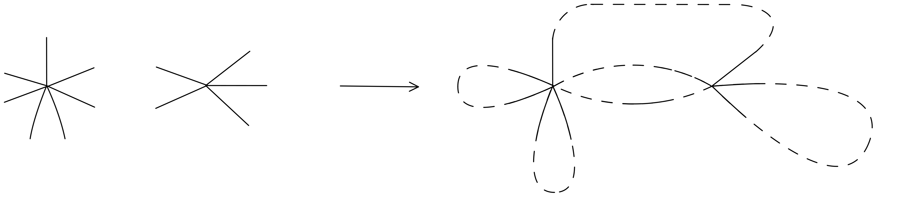
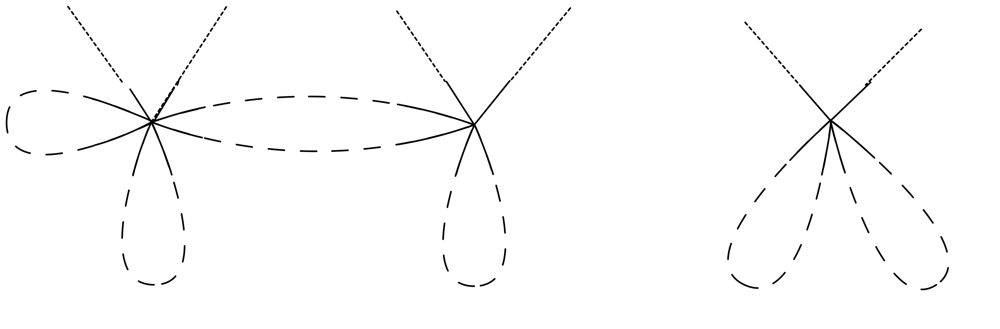
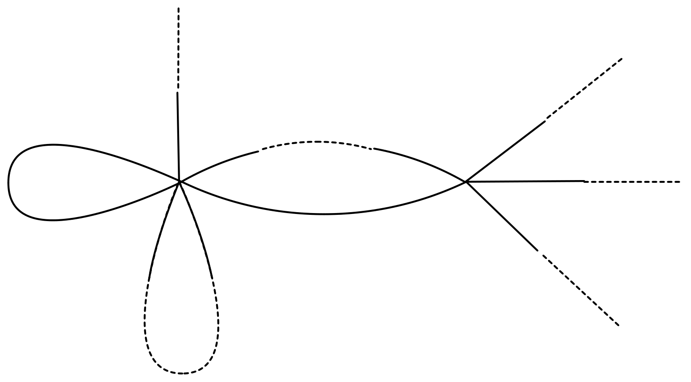
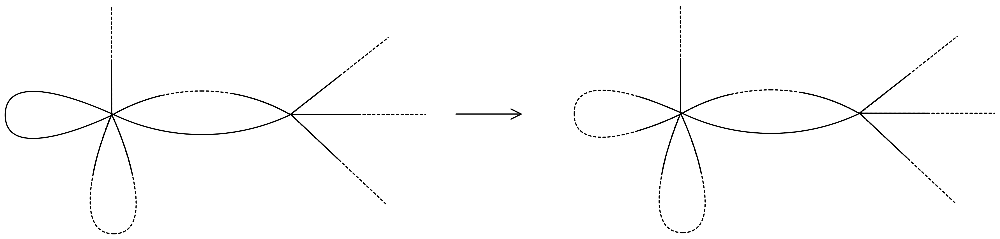

\begin{center}
\vspace*{0.28\textheight}
{\Large\bfseries 第 1 部分}

\vspace{0.8em}
{\Huge 阿贝尔对偶}

\vspace{1.2em}
{\large Part 1 · Abelian Duality}
\end{center}

\addcontentsline{toc}{section}{第 1 部分　阿贝尔对偶}

\newpage
# 第 2 章　引言与动机

<!-- p.057 -->

本部分的目的，是在一个非常简单的情形里细致地讲述 S-对偶这一现象——把它看成自由量子场论族之间的对偶，而且采取一种能让人显式地理解并计算对偶局部结构的讲法。

在这些广义 Maxwell 理论的语境里，阿贝尔对偶指的是 $n$-流形 $X$ 上广义 Maxwell 理论的如下现象：

**定理 2.0.1**　对次数为 $k$、规范群为 $T$ 的广义 Maxwell 理论中每个规范不变的可观测量 $O$，我们都能造出次数为 $n-k$、规范群为 $T^\vee$ 的理论中一个规范不变的对偶可观测量 $\widetilde{O}$，使两者的真空期望值相等：
$$
\langle O\rangle_{R,T}=\big\langle \widetilde{O}\big\rangle_{\frac{1}{2R},T^\vee}.
$$

我们并不要求 $X$ 紧致，所以阿贝尔对偶对局部可观测量同样有意义。正因如此，我们把阿贝尔对偶描述成一对因子化代数（factorization algebra）之间的关系，这两个因子化代数分别是两个量子场论中局部量子可观测量的模型。该对偶与因子化代数里的结构映射相容，却不延拓成因子化代数之间的态射——在非可缩开集上定义对偶可观测量有障碍：在那种开集上，可观测量未必完全由场的曲率决定。于是，对偶以因子化代数之间的一个**对应**（correspondence）的形式出现。

尽管这些理论是自由的，可观测量的对偶仍是一个值得研究的非平凡现象。一个规范不变可观测量，它的对偶在性质上可能与原可观测量截然不同。例如，在阿贝尔 Yang–Mills 理论中我们会验证：阿贝尔 Wilson 算子（即绕一个圈的和乐算子）的对偶<!-- p.058 -->是一个 't Hooft 算子（对应于对绕圈处的场施加一个奇异性条件）。

# 第 3 章　自由场论的 BV 形式

## 3.1　BV 形式的思想

<!-- p.059 -->

Batalin–Vilkovisky 形式（下文简称 BV 形式）为经典场论中运动方程的解空间——也就是模空间——提供了一种描述，而这种描述特别适合量子化。一旦按 BV 的处方去做量子化，我们就会看到：在自由理论的情形里，可观测量的期望值那种费曼路径积分式的描述会自然而然地掉出来。这一量子化程序可以延拓到有相互作用的理论，细节见 [Cos11b] 与 [CG15]。

我们先粗略地描述经典 BV 形式，并说明它的动机。在最简单的形式下，一个经典场论由两部分组成：一个场空间 $\Phi$（它常常是某个流形 $X$ 上某个层的整体截面，这个 $X$ 我们称为时空），以及一个映射 $S\colon\Phi\to\mathbb{R}$，即作用量泛函。这个经典系统里的物理态，应当是使作用量取极值的那些态，也就是 $S$ 的**临界轨迹**（critical locus）：$\Phi$ 中满足 $dS=0$ 的点的集合。这个集合可以写成一个交，具体说来是
$$
\operatorname{Crit}(S)=\Gamma_{dS}\cap X,
$$
其中 $\Gamma_{dS}$ 是 $dS$ 在余切丛 $T^*X$ 中的图像，$X$ 指零截面。经典 BV 形式给出的是 $S$ 的**导出临界轨迹**（derived critical locus）上函数的一个模型：也就是说，我们并不止于取这个交在空间范畴中给出的拉回，而是在空间的某个同伦范畴中取导出拉回，再考虑它的函数环。

> **译注**：经典 BV 复形 $\bigl(\wedge^\bullet\Gamma(TX),\iota_{dS}\bigr)$ 正是 $S$ 的导出临界轨迹：负次数部分给出临界轨迹的 Koszul–Tate 消解，正次数部分给出规范对称性的 Chevalley–Eilenberg 复形。（nLab: [[Batalin-Vilkovisky formalism]]）

我们可以把导出临界轨迹上的函数环显式地写成一个导出张量积，办法是把 $\mathcal{O}(\Gamma_{dS})$ 作为 $\mathcal{O}(T^*X)$-模来消解。我们取 Koszul 分解。

<!-- p.060 -->

具体说来，它写成
$$
\mathcal{O}(\Gamma_{dS})\ \simeq\ \Big(\cdots\longrightarrow
\mathcal{O}(T^*X)\otimes_{\mathcal{O}(X)}\wedge^2 T_X
\longrightarrow
\mathcal{O}(T^*X)\otimes_{\mathcal{O}(X)} T_X
\longrightarrow
\mathcal{O}(T^*X)\Big),
$$
其中 $T_X$ 记向量场构成的模；微分是从映射 $\mathcal{O}(T^*X)\otimes_{\mathcal{O}(X)}T_X\to\mathcal{O}(T^*X)$（$f\otimes v\mapsto fv-f\iota_{dS}(v)$）出发，作为关于楔积的导子延拓出来的。把这个复形与 $\mathcal{O}(X)$ 作张量积，我们就得到 $X$ 上**多重向量场**的复形 $\mathrm{PV}(X)$：也就是把向量场环的外幂放在非正次数上，微分取从向量场到函数的 $-\iota_{dS}$，并把它作为楔积的导子延拓成整个复形上的微分。导出临界轨迹上函数的这个模型，就是拉格朗日场论中**经典可观测量**代数的 BV 模型。

下面我们用一个玩具例子来说明**量子** BV 形式的动机。设 $\Phi$ 是有限维向量空间，$S$ 是这个向量空间上的一个二次型。在这个玩具例子里，量子场论（在欧氏号差下）归结为计算高斯积分
$$
\langle \mathcal{O}\rangle
=\frac{\int_\Phi \mathcal{O}(\varphi)\,e^{-S(\varphi)/\hbar}\,d\varphi}
{\int_\Phi e^{-S(\varphi)/\hbar}\,d\varphi}
=\frac{1}{Z}\int_\Phi \mathcal{O}(\varphi)\,e^{-S(\varphi)/\hbar}\,d\varphi,
$$
其中 $\mathcal{O}$ 是 $\Phi$ 上的多项式函数（$Z$ 记归一化因子 $\int e^{-S(\varphi)/\hbar}d\varphi$）。这里 $\hbar$ 是正实数，$d\varphi$ 是 $\Phi$ 上的一个体积形式。等价地，我们可以把这件事看成是在一个**扭化 de Rham 复形**里计算一个最高次元素 $\mathcal{O}\,d\varphi$ 的上同调类：该复形由多项式微分形式 $\Omega^*_{\mathrm{poly}}(\Phi)$ 配上微分 $d-\frac{1}{\hbar}(\wedge dS)$ 构成。最后，与最高次形式 $d\varphi$ 作缩并，给出分次向量空间的一个同构 $\mathrm{PV}(\Phi)[-\dim\Phi]\to\Omega^*(\Phi)$；只要给多重向量场空间配上微分 $D-\frac{1}{\hbar}\iota_{dS}$，它就成为一个复形的同构，其中 $D$ 是 BV 算子，由沿映射 $\iota_{d\varphi}$ 移送外微分得到。具体地，设 $x_1,\dots,x_n$ 构成 $\Phi$ 的一组基，$\partial_1,\dots,\partial_n$ 是 $T_0\Phi$ 上对应的基，<!-- p.061 -->并设 $d\varphi=dx_1\wedge\cdots\wedge dx_n$，则
$$
D=\sum_{i=1}^{n}\frac{\partial}{\partial x_i}\frac{\partial}{\partial(\partial_i)}.
$$

若 $\Phi$ 是无穷维的，那么原来的高斯积分（虽然原则上可以作为一个适当的极限算出来）、以及扭化 de Rham 复形中的「最高次」形式，就都不再有直接的意义了。但是，次数 $\le 0$ 的复形 $\mathrm{PV}(\Phi)$ 配上微分 $D-\frac{1}{\hbar}\iota_{dS}$ 仍然有意义，我们仍然可以计算一个零次元素的上同调类，从而直接定义它的期望值。更进一步，如果改而考虑同构的、微分为 $\hbar D-\iota_{dS}$ 的复形，那么在 $\hbar\to0$ 的「经典」极限下，我们就重新得到经典可观测量代数的 BV 描述。于是这就显式地给出了该代数的一个量子化。这个量子化不再是微分分次代数：Leibniz 律会收到一个正比于 $\hbar$ 的修正项，它来自经典 Poisson 括号。

因此，一般的 BV 形式按上述纲要，为自由拉格朗日场论（即作用量为二次型的理论）提供了经典与量子可观测量的模型。经典可观测量被构造成配以微分 $\iota_{dS}$ 的多重向量场代数；量子化则靠用一个类似于上面的 BV 算子去形变这个微分而得到。造这个算子的办法是：近似地辨认出场的（移位）余切丛上的 Darboux 坐标，再用一个类似上式的公式来定义算子。描述这件事更省事的办法，是利用移位余切丛上函数之间的 Poisson 括号（即所谓**反括号**），再按次数用归纳公式把它延拓成 BV 算子。

## 3.2　由上链复形得到的导出空间

在流形 $X$ 上定义经典场论时，究竟该用什么样的对象来定义拉格朗日场论在 $X$ 上的「场层」，并不完全清楚。我们可以<!-- p.062 -->从向量空间的上链复形出发造一个经典场论（这是 Costello 与 Gwilliam 采用的进路 [CG15]），但这样做就排除了对许多有意思的非线性例子（例如 sigma 模型）最自然的处理方式。它也不允许场空间里出现离散数据，比如 Yang–Mills 理论中场的 $G$-丛的选取。Witten 关于阿贝尔对偶的工作 [Wit95a] 表明：这一离散不变量对于对偶现象的存在是必要的——只有在把所有拓扑扇区都求和之后，才能在阿贝尔规范理论的配分函数里看到 theta 函数。

我们要采用的是下面这个经典拉格朗日场论的定义。它虽然不是可能的最一般定义，却允许场里含有离散的、非线性的部分，足以涵盖我们将要考虑的自由理论。

**定义 3.2.1**　流形 $X$ 上的一个经典拉格朗日场论由以下数据组成：$X$ 上一个单纯阿贝尔代数群的层 $\Phi$（即**场**），以及一个单纯概形层之间的态射
$$
L\colon\Phi\longrightarrow \mathrm{Dens}
$$
（即**作用量泛函**），其中 $\mathrm{Dens}$ 表示 $X$ 上的密度层，看作阿贝尔群层。

若 $X$ 紧致，我们就可以对整体密度作积分。由此得到的映射 $S\colon\Phi(X)\to\mathbb{R}$ 称为作用量泛函。同样地，我们可以对 $\Phi$ 的紧支局部截面作积分，从而定义一个局部作用量泛函。下一章我将说明如何由这些数据造出经典可观测量的因子化空间；但在此之前，先说明由更朴素的资料造出这样一个单纯阿贝尔群的若干途径。

> **译注**：原书此处说「下一章」，但经典可观测量的因子化空间其实是在本章 3.3 节构造的，译文照字面保留。另外，同一句所称的「因子化空间」，3.3 节实际定义的是「因子化代数」（定义 3.3.5）。

**注 3.2.2**　注意，定义 3.2.1 把流形的世界与概形的世界混在了一起，而这两类几何扮演的角色很不相同。对别的应用来说，我们其实可以放宽 $X$ 是光滑流形这个条件，改而允许它是任意一个位点（site）。相反，「开集 $U$ 上的局部截面 $\Phi(U)$ 构成一个（单纯）概形」这个条件将是本质性的。

<!-- p.063 -->

**注 3.2.3**　值得一提的是，我们也可以允许 $\Phi$ 是单纯阿贝尔**超**代数群的层，从而定义一个含费米子的理论。本论文的例子不需要这样的普遍性。

现在假定 $\Phi$ 不再是单纯代数群的层，而是位点
$$
\mathrm{Open}(X)\times \mathrm{Zar}/\mathbb{R}
$$
上的单纯阿贝尔群层，其中 $\mathrm{Zar}/\mathbb{R}$ 记 $\mathbb{R}$-代数的大 Zariski 位点（等价地说，$\Phi$ 是 $X$ 上的一个层，取值于单纯阿贝尔群的层构成的范畴）。此时可以用下述程序造出 $X$ 上一个单纯代数群的层 $\widetilde{\Phi}$：固定开集 $U\subseteq X$，考虑从概形到 $\Phi(U)$ 的一切单纯层映射，并在单纯概形范畴中取这个图表的同伦余极限。把结果记作 $\widetilde{\Phi}(U)$，就容易看出：让 $U$ 变动，便得到 $X$ 上所需的单纯阿贝尔代数群层。我们也可以把同样的构造放在 $\mathbb{C}$ 上而不是 $\mathbb{R}$ 上做（或者放在更一般的域上）；事实上我们所考虑的例子中有许多都是复值理论。

**例 3.2.4**　设 $V$ 是 $X$ 上取值于非正次数、由向量空间的上链复形构成的层。应用 Dold–Kan 对应，我们可以把它看成单纯向量空间的层 $\mathrm{DK}(V)$。在乘积位点 $\mathrm{Open}(X)\times\mathrm{Zar}/\mathbb{R}$ 上，它诱导出一个单纯向量空间层，只需置
$$
\Phi(U,R)=\mathrm{DK}\big(V(U)\otimes_{\mathbb{R}} R\big).
$$
我们注意到：固定 $U$ 之后，这个层已经可以由 dg-概形 $\operatorname{Spec}(\operatorname{Sym}(V^\vee))$ 表示，不必再取一次同伦余极限。也就是说，在所有映入 $\Phi$ 的 dg-概形上取的同伦余极限是平凡的。

**例 3.2.5（Yang–Mills 理论）**　设 $G$ 是紧连通李群。在 $\mathrm{Open}(X)\times\mathrm{Zar}/\mathbb{R}$ 上定义一个单纯群的层 $\Phi$，用来建模主 $G$-丛上联络的模叠：
<!-- p.064 -->
$$
\Phi(U,R)=\bigoplus_{P}\Big(\Omega^0(U;\mathfrak{g}_P)\otimes_{\mathbb{R}}R[1]\longrightarrow \Omega^1(U;\mathfrak{g}_P)\otimes_{\mathbb{R}}R\Big),
$$
其中求和遍历主 $G$-丛 $P\to X$ 的同构类。由 Dold–Kan 对应，对每个 $U$ 这给出一个单纯层，取同伦余极限后便得到一个单纯概形。这个单纯概形随后给出主 $G$-丛上联络的模叠的一个模型，并使我们能够定义经典 Yang–Mills 理论。当 $G$ 是阿贝尔群时，我们将推广这一构造。

**例 3.2.6（高次 Maxwell 理论）**　本论文的主要研究对象是一族理论，它们推广了规范群为 $U(1)$ 的 Yang–Mills 理论；我们按 [Fre00] 中用普通微分上链给出的广义 Maxwell 理论描述来处理它们。这类理论中的场应当描述「带联络的圆 $(p-1)$-丛」，其中 $p$ 是某个正整数（我们用 $p-1$ 的理由稍后就会明白：这类理论中场的「曲率」将是一个 $p$-形式）。描述这些理论的出发点是**光滑 Deligne 复形**：流形 $X$ 上的阿贝尔群上链复形层
$$
\begin{aligned}
\mathbb{Z}(p)_D(U)&=\ \Big[\ \mathbb{Z}[p]\ \longleftarrow\ \Omega^0(U)[p-1]\ \xrightarrow{d}\ \Omega^1(U)[p-2]\ \xrightarrow{d}\ \cdots\ \xrightarrow{d}\ \Omega^{p-1}(U)\Big]\\[1mm]
&\cong\ \Big[\ C^{\infty}(U,\mathbb{R}/\mathbb{Z})[p-1]\ \xrightarrow{-i\,d\log}\ \Omega^1(U)[p-2]\ \xrightarrow{d}\ \cdots\ \xrightarrow{d}\ \Omega^{p-1}(U)\Big],
\end{aligned}
$$
或它的复化版本
$$
\mathbb{Z}(p)_{D,\mathbb{C}}(U)=\Big[C^{\infty}(U,\mathbb{C}^{\times})[p-1]\xrightarrow{-i\,d\log}\Omega^1(U;\mathbb{C})[p-2]\xrightarrow{d}\cdots\xrightarrow{d}\Omega^{p-1}(U;\mathbb{C})\Big].
$$
我们可以把这个复形扩充成一个阿贝尔群上链复形层（或者由 Dold–Kan，扩充成单纯阿贝尔群层），使其 $\mathbb{C}$-点恰为复化的 Deligne 复形。具体地，对一个 $\mathbb{C}$-代数 $R$，定义上链复形
$$
C^{\infty}(U;R^{\times})[p-1]\longrightarrow\big(\Omega^1(U;\mathbb{C})\otimes_{\mathbb{C}}R\big)[p-2]\longrightarrow\cdots\longrightarrow \Omega^{p-1}(U;\mathbb{C})\otimes_{\mathbb{C}}R,
$$
<!-- p.065 -->其中第一个映射由 $-i\,d\log$ 给出，后面那些映射则简单地是第一个变量上的 de Rham 微分。上述余极限程序在 $U$ 上造出一个单纯代数群的层。

我们可以把这些复化的场想成带联络的高次主 $\mathbb{C}^{\times}$ 丛，或者想成带联络的高次复线丛。

## 3.3　作用量泛函与经典因子化空间

一旦有了场层 $\Phi$，我们就可以施行经典 BV 程序，为作用量的导出临界轨迹造一个便于量子化的模型。第一步是把移位余切丛 $T^*[-1]\Phi$ 描述成一个导出叠；或者——为避免从导出代数几何中引入太多形式化的东西——把函数代数 $\mathcal{O}(T^*[-1]\Phi)$ 描述成一个上链复形。固定开集 $U\subseteq X$，局部场 $\Phi=\Phi(U)$ 构成一个单纯阿贝尔代数群，因此（移位）余切丛理应可平凡化。也就是说，我们定义
$$
T^*[-1]\Phi\ \simeq\ T^*_0\Phi[-1]\times\Phi,
$$
于是
$$
\mathcal{O}(T^*[-1]\Phi)\ \simeq\ \mathcal{O}(T^*_0\Phi[-1])\otimes\mathcal{O}(\Phi),
$$
其中第一行只是启发式的（不过借助导出代数几何的机器，应当可以把这一点严格化）。移位余切纤维上的函数容易描述，因为余切纤维是一个（dg-）向量空间。对任何 $\Phi$ 我们都可以定义
$$
\mathcal{O}(T^*_0\Phi[-1])\ \simeq\ \operatorname{Sym}\big((T_0\Phi)[1]\big),
$$
所以只需描述复形 $T_0\Phi$。例如，若 $\Phi$ 是阿贝尔簇，则有
$$
\mathcal{O}(T^*[-1]\Phi)\ \simeq\ \operatorname{Sym}\big((\Phi\otimes_{\mathbb{Z}}\mathbb{R})[1]\big)\otimes\mathcal{O}(\Phi).
$$
本论文所关心的那些例子中的 $T_0\Phi$，我们将在第 4 章描述。这个计算使环 $\mathcal{O}(T^*[-1]\Phi)$ 自然地解释为 $\Phi$ 上多重向量场的环。事实上，<!-- p.066 -->dg-向量空间 $T_0\Phi\otimes\mathcal{O}(\Phi)$ 恰好描述 $\Phi$ 上的向量场。把这个空间放在次数 $-1$，再取分次对称幂（也就是按通常的符号规则取交错幂），我们就得到 $\Phi$ 上多重向量场的代数。

**注 3.3.1**　本论文中一切涉及拓扑向量空间的代数构造，都在核 Fréchet 空间（或其上链复形）的范围内进行。例如，向量空间 $V$ 的对偶空间 $V^\vee$ 一律指配以强拓扑的连续对偶，张量积一律指完备化射影张量积。同样地，虽然我们把空间 $V$ 上的代数函数环等同于对称代数 $\operatorname{Sym}(V^\vee)$，我们的一切构造都将延拓到完备化的对称代数上。

现在引入作用量。回忆一下：除了场之外，我们的拉格朗日场论数据还包括一个从 $\Phi$ 到 $X$ 上密度层的层映射。一般来说，由此得到的局部密度无法积分，但这一「局部作用量泛函」的**第一变分**还是可以定义的。人们由此在 $\Phi$ 上定义一个紧支 1-形式 $dS$，即元素
$$
dS\in T^*_0\Phi_c\otimes\mathcal{O}(\Phi)\ \cong\ \operatorname{Hom}(T_0\Phi_c,\mathcal{O}(\Phi)),
$$
其中 $T_0\Phi_c$ 记紧支切向量：也就是说，$T_0\Phi$ 描述 $X$ 上的一个上链复形层，而我们考虑的是手头这个 $U$ 上的紧支截面。于是 $dS$ 就是把一个紧支切方向 $v$ 送到泛函
$$
\varphi\ \mapsto\ \int_U L(\mathcal{L}_v(\varphi))
$$
的那个线性映射，其中 $\mathcal{L}_v(\varphi)$ 表示 $\varphi$ 沿向量场 $v$ 的李导数。紧支条件保证了 $L(\mathcal{L}_v(\varphi))$ 是紧支密度，所以积分是良定义的。

作用量泛函 $S$ 通过修改函数上的内蕴微分，描述移位余切丛的一个修正版本。在把移位余切丛上的函数等同于多重向量场之后，1-形式 $dS$ 自然地定义一个次数为 $1$ 的线性算子，即<!-- p.067 -->内乘
$$
\iota_{dS}\colon\mathcal{O}(T^*[-1]\Phi)\longrightarrow\mathcal{O}(T^*[-1]\Phi).
$$
更明确地说，这个算子是从算子 $T_0\Phi_c\otimes\mathcal{O}(\Phi)\to\mathcal{O}(\Phi)$——即把向量场与 1-形式 $dS\in T^*_0\Phi_c\otimes\mathcal{O}(\Phi)$ 配对——作为导子延拓而来的。

**注 3.3.2**　若场 $\Phi$ 由上链复形（而不是更一般的单纯概形或 dg-概形）描述，那么我们还可以更直接地描述多重向量场的复形 $\mathcal{O}(T^*[-1]\Phi)$ 与经典微分 $\iota_{dS}$。此时整体函数构成对称代数
$$
\mathcal{O}(T^*[-1]\Phi)\ \simeq\ \operatorname{Sym}\big(\Phi^\vee\oplus\Phi[1]\big),
$$
它由 $\Phi$ 上的线性函数与线性向量场生成。稍后我们会在自由理论的一些例子里看到这一点，那里作用量由一个次数为 $1$ 的线性算子 $\Phi\to\Phi^\vee$ 编码。

上面的讨论都是在固定的开集 $U\subseteq X$ 上进行的。现在来说明不同开集上的经典可观测量之间的关系。我们按 [CG15] 中发展的因子化代数机器来刻画局部性。先回顾基本定义。

<!-- p.068 -->

**定义 3.3.3**　空间 $X$ 上、取值于具有小余极限的对称幺半范畴 $\mathcal{C}$ 的一个**预因子化代数**（prefactorization algebra）$F$，是 $X$ 上一个 $\mathcal{C}$-值预余层，并配有一族 $S_k$-等变同构
$$
F(U_1)\otimes\cdots\otimes F(U_k)\longrightarrow F(U_1\sqcup\cdots\sqcup U_k),
$$
对每一族两两不交的开集 $U_1,\dots,U_k\subseteq X$ 各给一个。

空间 $X$ 的一个开覆盖 $\{U_i\}$ 称为**因子化的**，如果对 $U$ 的每个有限子集 $\{x_i,\dots,x_\ell\}$，覆盖中都存在一族两两不交的集合 $U_{i_1},\dots,U_{i_\ell}$，使得 $\{x_i,\dots,x_\ell\}\subseteq U_{i_1}\cup\cdots\cup U_{i_\ell}$。

给定 $X$ 的一个开覆盖以及 $X$ 上的预余层 $F$，我们可以造出 $\mathcal{C}$ 中一个单纯对象，称为 $F$ 的 **Čech 复形**，定义为
$$
\check{C}(U,F)=\bigoplus_{k=1}^{\infty}\left(\bigoplus_{U_{i_1},\dots,U_{i_k}}F\big(U_{i_1}\cap\cdots\cap U_{i_k}\big)[k-1]\right),
$$
并配以通常的 Čech 映射。

一个预因子化代数称为**因子化代数**，如果对每个开集 $U\subseteq M$ 以及 $U$ 的每个因子化覆盖 $\{U_i\}$，自然映射 $\operatorname{colim}\check{C}(U,F)\to F(U)$ 都是 $\mathcal{C}$ 中的同构。

**注 3.3.4**　我们将讨论的例子全都是取值于上链复形同伦范畴的预因子化代数，因此这里的同构指的是复形之间的拟同构。

> **译注**：预因子化代数只要求两两不交的开集上有乘法，相当于因子化 operad 上的代数；因子化代数还要求沿因子化覆盖的 Čech 构造收敛到 $F(U)$，即满足余层条件。（nLab: [[factorization algebra]]）

**定义 3.3.5**　联系于经典拉格朗日理论 $(\Phi,L)$ 的**经典可观测量因子化代数**，是取值于上链复形的因子化代数 $\mathrm{Obs}^{\mathrm{cl}}_\Phi(U)$，它在 $U$ 上的截面由复形 $\mathcal{O}(T^*[-1]\Phi)$ 给出，微分为 $\mathcal{O}(\Phi)$ 上的内蕴微分 $d_\Phi$ 加上经典微分 $-\iota_{dS}$。

它确实构成因子化代数（而不只是预因子化代数），这是 [Gwi12] 中的定理 4.5.1。这来自如下事实：$\Phi$ 构成一个层，因此整体函数 $\mathcal{O}(\Phi)$ 构成一个余层。

最后，我们还需要处理经典可观测量上的 Poisson 结构。这就是 [Gwi12] 中的定义 2.1.3。

**定义 3.3.6**　一个 **P0-因子化代数**是取值于上链复形的因子化代数 $F$，使得每个 $F(U)$ 都配有一个交换乘法，以及一个次数为 $1$ 的反称映射 $\{\ ,\}\colon F(U)\otimes F(U)\to F(U)$；后者是该乘法的双导子，满足恒等式
$$
d\{x,y\}=\{dx,y\}+(-1)^{|x|}\{x,dy\},
$$
并与预因子化结构相容。

<!-- p.069 -->

我们预期经典可观测量上会有这样的结构，它来自移位余切丛上的移位辛结构；不过我们也可以回顾一个熟悉的具体描述（即多重向量场上众所周知的 Schouten 括号）。首先，有一个求值映射
$$
T_0\Phi\otimes\mathcal{O}(\Phi)\longrightarrow\mathcal{O}(\Phi),
$$
把元素 $v\otimes f$ 送到 $df(v)\in\mathcal{O}(\Phi)$（这里把切向量 $v\in T_0\Phi$ 看成 $\Phi$ 上的常向量场）。我们用它来在低次多重向量场上定义 Schouten 括号：
$$
\begin{aligned}
\{1\otimes f_1,\ 1\otimes f_2\}&=0,\\
\{v_1\otimes f_1,\ 1\otimes f_2\}&=1\otimes df_2(v_1)\cdot f_1,\\
\{v_1\otimes f_1,\ v_2\otimes f_2\}&=v_2\otimes df_2(v_1)\cdot f_1-v_1\otimes df_1(v_2)\cdot f_2.
\end{aligned}
$$
这个括号作为关于多重向量场楔积（一如既往）的双导子，唯一地延拓为整个多重向量场代数上的次数 $1$ 反称配对。

## 3.4　自由因子化代数的量子化

从现在起，我们把注意力限制在自由场论上——对这类理论，我们可以使用 3.1 节所描述的那种直观的、非微扰的 BV 量子化概念。非正式地说，一个经典拉格朗日场论是**自由**的，如果其作用量泛函是二次型，从而作用量泛函的导数是线性的。

**定义 3.4.1**　一个经典拉格朗日场论称为**自由**的，如果经典微分 $\iota_{dS}$ 把多项式次数升高一。也就是说，若我们按多项式次数过滤 $\mathcal{O}(\Phi)$，并把第 $k$ 个过滤分片记作 $F^k\mathcal{O}(\Phi)$，则算子 $\iota_{dS}$ 把次数升高一：
$$
\iota_{dS}\colon \operatorname{Sym}^{i}(T_0\Phi[1])\otimes F^{j}\mathcal{O}(\Phi)\longrightarrow \operatorname{Sym}^{i-1}(T_0\Phi[1])\otimes F^{j+1}\mathcal{O}(\Phi).
$$

<!-- p.070 -->

现在，设 $(\Phi,L)$ 是一个自由经典理论，而 $\mathrm{Obs}^{\mathrm{cl}}(\Phi(U))$ 是开集 $U$ 上经典可观测量的复形。我们将通过在这个复形的微分上添一项来量子化局部可观测量：这一项就是 **BV 算子**，我们记作 $D$。这个算子由经典可观测量上的 P0-代数结构造出，办法遵循 [Gwi12] 中所述自由理论的形变量子化方法。

定义 BV 算子 $D\colon\mathcal{O}(T^*[-1]\Phi(U))\to\mathcal{O}(T^*[-1]\Phi(U))$，作法是延拓一个由 Poisson 括号构造的算子。令 $D$ 在 $\mathcal{O}(\Phi(U))$ 上为零，并在次数 $1$ 处由 Poisson 括号给出：$D=\{\ ,\}\colon T_0\Phi(U)\otimes\mathcal{O}(\Phi(U))\to\mathcal{O}(\Phi(U))$，也就是上面描述为「求值」的那个映射。然后按公式
$$
D(\varphi\cdot\psi)=D(\varphi)\cdot\psi+(-1)^{|\varphi|}\varphi\cdot D(\psi)+\{\varphi,\psi\}
$$
把它延拓为整个经典可观测量复形上的算子。

一个配有微分 $D$ 与 Poisson 括号 $\{\ ,\}$、并满足这类公式的代数，称为 **Beilinson–Drinfeld 代数**，或 **BD 代数**：Beilinson 与 Drinfeld 在 [BD04] 中构造了形式圆盘上的一族运算子（operad），它在原点的纤维恰为 P0 运算子。这里给出的 BD 代数结构，描述的是与那一族类似、但定义在整个 $\mathbb{C}$ 上（而不只是原点的形式邻域上）的那一族运算子的一个一般纤维上的代数。

**例 3.4.2**　若 $\Phi$ 是一个向量空间复形，从而经典可观测量由 $\operatorname{Sym}(\Phi[1]\oplus\Phi^\vee)$ 给出，那么我们可以更直接地构造 BV 算子。限制在 $\operatorname{Sym}^{\le 2}$ 上的 Poisson 括号，由求值映射 $\Phi\otimes\Phi^\vee\to\mathbb{C}$（从 $\operatorname{Sym}^2$ 到 $\operatorname{Sym}^0$）给出，在别处为零。它如上述 BD 结构那样，唯一地延拓为整个经典可观测量复形上一次数为 $1$、把 $\operatorname{Sym}$ 次数降低 $2$ 的算子。

配备了这个算子之后，我们现在可以定义量子可观测量了。

<!-- p.071 -->

**定义 3.4.3**　自由理论 $(\Phi,L)$ 的**量子可观测量因子化代数**，是这样一个因子化代数：它在 $U$ 上的局部截面由上链复形
$$
\mathrm{Obs}^{\mathrm{q}}(U)=\big(\mathcal{O}(T^*[-1]\Phi(U)),\ d_\Phi-\iota_{dS}+D\big)
$$
给出，其中 $d_\Phi$ 是来自 $\Phi$ 上内蕴微分的微分，$\iota_{dS}$ 是经典 BV 微分，$D$ 是上面定义的量子 BV 微分。

这一程序确实定义了一个因子化代数，这在 [Gwi12] 中有证明。

**注 3.4.4**　更标准的写法会考虑微分 $d_\Phi-\iota_{dS}+\hbar D$，并让 BV 算子 $D$ 由如下形式的公式定义：
$$
D(\varphi\cdot\psi)=D(\varphi)\cdot\psi+(-1)^{|\varphi|}\varphi\cdot D(\psi)+\hbar\{\varphi,\psi\},
$$
其中我们把一个形式参数 $\hbar$ 添进了经典可观测量代数。这样我们就会得到一个在 $\mathbb{R}[[\hbar]]$ 上平坦的模，令 $\hbar=0$ 便回到经典可观测量。我没有这样做，因为在只处理自由理论时，我们可以完全非微扰地工作，即在 $\hbar$ 的非零取值处作计算。我所研究的对偶现象只在非微扰意义下（把一切拓扑扇区都考虑进来）才可见，所以这样做是必要的；但代价是，我们失去了考虑任何非自由理论之量子可观测量的能力。

## 3.5　抹平可观测量

> **译注**：原书本节标题作「Smearing Observables」，正文亦作 smeared（或 smooth）observables；「抹平」沿用全书统一译名（术语表以 shearing 立目，英文原词实为 smearing）。按原意，这是把取值于分布的场与光滑的紧支检验截面作配对，即把可观测量「涂抹」开，使之成为性质良好的光滑对象；若单看英文，译作「涂抹可观测量」亦通。

为在第 5 章描述期望值，我们需要在经典可观测量中找出一稠密的子因子化代数，使其元素性质良好。为此我们限制到一个特殊情形：场上的函数代数 $\mathcal{O}(\Phi(U))$ 是某个向量空间上链复形上的自由交换 dg 代数。这包括例如 $\Phi(U)$ 由向量空间复形建模的例子，或者由向量空间复形与一个紧阿贝尔<!-- p.072 -->簇的乘积建模的例子。于是我们可以写
$$
\mathcal{O}(\Phi(U))=\operatorname{Sym}(V)
$$
对某个复形 $V$ 成立，从而
$$
\mathcal{O}(T^*[-1]\Phi(U))=\operatorname{Sym}\big(T_0\Phi(U)[1]\oplus V\big).
$$
注意实际上 $V\le T^*_0\Phi$。确实，$\operatorname{Sym}(T^*_0\Phi)=\mathcal{O}(T_0\Phi)$，而它接受一个来自 $\mathcal{O}(\Phi)$ 的单射（取整体代数函数的 $\infty$-jet）。

现在进一步假定理论是自由的。那么作为这个对称代数上的算子，经典微分 $\iota_{dS}$ 关于 $\operatorname{Sym}$ 次数不增。通过配方（差一个常数因子），可以把它变成保持 $\operatorname{Sym}$ 次数的算子，因此它可以描述为其线性部分的延拓——我们把线性部分记作
$$
Q\colon T_0\Phi(U)\to V,
$$
并按导子延拓到整个复形。于是经典可观测量本身就由某个复形上的自由交换 dg 代数给出，即复形 $T_0\Phi(U)[1]\xrightarrow{Q}V$。我们来分析这个复形。

**例 3.5.1**　若 $\Phi(U)$ 是（次数 $\le 0$ 的）向量空间上链复形，则经典可观测量的复形是上链复形
$$
\Phi(U)[1]\xrightarrow{\ Q\ }\Phi(U)^\vee
$$
上的自由代数。

**抹平的**（smeared）或**光滑的**经典可观测量构成 $\mathrm{Obs}^{\mathrm{cl}}(U)$ 的一个稠密子代数，其定义用到场上一个不变配对的数据。也就是说，我们要求一个上同调次数为 $-1$ 的反称层映射
$$
\langle-,-\rangle\colon\Phi\otimes\Phi\longrightarrow\mathrm{Dens},
$$
它在茎上是非退化配对。这个配对通过在 $U$ 上积分，定义一个非退化配对 $\Phi_c(U)\otimes\Phi_c(U)\to\mathbb{C}$，从而给出一个嵌入 $T_0\Phi(U)_c\hookrightarrow T^*_0\Phi(U)$：<!-- p.073 -->把一个紧支向量场送到泛函「与该向量场配对」。由于自然地有 $V\subseteq T^*_0\Phi(U)$，我们可以把 $V^{\mathrm{sm}}$ 定义为交 $V\cap T_0\Phi(U)_c\le T^*_0\Phi(U)$（更精确地说，是在向量空间上链复形范畴中取拉回）。

**定义 3.5.2**　开集 $U$ 上的**经典抹平可观测量**（或光滑可观测量）定义为自由交换 dg 代数
$$
\mathrm{Obs}^{\mathrm{sm},\mathrm{cl}}_{\Phi}(U)=\operatorname{Sym}\Big(T_0\Phi_c(U)[1]\xrightarrow{\ Q\ }V^{\mathrm{sm}}\Big).
$$

若对每个开集 $U\subseteq X$，$\mathcal{O}(\Phi(U))$ 都是自由交换 dg 代数，则光滑可观测量构成 $\mathrm{Obs}^{\mathrm{cl}}_\Phi$ 的一个子因子化代数，且在每个次数上都稠密。

**注 3.5.3**　再考虑 $\Phi(U)$ 是向量空间上链复形的情形。此时光滑可观测量通过由配对诱导的复形包含
$$
\Big(\Phi(U)_c[1]\xrightarrow{Q}\Phi(U)\Big)\ \hookrightarrow\ \Big(\Phi_c(U)[1]\xrightarrow{Q}\Phi(U)^\vee\Big)
$$
映入全部经典可观测量之中。

**定义 3.5.4**　一个配了不变配对的自由经典场论称为**椭圆的**（elliptic），如果对每个 $U$，$\mathrm{Obs}^{\mathrm{cl}}(U)$ 都是自由交换 dg 代数，且由此得到的线性抹平可观测量的复形
$$
E(X)=T_0\Phi_c(X)[1]\xrightarrow{\ Q\ }V^{\mathrm{sm}}
$$
在整个流形 $X$ 上是椭圆复形（elliptic complex）。

这是一个相当轻微的假设，在紧可定向流形上，大多数现实的自由物理理论都满足它（而且该理论还可以延拓去描述有相互作用理论中的经典可观测量，见 [CG15] 与 [Cos11a]）。我们给出一些自由的例子（它们全都有 Costello 与 Gwilliam 所描述的有相互作用的延拓）。

**例 3.5.5**

（1）**标量场论**　设 $\Phi(U)=C^{\infty}(U)$，即紧流形上光滑函数的层；并设 $L$ 是<!-- p.074 -->质量为 $m$ 的自由标量场的拉格朗日密度，即
$$
L(\varphi)=d\varphi\wedge *d\varphi-m^2\varphi\wedge *\varphi.
$$
该理论中的抹平经典可观测量由椭圆复形
$$
C^{\infty}(X)[1]\xrightarrow{\ Q\ }C^{\infty}(X),\qquad Q=\Delta-m^2
$$
生成。

（2）**阿贝尔 Chern–Simons 理论**　设 $T$ 是环面，$P\to X^3$ 是紧 3-流形上的主 $T$-丛，并设 $\Phi(U)$ 是描述 $P$ 上联络的层（其中我们通过选取一个固定的参考联络来平凡化这个 torsor）。这个固定丛上的 Chern–Simons 理论由复形 $\Omega^*(U;\mathfrak{t})$ 描述，其中 $\mathfrak{t}$ 是 $T$ 的（阿贝尔）李代数。若在复流形上取 Dolbeault 复形以代替 de Rham 复形，描述的则是**全纯** Chern–Simons 理论（而且，在这种语言里，在任何维数中把 Chern–Simons 理论定义为「经典可观测量代数由这个复形造出的理论」都是讲得通的）。

（3）**阿贝尔 Yang–Mills 理论**　设 $T$ 是环面，$P\to X^4$ 是紧黎曼 4-流形上的主 $T$-丛，并设 $\Phi(U)$ 如上描述 $P$ 上的联络。这个固定丛上的 Yang–Mills 理论，由描述 $P$ 上反自对偶联络的 Atiyah–Singer–Donaldson 复形的移位余切描述，即复形
$$
\Omega^0(U;\mathfrak{t})\xrightarrow{\ d\ }\Omega^1(U;\mathfrak{t})\xrightarrow{\ d_+}\Omega^2_+(U;\mathfrak{t}),
\qquad
\Omega^2_+(U;\mathfrak{t})\xrightarrow{\ d\ }\Omega^3(U;\mathfrak{t})\xrightarrow{\ d\ }\Omega^4(U;\mathfrak{t}),
$$
次数从 $-1$ 到 $2$。这里 $\Omega^2_+(U;\mathfrak{t})$ 表示自对偶 2-形式的空间，而 $d_+$ 是 $d$ 与到该空间投影的复合。

> **译注**：原书把这个复形排成两行：上行为 $\Omega^0\xrightarrow{d}\Omega^1\xrightarrow{d_+}\Omega^2_+$，下行为 $\Omega^2_+\xrightarrow{d}\Omega^3\xrightarrow{d}\Omega^4$，并用一支标以 $1$ 的箭头把两行里的两个 $\Omega^2_+$ 连起来，表示它们是同一个项；译文按此结构把五项串成一个行间公式，两段之间以逗号与空白隔开。又，原书说该复形「位于次数 $-1$ 到 $2$」，但按其列出的五项，末项 $\Omega^4$ 应落在次数 $3$，此处疑原文有误，译文照录，识之以备考。

我们很快就会看到 $p$-形式理论中同样适合这个框架的例子。

<!-- p.075 -->

**定义 3.5.6**　开集 $U$ 上的**量子抹平可观测量**由这样一个上链复形给出：它底层的分次阿贝尔群与经典抹平可观测量相同，但微分为 $\operatorname{Sym}(Q)+D$，其中 $D$ 是抹平 BV 算子：它由被限制到 $E(U)$ 上的不变配对给出算子 $\operatorname{Sym}^2(E(U))\to\operatorname{Sym}^0(E(U))$，再按 BD 乘积公式
$$
D(\varphi\cdot\psi)=D(\varphi)\cdot\psi+(-1)^{|\varphi|}\varphi\cdot D(\psi)+\{\varphi,\psi\}
$$
延拓到整个复形上。

量子抹平可观测量作为子复形嵌入全部量子可观测量的复形，且在每个次数上都稠密。要看出这一点，只需验证量子 BV 算子与这个包含映射交换，而这直接由定义可得。

# 第 4 章　作为因子化代数的广义 Maxwell 理论

<!-- p.076 -->

一般的形式体系既已交代完毕，接下来我说明我们将要研究的具体理论：广义 Maxwell 理论。这一族理论包含两个最简单的例子：以环面为目标的 sigma 模型，以及阿贝尔纯 Yang–Mills 理论。

## 4.1　广义 Maxwell 理论

### 4.1.1　经典因子化代数

上一章例 3.2.6 中，我们已经讨论过广义 Maxwell 理论里的场：由一个通常的微分上同调复形 $\mathbb{Z}(p)_D$ 出发，我们造出了单纯阿贝尔代数群的层 $\Phi_p$。它们就是我们感兴趣的那些理论中的场。紧流形上的作用量，则定义为场的曲率的 $L^2$-范数。

**定义 4.1.1**　**曲率映射**是单纯代数群层之间的映射 $F\colon\Phi_p\to\Omega^p_{\mathrm{cl}}$，它由外微分（看作上链复形层之间的映射 $\mathbb{Z}(p)_D\to\Omega^p_{\mathrm{cl}}$）借同伦余极限的泛性质诱导而来。

有了这个，我们把局部场 $\varphi\in\Phi_p(U)$ 的拉格朗日密度定义为
$$
L(\varphi)=R^2F(\varphi)\wedge *F(\varphi),
$$
其中 $R$ 是正实数，这里用的是 $U$ 上的黎曼度量。若该密度可积，所得积分正是 $F(\varphi)$ 的 $L^2$-范数。我们把这里的数 $R$ 称为**耦合常数**，并把它看成（复化之前的）规范群圆周的半径。我们本来也可以通过重新定义场来得到这个标度：在 Deligne 复形里，本可以把格 $2\pi R\mathbb{Z}$ 而非 $\mathbb{Z}$ 包含进去，这样在上同调中就会得到半径为 $R$ 的圆周。

> **译注**：原文说「所得积分正是 $F(\varphi)$ 的 $L^2$-范数」。按上面给出的 $L(\varphi)$，该积分实为 $R^2\|F(\varphi)\|^2$，作者略去了 $R^2$ 因子；译文照录，读者按公式理解即可。

<!-- p.077 -->

**注 4.1.2**　我们可以把这个设定从圆周（在复化的版本里则是 $\mathbb{C}^\times$）推广到更高秩的环面 $T\cong V/L$，其中 $L$ 是实赋范向量空间 $V$ 中的满秩格。令 $V_{\mathbb{C}}=V\otimes_{\mathbb{R}}\mathbb{C}$；$V_{\mathbb{C}}$ 与 $T_{\mathbb{C}}$ 分别是 $V$ 与 $T$ 的复化。上面所述理论中的场可以立刻推广：取映入 $T_{\mathbb{C}}$ 的代数映射，并取以 $V_{\mathbb{C}}$ 为值的代数 de Rham 复形。此时有一个取值于 $\Omega^p_{\mathrm{cl}}\otimes V_{\mathbb{C}}$ 的曲率映射，而我们把拉格朗日密度泛函定义为
$$
L(\varphi)=\|F(\varphi)\wedge *F(\varphi)\|^2,
$$
其中 $\|-\|$ 是 $V_{\mathbb{C}}$ 上的范数。

在这个描述里，耦合常数来自格 $L\le V$ 的选取：例如取 $2\pi R\mathbb{Z}\le\mathbb{R}$，就得到上面那个耦合常数为 $R$ 的理论。

上一章的构造由上述数据给出经典可观测量的因子化代数。局部截面我可以描述得相当具体。我们从多重向量场的代数出发：
$$
\mathrm{PV}\big(\Phi_p(U)\big)=\operatorname{Sym}\big(T_0\Phi_p(U)\big)\otimes\mathcal{O}\big(\Phi_p(U)\big).
$$

> **译注**：按后文 p.082 中出现的 $\operatorname{Sym}(T_0\Phi_c(U)[1])\otimes\mathcal{O}(\Phi(U))$，以及 BV 形式的惯例，$T_0$ 上应带有平移 $[1]$。此处抽取文本中未见 $[1]$，故照录旧式，存疑待核。

我们逐项来看。Deligne 复形 $\Phi_p(U)$ 上的函数是以抽象的同伦余极限给出的，因此不容易直接描述。不过切纤维 $T_0\Phi_p(U)$ 要容易接近得多，因为它来自一个真正的向量空间复形。我们算得
$$
T_0\Phi_p(U)=\Omega^0(U;\mathbb{C})[p-1]\to\Omega^1(U;\mathbb{C})[p-2]\to\cdots\to\Omega^{p-1}(U;\mathbb{C}),
$$
即移位的截断 de Rham 复形；更确切地说，是如例 3.2.4 中那样与之相伴的单纯代数群。Poincaré 引理告诉我们：作为上链复形层，它经由外微分拟同构于闭 $p$-形式层。

<!-- p.078 -->

现在来描述来自作用量泛函（或它的第一变分 $dS$）的经典微分。这是一个算子 $T_0\Phi_p(U)_c\to\mathcal{O}(\Phi_p(U))$；用上面的描述来说，就是一个在恰当形式上取值为零的算子 $\Omega^{p-1}_c(U;\mathbb{C})\to\mathcal{O}(\Phi_p(U))$（也就是说，从移位截断 de Rham 复形出发的一个上链映射）。我们借曲率映射 $F\colon\Phi_p(U)\to\Omega^p_{\mathrm{cl}}(U)$ 来定义这样的算子。它诱导拉回映射 $F^*\colon\mathcal{O}(\Omega^p_{\mathrm{cl}}(U))\to\mathcal{O}(\Phi_p(U))$。与曲率映射复合之后，只需把经典微分定义成下面这个映射 $\Omega^{p-1}_c(U;\mathbb{C})\to\mathcal{O}(\Omega^p_{\mathrm{cl}}(U;\mathbb{C}))\xrightarrow{F^*}\mathcal{O}(\Phi_p(U))$：
$$
\alpha\ \longmapsto\ \Big(\beta\mapsto\int_U\beta\wedge *d\alpha\Big)
\ \longmapsto\ \Big(A\mapsto\int_U F_A\wedge *d\alpha\Big)=\iota_{dS}(\alpha).
$$
这个泛函把场 $A$ 送到 $\int_U F_A\wedge *d\alpha$，显然还原出了所需作用量泛函的第一变分。

### 4.1.2　量子因子化代数

现在我们抽象地知道如何量子化这个因子化代数了，但还应当看看它在这个语境里实际意味着什么。有一个求值映射 $\Omega^{p-1}_c(U;\mathbb{C})\otimes\mathcal{O}(\Phi_p(U))\to\mathcal{O}(\Phi_p(U))$，它同样是通过曲率映射定义的。我们还会把场上的 1-形式 $\Omega^1(\Phi_p(U))$ 与拟同构的复形 $\mathcal{O}(\Phi_p(U))\otimes\Omega^p_{\mathrm{cl}}(U;\mathbb{C})^\vee$ 等同起来。求值映射由把 $\Phi_p(U)$ 上的向量场与 1-形式配对给出。我们可以分两步把它写清楚：

1. 从 $\chi\otimes f\in\Omega^{p-1}_c(U;\mathbb{C})\otimes\mathcal{O}(\Phi)$ 出发。先对 $\chi$ 与 $f$ 取外微分，得到

    $$
    d\chi\otimes df\in\Omega^p_{c,\mathrm{cl}}(U;\mathbb{C})\otimes\Omega^1(\Phi(U))\cong\Omega^p_{c,\mathrm{cl}}(U;\mathbb{C})\otimes\mathcal{O}(\Phi_p(U))\otimes\Omega^p_{\mathrm{cl}}(U;\mathbb{C})^\vee.
    $$

2. 用 $\Omega^p_{\mathrm{cl}}(U;\mathbb{C})^\vee$ 与 $\Omega^p_{c,\mathrm{cl}}(U;\mathbb{C})$ 之间的求值配对（也就是场上线性向量场与线性 1-形式之间的配对），缩并出所需的元素 $df(d\chi)\in\mathcal{O}(\Phi_p(U))$。

<!-- p.079 -->

这个求值映射随后按 BD 算子公式延拓为整个可观测量复形上的微分：这就是广义 Maxwell 理论中的量子微分。

从现在起，我写 $\mathrm{Obs}^{\mathrm{q}}(U)$ 时，特指广义 Maxwell 理论中的量子可观测量（究竟是哪一个理论，通常从上下文就能看清）。我会用 $\mathrm{Obs}^{\mathrm{q}}(U)_0$ 特指规范不变的零次（degree zero）可观测量：即上链复形中对应通常意义上「真正的」可观测量的那部分，而不是编码可观测量之间关系的那部分。这个记号并不指上链复形的整个零次部分，而是指子复形 $\mathcal{O}(H^0(\Phi(U)))\le\mathrm{Obs}^{\mathrm{q}}_\Phi(U)$，其中投影 $\Phi(U)\to H^0(\Phi(U))$ 诱导拉回映射 $\mathcal{O}(H^0(\Phi(U)))\to\mathcal{O}(\Phi(U))$。

具体到广义 Maxwell 理论，局部零次可观测量由 Deligne 复形第 0 个超上同调上的函数给出（按我们的次数约定，它就是 $p$ 次微分上同调群 $\widehat{H}^p(U)$）。我们用与层的短正合列
$$
0\to\tau_{<p}\Omega^*_{\mathbb{C}}[p-1]\to\mathbb{Z}(p)_{D,\mathbb{C}}\to 2\pi R\mathbb{Z}[p]\to 0
$$
相伴的超上同调长正合列来计算它，得到 $H^0(U;\mathbb{Z}(p)_D)$ 同构于一个环面（其上没有非常值的整体函数，因此尽可放心略去）与闭 $p$-形式群 $\Omega^p_{\mathrm{cl},\mathbb{Z}}(U;\mathbb{C})$ 的乘积，后者的上同调类落在子群 $H^p(U;2\pi R\mathbb{Z})\le H^p(U;\mathbb{C})$ 中。这一计算在 [Bry93] 定理 1.5.3 中有描述。

## 4.2　由 $p$-形式得到的自由理论

为了对 Maxwell 理论作计算，我们要把它们与容易得多的自由场论联系起来：后者的场是 $p$-形式层。直观上，这相当于只考虑那些经过曲率映射 $\widehat{H}^p(U)\to\Omega^p_{\mathrm{cl}}(U)$ 分解的可观测量。这些理论

<!-- p.080 -->

特别容易处理，因为其作用量泛函完全不含导数，所以经典 BV 算子只是一个标量。

**定义 4.2.1**　像前面一样固定 $0<p<n$。$X$ 上耦合常数为 $R$ 的**自由 $p$-形式理论**，指的是这样的拉格朗日场论：其场层为向量空间层 $\Omega^p$，作用量泛函为
$$
S_R(\alpha)=\frac{R^2\|\alpha\|^2}{2}=\frac{R^2}{2}\int_X\alpha\wedge *\alpha,
$$
其中 $\|\alpha\|^2$ 由 $L^2$-范数给出。耦合常数为 $R$ 的**自由闭 $p$-形式理论**，则是场层取 $\Omega^p_{\mathrm{cl}}$——即闭 $p$-形式层——而作用量泛函相同的子理论。

由这些数据直接造出经典与量子因子化代数，是上述 BV 形式一个非常容易的应用：我把它们记作 $\mathrm{Obs}^{\mathrm{cl}}_{\Omega^p}$、$\mathrm{Obs}^{\mathrm{q}}_{\Omega^p}$ 等等，其中 $R$ 的选取略去不写。对一般的 $p$-形式理论，我们算得
$$
\mathrm{Obs}^{\mathrm{cl}}_{\Omega^p}(U)=\operatorname{Sym}\Big(\Omega^p_c(U)[1]\xrightarrow{\ R^2\iota\ }\Omega^p(U)^\vee\Big),
$$
其中 $\iota$ 是由 $L^2$-配对给出的包含 $\Omega^p_c(U)\hookrightarrow\Omega^p(U)^\vee$。这直接来自第 3.3 节中作用量泛函的构造：这个算子描述作用量泛函的第一变分。

量子 BV 算子 $D$ 由求值配对 $\Omega^p_c(U)\otimes\Omega^p(U)^\vee\to\mathbb{R}$ 诱导而来。利用来自 $X$ 上黎曼度量的 $p$-形式的标准 $L^2$-配对，我们可以造出抹平的量子可观测量复形。也就是说，局部抹平量子可观测量由
$$
\Big(\operatorname{Sym}\big(\Omega^p_c(U)[1]\oplus\Omega^p_c(U)\big),\ \operatorname{Sym}(\cdot R^2)+D\Big)
$$
给出，其中 $\cdot R^2$ 现在只是一个标量乘法算子，而 $D$ 是按通常的 BD 公式从 $L^2$-配对延拓为映射 $\operatorname{Sym}^2\to\operatorname{Sym}^0$ 的算子。对每个 $U$，这个复形都拟同构于 $\mathbb{R}$。事实上，由谱序列的论证，只需对经典可观测量验证这一点，而那里我们是在计算一个可缩复形的 $\operatorname{Sym}$。

<!-- p.081 -->

闭 $p$-形式理论的情形与此类似，直到我们做抹平这一步为止。也就是说，量子因子化代数由复形
$$
\mathrm{Obs}^{\mathrm{q}}_{\Omega^p_{\mathrm{cl}}}(U)=\Big(\operatorname{Sym}\big(\Omega^p_{c,\mathrm{cl}}(U)[1]\oplus\Omega^p_{\mathrm{cl}}(U)^\vee\big),\ \operatorname{Sym}(R^2\iota)+D\Big)
$$
给出，其中 $D$ 如上由求值配对诱导。抹平之后，这个理论就不完全相同了：特别地，它不再是局部可缩的。抹平版本的因子化代数现在是
$$
\mathrm{Obs}^{\mathrm{sm}}_{\Omega^p_{\mathrm{cl}}}(U)=\Big(\operatorname{Sym}\big(\Omega^p_{c,\mathrm{cl}}(U)[1]\oplus\Omega^p_c(U)/d^*\Omega^{p+1}_c(U)\big),\ \operatorname{Sym}(R^2\pi)+D\Big),
$$
其中 $\pi$ 现在是投影 $\Omega^p_c(U)\to\Omega^p_c(U)/d^*\Omega^{p+1}_c(U)$，而 $D$ 由 $L^2$-配对诱导。嵌入 $\Omega^p_c(U)/d^*\Omega^{p+1}_c(U)\to\Omega^p_{\mathrm{cl}}(U)^\vee$ 一如往常由度量给出，这里用到的事实是：局部闭形式与局部余恰当形式关于 $L^2$-配对正交。这个复形只在整体上才拟同构于 $\mathbb{R}$，即在紧的 $U$ 上——那里可以用 Hodge 理论把闭形式等同于余恰当形式的正交补。

> **译注**：原文写作 $d^*\Omega^{p+1}_c(U)$，其中 $d^*$ 是余微分，故此式即「余微分作用在紧支 $(p+1)$-形式上的像」。「余恰当形式」（coexact form）指的就是这类形式，因此商复形 $\Omega^p_c(U)/d^*\Omega^{p+1}_c(U)$ 是模去余恰当形式。

这一整套论述对复值形式同样成立，我们从现在起就用复值形式。闭 $p$-形式理论的复化，按设计，与 $p$ 阶广义 Maxwell 理论密切相关：两者的可观测量复形在某些开集上同构，并且对任意 $U$，零次可观测量上都有一个自然映射 $\mathrm{Obs}^{\mathrm{q}}_{\Omega^p_{\mathrm{cl}}}(U;\mathbb{C})_0\to\mathrm{Obs}^{\mathrm{q}}_p(U)_0$。这个映射应当看成是把那些经过曲率映射分解的可观测量包含进来。具体地说，该映射由上链复形层之间的映射
$$
F\colon\mathbb{Z}(p)_D(A)\to\Omega^p_{\mathrm{cl}}\otimes_{\mathbb{C}}A
$$
诱导而来（即曲率映射，其中 $A$ 是交换 $\mathbb{C}$-代数），而这一映射由外微分诱导。取同伦余极限后，它给出单纯代数群层之间的映射。若 $U\subseteq X$ 可缩，则复形之间的映射 $F$ 在开集 $U$ 上是拟同构，于是诱导的单纯代数群映射是同伦等价。

<!-- p.082 -->

映射 $F$ 可以提升为因子化代数的态射。事实上，我们先借拉回多重向量场，把零次映射延拓为全部经典可观测量上的映射。具体地，这就是映射
$$
F\colon\ \operatorname{Sym}\big(\Omega^p_{c,\mathrm{cl}}(U;\mathbb{C})[1]\big)\otimes\operatorname{Sym}\big(\Omega^p_{\mathrm{cl}}(U;\mathbb{C})^\vee\big)\ \longrightarrow\ \operatorname{Sym}\big(T_0\Phi_c(U)[1]\big)\otimes\mathcal{O}(\Phi(U)),
$$
它在第一个因子上由上链复形余层之间拟同构 $d\colon T_0\Phi_c\to\Omega^p_{c,\mathrm{cl}}$ 的拟逆 $d^{-1}$ 给出，在第二个因子上由 $F^*$ 给出。

> **译注**：原文这两处都写作「in the second factor」（在第二个因子上），其中第一处应为「第一个因子」：$d^{-1}$ 把 $\operatorname{Sym}(\Omega^p_{c,\mathrm{cl}}[1])$ 送到 $\operatorname{Sym}(T_0\Phi_c[1])$，$F^*$ 才作用在第二个因子 $\operatorname{Sym}((\Omega^p_{\mathrm{cl}})^\vee)$ 上。旧译把两个因子对调，此处按数学含义更正。

具体而言，在整体截面上，我们可以用 Hodge 分解来定义 $d^{-1}\colon\Omega^p_{\mathrm{cl}}(X;\mathbb{C})\to T_0\Phi(X)$。这个映射保持形式的支撑集，因此限制到开集 $U$ 上的紧支局部截面，并在可缩开集上给出复形拟同构的一个拟逆。

需要验证它与经典 BV 算子 $Q$ 相容，这就要求我们看出方块
$$
\begin{array}{ccc}
\Omega^p_{c,\mathrm{cl}}(U;\mathbb{C}) & \longrightarrow & \mathcal{O}\big(\Omega^p_{\mathrm{cl}}(U;\mathbb{C})\big)\\[1mm]
{\scriptstyle d^{-1}}\Big\downarrow & & \Big\downarrow{\scriptstyle F^*}\\[1mm]
T_0\Phi_c(U) & \longrightarrow & \mathcal{O}(\Phi(U))
\end{array}
$$
交换，其中水平箭头正是那些定义 Poisson 括号的映射。进一步，若开集 $U$ 可缩，则这个映射给出经典可观测量的一个拟同构。

然后我们需要验证我们的映射与量子 BV 算子交换；也就是说，验证三角形
$$
\begin{array}{ccc}
\Omega^p_{c,\mathrm{cl}}(U;\mathbb{C})\otimes\Omega^p_{\mathrm{cl}}(U;\mathbb{C}) & \xrightarrow{\ \langle-,-\rangle\ } & \mathbb{C}\\[1mm]
{\scriptstyle d^{-1}\otimes F^*}\Big\downarrow & \ \ \ {\scriptstyle D}\nearrow & \\[1mm]
T_0\Phi_p(U)\otimes\mathcal{O}(\Phi(U)) & &
\end{array}
$$
交换，其中 $D$ 是广义 Yang–Mills 理论中的量子 BV 算子。由映射 $D$ 的定义，这很清楚：它先对线性向量场与线性泛函取外微分，再用 $L^2$-配对把结果配对起来。同样地，若 $U$ 事实上可缩，则所得的局部可观测量上的映射就确实是一个拟同构。

> **译注**：原文此处写「generalized Yang-Mills theory」（广义 Yang–Mills 理论），按上下文应即本章的广义 Maxwell 理论；为存原文面貌，译文保留原词。

# 第 5 章　期望值

<!-- p.083 -->

本章要说明：在自由理论中如何计算可观测量的真空期望值。这里考虑的自由理论，其场由向量空间的上链复形给出——上一章引入的闭 $p$-形式理论就是一例。对于场空间更复杂的自由理论，这一方法并不直接适用；不过我们会说明，期望值可以用泛函积分算出，而泛函积分可以推广到更复杂的情形，例如广义 Maxwell 理论。

## 5.1　由自由量子因子化代数计算期望值

对一个椭圆理论 $(\Phi,L)$，考虑整体经典可观测量的复形 $\mathrm{Obs}(X)$，其底层的分次向量空间为 $O(T^*[-1]\Phi)$。这个 cdga 由上链复形自由生成；它的抹平版本，则如第 3.5 节所述，被假定为由某个椭圆复形 $E$ 自由生成。Hodge 理论给出拉普拉斯算子 $\Delta\colon E\to E$，以及每个次数上的分裂
$$
E_i=H_i\oplus H_i^{\perp},
$$
其中 $H_i$ 记第 $i$ 次调和元构成的有限维向量空间。特别地，可把这用于零次元素 $E_0$：$E_0$ 表示我们理论中（零次）场空间的线性化。

**定义 5.1.1**　Hodge 分解给出分裂
$$
E_0=M\oplus M^{\perp},
$$
其中 $M$ 是调和场构成的有限维空间。称 $M$ 为该理论的**无质量模**（massless modes）空间，$M^{\perp}$ 为**有质量模**（massive modes）空间。

<!-- p.084 -->

**注 5.1.2**　用 Costello 关于微扰论的工作中的术语，无质量模提供了一个「非传播自由度」的例子，见 [Cos11b, Definition 13.1.1]。这一术语出自自由标量场这个例子。

**例 5.1.3**　设 $\Phi(U)=C^{\infty}(U)$，作用量取质量为 $m\ge0$ 的自由标量场的作用量，即
$$
S(\varphi)=\int_X\left(\varphi\,\Delta\varphi-m^2|\varphi|^2\right)d\mathrm{vol}.
$$
如第 3.5.5 节所述，此处抹平的整体量子可观测量的复形，底层分次向量空间为 $\operatorname{Sym}(C^{\infty}(X)[1]\oplus C^{\infty}(X))$，经典微分为 $\operatorname{Sym}(\Delta-m^2)$，量子微分由函数上的 $L^2$ 配对诱导。于是相应的椭圆复形是两步复形
$$
C^{\infty}(X)\xrightarrow{\ \Delta-m^2\ }C^{\infty}(X),
$$
位于次数 $-1$ 与 $0$。由于假定 $X$ 紧致，这个复形的上同调是有限维的；也就是说，拉普拉斯算子的 $m^2$-特征空间有限维（或者直接由复形是椭圆的、用 Hodge 理论得到）。

下面专注 $m=0$ 的情形。此时 Hodge 分解把 $C^{\infty}(X)$ 在每个次数上拆成 $\Delta^2$ 的特征空间之和，等价地，拆成 $\Delta$ 的特征空间之和。这些特征空间是方程 $\Delta\varphi=\lambda\varphi$ 的解空间；我们把它看成场空间中能量为 $\sqrt{\lambda}$ 的各个片段（类比于 Lorentz 号差下的 Klein–Gordon 方程）。上同调于是由调和／无质量的那一部分代表。

从今往后，我们始终假定复形 $E$ 在零次之外没有上同调。我们并不认为这个假设是必要的；但加上它会使下面的论证更简单，而且本论文所研究的理论都满足它。若放宽这一条件，期望值就要先投影到子空间 $\operatorname{Sym}(H_0(E))\le H^0(\operatorname{Sym}E)$ 上，即投影到对应于整体零次可观测量的那一部分。

<!-- p.085 -->

现在假定所考虑的理论没有无质量模；例如，可以限制到零次部分为 $M^{\perp}$ 的子复形。此时椭圆复形 $E$ 可缩，因此 $\mathrm{Obs}^{\mathrm{sm}}=\operatorname{Sym}(E)$ 的上同调在零次同构于 $\operatorname{Sym}(0)=\mathbb{C}$。要说明这对抹平量子可观测量同样成立，我们用一个简单的谱序列（spectral sequence）论证：按 $\operatorname{Sym}$ 次数过滤该复形。BV 算子由 $L^2$ 配对从 $\operatorname{Sym}^2\to\operatorname{Sym}^0$ 的映射延拓而来，因此一般把 $\operatorname{Sym}$ 次数降低 $2$。谱序列的 $E_1$ 页计算抹平可观测量的经典复形的上同调（即只对微分中不改变 $\operatorname{Sym}$ 次数的那一部分取上同调），而谱序列收敛到光滑量子可观测量复形的上同调（即对整个微分取上同调）。既然 $E_1$ 页在零次拟同构于 $\mathbb{C}$，$E_\infty$ 页也必然如此。最后注意到：从 $U$ 上这个光滑可观测量的复形到 $\mathbb{C}$ 的拟同构是唯一的，其特征性质是 $\operatorname{Sym}^0$ 中的 $1$ 映到 $1$。我们称之为**期望值映射**：它取一个零次抹平量子可观测量，返回一个数。

> **译注**：原文此处说 $E_1$ 页是「只关于微分中 $\operatorname{Sym}$ 次数为 $0$ 的那部分」取的上同调。按上下文，谱序列按 $\operatorname{Sym}$ 次数过滤，故 $E_1$ 页只保留微分中不改变 $\operatorname{Sym}$ 次数的部分——这正是经典微分（BV 部分把 $\operatorname{Sym}$ 次数降 $2$，落在更高阶的页上）。译文按此读法写出。

**注 5.1.4**　读者可能觉得这个假设来得突然，因为广义 Maxwell 理论远不是这种类型。然而，确实存在从某个闭 $p$-形式理论到广义 Maxwell 理论的一个映射，而该闭 $p$-形式理论是一个没有无质量模的椭圆理论；这个映射的像在可缩开集上稠密。本论文最后一部分将借助关于闭 $p$-形式理论的上述假设，为此映射之像中的可观测量定义期望值与对偶。

**注 5.1.5**　在我们所用的这套设定中，「没有无质量模」这一点是本质的。无质量模对应于 $E_0$ 中作用量泛函取零的轨迹，也就是指数化后的作用量退化之处。由于我们将把期望值作为有限维高斯积分的极限来计算，确保没有无质量模——从而高斯积分非退化、有限维高斯积分给出有限答案——就很重要。

<!-- p.086 -->

在某种略为不同的形式体系中，或许可以处理非线性的场空间：把它拆成有质量模的线性空间与无质量模的紧致有限维模空间。那时，可以在无质量模空间的每一点上，把有质量模的空间积掉（用我们下面要描述的形式体系），从而得到一个秩 $1$ 局部系统的截面。若这个局部系统事实上可平凡化，那么这个截面就可以积分成一个数。平凡化的失效，将是自由场论中反常（anomaly）的一个例子。

## 5.2　计算期望值

本章的想法并非原创，只是把熟悉的物理技巧在当下语境中复述一遍——对这些技巧的分析早已充分理解。泛函积分、费曼图与同调代数之间关系的一个现代数学论述，见 [GJF12]。

### 5.2.1　自由理论的费曼图

于是，固定一个场为 $\Phi$、没有无质量模的自由椭圆理论：例如紧流形 $X$ 上的 $p$-形式理论或闭 $p$-形式理论。费曼图展开的想法，是用组合的办法计算理论中可观测量的期望值。我们用来确认「这件事可以做」的关键想法是：对抹平可观测量而言，期望值映射是由唯一性刻画的。也就是说，对抹平可观测量，从整体抹平可观测量到 $\mathbb{C}$、并把 $1$ 送到 $1$ 的拟同构是唯一的。因此，要检验某个计算期望值的程序有效，只需检验它是一个非平凡的拟同构，然后再重新标度，使该映射得到适当的归一化。

<!-- p.087 -->

取一个规范不变的整体零次抹平可观测量 $O\in\operatorname{Sym}(\Phi(X)_0)$。也就是说，我们考虑那些能写成线性可观测量之积的可观测量
$$
O=O_1^{n_1}O_2^{n_2}\cdots O_k^{n_k},
$$
其中 $O_1,\dots,O_k$ 是 $\Phi(X)_0$ 中线性无关的线性抹平可观测量（它们本身不必规范不变），并且 $O$ 在抹平可观测量的经典复形（等价地，量子复形）中是闭的。这与规范不变性相对应，因为无论在经典还是量子的抹平可观测量复形中，从零次可观测量出发的微分都只来自 $\Phi$ 上底层微分的 $\operatorname{Sym}$。闭元素就是 $\operatorname{Sym}(d^\vee)$ 的核中的可观测量，其中 $d\colon\Phi_{-1}\to\Phi_0$ 是底层微分，而伴随 $d^\vee$ 借助场上的不变配对定义在 $\Phi_0$ 上。$d^\vee$ 的核恰好对应 $d$ 的余核，而后者正是我们认为在规范变换下不变的零次可观测量空间。

一般地，规范不变的多项式可观测量是这种形状的单项式可观测量的和；而计算对偶的程序是按线性延拓的，所以只需考虑这种形状的 $O$。

> **译注**：原文此处作「the procedure of computing duals」。按上下文，本段讨论的是期望值的计算，「对偶」一词疑为「期望值」之误。译文保留原文字面，以免擅改。

$O$ 的期望值按如下组合方式计算。把 $O$ 画成一张图：$k$ 个顶点，第 $i$ 个顶点上挂 $n_i$ 条半边。$\langle O\rangle$ 这样算：按规定的方式把边粘到这个骨架上，再把所得的各项求和。具体地说，接上**传播子**（propagator）边——它把两条这样的半边连起来——使得最后不剩下任何自由的半边。线性可观测量 $O_i$ 与 $O_j$ 之间的传播子，通过配对
$$
\frac{1}{2}\int_X\left\langle O_i,\ Q^{-1}O_j\right\rangle
$$
获得权重，其中 $Q$ 是经典 BV 算子，$Q^{-1}$ 通过在相应拉普拉斯算子的每个特征空间上把 $Q$ 取逆来定义（这里用到无质量模不存在），$\langle-,-\rangle$ 是抹平可观测量上的不变配对。一张图由所有这些边权之积加权。期望值就是这些权重对一切此种图的求和。

<!-- p.088 -->

**图 5.1**　计算形如 $O_1^7O_2^5$ 的可观测量的期望值时，费曼图展开中的一项。左图是起点，带有多条半边；右图是用传播子边（以虚线表示）把这些半边连接起来的一种方式。

要检验这确实算出了期望值，必须证明它非零，并且它在量子可观测量复形中微分的像上取零。前者容易：可观测量 $1$ 的期望值为 $1$（所以我们其实已经做了适当的归一化）。至于后者，我们将说明：$\mathrm{Obs}^{\mathrm{q}}(U)_0$ 中零次整体可观测量的路径积分计算，是有限维高斯积分的极限；而量子 BV 微分的像都是散度（divergence），因此由 Stokes 定理为零。

### 5.2.2　正则化与路径积分

理论中线性可观测量的经典复形是椭圆的，因此在 $E_0$ 上诱导出拉普拉斯算子 $\Delta$，其谱离散：$0<\lambda_1<\lambda_2<\cdots$，特征空间有限维。令 $F^kH^0(\Phi(X))$ 记前 $k$ 个特征空间之和：这用有限维子空间给出整体零次（线性化）场的一个过滤。下面回忆一个关于无穷维高斯积分的标准结果。

**命题 5.2.1**　设 $O$ 是抹平的整体可观测量。有限维高斯积分
$$
\frac{1}{Z_k}\int_{F^kH^0(\Phi(X))}O(a)\,e^{-S(a)}\,da,
$$
其中 $Z_k$ 是体积 $\int_{F^kH^0(\Phi(X))}e^{-S(a)}da$，当 $k\to\infty$ 时收敛到一个实数 $I(O)$；这个数与用费曼图方法算出的期望值一致。

<!-- p.089 -->

**证明**　我们验证：对每个 $k$，该高斯积分容许一个图解描述；并观察到，这些图所算出的表达式收敛到我们想要的那个表达式。如常可假定 $O$ 分解为线性抹平可观测量之积 $O=O_1^{n_1}O_2^{n_2}\cdots O_\ell^{n_\ell}$。这些 $O_i$ 描述各个过滤片上的线性算子。借助生成函数，可把高斯积分写成
$$
\int_{F^kH^0(\Phi(X))}O(a)e^{-S(a)}da
=\left.\frac{\partial^{n_1+\cdots+n_\ell}}{\partial t_1^{n_1}\cdots\partial t_\ell^{n_\ell}}\right|_{t_1=\cdots=t_\ell=0}
\int_{F^kH^0(\Phi(X))}e^{-\int_X\langle a,Qa\rangle+t_1O_1(a)+\cdots+t_\ell O_\ell(a)}\,da,
$$
只要 $k$ 足够大，使得投影到 $F^kH^0(\Phi(X))$ 之后这些 $O_i$ 仍线性无关即可。把这个投影记作 $O_i^{(k)}$。配方之后，上述表达式进一步化简为
$$
Z_k\left.\frac{\partial^{n_1+\cdots+n_\ell}}{\partial t_1^{n_1}\cdots\partial t_\ell^{n_\ell}}\right|_{t_1=\cdots=t_\ell=0}
e^{\frac{1}{2}\int_X\left\langle\left(t_1O_1^{(k)}+\cdots+t_\ell O_\ell^{(k)}\right),\,Q^{-1}\left(t_1O_1^{(k)}+\cdots+t_\ell O_\ell^{(k)}\right)\right\rangle},
$$
这里把线性抹平可观测量与微分形式等同了起来。现在可以图解地计算这个高斯积分。生成函数的 $t_1^{n_1}\cdots t_\ell^{n_\ell}$ 项，就是如上所述的一切费曼图之和，其中一张图由对应于各条边的矩阵元 $\frac{1}{2}\int_X\langle O_i^{(k)},Q^{-1}O_j^{(k)}\rangle$ 之积加权。可见当 $k\to\infty$ 时，这与我们预期的权重一致。$\square$

> **译注**：以下用到的记号：$d_\Phi$ 是沿场方向的外微分（经典 BV 微分），$D$ 是量子 BV 算子，$\iota_{dS}$ 是与作用量微分 $dS$ 的内乘。因此 $O$ 落在 $D-\iota_{dS}$ 的像中，正是「$Oe^{-S}$ 可写成某个向量场的散度」的代数表述。

现在可以说明为什么期望值在量子微分的像上取零。设 $O\in\mathrm{Obs}^{\mathrm{sm}}_\Phi(X)_0$ 是抹平的零次整体可观测量，并设 $O=d_\Phi V+(D-\iota_{dS})W$ 落在量子微分的像中。恰当项 $d_\Phi V$ 在场的 $H^0$ 中为零，所以只需考虑 $W$ 那一项。$W$ 限制到某个过滤片上，是向量空间 $F^kH^0(\Phi(X))$ 上的向量场，其散度可算：
$$
\mathrm{div}\left(e^{-S(a)}W\right)=O\,e^{-S(a)},
$$
记号中省略了到过滤片上的限制。于是 $O$ 的期望值是一族散度之积分的极限；由 Stokes 定理，这些积分为零，故期望值

<!-- p.090 -->

为零。这意味着上述程序确实在典范平凡化的上同调中，算出了整体抹平可观测量的上同调类。

> **译注**：按 nLab 对 BV 形式的标准表述，期望值本身就可以等同于 BV 复形中的一个上同调类——不必真的对测度积分。本节末的论证正是这一想法：期望值映射是到 $\mathbb{C}$ 的典范拟同构，因而在「典范平凡化的上同调」中取值。

# 第 6 章　多项式可观测量的傅里叶对偶

<!-- p.091 -->

在最简单的形式下，傅里叶对偶是自由 $p$-形式理论中零次可观测量上的同构：
$$
\mathrm{Obs}^{\mathrm{q}}_{\Omega^p,R}(U)_0\cong\mathrm{Obs}^{\mathrm{q}}_{\Omega^{n-p},1/2R}(U)_0 .
$$
它不会在这些理论中延拓成任何种类的上链映射，特别地不会与期望值映射相容；不过我们将说明：在限制到闭 $p$-形式理论、即经 $\mathrm{Obs}^{\mathrm{q}}_{\Omega^p,R}\to\mathrm{Obs}^{\mathrm{q}}_{\Omega^p_{\mathrm{cl}},R}$ 之后，它与期望值是相容的。

## 6.1　傅里叶对偶的费曼图

我们将用费曼图以显式的组合方式构造傅里叶变换，具体做法是把计算期望值的那个费曼图表达式延拓过来。取一个抹平的单项式可观测量 $O\in\mathrm{Obs}^{\mathrm{sm}}_{\Omega^p,R}(U)_0$。像上面那样，把 $O$ 写成
$$
O=O_1^{n_1}O_2^{n_2}\cdots O_k^{n_k},
$$
其中 $O_1,\dots,O_k$ 是 $\Omega^p_c(U)$ 中线性无关的线性抹平可观测量。

我们用与计算期望值类似的办法，图解地算出 $O$ 的傅里叶对偶。把 $O$ 画成一张有 $k$ 个顶点的图，第 $i$ 个顶点上挂着 $n_i$ 条半边。现在可以像以前那样接上任意多条传播子边，也可以接上任意多个**源项**（source term）——源项接在一条初始半边上、并留下一条自由的半边——只要最后不剩下任何一条初始半边未被用到。源项的作用是把线性项 $O_i$ 换成它的 Hodge 对偶 $*O_i$，也就是与 Hodge 星算子复合而得到的可观测量。

<!-- p.092 -->

结果是新的可观测量
$$
(*O_1)^{m_1}(*O_2)^{m_2}\cdots(*O_k)^{m_k},
$$
其中 $m_i$ 是接在第 $i$ 个顶点上的源边条数；它现在可以看作 $\mathrm{Obs}^{\mathrm{sm}}_{\Omega^{n-p},1/2R}(U)_0$ 中的一个零次可观测量。

**定义 6.1.1**　**总傅里叶对偶**可观测量 $\widetilde O$ 是这些可观测量对一切此种图的求和，其中每个可观测量都按相应图中所有边的如下权重之积加权：

- 线性可观测量 $O_i$ 与 $O_j$ 之间的传播子，权重为
$$
\frac{1}{2R^2}\langle O_i,O_j\rangle=\frac{1}{2R^2}\int_X O_i\wedge *O_j .
$$
- 接在线性可观测量 $O$ 上的源项，权重为 $i/2R^2$。

**图 6.1**　形如 $O_1^8O_2^6O_3^6$ 的可观测量的傅里叶对偶中，对应于一个 6 次项的那张费曼图。传播子以虚线表示，源以点线表示。

从路径积分的观点看，这些项都有自然的解释。$O$ 的傅里叶变换可以看成形如 $Oe^{i\langle a,\tilde a\rangle}$ 的可观测量的期望值，其中 $a$ 是场，$\tilde a$ 是它的傅里叶对偶变量。另一种看法是，它可以看成形如 $e^{-S(a)+i\langle a,\tilde a\rangle}$ 的指数函数的泛函导数。传播子项来自把泛函导数作用到作用量那一项上，源项则来自把它作用到第二项上，从而实现傅里叶对偶。源项中的 Hodge 星算子来自 $p$-形式理论中特定的配对，即 $L^2$ 配对 $\int a\wedge*\tilde a$。

<!-- p.093 -->

**例 6.1.2**　为演示这一想法，我们取 $O$ 是一个线性抹平可观测量，计算 $O^4$ 的傅里叶对偶可观测量。有一项不含传播子边而有四个源，六项含一条传播子边和两个源，三项含两条传播子边而不含源。于是对偶为
$$
\widetilde{O^4}=\frac{1}{16R^8}(*O)^4-\frac{6}{8R^6}\|O\|^2(*O)^2+\frac{3}{4R^4}\|O\|^4 .
$$
若 $R^2=1/2$ 且 $\|O\|=1$，这就还原出四次 Hermite 多项式 $\mathrm{He}_4(*O)$。

一般整体可观测量的对偶，可以先抹平、再取对偶来算：结论是，对每一种抹平的选取，一个可观测量都有唯一确定的抹平对偶。为了比较一个可观测量与其对偶的期望值，我们要用的关键工具是 Plancherel 公式，而我们可以借助费曼图把它重新推出。第一步是在这套语言里证明傅里叶反演公式。这样做时我们需要记住：取过一次对偶之后，新的可观测量生活在对偶理论中，作用量不同；因此赋给各条边的权重也不同，对应于参数 $R$ 的另一个取值。

我们还将采用这样的约定：傅里叶变换的第二次作用就是傅里叶逆变换，它给源边赋权 $-i/2R^2$，除此之外完全相同。

**命题 6.1.3**　抹平可观测量 $O$ 等于它的傅里叶双重对偶 $\widetilde{\widetilde O}$。

**证明**。如上设 $O=O_1^{n_1}O_2^{n_2}\cdots O_k^{n_k}$。$O$ 的傅里叶双重对偶按如下方式计算：对带有两类边的图求和，一类边来自第一次对偶，另一类来自第二次对偶。我们将说明，除不含传播子边的那张图以外，这些图都会自然地两两相消。我们把这类图画成：实线边来自第一次对偶，点线边来自第二次对偶。

<!-- p.094 -->

**图 6.2**　形如 $O_1^7O_2^5$ 的可观测量的傅里叶双重对偶中，某一个被求和的项所对应的图。

于是任取一张至少含一条传播子的图 $D$，并在这张图里选定一条传播子边。我们把这条传播子边由实线改成点线、或由点线改成实线，得到一张新图 $D'$。

**图 6.3**　在这张图中，我们选了最左边那个实线传播子圈（来自第一次对偶），并用两个源项（实线）连上一圈来自第二次对偶的点线传播子来替代它。

只需说明赋给新图的权重是赋给原图权重的 $-1$ 倍，两者便相消。这很容易看出来：第一次对偶中的那条传播子贡献权重
$$
\frac{1}{2R^2}\int_X O_i\wedge *O_j .
$$
在第二次对偶中，权重一方面来自原理论中的源项，另一方面来自对偶理论中的传播子——它按对偶理论贡献权重
$$
\frac{1}{2(1/2R)^2}\int_X O_i\wedge *O_j=2R^2\int_X O_i\wedge *O_j .
$$
于是总权重为
$$
2R^2\left(\frac{i}{2R^2}\right)^2\int_X O_i\wedge *O_j ,
$$
这正等于另一张图权重的 $-1$ 倍，如所要求。

> **译注**：原文此句在抽取文本中残缺（「……but the propagator in the dual theory, which contributes a weight using the dual theory」），从句法看，漏掉的是对偶理论中传播子的具体权重。译文按紧随其后的总权重式 $2R^2\bigl(i/2R^2\bigr)^2\int_X O_i\wedge*O_j$ 补出该权重为 $1/\bigl(2(1/2R)^2\bigr)=2R^2$，与 p.95 末尾「两个源项复合」的因子 $\bigl(i/2R^2\bigr)\bigl(-i/(2(1/2R)^2)\bigr)=1$ 一致。

<!-- p.095 -->

最后我们指出：在傅里叶双重对偶中，不含传播子边的那张图所赋的权重是 $1$。事实上，在每一条自由边上我们都有一个由两个源项构成的复合，贡献因子
$$
\left(\frac{i}{2R^2}\right)\left(\frac{-i}{2(1/2R)^2}\right)=1.\qquad\square
$$

为了进一步说明这些权重选取的合理性，我们应当把这个组合的傅里叶对偶与用泛函积分（对整体抹平可观测量）算出的对偶作比较。我们将通过在过滤分片上定义一串高斯积分、并验证它们收敛到一个与上述组合描述相符的傅里叶对偶，来做这项检验。如前，$F^k\Omega^p(X)$ 指按拉普拉斯算子的特征空间给出的过滤，只不过这次是在全部 $p$-形式的空间上，而不只是在闭 $p$-形式上。

**命题 6.1.4**　设 $O$ 是抹平的整体可观测量。有限维高斯积分
$$
\widetilde O(\tilde a)=\left(\frac{1}{Z_k}\int_{F^k\Omega^p(X)}O(a)\,e^{-S_R(a)+i\int_X\tilde a\wedge a}\,da\right)e^{S_{1/2R}(\tilde a)},
$$
其中 $\tilde a$ 是一个 $(n-p)$-形式，收敛到一个抹平的整体可观测量，它与用费曼图方法算出的傅里叶对偶可观测量一致。

**证明**。我们沿用 5.2.1 的证明方法，把积分写成生成函数的导数。具体地，对 $O=O_1^{n_1}O_2^{n_2}\cdots O_\ell^{n_\ell}$，展开
$$
\begin{aligned}
&\frac{1}{Z_k}\int_{F^k\Omega^p(X)}O(a)\,e^{-S_R(a)+i\int_X\tilde a\wedge a}\,da\\
&\quad=\frac{\partial^{n_1+\cdots+n_\ell}}{\partial t_1^{n_1}\cdots\partial t_\ell^{n_\ell}}\Big|_{t_1=\cdots=t_\ell=0}
\frac{1}{Z_k}\int_{F^k\Omega^p(X)}e^{-S_R(a)+\sum_i t_i\int_X O_i\wedge *a+i\int_X\tilde a\wedge a}\,da\\
&\quad=\frac{\partial^{n_1+\cdots+n_\ell}}{\partial t_1^{n_1}\cdots\partial t_\ell^{n_\ell}}\Big|_{t_1=\cdots=t_\ell=0}
e^{-S_{1/2R}(\tilde a)}\,
e^{\frac{1}{4R^2}\int_X(t_1O^{(k)}_1+\cdots+t_\ell O^{(k)}_\ell)\wedge*(t_1O^{(k)}_1+\cdots+t_\ell O^{(k)}_\ell)+\frac{i}{2R^2}\int_X(t_1O^{(k)}_1+\cdots+t_\ell O^{(k)}_\ell)\wedge\tilde a}
\end{aligned}
$$
（这一步用了配方），然后取出 $t_1^{n_1}\cdots t_\ell^{n_\ell}$ 项。我们再次用 $O^{(k)}_i$ 记 $O_i$ 到第 $k$ 个过滤分片 $F^k\Omega^p(X)$ 上的投影。我们选取过滤中的层次足够大，

> **译注**：上面第二个积分的被积函数在原文排作 $e^{-S_R(a)+\sum_i t_i\int_X O_i\wedge*a+i\int_X\tilde a\wedge a}$，抽取文本把 $S_R$ 前的负号丢了（旧译亦从之）。命题本身及配方的结果（$e^{-S_{1/2R}(\tilde a)}$）都要求这里的权重是 $e^{-S_R(a)}$，译文据以补上负号。

<!-- p.096 -->

使得投影到该分片之后这些形式 $O_i$ 仍线性无关。随后可以观察到：当 $k\to\infty$ 时，所关心的项由按上述方式描述、且权重正确的一族图之和给出。$\square$

现在，对任意开集 $U\subseteq X$ 我们都有零次局部可观测量之间的限制映射
$$
r(U)\colon\ \mathrm{Obs}^{\mathrm{sm}}_{\Omega^p}(U)_0\longrightarrow\mathrm{Obs}^{\mathrm{sm}}_{\Omega^p_{\mathrm{cl}}}(U)_0,
$$
它由投影 $\Omega^p_c(U)\to\Omega^p_c(U)/d^*\Omega^{p+1}_c(U)$ 诱导。这给出闭 $p$-形式理论中对偶性概念的一个候选。于是我们可以取 $r(U)$ 的像中的一个零次可观测量，选一个原像，算出它的对偶，然后再限制一次。当然，这并不完全典范，因为 $r(U)$ 不是单射：所得的对偶可观测量可能依赖于我们对原像的选取。不过在有些情形下，我们也许能选出一套自洽的选取原像的方案，从而得到典范的对偶映射。我们将在 6.3 节给出这样一个例子；但首先我们要证明：无论怎样选取提升，所得 $\Omega^p_{\mathrm{cl}}$ 理论中的对偶可观测量都与原理论中的有相同的期望值。

**注 6.1.5**　我们也可以考虑系数在向量空间 $V$ 中的闭 $p$-形式理论的对偶性，以及——正如我们很快会看到的——规范群为更高秩环面 $T=V/L$ 的广义 Maxwell 理论的对偶性，如第 4 章所述。这一理论以自然的方式推广：规范群为 $T$ 的 $p$-形式理论，对偶于规范群为对偶环面 $\widehat T$ 的 $(n-p)$-形式理论。事实上，规范群为更高秩环面的广义 Maxwell 理论，与某个闭 $p$-形式理论之间有完全相同的联系，只是那里形式取值于一个向量丛，而经典 BV 算子由描述格 $L$ 的矩阵给出。把这个矩阵对角化，系统就分解为若干秩一理论之和；单项式抹平可观测量同样分解为各秩一理论中单项式可观测量的乘积，可以逐个取对偶。

<!-- p.097 -->

## 6.2　傅里叶对偶与期望值

至此，对抹平可观测量的傅里叶变换与期望值映射，我们各有了两种等价的想法：一种用费曼图（它使我们能局部地描述对偶），另一种用泛函积分（它使我们能作计算，但只能整体地作）。我们将用泛函积分的计算来比较对偶可观测量的期望值，其中限制到**闭** $p$-形式这一点将是关键的。

为了得到上面所说的那种期望值的真正相等，我们必须把可观测量限制在可缩开集 $U$ 上。回忆一下，正是在这种设定下，闭 $p$-形式理论中的局部可观测量才与原广义 Maxwell 理论中的可观测量一致。在更一般的开集上，高次圆丛上的联络只与那些具有**整周期**的闭 $p$-形式有关。因此，对任意 $U$ 都有零次可观测量上的映射 $\mathrm{Obs}^{\mathrm{sm}}_{\Omega^p_{\mathrm{cl}},R}(U)_0\to\mathrm{Obs}^{\mathrm{q}}_R(U)_0$，它把紧支闭 $p$-形式 $a$ 送到局部可观测量
$$
A\mapsto\int_U F_A\wedge *a .
$$
不过这一般不是同构。尽管如此，从泛函积分的观点看，即使 $X$ 的 $p$ 次上同调不为零，我们也可以在广义 Maxwell 理论中定义这种可观测量的期望值。给定 $O\in\mathrm{Obs}^{\mathrm{sm}}_{\Omega^p_{\mathrm{cl}},R}(U)_0$，我们把 $O$ 延拓为整体的零次可观测量，并定义它的**期望值**为
$$
\langle O\rangle_R=\lim_{k\to\infty}\int_{F^k\Omega^p_{\mathrm{cl},\mathbb{Z}}(X)}O(a)\,e^{-S_R(a)}\,da .
$$

> **译注**：原文此处没有写出归一化因子 $1/Z_k$，而命题 6.1.4 及其证明中是写了的（p.99 末尾重新算同一极限时也带有 $1/Z_k$）。译文照原文保留，读者可自行补上理解。

这里回忆一下：$\Omega^p_{\mathrm{cl},\mathbb{Z}}(X)$ 是我们对具有整周期的闭 $p$-形式的记号。它是一个有限秩格与一个向量空间之积，而我们的过滤是这个子群与先前定义的过滤 $F^k\Omega^p_{\mathrm{cl}}(X)$ 的交；这个交性状良好，因为格那一部分包含在调和形式之中，从而包含在所有过滤分片的交里。我们注意到：若 $H^p(U)=0$，则这个定义与我们在 5.2.1 节所用的定义一致，因此

<!-- p.098 -->

特别地极限收敛。一般地，被积函数在绝对值意义下被「对全部闭 $p$-形式积分」的被积函数所控制，而后者我们已知收敛（因为 5.2.1 的证明在把 $O_i$ 换成 $|O_i|$ 之后仍然适用）。

利用这个定义（并记住它在某些开集上与上面考虑过的期望值概念的关系），我们将证明与对偶性的主要相容性。

**定理 6.2.1**　设 $O$ 是 $\mathrm{Obs}^{\mathrm{sm}}_{\Omega^p,R}(U)_0$ 中的局部可观测量，$\widetilde O\in\mathrm{Obs}^{\mathrm{sm}}_{\Omega^{n-p},1/2R}(U)_0$ 是它的傅里叶对偶可观测量。设 $r(O)$ 与 $r(\widetilde O)$ 分别是它们到 $\mathrm{Obs}^{\mathrm{sm}}_{\Omega^p_{\mathrm{cl}}}(U)_0$ 与 $\mathrm{Obs}^{\mathrm{sm}}_{\Omega^{n-p}_{\mathrm{cl}}}(U)_0$ 中局部可观测量的限制。那么计算 $r(O)$ 与 $r(\widetilde O)$ 的期望值，我们得到
$$
\langle r(O)\rangle_R=\big\langle r(\widetilde O)\big\rangle_{\frac{1}{2R}} .
$$

**注 6.2.2**　利用上面讨论过的映射，我们同样可以把 $r(O)$ 与 $r(\widetilde O)$ 看作相应广义 Maxwell 理论中的可观测量。

**证明**。由 6.1.3 我们知道 $O=\widetilde{\widetilde O}$，特别地 $\langle r(O)\rangle_R=\big\langle r(\widetilde{\widetilde O})\big\rangle_R$。由命题 6.1.4 中的计算，我们可以把这个期望值写成 $k\to\infty$ 时如下高斯积分的极限：
$$
\begin{aligned}
\frac{1}{Z_k}\int_{F^k\Omega^p_{\mathrm{cl},\mathbb{Z}}(X)}O(a)\,e^{-S_R(a)}da
&=\frac{1}{Z_k}\int_{F^k\Omega^p_{\mathrm{cl},\mathbb{Z}}(X)}\widetilde{\widetilde O}(a)\,e^{-S_R(a)}da\\
&=\frac{1}{Z_k}\int_{F^k\Omega^p_{\mathrm{cl},\mathbb{Z}}(X)}\int_{F^k\Omega^{n-p}(X)}\widetilde O(\tilde a)\,e^{-S_{1/2R}(\tilde a)-i\int_X\tilde a\wedge a}\,d\tilde a\,da\\
&=\frac{1}{Z_k}\int_{F^k\Omega^p(X)}\int_{F^k\Omega^{n-p}(X)}\widetilde O(\tilde a)\,e^{-S_{1/2R}(\tilde a)-i\int_X\tilde a\wedge a}\,\delta_{\Omega^p_{\mathrm{cl},\mathbb{Z}}(X)}(a)\,d\tilde a\,da .
\end{aligned}
$$
最后一行需要略作解释。分布 $\delta_{\Omega^p_{\mathrm{cl},\mathbb{Z}}(X)}$ 是支在「全部 $p$-形式之中那些闭且整周期的 $p$-形式」上的 delta 函数（限制在过滤分片上）：与这个分布配对、并在分片中的全部 $p$-形式上积分，等于只在相关的子群上积分。

<!-- p.099 -->

现在，对固定的 $k$，我们可以交换积分次序，重新解释上面最后的积分。这算的是 delta 函数 $\delta_{\Omega^p_{\mathrm{cl},\mathbb{Z}}(X)}$ 的傅里叶对偶，然后沿 Hodge 星算子作前推。delta 函数的傅里叶对偶是 $\delta_{\Omega^p_{\mathrm{cocl},\mathbb{Z}}(X)}$，即支在「具有整 $d^*$-上同调类的余闭 $p$-形式」群上的 delta 函数。也就是说，它是外积
$$
\delta_{d^*\Omega^{p+1}(X)}\boxtimes\delta_{H^p_{\mathbb{Z}}},
$$
其中 $H^p_{\mathbb{Z}}$ 是调和 $p$-形式空间中、经 Hodge 理论对应于整上同调的那个格。把这个分布沿 Hodge 星算子前推，就得到支在具有整周期的闭 $(n-p)$-形式上的 delta 函数 $\delta_{\Omega^{n-p}_{\mathrm{cl},\mathbb{Z}}(X)}$。因此
$$
\begin{aligned}
\langle r(O)\rangle_R&=\lim_{k\to\infty}\frac{1}{Z_k}\int_{F^k\Omega^{n-p}(X)}\widetilde O(\tilde a)\,e^{-S_{1/2R}(\tilde a)}\,\delta_{\Omega^{n-p}_{\mathrm{cl},\mathbb{Z}}(X)}\,d\tilde a\\
&=\lim_{k\to\infty}\frac{1}{Z_k}\int_{F^k\Omega^{n-p}_{\mathrm{cl},\mathbb{Z}}(X)}\widetilde O(\tilde a)\,e^{-S_{1/2R}(\tilde a)}\,d\tilde a=\big\langle r(\widetilde O)\big\rangle_{\frac{1}{2R}},
\end{aligned}
$$
如所要求。$\square$

于是总结起来，对偶性给我们这些理论中量子可观测量的因子化代数赋予如下结构：

- 对每个开集 $U$，零次局部可观测量空间里有一个子代数 $\mathrm{Obs}^{\mathrm{sm}}_{\Omega^p_{\mathrm{cl}},R}(U)_0\le\mathrm{Obs}^{\mathrm{q}}_R(U)_0$。若 $U$ 可缩（例如对一点的小邻域中的局部可观测量），这个子代数是稠密的。
- 对这个子代数中的局部可观测量 $O$，我们可以在 $\mathrm{Obs}^{\mathrm{sm}}_{\Omega^{n-p}_{\mathrm{cl}},1/2R}(U)_0$ 中定义它的傅里叶对偶可观测量。这一对偶依赖于把 $O$ 延拓成全部 $p$-形式（而不只是闭 $p$-形式）上的泛函的选取。
- 无论选哪一个对偶可观测量，我们都可以在原理论及其对偶理论中计算它们的期望值，而两者相等。若 $H^p(U)=0$，则这个期望值映射与从因子化代数观点出发的一个自然构造一致。

<!-- p.100 -->

我们可以用因子化代数的语言重新表述这个定理。注意，随 $U$ 变化，$\mathrm{Obs}^{\mathrm{sm}}_{\Omega^p}(U)_0$ 与 $\mathrm{Obs}^{\mathrm{sm}}_{\Omega^p_{\mathrm{cl}}}(U)_0$ 本身就构成因子化代数，且集中在零次。包含映射 $\mathrm{Obs}^{\mathrm{sm}}_{\Omega^p}(U)_0\to\mathrm{Obs}^{\mathrm{sm}}_{\Omega^p}(U)$ 与 $\mathrm{Obs}^{\mathrm{sm}}_{\Omega^p_{\mathrm{cl}}}(U)_0\to\mathrm{Obs}^{\mathrm{sm}}_{\Omega^p_{\mathrm{cl}}}(U)$ 是上链映射，因为目标复形集中在非正次数；它们也是因子化代数映射，因为因子化代数的结构映射保持零次部分。同样地，限制映射 $\mathrm{Obs}^{\mathrm{sm}}_{\Omega^p}(U)_0\to\mathrm{Obs}^{\mathrm{sm}}_{\Omega^p_{\mathrm{cl}}}(U)_0$ 显然与因子化代数结构映射交换，因此定义一个因子化代数映射。

也很容易看出，傅里叶对偶映射 $\mathrm{Obs}^{\mathrm{sm}}_{\Omega^p,R}(U)_0\to\mathrm{Obs}^{\mathrm{sm}}_{\Omega^{n-p},\frac{1}{2R}}(U)_0$ 是一个因子化代数映射：零次可观测量不过是某个向量空间余层的局部截面上的自由 cdga，所以结构映射不过是余层结构映射在自由代数上诱导的映射。于是结构映射由通常的乘法
$$
\begin{aligned}
&\operatorname{Sym}\big(\Omega^p_c(U_1)/d^*\Omega^{p+1}_c(U_1)\big)\otimes\operatorname{Sym}\big(\Omega^p_c(U_2)/d^*\Omega^{p+1}_c(U_2)\big)\longrightarrow\operatorname{Sym}\big(\Omega^p_c(V)/d^*\Omega^{p+1}_c(V)\big)\\
&(O_1\cdots O_n)\otimes(O'_1\cdots O'_m)\longmapsto O_1\cdots O_n\cdot O'_1\cdots O'_m
\end{aligned}
$$
给出，其中 $O_i$ 与 $O'_j$ 是局部线性抹平可观测量：分别是紧支于不交开集 $U_1$ 与 $U_2$ 中的 $\Omega^p_c/d^*\Omega^{p+1}_c$ 的截面。支集不交的可观测量之积的傅里叶变换，等于它们傅里叶变换之积：因为若 $O$ 与 $O'$ 支集不交，则它们的 $L^2$ 内积为零，于是所有在两组顶点之间连有传播子边的费曼图都贡献零权重。因此对偶性在「只由零次可观测量构成的因子化代数」上给出一个因子化代数映射。

把上述一切合起来，我们得到如下形状的因子化代数之间的一个对应：

$$
\begin{array}{ccc}
\big(\mathrm{Obs}^{\mathrm{sm}}_{\Omega^p,R}\big)_0 & \xleftrightarrow{\ \sim\ } & \big(\mathrm{Obs}^{\mathrm{sm}}_{\Omega^{n-p},\frac{1}{2R}}\big)_0\\[1mm]
{\scriptstyle r_R}\Big\downarrow & & \Big\downarrow{\scriptstyle r_{\frac{1}{2R}}}\\[1mm]
\mathrm{Obs}^{\mathrm{sm}}_{\Omega^p_{\mathrm{cl}},R} & & \mathrm{Obs}^{\mathrm{sm}}_{\Omega^{n-p}_{\mathrm{cl}},\frac{1}{2R}}\\[1mm]
{\scriptstyle F_R}\Big\downarrow & & \Big\downarrow{\scriptstyle F_{\frac{1}{2R}}}\\[1mm]
\mathrm{Obs}^{\mathrm{q}}_{p,R} & & \mathrm{Obs}^{\mathrm{q}}_{n-p,\frac{1}{2R}}
\end{array}
$$

<!-- p.101 -->

其中顶部的箭头是傅里叶对偶给出的同构，斜向的箭头则先由限制、再由把零次可观测量包含进全部可观测量的映射给出。

> **译注**：原文此处是一张六边形交换图：顶部一条水平箭头（傅里叶对偶给出的同构），两侧各有一条斜向箭头（限制后接包含）。由于两条斜边互不相交、底部没有箭头，这里改排成梯状图，箭头指向与各行含义（同构—限制—包含）与原文一致。

我们说，$\mathrm{Obs}^{\mathrm{q}}_{p,R}(U)$ 与 $\mathrm{Obs}^{\mathrm{q}}_{n-p,\frac{1}{2R}}(U)$ 中的一对局部可观测量 $O$、$O'$ 是**关联的**（incident），如果它们分别是傅里叶对偶的零次可观测量在限制映射下的像。用这套语言，定理 6.2.1 可以改述如下。

**推论 6.2.3**　若 $O$ 与 $O'$ 是对偶的广义 Maxwell 理论中关联的局部可观测量，则 $\langle O\rangle_R=\langle O'\rangle_{\frac{1}{2R}}$。

在下一章末尾我们将看到：不可能以任何自然的方式，把这个陈述从「一个对应」改进为「因子化代数之间的映射」（哪怕是闭 $p$-形式理论中的因子化代数之间的映射）。

## 6.3　Wilson 算子与 't Hooft 算子

本节将给出一个具体例子，说明广义 Maxwell 理论中存在具有典范对偶的可观测量，它们对应于通常 Maxwell 理论（即 $p=2$ 的情形）中熟悉的那些可观测量。特别地，对于 4 维中的 Wilson 算子与 't Hooft 算子，它们在阿贝尔对偶下的行为在 Kapustin 与 Tikhonov 的一篇论文 [KT09] 中有讨论。

在规范群为任意紧群 $G$ 的 Yang–Mills 理论中，Wilson 算子与 't Hooft 算子都可以经典地定义，即作为场空间上的泛函（对阿贝尔规范群，我们将由此造出经典与量子可观测量）。那么暂且设 $X$ 是一个黎曼 4-流形。

**定义 6.3.1**　设 $\rho$ 是 $G$ 的一个不可约表示。绕 $X$ 中定向闭圈 $\gamma$ 的 **Wilson 算子** $W_{\gamma,\rho}$，是主 $G$-丛上联络空间上的泛函，它把联络 $A$ 送到
$$
W_{\gamma,\rho}(A)=\operatorname{Tr}\big(\rho(\mathrm{Hol}_\gamma(A))\big),
$$

<!-- p.102 -->

其中 $\mathrm{Hol}_\gamma(A)$ 记该联络绕闭圈 $\gamma$ 的和乐。等价地，我们可以把 Wilson 算子算成路径有序指数
$$
W_{\gamma,\rho}(A)=\operatorname{Tr}\Big(\rho\big(Pe^{i\oint_\gamma A}\big)\Big).
$$

> **译注**：nLab 以 Wilson loop 立条：它是规范联络沿闭圈的和乐之迹，即路径有序指数；本书的「Wilson 算子」正是固定圈 $\gamma$ 后的这一泛函，故「圈」「线」「算子」指同一对象。（nLab: [[Wilson loop]]）
设 $\gamma$ 围出一个圆盘 $D$。在这种情形下，存在 Wilson 算子的一个候选对偶可观测量。

**定义 6.3.2**　设 $\mu\colon U(1)\to G$ 是群 $G$ 的一个余特征标（cocharacter）。绕 $X$ 中闭圈 $\gamma$ 的 **'t Hooft 算子** $T_{\gamma,\mu}$，是主 $G$-丛上联络空间上的泛函，它把联络 $A$ 送到
$$
T_{\gamma,\mu}(A)=e^{i\int_D\mu^*(*F_A)},
$$
其中 $F_A$ 是 $A$ 的曲率，$*F_A$ 是它的 Hodge 星，而 $\mu^*\colon\Omega^2(X;\mathfrak{g}^*)\to\Omega^2(X)$ 是沿余特征标的拉回。

这两类算子之间的关系在阿贝尔情形下最清楚，所以设 $G=U(1)$（稍作改动，对任意环面也成立）。$U(1)$ 的不可约表示由 $n$ 次幂映射 $z\mapsto z^n$（$n\in\mathbb{Z}$）给出，于是我们可以把 Wilson 算子写成
$$
W_{\gamma,n}(A)=e^{in\oint_\gamma A}=e^{in\int_D F_A},
$$
这里如上假定 $\partial D=\gamma$。余特征标同样由整数标号，所以类似地可以把 't Hooft 算子写成
$$
T_{\gamma,m}(A)=e^{im\int_D *F_A}.
$$
如上面所述，在阿贝尔 Yang–Mills 理论中，我们这样计算一个可观测量的对偶：先把它看成全部 2-形式上的泛函并取傅里叶对偶，然后与 Hodge 星算子复合。平面波的傅里叶对偶仍是平面波，所以我们应当预期 Wilson 可观测量与 't Hooft 可观测量互为对偶。本章余下部分就来证明这一点，并把它推广到更高次的理论。

<!-- p.103 -->

考虑 $n$-流形 $X$ 上耦合常数为 $R$ 的 $p$ 次广义 Maxwell 理论。我先来描述与一个复数 $r$ 和一个奇异链 $C\in C_p(U)$（$U\subseteq X$ 是开集）相伴的零次规范不变可观测量。回忆一下：局部零次可观测量由 $O(H^0(\Phi(U)))\le O(T^*[-1]\Phi(U))$ 给出，而在这种情形下零次上同调 $H^0(\Phi)$ 由具有整周期的闭 $p$-形式群 $\Omega^p_{\mathrm{cl},\mathbb{Z}}(U;\mathbb{C})$ 给出（周期落在格 $H^p(U;2\pi R\mathbb{Z})$ 中）。于是仿照上面的做法，我们定义一个 Wilson 型算子
$$
W_{C,r}(\alpha)=e^{ir\int_C\alpha}.
$$
类似地，若 $C$ 换成 $C_{n-p}(U)$ 中的链，我们可以先作用 Hodge 星算子，再定义一个 't Hooft 型算子
$$
T_{C,r}(\alpha)=e^{ir\int_C*\alpha}.
$$

**注 6.3.3**　这些算子并不完全来自我们的定义：它们不是线性可观测量的多项式函数。不过，取 Taylor 级数的有限多项，就可以用多项式任意好地逼近它们。这里要么应当指出：我们的构造（其中可观测量由对称代数描述）可以延拓到完备化的对称代数；要么等价地，把关于这些可观测量对偶性的断言，解释为关于它们在各个次数上的这些多项式逼近的断言。

现在我们来考察这些可观测量的对偶性。首先，设 $U$ 是满足 $H^p(U)=0$ 的开集，于是「具有整周期」这个条件就是平凡的。此时上面定义的可观测量立刻提升为闭 $p$-形式理论中的可观测量，并且有到「场为全部 $p$-形式」的理论中可观测量的典范延拓（由完全相同的公式给出）。我们也可以考察这些可观测量用抹平可观测量的逼近。在 $p$-链 $C$ 上的积分可以写成与某个特定流（current）的 $L^2$ 配对，即 delta 函数 $\delta_C$。而这个流又可以用支在 $C$ 的小邻域上的 $p$-形式在 $L^2$ 中逼近。

<!-- p.104 -->

于是我们来考察抹平可观测量
$$
O_\beta(a)=e^{ir\int_X a\wedge*\beta}
$$
的傅里叶对偶，其中 $\beta$ 是一个 $p$-形式。我们将在正则化的层面上用泛函积分计算这个对偶：
$$
\begin{aligned}
\widetilde O_{\beta,r}(\tilde a)&=\lim_{k\to\infty}\frac{1}{Z_k}\left(\int_{F^k\Omega^p(X)}e^{-S_R(a)+i\int_X\tilde a\wedge a+ir\int_X a\wedge*\beta}\,da\right)e^{S_{1/2R}(\tilde a)}\\
&=e^{-\frac{r^2}{4R^2}\|\beta\|^2}\,e^{-\frac{r}{2R^2}\int_X\tilde a\wedge\beta}\\
&=e^{-\frac{r^2}{4R^2}\|\beta\|^2}\cdot O_{*\beta,\,ir/2R^2}(\tilde a).
\end{aligned}
$$
这个计算使我们能够通过把越来越好的光滑逼近逐个取对偶，来得到原 Wilson 算子的对偶。我们得到
$$
\widehat{W_{C,r}}=e^{-\frac{r^2}{4R^2}\|C\|^2}\,T_{C,\,ir/2R^2},
$$
其中 $\|C\|$ 是链 $C$ 的 $L^2$-范数：即它在 Poincaré 对偶下的像、关于度量的通常 $L^2$ 范数。

总结起来，关于（广义）Wilson 算子与 't Hooft 算子的对偶性告诉我们：

**推论 6.3.4**　在广义 Maxwell 理论中，如下期望值等式成立：
$$
\langle W_{C,r}\rangle_R=e^{-\frac{r^2}{4R^2}\|C\|^2}\big\langle T_{C,\,ir/2R^2}\big\rangle_{\frac{1}{2R}} .
$$

**注 6.3.5**　我们用从「作用在闭 $p$-形式上的算子」到「作用在全部 $p$-形式上的算子」的一个自然的提升选取，为 Wilson 算子与 't Hooft 算子描述了典范对偶。自然要问：能否对所有可观测量都这样做，从而把阿贝尔对偶从一个对应提升为因子化代数之间真正的映射？然而结果是不可能。我们将用一个具体的例子来演示。

<!-- p.105 -->

设 $X$ 是满足 $H^p(X)=0$ 的 $2p$-流形，于是 $\Omega^p(X)$ 分裂为 $d\Omega^{p-1}(X)\oplus d^*\Omega^{p+1}(X)$。我们来讨论 $X$ 上闭 $p$-形式理论中整体的线性抹平可观测量。这样的可观测量是 $\big(d\Omega^{p-1}(X)\big)^\vee$ 中的一个元素，由与某个恰当 $p$-形式的 $L^2$ 配对给出。把一个闭 $p$-形式理论中的可观测量延拓为全 $p$-形式理论中的可观测量，等价于指定提升后的可观测量在余恰当 $p$-形式上的作用；因此，为所有线性抹平可观测量选取这样一个延拓，就是给一个映射
$$
f\colon d\Omega^{p-1}(X)\longrightarrow d^*\Omega^{p+1}(X).
$$
指定了这样的映射之后，对闭 $p$-形式理论中的每个线性可观测量，我们都得到典范的对偶可观测量。把这个对偶程序作用两次，应当把我们带回出发时的可观测量，即 $*f*f=\mathrm{id}$，这特别意味着 $f$ 必须是同构。

然而，我们还需要与上面为 Wilson 算子与 't Hooft 算子构造的典范对偶相容。设 $I$ 是形如「在一个 $p$-闭链上积分」的线性可观测量，并设 $\alpha_i\to I$ 是一列逼近 $I$ 的抹平可观测量。形如 $e^I$ 的 Wilson 可观测量的对偶由线性可观测量的对偶决定，因为 $e^x$ 在傅里叶变换下自对偶；而为了得到 Wilson 算子所需的对偶，我们需要对 $I$ 选取平凡的提升，即需要 $f(\alpha_i)\to0$。但这样一来 $*f*f(\alpha_i)\to0$，于是 $\alpha_i\to0$，这是不对的。所以不存在与 Wilson 算子、't Hooft 算子的自然对偶相容的典范提升 $f$；特别地，没有办法把阿贝尔对偶改进为真正的映射，而不只是一个对应。
