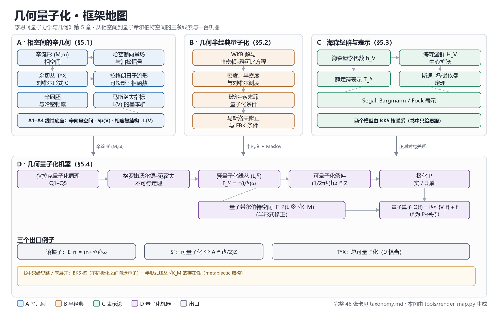
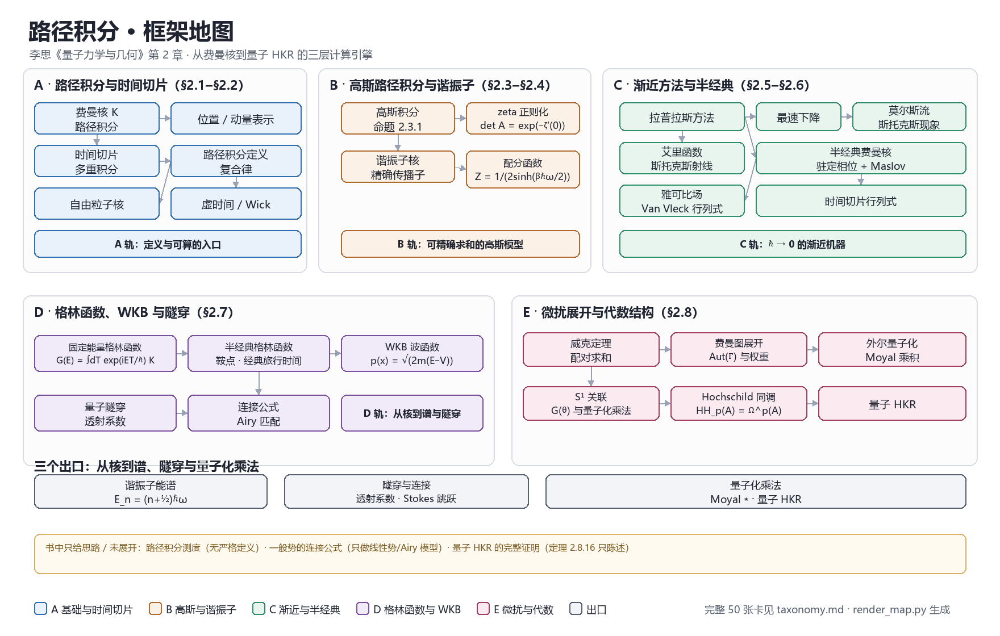

# 数译 · 中文数学译注文献库（数据集与语料）

> 让散落的数学资料得以保存，让数学术语形成共识，让中文数学的每一条陈述都能被机器读懂。

## 这个仓要做什么：从「给人读的译本」到「可对齐的中文数学底稿」

过去三年，这个仓做的事是把散落的中文数学译注本整理成可读、可查、可复用的资料。现在方向清楚了一步：
**译本只是原料，真正的产出是「资料卡 + 自然语言与形式语言的对齐」**——为中文数学语宙留一份
每条陈述都能追溯到原文页码、每个术语都能追溯到依据、每条命题都能被编译器检查的底稿。

四层管线，每层都有机器可校验的产物：

| 层 | 做什么 | 产物 | 现状（2026-11-27） |
|---|---|---|---|
| 译文 | 底本译成中文译注本，公式逐符号核对原文页面 | 143 部译注工程（129 部带 LaTeX 源码） | 主体完成，仍在补 |
| 资料卡 | 一部译本拆成可单独拿起的卡（概念/定理/例子），带页码与前提 | 1,777 张卡 / 46 个数据集 | 已成形，正在扩 |
| 数语规范 | 术语、记号、语体三层统一，每条带来源等级 | `01_corpus_zh/数语规范/`：术语 2,277 条、冲突 91 组、宏 662 个 | v1.0 首次成文 |
| 对齐卡 | 一条中文陈述 ↔ 一条 Lean 4 命题，由编译器判定 | `datasets/leanstmt/` 40 条（21 certified + 19 gap） | 试点，2026-Q1 目标 100 条 certified |

为什么把后两层当重心：**术语不统一，形式化就无法映射；陈述不成卡，中文数学就只能被阅读，
不能被检索、被验证、被讲给机器听。** 所以：

- 数语规范 → [`01_corpus_zh/数语规范/README.md`](01_corpus_zh/数语规范/README.md)（总则）、
  [`STYLE_NL.md`](01_corpus_zh/数语规范/STYLE_NL.md)（中文语体）、
  [`STYLE_FORMAL.md`](01_corpus_zh/数语规范/STYLE_FORMAL.md)（对齐卡规范）
- 形式化路线 → [`04_playbook/15_形式化与自然语言对齐_2026-11.md`](04_playbook/15_形式化与自然语言对齐_2026-11.md)
- 已落地的对齐卡 → [`datasets/leanstmt/README.md`](datasets/leanstmt/README.md)

**为什么做这个仓、往仓里传什么**：完整版见 [`04_playbook/17_仓库理念与上传规范.md`](04_playbook/17_仓库理念与上传规范.md)；
每个工程的 `工程文件/00_开工必读.md` 是它的三十行摘要——**开工前先读那一页**，再读该工程的 `BRIEF.md` 与 `STYLE_GUIDE.md`。

一句话：**能被人复核的留下，只能被自己相信的别留，能重跑的不要存结果、存命令。**

## 最近更新（2026-11-24 ~ 11-27）
- **新增整本译注**：`SY99-04`《上同调类域论讲义》（Raskin，MIT 18.786 课程讲义，119 页底本 → 91 页中译注本，23 讲；
  全文对照 MIT OCW 公开底本 PDF 逐讲复核，订正 22 处底本排印错误、按原图复原 4 幅交换图，另 2 处原文如此加注；
  `ERRATA.md` 29 条逐条给出讲次与源码行号；附《00-速览》等资料卡五件套）。
- **新增资料卡集**：`datasets/raskin_lcft/` 27 张（概念 12 + 推导 5 + 勘误 10，五轨 A–E，印刷页 1–107 覆盖 81 页；
  `lint_cards.py --strict` 0 error）。
- **新增整本译注**：`SY02-37`《电磁对偶与几何 Langlands 纲领》（Kapustin–Witten，arXiv:hep-th/0604151，
  231 页底本 → 176 页中译注本，362 个编号公式原号保留，216 条译注 + 12 条本节重点；
  附《思路导读》6 页、《译注汇编》28 页）。
- **新增整本译注**：`SY02-36`《约化群的 Kloosterman 层》（Heinloth–Ngô–Yun，58 页底本，61 页中译）；
  `SY02-32`《迹公式与函子性——一个纲领的开端》（法文底本，54 页，39 页中译）。
- **全本校订**：`SY02-17`《仿射 Grassmann 簇与几何 Satake 等价》（95 页）逐行校对，补 17 条 nLab 译注、
  修 13 处文字与 22 条文献，重编译 90 页 0 error；`SY04-04`《膜与层》修 20 处并补资料卡五件套。
- **语料与资料卡同步**：语料 51,009 段，资料卡 1,777 张 / 46 个数据集，术语基 2,214 条，
  Lean 对齐卡 40 条（21 certified + 19 gap）。
- **检索侧**：本机检索插件换为 `dsh-mathnotes` v0.1（工具 `kb_locate` / `kb_get` / `kb_ctx`，
  索引 135 部讲义、110,286 个语义单元，支持「某书某节某定理」定位与原书页码）；旧 `dsh-kb` 保留可回滚。
- **口径**：以上数字全部来自 `_meta/stats.json`（`make_stats.py` 生成，`tools/check_numbers.py` 校验），
  不再手写。

## 不用克隆，先看内容

本仓的东西可以直接在网页里看，不必 clone 整个仓库：

| 想看什么 | 打开 |
| --- | --- |
| 总览：十三个数字、8 条主线、卡片/语料/术语样例 | [`site/index.html`](site/index.html) |
| 143 部工程总表（可按主题搜） | [`site/p/index.html`](site/p/index.html) |
| 1,777 张资料卡统一入口（按系列/类型/状态筛） | [`site/cards/index.html`](site/cards/index.html) |
| 51,009 段语料里的 400 段抽样 | [`site/corpus.html`](site/corpus.html) |
| 2,214 条术语基（可搜索） | [`site/terms.html`](site/terms.html) |
| 三层许可与五条合规红线 | [`site/compliance.html`](site/compliance.html) |

站点是纯静态 HTML、不依赖 CDN 与联网，用浏览器直接打开本地文件也不需要服务器。

> 注意：AtomGit / GitHub 的仓库网页把 `.html` 当源码显示、不会渲染。想看到成品页面有两条路：clone 后双击 `site/index.html`；或按 [`.github/workflows/pages.yml`](.github/workflows/pages.yml) 开一次 Pages（Settings → Pages → Source 选 GitHub Actions），之后每次推送自动发布。**只想读内容、不想 clone 的，本页下面直接贴了卡片、语料与术语样例。**

### 资料卡长什么样

`glc/concept/restricted-local-systems` · concept · **published** · 来源：陈麟《Introduction to Geometric Langlands Theory》§9.5（p.51）

**受限局部系统叠** —— de Rham 之外层论里替换 $\operatorname{LocSys}_{\check G}$ 的受限叠，用取值在 $\operatorname{QLisse}(X)$ 里的张量函子描述。

- 受限局部系统叠用点函子描述为张量函子 $\operatorname{Rep}(\check G)\to\operatorname{QCoh}(S)\otimes\operatorname{QLisse}(X)$。
- de Rham 情形的平行表述是把 $\operatorname{QLisse}(X)$ 换成 $\operatorname{DMod}(X)$。
- 在 Betti／可构造情形，已知的因子化陈述落在具有幂零奇异支撑的范畴 $D_{\mathrm{Nilp}}(\operatorname{Bun}_G)$ 中。
- 因此它本身并不蕴涵整个 $D(\operatorname{Bun}_G)$ 上完整的消失定理。

这张卡还带 `question` / `definition`（含 notation）/ `pitfalls` / `formulas` / `related` 与 3 条 `verification` 记录（其中 1 条与 arXiv 原文冲突、已记为 P1 修正）——完整字段见 [`site/cards/index.html`](site/cards/index.html)。

### 语料长什么样

每段一行 JSONL（[`01_corpus_zh/zh_paragraphs.jsonl`](01_corpus_zh/zh_paragraphs.jsonl)），字段：`pkg / file / para / para_id / page_orig / env / tier / text / zh_chars / flags / seg`。

> **SY01-10 · para 18 · env=theorem · tier=B · 33 汉字**
>
> 设 $\mathcal{A}$ 与 $\mathcal{B}$ 是两个分裂闭的 $A_\infty$-范畴，分别由 $X_1,\dots,X_n$ 与 $Y_1,\dots,Y_m$ 分裂生成（split-generate）。令
> $$\mathcal{A}' = \operatorname{Hom}_{\mathcal{A}}(X_1\oplus\cdots\oplus X_n,\ X_1\oplus\cdots\oplus X_n),$$
> 并对 $\mathcal{B}'$ 作同样的定义。它们是 $A_\infty$-代数。

> **SY01-03 · para 12 · env=text · tier=B · 65 汉字**
>
> 这可以通过计算轴流与 (5.11) 中给出的 $(\partial_0\pm\partial_1)y$ 的算子乘积展开读出。又注意，theta 参数的轴平移（见 (4.22)；在目前情形下即 $\theta\to\theta+2\beta$）通过扭超势 (5.9) 被 (5.15) 有效地实现：$\tilde W=(y-\zeta+i\theta)\sigma$。还可以证明 $y$ 在矢量 $U(1)$ R-对称性下不变。

### 术语表长什么样

| 外文 | 语种 | 中文 | 状态 | 级别 | 出处 |
| --- | --- | --- | --- | --- | --- |
| 前層 | ja | 预层 | confirmed | A | 仓主裁决（2026-11-17）：presheaf 标准译名为「预层」 |
| Langlands Program | en | Langlands纲领 | confirmed | I | 本库术语表 |
| Galois group | en | Galois群 | confirmed | I | 本库术语表 |
| class field theory | en | 类域论 | confirmed | I | 本库术语表 |
| number field | en | 数域 | confirmed | B/nLab | nLab `function field` |
| function field | en | 函数域 | confirmed | B | nLab `function field` |

全表 **2,214 条**（confirmed 409 / candidate 1,805；en 1,661 / ja 325 / other 228），可在 [`site/terms.html`](site/terms.html) 里搜；另有 `01_corpus_zh/数语规范/TERMS.tsv` **2,277 条**术语规范表（含 91 组冲突待裁决），两套口径的差别见 `_meta/口径.md`。

<details>
<summary><b>开工前必读：本仓内部作业规程（只想看内容的读者可跳过）</b></summary>

> **⚠️ 强制前置读本（2026-11-18 起）**
> 任何人与智能体在做「挑文章 → 精读 → 造语料 → 评数据」之前，**必须先通读**
> [`MEMORANDUM_01_论证精读与语料生产.md`](MEMORANDUM_01_论证精读与语料生产.md)
> （网页版：[`site/memo.html`](site/memo.html)，站点首页顶部亦有入口）。
> 它与任务书、brief、口头指令冲突时**以它为准**；违反其 §8 红线者，本次产出作废并记 incident。
> 读完请在 `_meta/read_receipts.jsonl` 记一行，或用闸门脚本：
> `python tools/check_memo_gate.py --role <角色> --record`（没回执不许开工）。
>
> **配套任务规程**：AMS《量子场与弦》习题课那条线，读
> [`PLAYBOOK_02_AMS量子场与弦习题推理链_v1.md`](PLAYBOOK_02_AMS量子场与弦习题推理链_v1.md)
> （网页版：[`site/playbook-ams.html`](site/playbook-ams.html)）。它是 MEMORANDUM-01 在习题课场景的实例化，只能更严、不能更松。

> **施工标准（硬性）**：本库全部译注工程一律按 [`04_playbook/01_数学文献翻译纪律.md`](04_playbook/01_数学文献翻译纪律.md) **v2.1** 执行——
> 先通读后落笔（§1.0）、译注必须有来源并可追溯（§2.5）、来源黑名单与语料卫生（§2.5.9）。
> **每次开工前、每次接手别人的稿、每次交付前都要重读对应章节**；文件库总入口见 [`04_playbook/README.md`](04_playbook/README.md)。

</details>

本仓库是「数译」工程的**数据与语料发布仓**：把一批中文数学译注本、工程原件、术语资产、
AI 辅助翻译的过程轨迹、以及威腾文章研讨班的组织资料整理成**可以被别人直接拿去用**的数据。

- 译者/整理者：超对称梦想家（chaoduicheng）
- 用途：学术研究、教学、检索，以及中文数学语料训练与蒸馏（见「使用许可」）

<!-- STATS:BEGIN -->

| 指标 | 数值 |
|---|---|
| 译注工程 | **147** 部（其中 **133** 部带完整 LaTeX 源码） |
| 仓库文件（git 跟踪） | 16,307 个 / **537.2 MB** |
| LaTeX 源文件 / 插图 | 2,778 个 `.tex` / 2,345 张图 |
| 成品 PDF（预印本类） | 41 部 / **50.8 MB**（Release 附件） |
| 中文段落语料 | **51,009** 段（唯一 49,443），其中 **43,949** 段含公式（86%）；汉字 4,175,047 字 |
| 语料覆盖 | **84** 个工程有段落入库 |
| 近重复标注 | 1,418 段（保留，标 `near_dup_of`） |
| 原书页码锚点 | 4,023 段（`page_orig`） |
| 术语基 | 2,214 条 |
| 资料卡 | 1,858 张（49 个数据集） |
| 形式化陈述对齐 | 43 条（21 certified + 22 gap；8 个 `.lean`，28 处 `sorry` / 22 条声明） |
| 精选轨迹 | 402 条 |
| 原始会话分片 | 4 片 / **144.6 MB**（Release 附件） |

> 口径：本表由 `python make_stats.py` 从仓库文件与语料实测生成，同一份数据写入 [`_meta/stats.json`](_meta/stats.json)（机器可读，供其它文档与站点取数），是唯一事实源；请勿手写或从他处抄数。定义见 [`_meta/口径.md`](_meta/口径.md)。
<!-- STATS:END -->

## 这是一个有明确倾向的文献库（不是泛泛的数学资料堆）

**一句话**：本库集中在 **「镜像对称 — 辛几何 / 拓扑弦 — 量子场论与规范理论 — 几何朗兰兹 / 电磁对偶」**
这一条几何与数学物理的交叉带上，只收那些**能把这条主线某一段讲清楚**的材料，把它们译成中文，
并把工程、术语与语料一起放出来。

收起这些材料是**强烈个人取向**的结果：主线之外的经典教材基本不收，所以本库看起来"偏"是故意的。

### 收什么（按优先级）

1. **主线奠基性论文与系统讲义**：Fukaya 范畴与同调镜像对称、Gromov–Witten 不变量与量子上同调、SYZ 猜想、
   Batyrev–Borisov 环面构造、Kontsevich / Givental 的镜像对称公式、Floer 同调与 Hofer 几何。
2. **数学物理交叉的综述与讲义**：N=(2,2) 超共形场论、拓扑弦、CY 三维流形紧致化、
   Kapustin–Witten 对偶与几何朗兰兹、AGT 对应、Seiberg–Witten 理论、瞬子与单极子。
3. **三语学派文献**（本库的一个特色）：
   - **日本学派**：京都大学 RIMS 講究録、京大 / 阪大 / 东大的镜像对称与辛几何讲义
     （深谷賢治、植田一石、高橋篤史、梶浦宏成、入谷寛、秦泉寺雅夫、野原雄一）；
   - **法国学派**：Bourbaki 报告（946 / 981 / 884 / 801）、Astérisque、Claire Voisin 的 K3 与镜像；
   - **俄罗斯学派**：Batyrev–Borisov 组合镜像对称、Orlov 的导出范畴与镜像。
4. **威腾（Witten）系列**：拓扑弦与量子上同调、Gauge Theory and Geometric Langlands、Kapustin–Witten 对偶、
   Jones 多项式与 Chern–Simons。本库目前收 9 篇，另有独立的威腾研讨班工程 `papers/`。
5. **有工程价值的博士论文与专题论文集**：能补上主线某个技术缺口的（例如正特征几何朗兰兹、驯顺分歧、
   Hitchin 系统的自对偶解）。

### 不收什么（避免摊大饼）

- **传统数论方向的 Langlands 纲领**（自守表示、迹公式、L-函数那一支）——与本库的几何侧是两条路，
  已有成熟中译的不重复造；
- **通用教科书**（微积分、线性代数、微分几何导论、代数几何入门等"谁都能买到"的）；
- 与数学物理无关的纯组合、纯分析题目；
- **无法溯源底本**、或只有二手转述的材料（施工纪律要求每条译注可追溯到原文页码）。

### 按主题的分布（143 部译注工程，其中 129 部带 LaTeX 源码）

| 主线 | 编号 | 部数 | 带源码 | 内容举例 |
|---|---|---|---|---|
| 辛几何 · 拓扑 · 纽结 · 指标定理 | `SY05` | 30 | 26 | Hofer 几何、Floer 同调、K-理论、指数定理、Jost 黎曼几何 |
| 量子场论与规范理论 | `SY03` | 22 | 17 | 超对称、AGT、共形场论、瞬子、Seiberg–Witten |
| 镜像对称与同调镜像对称 | `SY01` | 31 | 29 | SYZ、深谷范畴、Kontsevich 对偶、Batyrev 构造、植田一石讲义 |
| 弦论与紧致化 | `SY04` | 4 | 4 | 拓扑弦、CY 紧致化、D-膜 |
| 几何朗兰兹与电磁对偶 | `SY02` | 37 | 35 | Hecke 本征层、Hitchin 系统、Kapustin–Witten、Frenkel 圈群讲义 |
| 其他几何（热带 / 范畴 / 量子力学与几何） | `SY07` | 11 | 11 | 热带几何、导出范畴、几何量子化、圏論 |
| 双有理几何 | `SY08` | 3 | 3 | Kollár–森重文《双有理几何》、导出范畴指南 |
| 拓扑学与专题 | `SY99` | 4 | 4 | Novikov 拓扑学、TQFT 博士论文、讨论班讲义 |
| 精读稿（无编号） | `GRASSMANN` | 1 | 0 | 格拉斯曼模空间与向量丛精读 |
| **合计** | | **143** | **129** | |

「带源码」= 该工程目录下有被 git 跟踪的 `.tex`（与「有 `源码/` 目录」不是一回事：`SY02-11` 的 `源码/` 目录是空的）。口径定义见 [`_meta/口径.md`](_meta/口径.md)。

## 关键词（供检索与打标签）

下面这些词就是本库的"检索面"：找得到本库的中英文说法、以及日文原题里的对应写法。
（下游做检索增强、做术语对齐、或给别人写推荐语时可以直接用。）

**镜像对称 / Mirror Symmetry / ミラー対称性**
镜像对称、同调镜像对称、SYZ 猜想、Lagrange 环面纤维化、Fukaya 范畴、深谷范畴、Gromov–Witten 不变量、
量子上同调、Kontsevich 镜像公式、Givental 公式、Batyrev–Borisov 环面构造、环面几何、Landau–Ginzburg 模型、
B 模型 / A 模型、开闭弦镜像、ホモロジー的ミラー対称性、深谷圏

**辛几何与拓扑 / Symplectic Geometry & Topology / シンプレクティック幾何**
辛流形、辛容量、Arnold 猜想、Floer 同调、Hamilton 微分同胚、Hofer 几何、Gromov 宽度、扭量、
辛约化、接触几何、Kontsevich 形式性、K-理论、指数定理、Atiyah–Patodi–Singer、Dirac 算子、
Jones 多项式、Chern–Simons、纽结不变量、量子不变量、J-全纯曲线

**量子场论与规范理论 / QFT & Gauge Theory / 場の量子論**
超对称、超共形场论、N=(2,2) SCFT、N=4 超杨–米尔斯、瞬子、单极子、Seiberg–Witten 理论、
Seiberg 对偶、AGT 对应、共形场论、顶点算子代数、仿射 Kac–Moody、W-代数、可积系统、
Donaldson–Thomas 不变量、BPS 态、D-膜、AdS/CFT

**几何朗兰兹与电磁对偶 / Geometric Langlands & Electric–Magnetic Duality / 幾何学的ラングランズ**
几何朗兰兹纲领、Hecke 本征层、Hitchin 系统、Hitchin 纤维化、Beilinson–Drinfeld、Gaitsgory、
Frenkel 圈群、电磁对偶、S-对偶、Montonen–Olive 对偶、Kapustin–Witten 方程、Langlands 参数、
分歧（ramification）、驯顺分歧、正特征几何朗兰兹

**弦论 / String Theory / 弦理論**
拓扑弦、弦对偶、CY 三维流形、紧致化、镜像流形、Gopakumar–Vafa 不变量、BPS 计数、
I 型 / II 型弦、杂化弦、F-理论、M-理论

**学科与方法 / 术语**
译注本、术语对照、日汉对照、法汉对照、俄汉对照、原文页码锚点、公式逐符号核对、LaTeX 工程

**文献类型**
讲义（lecture notes）、综述（review）、博士论文（PhD thesis）、講究録（RIMS Kôkyûroku）、
Bourbaki 报告、Astérisque 专辑、arXiv 预印本、论文集（proceedings）

## 内容结构

| 目录 | 内容 |
|---|---|
| `00_README.md` | 资产说明、脱敏说明、使用许可 |
| `MANIFEST.json` | 全部文件的路径 / 字节数 / sha256 前 16 位（提交后重算，见「校验」） |
| `01_corpus_zh/` | **中文段落语料**（保真保留 LaTeX 公式）+ 术语基 `termbase.jsonl` + 去重报告 + **数语规范**（`数语规范/`：术语/记号/宏四张表 + 语体与形式化规范，见下文） |
| `02_trajectories/` | AI 辅助工作的精选工具调用轨迹（意图→动作→证据→结论，含评分） |
| `03_translations_meta/` | 每部书的元数据、投稿信息、术语表；41 部预印本类的**成品 PDF** 已移到 Release `v1.0.1` 附件（清单见 `_PDF清单.tsv`） |
| `04_playbook/` | 翻译总纲、施工纪律（**v2.1**）、文献引进标准、待完成清单、环境备忘、形式化对齐路线 |
| `05_seminar_witten/` | 威腾（Witten）文章研讨班的索引、阅读路线、经验教训 |
| `06_sessions_raw/` | 原始对话事件流（已脱敏、zstd 压缩）；145 MB 分片已移到 Release `v1.0.1` 附件，仓库只留抽取脚本与分片说明 |
| `papers/WIT-1989-JONES/` | **威腾 1989 CS/Jones 论文研讨班**（第二轮解经试点）：六场研讨记录、claims/questions 数据、教材核查；交付两版讲义——**49 页连续叙事讲义**（`deliverables/lecture/`，可作课程主文本）与 **97 页逐句注疏版**（`deliverables/reading_note/`），均含 LaTeX 源码、一键构建工程、协作流程记录，并有打包下载 `WIT-1989-JONES-v1.0.zip` |
| `papers/WIT-2021-ATIYAH-LANG/` | **Witten 2021 INI 演讲《对偶、Langlands 对应与 Michael Atiyah 的影响》中文译注本**（讲义型）：把 54 张 beamer 幻灯片按演讲的叙事顺序重排为 **39 页连续叙事**，逐张标注原页码，译注（术语/译法）与批注（技术/史实）分两套编号；前置出版说明与导读「一条走了四十七年的暗线」，后置附录 A 术语表、B 人物小传、C 参考文献、D 技术路线图（从本演讲到 Kapustin–Witten 2006）。LaTeX 源码在 `源码/`，成品 PDF 在 `deliverables/lecture/`，底本对应表、通读笔记、疑点清单、术语表 tsv 在 `工程文件/` |
| `08_source_code/` | **每部译本的完整工程**：`工程文件/`（BRIEF、构建脚本、交付清单、术语表、校对记录、逐章报告）+ `源码/`（LaTeX 源与插图） |
| `07_refs_nlab/` | **nLab 参考资料库**（几何 Langlands 线专用）：120 条 nLab 条目摘要（含 `last_revised`，可直接写进译注来源行）+ 37 份替代来源卡（nLab 只有存根时改引 A 级教材 / MathWorld / Stacks）+ 110 条来源真实性抽查记录 |
| `10_gmn_series/` | **GMN 系列研究与译注层**：Gaiotto–Moore–Neitzke 五篇（穿墙公式、BPS 态、超凯勒几何、红外代数）的资料卡、阅读报告、术语与索引；译文源码在 `08_source_code/` |
| `datasets/` | **可训练数据集**（**46 个集 / 1,777 张资料卡**）：数学推理条目（`math/`）、原文片段↔译文↔译法理由（`parallel/`）、精读卡（`deepread/`）、高光与难证标注（`highlights/`）、事件级工作流（`traces/`）、概念图谱（`kg/`）、held-out 评测（`bench/`）、按概念组织的词条库（`encyclopedia/`）、单章资料卡（`geoq/`、`pathintegral/`、`csw/`、`glc/`、`kshms/`、`ggl19/` …）、**自然语言↔Lean 4 对齐卡（`leanstmt/`，本库未来重心）**；规则见 `datasets/README.md`，权利分 `self / arxiv / book / rewritten` 四层，`book` 只进 `_internal/` |
| `site/` | 静态站点（`site/index.html` 双击即开，无需服务器） |

## `01_corpus_zh/`：语料的形态

`zh_paragraphs.jsonl` 每行一段，字段：

| 字段 | 含义 |
|---|---|
| `pkg` / `file` / `para` | 所属工程、源文件、段序 |
| `para_id` | 内容哈希（sha1 前 16 位），全库唯一稳定标识，便于下游去重 / 增量更新 / 引用 |
| `page_orig` | 原书页码（解析 TeX 里的 `% ===== PDF p.NNN (原书 p.N) =====` 标记；当前 4,023 段带此标记，集中在 SY01-23 2,950 / SY01-08 692 / SY02-09 381） |
| `env` | 段落所在环境：`text` / `theorem` / `definition` / `proof` / `remark` / `example` |
| `tier` | 该工程的评级 A/B/C（来自工程元数据） |
| `text` | **保真文本**：行内/行间公式原样保留 `$...$`、`\begin{equation}...\end{equation}`，不再被洗成 ASCII 骨架 |
| `dup_of` / `dup_pkg` | 若与前面某段文本完全相同，指向首个出现位置；重复段**不删除**，便于按需过滤 |

去重统计与理由见 `01_corpus_zh/DEDUP_REPORT.md`；术语基 `termbase.jsonl` 字段为
`foreign / lang(en|ja|other) / zh / status / pkg / src_format`，SY02-09 的 215 行另有
`level`（A/B/I）/ `source`（依据）/ `lecture`（首次出现讲次）三字段，`status=confirmed`。

**干净训练子集**：`python tools/make_train_subset.py` 一条命令生成 `01_corpus_zh/zh_train.jsonl.gz`（8 MB，不入库）——按固定口径丢 `empty_ref` / `orphan_number` / `layout_residue` / 重复 `para_id` 等标注段、丢 <8 汉字碎片，实测 **46,059 段 / 378 万汉字 / 86% 含公式**（源 51,009 段保留不动，丢弃 4,950 段，逐项计数见脚本输出）。

**术语定案表**：[`01_corpus_zh/terms_frozen_SY02-09.tsv`](01_corpus_zh/terms_frozen_SY02-09.tsv)（223 条，
列：英文 / 中文 / 等级 / 依据 / 首次出现 / 本轮校订备注）。这是《Langlands 纲领导论》逐页校订后的
冻结术语表——`B` 级条目都能在 `07_refs_nlab/pages/` 找到对应 nLab 页，`A` 级条目指向本讲参考文献的
具体章节。以后翻译几何 Langlands 的文献先查这张表，避免同词异译。

**同一体例的第二张冻结表**（辛几何与 Floer 理论方向）：[`01_corpus_zh/terms_frozen_FUNCTORIALITY.tsv`](01_corpus_zh/terms_frozen_FUNCTORIALITY.tsv)（209 条，
列同 SY02-09；`A` 级指向 arXiv 原文页码/式号，`B` 级指向 nLab 页面，`I` 级为本库定案），
配套的**记号冻结表** [`01_corpus_zh/symbols_frozen_FUNCTORIALITY.tsv`](01_corpus_zh/symbols_frozen_FUNCTORIALITY.tsv)（76 条，
列：记号 / LaTeX 源码 / 读法 / 含义 / 首次出现 / 依据；按「导言区宏—辛拓扑—Floer 与 A∞ 范畴—拼接 Floer 与对应—组合模型与应用」五组）。
这两张表来自 Abouzaid–Bottman《Functoriality in categorical symplectic geometry》（arXiv:2210.11159v1）的中译注工程，
术语基 `termbase.jsonl` 同步追加 190 行（`pkg=FUNCTORIALITY`，`status=confirmed`）。译「辛」「Floer」「拼接」「操作子」一类文献时先查这三处。

## `08_source_code/`：工程源码

- 放的是**翻译工程本身**：`工程文件/` + `源码/`（LaTeX + figures）。
- 装 TeX Live / MiKTeX 后进 `源码/` 跑 `xelatex main.tex` 即可重建中文译注本；
  少数工程的根文件叫 `main.tex` 之外的名称，见该工程 `工程文件/编译说明.md`。
- **13 部没有 LaTeX 源码**（`SY01-18 / 01-19 / 02-08 / 02-11 / 03-02 / 03-16 / 03-17 / 03-18 / 03-21 / 05-19 / 05-20 / 05-21 / 05-22`），
  这些目录只有 `投稿信息.md`（其中 `SY02-11` 的 `源码/` 是空目录）；其余 **129 部**有可编译源码（`make_stats.py` 口径）。
- **`工程文件/` 覆盖 137 部**（143 部工程中 6 部暂无；2026-11-14 从投稿包回填了 38 部缺失的 `工程文件/`，共 223 文件 / 2.8 MB；2026-11-22 起每部另有一份生成的 `00_开工必读.md`）；
  其余 9 部（`SY01-18 / 01-19 / 02-08 / 02-11 / 03-16 / 03-18 / 05-20 / 05-21 / 05-22`）的原始投稿包本身就没有工程文档，只有 `源码/` 或仅成品。
- **自 2026-11-14 起，`03_translations_meta/<编号>/` 不再重复保存 `源码/` 与 `工程文件/`**：
  它们此前与 `08_source_code/<编号>_<中文名>/` 下的同名目录逐字节相同（约 45 MB 重复）。
  源码、工程文档与术语表统一以 `08_source_code/` 为唯一来源。
- 用途：学习、研究、复用翻译流水线。

## `datasets/`：把译本变成可训练数据

语料只给"译文"，`datasets/` 补上训练真正缺的东西：**原文片段、译法理由、工作过程、数学推理**。

**2026-11-16 方向调整**：模型缺的不是译法，而是数学理解与**中文推理链**（研究级中文推理语料几乎空白；现有数学语料以英文为主）。因此数据集重心转向 `math/`：命题、自足上下文、证明步骤、缺口、依赖、校验状态；`parallel/` 保留但降为术语与表达的小样本。设计依据见 [`datasets/math/README.md`](datasets/math/README.md)。

| 子目录 | 一条记录是什么 | 单条上限 |
|---|---|---|
| `math/` | 定义/定理/断言 + 自足上下文 + 证明步骤（含 `gap`）+ 依赖 + `verification`（lean/human/none）| 陈述 ≤4,000 字 / 证明 ≤12,000 字 |
| `parallel/` | 原文片段 → 译文 → 为什么这样译（术语选择、语序、脚注处理）| 原文 ≤600 字 / 单条 ≤1,400 字 |
| `deepread/` | 精读卡：主张、证明骨架、跳步补全、前置知识、易错点、证据行号 | ≤6,000 字 |
| `highlights/` | 论文里最精彩/最难的一段：为什么难、关键动作、可复用套路 | ≤3,000 字 |
| `traces/` | 事件级工作流：读什么、改什么、校验什么、失败后怎么改；`fidelity=event/reconstructed` | 每文件一段工作流 |
| `kg/` | 概念/定理/人物/文献节点 + `prereq_of / uses / generalizes / dual_to / cites` 边，每条边带证据 | 每边一条 |
| `bench/` | 带 rubric 的 held-out 评测题，与 `parallel/` 不重叠 | 10 题/单元 |

**权利四层**（与 `COMPLIANCE.md` §11、`datasets/README.md` §2 一致）：

- `rights:self` → 自产（中文表述、理由、精读、证明整理、图谱、评测），CC BY 4.0，可用于训练；数学事实本身不受版权保护；
- `rights:arxiv:<id>` → 逐篇核许可；许可未确认时原文只作 ≤300 字引用；
- `rights:book` → 只进 `datasets/_internal/`（已被 `.gitignore` 忽略），**永不发布**，也不进公开训练集；
- `rights:rewritten` → 改写卡（资料卡、对齐卡、术语条目）：不复制原文连续 20 字以上，只保留数学内容与页码指针，可公开。

工作流与提示词模板见 [`datasets/workflow/生产协议.md`](datasets/workflow/生产协议.md)，`math/` 的专门协议见 [`datasets/math/README.md`](datasets/math/README.md)。新增一个单元：

```bash
python tools/ds_harvest.py               # 存量回收：给语料段落打分，写 datasets/candidates/harvest_queue.jsonl
python tools/ds_lint.py                  # 结构、id、行号、字数、权利、math 校验状态
python tools/ds_publish.py --check       # 发布前权利过滤，0 blocked 才能发
python tools/ds_publish.py --write       # 重写 datasets/PUBLISH.json
```

当前试点：`SY05-25`（Witten, arXiv:0802.0999）第 1 节，6 条数学推理条目、7 条平行片段、4 张精读卡、3 条高光、3 道评测、1 张 6 节点图谱、1 段 12 事件工作流；另有 3 张跨工程精读卡（SY01-01 谱流、SY01-09 SYZ 启发式、SY03-08 Chern–Simons 形式），共 **119 条记录**（math 6 / parallel 7 / deepread 7 / highlights 3 / traces 81 / kg 12 / bench 3），`ds_lint` 0 错。存量第一批 L0 修正 47 处（44 改 3 删），见 `datasets/fixes/l0_batch01.jsonl`。扩量先做 37 部 arXiv 底本（每部 3–5 个技术引理），再做 22 部讲义；图书底本只做 `_internal/`；**形式化对（NL↔Lean）已单独起步**：`datasets/leanstmt/` 40 条（21 certified + 19 gap），规范见 [`01_corpus_zh/数语规范/STYLE_FORMAL.md`](01_corpus_zh/数语规范/STYLE_FORMAL.md)。

### 资料卡试点：几何量子化（`datasets/geoq/`）

把李思《量子力学与几何》第 5 章拆成 **48 张可以单独拿起来用的卡**：1 张总览、27 张概念卡、20 张例子卡（书中 20 个编号例子各一张）。概念卡按「先自测 → 定义 → 要点 → 公式 → 定理与证明 → 易错点 → 相关卡 → 出处」组织；例子卡按「设定 → 计算 → 结果 → 复核」组织。共 55 条定理、214 个证明步骤、97 个例子计算步骤。

- [`README.md`](datasets/geoq/README.md)：资料卡怎么用（概念卡 7 步、例子卡 4 步、Anki、打印、三条推荐路线）、目录与页码约定
- [`MAP.md`](datasets/geoq/MAP.md) / [`map.png`](datasets/geoq/map.png)：框架脉络图，四轨如何汇入同一台量子化机器
- [`taxonomy.md`](datasets/geoq/taxonomy.md)：48 张卡总表，逐卡标原书印刷页与 §5 源码行
- [`workflow/PRODUCTION.md`](datasets/geoq/workflow/PRODUCTION.md)：从勘察到入仓的完整协议（六路并行、lint、页码审计、两轮独立审校）

```bash
cd datasets/geoq
python tools/lint_geoq.py
python tools/audit_pages.py --src /path/to/SY07-03/chunks   # 底本源码不随数据集发布
python tools/build_index.py && python tools/render_md.py
```

卡片为改写（`rights: rewritten`），公式照录、出处逐条标原书印刷页；与底本无连续 20 字相同片段。



### 资料卡试点：路径积分（`datasets/pathintegral/`）

把李思《量子力学与几何》第 2 章「路径积分形式」拆成 **50 张可以单独拿起来用的卡**：1 张总览、29 张概念卡、20 张例子卡（书中 20 个编号例子各一张）。五条轨道依次是：A 定义与时间切片 → B 高斯与谐振子（精确答案）→ C 渐近方法与半经典 → D 格林函数、WKB 与隧穿 → E 威克图、Moyal 与量子 HKR。共 65 条定理、219 个证明步骤、109 个例子计算步骤。

- [`README.md`](datasets/pathintegral/README.md)：资料卡怎么用（概念卡 7 步、例子卡 4 步、Anki、打印）、目录与页码约定
- [`MAP.md`](datasets/pathintegral/MAP.md) / [`map.png`](datasets/pathintegral/map.png)：框架脉络图，五轨如何汇成「精确定义 → 近似 → 物理输出 → 代数输出」
- [`taxonomy.md`](datasets/pathintegral/taxonomy.md)：50 张卡总表，逐卡标原书印刷页与 §2 源码行
- [`workflow/PRODUCTION.md`](datasets/pathintegral/workflow/PRODUCTION.md)：从勘察到入仓的完整协议（七路并行、lint、页码审计、两轮独立审校）

```bash
cd datasets/pathintegral
python tools/lint_pi.py cards
python tools/audit_pages.py --src /path/to/SY07-03/chunks   # 底本源码不随数据集发布
python tools/build_index.py && python tools/render_md.py
```

卡片为改写（`rights: rewritten`），公式照录、出处逐条标原书印刷页（80–160）；与底本无连续 20 字相同片段。



### 资料卡试点：Chern–Simons 与共形场论（`datasets/csw/`）

把 Witten 1989（*Quantum Field Theory and the Jones Polynomial*，CMP 121, 351–399）拆成 **40 张卡**：1 张总览 + 30 张概念卡 + 9 张例子卡。九条轨道：O 总览 → A 三维理论（作用量、level、Wilson 线）→ B 相空间（约束、辛商、平坦联络模空间）→ C 几何量子化机器（预量子化、极化、全纯截面、半形式）→ D 穿刺点与 Borel–Weil–Bott → E WZW 一侧（仿射代数、Sugawara、共形块、KZ、融合）→ F 对偶与映射类群 → G 计算（手术、S 矩阵、Verlinde、Jones）→ H 边界（CS/WZW 与 AdS₃/CFT₂ 的区别）。

- [`README.md`](datasets/csw/README.md)：资料卡怎么用、目录、复现命令、队伍构造摘要
- [`MAP.md`](datasets/csw/MAP.md)：卡片依赖图（mermaid）与按轨道的阅读顺序
- [`taxonomy.md`](datasets/csw/taxonomy.md)：40 张卡总表，逐卡标类型与一句话说明
- [`workflow/PRODUCTION.md`](datasets/csw/workflow/PRODUCTION.md)：队伍怎么构造（Lead + historian/bibliographer/archivist/verifier）、四道闸、批次清单与纠错流程

```bash
cd datasets/csw
python tools/build_cards.py     # tools/_data1..5.py → cards/*.json + index.jsonl
python tools/lint_csw.py        # 0 error / 0 warning
python tools/render_md.py       # cards → md/
python tools/gen_docs.py        # taxonomy.md + MAP.md
```

卡片为改写（`rights: rewritten`），公式照录、出处逐条标印刷页与 tex 锚点；`proof.status=sketch` 的卡必须写缺口说明。与 [`papers/WIT-1989-JONES/`](papers/WIT-1989-JONES/README.md) 的 49 页讲义、97 页注疏本、六场研讨班记录互为“叙事 / 对照 / 原子断言”三层。

### 资料卡试点：几何 Langlands（`datasets/glc/`）

把陈麟《Introduction to Geometric Langlands Theory》（清华 2023 秋讲义，2025-08-08 修订，85 页、16 章 119 节）拆成 **154 张概念卡**，九条轨道：O 总览 → A 整体类域论 → B Hecke 特征层与几何 Satake → C Whittaker 与 Laumon → D Fourier 与洁净性 → E 因子化与 Ran 空间 → F 消失与范畴猜想 → G 谱侧与 Hitchin → H 局部等价与证明架构。

这一批的独特点是**逐卡外部核验**：8 名 drafter 起草，16 名 verifier 一章一人独立复核，逐句对齐讲义原句后再去 nLab / Stacks Project / 讲义参考文献逐字找依据，记下「哪句支持哪条断言」。结果 **external-confirmed 66 张、source-only 88 张、rejected 0**；核验抓出 9 处实质错误（水平 vs 临界水平、Whittaker 指数符号、$\operatorname{QLisse}$ 的定义、范畴迹的单位/余单位、$t$-正合性、平均函子基础情形、消失定理秩条件、$P=G$ 归属、整体函子提升方向），已全部改正并复验。

- [`README.md`](datasets/glc/README.md)：核验状态表、九条轨道、生产流程、9 条修订记录、纠错办法
- [`taxonomy.md`](datasets/glc/taxonomy.md)：154 张卡总表，逐卡标核验状态（E / S）与出处
- [`verification.jsonl`](datasets/glc/verification.jsonl)：一行一卡的核验台账（对齐结论、核验页面、URL、`last_revised`、支持断言、判定）
- [`SCHEMA.md`](datasets/glc/SCHEMA.md) / [`workflow/PRODUCTION.md`](datasets/glc/workflow/PRODUCTION.md)：卡片规范（csw v1 + `verification` 扩展）与四道闸

```bash
cd datasets/glc
python tools/lint_glc.py       # 154 卡 0 error / 0 warning
python tools/build_index.py    # index.jsonl
python tools/render_md.py      # md/
python tools/gen_docs.py       # taxonomy.md + MAP.md
```

`source-only` 是诚实标注，不是错误：它表示讲义自创的构造或未成文定理在公开权威页面找不到逐字对应，卡片仍严格对齐原句，引用时按讲义页码引即可。

## 数语规范：让术语与记号可以被机器引用

译文能读，不等于能被引用。一条中文术语若在不同工程里指两个概念，形式化时就无法确定该映射到哪个
Lean 定义；一个宏名若在两个导言区里展开不同，把陈述搬进 Lean 就会静默地换掉含义。所以
[`01_corpus_zh/数语规范/`](01_corpus_zh/数语规范/README.md) 把「术语 / 记号 / 写法」做成三件有闸门的东西：

| 产物 | 规模（2026-11-25） | 用途 |
|---|---|---|
| `TERMS.tsv` | **2,277 条**术语（A 170 / B 167 / I 135 / D 1,805） | 写作时查译名；`术语ID` 是对齐卡与资料卡的外键 |
| `SYMBOLS.tsv` | **76 条**记号（仅 1 部工程，覆盖是已知缺陷） | 排版与形式化时查读法、含义、出处 |
| `CONFLICTS.tsv` | **91 组**冲突（一外多中 14、一中多外 32、等级不一致 38、空格/连字符 7） | 裁定清单；高严重度 11 组待仓主裁决 |
| `MACROS.tsv` | **662 个**跨工程同名不同义的宏（359 个出现在 ≥5 工程） | 形式化前先看这张表，`\R` 一个名字有 6 种定义 |

三份规范：[`README.md`](01_corpus_zh/数语规范/README.md)（分级 A/B/I/D、命名、记号、四表口径）、
[`STYLE_NL.md`](01_corpus_zh/数语规范/STYLE_NL.md)（中文数学语体：句子层、术语层、公式、译注、交付、质量闸门）、
[`STYLE_FORMAL.md`](01_corpus_zh/数语规范/STYLE_FORMAL.md)（对齐卡 schema 与 Lean 侧约定）。

表由脚本从源表生成，不手改；改数据的顺序是**改源表 → 重生成 → 闸门通过 → 提交**：

```bash
python tools/build_norm.py           # 重建四张表 + INDEX.md
python tools/build_norm.py --check   # 与已提交版本不一致则失败（CI 闸门）
```

## 形式化对齐：本库未来三年的重心

页数是库存，**对齐卡才是产能**。对齐卡 = 一条中文陈述 + 一条英文陈述 + 一条 Lean 4 命题 + 编译证据 +
盲翻回译，五者互相约束。现有试点 [`datasets/leanstmt/`](datasets/leanstmt/README.md)：

- **39 张卡**：21 张 certified（编译通过、`sorry` 为 0）+ 18 张 gap（陈述已写出，依赖或证明未完成）；
- 覆盖 GNO 1977、Witten 2015、Witten 2008 三条底本批次；6 个 `.lean` 文件，22 处 `sorry`（18 条声明）全部记账；2026-11-21 在本地 `leanprover/lean4:v4.36.0` + mathlib `d33c49ca` 上独立复跑，6 个文件 0 error，三个 `Statements.lean` 均 0 sorry；
- 工具链固定 `leanprover/lean4:v4.36.0` + mathlib commit `d33c49c…`，每张卡写死版本。

四层对齐（只做前两层也能产生价值，但不要跳过 L1 直接做 L2）：

| 层 | 对齐什么 | 产物 |
|---|---|---|
| **L1 术语** | 中文术语 ↔ Lean 定义名 | `TERMS.tsv` 的术语 ID + 卡的 `lean.name` |
| **L2 陈述** | 中文陈述 ↔ Lean `Prop` | `cards/statements/*.json` 的 `lean.statement` |
| **L3 证明** | 中文论证 ↔ Lean 证明项 | 同名 `.lean` 的 `theorem … := by …` |
| **L4 反例** | 原文反例 ↔ Lean 反例 | `type: "counterexample"` 的卡 |

路线（详见 [`04_playbook/15_形式化与自然语言对齐_2026-11.md`](04_playbook/15_形式化与自然语言对齐_2026-11.md)）：

1. **2026-Q1 先做 100 条 certified**（不是 1,000 条草稿），集中在不依赖大量几何基础设施的 `discrete-core`；
2. 全年按课程分四档推进：T1 基础陈述 600 / T2 需定义的陈述 250 / T3 需证明的陈述 100 / T4 反例 50；
3. 陈述的第一来源是资料卡的 `01-结果清单.md` 与 `03-条款索引.md`（已带编号、页码、前提），不从译文随机摘句；
4. 每条 gap 必须归入 G1 缺定义 / G2 缺定理 / G3 版本漂移 / G4 陈述歧义 / G5 证明未完成之一。

`certified` 的判定只有一条：**编译通过且 `sorry` 数为 0**；人工觉得「应该对」不算。

## `09_thinking/`：AI 思考链的筛选、审计与上传

这是 2026-11-20 新增的**硬纪律 + 工具**，解决一个具体问题：272 个 agent 一次全书校订产生了 **3,952 万字符 reasoning**，最终文本只有 **1.7 万字符**；人不可能通读，但不读就等于把最贵的判断扔掉。

- 分层：`06_sessions_raw`（L0 原始）→ `.thinking_candidates`（L1 候选卡，本地不入库）→ `09_thinking/chains/`（L2 人工批准）→ `09_thinking/audit/`（L3 审计）。
- 一条链必须含七段：任务、关键片段、决策与替代方案、自纠与回退、验证证据、逆转条件、交付物。
- 只上传人批准的链；raw reasoning 永不入库；新交付打 tag 前跑 `python tools/thinking_audit.py check --require-coverage`。
- 完整规则见 [`09_thinking/README.md`](09_thinking/README.md)，模板见 [`09_thinking/_TEMPLATE.md`](09_thinking/_TEMPLATE.md)。

```bash
python tools/thinking_audit.py scan --root <父会话> --per-project 3 --cards 15
python tools/thinking_audit.py rank --top 15
python tools/thinking_audit.py approve --card .thinking_candidates/cards/SY01-26_xxx.md \
  --auditor <名字> --note "哪个决定改变了交付物"
python tools/thinking_audit.py check --require-coverage
```

## 评估与路线（2026-11-20）

- [`ASSESSMENT_2026-11-20_AI消耗.md`](ASSESSMENT_2026-11-20_AI消耗.md)：33 天、200,366 次调用、¥2,437.38；¥25.7/部（原报告另算了「每页成本」，页数分母已退役，见 [`_meta/口径.md`](_meta/口径.md) §2）；输出 token 占 45.6%。
- [`ASSESSMENT_2026-11-20_产出作用.md`](ASSESSMENT_2026-11-20_产出作用.md)：只问“有没有用”；结论是页数已过拐点，稀缺的是可验证判断（240 条核验断言、153 个校对 JSON、402 条轨迹）。
- [`04_playbook/15_形式化与自然语言对齐_2026-11.md`](04_playbook/15_形式化与自然语言对齐_2026-11.md)：算力受限下的路线——Lean 陈述层做验证器，2026-Q1 先做出 100 条 certified 的 NL↔Lean 对齐卡。

> 两份 ASSESSMENT 与 AUDIT 是当日快照，数字不回改；**所有统计以 [`_meta/stats.json`](_meta/stats.json) 为准**，口径定义见 [`_meta/口径.md`](_meta/口径.md)。

## 成品 PDF 与原文（合规说明）

> 本库**不在仓库里保存任何成品 PDF，也不保存原文**。这一节说明去哪拿、为什么。

- **成品 PDF（中文译注本）只对 arXiv / 开放许可底本开放**：41 部以 arXiv 预印本（含 arXiv 托管的学位论文与讲义）为底本的译本，成品 PDF 在 Release [`v1.0.1`](https://atomgit.com/lzxSUSUY/mathtranslate/releases/tag/v1.0.1) 的附件，点开即下载；逐部清单（页数、字节、arXiv 号、文件名、下载直链）见 [`03_translations_meta/_PDF清单.tsv`](03_translations_meta/_PDF清单.tsv)。
- **其余 72 部的成品不公开**：在版图书、非 arXiv 讲义、学位论文等，成品 PDF 不发布、不给直链；确需研读可按 [`COMPLIANCE.md`](COMPLIANCE.md) §4 申请，逐部登记在 [`RELEASE_REGISTER.csv`](RELEASE_REGISTER.csv)。
- **原文不发布、不给直链**：本库只发布译文、工程源码、元数据与自建语料；原文（无论 arXiv 版还是出版书）请按书目信息自行从 arXiv、出版社或图书馆获取。
- **2026-11-16 已撤下**：SY02-09 随仓的袁瑶课程讲义原本、SY07-08 随仓的扶磊《代数几何》成品，以及另外 4 部误入仓的成品 PDF。撤下记录见 `CHANGELOG.md` 与 `RELEASE_REGISTER.csv`。
- **为什么这样**：① 图书译文的再分发权在出版社，公开全文会累积下架与封仓风险；② 成品 PDF 是二进制大文件，留在 Git 历史里会让每次 clone 都下载全部版本。移出后检出体积约 280 MB。

## 校验（`MANIFEST.json`）

- `MANIFEST.json` 记录每个文件的 **路径 / 字节数 / sha256 前 16 位**，在**提交后**按仓库内容重算（`.gitattributes` 已固定 `eol=lf`，因此清单位节数 = 仓库内 blob 字节数，不会因换行归一化而集体失配）。
- 自查：`python tools/check_manifest.py`（仓库自带）会重算并报告不一致项。
- 已知例外：`MANIFEST.json` 自身与 `_build_summary.json` 不计入清单（它们是生成物）。

## 分片还原

`06_sessions_raw/` 的 145 MB 会话分片已移到 Release `v1.0.1` 附件（Git 仓库不再保存）。
下载、拼接与 sha256 校验命令写在 [`06_sessions_raw/_分片说明.md`](06_sessions_raw/_分片说明.md)，机器可读元数据见同目录 `_attachments.json`。

## 脱敏

已发布文本资产统一过一遍脱敏（脚本 `tools/scrub_publish.py`）：

- 邮箱 → `[邮箱隐去]`
- Windows 本机绝对路径 / UNC 路径 → `<本地路径>`
- `ghp_ / github_pat_ / sk- / AKIA / ssh-ed25519` 等凭据与密钥模式 → `[已脱敏]`
- 真实密码、账号名等由 `package_upload.py` 在打包阶段剔除

`06_sessions_raw/` 的 zstd 分片（现为 Release 附件）是用同一套规则（含新增两类模式）重新脱敏后压缩的。

## 使用许可

**分两层**，完整条款见 [`LICENSE`](./LICENSE) 与 [`COMPLIANCE.md`](./COMPLIANCE.md)。

- **自产层 → CC BY 4.0**：元数据、术语库、标注、工作流轨迹、方法文档、工程文档、脚本、站点，署名即可，**欢迎训练、蒸馏、评测与商用**。
- **译文层 → 本库不另设限制**：译文、译注、语料正文、译文源码是第三方作品的**演绎作品**，本库不代原作者授权，也**不附加"仅非商业""禁止训练"一类限制**——检索、研究、教学、模型训练、蒸馏都可以用。要出版发行或以正式形式署名使用，请自行核实底本权利。
- **成品 PDF**：不随译文以 CC BY 发布。arXiv / 开放许可底本的成品走 Release 外链；图书底本的成品不公开，按 `COMPLIANCE.md` §4 申请。
- **原文版权**归原作者与出版方，本库不发布原文、不授予原文权利。权利人要求撤下时 48 小时内移除。
- 口径沿革见 [`LICENSE`](./LICENSE) §7。

## 相关

- 站点：`site/index.html`
- 术语表：`08_source_code/*/工程文件/deliverable/术语表_*.csv`，汇总见 `01_corpus_zh/termbase.jsonl`；
  统一规范与合并表见 [`01_corpus_zh/数语规范/`](01_corpus_zh/数语规范/README.md)
- 形式化对齐：`datasets/leanstmt/`（卡、Lean 源码、ROADMAP）；规范见
  [`01_corpus_zh/数语规范/STYLE_FORMAL.md`](01_corpus_zh/数语规范/STYLE_FORMAL.md)
- 统计与一致性：`make_stats.py --write`（生成上面的统计块与 `_meta/stats.json`）、
  `make_stats.py --check`、`tools/check_numbers.py`（退役数字闸门）、
  `tools/build_norm.py --check`（数语规范闸门）、`tools/check_manifest.py`
