# csw 卡片依赖图（MAP）

箭头 `A --> B` 表示“读 B 之前建议先读 A”（取 `related` 边）。同轨道内的边用实线，跨轨道用虚线。

```mermaid
graph LR
  affine-lie-algebra --> wzw-action
  affine-lie-algebra --> sugawara-construction
  affine-lie-algebra --> conformal-blocks
  borel-weil-bott --> puncture-gauss-law
  borel-weil-bott --> flag-orbit-symplectic
  borel-weil-bott --> integrable-representation
  conformal-blocks -.-> holomorphic-sections
  conformal-blocks -.-> cs-wzw-duality
  conformal-blocks --> knizhnik-zamolodchikov
  conformal-blocks --> fusion-rules
  cs-action --> level-quantization
  cs-action -.-> gauss-law-constraint
  cs-action --> wilson-line
  cs-vs-ads3-cft2 -.-> cs-wzw-duality
  cs-vs-ads3-cft2 -.-> conformal-blocks
  cs-vs-ads3-cft2 -.-> mapping-class-group
  cs-wzw-duality -.-> conformal-blocks
  cs-wzw-duality --> mapping-class-group
  cs-wzw-duality -.-> cs-vs-ads3-cft2
  cs-wzw-duality -.-> verlinde-formula
  flag-orbit-symplectic --> borel-weil-bott
  flag-orbit-symplectic --> puncture-gauss-law
  flag-orbit-symplectic -.-> symplectic-quotient
  flat-connection-moduli --> gauss-law-constraint
  flat-connection-moduli --> narasimhan-seshadri
  flat-connection-moduli -.-> holomorphic-sections
  flat-connection-moduli --> pillowcase-dimension
  fusion-rules -.-> s-matrix
  fusion-rules -.-> verlinde-formula
  fusion-rules --> conformal-blocks
  fusion-rules -.-> su2-k2-s-matrix
  gauss-law-constraint --> symplectic-quotient
  gauss-law-constraint --> flat-connection-moduli
  gauss-law-constraint -.-> cs-action
  half-form-correction --> holomorphic-sections
  half-form-correction -.-> s-matrix
  half-form-correction -.-> conformal-blocks
  hitchin-connection --> projective-flat-connection
  hitchin-connection -.-> knizhnik-zamolodchikov
  hitchin-connection -.-> conformal-blocks
  holomorphic-sections --> polarization
  holomorphic-sections --> prequantization-determinant-line
  holomorphic-sections --> projective-flat-connection
  holomorphic-sections -.-> verlinde-formula
  integrable-representation --> borel-weil-bott
  integrable-representation -.-> affine-lie-algebra
  integrable-representation -.-> verlinde-formula
  jones-from-cs -.-> wilson-line
  jones-from-cs --> s-matrix
  jones-from-cs --> surgery-formula
  jones-from-cs --> trefoil-jones
  knizhnik-zamolodchikov --> conformal-blocks
  knizhnik-zamolodchikov -.-> hitchin-connection
  knizhnik-zamolodchikov --> sugawara-construction
  level-quantization --> cs-action
  level-quantization -.-> wzw-action
  level-quantization -.-> affine-lie-algebra
  mapping-class-group --> cs-wzw-duality
  mapping-class-group -.-> projective-flat-connection
  mapping-class-group -.-> s-matrix
  mapping-class-group -.-> surgery-formula
  narasimhan-seshadri --> flat-connection-moduli
  narasimhan-seshadri -.-> holomorphic-sections
  narasimhan-seshadri -.-> prequantization-determinant-line
  overview-cs-wzw -.-> cs-action
  overview-cs-wzw -.-> flat-connection-moduli
  overview-cs-wzw -.-> cs-wzw-duality
  overview-cs-wzw -.-> verlinde-formula
  polarization --> prequantization-determinant-line
  polarization --> holomorphic-sections
  polarization --> half-form-correction
  prequantization-determinant-line --> holomorphic-sections
  prequantization-determinant-line --> polarization
  prequantization-determinant-line --> half-form-correction
  projective-flat-connection --> holomorphic-sections
  projective-flat-connection --> hitchin-connection
  projective-flat-connection -.-> conformal-blocks
  projective-flat-connection -.-> mapping-class-group
  puncture-gauss-law -.-> gauss-law-constraint
  puncture-gauss-law --> borel-weil-bott
  puncture-gauss-law -.-> conformal-blocks
  s-matrix --> verlinde-formula
  s-matrix --> surgery-formula
  s-matrix -.-> mapping-class-group
  s-matrix --> su2-k2-s-matrix
  sugawara-construction --> affine-lie-algebra
  sugawara-construction --> conformal-blocks
  sugawara-construction -.-> half-form-correction
  surgery-formula --> s-matrix
  surgery-formula --> verlinde-formula
  surgery-formula --> jones-from-cs
  surgery-formula -.-> mapping-class-group
  symplectic-quotient --> gauss-law-constraint
  symplectic-quotient --> flat-connection-moduli
  symplectic-quotient -.-> holomorphic-sections
  verlinde-formula -.-> fusion-rules
  verlinde-formula --> s-matrix
  verlinde-formula --> surgery-formula
  verlinde-formula -.-> conformal-blocks
  wilson-line --> cs-action
  wilson-line -.-> puncture-gauss-law
  wilson-line -.-> jones-from-cs
  wilson-line -.-> borel-weil-bott
  wzw-action -.-> cs-action
  wzw-action -.-> level-quantization
  wzw-action --> affine-lie-algebra
  wzw-action --> sugawara-construction
  abelian-torus-dimension --> holomorphic-sections
  abelian-torus-dimension --> su2-torus-theta
  abelian-torus-dimension --> prequantization-determinant-line
  bwb-su2 --> borel-weil-bott
  bwb-su2 -.-> kz-two-point
  kz-two-point --> knizhnik-zamolodchikov
  kz-two-point -.-> bwb-su2
  kz-two-point -.-> level-shift-check
  level-shift-check --> half-form-correction
  level-shift-check --> su2-torus-theta
  level-shift-check -.-> su2-k2-s-matrix
  pillowcase-dimension --> flat-connection-moduli
  pillowcase-dimension -.-> su2-torus-theta
  s3-normalization --> s-matrix
  s3-normalization --> su2-k2-s-matrix
  s3-normalization --> surgery-formula
  su2-k2-s-matrix --> s-matrix
  su2-k2-s-matrix --> s3-normalization
  su2-k2-s-matrix -.-> level-shift-check
  su2-torus-theta -.-> pillowcase-dimension
  su2-torus-theta --> half-form-correction
  su2-torus-theta --> abelian-torus-dimension
  trefoil-jones --> jones-from-cs
  trefoil-jones -.-> wilson-line
  trefoil-jones --> s-matrix
```

## 建议阅读顺序（按轨道）

- **O 总览**：`overview-cs-wzw`
- **A 三维理论：作用量、level、Wilson 线**：`cs-action` → `level-quantization` → `wilson-line`
- **B 相空间：约束、辛商、平坦联络模空间**：`flat-connection-moduli` → `gauss-law-constraint` → `narasimhan-seshadri` → `symplectic-quotient` → `pillowcase-dimension`
- **C 几何量子化机器：预量子化、极化、全纯截面、半形式**：`half-form-correction` → `hitchin-connection` → `holomorphic-sections` → `polarization` → `prequantization-determinant-line` → `projective-flat-connection` → `abelian-torus-dimension` → `level-shift-check` → `su2-torus-theta`
- **D Wilson 线的穿刺点与 Borel–Weil–Bott**：`borel-weil-bott` → `flag-orbit-symplectic` → `integrable-representation` → `puncture-gauss-law` → `bwb-su2`
- **E WZW 一侧：仿射代数、Sugawara、共形块、KZ、融合**：`affine-lie-algebra` → `conformal-blocks` → `fusion-rules` → `knizhnik-zamolodchikov` → `sugawara-construction` → `wzw-action` → `kz-two-point`
- **F 对偶与映射类群**：`cs-wzw-duality` → `mapping-class-group`
- **G 计算：手术、S 矩阵、Verlinde、Jones**：`jones-from-cs` → `s-matrix` → `surgery-formula` → `verlinde-formula` → `s3-normalization` → `su2-k2-s-matrix` → `trefoil-jones`
- **H 边界：CS/WZW 与 AdS₃/CFT₂ 的区别**：`cs-vs-ads3-cft2`
