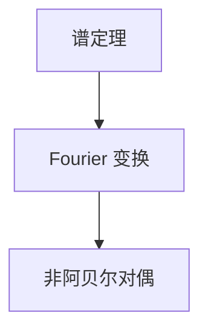

# 几何 Langlands 综述页 v1.0 · 起草总纲（Lead 版）

> 2026-11-27 · 项目负责人：lead
> 目标文件：`datasets/encyclopedia/pages/geometric-langlands.md`（v1.0，8 节 + 3 附录）
> 本目录：`datasets/encyclopedia/pages/work/survey-v1/`（起草过程稿，不合入正文）

## 0. 一句话

旧页（v0.3）拿 Laumon 2002 Bourbaki 906 当底本，太老。新页以 **Ben-Zvi 2026**（*What is the Geometric Langlands Correspondence about?*，arXiv:2605.23167v1）为**底本与叙事骨架**，以 **Scholze 2026 Bourbaki 1252 中译**为**证明主线**，以 **陈麟 2023 讲义中译**补技术细节、**Laumon 2002 + FGV 2002 + GLC I–V** 作历史层；每个概念挂资料卡，每条出处可回仓库文件。

## 1. 角色与产物

| 角色 | 产物 | 约束 |
|---|---|---|
| W1–W5（5 位起草者） | 各自一个 `sN-*.md` | 只写自己那节；不改主页面；不改别人的文件 |
| lead | 统稿成 `geometric-langlands.md` v1.0 | 负责删改、统一体例、补齐索引与总图 |
| R1–R2（2 位核对者） | 逐条核对报告 | 统稿后另派 |

每位起草者交：正文（带页级出处）+ 本节资料卡表 + 一张 mermaid 思维导图 + 易错点/待核清单。

## 2. 页面骨架（固定，不得增删节）

| 节 | 标题 | 底本对应 | 起草 |
|---|---|---|---|
| 0 | 导读：一句话、两个模空间、三条读法 | BZ26 p.1–2, 13 | W1 |
| 1 | 这是什么类型的命题：谱定理 → Fourier → 非阿贝尔对偶 | BZ26 §1 p.3–7 | W1 |
| 2 | 它在说什么：层论语言、Bun_G、谱侧、GL₁、主定理 | BZ26 §2 p.8–13 | W2 |
| 3 | 为什么成立：Hecke、因子化、对偶群的诞生、谱作用 | BZ26 §3 p.14–17 | W3 |
| 4 | 怎么变具体：Abel 化、Higgs 与 Hitchin | BZ26 §4 p.18–19 | W3 |
| 5 | 证明地图：五篇论文与 Scholze 路线 | BZ26 §5.1–5.3 p.20–23；SCH26 §1–7 | W4 |
| 6 | 证明细节：Whittaker、Eisenstein、Kac–Moody、尖点 | BZ26 §5.4–5.5 p.23–25；SCH26 §8–12 | W5 |
| 7 | 现状、开放问题、形式化（物理只留接口） | BZ26 §6 p.26–34；SCH26 §2.11–2.12 | W5 |
| 附录 A | 年表 1978–2026 | LAU02 / FGV / GLC I–V | W5 |
| 附录 B | 资料卡总索引（按节） | cards.tsv | lead |
| 附录 C | 证明思维导图（全页总图） | 五位各自的图 | lead |

正文合计 8,000–9,500 字（附录不计）。每位 1,400–2,400 字。

## 3. 五份分工

### W1 → `s1-intro-spectral.md`（§0 + §1，约 2,200 字）
- **§0**：一句话定义（自守层的代数谱定理）；两个模空间与两个范畴；为什么叫“几何”；三条读法（10 分钟／一天／一周）；记号表（k, X, G, Ĝ, Bun_G, Loc_Ĝ, D-mod, IndCoh_𝒩）。
- **§1**：有限维谱定理（V+T ↔ ℂ[t]-模）；Fourier 变换对偶平移/微分；范畴化三件套（函数→层、算子→函子、积分核→Fourier–Mukai 核）；非阿贝尔化（G→Ĝ、Hecke 交换族 ⇒ 同时对角化 ⇒ 谱侧是局部系统）；与经典 Langlands 的关系（函数域、Weil 罗塞塔，一句）。
- 底本页：BZ26 p.1–7；SCH26 §1 p.1–11（只取路线图地位）；陈麟 §1.1（几何类域论作为最小例子，p.5–8 附近）。
- 卡：`bzg/concept/spectral-theorem`、`algebraic-spectral-theorem`、`fourier-transform`、`categorical-fourier`、`categorical-harmonic-analysis`、`betti-mellin`、`glc-overview`。

### W2 → `s2-statement.md`（§2，约 2,300 字）
- 设定（char 0 / ℓ-adic；X 光滑射影；G 约化；无分歧）；自守侧 Bun_G（叠、非拟紧、无穷多分支）；谱侧 Loc_Ĝ（特征簇/derived reduction）与 IndCoh_𝒩（幂零支撑）。
- Hecke 特征层定义（H(K) ≅ E ⊠ K）；**两套不可约性约定**（Laumon 要 K 不可约，FGV 只要 K≠0）——必须单独成框。
- GL₁：Pic/Jac、Abel–Jacobi、Aut_E、几何类域论（Deligne/Laumon）、Fourier–Mukai。
- 主定理精确陈述（Shv(Bun_G) ≃ IndCoh_𝒩(Loc_Ĝ)，保持 QCoh 作用）；char 0 已证 / char p 条件的边界。
- 底本页：BZ26 §2 p.8–13；陈麟 ch1–2（书页 PDF−5）；LAU02 §1–2（中译页）；RAS23 §1.2。
- 卡：`bzg/concept/bun-g`、`loc-g-betti`、`loc-g-derham`、`glc-statement`、`indicoh-nilpotent-support`、`dual-group`、`picard-jacobian`、`hecke-operators`、`gl1-betti-glc`、`gl1-derham-glc` + `glc/concept/hecke-eigensheaf-general`、`geometric-class-field-theory`。

### W3 → `s3-hecke-spectral-action.md`（§3 + §4，约 2,400 字）
- **§3**：Hecke 叠与对应；H(K)；(X×X−Δ) 上的 S₂-等变；局部模型 Gr_G；几何 Satake（Sph_G ≃ Rep(Ĝ)）；**因子化是交换性的来源**；谱作用定理（QCoh(Loc_Ĝ) 作用 ↔ Hecke 作用）；“对偶群从交换性里被读出来”（Tannaka）。
- **§4**：Hitchin 纤维化、Higgs 丛、T*Bun_G；Dolbeault 变体；Abel 化/Higgs 机制（非阿贝尔→交换）；谱曲线与 Arinkin 渐近；为什么这让 GLC “可计算”（低亏格、可积系统）。物理只允许一句“S-对偶提供动机，详见别卷”。
- 底本页：BZ26 §3 p.14–17、§4 p.18–19；陈麟 §2.3–2.6（书页）；LAU02 §2–3；RAS23 §4。
- 卡：`hecke-operators`、`affine-grassmannian`、`spherical-hecke-category`、`geometric-satake`、`factorization`、`spectral-action`、`dual-group`、`higgs-bundles`、`hitchin-fibration`、`abelianization`、`dolbeault-glc`、`low-genus`。

### W4 → `s4-proof-map.md`（§5，约 2,300 字）
- 五篇论文的分工与**正确编年**（见 §6 红线）；Scholze 1252 的 12 节地图（§1 引言／§2 等价陈述／§3 Bun_G 上的层／§4 局部系统叠／§5 谱作用／§6 G_m／§7 Beilinson 投影子／§8 Frobenius 迹／§9 Whittaker／§10 Eisenstein／§11 Kac–Moody／§12 尖点）。
- 逻辑链：Langlands 函子构造 → 尖点层（Kac–Moody/opers）→ Eisenstein 归纳 → ambidexterity → 重数一；标出**每一步用哪篇论文**。
- 哪一步最难：ambidexterity／消没定理；Ben-Zvi 的“functional analysis”叙述（p.20–23）与旧 FGV 路线（消没→proper/IC→下降）的对照。
- 底本页：BZ26 §5.1–5.3 p.20–23；SCH26 §1–7（中译 p.1–38）；GLC I 卡（`glc1/*`）。
- 卡：`proof-map`、`eisenstein-series`、`whittaker-period`、`kac-moody-opers`、`beilinson-bernstein`、`feigin-frenkel`、`relative-langlands` + glc1 的 automorphic-category / spectral-category 等。

### W5 → `s5-proof-details-status.md`（§6 + §7 + 附录 A，约 2,600 字）
- **§6**：Whittaker 系数与“白光”；Frobenius 的迹；Eisenstein 级数与抛物诱导、常数项、重数一；Kac–Moody 局部化与 opers（Beilinson–Bernstein、Feigin–Frenkel）；尖点形式/尖点层；末尾用 150 字对照旧 Laumon/FGV 路线（Laumon 层→Fourier→洁净性→下降），只作历史注记。
- **§7**：已知（char 0 一般约化群；char p：p≫0 且 p 非挠、换 LocSys′；F_q 函数域定理）；未知（LocSys′=LocSys 一般 G、高秩函子性、正特征一般 p、分歧/局部/量子/Dolbeault）；形式化现状（Lean gap 卡 `laumon906-g01`，sorry=1，仅 GL₁ 语句骨架）；物理接口 ≤150 字。
- **附录 A**：年表（Drinfeld 1978 → Laumon 2002 → FGV 2002 → GLC I 2025b／II–IV 2024／V 2026／char p 2025a）。
- 底本页：BZ26 §5.4–5.5 p.23–25、§6 p.26–34；SCH26 §8–12（中译 p.38–53）、§2.11–2.12（p.14–15）。
- 卡：`whittaker-period`、`eisenstein-series`、`kac-moody-opers`、`beilinson-bernstein`、`feigin-frenkel`、`ramified-glc`、`local-langlands`、`function-field-langlands`、`quantum-glc`、`physics-s-duality`（只作接口）+ `raskin_glc/concept/cuspidal-sheaf` + `sy0246` 的 vanishing 卡。

## 4. 单份文件格式（严格照此，便于 lead 机械合稿）

```markdown
# sN · 标题

> 负责人：W N ｜ 覆盖：§x–§y ｜ 底本页：BZ26 p.a–b ｜ 字数：约 N

## 本节要回答
- 三到五条问题。

## §x 标题
正文段落……

### x.1 小节
……

## 本节资料卡
| 概念 | 卡 id | 卡文件（相对本目录） | 底本页 |
|---|---|---|---|
| 谱定理 | bzg/concept/spectral-theorem | ../../benzvi_glc/cards/concepts/spectral-theorem.json | p.3 |

## 出处对照
| 简称 | 仓库文件 | 页码基准 |
|---|---|---|
| BZ26 | ../../../08_source_code/SY02-10_几何朗兰兹对偶是什么？/工程文件/full.txt | PAGE n = 原文 p.n |

## 思维导图


## 易错点与待核
- 易错：……
- 待核：……
```

正文里**不要**重复整张资料卡表；概念首次出现用 `{{card:ID}}`（见 §5）。

## 5. 链接与引文（硬规则）

1. **概念 → 资料卡**：首次出现写 `{{card:ID}}`，ID 必须能在 `cards.tsv` 里查到。每节末尾“本节资料卡”表给**真实可点的相对链接**（用 cards.tsv 的 path 列），所以即使宏还没渲染器，读者也能点到 JSON。
2. **概念 → 百科词条**：`{{entry:geometry/xxx}}`（现有 3 个页面就是这么用的，合法 id 见 `datasets/encyclopedia/entries/`）。
3. **出处标记**：每个数学段落末尾给 `〔BZ26 p.13 §2.5〕` 这类标记；每节末尾“出处对照”表把简称映射到仓库文件。允许的简称：
   - `BZ26` = 底本全文 `08_source_code/SY02-10_几何朗兰兹对偶是什么？/工程文件/full.txt`，`PAGE n` 即原文 p.n；中译源码在同目录 `源码/chunks/`。
   - `SCH26` = `08_source_code/SY02-45_Scholze布尔巴基1252几何Langlands的证明/成品/SY02-45_..._中译注本.pdf`，页码=PDF 页。
   - `CL23` = `08_source_code/SY02-33_几何Langlands理论导论（陈麟）_中文译注校订版/成品/...pdf`，**书页 = PDF 页 − 5**（引用时写书页并注明 PDF 页）。
   - `LAU02` = `08_source_code/SY02-46_Laumon布尔巴基906Drinfeld-Langlands对应/成品/...pdf`，页边 `906--N` 为原文页。
   - `RAS23` = `08_source_code/SY02-47_Raskin射影曲线上的几何Langlands讲义/成品/...pdf`。
   - `LEAN` = `datasets/leanstmt/cards/statements/laumon906-g01.json`。
4. **逐字引文**只在真的逐字抄时用 `> [!quote] BZ26 p.13 — [full.txt](…)`；拿不准逐字就改写 + 出处，**不要伪造引号**。
5. arXiv 号可以写，但必须同时给仓库内可点的卡或译文；**不能只有 arXiv 链接**。
6. 相对链接路径含中文/空格时用尖括号写法：`[中译 p.19](<../../../08_source_code/…/成品/….pdf#page=19>)`。

## 6. 术语与红线（已由审校确认，违反即返工）

- 术语：**反常层**（不是错致层）、**Hecke 特征层**、**几何 Satake**、**谱作用**、**幂零支撑**、**消没定理**（vanishing）、**重数一**；`shtuka`、`leg`、`oper` 保留英文；Whittaker 层、尖点层。
- **Ψ=∞ 是复结构 J 的 B-模型，不是 I**（旧页与 KW 页写错过）。
- 五部曲编年：I = arXiv:2405.03599v3（2025b）；II–IV = 2024；V = arXiv:2409.09856v3（2026）；char p 是**独立**的 arXiv:2508.02237（2025a），条件 p≫0 且 p 不是 G 的挠素数；**Kazhdan 不在五部曲作者里**。
- `E^(d)` 只在 `X^(d)_rss` 上才是秩 n^d 的局部系统；`LocSys′ ≠ LocSys`，char p 必须写 ′。
- Drinfeld 对应属**中形式**（middle form），不是弱形式；出现 `h` 必须定义（对偶 Coxeter 数）。
- char 0 已证 ≠ 所有特征已证；F_q 函数域定理与 char 0 定理分开写。
- 形式化：只有 gap 卡（scope gap、sorry=1），**不许写“已形式化”**。
- 物理：§7 只留 ≤150 字接口，其余一字不写（Kapustin–Witten 归另一卷）。

## 7. 读法与预算

- 只读分配页；每页最多两条笔记；写进正文的每句都要能指到页；查不到就删，不凭印象补。
- 每人 30–60 页，上限 60 页（PDF 页）；整篇通读禁止。
- `07_refs_nlab/pages` 只作术语/方位（≤15 页），不作证据；香蕉空间只查术语表（`08_source_code/SY02-45_.../工程文件/tools/card04_banana.md`），不作证据。
- 卡片本身就是“已对齐原文页的中文重写”，可当二手中介；但**定理陈述必须回底本页**核对。

## 8. 交稿前自检（写进文件末尾）

- [ ] 每个 `{{card:…}}` 都在 cards.tsv 中；表格链接文件真实存在
- [ ] 每个数学段落有出处标记；无“凭印象”句
- [ ] 无手打定理（定理必须标 BZ26/SCH26/CL23/LAU02 页）
- [ ] mermaid ≤25 节点，方向清楚
- [ ] 字数达标；易错点 ≥3 条
- [ ] 没有越界写别的节（§5 不写 §6 的细节，§6 不重复 §5 的地图）
