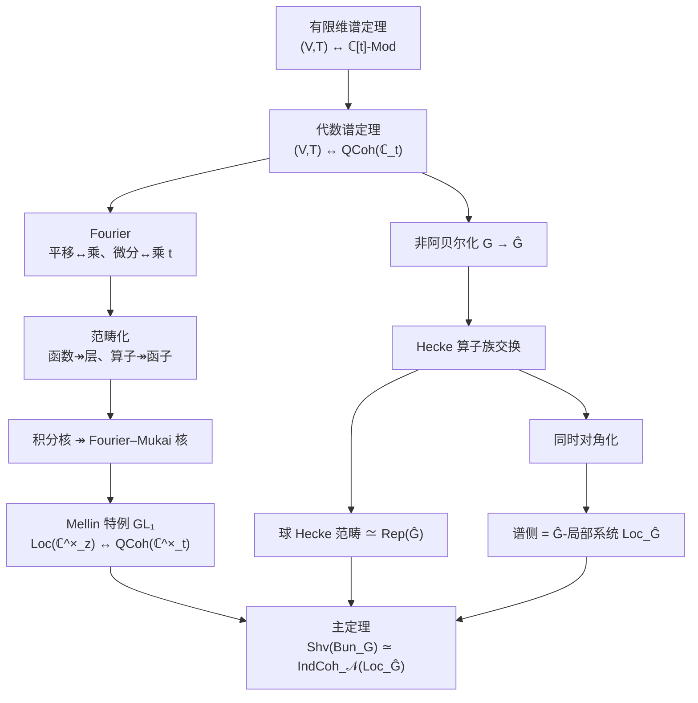
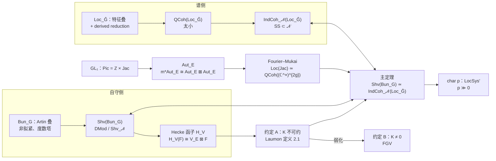
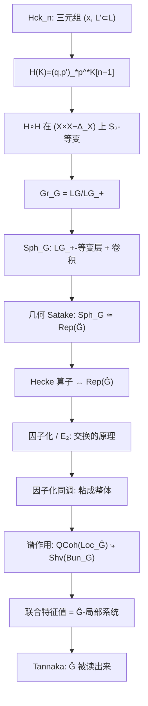
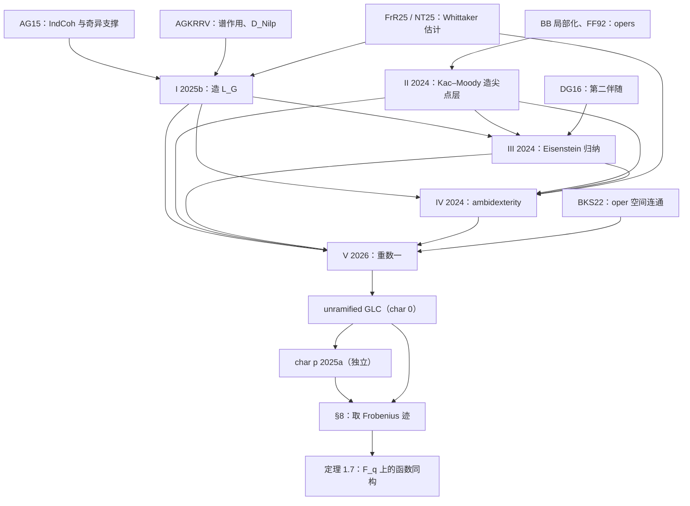
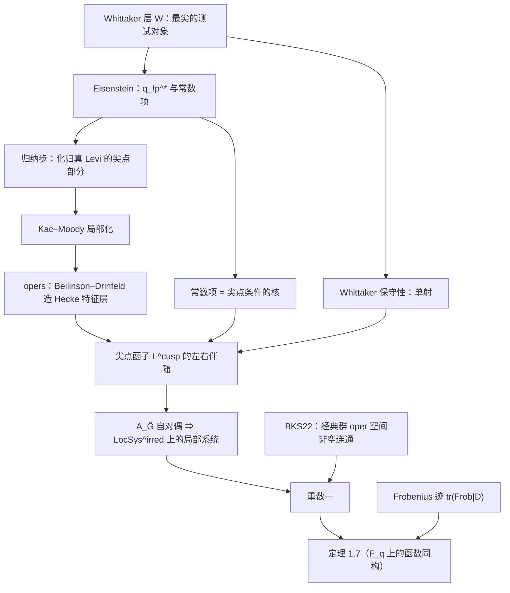
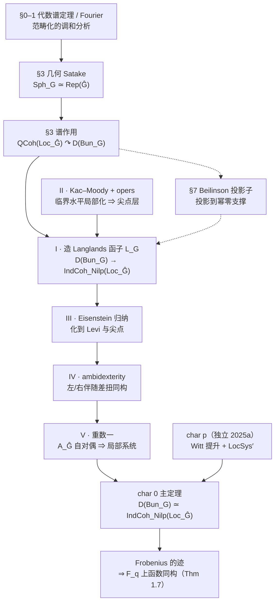

# 几何 Langlands 对应是什么：从谱定理到五部曲

> 本页是新版综述（v1.0，2026-11-27）。底本 Ben-Zvi 2026 负责叙事骨架，Scholze 2026 Bourbaki 1252 中译负责证明主线，陈麟 2023 讲义中译补技术细节，Laumon 2002 与 GLC I–V 作历史层。读法：概念旁的 card 宏打开资料卡；段末的〔…〕是出处，§0.6 给出简称到仓库文件的映射。旧页（以 Laumon 2002 为底本）已归档为 [v0.3](work/geometric-langlands-v0.3-2026-11-27.md)。

## 0 导读

### 0.1 一句话

几何 Langlands 对应（GLC）是**自守层的代数谱定理**：Bun_G 上的自守层可以分解为「单色」对象，这些对象同时对角化 Hecke 算子的作用，而对应的「颜色」或「频率」就是 Ĝ-局部系统 {{card:bzg/concept/glc-overview}}。底本摘要的原话是：它断言一类称为自守层的微分方程可分解为单色对象，后者对角化自然对称（Hecke 算子）的作用，并描述相应的颜色或频率（Langlands 参数）〔BZ26 p.1〕。

三件事要立刻钉住。其一，「对角化」是字面的：Hecke 算子构成一族两两交换的函子，交换性保证同时对角化存在。其二，特征值不是数，而是**局部系统**——一个几何对象；把「数」换成「空间」，正是整个理论从经典跨到几何的那一步。其三，被分解的不是某一个层，而是整个层范畴，所以 GLC 的结论是范畴等价，不是逐个对象的配对 {{card:bzg/concept/glc-statement}}〔BZ26 p.13 §2.5〕。

### 0.2 两个模空间、两个范畴、两个方向

A 侧（automorphic，问题侧）是 Bun_G，即 X 上 G-丛的模叠；GL_n 时它就是秩 n 向量丛的模叠 {{card:bzg/concept/bun-g}}。它扮演经典情形里「空间」的角色，要做的则是这个空间上的调和分析：把层按对称性拆开〔BZ26 p.7 §1.4.3〕〔BZ26 p.9 §2.2〕。B 侧（spectral，答案侧）是 Loc_Ĝ，即 Ĝ-局部系统的模叠——基本群到 Ĝ 的表示空间，扮演频率空间或颜色空间 {{card:bzg/concept/loc-g-betti}}；de Rham 版取带平坦联络的 Ĝ-丛，与 Betti 版解析上相同、代数上不同 {{card:bzg/concept/loc-g-derham}}〔BZ26 p.11 §2.3〕。

两个范畴因此是：自守侧 Shv(Bun_G)（de Rham 版为 D-mod(Bun_G)），谱侧 QCoh(Loc_Ĝ)，精确形式换成 IndCoh_𝒩(Loc_Ĝ) {{card:bzg/concept/indicoh-nilpotent-support}}。方向是「谱侧 → 自守侧」：给一个 Ĝ-局部系统 E，得到 Bun_G 上一个以 E 为特征值的 Hecke 特征层 Aut_E；整体形式把这个逐点构造升级为函子〔BZ26 p.13 §2.5〕〔CL23 书页 p.3（PDF 8）〕。

方向在两侧并不对称。数域 Langlands 里 Galois 侧是神秘的、自守侧是已知的，信息从自守流向 Galois；GLC 里两侧都是代数量，方向被拉平了〔BZ26 p.8 §1.4.4〕。

### 0.3 为什么叫「几何」

经典 Langlands 的舞台是数域 F 与其绝对 Galois 群，对象是 G(F) 的表示；GLC 同时换掉三样东西：数域换成 ℂ 上的光滑射影曲线 X（等价地，紧 Riemann 面），表示换成 X 上的层，Galois 表示换成基本群到 Ĝ 的局部系统〔BZ26 p.6–7 §1.4〕。所以「几何」不是修饰词，而是说这套对应住在曲线、层、模叠这三件几何物件上，不住在数域与表示上。

Weil 罗塞塔把这件事讲得最清楚：三栏并置——数域、F_q 上的函数域、代数闭域上的曲线，同一套猜想各有版本，第三栏就是几何版〔SCH26 p.1–2〕。函数域那一栏说明了曲线为何自然：它和 ℂ 上的曲线共享同一套「点—局部域—整体域」结构〔SCH26 p.7–8〕。第三栏能做得更细，是因为在 ℂ 上「层」与「局部系统」都是代数几何对象，可以谈范畴、谈六函子，而不只是谈迹函数〔BZ26 p.2〕。

### 0.4 三条读法

- **10 分钟**：只读 §0–§2。读完应能说出「两个模空间、一个范畴等价、Hecke 对角化」这三件事，并知道 GL₁ 的答案长什么样（Fourier–Mukai）。
- **一天**：§0–§5。加上 Hecke 函子、球 Hecke 范畴与几何 Satake，理解交换性从哪来，以及为什么谱侧必须是 IndCoh_𝒩 而不是 QCoh。
- **一周**：全页加附录。补上证明主线的编年（五部曲与 char p 的独立论文）、Whittaker 归一化与 Eisenstein 部分，以及形式化现状。

这个梯度的设计原则是每层回答一个「为什么」，而不只是加细节：10 分钟那层回答「断言什么」，一天那层回答「为什么可能」，一周那层回答「凭什么相信」。

### 0.5 记号表

| 记号 | 含义 | 首次出现 |
| --- | --- | --- |
| k | 基域；几何情形取 ℂ，函数域情形取 F_q | §0 |
| X | k 上光滑射影曲线，ℂ 上即紧 Riemann 面 | §0 |
| G | k 上连通约化群 | §0 |
| Ĝ | Langlands 对偶群，由根数据对偶得到 | §1.4 |
| Bun_G | X 上 G-丛的模叠 | §0.2 |
| Loc_Ĝ | Ĝ-局部系统的模叠（Betti 与 de Rham 两版） | §0.2 |
| D-mod | 代数 D-模的导出范畴 | §0.2 |
| IndCoh_𝒩 | 幂零奇异支撑的指示凝聚范畴，谱侧的精确选择 | §0.2 |

### 0.6 引用与页码约定

本页所有〔…〕标记按下列简称书写；点文件名可回到仓库内文献本身。页码约定已按各自 PDF 的页码基准核对过。

| 简称 | 仓库文件 | 页码基准 |
| --- | --- | --- |
| BZ26 | [full.txt](../../../08_source_code/SY02-10_几何朗兰兹对偶是什么？/工程文件/full.txt) | `===== PAGE n =====` 的 n |
| SCH26 | [中译注本 PDF](../../../08_source_code/SY02-45_Scholze布尔巴基1252几何Langlands的证明/成品/SY02-45_Scholze布尔巴基1252几何Langlands的证明_中译注本.pdf) | PDF 页 |
| CL23 | [导论中译 PDF](<../../../08_source_code/SY02-33_几何Langlands理论导论（陈麟）_中文译注校订版/成品/几何Langlands理论导论（陈麟）_中文译注校订版.pdf>) | 书页 = PDF 页 − 5 |
| RAS23 | [Raskin 中译注本](<../../../08_source_code/SY02-47_Raskin射影曲线上的几何Langlands讲义/成品/SY02-47_Raskin射影曲线上的几何Langlands讲义_中译注本.pdf>) | 书页（页边） |
| LAU02 | [Laumon 中译注本](<../../../08_source_code/SY02-46_Laumon布尔巴基906Drinfeld-Langlands对应/成品/SY02-46_Laumon布尔巴基906Drinfeld-Langlands对应_中译注本.pdf>) | 页边 `906--N` |
| GLC I | [GLC I 中译](../../../08_source_code/SY02-35_几何Langlands猜想I_函子的构造/成品/SY02-35_几何Langlands猜想I_函子的构造_v1.0.pdf) | 论文页 p.12–15 |
| LEAN | [laumon906-g01.json](../../leanstmt/cards/statements/laumon906-g01.json) | 卡片字段（scope/sorry_count） |

## 1 这是什么类型的命题：谱定理 → Fourier → 非阿贝尔对偶

### 1.1 谱定理：从分析到代数

分析版是原型：Hilbert 空间上的自伴算子 H 酉等价于某个直积分上「乘 t」的算子，H 由坐标函数 t 的乘法给出，这就是函数演算；注意直积分是沿 ℝ_t 的连续叠加，不能用直和顶替 {{card:bzg/concept/spectral-theorem}}〔BZ26 p.3 §1.1〕。

最简的谱定理则连分析都不需要。取有限维复向量空间 V 与自同态 T：数据 (V, T) 与「V 上的 ℂ[t]-模结构」是同一件事——t 作用为 T，多项式 p(t) 作用为 p(T)，这就是函数演算 {{card:bzg/concept/algebraic-spectral-theorem}}。于是「把 T 对角化」翻译成「把这个模分解为特征线之直和」：特征值 λ 对应极大理想 (t−λ)，广义特征空间对应 Jordan 块，n×n 块恰好是模 ℂ[t]/t^n，即 0 的 (n−1) 阶无穷小邻域上的秩 1 族〔BZ26 p.4 §1.3.1〕。

升级一步就是几何形状：(V, T) 的整体等价于 ℂ_t 上的拟凝聚层，即「t 轴上的一个向量空间族」。原型因此有了三行对照：向量空间 ↠ 范畴，自同态 ↠ 函子，ℂ[t]-模 ↠ QCoh(ℂ_t) {{card:bzg/concept/categorical-harmonic-analysis}}〔BZ26 p.4〕。GLC 的全部野心，就是把这三行里的「向量空间」换成 Bun_G 上的层、「自同态」换成 Hecke 函子。

### 1.2 Fourier 变换：同一件事的可算版本

Fourier 变换让谱定理变成可算的：x 侧的平移变成 t 侧乘 e^{2πiat}，x 侧的微分 d/dx 变成 t 侧乘 2πit，卷积变成逐点乘法 {{card:bzg/concept/fourier-transform}}。换句话说，Fourier 把一组交换算子整体变成乘法算子，「同时对角化」就是这样实现的；而 f̂(t) = ∫ f(x)e^{−2πixt}dx 正是「把 f 拆成特征函数 e^{2πixt} 的叠加」的具体写法〔BZ26 p.4 §1.2〕。

底本给了一张对照表：e^{iλx} ↔ ℂ_λ（特征向量），f(x) ↔ H（被分解的对象），指数的积分 ↔ 特征空间的直积分，数 λ ↔ 向量空间 ℂ_λ，L²(ℝ) ↔ 酉表示范畴。据此它说：谱定理本身可以看作范畴化的 Fourier 变换〔BZ26 p.4〕。这不是类比修辞，而是同一个陈述在两层范畴里各显一次形。把群换成 ℤ、把 ℝ 换成 ℂ^×，就得到 Mellin 版本：Loc(ℂ^×_z) ≃ QCoh(ℂ^×_t)，单值性 t 的特征值就是颜色 {{card:bzg/concept/betti-mellin}}〔BZ26 p.5 §1.3.2〕。

### 1.3 范畴化三件套

把语言提到范畴层，替换规则只有三行：函数空间 ↠ 层范畴，算子 ↠ 函子，积分核 ↠ Fourier–Mukai 核 {{card:bzg/concept/categorical-fourier}}。核 K ∈ Shv(X×Y) 给出函子 FM_K(F) = p_{Y!}(p_X^*F ⊗ K)，其中 p_X^* 是限制（拉回）、⊗ 是乘法、p_{Y!} 是积分（沿纤维的紧支撑推前）。底本把这一族构造统称 categorical Fourier transforms，并点明 Mukai 1981 的核与 Fourier–Malgrange/Sato/Deligne 的版本都在配对的模空间之间交换卷积与张量〔BZ26 p.6 §1.3.3〕。GLC 的困难被底本一句话定位：这套理论的非阿贝尔对应〔BZ26 p.6〕。

一句必须写下的警告：范畴化不是逐字替换公式。紧支撑与增长条件在函数层是「选哪个函数空间」，到了范畴层变成 ! 与 * 的选择；选错，等价只在光滑点成立。IndCoh_𝒩 正是为这个选择买单 {{card:bzg/concept/categorical-harmonic-analysis}}〔BZ26 p.13 §2.5〕〔CL23 书页 p.5（PDF 10）〕。

### 1.4 非阿贝尔化：从 G 到 Ĝ

阿贝尔情形（G = GL₁ 或环面）里，Hecke 算子就是「按点修改丛」，谱侧是 Pic 或对偶环面，Fourier–Mukai 直接给出对应；GL₁ 的无分歧几何类域论已经是定理 {{card:glc/concept/geometric-class-field-theory}}〔BZ26 p.12 §2.4〕〔CL23 书页 p.2–3（PDF 7–8）〕。非阿贝尔的困难在于：修改丛不再由点参数化，而要取 Gr = LG₊\LG/LG₊ 的双陪集，其轨道对应 Ĝ 的不可约表示（最高权）〔BZ26 p.14 §3.1〕。

于是 Ĝ 出现了，而且是被「逼」出来的：Hecke 算子要交换，球 Hecke 范畴 Sph_G 就必须是交换幺半范畴；几何 Satake 把它等同于 Rep(Ĝ) 的一个版本，Ĝ 的表示环因此就是 Hecke 算子的共同谱 {{card:bzg/concept/dual-group}}〔BZ26 p.14 §3.1〕。这条链是：Hecke 族交换 ⇒ 同时对角化 ⇒ 谱侧是 Ĝ-局部系统。底本说得更重——「GLC 给出 Ĝ 从哪来的根本描述」〔BZ26 p.6–7 §1.4〕。这里只留一句预告：对偶群可以从交换性里读出来，而交换性的来源是 factorization algebra 提供的隐藏结构，留给 §3。

### 1.5 与经典 Langlands 的关系

几何版不是经典版的替代，而是它在函数域一栏的范畴化。经典陈述配对「G(F) 的尖点表示」与「Galois 表示（或 L-参数）」；几何陈述配对「Bun_G 上的层范畴」与「Loc_Ĝ 上的（指示）凝聚范畴」〔BZ26 p.7 §1.4.3〕〔SCH26 p.1–2〕。前者里的每个不可约对象对应后者里的一个单色对象（Hecke 特征层），但后者还多出可约对象、导出结构与非单色层——这些正是几何版多出来的信息〔CL23 书页 p.3（PDF 8）〕。函数域情形经典侧已定理化，几何侧 char 0 的主定理是另一条线：两者是同一罗塞塔的两栏，不是谁蕴含谁〔SCH26 p.7–9〕。

### 本节思路图

### 易错点

- **把 GLC 说成「自守表示 ↔ Galois 表示」**。几何版配对的是范畴，不是单个对象；单色对象（Hecke 特征层）只是特例，且可约局部系统对应的是特征对象而非层 {{card:bzg/concept/glc-overview}}〔CL23 书页 p.3（PDF 8）〕。
- **把谱定理当成已经给出 GLC**。谱定理只是形状与直觉来源；非阿贝尔化需要额外输入（对偶群、球 Hecke 范畴、几何 Satake），定理本身要引用 [GR24a] 一线的工作。
- **把 Ĝ 当成 G 本身**。只有 GL_n、SO_{2n} 这类自对偶群成立；SL_n 对偶于 PGL_n，环面 T 对偶于 T̂ {{card:bzg/concept/dual-group}}。

## 2 它在说什么：两个模空间与主定理

### 2.1 设定：一条曲线、一个群、两套系数

几何 Langlands 的舞台是三元组（X, G, 系数域）。X 是域 k 上光滑射影连通曲线，k=ℂ 时即紧 Riemann 面；G 是 k 上连通约化群，其对偶群 Ĝ 由根数据对偶得到 {{card:bzg/concept/dual-group}}。系数侧有三栏：k=ℂ 的 Betti 层（局部系统即基本群表示）、char k=0 的 de Rham D-模（带平坦联络的向量丛）、任意 k 上 ℓ≠char k、系数 Q̄_ℓ 的 ℓ-adic 层〔RAS23 书页 2 §1.1〕〔LAU02 906--1〕。三种语言是同一份罗塞塔，不是三个定理；本节主写 Betti 与 de Rham，ℓ-adic 只在对照处出现。

「无分歧」是这套设定的减法：X 不挖洞，不给点加 level 结构，不谈分歧，Hecke 算子在每个闭点都有定义，两侧对象都在处处无分歧的范围内。代价是只覆盖 GLC 的 base case；好处是两侧仍是「整体」对象，不必先搭局部理论再拼回去。底本说得直白：只谈无分歧情形，而它正是已有定理的那一支〔BZ26 p.9 §2.2〕。

### 2.2 自守侧：Bun_G 是一个不拟紧的叠

自守侧的对象是 Bun_G，X 上 G-丛的模叠：Bun_G(S) 是 X×S 上 G-挠子的群胚，等价地是 X×S → S 的截面叠 {{card:bzg/concept/bun-g}}。它是 Artin 叠，对角仿射，并有一列有限型的开子叠把它穷竭〔CL23 书页 12（PDF 17）定理 2.2.1〕。也可写成 Bun_G = G(F)\G(A_C)/G(O_A)，F=k(C) {{card:bzg/concept/adelic-uniformization}}〔CL23 书页 12（PDF 17）〕。

其一，它不是概形而是叠：一个点自带自同构群，G=GL₁ 时线丛的自同构群是 ℂ^×。所以「Bun_G 上的函数」必须换成「Bun_G 上的层」，而层范畴要按叠来取〔CL23 书页 12（PDF 17）〕。

其二，它不拟紧：度数的绝对值无界，一个固定的连通分支 Bun_G^d 也未必拟紧；G=GL_n 时它甚至不连通，连通分支按度数 d 编号〔CL23 书页 13（PDF 18）注 2.2.3〕。逐次扩张线丛把分支拉成无限长的「尾巴」——所以不能「取个紧化就完事」：截掉不稳定部分会同时截掉 Hecke 对应。

其三，Shv(Bun_G) 因此不是有限型叠上那种层范畴，要先 Ind-完备化再取导出范畴。de Rham 侧的对象是 DMod(Bun_G)；Betti 侧是可构造层，并且还要允许沿幂零方向带奇异性的对象，记 Shv_𝒩(Bun_G)，两侧统称 Shv(Bun_G)〔BZ26 p.13 §2.5〕。

Hecke 结构由一个对应图给出：Hecke 叠记录「在 X 的一个移动点处对丛作一次修改」，两个投影分别记下修改前与修改后的丛，`supp` 记下移动点；它的局部模型是仿射 Grassmann 簇 Gr = LG/L⁺G {{card:bzg/concept/affine-grassmannian}}。对 V ∈ Rep(Ĝ) 取几何 Satake 层 Sat_V，得到 Hecke 函子 H_V: D(Bun_G) → D(X×Bun_G)，F ↦ (supp, h→)_!(m*Sat_V ⊗ h←^*F) {{card:glc/concept/hecke-eigensheaf-general}}〔CL23 书页 14（PDF 19）〕。Ĝ 正是在这一步被逼出来的：Perv_{L⁺G}(Gr) ≃ Rep(Ĝ)，轨道 IC 层对应最高权表示 {{card:bzg/concept/geometric-satake}}〔CL23 书页 14（PDF 19）§2.5〕。

特征方程于是写成：若对每个 V 都有函子性同构 H_V(F) ≅ V_E ⊠ F，且与张量积相容，则称 F 是以 E 为特征值的 Hecke 特征层；GL_n 的经典写法是 H(K) ≅ E ⊠ K {{card:bzg/concept/hecke-operators}}〔LAU02 906--7〕。这里 E 是 X 上 Ĝ-局部系统，V_E 是沿 E 拉回的局部系统，⊠ 是外张量积。这些函子两两交换，来源是球 Hecke 范畴 {{card:bzg/concept/spherical-hecke-category}}〔CL23 书页 14（PDF 19）〕；技术含义留给 §3。

### 2.3 框：两套不可约性约定

同一句 H(K) ≅ E ⊠ K，在两篇文献里对 K 的要求不同，后果也不同，不能互换。这是全节最容易写错的一处，所以单独成框。Laumon 在 GL_n 情形工作，对象空间是 X 上秩 n 丛的叠 Fib_n(X)，连通分支按次数编号 Fib_n^d；E 是 X 上秩 n 的不可约局部系统，K 是 Fib_n(X) 上的反常层〔LAU02 906--7〕。

| 项 | Laumon 定义 2.1（原书 p.7） | FGV 定义（仓库无中译，待核） |
| --- | --- | --- |
| 对 K 的要求 | K 是不可约反常层 | 只要求 K ≠ 0 |
| 特征方程 | H(K) ≅ E ⊠ K | 同左 |
| 附加条件 | (H∘H)(K) ≅ E⊠E⊠K 限制到 (X×X−Δ)×Fib_n 上 S₂-等变 | 同左 |
| 得到的结论 | 存在 Aut_E，在每个连通分支上不可约 | 存在非零的 Hecke 特征层 |
| 唯一性 | 在不可约类里谈「那个」特征层 | 特征层成范畴，不唯一 |

Laumon 那一套见〔LAU02 906--7〕：他先要求 E 是秩 n 的不可约局部系统，再要求 K 不可约，两条一起才给出定义；结论也强——定理 2.2 的 Aut_E 到每个连通分支 Fib_n^d 的限制不可约〔LAU02 906--8〕。FGV 那一套把 K 的要求降到非零，因为对一般约化群，能证的正是「存在非零特征层」，不可约性是额外结论而非前提。

后果有三条。第一，强度方向单一：Laumon 式推出 FGV 式，反之不成立。第二，「那个特征层」只在不可约类里说得出口；只要求非零时，特征层对直和与扩张封闭，构成范畴，说不上唯一。第三，两者的断言对象不同：FGV 式是存在性陈述，而 Laumon 式是带不可约性附加物的存在性陈述，不能互相冒充〔LAU02 906--7〕。

### 2.4 谱侧：Loc_Ĝ、derived reduction、幂零支撑

谱侧的对象是 Loc_Ĝ，Ĝ-局部系统的模叠，扮演频率空间或颜色空间。它有两套 flavor，且两套不能混写〔BZ26 p.11 §2.3〕。

Betti 版是特征簇：Loc^B_Ĝ(C) = {(A_i,B_i) ∈ Ĝ^{2g} : ∏_{i=1}^{g} [A_i,B_i] = 1}/Ĝ，即 2g 个生成元到 Ĝ 的表示模共轭 {{card:bzg/concept/loc-g-betti}}〔BZ26 p.11 §2.3〕。GL₁ 时它就是 (ℂ^×)^{2g}。两点须知。第一，它是叠不是簇：表示自带自同构群。第二，定义方程 ∏[A_i,B_i]=1 通常不横截，直接取商得到的不是正确的对象，还须补一次 derived reduction，底本把这个修正写进脚注，与 stacky ℂ^× 一并交代〔BZ26 p.11 §2.3 脚注 4〕。一句话：derived 就是别把非横截方程当簇算。

de Rham 版是带平坦联络的 Ĝ-丛 {{card:bzg/concept/loc-g-derham}}。它是 Bun_Ĝ 某个拟紧开子集上的仿射丛（扭曲余切丛）；解析上与 Betti 一致（Riemann–Hilbert），代数上更「胖」，甚至不仿射。g=1、G=GL₁ 时两版一个是 (ℂ^×)²、一个是椭圆曲线上的 ℂ-丛，Serre 的例子〔BZ26 p.11 §2.3〕。

为什么不是 QCoh(Loc_Ĝ)？QCoh 只记得「向量丛式」对象，而自守侧含摩天楼型的奇点对象：没有有限向量丛分解，只能作为「广义函数」出现。IndCoh 正是补这个缺口的扩张，它允许奇异支撑，Hom 与张量积都与 QCoh 不同 {{card:bzg/concept/indicoh-nilpotent-support}}〔BZ26 p.21–22 §5.1〕。

那为什么也不是整个 IndCoh？因为并非所有方向的奇性都该允许。[AG15] 定出的条件是奇异支撑落在 Loc_Ĝ 的整体幂零锥 𝒩 内：SS(F) ⊂ 𝒩。只允许幂零方向的奇性，不许环面方向——GL₁ 时幂零锥只剩零截面，IndCoh_𝒩 退回 QCoh，与早已懂透的经典情形吻合。记这个子范畴为 IndCoh_𝒩(Loc_Ĝ)，它把 QCoh 收作零奇异支撑的那一部分 {{card:bzg/concept/indicoh-nilpotent-support}}〔BZ26 p.21 §5.1〕。

### 2.5 GL₁：Pic、Abel–Jacobi、Aut_E 与 Fourier

GL₁ 是唯一能从头走到尾的情形，也是检验全部约定是否自洽的地方〔BZ26 p.12 §2.4〕。

先看左侧。G=GL₁ 时 Bun_G = Pic(C)，而 Pic(C) ≅ ℤ × Jac(C)：度数给出 ℤ 这一项，单位分支是雅可比簇。这个分裂并不典范，要选定一个度数 1 的线丛才定得下来 {{card:bzg/concept/picard-jacobian}}。Jac(C) = H¹(C,O)/H¹(C,ℤ) ≅ (S¹)^{2g} 是复环面而不是向量空间；Abel–Jacobi 把 C 嵌进 Jac(C)，x ↦ O_X([x]−[x₀])〔LAU02 906--5〕〔BZ26 p.10 §2.2〕。

再看右侧。给定 X 上一个秩 1 局部系统 E，定理（Laumon 定理 1.2）断言存在 Pic⁰(X) 上唯一的秩 1 局部系统 Aut_E，它在原点刚性化，满足 φ*Aut_E = E，并且对群运算 m: Pic⁰×Pic⁰ → Pic⁰ 有典范同构 m*Aut_E ≅ Aut_E ⊠ Aut_E〔LAU02 906--5〕。这正是「特征层」在 GL₁ 的形状：沿群运算，Aut_E 像乘法特征。把 Hecke 方程写出来就是 χ_σ|_{L(x)} ≅ χ_σ|_L ⊗ σ_x，再加归一化 χ_σ|_{O_X} ≅ 1 {{card:bzg/concept/gl1-betti-glc}}〔RAS23 书页 2 §1.2〕。

这两条合起来就是无分歧几何类域论：Jac 的覆叠（π₁(Jac) 的表示）与 C 上阿贝尔覆叠（π₁(C)^{ab} 的表示）经 Abel–Jacobi 等同，且与 Hecke 算子相容〔RAS23 书页 2–3 §1.2〕〔BZ26 p.12 §2.4〕。古典侧（Deligne）它对应非分歧特征标与 Galois 特征标的几乎双射，由 ξ(π_v) = ρ(Fr_v) 刻画；「几乎」是因为 Q̄_ℓ^× 完全不连通 {{card:glc/concept/geometric-class-field-theory}}〔CL23 书页 5（PDF 10）定理 1.1.1〕。

范畴化之后，Betti 版是 Loc(Jac(C)) = Rep(ℤ^{2g}) ≃ QCoh((ℂ^×)^{2g}) = QCoh(Loc^B_{GL₁}(C))，实现方式是 Fourier–Mukai，核来自 Poincaré 丛；Jac 上的平移对应张量积，Abel–Jacobi 保证这个等价与几何类域论相容 {{card:bzg/concept/gl1-betti-glc}}〔BZ26 p.12 §2.4〕。de Rham 版是 DMod(Jac(C)) ≃ QCoh(Loc^dR_{GL₁}(C))（Laumon–Rothstein）；它只在导出范畴层成立，是 Mukai 对偶阿贝尔簇上 Fourier 变换的增强版，不是 Abel 范畴的等价 {{card:bzg/concept/gl1-derham-glc}}〔BZ26 p.12–13 §2.4〕。两版的点是同一批，范畴却不同——这就是「两套 flavor 不能混写」的最小例子。

### 2.6 主定理：精确陈述

把两侧接起来，主定理的精确形式是 Shv(Bun_G) ≃ IndCoh_𝒩(Loc_Ĝ)。它对两套 flavor 各成立一次：de Rham 侧左边是 DMod(Bun_G)，Betti 侧左边是 Shv_𝒩(Bun_G)。定理的另一半是作用相容——谱侧 QCoh(Loc_Ĝ) 经 spectral action 作用于 Shv(Bun_G)，等价把它送到 IndCoh_𝒩(Loc_Ĝ) 的自然张量积作用 {{card:bzg/concept/glc-statement}}〔BZ26 p.21–22 §5.1〕。

底本 §2.5 先给的其实是 QCoh 版，并立刻自注 not quite correct as stated，把修正指向 §5.1〔BZ26 p.13 §2.5〕。所以引用时必须带上 𝒩：写成 QCoh(Loc_Ĝ) 是弱形式，写成 IndCoh(Loc_Ĝ) 则丢掉幂零支撑条件、范畴太大，两种写法都会把定理说成假的。

证明状态要分两栏写，不能合并。char 0 已经是定理，由五篇论文合成（[GR24a]、[ABC⁺24b]、[CCF⁺24]、[ABC⁺24a]、[GR24b]）〔BZ26 p.13 §2.5〕。char p 只有条件版本：要求 p 相对 G 充分大，还要排除与 G 有关的坏素数（即 p 非挠），并把 Loc_Ĝ 换成开闭子叠 LocSys′_Ĝ；LocSys′ ≠ LocSys，条件版本不能当无条件定理用〔SCH26 p.8〕。细节归 §7。

记住：这是范畴等价加作用相容，不是「每个 E 配一个层」；逐对象配对还要补重数一与归一化（§5）〔BZ26 p.21–22 §5.1〕。

### 本节思路图

### 易错点

- **把 IndCoh_𝒩 写成 IndCoh**：丢掉「奇异支撑落在幂零锥内」，等价就不成立；𝒩 是定理的一部分 {{card:bzg/concept/indicoh-nilpotent-support}}〔BZ26 p.21–22 §5.1〕。
- **把 Loc_Ĝ 当普通概形**：它是有自同构的叠，Betti 版还要 derived reduction；g=1、GL₁ 时两 flavor 的差别不能抹平 {{card:bzg/concept/loc-g-betti}}〔BZ26 p.11 §2.3〕。
- **把 E^(d) 的秩结论推广到非 rss 点**：它只在 X^(d)_rss 上是秩 n^d 局部系统；全空间上只是可构造层，纤维是 ⊗_x Sym^{d_x}E_x 〔LAU02 906--6〕。
- **把 char p 的 LocSys′ 当定理**：LocSys′ 是 LocSys 的开闭子叠，char p 只有条件版（p 充分大），不能与 char 0 的无条件陈述并列 {{card:bzg/concept/glc-statement}}〔SCH26 p.8〕。
- **混用两套不可约性**：FGV 的存在性推不出不可约性，Laumon 的定义也管不到所有特征层〔LAU02 906--7〕。
- **把 QCoh(Loc_Ĝ) 当最终答案**：底本 p.13 的 QCoh 版自称 not quite correct，正确形式在 §5.1〔BZ26 p.13 §2.5〕。

## 3 为什么成立：Hecke、因子化与谱作用

§2 写完陈述，未解释它凭什么成立。底本把理由压成一句：$\operatorname{Bun}_G$ 线性化之后出人意料地像一个阿贝尔群〔BZ26 p.14 §3〕。有两个化身：Hecke 算子两两交换 {{card:bzg/concept/hecke-operators}}，相空间里的 $\operatorname{Bun}_G$ 一般地像 Jacobian〔BZ26 p.14 §3〕。本节走前者，§4 走后者〔BZ26 p.14 §3〕。

### 3.1 Hecke 算子：交换性被写成一个等变条件

记号接着 §2，不再推导：$\operatorname{Hck}_n(X)$ 参数化三元组 $(x,L'\subset L)$，两张图 $p:\operatorname{Hck}\to\operatorname{Fib}$、$(q,p'):\operatorname{Hck}\to X\times\operatorname{Fib}$，$H(K)=(q,p')_*p^*K[n-1]$；$(q,p')$ 的相对维数 $n-1$ 就是移位的来源〔LAU02 906--7〕；要记住三件事〔BZ26 p.14 §3.1〕。

其一，$\hat G$ 在此只是组合对象：$x$ 处的修改由双陪集 $\operatorname{Gr}=LG_+\backslash LG/LG_+$ 参数化，高斯消元的变体给出这些轨道与「对偶环面特征的 Weyl 轨道」的一一对应，再经最高权到 $\hat G$ 的不可约表示；此处的 $\hat G$ 只是「有对偶环面、同一 Weyl 群」的产物〔BZ26 p.14 §3.1〕。

其二，双陪集没有结合乘法，线性化之后才有：测度上得到 Hecke 代数，换成层得到 $\operatorname{Sph}_G=\operatorname{Shv}(\operatorname{Gr})^{LG_+}$ 与 $F*G=m_!(F\boxtimes G)$ {{card:bzg/concept/spherical-hecke-category}}〔BZ26 p.15 §3.1〕。

其三，交换性只以等变条件的形式出现：同一点两次长度 $1$ 的修改叠成一次长度 $2$ 的修改，次序无从互换，规律是 $H^V_x\circ H^W_x\simeq H^{V\otimes W}_x$，与交换性无关〔RAS23 PDF p.15 §4.1〕。只有 $x\neq x'$ 时才有「先做哪一个」的对称性，故迭代 $H\circ H$ 的等变要求只加在对角线外：它在 $(X\times X-\Delta_X)\times\operatorname{Fib}_n(X)$ 上关于交换两个 $X$ 因子的 $S_2$ 作用是等变的〔LAU02 906--7〕。这是交换性的技术形态——不是算子等式，而是一族定义在构形空间开集上的等变同构，是一个**结构**〔CL23 书页 15（PDF 20）§2.11〕。对角线上没有它，这个缺口正是 3.3 要补的〔BZ26 p.15 §3.2〕。

### 3.2 局部模型与几何 Satake

局部模型是 $\operatorname{Gr}_G=LG/LG_+$ {{card:bzg/concept/affine-grassmannian}}：$LG=G((t))$，$LG_+=G[[t]]$，Cartan 分解按优势余权给出 Schubert 胞腔 $\operatorname{Gr}_G^\lambda$，$\lambda$ 跑遍 $\hat G$ 的最高权〔BZ26 p.14 §3.1〕〔CL23 书页 15（PDF 20）§2.12〕。几何 Satake 说卷积与张量是同一件事——一个对称 monoidal 等价：

$$\operatorname{Sph}_G\simeq\operatorname{Rep}(\hat G),\qquad \mathrm{IC}_{\operatorname{Gr}^\lambda}\leftrightarrow V^\lambda,$$

由 Lusztig–Ginzburg–Mirković–Vilonen 证得，导出算术版见 BF08 {{card:bzg/concept/geometric-satake}}〔BZ26 p.16 §3.3–3.4〕。「按表示分类」于是有了确切含义：每个 $V\in\operatorname{Rep}(\hat G)$ 给出 $H^V$，同一点满足 $H^{V\otimes W}=H^V\circ H^W$〔RAS23 PDF p.15 §4.1〕。

### 3.3 因子化：交换性的原理

为什么卷积交换？答案在 $\operatorname{Gr}_G$ 的同伦类型：它描述「圆盘外平凡的 $G$-丛」，$\simeq\Omega^2BG$，自带同伦交换的乘法〔BZ26 p.15 §3.2〕。这是 $E_n$-operad 的机制：$\pi_2$ 交换而 $\pi_1$ 不交换——二维圆盘里两个圈有空间绕开。Beilinson–Drinfeld 把它代数化为**因子化**（factorization / fusion）{{card:bzg/concept/factorization}}：在 $x$ 做 $T_1$、在邻近的 $y$ 做 $T_2$，让 $y$ 绕 $x$ 一周，绕行给出 $T_1\circ T_2\to T_2\circ T_1$ 的形变，于是卷积实际交换，$\operatorname{Sph}$ 成为对称 monoidal 范畴〔BZ26 p.15 §3.2〕。底本说得直白：交换性原本靠一个「技巧」证明；因子化给出的才是原理，降范畴化后还能回收经典 Hecke 代数的交换性〔BZ26 p.16 §3.3〕。交换是同伦意义下的，不是严格相等；因子化是「对不相交开集取值」的粘合数据，Ran 空间允许碰撞，碰撞处的复合正对应张量积；它的第二个用处是整体化〔RAS23 PDF p.16 §4.1 译注 18〕，给出 $\operatorname{Rep}(\hat G)_{\mathrm{Ran}}\to\operatorname{End}(\operatorname{Shv}(\operatorname{Bun}_G))$〔RAS23 PDF p.16 §4.1〕。

### 3.4 谱作用：特征值是局部系统

$\operatorname{Shv}(\operatorname{Bun}_G)$ 上于是有一族「每点一份 $\operatorname{Rep}(\hat G)$、彼此交换」的算子；谱作用定理把它打包成范畴作用，Hecke 作用穿过 $\operatorname{QCoh}(\operatorname{Loc}_{\hat G}(C))$：

$$\operatorname{QCoh}(\operatorname{Loc}_{\hat G}(C))\ \curvearrowright\ \operatorname{Shv}(\operatorname{Bun}_G),$$

de Rham 见 [Gai15]、Betti 见 [NY19] {{card:bzg/concept/spectral-action}}；打包方式写在脚注里：$x$ 处的 $V$ 送到 $\operatorname{Loc}_{\hat G}$ 上的向量丛，纤维是 $(V)_E|_x$〔BZ26 p.17 §3.5〕。读法是底本那句改写：{Hecke 算子的联合特征值} ↔ {$C$ 上的 $\hat G$-局部系统}〔BZ26 p.17 §3.5〕。对特征层即 $H^V(F)\cong F\boxtimes V_E$，特征值不是数，是 $E$ 处的一个向量空间〔RAS23 PDF p.17 §4.2〕。§2 因此把 $\operatorname{QCoh}$ 写进等价，补上「对角化」的内容；而谱作用本身只给自守到谱一个方向〔BZ26 p.17 §3.5〕。

### 3.5 对偶群从交换性里被读出来

现在回答「为什么是 $\hat G$」。Tannaka 的逻辑：交换环的谱刻画其全部联合特征值；同样，一个**交换**张量范畴的谱由 Tannaka 重构给出，只是特征值取向量空间〔BZ26 p.16 §3.4〕。$G=\mathrm{GL}_n$ 时这定理读成 {$\operatorname{Sph}$ 的可能特征值} ↔ {$n$ 维向量空间}：$n$ 维空间自身没有信息，信息全在 $\operatorname{Aut}=\mathrm{GL}_n$，右侧其实是栈 $\mathrm{pt}/\mathrm{GL}_n$；$G=\mathrm{SO}_{2n+1}$ 时右侧是 $2n$ 维辛向量空间，$\operatorname{Sp}_{2n}$ 正是 $\hat G$〔BZ26 p.16 §3.4〕。证明照此路线：以 $\operatorname{Sph}_G$ 上总上同调函子的自同构群造群，验证 tautological 张量函子是等价（这一步强依赖交换性、因而依赖因子化），再由 Schubert 分层迫使群约化、算出与 $G$ 对偶的根数据，它才配叫 Langlands 对偶群 {{card:bzg/concept/dual-group}}〔BZ26 p.16 §3.4〕。所以底本说应当反过来读几何 Satake：不是用 $\hat G$ 描述 $\operatorname{Sph}_G$，而是用 $\operatorname{Sph}_G$ 定义 $\hat G$——3.1 里那个组合的 $\hat G$，到这里才升级成真正的群〔BZ26 p.16 §3.3–3.4〕。

§2 两边因此取不同的群：$\hat G$ 由根数据对偶得到，$\mathrm{GL}_n$ 自对偶，$\mathrm{SL}_n$ 与 $\mathrm{PGL}_n$ 互换〔BZ26 p.6 §1.4〕；若谱侧也写 $G$，几何 Satake 不成立，主定理随之失去意义——$\hat G$ 不是选出来的，是被 Schubert 几何与交换性逼出来的〔BZ26 p.16 §3.4〕。

## 4 怎么变具体：Abel 化与 Hitchin

§3 走层范畴，第二条路回到几何。微局部分析的经验说函数更像相空间，故先问 $\operatorname{Bun}_G$ 的余切丛有什么特别〔BZ26 p.18 §4〕。

### 4.1 相空间：Higgs 丛就是 $T^*\operatorname{Bun}_G$

余切丛有模空间解释：$\operatorname{Higgs}_G=\{(P,\eta)\mid\eta\in\Gamma(C,\operatorname{ad}^*P\otimes\Omega^1_C)\}$，即「一个丛加一个自同态值的一形式」{{card:bzg/concept/higgs-bundles}}〔BZ26 p.18 §4.1〕。它带辛结构（稳定部分经非阿贝尔 Hodge 细化为 hyperkähler），Hitchin 发现它还带完全可积的哈密顿系统〔BZ26 p.18 §4.1〕。$G=\mathrm{GL}_n$ 时，取 $\eta$ 的特征多项式给出 Lagrangian 纤维化 $\operatorname{Hitch}:\operatorname{Higgs}_n\to\bigoplus_i\Gamma(C,\Omega^i)$，一般纤维是复环面且就是谱曲线的 Picard 群：$\eta$ 的特征值切出 $n$ 重覆盖 $C_\eta\subset T^*C$，故 $\operatorname{Hitch}^{-1}(\chi(\eta))=\operatorname{Pic}(C_\eta)$；一般 $G$ 以 cameral cover 替代谱曲线 {{card:bzg/concept/hitchin-fibration}}〔BZ26 p.18 §4.1〕。零纤维是整体幂零锥 $\operatorname{Nilp}$，$\operatorname{Bun}_G$ 是 $\eta\equiv0$ 的不可约分支〔BZ26 p.18 §4.1〕。其份量在于：Hitchin 把 $\operatorname{Bun}_G$ 表现成「曲线 Picard 群退化」的分支，离阿贝尔簇只有一步之遥〔BZ26 p.18 §4.1〕。

### 4.2 Abel 化：把非阿贝尔化到 $\mathrm{GL}_1$

阿贝尔化的入口也是 Higgs 机制的几何实现：$\eta$ 取真空期望值 $\operatorname{Hitch}(\eta)$，规范对称破缺到其中心化子〔BZ26 p.18 §4.1〕。Donagi 由此提出用 Hitchin 纤维化把 $\operatorname{Bun}_G$ 上的层论「一般地」化到 $\mathrm{GL}_1$ {{card:bzg/concept/abelianization}}〔BZ26 p.19 §4.2〕。Fourier 的语言是：$e^{i\lambda x}$ 在动量空间定域于一条直线，故特征层应沿 Hitchin 纤维微局部定域；换成缩放极限得渐近版本——特征簇是 $\operatorname{Nilp}$〔BZ26 p.20 §4.2〕，这也解释 Betti GLC 为何用带幂零支撑的反常层。Arinkin 把这条思路做成函子：先取符号退化，再过 Dolbeault 对偶，最后形变，

$$\mathrm{DMod}(\operatorname{Bun}_G)\ \rightsquigarrow\ \operatorname{QCoh}(\operatorname{Higgs}_G)\ \simeq\ \operatorname{QCoh}(\operatorname{Higgs}_{\hat G})\ \rightsquigarrow\ \operatorname{QCoh}(\operatorname{Loc}_{\hat G}),$$

得到「一般、形式渐近」的片段；三个箭头只有中间是等价，两端是退化与形变，故这条链不是 GLC 的证明〔BZ26 p.20 §4.2〕。Dolbeault 变体正嵌在中间：它是 $\operatorname{Loc}^{\mathrm{dR}}_{\hat G}$ 沿单参数族退化到 $T^*\operatorname{Bun}_{\hat G}$ 之后的对应 {{card:bzg/concept/dolbeault-glc}}，形式为 $\operatorname{QCoh}(\operatorname{Higgs}_G)\simeq\operatorname{QCoh}(\operatorname{Higgs}_{\hat G})$，在 Hitchin 基的一般纤维上由对偶阿贝尔簇之间的 Fourier–Mukai 给出，即 [DP12]；后经 [Ari13, MRV19] 推广，但整个 Hitchin 系统仍无完整图景〔BZ26 p.19 §4.1〕。它是 GLC 的**退化**，不是推论，也不能替代主定理〔BZ26 p.27 §6.0.4〕。

### 4.3 为什么这让 GLC 可计算

低亏格把两侧都变成显式的对象：$g=1$ 时 Langlands 参数是一对交换矩阵；$g=0$ 带标记点或穿孔时，它变成亚纯 ODE，étale 设定下则是一元有理函数域的 Galois 表示〔BZ26 p.27 §6.0.3〕。允许分歧之后，刚性局部系统、Kloosterman/Bessel 算术、Schubert 演算都归入这套语言，Yun 还用它解决某些有限约化群的反 Galois 问题〔BZ26 p.27 §6.0.3〕。反过来，自守侧谱问题在低亏格被等同于 Gaudin 自旋链与 Calogero–Moser 的求解，GLC 由此给出范式：交换哈密顿量的联合谱由 Langlands 参数给出 {{card:bzg/concept/low-genus}}〔BZ26 p.27 §6.0.3〕。与 Hitchin 侧合看，「可计算」的含义是：Hitchin 哈密顿量就是该可积系统的哈密顿量，谱曲线上的线丛就是联合特征值，层论在一般点被约化到曲线的 Picard 群〔BZ26 p.18 §4.1〕。

但有限制：对 $\mathrm{GL}_n$（$n\ge2$）、$g=0,1$，处处非分歧的 Drinfeld–Langlands 对应是空的，因为这样的 $X$ 上没有秩 $\ge2$ 的不可约局部系统〔LAU02 906--9〕。低亏格的故事全发生在允许分歧或刚性局部系统的设定里，「低亏格更容易」不是定理〔LAU02 906--9〕。

物理上，S-对偶提供动机，详见《超对称场论》卷。

### 本节思路图

### 易错点

- **易错：把 Hecke 算子当普通卷积。** 它是「在一点换丛」诱导的函子，$V$ 是 $\hat G$ 而非 $G$ 的表示；同一点复合满足 $H^{V\otimes W}=H^V\circ H^W$，这不是交换性〔RAS23 PDF p.15 §4.1〕。
- **易错：把几何 Satake 的方向写反。** 是 $\operatorname{Sph}_G\simeq\operatorname{Rep}(\hat G)$，不是 $\operatorname{Rep}(G)$；而且它是 monoidal 等价，不只是 Grothendieck 群上的同构〔BZ26 p.16 §3.3〕。
- **易错：把 Abel 化当成「GLC 的证明」。** Arinkin 链两端只是退化与形变，只给一般、形式渐近的片段〔BZ26 p.20 §4.2〕。
- **易错：把物理的 S-对偶写成数学定理。** 它只提供动机，本页只留一句接口。

## 5 证明地图：五篇论文与 Scholze 路线

### 5.1 五篇论文：造什么、依赖谁、解决哪一步

五篇不是按投稿时间排的直线，而是按论证依赖咬合的五台机器：I 造函子，II 造尖点层，III 用 Eisenstein 化到尖点，IV 用 ambidexterity 把单射与满射合成等价，V 算重数一收口〔BZ26 p.26 §6〕。编年照 §6：I 定稿 2025b，II–IV 是 2024，V 是 2026；char p 的 2025a 独立成篇，不算五部曲〔BZ26 p.26 §6〕。

**I（2025b，arXiv:2405.03599v3）造 Langlands 函子。** 先由真空 Poincaré 层经谱作用得 L^L_{G,temp}，取其右伴随得粗化函子 L_{G,coarse}；主定理只断言这个粗化函子把紧对象送到下有界，再用 Ψ 在 >−∞ 上的等价把像提升进 IndCoh_Nilp，得 L_G，并由「保余极限、紧对象入 IndCoh_Nilp^{>−∞}、与 L_{G,coarse} 经 Ψ 相容」唯一刻画〔SCH26 p.33 §9〕{{card:bzg/concept/proof-map}}{{card:glc1/concept/langlands-functor}}{{card:glc1/concept/coarse-langlands-functor}}。依赖 AG15 的 IndCoh 与奇异支撑、AGKRRV 的谱作用、FrR25/NT25 的 Whittaker 估计；解决「自守→谱」的存在性，构造无条件，不假设 Hecke 特征层先存在。

**II（2024，arXiv:2405.03648）造尖点层。** 临界水平的仿射 Kac–Moody 表示经 Beilinson–Bernstein 局部化成 Bun_G 上的 D-模；Feigin–Frenkel 把临界水平中心识别为 opers 上的函数，于是每个带 oper 结构的局部系统都给出一族可写对象{{card:bzg/concept/beilinson-bernstein}}{{card:bzg/concept/feigin-frenkel}}。II 把它做成含因子化与局部-整体兼容的机器，主输出是定理 11.4 的交换图：上排 L_G，下排 FLE: KL(G)_crit ≃ IndCoh_*(Op^monfree)_Ran〔SCH26 p.40 §11〕{{card:bzg/concept/kac-moody-opers}}。它解决「满射」那一半的库存：保证谱侧每种颜色都有尖点层可对。

**III（2024，arXiv:2409.07051）做 Eisenstein 归纳。** 定义 Eis_! = q_!p^* 与常数项 CT_! = p_!q^*，用第二伴随把两者配成伴随对〔SCH26 p.37 §10〕。主定理证 L 与抛物诱导差扭交换，并对取右伴随得到的常数项方块同样证交换，后者用 Kac–Moody 局部化〔SCH26 p.38 §10〕。它解决「化到真 Levi 加尖点」，也是必须把 QCoh 换成 IndCoh_Nilp 的原因{{card:bzg/concept/eisenstein-series}}。

**IV（2024，arXiv:2409.08670）做 ambidexterity。** 前两步只给两个半句：Whittaker 保守性给单射，Kac–Moody 库存给满射；IV 证 L^cusp 的左、右伴随存在且差扭同构——右伴随用与 Whittaker 系数的相容性，左伴随用与 Kac–Moody 局部化的相容性〔SCH26 p.41 §12〕。它解决「把两个半句合成一个等价」，是全证明的枢纽，详见 §5.4。

**V（2026，arXiv:2409.09856v3）证重数一。** 由 IV 得 L^cusp∘(L^cusp)^R ≅ id，问题化到谱侧完美复形 A_Ĝ 与结构层的比较；A_Ĝ 由 oper 结构空间的同调给出，已证连通、H^0 自由、自对偶，只能是 0 次向量丛，即 LocSys^irred 上的局部系统〔SCH26 p.41 §12〕。BKS22 给经典群的 oper 空间非空连通，H^0 维数等于 Whittaker 层自同态、等于 1，故重数一，unramified GLC 成立{{card:bzg/concept/glc-statement}}{{card:glc1/conjecture/glc-conjecture}}。

**char p（2025a，arXiv:2508.02237）是独立第六篇，不在五部曲里。** 它把 char p 的层经 Witt 向量环提升到 char 0，再由一般纤维退化，得 D(Bun_G) ≃ IndCoh_Nilp(LocSys′_Ĝ)，条件 p≫0 且 p 不是 G 的挠素数；′ 是开闭子叠（混合特征的 étale 奇异支撑更微妙）〔SCH26 p.14 §2〕。它取 char 0 的定理作输入，再与 §8 的迹推出 F_q 上的定理 1.7。

### 5.2 Scholze 1252 的十二节地图

**§1 引言（p.2–8）：** 把 GLC 放回 Weil 罗塞塔第三栏，终点写成 F_q 上的函数同构（定理 1.7）；再给四步战略——范畴等价、取 Frobenius 迹、换域与层论、在 char 0 de Rham 中证明。作用是定终点与路线，后面十一节都为第四步供料〔SCH26 p.7 §1〕。

**§2 等价陈述（p.9–14）：** 搭六函子框架与 Hecke 作用，陈述猜想 2.10：D(Bun_G) ≃ IndCoh_Nilp(LocSys_Ĝ)，以「Whittaker 层 ↔ 结构层」归一化；同节给出 char 0（定理 2.11）与 char p（定理 2.12，LocSys′）两个已证版本。作用是把要证的压成唯一精确的范畴命题〔SCH26 p.13 §2〕{{card:glc1/concept/indcoherent-nilpotent-support}}{{card:glc1/concept/nilpotent-cone}}。

**§3 Bun_G 上的层（p.15–16）：** 定义自守侧 D(Bun_G)（étale 用 Ind D^b_c，de Rham 用完整 D-模范畴），证定理 3.4：幂零奇异支撑、Hecke-lisse、ind-prim 三者等价，记 D_Nilp。作用是给自守侧一个与 IndCoh_Nilp 对得上的子范畴，否则函子没有落点〔SCH26 p.16 §3〕{{card:glc1/concept/automorphic-category}}{{card:glc1/concept/betti-automorphic-category}}{{card:glc1/concept/half-twist}}。

**§4 局部系统的叠（p.17–18）：** 定义谱侧三版 LocSys^Betti/dR/et，说明它们点与变形理论相同而整体不同（étale 是 restricted 完备化）。作用：决定 IndCoh 建在哪个叠上，也解释 étale 版为何能当 de Rham 与 Betti 的共同核心〔SCH26 p.17 §4〕{{card:glc1/concept/spectral-stack}}。

**§5 谱作用（p.19–25）：** 证 D_qc(LocSys_Ĝ) 作用在 D(Bun_G) 上：Betti/étale 用 Nadler–Yun 的 1-affineness，de Rham 用定理 5.9（支撑在 LocSys^dR，证明靠 Eisenstein 与 Kac–Moody 生成）。作用：给「谱分解」这半边的函子性；没有它 L_G 无从定义〔SCH26 p.25 §5〕{{card:bzg/concept/spectral-action}}{{card:glc1/concept/spectral-action}}{{card:glc1/concept/hecke-action}}{{card:bzg/concept/factorization}}。

**§6 G=G_m（p.26–27）：** 手算一维情形：Pic 侧写成 ∏_Z Ind Lisse(J)⊗D(∗/C^×)，LocSys 侧写成 G_m^{2g}×(∗×^L∗)×∗/G_m，逐项配对得 D_Nilp(Pic) ≃ D_qc(LocSys^Betti_{G_m})；并指出 de Rham 侧整体截面极少。作用：给归纳 base case，预演最后一步「截面少反而好算重数」〔SCH26 p.26 §6〕。

**§7 Beilinson 谱投影子（p.27–28）：** 用 i 的 1-étale、1-proper 性造收缩 P: D(Bun_G)→D_Nilp(Bun_G)（i_! 作截面），它 D_qc(∗/Ĝ)-线性。作用：把任意层投影到幂零支撑部分——造 L_G、造特征层、算迹都靠它〔SCH26 p.27 §7〕。

**§8 Frobenius 的迹（p.29–31）：** 定义范畴迹 tr(F|C)，证定理 8.2：tr(Frob|D_Nilp(Bun_G)) ≅ Ac(Bun_G(F_q))；对定理 2.12 取迹即得定理 1.7。作用：把几何等价降回 F_q 上的函数同构〔SCH26 p.30 §8〕。

**§9 Whittaker 系数（p.32–35）：** 定义 W = p_!ψ^*exp、函子 A↦A?P(W) 与粗化函子 L^coarse，证定理 9.3：存在唯一保余极限的 L_G 提升；定理 9.6 给 Whittaker 系数的完全描述。作用：真正造出 L_G，也是单射性的来源〔SCH26 p.33 §9〕{{card:bzg/concept/whittaker-period}}。

**§10 Eisenstein 级数（p.35–38）：** 定义 Eis_! = q_!p^*、CT_! = p_!q^*，引第二伴随（定理 10.1），证 CCF 方块与常数项方块。作用：归纳步——把 G 化到真 Levi 与尖点，也解释为何必须用 IndCoh_Nilp（注 10.2）〔SCH26 p.38 §10〕。

**§11 Kac–Moody 局部化（p.38–40）：** 定义 opers，陈述定理 11.4：KL(G)_crit ≃ IndCoh_*(Op^monfree)_Ran（FLE），且与 L_G、Loc_G 排成交换图。作用：满射性——保证每个不可约参数都有尖点层，即「每种颜色都出现」〔SCH26 p.40 §11〕。

**§12 尖点形式（p.40–41）：** 把问题化到 LocSys^irred 上的 L^cusp；核心输入是 FrR25 的保守性，右伴随用与 Whittaker 系数的相容性、左伴随用与 Kac–Moody 局部化的相容性，再由 IV 证两者同构；于是 A_Ĝ 自对偶、连通，只能是 0 次向量丛，重数一落地，BKS22 收尾经典群。作用：收口，把等价与重数一同时证完〔SCH26 p.41 §12〕。

### 5.3 主逻辑链：五步与出处

| 步 | 做什么 | 论文 | SCH26 节 | BZ26 页 |
|---|---|---|---|---|
| 1 | 造 L_G：粗化函子 + Ψ 提升 | I（2025b） | §9，定理 9.3 | p.23–25 §5.4 |
| 2 | 造尖点层：临界水平表示 → oper 层 | II（2024） | §11，定理 11.4 | p.25–26 §5.5 |
| 3 | Eisenstein 归纳：化到真 Levi 与尖点 | III（2024） | §10，CCF 方块 | p.23 §5.3 |
| 4 | ambidexterity：左右伴随同构 | IV（2024） | §12，L^cusp | p.21–22 §5.1 |
| 5 | 重数一：A_Ĝ 自对偶 ⇒ 局部系统 | V（2026） | §12 末 | p.26 §6 |

这条链不线性：II 与 III 都要用 I 的 L_G，IV 同时吃 II 与 III，V 再吃前三者。§2、§5、§7 是贯穿各步的基础设施（陈述、谱作用、投影子），§3–§4 定两边范畴，§6 是 base case，§8 只服务与 F_q 的对接。一句话：I 给函子，II 给库存，III 给归约，IV 给等价，V 给重数〔BZ26 p.26 §6〕。

### 5.4 最难的一步：ambidexterity

**为什么难。** 它不是一条估计，而是一个 (∞,2)-范畴的伴随陈述：L^cusp 有两个伴随，要证它们差扭相等。BZ26 把 §5.1 整节叫「先做一点泛函分析」：D(Bun_G) 要像范畴 Hilbert 空间那样自对偶，谱侧才只能取 IndCoh（广义函数），奇异支撑对应波前集；ambidexterity 就是这套分析里「算子与其伴随可逆」的性质，故 §6 称它「更精细的泛函分析」〔BZ26 p.21–22 §5.1；p.26 §6〕。若当技术引理，就会以为单射加满射已经足够；两个半句之间差的正是这个伴随同构，所以它单列一篇。

**旧 FGV 路线是另一条链。** Laumon 层 L_E → Fourier–Deligne → 消没定理（d > nk(2g−2) 时 Av_E^d = 0）⇒ 洁净性 j_{k,!}F_k ≅ j_{k,*}F_k（IC 的 ! 与 * 延拓一致）→ 沿 Drinfeld 的 Y^n_d 下降得 Aut_E〔CL23 p.36–37 §5.7–§6.2〕{{card:glc/concept/laumon-sheaf}}{{card:glc/concept/vanishing-theorem}}{{card:glc/concept/cleanness-theorem}}{{card:sy0246/concept/main-theorem-fgv}}。它的逻辑型是「对每个 oper 参数造对象」，核心投入是消失估计；新路线的逻辑型是「证函子是等价」，核心投入是伴随同构。两条链共享 Whittaker 与消没的技术遗产，但新路线不是旧链的延长：命题类型与收口工具都换了——Beilinson 投影子与 IndCoh_Nilp 扮演旧路线里 IC 与洁净性的角色。

**关系定性。** 所以两条路线是「同一目的、不同证明类型」：旧路线证「每个参数有对象」，新路线证「整个范畴等价」，后者蕴含前者但证明结构不同。把新证明说成「FGV + Eisenstein + Kac–Moody」会漏掉 ambidexterity 一整篇的份量；细节留给 §6，这里只留结构性对照〔BZ26 p.26 §6〕。

### 5.5 为什么五篇加起来是数千页

因为陈述只有几行，而让这几行有意义的每台机器都要几百页：六函子与 IndCoh 的形式化、D(Bun_G) 的紧生成与自对偶、临界水平表示与 opers 的因子化机器、Eisenstein 的 (∞,2)-伴随、de Rham/Betti/étale 与 char 0/char p 的翻译，每台都自带定义、定理与相容性，接口再写一遍，页数就上去了〔BZ26 p.26 §6〕。BZ26 说这不是测地线而是「包围后攻入」；Scholze 开篇也点明该定理依赖许多其他论文〔SCH26 p.2 §1〕。页数买的是「让陈述可被操作」，不是「把证明写长」。

### 本节思路图

### 易错点

- **「2024 年五篇」。** I 定稿 2025b、V 在 2026，只有 II–IV 是 2024；按 arXiv 首版时间全标 2024 会与 §6 编年冲突。
- **把 char p 算进五部曲。** 它是 2025a、独立论文，条件是 p≫0 且 p 非 G 的挠素数，谱侧写 LocSys′。
- **把 Scholze 1252 当证明正文。** 它是 Bourbaki 报告式路线图，证明在 I–V；引它只能引叙述与编排，不能当证明引。
- **把 ambidexterity 说成技术引理。** 它是把单射与满射合成等价的伴随陈述，BZ26 称其「更精细的泛函分析」，并为它单列一篇。
- **把 Kazhdan 列入五部曲作者。** 他出现在 BKS22 等配套论文里；SCH26 p.2 的十一人名单是整个 enterprise 的致谢，不是某一篇的作者。
- **把 §9 的单射与 §11 的满射当成已经合起来。** 合起来正是 §12 与 IV 的工作；缺了 IV 只有两个方向性结论。
- **把 LocSys′ 写成 LocSys，或把 char 0 的定理说成「所有特征已证」。** F_q 情形另需 §8 的迹。

## 6 证明细节：Whittaker、Eisenstein、Kac–Moody、尖点

先给一句总述：§5 的五篇论文把 GLC 拆成三条互锁的输入——Whittaker 系数（测量）、Eisenstein（归纳）、Kac–Moody/opers（构造），最后在尖点处用伴随与重数一收口〔BZ26 p.26 §6〕。

### 6.1 白光：Whittaker 层为什么最尖

傅里叶分析里，「白光」是 δ₀：它集中在 x=0，变换后是常数函数 1；本征函数按在单位点取值归一，于是 δ_e（Dirichlet）↦ 常数 1（Neumann）。非阿贝尔情形没有现成的 δ₀，顶替它的是 **Whittaker period**{{card:bzg/concept/whittaker-period}}：沿最大单幂根 U 取一个最不退化的加性特征 ψ，再把特征函数沿 U-轨道求和。归一化条件正是「Whittaker period ↦ 整体截面」，几何上即「Whittaker 层 ↦ O_{Loc_Ĝ}」〔BZ26 p.23–24 §5.4〕。

它为什么最尖：ψ 取遍全部单根投影之和，W = p_! ψ^* exp 由「沿 U-丛紧支撑前推 + 指数局部系统」造出，因此把 U 的所有根方向一次点亮，是对 Hecke 平移最敏感的对象；谱作用 D_qc(LocSys_Ĝ) 若在 D(Bun_G) 上有秩 1 自由模，W 就是那个基向量〔SCH26 p.32 §9〕。g≥2 时 Θ 丰沛，Bun^Θ_U 上的滤过被迫是 Harder–Narasimhan 滤过，W 因而极显式——这是最后一步能算自同态的前提〔SCH26 p.33 §9〕。

Whittaker 系数还有微局部读法：它等于 T^*Bun_G 在正则幂零轨道处的微茎（精确版见 Nadler–Taylor）〔SCH26 p.41 §12〕。Færgeman–Raskin 证明它在尖点层上不消失——与数论中「尖点形式的 Whittaker 系数可以消失」的经验相反——于是用 W 及其 Hecke 平移可忠实检测尖点层，得到单射性〔BZ26 p.25 §5.4〕{{card:glc/concept/whittaker-conservativity}}。

Frobenius 的迹把这套几何送回函数：在对称幺半范畴中对可对偶对象取迹，得 tr(F|𝒞) ∈ D(e)；AGKRV 2021 证明 tr(Frob | D_Nil(Bun_G)) 与 A_c(Bun_G(F_q)) 同构〔SCH26 p.30 §8〕。证明虽在自守侧，却必须算 tr(Frob∘H | D(Bun_G×X^I))：与 Frobenius 图像取纤维积得 shtuka 空间，再用 Xue 2025 的 ind-lisse 性，Beilinson 投影自动失效〔SCH26 p.31 §8〕。谱侧的迹另算，两半合起来才是定理 1.7〔SCH26 p.31 §8 注 8.3〕。

### 6.2 Eisenstein：抛物诱导、常数项与归纳步

经典 Eisenstein 级数先沿抛物 B 的纤维求和、再解析延拓；几何版把「求和」换成紧支撑前推：对应 Bun_P 带投影 p, q 到 Bun_M 与 Bun_G，给出 Eis_{P!} = q_! p^*，常数项是反方向的 CT_{P!} = p_! q^*，即「沿尖点取 Fourier 展开的常数项」〔SCH26 p.35–36 §10〕{{card:bzg/concept/eisenstein-series}}。第二伴随（Drinfeld–Gaitsgory 2016）说 CT_{P⁻!} 是 Eis_{P!} 的右伴随，证明在核的 (∞,2)-范畴层面完成〔SCH26 p.37 §10〕。

归纳步这样走：对 G 的秩归纳，先承认真 Levi 上的 GLC；Eisenstein 生成的部分交给连续谱，剩下的是常数项的核，即尖点部分。CCF'24 证明 Eisenstein 与 Langlands 函子 L 差一个扭交换，方块 L_M → Eis^spec → L_G 与自守侧对应；这也是必须把 D_qc 换成 IndCoh_Nilp 的原因——Eis_{P!} 保紧对象，其谱对应却不保〔SCH26 p.38 §10〕。竖直取右伴随得到的 CT 方块同样交换，证明用到 Kac–Moody 局部化〔SCH26 p.38 §10〕。于是 GLC 化归「尖点自守层 = Eisenstein 的正交补」〔BZ26 p.23 §5.3〕{{card:glc/concept/eisenstein-compatibility}}。

重数一在这一步只作为归纳的收尾出现：Eisenstein 部分给连续谱，尖点部分给离散的不可约参数，两者接缝处的重数必须是一〔BZ26 p.26 §5.5〕。

### 6.3 Kac–Moody 局部化与 opers：尖点层从哪来

前两节是「测量」与「归约」，真正「造对象」的是 Kac–Moody 局部化{{card:bzg/concept/kac-moody-opers}}。一个 oper 是 de Rham Ĝ-局部系统加上到 Ȗ^Θ 的约化，使联络在 T̂-丛上取典范形状；Ĝ=SL₂ 时它就是 0→Θ→E→Θ^{-1}→0 且联络诱导 Θ→Θ^{-1}⊗Ω¹=Θ 的恒等〔SCH26 p.38–39 §11〕。Beilinson–Drinfeld 1996 从 opers 出发造 Bun_G 上的 Hecke 特征层，这是目前最一般的构造，也是「Galois → 自守」方向的关键〔SCH26 p.38 §11〕。

局部侧，g((z)) 的临界水平表示（仿射 Kac–Moody 代数 ĝ 的中心扩张）不能积分到群；**Beilinson–Bernstein 局部化**把临界水平表示实现为 D-模，给出局部-整体桥梁〔BZ26 p.25 §5.5〕{{card:bzg/concept/beilinson-bernstein}}。**Feigin–Frenkel** 把 ĝ 临界水平表示的内蕴参数等同于去心圆盘上的 Ĝ-局部系统，即 opers；ABC'24b 把它升级为临界水平上的交换图：上排 L_G，下排是基本局部等价 FLE: KL(G)_crit ≅ IndCoh_*(Op^monfree_Ĝ)_Ran，左列 Loc_G，右列 Poinc^spec〔SCH26 p.40 §11〕{{card:bzg/concept/feigin-frenkel}}。给定带 oper 结构的 Ĝ-局部系统，沿 FLE 搬到自守侧再施 Loc_G，就得到以它为特征的 Hecke 特征层〔SCH26 p.40 §11〕。

opers 只是 Loc_Ĝ 的半维子簇，但任何不可约局部系统在有限多点外都有 oper 结构（GL_n 是 Deligne 的经典结果），且选择空间可缩（BKS22，经典群）；所以还要 ABC'24b 的机器把「有理 oper 结构」的更大表示类填进去，才能得到满射〔BZ26 p.26 §5.5〕。

### 6.4 尖点：保守性、伴随与谱分解

Eisenstein 与 Kac–Moody 就位后，只剩尖点部分：它等于常数项的核，也等于把 D(Bun_G) 张量到不可约局部系统的开子空间 LocSys^irred_Ĝ 所得的部分〔SCH26 p.40 §12〕{{card:raskin_glc/concept/cuspidal-sheaf}}。考虑 L^cusp_G: D(Bun_G)⊗_{D_qc(LocSys_Ĝ)}D_qc(LocSys^irred_Ĝ) → D_qc(LocSys^irred_Ĝ)。策略是证明它有左伴随、右伴随且二者同构：右伴随用 L_G 与 Whittaker 系数的相容性，左伴随用与 Kac–Moody 局部化的相容性（ABC'24a）〔SCH26 p.40–41 §12〕。

核心输入是 Færgeman–Raskin 的保守性：尖点形式自动缓增，而 Whittaker 系数是正则幂零处的微茎，缓增层的该微茎消失就蕴涵整体消失〔SCH26 p.41 §12〕。剩下只需证 L^cusp∘(L^cusp)^R ≅ id；由线性性与左伴随，它等于与某个完美复形 A_Ĝ 张量，而 A_Ĝ 由 oper 结构空间的同调给出：连通、H⁰ 以一般 oper 空间的连通分支自由生成、自对偶，故是 0 次带联络向量丛，即 LocSys^irred_Ĝ 上的局部系统〔SCH26 p.41 §12〕。BKS22 说经典群的一般 oper 结构空间非空连通，于是经典群证完；再把 A_Ĝ 展开成 Whittaker 层的自同态，显式算出是一维，即重数一〔SCH26 p.41 §12〕。注 12.1 提醒：de Rham 情形 LocSys 叠的整体截面极少，所以「处处重数一」只能化为「整体截面层面重数一」——后者才适合在自守侧算〔SCH26 p.41 §12〕。

### 6.5 注记：旧 Laumon–FGV 路线（历史对照）

旧路线只做 GL_n：先造 Laumon 层 L_E{{card:glc/concept/laumon-sheaf}}，作 Fourier–Deligne 变换，再用消没定理（d > i n(2g−2) 时 M^d_{i,E}=0）得洁净性，最后沿 Drinfeld 的 Y^n_d 下降得到 Aut_E〔LAU02 906--13〕〔LAU02 906--15〕{{card:sy0246/concept/main-theorem-fgv}}。它给出主定理，但停在 GL_n，且把证明压在消没定理这项重技术上；新路线用 Whittaker 层加归纳取代之，两者不是同一条证明的延长线{{card:glc/concept/vanishing-theorem}}。

## 7 现状、开放问题与形式化

### 7.1 已知

- **char 0**：一般约化群 G 的 GLC 已证，de Rham、Betti、étale 三种情形同时成立（Scholze 报告的定理 2.11，五部曲的结论）〔SCH26 p.14 §2.11〕。
- **char p**：p 大于由 G 决定的常数、且 p 不是 G 的挠素数时，存在开闭子叠 LocSys′_Ĝ ⊂ LocSys_Ĝ 与 D_qc(LocSys_Ĝ)-线性等价 D(Bun_G) ≅ IndCoh_Nilp(LocSys′_Ĝ)（定理 2.12；char p 的独立论文 2025a）〔SCH26 p.14 §2.12〕。必须写 LocSys′。
- **函数域 F_q**：p 相对 G 充分大时，A_c(Bun_G(F_q)) 与 Γ(LocSys′_Ĝ, ω) 有典范 T-等变同构（定理 1.7），由定理 2.12 取 Frobenius 迹推出〔SCH26 p.7 §1〕〔SCH26 p.14–15 §2.12〕。
- **驯分歧**：Bezrukavnikov 把几何 Satake 推广到驯分歧（抛物结构、正则奇异），给出驯分歧 GLC 的精确表述；这是分歧 GLC 目前最完整的一块〔BZ26 p.26 §6.0.1〕。

### 7.2 未知

- **一般 G 的 LocSys′ = LocSys**：仅 G=SL_n 已知，其余是期望〔SCH26 p.14 §2.12〕。
- **高秩函子性**：五部曲逐群给出等价与 Eisenstein 相容，但未陈述一般同态 Ĝ′→Ĝ 的函子性；这一步是否已被框架覆盖，见待核。
- **正特征的一般 p**：p≫0 且避开挠素数的条件未去掉；char p 的谱侧必须换成 LocSys′〔SCH26 p.14 §2.12〕。
- **分歧与局部**：完全分歧需局部 GLC（去心圆盘局部系统的谱分解）；p 进侧由 Fargues–Scholze、实侧由扭量 P¹ 解释，精细形式仍在研究〔BZ26 p.26 §6.0.1〕〔BZ26 p.28 §6.1.1〕{{card:bzg/concept/ramified-glc}}{{card:bzg/concept/local-langlands}}。
- **量子与 Dolbeault**：量子 GLC 仍开；Dolbeault 已有一般情形的工作〔BZ26 p.27 §6.0.4〕{{card:bzg/concept/quantum-glc}}。

### 7.3 形式化：只有缺口卡

仓库的形式化状态只有一张 **gap 卡**：leanstmt/laumon906-g01，scope 为 gap，sorry_count = 1，内容是 Laumon 906 定理 1.2（GL₁ 的 Aut_E 存在唯一性）的**语句骨架**；X、E、Pic⁰、Abel–Jacobi、pullback 全是 opaque 占位，未编译，缺口是 Pic⁰ 与六函子形式化〔LEAN laumon906-g01〕。所以本页只能说「已记录语句骨架与缺口」，不能写「已形式化」；定理 1.1 与乘法结构 m^*Aut ≅ Aut ⊠ Aut 还没有卡〔LEAN laumon906-g01〕。

### 7.4 物理接口

S-对偶读法属《超对称场论》卷（Kapustin–Witten），本页只留接口，不解释任何物理{{card:bzg/concept/physics-s-duality}}。

### 本节思路图

### 易错点

- char 0 已证 ≠ 所有特征已证。char p 只到 p≫0 且 p 非挠素数，并且必须换成 LocSys′。
- 把 LocSys′ 当定理写。LocSys′ = LocSys 仅 SL_n 已知，一般 G 是期望。
- 把 gap 卡当已形式化。laumon906-g01 是 scope=gap、sorry=1、仅 GL₁ 定理 1.2 的语句骨架，全部对象是 opaque 占位，未编译。
- 把 F_q 定理（定理 1.7）与 char 0 的范畴等价混写。前者是取 Frobenius 迹后的函数空间同构，两者层次不同。
- 把 char p 的 2025a 算进五部曲。五部曲只有 I–V；2025a 是独立论文，条件也另立。
- 把旧 Laumon–FGV 路线当作新证明的前身。它只做 GL_n，且核心是消没定理；新路线以 Whittaker 层 + 归纳 + Kac–Moody 局部化另起。

## 附录 A 年表 1978–2026

| 年 | 事件 | 要点 | 仓库可点 |
|---|---|---|---|
| 1978 | Drinfeld，ICM Helsinki：函数域上 GL(2) 的 Langlands 对应 | n=2，几何方法的起点 | [LAU02 中译 p.15](<../../../08_source_code/SY02-46_Laumon布尔巴基906Drinfeld-Langlands对应/成品/SY02-46_Laumon布尔巴基906Drinfeld-Langlands对应_中译注本.pdf#page=15>) |
| 2002 | Laumon，Bourbaki 906（arXiv:math/0207078） | 把 FGV 讲成「Laumon 层→Fourier→洁净性→下降」 | [LAU02 中译注本](<../../../08_source_code/SY02-46_Laumon布尔巴基906Drinfeld-Langlands对应/成品/SY02-46_Laumon布尔巴基906Drinfeld-Langlands对应_中译注本.pdf>) |
| 2002 | FGV，arXiv:math/0012255 | GL_n 主定理：Aut_E 存在 | {{card:sy0246/concept/main-theorem-fgv}} |
| 2002 | Gaitsgory，arXiv:math/0204081 | 消没定理，旧路线的技术核心 | {{card:sy0246/concept/vanishing-theorem}} |
| 2024 | GLC II–IV（2024 年四篇，见 §5 论文地图） | Kac–Moody 局部化、ambidexterity、Eisenstein | {{card:bzg/concept/proof-map}} |
| 2025a | char p（arXiv:2508.02237） | 独立论文；p≫0 且 p 非挠素数，换 LocSys′ | {{card:bzg/concept/function-field-langlands}} |
| 2025b | GLC I（arXiv:2405.03599v3） | Langlands 函子的构造 | {{card:bzg/concept/glc-statement}} |
| 2026 | GLC V（arXiv:2409.09856v3） | 重数一与无分歧 GLC | {{card:bzg/concept/proof-map}} |
| 2026 | Scholze，Bourbaki 1252 中译 | 本页 §6–§7 的证明主线 | [SCH26 中译注本](<../../../08_source_code/SY02-45_Scholze布尔巴基1252几何Langlands的证明/成品/SY02-45_Scholze布尔巴基1252几何Langlands的证明_中译注本.pdf>) |
| 2026 | Ben-Zvi 综述（arXiv:2605.23167v1） | 本页底本 | [BZ26 full.txt](<../../../08_source_code/SY02-10_几何朗兰兹对偶是什么？/工程文件/full.txt>) |
| 2026 | leanstmt 缺口卡 laumon906-g01 | 仅 GL₁ 定理 1.2 语句骨架 | [laumon906-g01.json](../../leanstmt/cards/statements/laumon906-g01.json) |
> 五部曲按论证依赖排序是 I（2025b）→ II–IV（2024）→ V（2026）；本表按年份排，故 2024 在 2025b 之前。char p（2025a）是独立论文，不计入五部曲；Kazhdan 不在五部曲作者里。

## 附录 B 资料卡总索引

按节列出本页引用的全部资料卡。卡 id 可在 `datasets/<work>/cards/` 下按路径打开；「节」指首次出现处。

| 卡 id | 概念 | 卡文件 | 节 | 底本页 |
| --- | --- | --- | --- | --- |
| `bzg/concept/glc-overview` | 自守层的谱分解（总览） | [glc-overview.json](../../benzvi_glc/cards/concepts/glc-overview.json) | §0 | p.3 |
| `bzg/concept/bun-g` | Bun_G：G-丛的模叠 | [bun-g.json](../../benzvi_glc/cards/concepts/bun-g.json) | §0/§2 | p.9 |
| `bzg/concept/loc-g-betti` | Betti 特征簇 Loc_Ĝ | [loc-g-betti.json](../../benzvi_glc/cards/concepts/loc-g-betti.json) | §0/§2 | p.11 |
| `bzg/concept/loc-g-derham` | de Rham 局部系统 | [loc-g-derham.json](../../benzvi_glc/cards/concepts/loc-g-derham.json) | §0/§2 | p.11 |
| `bzg/concept/indicoh-nilpotent-support` | IndCoh_𝒩 与幂零支撑 | [indicoh-nilpotent-support.json](../../benzvi_glc/cards/concepts/indicoh-nilpotent-support.json) | §0/§2/§7 | p.21 |
| `bzg/concept/glc-statement` | 主定理精确形式 | [glc-statement.json](../../benzvi_glc/cards/concepts/glc-statement.json) | §0/§2/§5/§7 | p.21–22 |
| `bzg/concept/spectral-theorem` | 谱定理：自伴算子与直积分 | [spectral-theorem.json](../../benzvi_glc/cards/concepts/spectral-theorem.json) | §1 | p.3 |
| `bzg/concept/algebraic-spectral-theorem` | 代数谱定理 | [algebraic-spectral-theorem.json](../../benzvi_glc/cards/concepts/algebraic-spectral-theorem.json) | §1 | p.4 |
| `bzg/concept/fourier-transform` | Fourier：平移与微分的对角化 | [fourier-transform.json](../../benzvi_glc/cards/concepts/fourier-transform.json) | §1 | p.4 |
| `bzg/concept/categorical-fourier` | 范畴化 Fourier 与 FM 核 | [categorical-fourier.json](../../benzvi_glc/cards/concepts/categorical-fourier.json) | §1 | p.6 |
| `bzg/concept/categorical-harmonic-analysis` | 范畴调和分析：从函数到层 | [categorical-harmonic-analysis.json](../../benzvi_glc/cards/concepts/categorical-harmonic-analysis.json) | §1 | p.8 |
| `bzg/concept/betti-mellin` | Betti Mellin（GL₁ 原型） | [betti-mellin.json](../../benzvi_glc/cards/concepts/betti-mellin.json) | §1 | p.5 |
| `bzg/concept/dual-group` | Langlands 对偶群 | [dual-group.json](../../benzvi_glc/cards/concepts/dual-group.json) | §1/§2/§3 | p.6 |
| `glc/concept/geometric-class-field-theory` | 非分歧类域论（特征标形式） | [geometric-class-field-theory.json](../../glc/cards/concepts/geometric-class-field-theory.json) | §1/§2 | p.5 |
| `bzg/concept/adelic-uniformization` | 阿代尔一致化 | [adelic-uniformization.json](../../benzvi_glc/cards/concepts/adelic-uniformization.json) | §2 | p.11 |
| `bzg/concept/affine-grassmannian` | 仿射 Grassmann 簇 | [affine-grassmannian.json](../../benzvi_glc/cards/concepts/affine-grassmannian.json) | §2/§3 | p.10 |
| `bzg/concept/hecke-operators` | Hecke 算子 | [hecke-operators.json](../../benzvi_glc/cards/concepts/hecke-operators.json) | §2/§3 | p.14 |
| `bzg/concept/geometric-satake` | 几何 Satake | [geometric-satake.json](../../benzvi_glc/cards/concepts/geometric-satake.json) | §2/§3 | p.16 |
| `bzg/concept/spherical-hecke-category` | 球 Hecke 范畴 | [spherical-hecke-category.json](../../benzvi_glc/cards/concepts/spherical-hecke-category.json) | §2/§3 | p.14,16 |
| `glc/concept/hecke-eigensheaf-general` | Hecke 特征层（一般 G） | [hecke-eigensheaf-general.json](../../glc/cards/concepts/hecke-eigensheaf-general.json) | §2 | p.14 |
| `bzg/concept/picard-jacobian` | Pic ≅ ℤ × Jac、Abel–Jacobi | [picard-jacobian.json](../../benzvi_glc/cards/concepts/picard-jacobian.json) | §2 | p.10 |
| `bzg/concept/gl1-betti-glc` | GL₁ Betti 版几何类域论 | [gl1-betti-glc.json](../../benzvi_glc/cards/concepts/gl1-betti-glc.json) | §2 | p.12 |
| `bzg/concept/gl1-derham-glc` | GL₁ de Rham 版几何类域论 | [gl1-derham-glc.json](../../benzvi_glc/cards/concepts/gl1-derham-glc.json) | §2 | p.12 |
| `bzg/concept/factorization` | 因子化与 $E_n$ 结构 | [factorization.json](../../benzvi_glc/cards/concepts/factorization.json) | §3/§5 | p.15 |
| `bzg/concept/spectral-action` | 谱作用定理 | [spectral-action.json](../../benzvi_glc/cards/concepts/spectral-action.json) | §3/§5 | p.17 |
| `bzg/concept/higgs-bundles` | Higgs 丛与 $T^*\operatorname{Bun}_G$ | [higgs-bundles.json](../../benzvi_glc/cards/concepts/higgs-bundles.json) | §4 | p.18 |
| `bzg/concept/hitchin-fibration` | Hitchin 纤维化与谱曲线 | [hitchin-fibration.json](../../benzvi_glc/cards/concepts/hitchin-fibration.json) | §4 | p.18 |
| `bzg/concept/abelianization` | 阿贝尔化与 Arinkin 渐近 | [abelianization.json](../../benzvi_glc/cards/concepts/abelianization.json) | §4 | p.19 |
| `bzg/concept/dolbeault-glc` | Dolbeault 几何 Langlands | [dolbeault-glc.json](../../benzvi_glc/cards/concepts/dolbeault-glc.json) | §4 | p.19 |
| `bzg/concept/low-genus` | 低亏格与可积系统 | [low-genus.json](../../benzvi_glc/cards/concepts/low-genus.json) | §4 | p.27 |
| `bzg/concept/proof-map` | 五篇分工、主线 | [proof-map.json](../../benzvi_glc/cards/concepts/proof-map.json) | §5/§7 | p.20, 26 |
| `glc1/concept/langlands-functor` | Langlands 函子 L_G | [langlands-functor.json](../../glc1/cards/concepts/langlands-functor.json) | §5 | p.14–15 |
| `glc1/concept/coarse-langlands-functor` | 粗化函子 | [coarse-langlands-functor.json](../../glc1/cards/concepts/coarse-langlands-functor.json) | §5 | p.12–13 |
| `bzg/concept/kac-moody-opers` | Kac–Moody 与 opers | [kac-moody-opers.json](../../benzvi_glc/cards/concepts/kac-moody-opers.json) | §5/§6 | p.25 |
| `bzg/concept/beilinson-bernstein` | Beilinson–Bernstein | [beilinson-bernstein.json](../../benzvi_glc/cards/concepts/beilinson-bernstein.json) | §5/§6 | p.25 |
| `bzg/concept/feigin-frenkel` | Feigin–Frenkel | [feigin-frenkel.json](../../benzvi_glc/cards/concepts/feigin-frenkel.json) | §5/§6 | p.25 |
| `bzg/concept/eisenstein-series` | Eisenstein 归纳 | [eisenstein-series.json](../../benzvi_glc/cards/concepts/eisenstein-series.json) | §5/§6 | p.23 |
| `glc1/conjecture/glc-conjecture` | 猜想与四版本等价 | [glc-conjecture.json](../../glc1/cards/conjectures/glc-conjecture.json) | §5 | p.15 |
| `glc1/concept/automorphic-category` | 自守范畴与平方根扭转 | [automorphic-category.json](../../glc1/cards/concepts/automorphic-category.json) | §5 | p.9–10 |
| `glc1/concept/betti-automorphic-category` | Betti 自守范畴 | [betti-automorphic-category.json](../../glc1/cards/concepts/betti-automorphic-category.json) | §5 | p.23 |
| `glc1/concept/half-twist` | 半扭转 | [half-twist.json](../../glc1/cards/concepts/half-twist.json) | §5 | p.9–10 |
| `glc1/concept/spectral-stack` | 谱叠 | [spectral-stack.json](../../glc1/cards/concepts/spectral-stack.json) | §5 | p.19–20 |
| `glc1/concept/hecke-action` | Hecke 作用 | [hecke-action.json](../../glc1/cards/concepts/hecke-action.json) | §5 | p.10 |
| `glc1/concept/spectral-action` | 谱作用（GLC I 版） | [spectral-action.json](../../glc1/cards/concepts/spectral-action.json) | §5 | p.10 |
| `glc1/concept/indcoherent-nilpotent-support` | 幂零支撑（IndCoh 侧） | [indcoherent-nilpotent-support.json](../../glc1/cards/concepts/indcoherent-nilpotent-support.json) | §5 | p.14 |
| `glc1/concept/nilpotent-cone` | 幂零锥 | [nilpotent-cone.json](../../glc1/cards/concepts/nilpotent-cone.json) | §5 | p.14 |
| `bzg/concept/whittaker-period` | Whittaker period | [whittaker-period.json](../../benzvi_glc/cards/concepts/whittaker-period.json) | §5/§6 | p.23 |
| `bzg/concept/relative-langlands` | 相对 Langlands 与 period | [relative-langlands.json](../../benzvi_glc/cards/concepts/relative-langlands.json) | §5/§7 | p.22 |
| `glc/concept/laumon-sheaf` | Laumon 层 | [laumon-sheaf.json](../../glc/cards/concepts/laumon-sheaf.json) | §5/§6 | p.29 |
| `glc/concept/vanishing-theorem` | 消没定理 | [vanishing-theorem.json](../../glc/cards/concepts/vanishing-theorem.json) | §5/§6 | p.36 |
| `glc/concept/cleanness-theorem` | 洁净性定理 | [cleanness-theorem.json](../../glc/cards/concepts/cleanness-theorem.json) | §5 | p.37 |
| `sy0246/concept/main-theorem-fgv` | FGV 主定理（GL_n） | [main-theorem-fgv.json](../../sy0246/cards/concepts/main-theorem-fgv.json) | §5/§6 | p.8 |
| `raskin_glc/concept/cuspidal-sheaf` | 尖点层与常数项函子 | [cuspidal-sheaf.json](../../raskin_glc/cards/concepts/cuspidal-sheaf.json) | §6 | RAS23 p.6–7 |
| `glc/concept/whittaker-conservativity` | Whittaker 系数的保守性 | [whittaker-conservativity.json](../../glc/cards/concepts/whittaker-conservativity.json) | §6 | GLC p.64 |
| `glc/concept/eisenstein-compatibility` | Eisenstein 的 Langlands 相容性 | [eisenstein-compatibility.json](../../glc/cards/concepts/eisenstein-compatibility.json) | §6 | GLC p.76 |
| `bzg/concept/function-field-langlands` | 函数域 Langlands | [function-field-langlands.json](../../benzvi_glc/cards/concepts/function-field-langlands.json) | §7 | BZ26 p.28 |
| `bzg/concept/ramified-glc` | 分歧 GLC | [ramified-glc.json](../../benzvi_glc/cards/concepts/ramified-glc.json) | §7 | BZ26 p.26 |
| `bzg/concept/local-langlands` | 局部 Langlands | [local-langlands.json](../../benzvi_glc/cards/concepts/local-langlands.json) | §7 | BZ26 p.28 |
| `bzg/concept/quantum-glc` | 量子 GLC | [quantum-glc.json](../../benzvi_glc/cards/concepts/quantum-glc.json) | §7 | BZ26 p.27 |
| `bzg/concept/physics-s-duality` | S-对偶接口 | [physics-s-duality.json](../../benzvi_glc/cards/concepts/physics-s-duality.json) | §7 | BZ26 p.29 |

## 附录 C 证明思维导图

全页总图：上半是「为什么可能」，下半是五篇论文的证明链与两条收口。分节小图见各节末尾。

