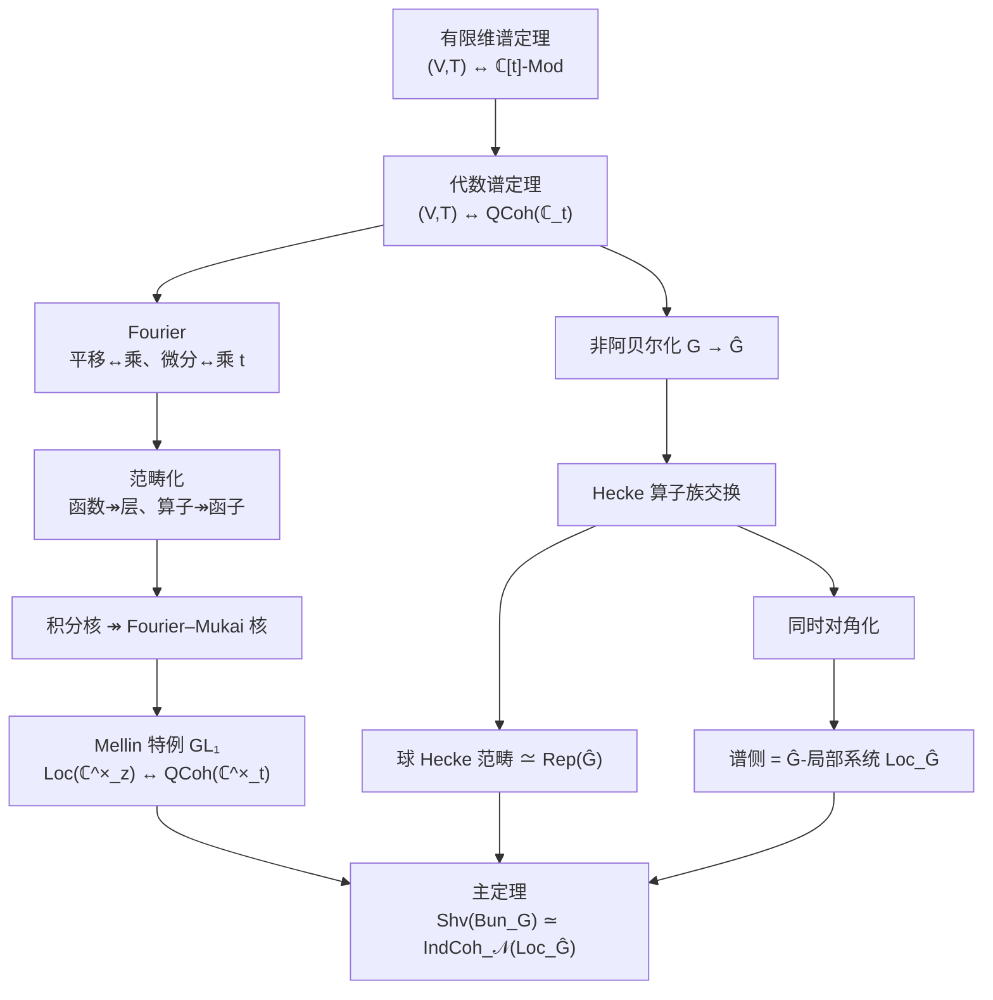

# s1 · 导读与命题的形状

> 负责人：W1 ｜ 覆盖：§0–§1 ｜ 底本页：BZ26 p.1–14 ｜ 字数：约 2200

## 本节要回答

- GLC 用一句话怎么讲；「谱定理」是比喻，还是字面陈述。
- 它把哪两个模空间、哪两个范畴配了对；A/B 两侧各问什么、各答什么。
- 「几何」二字替换掉了经典 Langlands 的哪一层东西。
- 从有限维谱定理到 Fourier 再到范畴化，三步各丢掉什么、补回什么。
- 对偶群 Ĝ 从哪里来；为什么它一般不是 G。

## §0 导读

### 0.1 一句话

几何 Langlands 对应（GLC）是**自守层的代数谱定理**：Bun_G 上的自守层可以分解为「单色」对象，这些对象同时对角化 Hecke 算子的作用，而对应的「颜色」或「频率」就是 Ĝ-局部系统 {{card:bzg/concept/glc-overview}}。底本摘要的原话是：它断言一类称为自守层的微分方程可分解为单色对象，后者对角化自然对称（Hecke 算子）的作用，并描述相应的颜色或频率（Langlands 参数）〔BZ26 p.1〕。

三件事要立刻钉住。其一，「对角化」是字面的：Hecke 算子构成一族两两交换的函子，交换性保证同时对角化存在。其二，特征值不是数，而是**局部系统**——一个几何对象；把「数」换成「空间」，正是整个理论从经典跨到几何的那一步。其三，被分解的不是某一个层，而是整个层范畴，所以 GLC 的结论是范畴等价，不是逐个对象的配对 {{card:bzg/concept/glc-statement}}〔BZ26 p.13 §2.5〕。

### 0.2 两个模空间、两个范畴、两个方向

A 侧（automorphic，问题侧）是 Bun_G，即 X 上 G-丛的模叠；GL_n 时它就是秩 n 向量丛的模叠 {{card:bzg/concept/bun-g}}。它扮演经典情形里「空间」的角色，要做的则是这个空间上的调和分析：把层按对称性拆开〔BZ26 p.7 §1.4.3〕〔BZ26 p.9 §2.2〕。B 侧（spectral，答案侧）是 Loc_Ĝ，即 Ĝ-局部系统的模叠——基本群到 Ĝ 的表示空间，扮演频率空间或颜色空间 {{card:bzg/concept/loc-g-betti}}；de Rham 版取带平坦联络的 Ĝ-丛，与 Betti 版解析上相同、代数上不同 {{card:bzg/concept/loc-g-derham}}〔BZ26 p.11 §2.3〕。

两个范畴因此是：自守侧 Shv(Bun_G)（de Rham 版为 D-mod(Bun_G)），谱侧 QCoh(Loc_Ĝ)，精确形式换成 IndCoh_𝒩(Loc_Ĝ) {{card:bzg/concept/indicoh-nilpotent-support}}。方向是「谱侧 → 自守侧」：给一个 Ĝ-局部系统 E，得到 Bun_G 上一个以 E 为特征值的 Hecke 特征层 Aut_E；整体形式把这个逐点构造升级为函子〔BZ26 p.13 §2.5〕〔CL23 书页 p.3（PDF 8）〕。

方向在两侧并不对称。数域 Langlands 里 Galois 侧是神秘的、自守侧是已知的，信息从自守流向 Galois；GLC 里两侧都是代数量，方向被拉平了〔BZ26 p.8 §1.4.4〕。

### 0.3 为什么叫「几何」

经典 Langlands 的舞台是数域 F 与其绝对 Galois 群，对象是 G(F) 的表示；GLC 同时换掉三样东西：数域换成 ℂ 上的光滑射影曲线 X（等价地，紧 Riemann 面），表示换成 X 上的层，Galois 表示换成基本群到 Ĝ 的局部系统〔BZ26 p.6–7 §1.4〕。所以「几何」不是修饰词，而是说这套对应住在曲线、层、模叠这三件几何物件上，不住在数域与表示上。

Weil 罗塞塔把这件事讲得最清楚：三栏并置——数域、F_q 上的函数域、代数闭域上的曲线，同一套猜想各有版本，第三栏就是几何版〔SCH26 p.1–2〕。函数域那一栏说明了曲线为何自然：它和 ℂ 上的曲线共享同一套「点—局部域—整体域」结构〔SCH26 p.7–8〕。第三栏能做得更细，是因为在 ℂ 上「层」与「局部系统」都是代数几何对象，可以谈范畴、谈六函子，而不只是谈迹函数〔BZ26 p.2〕。

### 0.4 三条读法

- **10 分钟**：只读 §0–§2。读完应能说出「两个模空间、一个范畴等价、Hecke 对角化」这三件事，并知道 GL₁ 的答案长什么样（Fourier–Mukai）。
- **一天**：§0–§5。加上 Hecke 函子、球 Hecke 范畴与几何 Satake，理解交换性从哪来，以及为什么谱侧必须是 IndCoh_𝒩 而不是 QCoh。
- **一周**：全页加附录。补上证明主线的编年（五部曲与 char p 的独立论文）、Whittaker 归一化与 Eisenstein 部分，以及形式化现状。

这个梯度的设计原则是每层回答一个「为什么」，而不只是加细节：10 分钟那层回答「断言什么」，一天那层回答「为什么可能」，一周那层回答「凭什么相信」。

### 0.5 记号表

| 记号 | 含义 | 首次出现 |
| --- | --- | --- |
| k | 基域；几何情形取 ℂ，函数域情形取 F_q | §0 |
| X | k 上光滑射影曲线，ℂ 上即紧 Riemann 面 | §0 |
| G | k 上连通约化群 | §0 |
| Ĝ | Langlands 对偶群，由根数据对偶得到 | §1.4 |
| Bun_G | X 上 G-丛的模叠 | §0.2 |
| Loc_Ĝ | Ĝ-局部系统的模叠（Betti 与 de Rham 两版） | §0.2 |
| D-mod | 代数 D-模的导出范畴 | §0.2 |
| IndCoh_𝒩 | 幂零奇异支撑的指示凝聚范畴，谱侧的精确选择 | §0.2 |

### 本节资料卡

| 概念 | 卡 id | 卡文件 | 底本页 |
| --- | --- | --- | --- |
| 自守层的谱分解（总览） | `bzg/concept/glc-overview` | [glc-overview.json](../../../../benzvi_glc/cards/concepts/glc-overview.json) | p.3 |
| Bun_G：G-丛的模叠 | `bzg/concept/bun-g` | [bun-g.json](../../../../benzvi_glc/cards/concepts/bun-g.json) | p.9 |
| Betti 特征簇 Loc_Ĝ | `bzg/concept/loc-g-betti` | [loc-g-betti.json](../../../../benzvi_glc/cards/concepts/loc-g-betti.json) | p.11 |
| de Rham 局部系统 | `bzg/concept/loc-g-derham` | [loc-g-derham.json](../../../../benzvi_glc/cards/concepts/loc-g-derham.json) | p.11 |
| IndCoh_𝒩 与幂零支撑 | `bzg/concept/indicoh-nilpotent-support` | [indicoh-nilpotent-support.json](../../../../benzvi_glc/cards/concepts/indicoh-nilpotent-support.json) | p.21 |
| 主定理精确形式 | `bzg/concept/glc-statement` | [glc-statement.json](../../../../benzvi_glc/cards/concepts/glc-statement.json) | p.21–22 |

### 出处对照

| 简称 | 仓库文件 | 页码基准 |
| --- | --- | --- |
| BZ26 | [full.txt](<../../../../../08_source_code/SY02-10_几何朗兰兹对偶是什么？/工程文件/full.txt>) | `===== PAGE n =====` 的 n |
| SCH26 | [中译注本 PDF](<../../../../../08_source_code/SY02-45_Scholze布尔巴基1252几何Langlands的证明/成品/SY02-45_Scholze布尔巴基1252几何Langlands的证明_中译注本.pdf>) | PDF 页 |
| CL23 | [导论中译 PDF](<../../../../../08_source_code/SY02-33_几何Langlands理论导论（陈麟）_中文译注校订版/成品/几何Langlands理论导论（陈麟）_中文译注校订版.pdf>) | 书页 = PDF 页 − 5 |

## §1 命题的形状

### 1.1 谱定理：从分析到代数

分析版是原型：Hilbert 空间上的自伴算子 H 酉等价于某个直积分上「乘 t」的算子，H 由坐标函数 t 的乘法给出，这就是函数演算；注意直积分是沿 ℝ_t 的连续叠加，不能用直和顶替 {{card:bzg/concept/spectral-theorem}}〔BZ26 p.3 §1.1〕。

最简的谱定理则连分析都不需要。取有限维复向量空间 V 与自同态 T：数据 (V, T) 与「V 上的 ℂ[t]-模结构」是同一件事——t 作用为 T，多项式 p(t) 作用为 p(T)，这就是函数演算 {{card:bzg/concept/algebraic-spectral-theorem}}。于是「把 T 对角化」翻译成「把这个模分解为特征线之直和」：特征值 λ 对应极大理想 (t−λ)，广义特征空间对应 Jordan 块，n×n 块恰好是模 ℂ[t]/t^n，即 0 的 (n−1) 阶无穷小邻域上的秩 1 族〔BZ26 p.4 §1.3.1〕。

升级一步就是几何形状：(V, T) 的整体等价于 ℂ_t 上的拟凝聚层，即「t 轴上的一个向量空间族」。原型因此有了三行对照：向量空间 ↠ 范畴，自同态 ↠ 函子，ℂ[t]-模 ↠ QCoh(ℂ_t) {{card:bzg/concept/categorical-harmonic-analysis}}〔BZ26 p.4〕。GLC 的全部野心，就是把这三行里的「向量空间」换成 Bun_G 上的层、「自同态」换成 Hecke 函子。

### 1.2 Fourier 变换：同一件事的可算版本

Fourier 变换让谱定理变成可算的：x 侧的平移变成 t 侧乘 e^{2πiat}，x 侧的微分 d/dx 变成 t 侧乘 2πit，卷积变成逐点乘法 {{card:bzg/concept/fourier-transform}}。换句话说，Fourier 把一组交换算子整体变成乘法算子，「同时对角化」就是这样实现的；而 f̂(t) = ∫ f(x)e^{−2πixt}dx 正是「把 f 拆成特征函数 e^{2πixt} 的叠加」的具体写法〔BZ26 p.4 §1.2〕。

底本给了一张对照表：e^{iλx} ↔ ℂ_λ（特征向量），f(x) ↔ H（被分解的对象），指数的积分 ↔ 特征空间的直积分，数 λ ↔ 向量空间 ℂ_λ，L²(ℝ) ↔ 酉表示范畴。据此它说：谱定理本身可以看作范畴化的 Fourier 变换〔BZ26 p.4〕。这不是类比修辞，而是同一个陈述在两层范畴里各显一次形。把群换成 ℤ、把 ℝ 换成 ℂ^×，就得到 Mellin 版本：Loc(ℂ^×_z) ≃ QCoh(ℂ^×_t)，单值性 t 的特征值就是颜色 {{card:bzg/concept/betti-mellin}}〔BZ26 p.5 §1.3.2〕。

### 1.3 范畴化三件套

把语言提到范畴层，替换规则只有三行：函数空间 ↠ 层范畴，算子 ↠ 函子，积分核 ↠ Fourier–Mukai 核 {{card:bzg/concept/categorical-fourier}}。核 K ∈ Shv(X×Y) 给出函子 FM_K(F) = p_{Y!}(p_X^*F ⊗ K)，其中 p_X^* 是限制（拉回）、⊗ 是乘法、p_{Y!} 是积分（沿纤维的紧支撑推前）。底本把这一族构造统称 categorical Fourier transforms，并点明 Mukai 1981 的核与 Fourier–Malgrange/Sato/Deligne 的版本都在配对的模空间之间交换卷积与张量〔BZ26 p.6 §1.3.3〕。GLC 的困难被底本一句话定位：这套理论的非阿贝尔对应〔BZ26 p.6〕。

一句必须写下的警告：范畴化不是逐字替换公式。紧支撑与增长条件在函数层是「选哪个函数空间」，到了范畴层变成 ! 与 * 的选择；选错，等价只在光滑点成立。IndCoh_𝒩 正是为这个选择买单 {{card:bzg/concept/categorical-harmonic-analysis}}〔BZ26 p.13 §2.5〕〔CL23 书页 p.5（PDF 10）〕。

### 1.4 非阿贝尔化：从 G 到 Ĝ

阿贝尔情形（G = GL₁ 或环面）里，Hecke 算子就是「按点修改丛」，谱侧是 Pic 或对偶环面，Fourier–Mukai 直接给出对应；GL₁ 的无分歧几何类域论已经是定理 {{card:glc/concept/geometric-class-field-theory}}〔BZ26 p.12 §2.4〕〔CL23 书页 p.2–3（PDF 7–8）〕。非阿贝尔的困难在于：修改丛不再由点参数化，而要取 Gr = LG₊\LG/LG₊ 的双陪集，其轨道对应 Ĝ 的不可约表示（最高权）〔BZ26 p.14 §3.1〕。

于是 Ĝ 出现了，而且是被「逼」出来的：Hecke 算子要交换，球 Hecke 范畴 Sph_G 就必须是交换幺半范畴；几何 Satake 把它等同于 Rep(Ĝ) 的一个版本，Ĝ 的表示环因此就是 Hecke 算子的共同谱 {{card:bzg/concept/dual-group}}〔BZ26 p.14 §3.1〕。这条链是：Hecke 族交换 ⇒ 同时对角化 ⇒ 谱侧是 Ĝ-局部系统。底本说得更重——「GLC 给出 Ĝ 从哪来的根本描述」〔BZ26 p.6–7 §1.4〕。这里只留一句预告：对偶群可以从交换性里读出来，而交换性的来源是 factorization algebra 提供的隐藏结构，留给 §3。

### 1.5 与经典 Langlands 的关系

几何版不是经典版的替代，而是它在函数域一栏的范畴化。经典陈述配对「G(F) 的尖点表示」与「Galois 表示（或 L-参数）」；几何陈述配对「Bun_G 上的层范畴」与「Loc_Ĝ 上的（指示）凝聚范畴」〔BZ26 p.7 §1.4.3〕〔SCH26 p.1–2〕。前者里的每个不可约对象对应后者里的一个单色对象（Hecke 特征层），但后者还多出可约对象、导出结构与非单色层——这些正是几何版多出来的信息〔CL23 书页 p.3（PDF 8）〕。函数域情形经典侧已定理化，几何侧 char 0 的主定理是另一条线：两者是同一罗塞塔的两栏，不是谁蕴含谁〔SCH26 p.7–9〕。

### 本节资料卡

| 概念 | 卡 id | 卡文件 | 底本页 |
| --- | --- | --- | --- |
| 谱定理：自伴算子与直积分 | `bzg/concept/spectral-theorem` | [spectral-theorem.json](../../../../benzvi_glc/cards/concepts/spectral-theorem.json) | p.3 |
| 代数谱定理 | `bzg/concept/algebraic-spectral-theorem` | [algebraic-spectral-theorem.json](../../../../benzvi_glc/cards/concepts/algebraic-spectral-theorem.json) | p.4 |
| Fourier：平移与微分的对角化 | `bzg/concept/fourier-transform` | [fourier-transform.json](../../../../benzvi_glc/cards/concepts/fourier-transform.json) | p.4 |
| 范畴化 Fourier 与 FM 核 | `bzg/concept/categorical-fourier` | [categorical-fourier.json](../../../../benzvi_glc/cards/concepts/categorical-fourier.json) | p.6 |
| 范畴调和分析：从函数到层 | `bzg/concept/categorical-harmonic-analysis` | [categorical-harmonic-analysis.json](../../../../benzvi_glc/cards/concepts/categorical-harmonic-analysis.json) | p.8 |
| Betti Mellin（GL₁ 原型） | `bzg/concept/betti-mellin` | [betti-mellin.json](../../../../benzvi_glc/cards/concepts/betti-mellin.json) | p.5 |
| Langlands 对偶群 | `bzg/concept/dual-group` | [dual-group.json](../../../../benzvi_glc/cards/concepts/dual-group.json) | p.6 |
| 非分歧类域论（特征标形式） | `glc/concept/geometric-class-field-theory` | [geometric-class-field-theory.json](../../../../glc/cards/concepts/geometric-class-field-theory.json) | p.5 |

### 出处对照

| 简称 | 仓库文件 | 页码基准 |
| --- | --- | --- |
| BZ26 | [full.txt](<../../../../../08_source_code/SY02-10_几何朗兰兹对偶是什么？/工程文件/full.txt>) | `===== PAGE n =====` 的 n |
| SCH26 | [中译注本 PDF](<../../../../../08_source_code/SY02-45_Scholze布尔巴基1252几何Langlands的证明/成品/SY02-45_Scholze布尔巴基1252几何Langlands的证明_中译注本.pdf>) | PDF 页 |
| CL23 | [导论中译 PDF](<../../../../../08_source_code/SY02-33_几何Langlands理论导论（陈麟）_中文译注校订版/成品/几何Langlands理论导论（陈麟）_中文译注校订版.pdf>) | 书页 = PDF 页 − 5 |

## 思维导图

## 易错点与待核

- **把 GLC 说成「自守表示 ↔ Galois 表示」**。几何版配对的是范畴，不是单个对象；单色对象（Hecke 特征层）只是特例，且可约局部系统对应的是特征对象而非层 {{card:bzg/concept/glc-overview}}〔CL23 书页 p.3（PDF 8）〕。
- **把谱定理当成已经给出 GLC**。谱定理只是形状与直觉来源；非阿贝尔化需要额外输入（对偶群、球 Hecke 范畴、几何 Satake），定理本身要引用 [GR24a] 一线的工作。
- **把 Ĝ 当成 G 本身**。只有 GL_n、SO_{2n} 这类自对偶群成立；SL_n 对偶于 PGL_n，环面 T 对偶于 T̂ {{card:bzg/concept/dual-group}}。
- **待核**：§0.2 与 §1.3 都提到 IndCoh_𝒩，但底本 p.13 的 QCoh 版自称 not quite correct，而 SCH26 的 char p 定理用的是 LocSys′_Ĝ ⊊ LocSys_Ĝ。导读里不能把两者写成同一条定理，合稿时要与 §5–§6 的措辞对齐〔BZ26 p.13〕〔SCH26 p.8–9〕。
- **待核（链接前缀）**：本稿的卡表与出处对照表都按「相对本目录」写（`../../../../benzvi_glc/…`、`../../../../../08_source_code/…`），从 survey-v1 解析全部命中，`check_survey.py` 已通过；合入 `datasets/encyclopedia/pages/geometric-langlands.md` 后两个前缀都必须各去掉两级（改为 `../../`、`../../../`）。这是本稿唯一需要 lead 定夺的一致性项。
