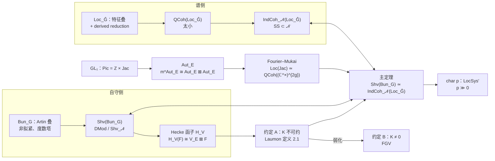

# s2 · 它在说什么

> 负责人：W2 ｜ 覆盖：§2 ｜ 底本页：BZ26 p.8–13 ｜ 字数：约 2400

## 本节要回答

- 舞台：哪条曲线、哪个群、哪几套系数；「无分歧」这一减法免掉了什么。
- Bun_G 为什么必须是叠、为什么不能截断；上面放哪一类层。
- Hecke 特征层的特征方程；两套不可约性约定差在哪、各撑起什么结论。
- Loc_Ĝ 为什么不是概形、要补哪一步 derived；谱侧为何是 IndCoh_𝒩。
- GL₁ 能否把全部记号落成定理；主定理的精确形式与证明状态。

## §2 各小节

### 2.1 设定：一条曲线、一个群、两套系数

几何 Langlands 的舞台是三元组（X, G, 系数域）。X 是域 k 上光滑射影连通曲线，k=ℂ 时即紧 Riemann 面；G 是 k 上连通约化群，其对偶群 Ĝ 由根数据对偶得到 {{card:bzg/concept/dual-group}}。系数侧有三栏：k=ℂ 的 Betti 层（局部系统即基本群表示）、char k=0 的 de Rham D-模（带平坦联络的向量丛）、任意 k 上 ℓ≠char k、系数 Q̄_ℓ 的 ℓ-adic 层〔RAS23 书页 2 §1.1〕〔LAU02 906--1〕。三种语言是同一份罗塞塔，不是三个定理；本节主写 Betti 与 de Rham，ℓ-adic 只在对照处出现。

「无分歧」是这套设定的减法：X 不挖洞，不给点加 level 结构，不谈分歧，Hecke 算子在每个闭点都有定义，两侧对象都在处处无分歧的范围内。代价是只覆盖 GLC 的 base case；好处是两侧仍是「整体」对象，不必先搭局部理论再拼回去。底本说得直白：只谈无分歧情形，而它正是已有定理的那一支〔BZ26 p.9 §2.2〕。

#### 本节资料卡

| 概念 | 卡 id | 卡文件 | 页 |
| --- | --- | --- | --- |
| Langlands 对偶群 | `bzg/concept/dual-group` | [dual-group.json](../../benzvi_glc/cards/concepts/dual-group.json) | p.6 |

#### 出处对照

| 简称 | 仓库文件 | 页码基准 |
| --- | --- | --- |
| BZ26 | [full.txt](<../../../08_source_code/SY02-10_几何朗兰兹对偶是什么？/工程文件/full.txt>) | `===== PAGE n =====` 的 n |
| RAS23 | [Raskin 中译注本](<../../../08_source_code/SY02-47_Raskin射影曲线上的几何Langlands讲义/成品/SY02-47_Raskin射影曲线上的几何Langlands讲义_中译注本.pdf>) | 书页（页边） |
| LAU02 | [Laumon 中译注本](<../../../08_source_code/SY02-46_Laumon布尔巴基906Drinfeld-Langlands对应/成品/SY02-46_Laumon布尔巴基906Drinfeld-Langlands对应_中译注本.pdf>) | 页边 `906--N` |

### 2.2 自守侧：Bun_G 是一个不拟紧的叠

自守侧的对象是 Bun_G，X 上 G-丛的模叠：Bun_G(S) 是 X×S 上 G-挠子的群胚，等价地是 X×S → S 的截面叠 {{card:bzg/concept/bun-g}}。它是 Artin 叠，对角仿射，并有一列有限型的开子叠把它穷竭〔CL23 书页 12（PDF 17）定理 2.2.1〕。也可写成 Bun_G = G(F)\G(A_C)/G(O_A)，F=k(C) {{card:bzg/concept/adelic-uniformization}}〔CL23 书页 12（PDF 17）〕。

其一，它不是概形而是叠：一个点自带自同构群，G=GL₁ 时线丛的自同构群是 ℂ^×。所以「Bun_G 上的函数」必须换成「Bun_G 上的层」，而层范畴要按叠来取〔CL23 书页 12（PDF 17）〕。

其二，它不拟紧：度数的绝对值无界，一个固定的连通分支 Bun_G^d 也未必拟紧；G=GL_n 时它甚至不连通，连通分支按度数 d 编号〔CL23 书页 13（PDF 18）注 2.2.3〕。逐次扩张线丛把分支拉成无限长的「尾巴」——所以不能「取个紧化就完事」：截掉不稳定部分会同时截掉 Hecke 对应。

其三，Shv(Bun_G) 因此不是有限型叠上那种层范畴，要先 Ind-完备化再取导出范畴。de Rham 侧的对象是 DMod(Bun_G)；Betti 侧是可构造层，并且还要允许沿幂零方向带奇异性的对象，记 Shv_𝒩(Bun_G)，两侧统称 Shv(Bun_G)〔BZ26 p.13 §2.5〕。

Hecke 结构由一个对应图给出：Hecke 叠记录「在 X 的一个移动点处对丛作一次修改」，两个投影分别记下修改前与修改后的丛，`supp` 记下移动点；它的局部模型是仿射 Grassmann 簇 Gr = LG/L⁺G {{card:bzg/concept/affine-grassmannian}}。对 V ∈ Rep(Ĝ) 取几何 Satake 层 Sat_V，得到 Hecke 函子 H_V: D(Bun_G) → D(X×Bun_G)，F ↦ (supp, h→)_!(m*Sat_V ⊗ h←^*F) {{card:glc/concept/hecke-eigensheaf-general}}〔CL23 书页 14（PDF 19）〕。Ĝ 正是在这一步被逼出来的：Perv_{L⁺G}(Gr) ≃ Rep(Ĝ)，轨道 IC 层对应最高权表示 {{card:bzg/concept/geometric-satake}}〔CL23 书页 14（PDF 19）§2.5〕。

特征方程于是写成：若对每个 V 都有函子性同构 H_V(F) ≅ V_E ⊠ F，且与张量积相容，则称 F 是以 E 为特征值的 Hecke 特征层；GL_n 的经典写法是 H(K) ≅ E ⊠ K {{card:bzg/concept/hecke-operators}}〔LAU02 906--7〕。这里 E 是 X 上 Ĝ-局部系统，V_E 是沿 E 拉回的局部系统，⊠ 是外张量积。这些函子两两交换，来源是球 Hecke 范畴 {{card:bzg/concept/spherical-hecke-category}}〔CL23 书页 14（PDF 19）〕；技术含义留给 §3。

#### 本节资料卡

| 概念 | 卡 id | 卡文件 | 页 |
| --- | --- | --- | --- |
| Bun_G：G-丛的模叠 | `bzg/concept/bun-g` | [bun-g.json](../../benzvi_glc/cards/concepts/bun-g.json) | p.9 |
| 阿代尔一致化 | `bzg/concept/adelic-uniformization` | [adelic-uniformization.json](../../benzvi_glc/cards/concepts/adelic-uniformization.json) | p.11 |
| 仿射 Grassmann 簇 | `bzg/concept/affine-grassmannian` | [affine-grassmannian.json](../../benzvi_glc/cards/concepts/affine-grassmannian.json) | p.10 |
| Hecke 算子 | `bzg/concept/hecke-operators` | [hecke-operators.json](../../benzvi_glc/cards/concepts/hecke-operators.json) | p.14 |
| 几何 Satake | `bzg/concept/geometric-satake` | [geometric-satake.json](../../benzvi_glc/cards/concepts/geometric-satake.json) | p.16 |
| 球 Hecke 范畴 | `bzg/concept/spherical-hecke-category` | [spherical-hecke-category.json](../../benzvi_glc/cards/concepts/spherical-hecke-category.json) | p.14,16 |
| Hecke 特征层（一般 G） | `glc/concept/hecke-eigensheaf-general` | [hecke-eigensheaf-general.json](../../glc/cards/concepts/hecke-eigensheaf-general.json) | p.14 |

#### 出处对照

| 简称 | 仓库文件 | 页码基准 |
| --- | --- | --- |
| BZ26 | [full.txt](<../../../08_source_code/SY02-10_几何朗兰兹对偶是什么？/工程文件/full.txt>) | `===== PAGE n =====` 的 n |
| CL23 | [导论中译 PDF](<../../../08_source_code/SY02-33_几何Langlands理论导论（陈麟）_中文译注校订版/成品/几何Langlands理论导论（陈麟）_中文译注校订版.pdf>) | 书页 = PDF 页 − 5 |
| LAU02 | [Laumon 中译注本](<../../../08_source_code/SY02-46_Laumon布尔巴基906Drinfeld-Langlands对应/成品/SY02-46_Laumon布尔巴基906Drinfeld-Langlands对应_中译注本.pdf>) | 页边 `906--N` |

### 2.3 框：两套不可约性约定

同一句 H(K) ≅ E ⊠ K，在两篇文献里对 K 的要求不同，后果也不同，不能互换。这是全节最容易写错的一处，所以单独成框。Laumon 在 GL_n 情形工作，对象空间是 X 上秩 n 丛的叠 Fib_n(X)，连通分支按次数编号 Fib_n^d；E 是 X 上秩 n 的不可约局部系统，K 是 Fib_n(X) 上的反常层〔LAU02 906--7〕。

| 项 | Laumon 定义 2.1（原书 p.7） | FGV 定义（仓库无中译，待核） |
| --- | --- | --- |
| 对 K 的要求 | K 是不可约反常层 | 只要求 K ≠ 0 |
| 特征方程 | H(K) ≅ E ⊠ K | 同左 |
| 附加条件 | (H∘H)(K) ≅ E⊠E⊠K 限制到 (X×X−Δ)×Fib_n 上 S₂-等变 | 同左 |
| 得到的结论 | 存在 Aut_E，在每个连通分支上不可约 | 存在非零的 Hecke 特征层 |
| 唯一性 | 在不可约类里谈「那个」特征层 | 特征层成范畴，不唯一 |

Laumon 那一套见〔LAU02 906--7〕：他先要求 E 是秩 n 的不可约局部系统，再要求 K 不可约，两条一起才给出定义；结论也强——定理 2.2 的 Aut_E 到每个连通分支 Fib_n^d 的限制不可约〔LAU02 906--8〕。FGV 那一套把 K 的要求降到非零，因为对一般约化群，能证的正是「存在非零特征层」，不可约性是额外结论而非前提。

后果有三条。第一，强度方向单一：Laumon 式推出 FGV 式，反之不成立。第二，「那个特征层」只在不可约类里说得出口；只要求非零时，特征层对直和与扩张封闭，构成范畴，说不上唯一。第三，两者的断言对象不同：FGV 式是存在性陈述，而 Laumon 式是带不可约性附加物的存在性陈述，不能互相冒充〔LAU02 906--7〕。

#### 本节资料卡

| 概念 | 卡 id | 卡文件 | 页 |
| --- | --- | --- | --- |
| Hecke 特征层（一般 G） | `glc/concept/hecke-eigensheaf-general` | [hecke-eigensheaf-general.json](../../glc/cards/concepts/hecke-eigensheaf-general.json) | p.14 |

#### 出处对照

| 简称 | 仓库文件 | 页码基准 |
| --- | --- | --- |
| LAU02 | [Laumon 中译注本](<../../../08_source_code/SY02-46_Laumon布尔巴基906Drinfeld-Langlands对应/成品/SY02-46_Laumon布尔巴基906Drinfeld-Langlands对应_中译注本.pdf>) | 页边 `906--N` |

### 2.4 谱侧：Loc_Ĝ、derived reduction、幂零支撑

谱侧的对象是 Loc_Ĝ，Ĝ-局部系统的模叠，扮演频率空间或颜色空间。它有两套 flavor，且两套不能混写〔BZ26 p.11 §2.3〕。

Betti 版是特征簇：Loc^B_Ĝ(C) = {(A_i,B_i) ∈ Ĝ^{2g} : ∏_{i=1}^{g} [A_i,B_i] = 1}/Ĝ，即 2g 个生成元到 Ĝ 的表示模共轭 {{card:bzg/concept/loc-g-betti}}〔BZ26 p.11 §2.3〕。GL₁ 时它就是 (ℂ^×)^{2g}。两点须知。第一，它是叠不是簇：表示自带自同构群。第二，定义方程 ∏[A_i,B_i]=1 通常不横截，直接取商得到的不是正确的对象，还须补一次 derived reduction，底本把这个修正写进脚注，与 stacky ℂ^× 一并交代〔BZ26 p.11 §2.3 脚注 4〕。一句话：derived 就是别把非横截方程当簇算。

de Rham 版是带平坦联络的 Ĝ-丛 {{card:bzg/concept/loc-g-derham}}。它是 Bun_Ĝ 某个拟紧开子集上的仿射丛（扭曲余切丛）；解析上与 Betti 一致（Riemann–Hilbert），代数上更「胖」，甚至不仿射。g=1、G=GL₁ 时两版一个是 (ℂ^×)²、一个是椭圆曲线上的 ℂ-丛，Serre 的例子〔BZ26 p.11 §2.3〕。

为什么不是 QCoh(Loc_Ĝ)？QCoh 只记得「向量丛式」对象，而自守侧含摩天楼型的奇点对象：没有有限向量丛分解，只能作为「广义函数」出现。IndCoh 正是补这个缺口的扩张，它允许奇异支撑，Hom 与张量积都与 QCoh 不同 {{card:bzg/concept/indicoh-nilpotent-support}}〔BZ26 p.21–22 §5.1〕。

那为什么也不是整个 IndCoh？因为并非所有方向的奇性都该允许。[AG15] 定出的条件是奇异支撑落在 Loc_Ĝ 的整体幂零锥 𝒩 内：SS(F) ⊂ 𝒩。只允许幂零方向的奇性，不许环面方向——GL₁ 时幂零锥只剩零截面，IndCoh_𝒩 退回 QCoh，与早已懂透的经典情形吻合。记这个子范畴为 IndCoh_𝒩(Loc_Ĝ)，它把 QCoh 收作零奇异支撑的那一部分 {{card:bzg/concept/indicoh-nilpotent-support}}〔BZ26 p.21 §5.1〕。

#### 本节资料卡

| 概念 | 卡 id | 卡文件 | 页 |
| --- | --- | --- | --- |
| Betti 特征簇 Loc_Ĝ | `bzg/concept/loc-g-betti` | [loc-g-betti.json](../../benzvi_glc/cards/concepts/loc-g-betti.json) | p.11 |
| de Rham 局部系统 | `bzg/concept/loc-g-derham` | [loc-g-derham.json](../../benzvi_glc/cards/concepts/loc-g-derham.json) | p.11 |
| IndCoh_𝒩 与幂零支撑 | `bzg/concept/indicoh-nilpotent-support` | [indicoh-nilpotent-support.json](../../benzvi_glc/cards/concepts/indicoh-nilpotent-support.json) | p.21 |

#### 出处对照

| 简称 | 仓库文件 | 页码基准 |
| --- | --- | --- |
| BZ26 | [full.txt](<../../../08_source_code/SY02-10_几何朗兰兹对偶是什么？/工程文件/full.txt>) | `===== PAGE n =====` 的 n |

### 2.5 GL₁：Pic、Abel–Jacobi、Aut_E 与 Fourier

GL₁ 是唯一能从头走到尾的情形，也是检验全部约定是否自洽的地方〔BZ26 p.12 §2.4〕。

先看左侧。G=GL₁ 时 Bun_G = Pic(C)，而 Pic(C) ≅ ℤ × Jac(C)：度数给出 ℤ 这一项，单位分支是雅可比簇。这个分裂并不典范，要选定一个度数 1 的线丛才定得下来 {{card:bzg/concept/picard-jacobian}}。Jac(C) = H¹(C,O)/H¹(C,ℤ) ≅ (S¹)^{2g} 是复环面而不是向量空间；Abel–Jacobi 把 C 嵌进 Jac(C)，x ↦ O_X([x]−[x₀])〔LAU02 906--5〕〔BZ26 p.10 §2.2〕。

再看右侧。给定 X 上一个秩 1 局部系统 E，定理（Laumon 定理 1.2）断言存在 Pic⁰(X) 上唯一的秩 1 局部系统 Aut_E，它在原点刚性化，满足 φ*Aut_E = E，并且对群运算 m: Pic⁰×Pic⁰ → Pic⁰ 有典范同构 m*Aut_E ≅ Aut_E ⊠ Aut_E〔LAU02 906--5〕。这正是「特征层」在 GL₁ 的形状：沿群运算，Aut_E 像乘法特征。把 Hecke 方程写出来就是 χ_σ|_{L(x)} ≅ χ_σ|_L ⊗ σ_x，再加归一化 χ_σ|_{O_X} ≅ 1 {{card:bzg/concept/gl1-betti-glc}}〔RAS23 书页 2 §1.2〕。

这两条合起来就是无分歧几何类域论：Jac 的覆叠（π₁(Jac) 的表示）与 C 上阿贝尔覆叠（π₁(C)^{ab} 的表示）经 Abel–Jacobi 等同，且与 Hecke 算子相容〔RAS23 书页 2–3 §1.2〕〔BZ26 p.12 §2.4〕。古典侧（Deligne）它对应非分歧特征标与 Galois 特征标的几乎双射，由 ξ(π_v) = ρ(Fr_v) 刻画；「几乎」是因为 Q̄_ℓ^× 完全不连通 {{card:glc/concept/geometric-class-field-theory}}〔CL23 书页 5（PDF 10）定理 1.1.1〕。

范畴化之后，Betti 版是 Loc(Jac(C)) = Rep(ℤ^{2g}) ≃ QCoh((ℂ^×)^{2g}) = QCoh(Loc^B_{GL₁}(C))，实现方式是 Fourier–Mukai，核来自 Poincaré 丛；Jac 上的平移对应张量积，Abel–Jacobi 保证这个等价与几何类域论相容 {{card:bzg/concept/gl1-betti-glc}}〔BZ26 p.12 §2.4〕。de Rham 版是 DMod(Jac(C)) ≃ QCoh(Loc^dR_{GL₁}(C))（Laumon–Rothstein）；它只在导出范畴层成立，是 Mukai 对偶阿贝尔簇上 Fourier 变换的增强版，不是 Abel 范畴的等价 {{card:bzg/concept/gl1-derham-glc}}〔BZ26 p.12–13 §2.4〕。两版的点是同一批，范畴却不同——这就是「两套 flavor 不能混写」的最小例子。

#### 本节资料卡

| 概念 | 卡 id | 卡文件 | 页 |
| --- | --- | --- | --- |
| Pic ≅ ℤ × Jac、Abel–Jacobi | `bzg/concept/picard-jacobian` | [picard-jacobian.json](../../benzvi_glc/cards/concepts/picard-jacobian.json) | p.10 |
| GL₁ Betti 版几何类域论 | `bzg/concept/gl1-betti-glc` | [gl1-betti-glc.json](../../benzvi_glc/cards/concepts/gl1-betti-glc.json) | p.12 |
| GL₁ de Rham 版几何类域论 | `bzg/concept/gl1-derham-glc` | [gl1-derham-glc.json](../../benzvi_glc/cards/concepts/gl1-derham-glc.json) | p.12 |
| 非分歧几何类域论 | `glc/concept/geometric-class-field-theory` | [geometric-class-field-theory.json](../../glc/cards/concepts/geometric-class-field-theory.json) | p.5 |

#### 出处对照

| 简称 | 仓库文件 | 页码基准 |
| --- | --- | --- |
| BZ26 | [full.txt](<../../../08_source_code/SY02-10_几何朗兰兹对偶是什么？/工程文件/full.txt>) | `===== PAGE n =====` 的 n |
| LAU02 | [Laumon 中译注本](<../../../08_source_code/SY02-46_Laumon布尔巴基906Drinfeld-Langlands对应/成品/SY02-46_Laumon布尔巴基906Drinfeld-Langlands对应_中译注本.pdf>) | 页边 `906--N` |
| RAS23 | [Raskin 中译注本](<../../../08_source_code/SY02-47_Raskin射影曲线上的几何Langlands讲义/成品/SY02-47_Raskin射影曲线上的几何Langlands讲义_中译注本.pdf>) | 书页（页边） |
| CL23 | [导论中译 PDF](<../../../08_source_code/SY02-33_几何Langlands理论导论（陈麟）_中文译注校订版/成品/几何Langlands理论导论（陈麟）_中文译注校订版.pdf>) | 书页 = PDF 页 − 5 |

### 2.6 主定理：精确陈述

把两侧接起来，主定理的精确形式是 Shv(Bun_G) ≃ IndCoh_𝒩(Loc_Ĝ)。它对两套 flavor 各成立一次：de Rham 侧左边是 DMod(Bun_G)，Betti 侧左边是 Shv_𝒩(Bun_G)。定理的另一半是作用相容——谱侧 QCoh(Loc_Ĝ) 经 spectral action 作用于 Shv(Bun_G)，等价把它送到 IndCoh_𝒩(Loc_Ĝ) 的自然张量积作用 {{card:bzg/concept/glc-statement}}〔BZ26 p.21–22 §5.1〕。

底本 §2.5 先给的其实是 QCoh 版，并立刻自注 not quite correct as stated，把修正指向 §5.1〔BZ26 p.13 §2.5〕。所以引用时必须带上 𝒩：写成 QCoh(Loc_Ĝ) 是弱形式，写成 IndCoh(Loc_Ĝ) 则丢掉幂零支撑条件、范畴太大，两种写法都会把定理说成假的。

证明状态要分两栏写，不能合并。char 0 已经是定理，由五篇论文合成（[GR24a]、[ABC⁺24b]、[CCF⁺24]、[ABC⁺24a]、[GR24b]）〔BZ26 p.13 §2.5〕。char p 只有条件版本：要求 p 相对 G 充分大，还要排除与 G 有关的坏素数（即 p 非挠），并把 Loc_Ĝ 换成开闭子叠 LocSys′_Ĝ；LocSys′ ≠ LocSys，条件版本不能当无条件定理用〔SCH26 p.8〕。细节归 §7。

记住：这是范畴等价加作用相容，不是「每个 E 配一个层」；逐对象配对还要补重数一与归一化（§5）〔BZ26 p.21–22 §5.1〕。

#### 本节资料卡

| 概念 | 卡 id | 卡文件 | 页 |
| --- | --- | --- | --- |
| 主定理精确形式 | `bzg/concept/glc-statement` | [glc-statement.json](../../benzvi_glc/cards/concepts/glc-statement.json) | p.21–22 |
| IndCoh_𝒩 与幂零支撑 | `bzg/concept/indicoh-nilpotent-support` | [indicoh-nilpotent-support.json](../../benzvi_glc/cards/concepts/indicoh-nilpotent-support.json) | p.21 |

#### 出处对照

| 简称 | 仓库文件 | 页码基准 |
| --- | --- | --- |
| BZ26 | [full.txt](<../../../08_source_code/SY02-10_几何朗兰兹对偶是什么？/工程文件/full.txt>) | `===== PAGE n =====` 的 n |
| SCH26 | [Scholze 中译注本](<../../../08_source_code/SY02-45_Scholze布尔巴基1252几何Langlands的证明/成品/SY02-45_Scholze布尔巴基1252几何Langlands的证明_中译注本.pdf>) | PDF 页 |

## 本节资料卡（合稿总表）

| 概念 | 卡 id | 卡文件 | 底本页 |
| --- | --- | --- | --- |
| Langlands 对偶群 | `bzg/concept/dual-group` | [dual-group.json](../../benzvi_glc/cards/concepts/dual-group.json) | p.6 |
| Bun_G：G-丛的模叠 | `bzg/concept/bun-g` | [bun-g.json](../../benzvi_glc/cards/concepts/bun-g.json) | p.9 |
| 阿代尔一致化 | `bzg/concept/adelic-uniformization` | [adelic-uniformization.json](../../benzvi_glc/cards/concepts/adelic-uniformization.json) | p.11 |
| 仿射 Grassmann 簇 | `bzg/concept/affine-grassmannian` | [affine-grassmannian.json](../../benzvi_glc/cards/concepts/affine-grassmannian.json) | p.10 |
| Hecke 算子 | `bzg/concept/hecke-operators` | [hecke-operators.json](../../benzvi_glc/cards/concepts/hecke-operators.json) | p.14 |
| 几何 Satake | `bzg/concept/geometric-satake` | [geometric-satake.json](../../benzvi_glc/cards/concepts/geometric-satake.json) | p.16 |
| 球 Hecke 范畴 | `bzg/concept/spherical-hecke-category` | [spherical-hecke-category.json](../../benzvi_glc/cards/concepts/spherical-hecke-category.json) | p.14,16 |
| Betti 特征簇 Loc_Ĝ | `bzg/concept/loc-g-betti` | [loc-g-betti.json](../../benzvi_glc/cards/concepts/loc-g-betti.json) | p.11 |
| de Rham 局部系统 | `bzg/concept/loc-g-derham` | [loc-g-derham.json](../../benzvi_glc/cards/concepts/loc-g-derham.json) | p.11 |
| IndCoh_𝒩 与幂零支撑 | `bzg/concept/indicoh-nilpotent-support` | [indicoh-nilpotent-support.json](../../benzvi_glc/cards/concepts/indicoh-nilpotent-support.json) | p.21 |
| 主定理精确形式 | `bzg/concept/glc-statement` | [glc-statement.json](../../benzvi_glc/cards/concepts/glc-statement.json) | p.21–22 |
| Pic ≅ ℤ × Jac、Abel–Jacobi | `bzg/concept/picard-jacobian` | [picard-jacobian.json](../../benzvi_glc/cards/concepts/picard-jacobian.json) | p.10 |
| GL₁ Betti 版几何类域论 | `bzg/concept/gl1-betti-glc` | [gl1-betti-glc.json](../../benzvi_glc/cards/concepts/gl1-betti-glc.json) | p.12 |
| GL₁ de Rham 版几何类域论 | `bzg/concept/gl1-derham-glc` | [gl1-derham-glc.json](../../benzvi_glc/cards/concepts/gl1-derham-glc.json) | p.12 |
| Hecke 特征层（一般 G） | `glc/concept/hecke-eigensheaf-general` | [hecke-eigensheaf-general.json](../../glc/cards/concepts/hecke-eigensheaf-general.json) | p.14 |
| 非分歧几何类域论 | `glc/concept/geometric-class-field-theory` | [geometric-class-field-theory.json](../../glc/cards/concepts/geometric-class-field-theory.json) | p.5 |

## 出处对照（合稿总表）

| 简称 | 仓库文件 | 页码基准 |
| --- | --- | --- |
| BZ26 | [full.txt](<../../../08_source_code/SY02-10_几何朗兰兹对偶是什么？/工程文件/full.txt>) | `===== PAGE n =====` 的 n |
| CL23 | [导论中译 PDF](<../../../08_source_code/SY02-33_几何Langlands理论导论（陈麟）_中文译注校订版/成品/几何Langlands理论导论（陈麟）_中文译注校订版.pdf>) | 书页 = PDF 页 − 5（引用时注明 PDF） |
| LAU02 | [Laumon 中译注本](<../../../08_source_code/SY02-46_Laumon布尔巴基906Drinfeld-Langlands对应/成品/SY02-46_Laumon布尔巴基906Drinfeld-Langlands对应_中译注本.pdf>) | 页边 `906--N` 为原文页 |
| RAS23 | [Raskin 中译注本](<../../../08_source_code/SY02-47_Raskin射影曲线上的几何Langlands讲义/成品/SY02-47_Raskin射影曲线上的几何Langlands讲义_中译注本.pdf>) | 书页（页边） |
| SCH26 | [Scholze 中译注本](<../../../08_source_code/SY02-45_Scholze布尔巴基1252几何Langlands的证明/成品/SY02-45_Scholze布尔巴基1252几何Langlands的证明_中译注本.pdf>) | PDF 页 |

## 思维导图

## 易错点与待核

- **把 IndCoh_𝒩 写成 IndCoh**：丢掉「奇异支撑落在幂零锥内」，等价就不成立；𝒩 是定理的一部分 {{card:bzg/concept/indicoh-nilpotent-support}}〔BZ26 p.21–22 §5.1〕。
- **把 Loc_Ĝ 当普通概形**：它是有自同构的叠，Betti 版还要 derived reduction；g=1、GL₁ 时两 flavor 的差别不能抹平 {{card:bzg/concept/loc-g-betti}}〔BZ26 p.11 §2.3〕。
- **把 E^(d) 的秩结论推广到非 rss 点**：它只在 X^(d)_rss 上是秩 n^d 局部系统；全空间上只是可构造层，纤维是 ⊗_x Sym^{d_x}E_x 〔LAU02 906--6〕。
- **把 char p 的 LocSys′ 当定理**：LocSys′ 是 LocSys 的开闭子叠，char p 只有条件版（p 充分大），不能与 char 0 的无条件陈述并列 {{card:bzg/concept/glc-statement}}〔SCH26 p.8〕。
- **混用两套不可约性**：FGV 的存在性推不出不可约性，Laumon 的定义也管不到所有特征层〔LAU02 906--7〕。
- **把 QCoh(Loc_Ĝ) 当最终答案**：底本 p.13 的 QCoh 版自称 not quite correct，正确形式在 §5.1〔BZ26 p.13 §2.5〕。
- **待核（FGV 侧）**：仓库无 FGV 中译，「只要求 K ≠ 0」与引文 (1.3) 只能标待核，勿补造页码。
- **待核（char p）**：SCH26 p.8 只说 p 相对 G 充分大，未写「p 非挠」的精确形式，具体表述需 §7 与原文对齐。
- **待核（链接前缀）**：本稿按最终页基准（BRIEF §4 示例即此）；在 survey-v1 内跑 `check_survey.py` 会全判 dead，属预期；W1 用就地写法，合稿前统一。

## 交稿前自检

- [x] 六问按序：2.1 设定 → 2.2 自守侧 → 2.3 两套约定 → 2.4 谱侧 → 2.5 GL₁ → 2.6 主定理。
- [x] 每段有〔…〕出处；每小节末有「本节资料卡」「出处对照」两表。
- [x] 资料卡表 16 行、卡片宏 20 处、链接 52 条，id 与 path 均取自 `cards.tsv`，按最终页基准逐条命中。
- [x] 一张 mermaid，13 节点；未证主定理、未写证明步骤、未写物理；术语按 BRIEF 红线，无裸 arXiv 号。
- [ ] 链接前缀基准见文末末条，合稿时统一。
