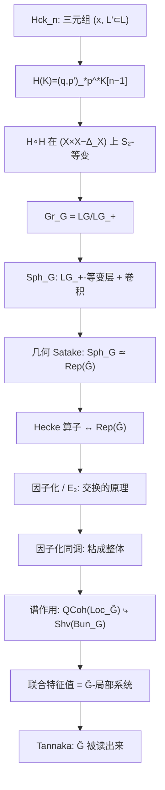
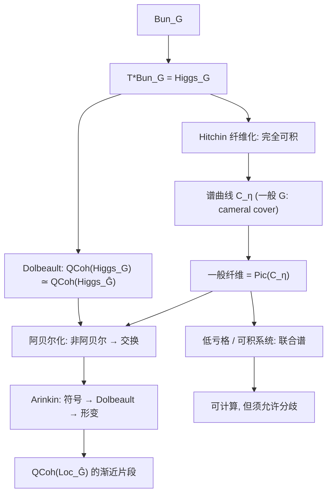

# s3 · 为什么成立，怎么变具体

> 负责人：W3 ｜ 覆盖：§3–§4 ｜ 底本页：BZ26 p.14–19（§4.3 另用 p.27）｜ 字数：约 2200（正文；含表格与思维导图约 2600）

## 本节要回答

- Hecke 算子凭什么两两交换，「交换」在几何上被写成什么？
- 几何 Satake 怎样把卷积翻译成张量积、把 Hecke 算子按 $\hat G$ 的表示分类？
- 因子化为什么是交换性的原理，$\hat G$ 又怎样从交换性里被读出来？
- 谱作用说的「特征值」究竟是什么？
- Hitchin 纤维化与 Abel 化怎样让 GLC 变成可计算的对象？

## §3 为什么成立

§2 写完陈述，未解释它凭什么成立。底本把理由压成一句：$\operatorname{Bun}_G$ 线性化之后出人意料地像一个阿贝尔群〔BZ26 p.14 §3〕。有两个化身：Hecke 算子两两交换 {{card:bzg/concept/hecke-operators}}，相空间里的 $\operatorname{Bun}_G$ 一般地像 Jacobian〔BZ26 p.14 §3〕。本节走前者，§4 走后者〔BZ26 p.14 §3〕。

### 3.1 Hecke 算子：交换性被写成一个等变条件

记号接着 §2，不再推导：$\operatorname{Hck}_n(X)$ 参数化三元组 $(x,L'\subset L)$，两张图 $p:\operatorname{Hck}\to\operatorname{Fib}$、$(q,p'):\operatorname{Hck}\to X\times\operatorname{Fib}$，$H(K)=(q,p')_*p^*K[n-1]$；$(q,p')$ 的相对维数 $n-1$ 就是移位的来源〔LAU02 906--7〕；要记住三件事〔BZ26 p.14 §3.1〕。

其一，$\hat G$ 在此只是组合对象：$x$ 处的修改由双陪集 $\operatorname{Gr}=LG_+\backslash LG/LG_+$ 参数化，高斯消元的变体给出这些轨道与「对偶环面特征的 Weyl 轨道」的一一对应，再经最高权到 $\hat G$ 的不可约表示；此处的 $\hat G$ 只是「有对偶环面、同一 Weyl 群」的产物〔BZ26 p.14 §3.1〕。

其二，双陪集没有结合乘法，线性化之后才有：测度上得到 Hecke 代数，换成层得到 $\operatorname{Sph}_G=\operatorname{Shv}(\operatorname{Gr})^{LG_+}$ 与 $F*G=m_!(F\boxtimes G)$ {{card:bzg/concept/spherical-hecke-category}}〔BZ26 p.15 §3.1〕。

其三，交换性只以等变条件的形式出现：同一点两次长度 $1$ 的修改叠成一次长度 $2$ 的修改，次序无从互换，规律是 $H^V_x\circ H^W_x\simeq H^{V\otimes W}_x$，与交换性无关〔RAS23 PDF p.15 §4.1〕。只有 $x\neq x'$ 时才有「先做哪一个」的对称性，故迭代 $H\circ H$ 的等变要求只加在对角线外：它在 $(X\times X-\Delta_X)\times\operatorname{Fib}_n(X)$ 上关于交换两个 $X$ 因子的 $S_2$ 作用是等变的〔LAU02 906--7〕。这是交换性的技术形态——不是算子等式，而是一族定义在构形空间开集上的等变同构，是一个**结构**〔CL23 书页 15（PDF 20）§2.11〕。对角线上没有它，这个缺口正是 3.3 要补的〔BZ26 p.15 §3.2〕。

### 3.2 局部模型与几何 Satake

局部模型是 $\operatorname{Gr}_G=LG/LG_+$ {{card:bzg/concept/affine-grassmannian}}：$LG=G((t))$，$LG_+=G[[t]]$，Cartan 分解按优势余权给出 Schubert 胞腔 $\operatorname{Gr}_G^\lambda$，$\lambda$ 跑遍 $\hat G$ 的最高权〔BZ26 p.14 §3.1〕〔CL23 书页 15（PDF 20）§2.12〕。几何 Satake 说卷积与张量是同一件事——一个对称 monoidal 等价：

$$\operatorname{Sph}_G\simeq\operatorname{Rep}(\hat G),\qquad \mathrm{IC}_{\operatorname{Gr}^\lambda}\leftrightarrow V^\lambda,$$

由 Lusztig–Ginzburg–Mirković–Vilonen 证得，导出算术版见 BF08 {{card:bzg/concept/geometric-satake}}〔BZ26 p.16 §3.3–3.4〕。「按表示分类」于是有了确切含义：每个 $V\in\operatorname{Rep}(\hat G)$ 给出 $H^V$，同一点满足 $H^{V\otimes W}=H^V\circ H^W$〔RAS23 PDF p.15 §4.1〕。

### 3.3 因子化：交换性的原理

为什么卷积交换？答案在 $\operatorname{Gr}_G$ 的同伦类型：它描述「圆盘外平凡的 $G$-丛」，$\simeq\Omega^2BG$，自带同伦交换的乘法〔BZ26 p.15 §3.2〕。这是 $E_n$-operad 的机制：$\pi_2$ 交换而 $\pi_1$ 不交换——二维圆盘里两个圈有空间绕开。Beilinson–Drinfeld 把它代数化为**因子化**（factorization / fusion）{{card:bzg/concept/factorization}}：在 $x$ 做 $T_1$、在邻近的 $y$ 做 $T_2$，让 $y$ 绕 $x$ 一周，绕行给出 $T_1\circ T_2\to T_2\circ T_1$ 的形变，于是卷积实际交换，$\operatorname{Sph}$ 成为对称 monoidal 范畴〔BZ26 p.15 §3.2〕。底本说得直白：交换性原本靠一个「技巧」证明；因子化给出的才是原理，降范畴化后还能回收经典 Hecke 代数的交换性〔BZ26 p.16 §3.3〕。交换是同伦意义下的，不是严格相等；因子化是「对不相交开集取值」的粘合数据，Ran 空间允许碰撞，碰撞处的复合正对应张量积；它的第二个用处是整体化〔RAS23 PDF p.16 §4.1 译注 18〕，给出 $\operatorname{Rep}(\hat G)_{\mathrm{Ran}}\to\operatorname{End}(\operatorname{Shv}(\operatorname{Bun}_G))$〔RAS23 PDF p.16 §4.1〕。

### 3.4 谱作用：特征值是局部系统

$\operatorname{Shv}(\operatorname{Bun}_G)$ 上于是有一族「每点一份 $\operatorname{Rep}(\hat G)$、彼此交换」的算子；谱作用定理把它打包成范畴作用，Hecke 作用穿过 $\operatorname{QCoh}(\operatorname{Loc}_{\hat G}(C))$：

$$\operatorname{QCoh}(\operatorname{Loc}_{\hat G}(C))\ \curvearrowright\ \operatorname{Shv}(\operatorname{Bun}_G),$$

de Rham 见 [Gai15]、Betti 见 [NY19] {{card:bzg/concept/spectral-action}}；打包方式写在脚注里：$x$ 处的 $V$ 送到 $\operatorname{Loc}_{\hat G}$ 上的向量丛，纤维是 $(V)_E|_x$〔BZ26 p.17 §3.5〕。读法是底本那句改写：{Hecke 算子的联合特征值} ↔ {$C$ 上的 $\hat G$-局部系统}〔BZ26 p.17 §3.5〕。对特征层即 $H^V(F)\cong F\boxtimes V_E$，特征值不是数，是 $E$ 处的一个向量空间〔RAS23 PDF p.17 §4.2〕。§2 因此把 $\operatorname{QCoh}$ 写进等价，补上「对角化」的内容；而谱作用本身只给自守到谱一个方向〔BZ26 p.17 §3.5〕。

### 3.5 对偶群从交换性里被读出来

现在回答「为什么是 $\hat G$」。Tannaka 的逻辑：交换环的谱刻画其全部联合特征值；同样，一个**交换**张量范畴的谱由 Tannaka 重构给出，只是特征值取向量空间〔BZ26 p.16 §3.4〕。$G=\mathrm{GL}_n$ 时这定理读成 {$\operatorname{Sph}$ 的可能特征值} ↔ {$n$ 维向量空间}：$n$ 维空间自身没有信息，信息全在 $\operatorname{Aut}=\mathrm{GL}_n$，右侧其实是栈 $\mathrm{pt}/\mathrm{GL}_n$；$G=\mathrm{SO}_{2n+1}$ 时右侧是 $2n$ 维辛向量空间，$\operatorname{Sp}_{2n}$ 正是 $\hat G$〔BZ26 p.16 §3.4〕。证明照此路线：以 $\operatorname{Sph}_G$ 上总上同调函子的自同构群造群，验证 tautological 张量函子是等价（这一步强依赖交换性、因而依赖因子化），再由 Schubert 分层迫使群约化、算出与 $G$ 对偶的根数据，它才配叫 Langlands 对偶群 {{card:bzg/concept/dual-group}}〔BZ26 p.16 §3.4〕。所以底本说应当反过来读几何 Satake：不是用 $\hat G$ 描述 $\operatorname{Sph}_G$，而是用 $\operatorname{Sph}_G$ 定义 $\hat G$——3.1 里那个组合的 $\hat G$，到这里才升级成真正的群〔BZ26 p.16 §3.3–3.4〕。

§2 两边因此取不同的群：$\hat G$ 由根数据对偶得到，$\mathrm{GL}_n$ 自对偶，$\mathrm{SL}_n$ 与 $\mathrm{PGL}_n$ 互换〔BZ26 p.6 §1.4〕；若谱侧也写 $G$，几何 Satake 不成立，主定理随之失去意义——$\hat G$ 不是选出来的，是被 Schubert 几何与交换性逼出来的〔BZ26 p.16 §3.4〕。

### 本节资料卡

| 概念 | 卡 id | 卡文件（相对本目录） | 底本页 |
| --- | --- | --- | --- |
| Hecke 函子：在一点修改丛 | `bzg/concept/hecke-operators` | [hecke-operators.json](../../../../benzvi_glc/cards/concepts/hecke-operators.json) | p.14 |
| 仿射 Grassmannian $\operatorname{Gr}_G=LG/LG_+$ | `bzg/concept/affine-grassmannian` | [affine-grassmannian.json](../../../../benzvi_glc/cards/concepts/affine-grassmannian.json) | p.10 |
| 球 Hecke 范畴 $\operatorname{Sph}_G$ | `bzg/concept/spherical-hecke-category` | [spherical-hecke-category.json](../../../../benzvi_glc/cards/concepts/spherical-hecke-category.json) | p.14, 16 |
| 几何 Satake 等价 | `bzg/concept/geometric-satake` | [geometric-satake.json](../../../../benzvi_glc/cards/concepts/geometric-satake.json) | p.16 |
| 因子化与 $E_n$ 结构 | `bzg/concept/factorization` | [factorization.json](../../../../benzvi_glc/cards/concepts/factorization.json) | p.15 |
| 谱作用定理 | `bzg/concept/spectral-action` | [spectral-action.json](../../../../benzvi_glc/cards/concepts/spectral-action.json) | p.17 |
| Langlands 对偶群与根数据 | `bzg/concept/dual-group` | [dual-group.json](../../../../benzvi_glc/cards/concepts/dual-group.json) | p.6 |

> 路径按本过程稿位置写；合入 `pages/geometric-langlands.md` 时前缀各去掉两级。

### 出处对照

| 简称 | 仓库文件 | 页码基准 |
| --- | --- | --- |
| BZ26 | [底本 full.txt](<../../../../../08_source_code/SY02-10_几何朗兰兹对偶是什么？/工程文件/full.txt>) | `===== PAGE n =====` 的 n 即原文 p.n |
| CL23 | [SY02-33 中译](<../../../../../08_source_code/SY02-33_几何Langlands理论导论（陈麟）_中文译注校订版/成品/几何Langlands理论导论（陈麟）_中文译注校订版.pdf>) | 书页 = PDF − 5；引用写「书页 N（PDF N+5）」 |
| LAU02 | [SY02-46 中译](<../../../../../08_source_code/SY02-46_Laumon布尔巴基906Drinfeld-Langlands对应/成品/SY02-46_Laumon布尔巴基906Drinfeld-Langlands对应_中译注本.pdf>) | 页边 `906--N` 即原文页 |
| RAS23 | [SY02-47 中译](<../../../../../08_source_code/SY02-47_Raskin射影曲线上的几何Langlands讲义/成品/SY02-47_Raskin射影曲线上的几何Langlands讲义_中译注本.pdf>) | PDF 页；书眉 p.N 对应 PDF N+3 |

## §4 怎么变具体

§3 走层范畴，第二条路回到几何。微局部分析的经验说函数更像相空间，故先问 $\operatorname{Bun}_G$ 的余切丛有什么特别〔BZ26 p.18 §4〕。

### 4.1 相空间：Higgs 丛就是 $T^*\operatorname{Bun}_G$

余切丛有模空间解释：$\operatorname{Higgs}_G=\{(P,\eta)\mid\eta\in\Gamma(C,\operatorname{ad}^*P\otimes\Omega^1_C)\}$，即「一个丛加一个自同态值的一形式」{{card:bzg/concept/higgs-bundles}}〔BZ26 p.18 §4.1〕。它带辛结构（稳定部分经非阿贝尔 Hodge 细化为 hyperkähler），Hitchin 发现它还带完全可积的哈密顿系统〔BZ26 p.18 §4.1〕。$G=\mathrm{GL}_n$ 时，取 $\eta$ 的特征多项式给出 Lagrangian 纤维化 $\operatorname{Hitch}:\operatorname{Higgs}_n\to\bigoplus_i\Gamma(C,\Omega^i)$，一般纤维是复环面且就是谱曲线的 Picard 群：$\eta$ 的特征值切出 $n$ 重覆盖 $C_\eta\subset T^*C$，故 $\operatorname{Hitch}^{-1}(\chi(\eta))=\operatorname{Pic}(C_\eta)$；一般 $G$ 以 cameral cover 替代谱曲线 {{card:bzg/concept/hitchin-fibration}}〔BZ26 p.18 §4.1〕。零纤维是整体幂零锥 $\operatorname{Nilp}$，$\operatorname{Bun}_G$ 是 $\eta\equiv0$ 的不可约分支〔BZ26 p.18 §4.1〕。其份量在于：Hitchin 把 $\operatorname{Bun}_G$ 表现成「曲线 Picard 群退化」的分支，离阿贝尔簇只有一步之遥〔BZ26 p.18 §4.1〕。

### 4.2 Abel 化：把非阿贝尔化到 $\mathrm{GL}_1$

阿贝尔化的入口也是 Higgs 机制的几何实现：$\eta$ 取真空期望值 $\operatorname{Hitch}(\eta)$，规范对称破缺到其中心化子〔BZ26 p.18 §4.1〕。Donagi 由此提出用 Hitchin 纤维化把 $\operatorname{Bun}_G$ 上的层论「一般地」化到 $\mathrm{GL}_1$ {{card:bzg/concept/abelianization}}〔BZ26 p.19 §4.2〕。Fourier 的语言是：$e^{i\lambda x}$ 在动量空间定域于一条直线，故特征层应沿 Hitchin 纤维微局部定域；换成缩放极限得渐近版本——特征簇是 $\operatorname{Nilp}$〔BZ26 p.20 §4.2〕，这也解释 Betti GLC 为何用带幂零支撑的反常层。Arinkin 把这条思路做成函子：先取符号退化，再过 Dolbeault 对偶，最后形变，

$$\mathrm{DMod}(\operatorname{Bun}_G)\ \rightsquigarrow\ \operatorname{QCoh}(\operatorname{Higgs}_G)\ \simeq\ \operatorname{QCoh}(\operatorname{Higgs}_{\hat G})\ \rightsquigarrow\ \operatorname{QCoh}(\operatorname{Loc}_{\hat G}),$$

得到「一般、形式渐近」的片段；三个箭头只有中间是等价，两端是退化与形变，故这条链不是 GLC 的证明〔BZ26 p.20 §4.2〕。Dolbeault 变体正嵌在中间：它是 $\operatorname{Loc}^{\mathrm{dR}}_{\hat G}$ 沿单参数族退化到 $T^*\operatorname{Bun}_{\hat G}$ 之后的对应 {{card:bzg/concept/dolbeault-glc}}，形式为 $\operatorname{QCoh}(\operatorname{Higgs}_G)\simeq\operatorname{QCoh}(\operatorname{Higgs}_{\hat G})$，在 Hitchin 基的一般纤维上由对偶阿贝尔簇之间的 Fourier–Mukai 给出，即 [DP12]；后经 [Ari13, MRV19] 推广，但整个 Hitchin 系统仍无完整图景〔BZ26 p.19 §4.1〕。它是 GLC 的**退化**，不是推论，也不能替代主定理〔BZ26 p.27 §6.0.4〕。

### 4.3 为什么这让 GLC 可计算

低亏格把两侧都变成显式的对象：$g=1$ 时 Langlands 参数是一对交换矩阵；$g=0$ 带标记点或穿孔时，它变成亚纯 ODE，étale 设定下则是一元有理函数域的 Galois 表示〔BZ26 p.27 §6.0.3〕。允许分歧之后，刚性局部系统、Kloosterman/Bessel 算术、Schubert 演算都归入这套语言，Yun 还用它解决某些有限约化群的反 Galois 问题〔BZ26 p.27 §6.0.3〕。反过来，自守侧谱问题在低亏格被等同于 Gaudin 自旋链与 Calogero–Moser 的求解，GLC 由此给出范式：交换哈密顿量的联合谱由 Langlands 参数给出 {{card:bzg/concept/low-genus}}〔BZ26 p.27 §6.0.3〕。与 Hitchin 侧合看，「可计算」的含义是：Hitchin 哈密顿量就是该可积系统的哈密顿量，谱曲线上的线丛就是联合特征值，层论在一般点被约化到曲线的 Picard 群〔BZ26 p.18 §4.1〕。

但有限制：对 $\mathrm{GL}_n$（$n\ge2$）、$g=0,1$，处处非分歧的 Drinfeld–Langlands 对应是空的，因为这样的 $X$ 上没有秩 $\ge2$ 的不可约局部系统〔LAU02 906--9〕。低亏格的故事全发生在允许分歧或刚性局部系统的设定里，「低亏格更容易」不是定理〔LAU02 906--9〕。

物理上，S-对偶提供动机，详见《超对称场论》卷。

### 本节资料卡

| 概念 | 卡 id | 卡文件（相对本目录） | 底本页 |
| --- | --- | --- | --- |
| Higgs 丛与 $T^*\operatorname{Bun}_G$ | `bzg/concept/higgs-bundles` | [higgs-bundles.json](../../../../benzvi_glc/cards/concepts/higgs-bundles.json) | p.18 |
| Hitchin 纤维化与谱曲线 | `bzg/concept/hitchin-fibration` | [hitchin-fibration.json](../../../../benzvi_glc/cards/concepts/hitchin-fibration.json) | p.18 |
| 阿贝尔化与 Arinkin 渐近 | `bzg/concept/abelianization` | [abelianization.json](../../../../benzvi_glc/cards/concepts/abelianization.json) | p.19 |
| Dolbeault 几何 Langlands | `bzg/concept/dolbeault-glc` | [dolbeault-glc.json](../../../../benzvi_glc/cards/concepts/dolbeault-glc.json) | p.19 |
| 低亏格与可积系统 | `bzg/concept/low-genus` | [low-genus.json](../../../../benzvi_glc/cards/concepts/low-genus.json) | p.27 |

### 出处对照

| 简称 | 仓库文件 | 页码基准 |
| --- | --- | --- |
| BZ26 | [底本 full.txt](<../../../../../08_source_code/SY02-10_几何朗兰兹对偶是什么？/工程文件/full.txt>) | `===== PAGE n =====` 的 n 即原文 p.n |
| LAU02 | [SY02-46 中译](<../../../../../08_source_code/SY02-46_Laumon布尔巴基906Drinfeld-Langlands对应/成品/SY02-46_Laumon布尔巴基906Drinfeld-Langlands对应_中译注本.pdf>) | 页边 `906--N` 即原文页 |

## 思维导图

§3：从 Hecke 对应到谱作用。

§4：从 Higgs 相空间到阿贝尔化。

## 易错点与待核

- **易错：把 Hecke 算子当普通卷积。** 它是「在一点换丛」诱导的函子，$V$ 是 $\hat G$ 而非 $G$ 的表示；同一点复合满足 $H^{V\otimes W}=H^V\circ H^W$，这不是交换性〔RAS23 PDF p.15 §4.1〕。
- **易错：把几何 Satake 的方向写反。** 是 $\operatorname{Sph}_G\simeq\operatorname{Rep}(\hat G)$，不是 $\operatorname{Rep}(G)$；而且它是 monoidal 等价，不只是 Grothendieck 群上的同构〔BZ26 p.16 §3.3〕。
- **易错：把 Abel 化当成「GLC 的证明」。** Arinkin 链两端只是退化与形变，只给一般、形式渐近的片段〔BZ26 p.20 §4.2〕。
- **易错：把物理的 S-对偶写成数学定理。** 它只提供动机，本页只留一句接口。
- **待核（归一化）：** 三份文献写法不同——LAU02 用 $(q,p')_*p^*\lbrack n-1\rbrack$，CL23 用 $(\operatorname{supp},h_\to)_!h_\leftarrow^*\lbrack d_i\rbrack(d_i/2)$（$d_i=i(n-i)$），RAS23 用 $h_{\to*}h_\leftarrow^!\otimes\pi^!S_V$。合稿须统一约定，并说明 $n-1$ 与 $d_i$ 不是同一个量〔LAU02 906--7〕〔CL23 书页 14（PDF 19）§2.8〕。
- **待核（低亏格边界）：** 对 $\mathrm{GL}_n$（$n\ge2$）、$g=0,1$，处处非分歧的 Drinfeld–Langlands 对应为空，低亏格结论必须写在允许分歧的设定里〔LAU02 906--9〕。
