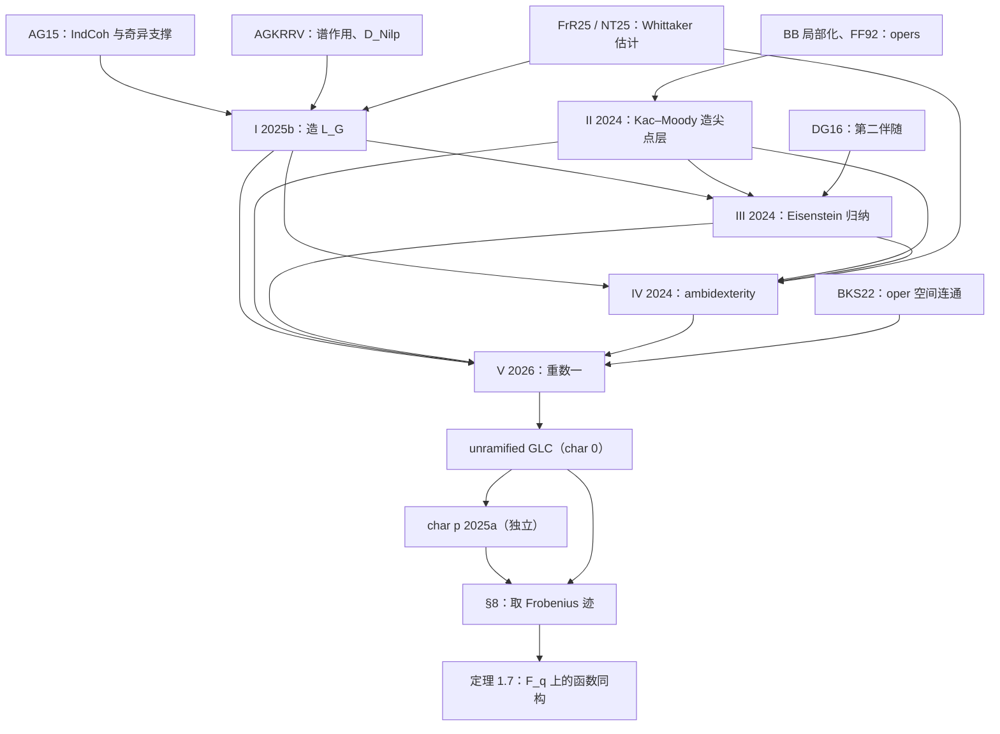
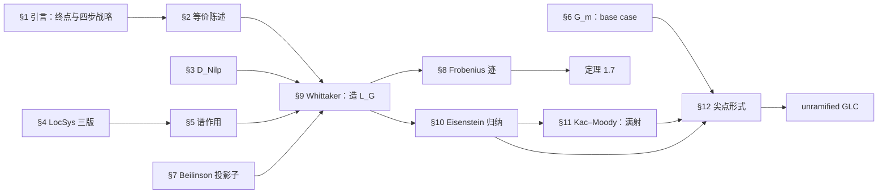

# s4 · 证明地图：五篇论文与 Scholze 路线

> 负责人：W4 ｜ 覆盖：§5 ｜ 底本页：BZ26 p.20–26；SCH26 p.2–41 ｜ 字数：约 2600（正文汉字，表格另计）

## 本节要回答

- 五篇论文各造什么、依赖谁、解决哪一步？编年上为什么不能写成「2024 年五篇」？
- Scholze 1252 的十二节，每一节在证明里干什么？
- 主逻辑链的五步怎样落到具体论文与节？
- 最难的一步为什么是 ambidexterity？它与旧 FGV 路线是什么关系？
- 为什么五篇加起来是数千页？

## 5.1 五篇论文：造什么、依赖谁、解决哪一步

五篇不是按投稿时间排的直线，而是按论证依赖咬合的五台机器：I 造函子，II 造尖点层，III 用 Eisenstein 化到尖点，IV 用 ambidexterity 把单射与满射合成等价，V 算重数一收口〔BZ26 p.26 §6〕。编年照 §6：I 定稿 2025b，II–IV 是 2024，V 是 2026；char p 的 2025a 独立成篇，不算五部曲〔BZ26 p.26 §6〕。

**I（2025b，arXiv:2405.03599v3）造 Langlands 函子。** 先由真空 Poincaré 层经谱作用得 L^L_{G,temp}，取其右伴随得粗化函子 L_{G,coarse}；主定理只断言这个粗化函子把紧对象送到下有界，再用 Ψ 在 >−∞ 上的等价把像提升进 IndCoh_Nilp，得 L_G，并由「保余极限、紧对象入 IndCoh_Nilp^{>−∞}、与 L_{G,coarse} 经 Ψ 相容」唯一刻画〔SCH26 p.33 §9〕{{card:bzg/concept/proof-map}}{{card:glc1/concept/langlands-functor}}{{card:glc1/concept/coarse-langlands-functor}}。依赖 AG15 的 IndCoh 与奇异支撑、AGKRRV 的谱作用、FrR25/NT25 的 Whittaker 估计；解决「自守→谱」的存在性，构造无条件，不假设 Hecke 特征层先存在。

**II（2024，arXiv:2405.03648）造尖点层。** 临界水平的仿射 Kac–Moody 表示经 Beilinson–Bernstein 局部化成 Bun_G 上的 D-模；Feigin–Frenkel 把临界水平中心识别为 opers 上的函数，于是每个带 oper 结构的局部系统都给出一族可写对象{{card:bzg/concept/beilinson-bernstein}}{{card:bzg/concept/feigin-frenkel}}。II 把它做成含因子化与局部-整体兼容的机器，主输出是定理 11.4 的交换图：上排 L_G，下排 FLE: KL(G)_crit ≃ IndCoh_*(Op^monfree)_Ran〔SCH26 p.40 §11〕{{card:bzg/concept/kac-moody-opers}}。它解决「满射」那一半的库存：保证谱侧每种颜色都有尖点层可对。

**III（2024，arXiv:2409.07051）做 Eisenstein 归纳。** 定义 Eis_! = q_!p^* 与常数项 CT_! = p_!q^*，用第二伴随把两者配成伴随对〔SCH26 p.37 §10〕。主定理证 L 与抛物诱导差扭交换，并对取右伴随得到的常数项方块同样证交换，后者用 Kac–Moody 局部化〔SCH26 p.38 §10〕。它解决「化到真 Levi 加尖点」，也是必须把 QCoh 换成 IndCoh_Nilp 的原因{{card:bzg/concept/eisenstein-series}}。

**IV（2024，arXiv:2409.08670）做 ambidexterity。** 前两步只给两个半句：Whittaker 保守性给单射，Kac–Moody 库存给满射；IV 证 L^cusp 的左、右伴随存在且差扭同构——右伴随用与 Whittaker 系数的相容性，左伴随用与 Kac–Moody 局部化的相容性〔SCH26 p.41 §12〕。它解决「把两个半句合成一个等价」，是全证明的枢纽，详见 §5.4。

**V（2026，arXiv:2409.09856v3）证重数一。** 由 IV 得 L^cusp∘(L^cusp)^R ≅ id，问题化到谱侧完美复形 A_Ĝ 与结构层的比较；A_Ĝ 由 oper 结构空间的同调给出，已证连通、H^0 自由、自对偶，只能是 0 次向量丛，即 LocSys^irred 上的局部系统〔SCH26 p.41 §12〕。BKS22 给经典群的 oper 空间非空连通，H^0 维数等于 Whittaker 层自同态、等于 1，故重数一，unramified GLC 成立{{card:bzg/concept/glc-statement}}{{card:glc1/conjecture/glc-conjecture}}。

**char p（2025a，arXiv:2508.02237）是独立第六篇，不在五部曲里。** 它把 char p 的层经 Witt 向量环提升到 char 0，再由一般纤维退化，得 D(Bun_G) ≃ IndCoh_Nilp(LocSys′_Ĝ)，条件 p≫0 且 p 不是 G 的挠素数；′ 是开闭子叠（混合特征的 étale 奇异支撑更微妙）〔SCH26 p.14 §2〕。它取 char 0 的定理作输入，再与 §8 的迹推出 F_q 上的定理 1.7。

#### 本节资料卡

| 概念 | 卡 id | 卡文件 | 页 |
|---|---|---|---|
| 五篇分工、主线 | bzg/concept/proof-map | [proof-map.json](../../benzvi_glc/cards/concepts/proof-map.json) | p.20, 26 |
| Langlands 函子 L_G | glc1/concept/langlands-functor | [langlands-functor.json](../../glc1/cards/concepts/langlands-functor.json) | p.14–15 |
| 粗化函子 | glc1/concept/coarse-langlands-functor | [coarse-langlands-functor.json](../../glc1/cards/concepts/coarse-langlands-functor.json) | p.12–13 |
| Kac–Moody 与 opers | bzg/concept/kac-moody-opers | [kac-moody-opers.json](../../benzvi_glc/cards/concepts/kac-moody-opers.json) | p.25 |
| Beilinson–Bernstein | bzg/concept/beilinson-bernstein | [beilinson-bernstein.json](../../benzvi_glc/cards/concepts/beilinson-bernstein.json) | p.25 |
| Feigin–Frenkel | bzg/concept/feigin-frenkel | [feigin-frenkel.json](../../benzvi_glc/cards/concepts/feigin-frenkel.json) | p.25 |
| Eisenstein 归纳 | bzg/concept/eisenstein-series | [eisenstein-series.json](../../benzvi_glc/cards/concepts/eisenstein-series.json) | p.23 |
| GLC 陈述 | bzg/concept/glc-statement | [glc-statement.json](../../benzvi_glc/cards/concepts/glc-statement.json) | p.21–22 |
| 猜想与四版本等价 | glc1/conjecture/glc-conjecture | [glc-conjecture.json](../../glc1/cards/conjectures/glc-conjecture.json) | p.15 |

#### 出处对照

| 简称 | 仓库文件 | 页码基准 |
|---|---|---|
| BZ26 | `08_source_code/SY02-10_几何朗兰兹对偶是什么？/工程文件/full.txt` | PAGE n = 原文 p.n |
| SCH26 | `08_source_code/SY02-45_Scholze布尔巴基1252几何Langlands的证明/成品/SY02-45_Scholze布尔巴基1252几何Langlands的证明_中译注本.pdf` | PDF 页脚，本稿 p.2–41 |
| GLC I | `08_source_code/SY02-35_几何Langlands猜想I_函子的构造/成品/SY02-35_几何Langlands猜想I_函子的构造_v1.0.pdf` | 论文页 p.12–15 |

## 5.2 Scholze 1252 的十二节地图

**§1 引言（p.2–8）：** 把 GLC 放回 Weil 罗塞塔第三栏，终点写成 F_q 上的函数同构（定理 1.7）；再给四步战略——范畴等价、取 Frobenius 迹、换域与层论、在 char 0 de Rham 中证明。作用是定终点与路线，后面十一节都为第四步供料〔SCH26 p.7 §1〕。

**§2 等价陈述（p.9–14）：** 搭六函子框架与 Hecke 作用，陈述猜想 2.10：D(Bun_G) ≃ IndCoh_Nilp(LocSys_Ĝ)，以「Whittaker 层 ↔ 结构层」归一化；同节给出 char 0（定理 2.11）与 char p（定理 2.12，LocSys′）两个已证版本。作用是把要证的压成唯一精确的范畴命题〔SCH26 p.13 §2〕{{card:glc1/concept/indcoherent-nilpotent-support}}{{card:glc1/concept/nilpotent-cone}}。

**§3 Bun_G 上的层（p.15–16）：** 定义自守侧 D(Bun_G)（étale 用 Ind D^b_c，de Rham 用完整 D-模范畴），证定理 3.4：幂零奇异支撑、Hecke-lisse、ind-prim 三者等价，记 D_Nilp。作用是给自守侧一个与 IndCoh_Nilp 对得上的子范畴，否则函子没有落点〔SCH26 p.16 §3〕{{card:glc1/concept/automorphic-category}}{{card:glc1/concept/betti-automorphic-category}}{{card:glc1/concept/half-twist}}。

**§4 局部系统的叠（p.17–18）：** 定义谱侧三版 LocSys^Betti/dR/et，说明它们点与变形理论相同而整体不同（étale 是 restricted 完备化）。作用：决定 IndCoh 建在哪个叠上，也解释 étale 版为何能当 de Rham 与 Betti 的共同核心〔SCH26 p.17 §4〕{{card:glc1/concept/spectral-stack}}。

**§5 谱作用（p.19–25）：** 证 D_qc(LocSys_Ĝ) 作用在 D(Bun_G) 上：Betti/étale 用 Nadler–Yun 的 1-affineness，de Rham 用定理 5.9（支撑在 LocSys^dR，证明靠 Eisenstein 与 Kac–Moody 生成）。作用：给「谱分解」这半边的函子性；没有它 L_G 无从定义〔SCH26 p.25 §5〕{{card:bzg/concept/spectral-action}}{{card:glc1/concept/spectral-action}}{{card:glc1/concept/hecke-action}}{{card:bzg/concept/factorization}}。

**§6 G=G_m（p.26–27）：** 手算一维情形：Pic 侧写成 ∏_Z Ind Lisse(J)⊗D(∗/C^×)，LocSys 侧写成 G_m^{2g}×(∗×^L∗)×∗/G_m，逐项配对得 D_Nilp(Pic) ≃ D_qc(LocSys^Betti_{G_m})；并指出 de Rham 侧整体截面极少。作用：给归纳 base case，预演最后一步「截面少反而好算重数」〔SCH26 p.26 §6〕。

**§7 Beilinson 谱投影子（p.27–28）：** 用 i 的 1-étale、1-proper 性造收缩 P: D(Bun_G)→D_Nilp(Bun_G)（i_! 作截面），它 D_qc(∗/Ĝ)-线性。作用：把任意层投影到幂零支撑部分——造 L_G、造特征层、算迹都靠它〔SCH26 p.27 §7〕。

**§8 Frobenius 的迹（p.29–31）：** 定义范畴迹 tr(F|C)，证定理 8.2：tr(Frob|D_Nilp(Bun_G)) ≅ Ac(Bun_G(F_q))；对定理 2.12 取迹即得定理 1.7。作用：把几何等价降回 F_q 上的函数同构〔SCH26 p.30 §8〕。

**§9 Whittaker 系数（p.32–35）：** 定义 W = p_!ψ^*exp、函子 A↦A?P(W) 与粗化函子 L^coarse，证定理 9.3：存在唯一保余极限的 L_G 提升；定理 9.6 给 Whittaker 系数的完全描述。作用：真正造出 L_G，也是单射性的来源〔SCH26 p.33 §9〕{{card:bzg/concept/whittaker-period}}。

**§10 Eisenstein 级数（p.35–38）：** 定义 Eis_! = q_!p^*、CT_! = p_!q^*，引第二伴随（定理 10.1），证 CCF 方块与常数项方块。作用：归纳步——把 G 化到真 Levi 与尖点，也解释为何必须用 IndCoh_Nilp（注 10.2）〔SCH26 p.38 §10〕。

**§11 Kac–Moody 局部化（p.38–40）：** 定义 opers，陈述定理 11.4：KL(G)_crit ≃ IndCoh_*(Op^monfree)_Ran（FLE），且与 L_G、Loc_G 排成交换图。作用：满射性——保证每个不可约参数都有尖点层，即「每种颜色都出现」〔SCH26 p.40 §11〕。

**§12 尖点形式（p.40–41）：** 把问题化到 LocSys^irred 上的 L^cusp；核心输入是 FrR25 的保守性，右伴随用与 Whittaker 系数的相容性、左伴随用与 Kac–Moody 局部化的相容性，再由 IV 证两者同构；于是 A_Ĝ 自对偶、连通，只能是 0 次向量丛，重数一落地，BKS22 收尾经典群。作用：收口，把等价与重数一同时证完〔SCH26 p.41 §12〕。

#### 本节资料卡

| 概念 | 卡 id | 卡文件 | 页 |
|---|---|---|---|
| 自守范畴与平方根扭转 | glc1/concept/automorphic-category | [automorphic-category.json](../../glc1/cards/concepts/automorphic-category.json) | p.9–10 |
| Betti 自守范畴 | glc1/concept/betti-automorphic-category | [betti-automorphic-category.json](../../glc1/cards/concepts/betti-automorphic-category.json) | p.23 |
| 半扭转 | glc1/concept/half-twist | [half-twist.json](../../glc1/cards/concepts/half-twist.json) | p.9–10 |
| 谱叠 | glc1/concept/spectral-stack | [spectral-stack.json](../../glc1/cards/concepts/spectral-stack.json) | p.19–20 |
| Hecke 作用 | glc1/concept/hecke-action | [hecke-action.json](../../glc1/cards/concepts/hecke-action.json) | p.10 |
| 谱作用（GLC I 版） | glc1/concept/spectral-action | [spectral-action.json](../../glc1/cards/concepts/spectral-action.json) | p.10 |
| 谱作用（BZ 版） | bzg/concept/spectral-action | [spectral-action.json](../../benzvi_glc/cards/concepts/spectral-action.json) | p.17 |
| 因子化 | bzg/concept/factorization | [factorization.json](../../benzvi_glc/cards/concepts/factorization.json) | p.15 |
| 幂零支撑（IndCoh 侧） | glc1/concept/indcoherent-nilpotent-support | [indcoherent-nilpotent-support.json](../../glc1/cards/concepts/indcoherent-nilpotent-support.json) | p.14 |
| 幂零锥 | glc1/concept/nilpotent-cone | [nilpotent-cone.json](../../glc1/cards/concepts/nilpotent-cone.json) | p.14 |
| Whittaker period | bzg/concept/whittaker-period | [whittaker-period.json](../../benzvi_glc/cards/concepts/whittaker-period.json) | p.23 |

#### 出处对照

| 简称 | 仓库文件 | 页码基准 |
|---|---|---|
| SCH26 §1–§12 | `08_source_code/SY02-45_Scholze布尔巴基1252几何Langlands的证明/成品/SY02-45_Scholze布尔巴基1252几何Langlands的证明_中译注本.pdf` | PDF 页脚 p.2–41 |
| BZ26 §5.1–§5.5 | `08_source_code/SY02-10_几何朗兰兹对偶是什么？/工程文件/full.txt` | PAGE 21–25 |

## 5.3 主逻辑链：五步与出处

| 步 | 做什么 | 论文 | SCH26 节 | BZ26 页 |
|---|---|---|---|---|
| 1 | 造 L_G：粗化函子 + Ψ 提升 | I（2025b） | §9，定理 9.3 | p.23–25 §5.4 |
| 2 | 造尖点层：临界水平表示 → oper 层 | II（2024） | §11，定理 11.4 | p.25–26 §5.5 |
| 3 | Eisenstein 归纳：化到真 Levi 与尖点 | III（2024） | §10，CCF 方块 | p.23 §5.3 |
| 4 | ambidexterity：左右伴随同构 | IV（2024） | §12，L^cusp | p.21–22 §5.1 |
| 5 | 重数一：A_Ĝ 自对偶 ⇒ 局部系统 | V（2026） | §12 末 | p.26 §6 |

这条链不线性：II 与 III 都要用 I 的 L_G，IV 同时吃 II 与 III，V 再吃前三者。§2、§5、§7 是贯穿各步的基础设施（陈述、谱作用、投影子），§3–§4 定两边范畴，§6 是 base case，§8 只服务与 F_q 的对接。一句话：I 给函子，II 给库存，III 给归约，IV 给等价，V 给重数〔BZ26 p.26 §6〕。

#### 本节资料卡

| 概念 | 卡 id | 卡文件 | 页 |
|---|---|---|---|
| 相对 Langlands 与 period | bzg/concept/relative-langlands | [relative-langlands.json](../../benzvi_glc/cards/concepts/relative-langlands.json) | p.22 |
| 三类测量（归纳/单射/满射） | bzg/concept/whittaker-period | [whittaker-period.json](../../benzvi_glc/cards/concepts/whittaker-period.json) | p.23 |
| 五篇主线 | bzg/concept/proof-map | [proof-map.json](../../benzvi_glc/cards/concepts/proof-map.json) | p.20, 26 |

#### 出处对照

| 简称 | 仓库文件 | 页码基准 |
|---|---|---|
| BZ26 §5.1–§5.5 | `08_source_code/SY02-10_几何朗兰兹对偶是什么？/工程文件/full.txt` | PAGE 21–26 |
| SCH26 §9–§12 | 同 §5.2 表 | PDF 页脚 p.32–41 |

## 5.4 最难的一步：ambidexterity

**为什么难。** 它不是一条估计，而是一个 (∞,2)-范畴的伴随陈述：L^cusp 有两个伴随，要证它们差扭相等。BZ26 把 §5.1 整节叫「先做一点泛函分析」：D(Bun_G) 要像范畴 Hilbert 空间那样自对偶，谱侧才只能取 IndCoh（广义函数），奇异支撑对应波前集；ambidexterity 就是这套分析里「算子与其伴随可逆」的性质，故 §6 称它「更精细的泛函分析」〔BZ26 p.21–22 §5.1；p.26 §6〕。若当技术引理，就会以为单射加满射已经足够；两个半句之间差的正是这个伴随同构，所以它单列一篇。

**旧 FGV 路线是另一条链。** Laumon 层 L_E → Fourier–Deligne → 消没定理（d > nk(2g−2) 时 Av_E^d = 0）⇒ 洁净性 j_{k,!}F_k ≅ j_{k,*}F_k（IC 的 ! 与 * 延拓一致）→ 沿 Drinfeld 的 Y^n_d 下降得 Aut_E〔CL23 p.36–37 §5.7–§6.2〕{{card:glc/concept/laumon-sheaf}}{{card:glc/concept/vanishing-theorem}}{{card:glc/concept/cleanness-theorem}}{{card:sy0246/concept/main-theorem-fgv}}。它的逻辑型是「对每个 oper 参数造对象」，核心投入是消失估计；新路线的逻辑型是「证函子是等价」，核心投入是伴随同构。两条链共享 Whittaker 与消没的技术遗产，但新路线不是旧链的延长：命题类型与收口工具都换了——Beilinson 投影子与 IndCoh_Nilp 扮演旧路线里 IC 与洁净性的角色。

**关系定性。** 所以两条路线是「同一目的、不同证明类型」：旧路线证「每个参数有对象」，新路线证「整个范畴等价」，后者蕴含前者但证明结构不同。把新证明说成「FGV + Eisenstein + Kac–Moody」会漏掉 ambidexterity 一整篇的份量；细节留给 §6，这里只留结构性对照〔BZ26 p.26 §6〕。

#### 本节资料卡

| 概念 | 卡 id | 卡文件 | 页 |
|---|---|---|---|
| Laumon 层 | glc/concept/laumon-sheaf | [laumon-sheaf.json](../../glc/cards/concepts/laumon-sheaf.json) | p.29 |
| 消没定理 | glc/concept/vanishing-theorem | [vanishing-theorem.json](../../glc/cards/concepts/vanishing-theorem.json) | p.36 |
| 洁净性定理 | glc/concept/cleanness-theorem | [cleanness-theorem.json](../../glc/cards/concepts/cleanness-theorem.json) | p.37 |
| FGV 主定理（GL_n） | sy0246/concept/main-theorem-fgv | [main-theorem-fgv.json](../../sy0246/cards/concepts/main-theorem-fgv.json) | p.8 |

#### 出处对照

| 简称 | 仓库文件 | 页码基准 |
|---|---|---|
| CL23 | `08_source_code/SY02-33_几何Langlands理论导论（陈麟）_中文译注校订版/成品/几何Langlands理论导论（陈麟）_中文译注校订版.pdf` | 书页 = PDF 页 − 5 |
| BZ26 §5.1、§6 | `08_source_code/SY02-10_几何朗兰兹对偶是什么？/工程文件/full.txt` | PAGE 21–22、26 |
| SCH26 §12 | 同 §5.2 表 | PDF 页脚 p.41 |

## 5.5 为什么五篇加起来是数千页

因为陈述只有几行，而让这几行有意义的每台机器都要几百页：六函子与 IndCoh 的形式化、D(Bun_G) 的紧生成与自对偶、临界水平表示与 opers 的因子化机器、Eisenstein 的 (∞,2)-伴随、de Rham/Betti/étale 与 char 0/char p 的翻译，每台都自带定义、定理与相容性，接口再写一遍，页数就上去了〔BZ26 p.26 §6〕。BZ26 说这不是测地线而是「包围后攻入」；Scholze 开篇也点明该定理依赖许多其他论文〔SCH26 p.2 §1〕。页数买的是「让陈述可被操作」，不是「把证明写长」。

#### 本节资料卡

| 概念 | 卡 id | 卡文件 | 页 |
|---|---|---|---|
| 五篇主线 | bzg/concept/proof-map | [proof-map.json](../../benzvi_glc/cards/concepts/proof-map.json) | p.26 |
| GLC 陈述 | bzg/concept/glc-statement | [glc-statement.json](../../benzvi_glc/cards/concepts/glc-statement.json) | p.21–22 |

#### 出处对照

| 简称 | 仓库文件 | 页码基准 |
|---|---|---|
| BZ26 §6 | `08_source_code/SY02-10_几何朗兰兹对偶是什么？/工程文件/full.txt` | PAGE 26 |
| SCH26 §1 | 同 §5.2 表 | PDF 页脚 p.2、p.7 |

## 思维导图

## 易错点与待核

**易错点。**

1. **「2024 年五篇」。** I 定稿 2025b、V 在 2026，只有 II–IV 是 2024；按 arXiv 首版时间全标 2024 会与 §6 编年冲突。
2. **把 char p 算进五部曲。** 它是 2025a、独立论文，条件是 p≫0 且 p 非 G 的挠素数，谱侧写 LocSys′。
3. **把 Scholze 1252 当证明正文。** 它是 Bourbaki 报告式路线图，证明在 I–V；引它只能引叙述与编排，不能当证明引。
4. **把 ambidexterity 说成技术引理。** 它是把单射与满射合成等价的伴随陈述，BZ26 称其「更精细的泛函分析」，并为它单列一篇。
5. **把 Kazhdan 列入五部曲作者。** 他出现在 BKS22 等配套论文里；SCH26 p.2 的十一人名单是整个 enterprise 的致谢，不是某一篇的作者。
6. **把 §9 的单射与 §11 的满射当成已经合起来。** 合起来正是 §12 与 IV 的工作；缺了 IV 只有两个方向性结论。
7. **把 LocSys′ 写成 LocSys，或把 char 0 的定理说成「所有特征已证」。** F_q 情形另需 §8 的迹。

**待核。**

1. **「数千页」的页数。** 仓库没有五篇的逐篇页数；本稿只解释页数为何膨胀，未核实际总量（若只数五篇正文，量级可能是「上千页」）。建议 lead 统一措辞或补页数。
2. **II/III/IV 的 arXiv 编号与版本。** 标题、作者、年份取自 SCH26 书目，编号另行核对；II 的 2405.03648 首版在 2024-05，与「II–IV = 2024」相容，v 版仍需确认。
3. **旧 FGV 路线的三步表述。** BZ26 全文没有这条叙述（grep 仅命中参考文献），本稿依据 CL23 §5.7–§6.2 的卡片与 W5 的 §6.5，属编者综合，需与 §6 正文对齐。
4. **§12 中 A_Ĝ 的「连通、H^0 自由、自同态维数 1」。** 仅据 SCH26 §12 的叙述，未逐行核原文；BKS22 只覆盖经典群，一般 G 的连通性在原文中由 GLC 推出，引用要避免循环。
5. **「IV 是最难的一步」是编者判断。** BZ26 只说它是「更精细的泛函分析」（p.26），未明说「最难」；要写成定论需 lead 认可。

## 交稿前自检

- [x] 每个 `{{card:}}` 都在 `cards.tsv`，按 `check_survey.py` 同款规则（JSON 的 `id` 字段）核过。
- [x] 每个数学段落末有 `〔BZ26 …〕` 或 `〔SCH26 …〕`。
- [x] 表内链接按最终页 `datasets/encyclopedia/pages/geometric-langlands.md` 的位置书写。
- [x] 两张 mermaid：论文依赖图 15 个节点，十二节映射图 14 个节点，均 ≤20。
- [x] 易错点 7 条、待核 5 条。
- [x] 未展开 §6 的 Whittaker/Eisenstein/Kac–Moody 细节，未写 §7 现状，未写物理。

> 表内相对链接按最终页 `datasets/encyclopedia/pages/geometric-langlands.md` 的位置书写；从 `work/survey-v1/` 直接点会多差两级，合稿时不改。
