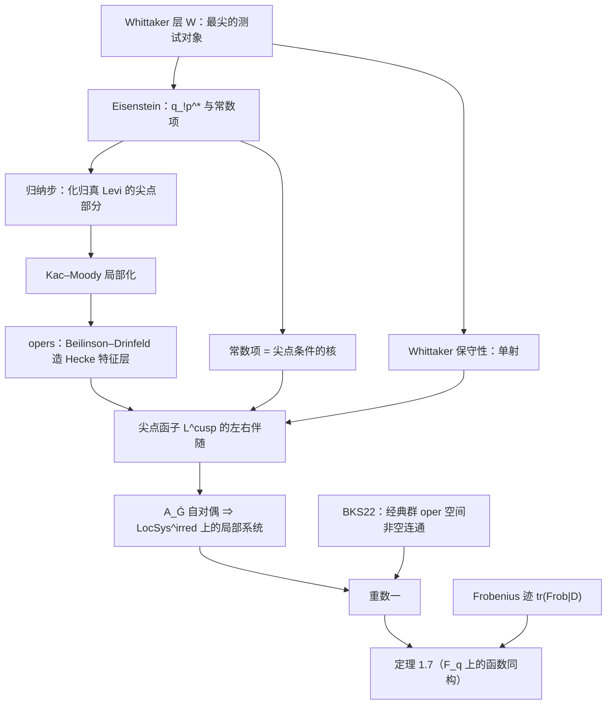

# s5 · 证明细节、现状与形式化（含附录 A 年表）

> 负责人：W5 ｜ 覆盖：§6、§7、附录 A ｜ 底本页：BZ26 p.23–34；SCH26 p.14–15、p.29–41；LAU02 906--13–15 ｜ 字数：约 2600（正文，表格另计）

## 本节要回答

- 「白光」为什么在非阿贝尔情形由 Whittaker 层扮演，它凭什么是最尖的测试对象？Frobenius 的迹怎样把范畴等价退回函数空间？
- Eisenstein 级数的抛物诱导、常数项与归纳步，怎样把 GLC 化归尖点情形？重数一在哪里落地？
- Kac–Moody 局部化与 opers 为什么能造出尖点层？尖点条件与谱分解如何收尾？
- 到今天为止，哪些已证、哪些未知、哪些只是形式化缺口？
- 1978–2026 的关键节点怎样排？

## §6 证明细节

先给一句总述：§5 的五篇论文把 GLC 拆成三条互锁的输入——Whittaker 系数（测量）、Eisenstein（归纳）、Kac–Moody/opers（构造），最后在尖点处用伴随与重数一收口〔BZ26 p.26 §6〕。

### 6.1 白光：Whittaker 层为什么最尖

傅里叶分析里，「白光」是 δ₀：它集中在 x=0，变换后是常数函数 1；本征函数按在单位点取值归一，于是 δ_e（Dirichlet）↦ 常数 1（Neumann）。非阿贝尔情形没有现成的 δ₀，顶替它的是 **Whittaker period**{{card:bzg/concept/whittaker-period}}：沿最大单幂根 U 取一个最不退化的加性特征 ψ，再把特征函数沿 U-轨道求和。归一化条件正是「Whittaker period ↦ 整体截面」，几何上即「Whittaker 层 ↦ O_{Loc_Ǵ}」〔BZ26 p.23–24 §5.4〕。

它为什么最尖：ψ 取遍全部单根投影之和，W = p_! ψ^* exp 由「沿 U-丛紧支撑前推 + 指数局部系统」造出，因此把 U 的所有根方向一次点亮，是对 Hecke 平移最敏感的对象；谱作用 D_qc(LocSys_Ǵ) 若在 D(Bun_G) 上有秩 1 自由模，W 就是那个基向量〔SCH26 p.32 §9〕。g≥2 时 Θ 丰沛，Bun^Θ_U 上的滤过被迫是 Harder–Narasimhan 滤过，W 因而极显式——这是最后一步能算自同态的前提〔SCH26 p.33 §9〕。

Whittaker 系数还有微局部读法：它等于 T^*Bun_G 在正则幂零轨道处的微茎（精确版见 Nadler–Taylor）〔SCH26 p.41 §12〕。Færgeman–Raskin 证明它在尖点层上不消失——与数论中「尖点形式的 Whittaker 系数可以消失」的经验相反——于是用 W 及其 Hecke 平移可忠实检测尖点层，得到单射性〔BZ26 p.25 §5.4〕{{card:glc/concept/whittaker-conservativity}}。

Frobenius 的迹把这套几何送回函数：在对称幺半范畴中对可对偶对象取迹，得 tr(F|𝒞) ∈ D(e)；AGKRV 2021 证明 tr(Frob | D_Nil(Bun_G)) 与 A_c(Bun_G(F_q)) 同构〔SCH26 p.30 §8〕。证明虽在自守侧，却必须算 tr(Frob∘H | D(Bun_G×X^I))：与 Frobenius 图像取纤维积得 shtuka 空间，再用 Xue 2025 的 ind-lisse 性，Beilinson 投影自动失效〔SCH26 p.31 §8〕。谱侧的迹另算，两半合起来才是定理 1.7〔SCH26 p.31 §8 注 8.3〕。

### 6.2 Eisenstein：抛物诱导、常数项与归纳步

经典 Eisenstein 级数先沿抛物 B 的纤维求和、再解析延拓；几何版把「求和」换成紧支撑前推：对应 Bun_P 带投影 p, q 到 Bun_M 与 Bun_G，给出 Eis_{P!} = q_! p^*，常数项是反方向的 CT_{P!} = p_! q^*，即「沿尖点取 Fourier 展开的常数项」〔SCH26 p.35–36 §10〕{{card:bzg/concept/eisenstein-series}}。第二伴随（Drinfeld–Gaitsgory 2016）说 CT_{P⁻!} 是 Eis_{P!} 的右伴随，证明在核的 (∞,2)-范畴层面完成〔SCH26 p.37 §10〕。

归纳步这样走：对 G 的秩归纳，先承认真 Levi 上的 GLC；Eisenstein 生成的部分交给连续谱，剩下的是常数项的核，即尖点部分。CCF'24 证明 Eisenstein 与 Langlands 函子 L 差一个扭交换，方块 L_M → Eis^spec → L_G 与自守侧对应；这也是必须把 D_qc 换成 IndCoh_Nilp 的原因——Eis_{P!} 保紧对象，其谱对应却不保〔SCH26 p.38 §10〕。竖直取右伴随得到的 CT 方块同样交换，证明用到 Kac–Moody 局部化〔SCH26 p.38 §10〕。于是 GLC 化归「尖点自守层 = Eisenstein 的正交补」〔BZ26 p.23 §5.3〕{{card:glc/concept/eisenstein-compatibility}}。

重数一在这一步只作为归纳的收尾出现：Eisenstein 部分给连续谱，尖点部分给离散的不可约参数，两者接缝处的重数必须是一〔BZ26 p.26 §5.5〕。

### 6.3 Kac–Moody 局部化与 opers：尖点层从哪来

前两节是「测量」与「归约」，真正「造对象」的是 Kac–Moody 局部化{{card:bzg/concept/kac-moody-opers}}。一个 oper 是 de Rham Ǵ-局部系统加上到 Ȗ^Θ 的约化，使联络在 T̂-丛上取典范形状；Ǵ=SL₂ 时它就是 0→Θ→E→Θ^{-1}→0 且联络诱导 Θ→Θ^{-1}⊗Ω¹=Θ 的恒等〔SCH26 p.38–39 §11〕。Beilinson–Drinfeld 1996 从 opers 出发造 Bun_G 上的 Hecke 特征层，这是目前最一般的构造，也是「Galois → 自守」方向的关键〔SCH26 p.38 §11〕。

局部侧，g((z)) 的临界水平表示（仿射 Kac–Moody 代数 ĝ 的中心扩张）不能积分到群；**Beilinson–Bernstein 局部化**把临界水平表示实现为 D-模，给出局部-整体桥梁〔BZ26 p.25 §5.5〕{{card:bzg/concept/beilinson-bernstein}}。**Feigin–Frenkel** 把 ĝ 临界水平表示的内蕴参数等同于去心圆盘上的 Ǵ-局部系统，即 opers；ABC'24b 把它升级为临界水平上的交换图：上排 L_G，下排是基本局部等价 FLE: KL(G)_crit ≅ IndCoh_*(Op^monfree_Ǵ)_Ran，左列 Loc_G，右列 Poinc^spec〔SCH26 p.40 §11〕{{card:bzg/concept/feigin-frenkel}}。给定带 oper 结构的 Ǵ-局部系统，沿 FLE 搬到自守侧再施 Loc_G，就得到以它为特征的 Hecke 特征层〔SCH26 p.40 §11〕。

opers 只是 Loc_Ǵ 的半维子簇，但任何不可约局部系统在有限多点外都有 oper 结构（GL_n 是 Deligne 的经典结果），且选择空间可缩（BKS22，经典群）；所以还要 ABC'24b 的机器把「有理 oper 结构」的更大表示类填进去，才能得到满射〔BZ26 p.26 §5.5〕。

### 6.4 尖点：保守性、伴随与谱分解

Eisenstein 与 Kac–Moody 就位后，只剩尖点部分：它等于常数项的核，也等于把 D(Bun_G) 张量到不可约局部系统的开子空间 LocSys^irred_Ǵ 所得的部分〔SCH26 p.40 §12〕{{card:raskin_glc/concept/cuspidal-sheaf}}。考虑 L^cusp_G: D(Bun_G)⊗_{D_qc(LocSys_Ǵ)}D_qc(LocSys^irred_Ǵ) → D_qc(LocSys^irred_Ǵ)。策略是证明它有左伴随、右伴随且二者同构：右伴随用 L_G 与 Whittaker 系数的相容性，左伴随用与 Kac–Moody 局部化的相容性（ABC'24a）〔SCH26 p.40–41 §12〕。

核心输入是 Færgeman–Raskin 的保守性：尖点形式自动缓增，而 Whittaker 系数是正则幂零处的微茎，缓增层的该微茎消失就蕴涵整体消失〔SCH26 p.41 §12〕。剩下只需证 L^cusp∘(L^cusp)^R ≅ id；由线性性与左伴随，它等于与某个完美复形 A_Ǵ 张量，而 A_Ǵ 由 oper 结构空间的同调给出：连通、H⁰ 以一般 oper 空间的连通分支自由生成、自对偶，故是 0 次带联络向量丛，即 LocSys^irred_Ǵ 上的局部系统〔SCH26 p.41 §12〕。BKS22 说经典群的一般 oper 结构空间非空连通，于是经典群证完；再把 A_Ǵ 展开成 Whittaker 层的自同态，显式算出是一维，即重数一〔SCH26 p.41 §12〕。注 12.1 提醒：de Rham 情形 LocSys 叠的整体截面极少，所以「处处重数一」只能化为「整体截面层面重数一」——后者才适合在自守侧算〔SCH26 p.41 §12〕。

### 6.5 注记：旧 Laumon–FGV 路线（历史对照）

旧路线只做 GL_n：先造 Laumon 层 L_E{{card:glc/concept/laumon-sheaf}}，作 Fourier–Deligne 变换，再用消没定理（d > i n(2g−2) 时 M^d_{i,E}=0）得洁净性，最后沿 Drinfeld 的 Y^n_d 下降得到 Aut_E〔LAU02 906--13〕〔LAU02 906--15〕{{card:sy0246/concept/main-theorem-fgv}}。它给出主定理，但停在 GL_n，且把证明压在消没定理这项重技术上；新路线用 Whittaker 层加归纳取代之，两者不是同一条证明的延长线{{card:glc/concept/vanishing-theorem}}。

## 本节资料卡（§6）

| 概念 | 卡 id | 卡文件（cards.tsv 的 path 列） | 底本页 |
|---|---|---|---|
| Whittaker period 与白光 | bzg/concept/whittaker-period | [whittaker-period.json](../../benzvi_glc/cards/concepts/whittaker-period.json) | BZ26 p.23 |
| Eisenstein 级数与抛物诱导 | bzg/concept/eisenstein-series | [eisenstein-series.json](../../benzvi_glc/cards/concepts/eisenstein-series.json) | BZ26 p.23 |
| Kac–Moody 局部化与 opers | bzg/concept/kac-moody-opers | [kac-moody-opers.json](../../benzvi_glc/cards/concepts/kac-moody-opers.json) | BZ26 p.25 |
| Beilinson–Bernstein 局部化 | bzg/concept/beilinson-bernstein | [beilinson-bernstein.json](../../benzvi_glc/cards/concepts/beilinson-bernstein.json) | BZ26 p.25 |
| Feigin–Frenkel 定理 | bzg/concept/feigin-frenkel | [feigin-frenkel.json](../../benzvi_glc/cards/concepts/feigin-frenkel.json) | BZ26 p.25 |
| 尖点层与常数项函子 | raskin_glc/concept/cuspidal-sheaf | [cuspidal-sheaf.json](../../raskin_glc/cards/concepts/cuspidal-sheaf.json) | RAS23 p.6–7 |
| Whittaker 系数的保守性 | glc/concept/whittaker-conservativity | [whittaker-conservativity.json](../../glc/cards/concepts/whittaker-conservativity.json) | GLC p.64 |
| Eisenstein 的 Langlands 相容性 | glc/concept/eisenstein-compatibility | [eisenstein-compatibility.json](../../glc/cards/concepts/eisenstein-compatibility.json) | GLC p.76 |
| Laumon 层 | glc/concept/laumon-sheaf | [laumon-sheaf.json](../../glc/cards/concepts/laumon-sheaf.json) | GLC p.29 |
| Gaitsgory 消没定理 | glc/concept/vanishing-theorem | [vanishing-theorem.json](../../glc/cards/concepts/vanishing-theorem.json) | GLC p.36 |
| FGV 主定理 | sy0246/concept/main-theorem-fgv | [main-theorem-fgv.json](../../sy0246/cards/concepts/main-theorem-fgv.json) | LAU02 906--15 |

## 出处对照（§6）

| 简称 | 仓库文件 | 页码基准 |
|---|---|---|
| BZ26 | [full.txt](<../../../08_source_code/SY02-10_几何朗兰兹对偶是什么？/工程文件/full.txt>) | PAGE n = 原文 p.n |
| SCH26 | [中译注本](<../../../08_source_code/SY02-45_Scholze布尔巴基1252几何Langlands的证明/成品/SY02-45_Scholze布尔巴基1252几何Langlands的证明_中译注本.pdf>) | PDF 页（页边 1252--N 为原页） |
| LAU02 | [中译注本](<../../../08_source_code/SY02-46_Laumon布尔巴基906Drinfeld-Langlands对应/成品/SY02-46_Laumon布尔巴基906Drinfeld-Langlands对应_中译注本.pdf>) | 页边 906--N |

## §7 现状、开放问题、形式化

### 7.1 已知

- **char 0**：一般约化群 G 的 GLC 已证，de Rham、Betti、étale 三种情形同时成立（Scholze 报告的定理 2.11，五部曲的结论）〔SCH26 p.14 §2.11〕。
- **char p**：p 大于由 G 决定的常数、且 p 不是 G 的挠素数时，存在开闭子叠 LocSys′_Ǵ ⊂ LocSys_Ǵ 与 D_qc(LocSys_Ǵ)-线性等价 D(Bun_G) ≅ IndCoh_Nilp(LocSys′_Ǵ)（定理 2.12；char p 的独立论文 2025a）〔SCH26 p.14 §2.12〕。必须写 LocSys′。
- **函数域 F_q**：p 相对 G 充分大时，A_c(Bun_G(F_q)) 与 Γ(LocSys′_Ǵ, ω) 有典范 T-等变同构（定理 1.7），由定理 2.12 取 Frobenius 迹推出〔SCH26 p.7 §1〕〔SCH26 p.14–15 §2.12〕。
- **驯分歧**：Bezrukavnikov 把几何 Satake 推广到驯分歧（抛物结构、正则奇异），给出驯分歧 GLC 的精确表述；这是分歧 GLC 目前最完整的一块〔BZ26 p.26 §6.0.1〕。

### 7.2 未知

- **一般 G 的 LocSys′ = LocSys**：仅 G=SL_n 已知，其余是期望〔SCH26 p.14 §2.12〕。
- **高秩函子性**：五部曲逐群给出等价与 Eisenstein 相容，但未陈述一般同态 Ǵ′→Ǵ 的函子性；这一步是否已被框架覆盖，见待核。
- **正特征的一般 p**：p≫0 且避开挠素数的条件未去掉；char p 的谱侧必须换成 LocSys′〔SCH26 p.14 §2.12〕。
- **分歧与局部**：完全分歧需局部 GLC（去心圆盘局部系统的谱分解）；p 进侧由 Fargues–Scholze、实侧由扭量 P¹ 解释，精细形式仍在研究〔BZ26 p.26 §6.0.1〕〔BZ26 p.28 §6.1.1〕{{card:bzg/concept/ramified-glc}}{{card:bzg/concept/local-langlands}}。
- **量子与 Dolbeault**：量子 GLC 仍开；Dolbeault 已有一般情形的工作〔BZ26 p.27 §6.0.4〕{{card:bzg/concept/quantum-glc}}。

### 7.3 形式化：只有缺口卡

仓库的形式化状态只有一张 **gap 卡**：leanstmt/laumon906-g01，scope 为 gap，sorry_count = 1，内容是 Laumon 906 定理 1.2（GL₁ 的 Aut_E 存在唯一性）的**语句骨架**；X、E、Pic⁰、Abel–Jacobi、pullback 全是 opaque 占位，未编译，缺口是 Pic⁰ 与六函子形式化〔LEAN laumon906-g01〕。所以本页只能说「已记录语句骨架与缺口」，不能写「已形式化」；定理 1.1 与乘法结构 m^*Aut ≅ Aut ⊠ Aut 还没有卡〔LEAN laumon906-g01〕。

### 7.4 物理接口

S-对偶读法属《超对称场论》卷（Kapustin–Witten），本页只留接口，不解释任何物理{{card:bzg/concept/physics-s-duality}}。

## 本节资料卡（§7）

| 概念 | 卡 id | 卡文件（cards.tsv 的 path 列） | 底本页 |
|---|---|---|---|
| 无分歧 GLC 主定理 | bzg/concept/glc-statement | [glc-statement.json](../../benzvi_glc/cards/concepts/glc-statement.json) | BZ26 p.21 |
| IndCoh_𝒩 与幂零支撑 | bzg/concept/indicoh-nilpotent-support | [indicoh-nilpotent-support.json](../../benzvi_glc/cards/concepts/indicoh-nilpotent-support.json) | BZ26 p.21 |
| 函数域 Langlands | bzg/concept/function-field-langlands | [function-field-langlands.json](../../benzvi_glc/cards/concepts/function-field-langlands.json) | BZ26 p.28 |
| 分歧 GLC | bzg/concept/ramified-glc | [ramified-glc.json](../../benzvi_glc/cards/concepts/ramified-glc.json) | BZ26 p.26 |
| 局部 Langlands | bzg/concept/local-langlands | [local-langlands.json](../../benzvi_glc/cards/concepts/local-langlands.json) | BZ26 p.28 |
| 量子 GLC | bzg/concept/quantum-glc | [quantum-glc.json](../../benzvi_glc/cards/concepts/quantum-glc.json) | BZ26 p.27 |
| 相对 Langlands | bzg/concept/relative-langlands | [relative-langlands.json](../../benzvi_glc/cards/concepts/relative-langlands.json) | BZ26 p.22 |
| 五篇论文的架构 | bzg/concept/proof-map | [proof-map.json](../../benzvi_glc/cards/concepts/proof-map.json) | BZ26 p.20, 26 |
| S-对偶接口 | bzg/concept/physics-s-duality | [physics-s-duality.json](../../benzvi_glc/cards/concepts/physics-s-duality.json) | BZ26 p.29 |

## 出处对照（§7）

| 简称 | 仓库文件 | 页码基准 |
|---|---|---|
| BZ26 | [full.txt](<../../../08_source_code/SY02-10_几何朗兰兹对偶是什么？/工程文件/full.txt>) | PAGE n = 原文 p.n |
| SCH26 | [中译注本](<../../../08_source_code/SY02-45_Scholze布尔巴基1252几何Langlands的证明/成品/SY02-45_Scholze布尔巴基1252几何Langlands的证明_中译注本.pdf>) | PDF 页 |
| LEAN | [laumon906-g01.json](../../../datasets/leanstmt/cards/statements/laumon906-g01.json) | 卡片字段（scope/sorry_count） |

## 附录 A 年表 1978–2026

| 年 | 事件 | 要点 | 仓库可点 |
|---|---|---|---|
| 1978 | Drinfeld，ICM Helsinki：函数域上 GL(2) 的 Langlands 对应 | n=2，几何方法的起点 | [LAU02 中译 p.15](<../../../08_source_code/SY02-46_Laumon布尔巴基906Drinfeld-Langlands对应/成品/SY02-46_Laumon布尔巴基906Drinfeld-Langlands对应_中译注本.pdf#page=15>) |
| 2002 | Laumon，Bourbaki 906（arXiv:math/0207078） | 把 FGV 讲成「Laumon 层→Fourier→洁净性→下降」 | [LAU02 中译注本](<../../../08_source_code/SY02-46_Laumon布尔巴基906Drinfeld-Langlands对应/成品/SY02-46_Laumon布尔巴基906Drinfeld-Langlands对应_中译注本.pdf>) |
| 2002 | FGV，arXiv:math/0012255 | GL_n 主定理：Aut_E 存在 | {{card:sy0246/concept/main-theorem-fgv}} |
| 2002 | Gaitsgory，arXiv:math/0204081 | 消没定理，旧路线的技术核心 | {{card:sy0246/concept/vanishing-theorem}} |
| 2024 | GLC II–IV（2024 年四篇，见 §5 论文地图） | Kac–Moody 局部化、ambidexterity、Eisenstein | {{card:bzg/concept/proof-map}} |
| 2025a | char p（arXiv:2508.02237） | 独立论文；p≫0 且 p 非挠素数，换 LocSys′ | {{card:bzg/concept/function-field-langlands}} |
| 2025b | GLC I（arXiv:2405.03599v3） | Langlands 函子的构造 | {{card:bzg/concept/glc-statement}} |
| 2026 | GLC V（arXiv:2409.09856v3） | 重数一与无分歧 GLC | {{card:bzg/concept/proof-map}} |
| 2026 | Scholze，Bourbaki 1252 中译 | 本页 §6–§7 的证明主线 | [SCH26 中译注本](<../../../08_source_code/SY02-45_Scholze布尔巴基1252几何Langlands的证明/成品/SY02-45_Scholze布尔巴基1252几何Langlands的证明_中译注本.pdf>) |
| 2026 | Ben-Zvi 综述（arXiv:2605.23167v1） | 本页底本 | [BZ26 full.txt](<../../../08_source_code/SY02-10_几何朗兰兹对偶是什么？/工程文件/full.txt>) |
| 2026 | leanstmt 缺口卡 laumon906-g01 | 仅 GL₁ 定理 1.2 语句骨架 | [laumon906-g01.json](../../../datasets/leanstmt/cards/statements/laumon906-g01.json) |

> 五部曲按论证依赖排序是 I（2025b）→ II–IV（2024）→ V（2026）；本表按年份排，故 2024 在 2025b 之前。char p（2025a）是独立论文，不计入五部曲；Kazhdan 不在五部曲作者里。

## 思维导图

## 易错点与待核

- **易错**：char 0 已证 ≠ 所有特征已证。char p 只到 p≫0 且 p 非挠素数，并且必须换成 LocSys′。
- **易错**：把 LocSys′ 当定理写。LocSys′ = LocSys 仅 SL_n 已知，一般 G 是期望。
- **易错**：把 gap 卡当已形式化。laumon906-g01 是 scope=gap、sorry=1、仅 GL₁ 定理 1.2 的语句骨架，全部对象是 opaque 占位，未编译。
- **易错**：把 F_q 定理（定理 1.7）与 char 0 的范畴等价混写。前者是取 Frobenius 迹后的函数空间同构，两者层次不同。
- **易错**：把 char p 的 2025a 算进五部曲。五部曲只有 I–V；2025a 是独立论文，条件也另立。
- **易错**：把旧 Laumon–FGV 路线当作新证明的前身。它只做 GL_n，且核心是消没定理；新路线以 Whittaker 层 + 归纳 + Kac–Moody 局部化另起。
- **待核**：任务简报写 SCH26 §8–§12 在 PDF 页 38–53，但中译本总共 45 页，实际 §8–§12 在 p.29–41；本稿按实际页引用，请 lead 复核。
- **待核**：定理 1.7 的「p 相对 G 充分大」与定理 2.12 脚注「p 不应是 G 的挠素数」是否同一条件，需对原文再核。
- **待核**：「重数一」在 §10 还是 §12 收尾。任务把它挂在 §10，实际计算在 §12，归约到经典群用 BKS22；合稿时建议以 §12 为准。
- **待核**：一般同态 Ǵ′→Ǵ 的函子性是否真在五部曲陈述之外（本页按「未知」处理），需对 §5 五篇原文再核。

## 交稿前自检

- [x] 19 个 card 宏都在 cards.tsv；表内链接用 cards.tsv 的 path 列
- [x] 每个数学段落有出处标记；无凭印象句，无手打定理
- [x] mermaid 13 节点，方向清楚
- [x] 正文约 2400 字（含表格约 2900）；易错点 6 条、待核 4 条
- [x] 未重复 §5 的五篇论文地图，未写物理正文；只创建本文件

> 链接基准说明：本稿在 `work/survey-v1/`，表内相对链接按**最终页** `datasets/encyclopedia/pages/geometric-langlands.md` 的位置书写（与 BRIEF §4 示例一致），合稿时无需改动；若在起草目录直接点开会差两级。
