# MAP ——《范畴辛几何中的函子性》资料卡在全书的分布

底本：Abouzaid & Bottman, *Functoriality in categorical symplectic geometry*（arXiv:2210.11159v1，68 页）。
锚点 `原书 p.N` 指英文原文的印刷页（PDF 页 = 印刷页）。
卡分三种：**概念**（`concept`）、**推导**（`deriv`）、**勘误**（`correction`）；每张卡一个 JSON，渲染版在 `md/`。

## 一、书骨架（按章）

```mermaid
flowchart TB
  B["Abouzaid–Bottman（2022）：范畴辛几何中的函子性"]
  C1["§1 引言"]
  B --> C1
  S1_1_1["§1.1 · 3 张"]
  C1 --> S1_1_1
  S1_1_2["§1.2 · 1 张"]
  C1 --> S1_1_2
  C2["§2 Floer 上同调、Fukaya A∞-范畴与操作子原理"]
  B --> C2
  S2_2_1["§2.1 · 3 张"]
  C2 --> S2_2_1
  S2_2_2["§2.2 · 5 张"]
  C2 --> S2_2_2
  S2_2_3["§2.3 · 3 张"]
  C2 --> S2_2_3
  S2_2_4["§2.4 · 4 张"]
  C2 --> S2_2_4
  C3["§3 拼接 Floer 理论与拉格朗日对应函子"]
  B --> C3
  S3_3_1["§3.1 · 1 张"]
  C3 --> S3_3_1
  S3_3_2["§3.2 · 3 张"]
  C3 --> S3_3_2
  S3_3_3["§3.3 · 2 张"]
  C3 --> S3_3_3
  S3_3_4["§3.4 · 3 张"]
  C3 --> S3_3_4
  S3_3_5["§3.5 · 4 张"]
  C3 --> S3_3_5
  S3_3_6["§3.6 · 3 张"]
  C3 --> S3_3_6
  S3_3_7["§3.7 · 1 张"]
  C3 --> S3_3_7
  S3_3_8["§3.8 · 1 张"]
  C3 --> S3_3_8
  S3_3_9["§3.9 · 3 张"]
  C3 --> S3_3_9
  S3_3_10["§3.10 · 2 张"]
  C3 --> S3_3_10
  S3_3_11["§3.11 · 2 张"]
  C3 --> S3_3_11
  C4["§4 辛 (A∞,2)-范畴 Symp"]
  B --> C4
  S4_4_1["§4.1 · 3 张"]
  C4 --> S4_4_1
  S4_4_2["§4.2 · 2 张"]
  C4 --> S4_4_2
  S4_4_3["§4.3 · 2 张"]
  C4 --> S4_4_3
  S4_4_4["§4.4 · 2 张"]
  C4 --> S4_4_4
  S4_4_5["§4.5 · 1 张"]
  C4 --> S4_4_5
  C5["§5 应用"]
  B --> C5
  S5_5_1["§5.1 · 2 张"]
  C5 --> S5_5_1
  S5_5_2["§5.2 · 3 张"]
  C5 --> S5_5_2
  S5_5_3["§5.3 · 1 张"]
  C5 --> S5_5_3
  S5_5_4["§5.4 · 2 张"]
  C5 --> S5_5_4
  S5_5_5["§5.5 · 1 张"]
  C5 --> S5_5_5
  S5_5_6["§5.6 · 2 张"]
  C5 --> S5_5_6
  S5_5_7["§5.7 · 5 张"]
  C5 --> S5_5_7
```

## 二、卡的位置

### §1 引言

**§1.1**（原书 p.2–3）

| 卡 id | 类型 | 标题 | 原书页 |
|---|---|---|---|
| `functoriality/concept/symplectic-manifold` ✅ | concept | 辛流形 | p.2–3 |
| `functoriality/concept/pseudoholomorphic-curve` ✅ | concept | 伪全纯曲线 | p.2–3 |
| `functoriality/concept/lagrangian-submanifold` ✅ | concept | 拉格朗日子流形 | p.2–3 |

**§1.2**（原书 p.4–4）

| 卡 id | 类型 | 标题 | 原书页 |
|---|---|---|---|
| `functoriality/concept/lagrangian-correspondence` ✅ | concept | 拉格朗日对应 | p.4–4 |

**本章勘误卡**

| 卡 id | 页 | 一句话 |
|---|---|---|
| `functoriality/correction/d01-cpn-should-be-cn` | p.3 | 原文 p.3：阻碍嵌入 $\CP^n$ 应为 $\bC^n$ |

### §2 Floer 上同调、Fukaya A∞-范畴与操作子原理

**§2.1**（原书 p.5–8）

| 卡 id | 类型 | 标题 | 原书页 |
|---|---|---|---|
| `functoriality/concept/almost-complex-structure` ✅ | concept | 殆复结构与相容性 | p.5–8 |
| `functoriality/concept/floer-cohomology` ✅ | concept | Floer 上同调 | p.5–8 |
| `functoriality/deriv/floer-d-squared` ✅ | deriv | 为何 d²=0：Floer 微分的闭合性 | p.5–8 |

**§2.2**（原书 p.9–11）

| 卡 id | 类型 | 标题 | 原书页 |
|---|---|---|---|
| `functoriality/concept/fukaya-category` ✅ | concept | Fukaya A∞-范畴 | p.9–11 |
| `functoriality/concept/novikov-field` ✅ | concept | Novikov 域 | p.9–11 |
| `functoriality/concept/filtered-a-infinity` ✅ | concept | 滤过 A∞-范畴与有间隙条件 | p.9–11 |
| `functoriality/concept/a-infinity-category` ✅ | concept | A∞-范畴 | p.9–10 |
| `functoriality/deriv/fukaya-ainf-structure` ✅ | deriv | 从圆盘计数到 A∞ 关系 | p.9–11 |

**§2.3**（原书 p.12–15）

| 卡 id | 类型 | 标题 | 原书页 |
|---|---|---|---|
| `functoriality/concept/operad` ✅ | concept | 操作子 | p.12–15 |
| `functoriality/concept/operadic-principle` ✅ | concept | 操作子原理 | p.12–15 |
| `functoriality/deriv/operadic-construction` ✅ | deriv | 操作子原理的用法 | p.12–15 |

**§2.4**（原书 p.16–18）

| 卡 id | 类型 | 标题 | 原书页 |
|---|---|---|---|
| `functoriality/concept/curved-a-infinity` ✅ | concept | 带曲率 A∞-代数 | p.16–18 |
| `functoriality/concept/bounding-cochain` ✅ | concept | 边界上链 | p.16–18 |
| `functoriality/concept/anomaly` ✅ | concept | 拉格朗日 Floer 理论中的反常 | p.16–18 |
| `functoriality/deriv/bounding-cochain-construction` ✅ | deriv | 弱边界上链构造 A∞-范畴 | p.16–18 |

**本章勘误卡**

| 卡 id | 页 | 一句话 |
|---|---|---|
| `functoriality/correction/d18-floer-differential-index` | p.9 | 原文 p.9：$dq$ 的右端应落在 $p$ 上 |

### §3 拼接 Floer 理论与拉格朗日对应函子

**§3.1**（原书 p.19–19）

| 卡 id | 类型 | 标题 | 原书页 |
|---|---|---|---|
| `functoriality/concept/derived-category-coherent` ✅ | concept | 凝聚层的导出范畴 | p.19–19 |

**§3.2**（原书 p.20–20）

| 卡 id | 类型 | 标题 | 原书页 |
|---|---|---|---|
| `functoriality/concept/orlov-theorem` ✅ | concept | Orlov 定理与 K3 的 Hodge 等距 | p.20–20 |
| `functoriality/concept/fourier-mukai` ✅ | concept | Fourier–Mukai 变换 | p.20–20 |
| `functoriality/deriv/fm-composition` ✅ | deriv | Fourier–Mukai 复合等于卷积 | p.20–20 |

**§3.3**（原书 p.21–21）

| 卡 id | 类型 | 标题 | 原书页 |
|---|---|---|---|
| `functoriality/concept/mww-functor` ✅ | concept | MWW 函子 | p.21–21 |
| `functoriality/deriv/mww-composition` ✅ | deriv | MWW 复合定理 | p.21–21 |

**§3.4**（原书 p.22–24）

| 卡 id | 类型 | 标题 | 原书页 |
|---|---|---|---|
| `functoriality/concept/guillemin-sternberg` ✅ | concept | Guillemin–Sternberg 凸性定理 | p.22–24 |
| `functoriality/concept/composite-polytope` ✅ | concept | 复合多面体 | p.22–24 |
| `functoriality/deriv/guillemin-sternberg-application` ✅ | deriv | 用凸性定理控制复合 | p.22–24 |

**§3.5**（原书 p.25–28）

| 卡 id | 类型 | 标题 | 原书页 |
|---|---|---|---|
| `functoriality/concept/quilted-floer` ✅ | concept | 拼接 Floer 上同调 | p.25–28 |
| `functoriality/concept/seam-condition` ✅ | concept | 接缝条件 | p.25–28 |
| `functoriality/concept/figure-eight-bubble` ✅ | concept | 八字形泡 | p.25–28 |
| `functoriality/concept/strip-shrinking` ✅ | concept | 带收缩 | p.25–28 |

**§3.6**（原书 p.29–31）

| 卡 id | 类型 | 标题 | 原书页 |
|---|---|---|---|
| `functoriality/concept/phi-sharp` ✅ | concept | 函子 Φ# | p.29–31 |
| `functoriality/concept/extended-fukaya` ✅ | concept | 扩充 Fukaya 范畴 | p.29–31 |
| `functoriality/deriv/phi-sharp-induction` ✅ | deriv | Φ# 的递归构造 | p.29–31 |

**§3.7**（原书 p.32–32）

| 卡 id | 类型 | 标题 | 原书页 |
|---|---|---|---|
| `functoriality/concept/a-infinity-bimodule` ✅ | concept | A∞-双模 | p.32–32 |

**§3.8**（原书 p.33–33）

| 卡 id | 类型 | 标题 | 原书页 |
|---|---|---|---|
| `functoriality/concept/adjunction` ✅ | concept | 伴随对 | p.33–33 |

**§3.9**（原书 p.34–35）

| 卡 id | 类型 | 标题 | 原书页 |
|---|---|---|---|
| `functoriality/concept/symplectic-reduction` ✅ | concept | 辛约化 | p.34–35 |
| `functoriality/concept/clifford-torus` ✅ | concept | Clifford 环面 | p.34–35 |
| `functoriality/deriv/reduction-clifford-example` ✅ | deriv | 约化例子的带收缩同构计算 | p.34–35 |

**§3.10**（原书 p.36–36）

| 卡 id | 类型 | 标题 | 原书页 |
|---|---|---|---|
| `functoriality/concept/y-map` ✅ | concept | Y-映射 | p.36–36 |
| `functoriality/deriv/y-map-route` ✅ | deriv | 延拓映射路线 | p.36–36 |

**§3.11**（原书 p.37–38）

| 卡 id | 类型 | 标题 | 原书页 |
|---|---|---|---|
| `functoriality/concept/fukaya-bifunctor` ✅ | concept | Fukaya 双函子 | p.37–38 |
| `functoriality/deriv/fukaya-transfer-route` ✅ | deriv | Fukaya 的边界上链路线 | p.37–38 |

**本章勘误卡**

| 卡 id | 页 | 一句话 |
|---|---|---|
| `functoriality/correction/d08-right-module-index` | p.24 | 原文 p.24：右模映射的指标 $r_k$ 应为 $r_a$ |
| `functoriality/correction/d09-patch-index` | p.26 | 原文 p.26：第 0 片的像应为 $M_0$ |
| `functoriality/correction/d11-homotopy-equations` | p.31 | 原文 p.31：同伦公式的三处书写问题 |

### §4 辛 (A∞,2)-范畴 Symp

**§4.1**（原书 p.42–44）

| 卡 id | 类型 | 标题 | 原书页 |
|---|---|---|---|
| `functoriality/concept/witch-curve` ✅ | concept | 巫曲线 | p.42–44 |
| `functoriality/concept/quilted-sphere-moduli` ✅ | concept | 拼接球面模空间 | p.42–44 |
| `functoriality/concept/witch-ball` ✅ | concept | 巫球 | p.42–44 |

**§4.2**（原书 p.45–46）

| 卡 id | 类型 | 标题 | 原书页 |
|---|---|---|---|
| `functoriality/concept/tree-pairs` ✅ | concept | 树对模型 | p.45–46 |
| `functoriality/concept/two-bracketings` ✅ | concept | 2-括号化模型 | p.45–46 |

**§4.3**（原书 p.47–48）

| 卡 id | 类型 | 标题 | 原书页 |
|---|---|---|---|
| `functoriality/concept/relative-2-operad` ✅ | concept | 相对 2-操作子 | p.47–48 |
| `functoriality/concept/a-infinity-2-category` ✅ | concept | (A∞,2)-范畴 | p.47–48 |

**§4.4**（原书 p.49–50）

| 卡 id | 类型 | 标题 | 原书页 |
|---|---|---|---|
| `functoriality/concept/singularity-removal` ✅ | concept | 奇点消去 | p.49–50 |
| `functoriality/deriv/witch-ball-compactness` ✅ | deriv | 巫球模空间的紧性与奇点 | p.49–50 |

**§4.5**（原书 p.51–52）

| 卡 id | 类型 | 标题 | 原书页 |
|---|---|---|---|
| `functoriality/concept/symp-category` ✅ | concept | 辛 (A∞,2)-范畴 Symp | p.51–52 |

**本章勘误卡**

| 卡 id | 页 | 一句话 |
|---|---|---|
| `functoriality/correction/d10-unit-ends` | p.39 | 原文 p.39：三个输入端的第四个端才是输出端 |
| `functoriality/correction/d12-phi-sharp-notation` | p.40 | 原文 p.40：$\Phi^\#_{L_{12}}$ 与 $\Psi^\#$ 的记号写错 |
| `functoriality/correction/d13-crossref-co` | p.52 | 原文 p.52：方图的交叉引用应指向 §4.5.1 |

### §5 应用

**§5.1**（原书 p.53–54）

| 卡 id | 类型 | 标题 | 原书页 |
|---|---|---|---|
| `functoriality/concept/dehn-twist` ✅ | concept | Dehn 扭转 | p.53–54 |
| `functoriality/concept/exact-triangle-bimodules` ✅ | concept | 双模的正合三角 | p.53–54 |

**§5.2**（原书 p.55–55）

| 卡 id | 类型 | 标题 | 原书页 |
|---|---|---|---|
| `functoriality/concept/khovanov-homology` ✅ | concept | Khovanov 同调 | p.55–55 |
| `functoriality/concept/symplectic-khovanov` ✅ | concept | 辛 Khovanov 同调 | p.55–55 |
| `functoriality/deriv/khovanov-matching` ✅ | deriv | Kh_symp ≅ Kh 的证明思路 | p.55–55 |

**§5.3**（原书 p.56–56）

| 卡 id | 类型 | 标题 | 原书页 |
|---|---|---|---|
| `functoriality/concept/floer-field-theory` ✅ | concept | Floer 场论 | p.56–56 |

**§5.4**（原书 p.57–57）

| 卡 id | 类型 | 标题 | 原书页 |
|---|---|---|---|
| `functoriality/concept/hms` ✅ | concept | 同调镜像对称 | p.57–57 |
| `functoriality/concept/steenrod-operations` ✅ | concept | Steenrod 运算 | p.57–57 |

**§5.5**（原书 p.58–58）

| 卡 id | 类型 | 标题 | 原书页 |
|---|---|---|---|
| `functoriality/concept/g-manifold` ✅ | concept | G-流形的 Fukaya 范畴 | p.58–58 |

**§5.6**（原书 p.59–59）

| 卡 id | 类型 | 标题 | 原书页 |
|---|---|---|---|
| `functoriality/concept/formal-group` ✅ | concept | 形式群 | p.59–59 |
| `functoriality/concept/maurer-cartan` ✅ | concept | Maurer–Cartan 元 | p.59–59 |

**§5.7**（原书 p.59–68）

| 卡 id | 类型 | 标题 | 原书页 |
|---|---|---|---|
| `functoriality/concept/monad` ✅ | concept | 单子 | p.59–68 |
| `functoriality/concept/barr-beck` ✅ | concept | Barr–Beck 定理 | p.59–68 |
| `functoriality/concept/eilenberg-moore` ✅ | concept | Eilenberg–Moore 范畴 | p.59–68 |
| `functoriality/concept/expectation` ✅ | concept | 预期（expectation） | p.59–68 |
| `functoriality/deriv/barr-beck-to-fukaya` ✅ | deriv | 把 Barr–Beck 搬到 Fukaya 范畴 | p.59–68 |

**本章勘误卡**

| 卡 id | 页 | 一句话 |
|---|---|---|
| `functoriality/correction/d23-hom-bracketing` | p.56 | 原文 p.56：式 (120) 的括号位置 |
| `functoriality/correction/d24-donaldson-duplicate` | p.56 | 原文 p.56：Donaldson 在同一句中出现两次 |
| `functoriality/correction/d20-monad-triple` | p.61 | 原文 p.61：单子三元组 $(T,\mu,\nu)$ 应为 $(T,\mu,\eta)$ |
| `functoriality/correction/d21-monadic-not-monoidal` | p.64 | 原文 p.64：monoidal 应为 monadic |
| `functoriality/correction/d22-expectation-crossref` | p.65 | 原文 p.65：预期引用的应是开--闭映射 (143) |

## 三、轨道一览

| 轨道 | 主题 |
|---|---|
| A（19 张计划） | 第 1–2 章：辛流形、Floer、Fukaya、操作子 |
| B（25 张计划） | 第 3 章：拼接 Floer 与函子 |
| C（10 张计划） | 第 4 章：辛 $(A_\infty,2)$-范畴 |
| D（16 张计划） | 第 5 章：应用 |
| O（0 张计划） | 术语总览 |

