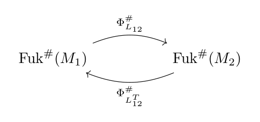

# 伴随对

> `functoriality/concept/adjunction` ｜ track B ｜ draft

**一句话**：拉格朗日对应与其转置给出的两个 A∞-函子构成伴随对，伴随数据由计数拼接带得到的自然同构给出。

**自测**：为什么 Φ#_{L12} 与 Φ#_{L12^T} 应当互为伴随，单位与余单位在拼接图景里到底是什么？

## 定义

考虑与拉格朗日对应及其转置相联系的函子 $\Phi^\#_{L_{12}}:\Fuk^\#(M_1)\to\Fuk^\#(M_2)$ 与 $\Phi^\#_{L_{12}^T}:\Fuk^\#(M_2)\to\Fuk^\#(M_1)$，原文断言它们构成伴随对（并注明这个陈述据作者所知未出现在 Wehrheim–Woodward 的工作中）。按 Abouzaid–Seidel 定义 2.14，一对 $A_\infty$-函子 $L:\mathscr C\to\mathscr D$、$R:\mathscr D\to\mathscr C$ 伴随，是指存在 $\mathscr C$–$\mathscr D$ 双模的自然同构 $\hom_{\mathscr D}(L(-),-)\xrightarrow{\simeq}\hom_{\mathscr C}(-,R(-))$。在预期的伴随中，这个自然同构包含一族由计数拼接映射（图 23）给出的态射，单位与余单位由拼接带给出。

记号：$L_{12}^T$ 是转置对应（交换两个因子）；$\hom$ 两侧分别取在 $\mathscr D=\Fuk^\#(M_2)$ 与 $\mathscr C=\Fuk^\#(M_1)$ 中。

## 要点

- 伴随的代数定义是双模层面的自然同构 (78)，不是「互为逆函子」；$\Fuk^\#$ 中一般只有伴随，没有等价。
- 单位由一条拼接带给出：一端接 $L_1$、另一端接 $(L_2,L_{12}^T)$，等价于一端接 $(L_1,L_{12})$、另一端接 $L_2$。
- 转置 $L_{12}^T$ 只是把 $M_1^-\times M_2$ 的两个因子互换，故两个方向的伴随数据来自同一族拼接带的计数。
- 自然同构逐层展开为一族态射 (79)，它吃左侧若干 $\CF^*$ 因子、右侧若干 $\CF^*$ 因子以及一个 $\CF^*((L_1^0,L_{12}),L_2^0)$，输出到 $\CF^*(L_1^d,(L_2^e,L_{12}^T))$。
- 这是原文给出的预期（并注明未见于 WW 工作），引用时应作为待证陈述，而不是已证定理。

## 公式

$\hom_{\mathscr D}(L(-),-)\xrightarrow{\simeq}\hom_{\mathscr C}(-,R(-)).$
$\CF^*(L_1^{d-1},L_1^d)\otimes\cdots\otimes\CF^*(L_1^0,L_1^1)$

## 交换图

### 图 1：Φ# 与转置对应函子的伴随对（式 76）



直取中译本式 (76)。伴随的代数含义是式 (77)–(78) 的自然同构 $\operatorname{hom}_{\mathcal D}(L(-),-)\simeq\operatorname{hom}_{\mathcal C}(-,R(-))$，具体由式 (79) 的拼接映射族计数给出（图 23）。

```tikz
\begin{tikzcd}[column sep=huge]
\Fuk^\#(M_1)\arrow[r,bend left=22,"\Phi^\#_{L_{12}}"]&\Fuk^\#(M_2)\arrow[l,bend left=22,"\Phi^\#_{L_{12}^T}"]
\end{tikzcd}
```

## 定理与证明

### 转置对应给出伴随

Φ#_{L12}:Fuk#(M1)→Fuk#(M2) 与 Φ#_{L12^T}:Fuk#(M2)→Fuk#(M1) 构成伴随对，伴随自然同构由计数拼接映射给出。

（none；来源：原书 p.33 §3.8）


缺口：原文只给预期与图 23 的示意，并明言该陈述未出现在 WW 的工作中；自然同构的构造与验证均未给出。

### A∞-函子伴随的判据

按 Abouzaid–Seidel 定义 2.14，A∞-函子 L:C→D 与 R:D→C 伴随，当且仅当存在 C–D 双模的自然同构 hom_D(L(-),-)≅hom_C(-,R(-))。

（none；来源：原书 p.33 §3.8）


缺口：这是定义而非定理；原文引 AS19 定义 2.14。

## 易错点

- 把伴随当成互为逆：伴随只要求双模自然同构 (78)，不要求两个函子复合后同构于恒等函子。
- 把转置 $L_{12}^T$ 当成复合的逆或 $L_{21}$ 的几何复合：它只是交换两个因子，方向由它所在的范畴决定。
- 以为 (79) 是固定输入个数的映射：它是逐层展开的态射族，$d$、$e$ 都可变。
- 忽略陈述的性质：原文注明这是作者预期、未见于 WW 工作，不能当作已证定理引用。

## 参考与关联

- Abouzaid & Bottman, Functoriality in categorical symplectic geometry (arXiv:2210.11159v1)，§3.8，p.33–33（原书 p.33 §3.8）

关联：`functoriality/concept/a-infinity-bimodule`、`functoriality/concept/phi-sharp`、`functoriality/concept/mww-functor`、`functoriality/concept/lagrangian-correspondence`

来源说明：原书 p.33 §3.8（注 3.18 前后、AS19 定义 2.14 的转述）；公式 (78)(79) 取自中译本 chapter3.tex。
