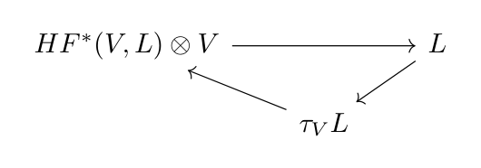
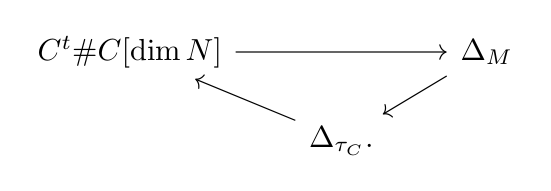

# 纤维化 Dehn 扭转

> `functoriality/concept/dehn-twist` ｜ track D ｜ draft

**一句话**：沿球面纤维化拉格朗日对应 C 扭转的辛同胚；Wehrheim–Woodward 把它嵌入双模的正合三角，使 Seidel 扭转成为函子性构造。

**自测**：Dehn 扭转为什么能在 Fukaya 范畴中表现为函子性的正合三角，而不只是底流形上的一个辛同胚？

## 定义

Seidel 在 [Sei03] 中通过计算模型辛同胚在 Floer 同调上的作用，证明它们与恒等映射不同痕。Wehrheim 与 Woodward 把这一结果推广到球面纤维化的拉格朗日对应：$C\subset N^-\times M$，它到 $M$ 的投影是嵌入、到 $N$ 的投影是球面丛。用 $\tau_C$ 表示与 $C$ 相联系的纤维化 Dehn 扭转，则余单位 $C^t\#C\to\Delta_M$ 可以放入 $\Fuk(M\times M^-)$ 的一个正合三角，第三项为 $\Delta_{\tau_C}$；$C=V$ 为球面时 $\tau_V$ 就是经典的 Seidel 扭转。

记号：$\tau_C$ 为与球面纤维化拉格朗日对应 $C$ 相联系的纤维化 Dehn 扭转；$C^t$ 为转置对应；$\Delta_M$ 为空对应，几何上即 $M$ 的对角线。

## 要点

- 纤维化 Dehn 扭转 $\tau_C$ 由球面纤维化拉格朗日对应 $C\subset N^-\times M$ 给出：到 $M$ 的投影是嵌入、到 $N$ 的投影是球面丛，它推广了 Seidel 的球面扭转。
- Wehrheim–Woodward 的提升：余单位 $C^t\#C\to\Delta_M$ 可置于 $\Fuk(M\times M^-)$ 的正合三角中，第三项是 $\Delta_{\tau_C}$。
- 该定理是转述（[WW16] 定理 7.4），不是本文证明的定理，本卡只能给 sketch。
- 几何意义：$\Delta_{\tau_C}$ 是余单位 $C^t\#C\to\Delta_M$ 的锥，$\tau_C$ 度量「$C^t$ 与 $C$ 的复合」偏离恒等的程度。

## 公式

$C\subset N^-\times M$
$C^t\#C\to\Delta_M$
$\Fuk(M\times M^-)$

## 交换图

### 图 1：Seidel 正合三角（式 111）



直取中译本式 (111)：球面 $V$ 沿 $L$ 的 Seidel 扭转 $\tau_V L$ 所在的正合三角。

```tikz
\begin{tikzcd}[column sep=2em,row sep=1.2em]
\HF^*(V,L)\otimes V \arrow[rr] && L \arrow[dl] \\
& \tau_V L \arrow[ul] &
\end{tikzcd}
```

### 图 2：Wehrheim–Woodward 提升的正合三角（式 112）



直取中译本式 (112)（[WW16] 定理 7.4）：余单位 $C^t\#C\to\Delta_M$ 的锥为 $\Delta_{\tau_C}$。译者注：按预三角范畴约定，第三条箭头应终止于 $C^t\#C[\dim N+1]$，原文图中只画到 $[\dim N]$；此处保留原文画法。

```tikz
\begin{tikzcd}[column sep=2em,row sep=1.2em]
C^t\#C[\dim N] \arrow[rr] && \Delta_M \arrow[dl] \\
& \Delta_{\tau_C}. \arrow[ul] &
\end{tikzcd}
```

## 定理与证明

### 定理 5.1（转述 Wehrheim–Woodward 定理 7.4）

设 $C\subset N^-\times M$ 是球面纤维化的拉格朗日对应，$\tau_C$ 为相应的纤维化 Dehn 扭转。则余单位 $C^t\#C\to\Delta_M$ 可以置于 $\Fuk(M\times M^-)$ 的一个正合三角中，第三项为 $\Delta_{\tau_C}$。这是转述自 [WW16] 的定理，不是本文结果；按预三角范畴的约定，第三个箭头应终止于 $C^t\#C[\dim N+1]$，原文图中只画到 $[\dim N]$。

（sketch；来源：原书 p.53–54 §5.1（转述 [WW16] 定理 7.4；译者注说明平移与锥））

1. 把 $C\times C$ 视为 $M^-\times N\times N^-\times M$ 中的拉格朗日对应，得到 $C^t\#C$；态射 $C^t\#C\to\Delta_M$ 由计数拼接映射给出，是伴随的余单位。  
   为什么：原文先构造三个几何对象（图像、乘积 $C^t\#C$、次数 $\dim N$ 的余单位），再把它嵌入三角。
2. 取该余单位的锥，得到 $\Delta_{\tau_C}$；纤维化 Dehn 扭转 $\tau_C$ 刻画 $C^t$ 与 $C$ 的复合偏离恒等的程度。  
   为什么：原文的几何解释；锥的具体计算属于 [WW16]。

缺口：原文只引用 [WW16] 定理 7.4，不在此证明；本卡据几何描述给两步行文概括，不能当证明。

## 易错点

- 把定理 5.1 当成本文证明的定理：原文明确标注转述自 [WW16] 定理 7.4，本节只是综述。
- (112) 的第三个箭头在图中只画到 $C^t\#C[\dim N]$；按预三角范畴的约定应到 $[\dim N+1]$，漏掉平移会读错三角。
- 把 $\tau_C$ 与经典 Seidel 扭转混为一谈：后者只是 $C=V$ 为球面这一特例。

## 参考与关联

- Abouzaid & Bottman, Functoriality in categorical symplectic geometry (arXiv:2210.11159v1)，§5.1，p.53–54（原书 p.53–54 §5.1）

关联：`functoriality/concept/exact-triangle-bimodules`、`functoriality/concept/lagrangian-correspondence`、`functoriality/concept/fukaya-category`

来源说明：据中译本 §5.1（p.53–54）与译者注转述；定理 5.1 系 [WW16] 定理 7.4 的转述，本节未给证明。
