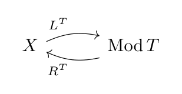

# Eilenberg–Moore 范畴

> `functoriality/concept/eilenberg-moore` ｜ track D ｜ draft

**一句话**：EM 范畴 Mod T 的对象是满足结合律与单位律的 T-代数（本章称 T-模）；比较函子 K:Y→Mod T 是等价当且仅当伴随单子。

**自测**：Eilenberg–Moore 范畴的对象需要满足哪两张交换图，为什么比较函子是否等价正好刻画了「单子性」？

## 定义

设 $(T,\mu,\eta)$ 是范畴 $X$ 上的单子。其 Eilenberg–Moore 范畴（通常记 $X^T$）的对象是 T-代数，即二元组 $(x,h:Tx\to x)$，其中 $h$ 使结合律图与单位律图交换；态射是与 $T$ 相容的态射。本章按 remark 5.11 把它记作 $\Mod T$，并把 T-代数称为 T-模，以便后文讨论完美 T-模。若 $L\dashv R$ 给出 $T=RL$，比较函子 $K:Y\to\Mod T$ 由 $y\mapsto(Ry,R\epsilon_y)$ 定义；伴随是单子的当且仅当 $K$ 是范畴等价。

记号：$X^T$ 或 $\Mod T$：EM 范畴；$h:Tx\to x$：T-模的结构映射；$K$：比较函子；$R\epsilon_y$：$h$ 的具体形式。

## 要点

- EM 范畴的对象是 $(x,h:Tx\to x)$，$h$ 必须满足两张交换图：结合律 $h\circ\mu_x=h\circ Th$ 与单位律 $h\circ\eta_x=\id_x$。
- 通常记 $X^T$ 并称对象为 T-代数；本章为便于后文谈完美 T-模，改记 $\Mod T$ 并称 T-模（remark 5.11）。
- 比较函子 $K:Y\to\Mod T$，$y\mapsto(Ry,R\epsilon_y)$；伴随单子（monadic）当且仅当 $K$ 是范畴等价。
- 每个单子都通过自由/遗忘伴随 $L^T\dashv R^T$ 从 EM 范畴产生，这是单子论的另一半。
- Kleisli 范畴是同一单子的另一种代数，与 EM 范畴不同；本章只用 EM 范畴。

## 公式

$h:Tx\to x$
$\Mod T$
$K:Y\to\Mod T$
$(Ry,R\epsilon_y)$

## 交换图

### 图 1：自由/遗忘伴随 L^T ⊣ R^T（式 135）



直取中译本式 (135)：单子 $(T,\mu,\eta)$ 的 Eilenberg–Moore 范畴 $\operatorname{Mod}T$ 与自由函子 $L^T$、遗忘函子 $R^T$ 构成伴随，相联系的单子恰是 $(T,\mu,\eta)$（原文此处误写 $\nu$，见 barr-beck / monad 卡原文笔误条）。

```tikz
\begin{tikzcd}[column sep=3em]
X \arrow[r,bend left=18,"L^T"] & \operatorname{Mod}T \arrow[l,bend left=18,"R^T"]
\end{tikzcd}
```

## 定理与证明

## 易错点

- 把 $\Mod T$ 的对象当成任意 $Tx\to x$：必须满足结合律与单位律两张图，否则不是 T-模。
- 把 EM 范畴与 Kleisli 范畴混淆：两者都是单子的代数，但对象不同，本章只用 EM 范畴。
- 把「T-模」当成环上的模：本章的 T-模就是 T-代数（remark 5.11），不是环模。

## 参考与关联

- Abouzaid & Bottman, Functoriality in categorical symplectic geometry (arXiv:2210.11159v1)，§5.7，p.60–62（原书 p.60–62 §5.7）

关联：`functoriality/concept/monad`、`functoriality/concept/barr-beck`、`functoriality/concept/adjunction`

来源说明：据中译本 §5.7.1（p.60–62）remark 5.11 与译者注转述 Eilenberg–Moore 范畴的标准定义。
