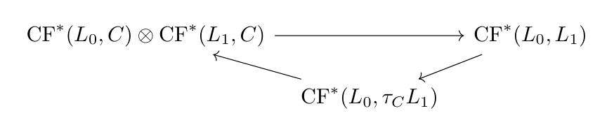

# 双模的正合三角

> `functoriality/concept/exact-triangle-bimodules` ｜ track D ｜ draft

**一句话**：在 Fuk M 的双模范畴中，CF*(L0,C)⊗CF*(L1,C) → CF*(L0,L1) → CF*(L0,τ_C L1) 构成正合三角，把 Seidel 群层面的三角范畴化。

**自测**：把 Seidel 的正合三角从 Floer 群提升到双模范畴之后，三角的项与方向发生了什么变化？

## 定义

Seidel 的正合三角是在 Floer 群层面陈述的；Wehrheim–Woodward 的结果则活在乘积 $M\times M^-$ 中。按照「从 Fukaya 范畴转到双模范畴」的形式体系，把定理 5.1 的三角翻译过去，就得到 $\Fuk M$ 的双模范畴中的一个正合三角，其项与式 (113) 一致：两个双模的张量积、$\CF^*(L_0,L_1)$，以及 $\CF^*(L_0,\tau_C L_1)$。Seidel 原来的三角是这个推论的特例。

记号：$L_0,L_1$ 为 $M$ 中的拉格朗日子流形；$C$ 为球面纤维化拉格朗日对应；$\tau_C$ 为相应的纤维化 Dehn 扭转。

## 要点

- 推论 5.2 是定理 5.1 在双模范畴中的形式：三个项依次是两个双模的张量积、$\CF^*(L_0,L_1)$ 与 $\CF^*(L_0,\tau_C L_1)$。
- 三角的方向与式 (112) 一致；第三个箭头同样带平移，方向与预三角约定之间的差别是本节最容易读错的地方。
- Seidel 的三角 (111) 是这一推论的结果（原文 p.54 末句），所以它确实是「范畴化」：Floer 群的三角被提升为双模的三角。
- 与定理 5.1 一样，这是转述 [WW16] 定理 7.4 的推论形式。

## 公式

$\CF^*(L_0,C)\otimes\CF^*(L_1,C)$
$\CF^*(L_0,L_1)$
$\CF^*(L_0,\tau_C L_1)$

## 交换图

### 图 1：双模范畴中的正合三角（式 113）



直取中译本式 (113)（推论 5.2）：$\Fuk M$ 上双模范畴中的正合三角，方向与式 (112) 一致；按预三角约定第三条箭头的平移见 dehn-twist 卡的注。

```tikz
\begin{tikzcd}[column sep=0.8em,row sep=1.2em]
\operatorname{CF}^*(L_0,C)\otimes\operatorname{CF}^*(L_1,C) \arrow[rr] && \operatorname{CF}^*(L_0,L_1) \arrow[dl] \\
& \operatorname{CF}^*(L_0,\tau_C L_1) \arrow[ul] &
\end{tikzcd}
```

## 定理与证明

### 推论 5.2（转述 Wehrheim–Woodward 定理 7.4 的推论形式）

在 $\Fuk M$ 上的双模范畴中有一个正合三角，其项依次为 $\CF^*(L_0,C)\otimes\CF^*(L_1,C)$、$\CF^*(L_0,L_1)$ 与 $\CF^*(L_0,\tau_C L_1)$。这是转述 [WW16] 结果的推论，不是本文证明的定理。

（sketch；来源：原书 p.53–54 §5.1（转述 [WW16] 定理 7.4））

1. 把 $M\times M^-$ 中的三角（定理 5.1）按 §3.7 的双模范畴描述重写。  
   为什么：从 Fukaya 范畴转到双模范畴是原文明确指出的翻译步骤。
2. 代入两个对象 $L_0,L_1$ 与对应 $C$，即得式 (113) 的三个项。  
   为什么：这是把三角逐项翻译的直接结果。

缺口：原文只引用 [WW16] 定理 7.4，并说明这是在双模范畴中的翻译；本卡不重复其证明。

## 易错点

- 把双模范畴的三角与 $\Fuk M$ 本身的三角混同：三角的项从拉格朗日对象变成了双模。
- 忽略第三个箭头的平移与方向；只按图形记忆容易把 $\CF^*(L_0,\tau_C L_1)$ 写成别的项。
- 以为式 (113) 是独立定理：它只是式 (112) 经由「转到双模范畴」的翻译。

## 参考与关联

- Abouzaid & Bottman, Functoriality in categorical symplectic geometry (arXiv:2210.11159v1)，§5.1，p.53–54（原书 p.53–54 §5.1）

关联：`functoriality/concept/dehn-twist`、`functoriality/concept/a-infinity-bimodule`、`functoriality/concept/floer-cohomology`

来源说明：据中译本 §5.1（p.53–54）转述；推论 5.2 引自 [WW16] 定理 7.4 的双模范畴版本。
