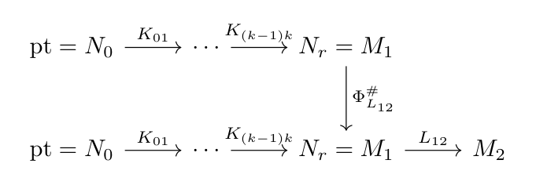

# 函子 Φ#

> `functoriality/concept/phi-sharp` ｜ track B ｜ draft

**一句话**：在扩充 Fukaya 范畴上把输入循环对应末尾追加 L12，并用刚性拼接映射定义态射，得到 A∞-函子 Φ#:Fuk#(M1)→Fuk#(M2)。

**自测**：Φ# 为什么只能在扩充 Fukaya 范畴上定义，它的「逐层加拼接」究竟加在哪一层？

## 定义

给定对应 $L_{12}\subset M_1^-\times M_2$，定义 $\Phi^\#_{L_{12}}$：在对象上，把广义拉格朗日 $\pt=N_0\xrightarrow{K_{01}}\cdots\xrightarrow{K_{(k-1)k}}N_r=M_1$ 映射为在末尾追加一段 $\pt=N_0\xrightarrow{K_{01}}\cdots\xrightarrow{K_{(k-1)k}}N_r=M_1\xrightarrow{L_{12}}M_2$，输出常记作 $(\underline L_1,L_{12})$；在态射上，把若干个 hom 的张量积送到 $\hom\bigl((\underline L_1^0,L_{12}),(\underline L_1^r,L_{12})\bigr)$，方式是计数刚性拼接映射。之所以要扩充，是因为在通常 Fukaya 范畴里，定义 $\Phi_{L_{12}}$ 的拼接曲面接缝与边界相切，造成严重分析困难；扩充范畴让接缝在输出标记点处横截地趋近边界。

记号：$\underline L_1$ 表示输入的广义拉格朗日；$(\underline L_1,L_{12})$ 表示追加后的对象；$\hom$ 在 $\Fuk^\#(M_1)$ 中即拼接 Floer 上链复形。

## 要点

- 「递归」的含义是对象链长逐层增加：$\Fuk^\#(M_1)$ 的对象本来就是任意长的循环对应，$\Phi^\#_{L_{12}}$ 只在末端追加一段，不碰前面各段。
- 态射上的计数相应多出一条接缝，它把输入侧的片与新增的 $L_{12}$ 片耦合起来；这就是「逐层加拼接」。
- $A_\infty$ 关系由所计数拼接映射的余维 1 退化得到：左侧退化给出关系式左端，右侧退化给出右端。
- 它绕开了 $\Phi_{L_{12}}$ 在对象层面的两个问题（复合未必是浸入甚至未必是子流形），因为对象层面根本不做几何复合。
- 带收缩同构翻译为函子同伦 (71)，从而 MWW 定理 1.2 给出复合相容性；注意只是同伦，不是相等。

## 公式

$\Phi^\#_{L_{12}}\bigl(\pt=N_0\xrightarrow{K_{01}}\cdots\xrightarrow{K_{(k-1)k}}N_r=M_1\bigr)$
$\hom(\underline L_1^0,\underline L_1^1)\otimes\cdots\otimes\hom(\underline L_1^{r-1},\underline L_1^r)$
$\sum_{k,\ell}\pm\Phi^\#_{L_{12}}\bigl(x_1,\ldots,x_k,\mu_\ell(x_{k+1},\ldots,x_{k+\ell}),x_{k+\ell+1},\ldots,x_d\bigr)$

## 交换图

### 图 1：Φ# 在对象上于链尾追加 L12



定义 3.14 式 (67)：输入广义拉格朗日 $\underline L_1=(\pt=N_0\to\cdots\to N_r=M_1)$ 映到 $(\underline L_1,L_{12})$，即在链尾追加 $L_{12}\subset M_1^-\times M_2$ 一段。原文用公式 (67) 而未画图，本图按该式重排；态射侧见式 (68)。

```tikz
\begin{tikzcd}[column sep=2.4em,row sep=large]
\pt=N_0 \arrow[r,"K_{01}"] & \cdots \arrow[r,"K_{(k-1)k}"] & N_r=M_1 \arrow[d,"\Phi^\#_{L_{12}}"] \\
\pt=N_0 \arrow[r,"K_{01}"] & \cdots \arrow[r,"K_{(k-1)k}"] & N_r=M_1 \arrow[r,"L_{12}"] & M_2
\end{tikzcd}
```

## 定理与证明

### Φ# 满足 A∞ 关系

对任意输入 x1,…,xd，Φ#_{L12} 满足 A∞-函子关系 (69)：把 μ 作用在一段输入上再送入 Φ#，与把 Φ# 分别作用于各段再用 μ 组合，两种求和相等（差符号）。

（sketch；来源：原书 p.30 §3.6）

1. 写出 A∞-函子关系 (69) 的两侧。  
   为什么：这是函子性的定义性方程。
2. 考虑定义 Φ# 时所计数拼接映射的余维 1 退化。  
   为什么：余维 1 退化给出边界项，正是关系式两项的来源。
3. 对左侧（退化留下一段 μ 在输入内部）计数，得到 (69) 左端。  
   为什么：退化位置决定 μ 落在输入还是落在输出。
4. 对右侧（退化发生在 Φ# 输出后的组合处）计数，得到 (69) 右端；两侧相等。  
   为什么：同一模空间的边界分解给出等式。

缺口：原文称「图示证明」，按 MWW 定理 1.1 给出，未逐项验证符号与退化枚举；细节在 MWW 原文。

### 带收缩同构给出函子同伦

若两个 A∞-函子 F、G 在对象上一致，且存在一族态射 T 使同伦方程 (71) 成立，则 F 与 G 同伦。MWW 定理 1.2 的同伦 Ψ_{L12,L23} 由计数特定拼接圆盘给出，其退化恰对应 (71) 的四项。

（sketch；来源：原书 p.31 §3.6）

1. 定义同伦算子 T 的推广形式，其输入是若干 hom 的张量积。  
   为什么：同伦必须是逐层定义的算子族。
2. 用计数拼接圆盘定义 Ψ，使 Φ_{L23}∘Φ_{L12} 与 Φ_{L12}∘Φ_{L23} 的差由 Ψ 与 μ 的组合给出。  
   为什么：这正是 (71) 的形式。
3. 枚举拼接圆盘的余维 1 退化：接缝碰撞、接缝与边界碰撞、边界标记点碰撞、接缝以可比速度与边界碰撞。  
   为什么：退化枚举逐项对应 (71) 中的加式。
4. 最右退化与最后一个和式差一项，用延迟函数修正。  
   为什么：延迟函数调整退化速度，使计数与代数表达式对齐。

缺口：原文只给图示与引文（MWW 定理 1.2、第 7 节），延迟函数的构造未展开；中译本译注指出底本此处第二个复合方向在类型上不成立，应为笔误。

## 易错点

- 把 Φ# 的对象与 Φ 的对象混为一谈：Φ# 作用在任意长的广义拉格朗日上，Φ 只在单个拉格朗日 L1 上谈几何复合 L1∘L12。
- 以为 Φ# 是 Φ 的简单扩充：Φ# 根本不做几何复合，靠末尾追加一段实现，因此不要求 L1∘L12 是嵌入子流形。
- 把接缝画成与边界相切：扩充范畴的定义要求接缝在输出标记点处横截地趋近边界（局部平行于边界），这是能建立椭圆估计的关键。
- 把定理 1.2 的「同伦」当成「相等」，或忽略嵌入复合与单调性假设。

## 参考与关联

- Abouzaid & Bottman, Functoriality in categorical symplectic geometry (arXiv:2210.11159v1)，§3.6，p.29–31（原书 p.29–31 §3.6）

关联：`functoriality/concept/extended-fukaya`、`functoriality/concept/mww-functor`、`functoriality/concept/strip-shrinking`、`functoriality/deriv/phi-sharp-induction`

来源说明：原书 p.29–31 §3.6（定义 3.14、图示证明、注 3.16 前后）；公式 (67)(68)(69) 取自中译本 chapter3.tex。
