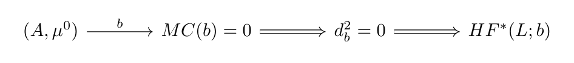

# 弱边界上链构造 A∞-范畴

> `functoriality/deriv/bounding-cochain-construction` ｜ track A ｜ draft

**目标**：说明如何用弱边界上链 b 消去带曲率 A∞-代数中的曲率、构造 A∞-范畴，并解释「弱无障碍」与严格无障碍的差别。

**自测**：为什么用弱边界上链扭曲后微分就平方为零，而势值非零时只能得到「弱」的结论？

## 前提

- A 是有间隙、滤过、带曲率的 A∞-代数（定义 thm:2.24），运算 μ^k=∑T^λμ^k_λ（式(40)），曲率 μ^0 未必为零。
- b∈A 是弱边界上链：存在势值 𝔓 使 𝔓·id_A=μ^0+μ^1(b)+μ^2(b,b)+μ^3(b,b,b)+…（式(42)）。
- 目标是给同势值的 b 之间定义态射复形，使它们成为 A∞-范畴的对象（引理 thm:2.25，式(43)）。

## 步骤

1. **从 Maurer–Cartan 方程读出曲率：式(42) 把 μ^0 表示为 μ^1(b)+μ^2(b,b)+μ^3(b,b,b)+… 减去 𝔓·id_A 的结果。**  
   为什么：这说明曲率不是独立数据，而是被 b 的高阶项「吸收」的量。  
   锚点：原书 p.18（证据 A）

2. **用 b 扭曲微分：定义 d_b x=μ^1(x)+μ^2(b,x)+μ^2(x,b)+μ^3(b,b,x)+μ^3(b,x,b)+μ^3(x,b,b)+…（式(43) 取 b′=b 的形态）。**  
   为什么：原文给出的是 b 到 b′ 的态射微分（式(43)），取 b′=b 即得自态射复形的微分；原文译注只说用 μ_2(b,−) 等项修正微分，未写全式。  
   锚点：原书 p.18（证据 B）

3. **计算 d_b²：展开后，不含 b 的最低阶项 μ^1(μ^1(x)) 与曲率项 μ^2(μ^0,x)、μ^2(x,μ^0) 一起，用式(30) 与式(42) 合并，曲率项恰好被 𝔓·id 抵消。**  
   为什么：这是 MC 方程「等于修正后微分平方为零」的实质：曲率被 b 的二次项吸收，势值记录残余。  
   锚点：原书 p.18（证据 B）

4. **再由带曲率 A∞ 方程式(19) 的其余各项，说明剩余项按插入位置两两配对为零；于是 d_b²=0，同势值的 b 之间的态射复形有良定义的同调。**  
   为什么：原文引理只陈述结论；这里补出「用 A∞ 方程逐项配对」的推理链。  
   锚点：原书 p.18（证据 B）

5. **复合与高阶运算由 μ_r 的 b-扭曲版本（把 b 插入各输入位置）给出，它们满足同样的 A∞ 方程，故得到 A∞-范畴；势值不同的 b 属于不同范畴，「弱」正来自 𝔓≠0。**  
   为什么：原文只说「具有给定势值的弱边界上链构成范畴对象」；复合的具体公式与「势值不同则范畴不同」是我们的判断。  
   锚点：原书 p.18（证据 C）

## 交换图

### 图 1：论证骨架：MC 方程消去曲率



本图为论证骨架，非原文图。原文 §2.4 p.18 只有文字：式(42) 的 Maurer--Cartan 方程使 d_b² 中的曲率项相消，式(43) 给出态射复形的扭曲微分。

```tikz
\begin{tikzcd}[column sep=large]
(A,\mu^0) \arrow[r,"b"] & \MC(b)=0 \arrow[r,Rightarrow] & d_b^2=0 \arrow[r,Rightarrow] & \HF^*(L;b)
\end{tikzcd}
```

## 结果

对每个势值 𝔓，弱边界上链 b 构成 A∞-范畴的对象，态射复形的微分由式(43) 给出；曲率被 Maurer–Cartan 方程吸收，若 𝔓=0 则得到通常意义（严格）的无障碍理论。

## 缺口

- 引理 thm:2.25 的证明原文从略（属 FOOO 的技术工作）；本卡步骤 2–5 是我们按译注与式(30)、(42)、(43) 补出的推理，符号与系数未逐项核实。
- 扭曲运算 μ_r^b 的完整定义（把 b 插入所有可能位置并对树求和）原文未写出；本卡只给出方向。
- d_b²=0 的验证依赖带曲率 A∞ 方程中 μ^0 项与 b 项的精确配对，原文未展示；若符号约定不同，消去方式可能需要调整（C：我们的判断）。
- 势值 𝔓 在 Novikov 环中，且不同 𝔓 的范畴之间的关系（是否存在函子）原文未讨论。

## 易错点

- 把 MC 方程写成 $\\mu^0+\\mu^1(b)+\\mu^2(b,b)=0$：高阶项 $\\mu^3(b,b,b)$ 等一般不为零，截断会破坏 $d_b^2=0$。
- 以为 $b$ 只是「扰动参数」：$b$ 的选择改变对象本身，不同势值的 $b$ 属于不同范畴，不能随意互换。
- 忽略势值：$\\mathfrak P\\ne0$ 时 $d_b^2=\\mathfrak P\\cdot\\id\\ne0$，「上同调」只能带残余曲率理解，不是通常的微分分次结构。
- 把弱无障碍当成自动成立：$b$ 的存在性依赖几何（如单调情形 $m>1$ 才可忽略曲率），一般情形需实际求解 MC 方程。

## 参考与关联

- Abouzaid & Bottman, Functoriality in categorical symplectic geometry (arXiv:2210.11159v1)，§2.4，p.16–18（原书 p.16–18 §2.4）

关联：`functoriality/concept/bounding-cochain`、`functoriality/concept/curved-a-infinity`、`functoriality/concept/anomaly`、`functoriality/concept/fukaya-category`

来源说明：原书 p.16–18 §2.4（式(30)、(40)、(42)、(43)、引理 thm:2.25、译注）；步骤 2–4 为补出的推理（B），步骤 5 为我们的判断（C），符号未逐项核实。
