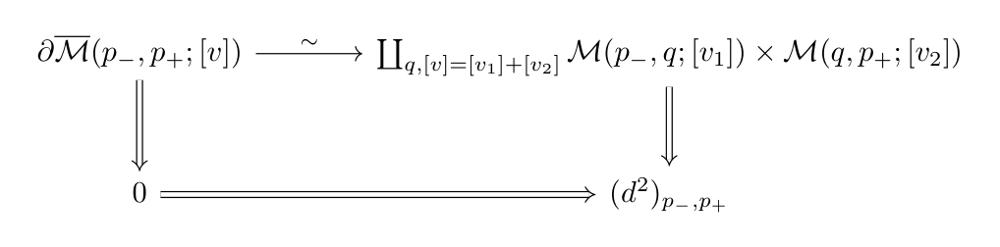
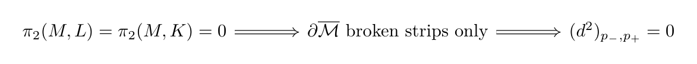

# 为何 d²=0：Floer 微分的闭合性

> `functoriality/deriv/floer-d-squared` ｜ track A ｜ draft

**目标**：在闭辛流形 M、闭拉格朗日子流形 L,K 横截且 π₂(M,L)=π₂(M,K)=0 的假设下，证明由条带计数定义的算子 d 满足 d²=0，从而 HF*(L,K)=H(CF*,d) 良定义。

**自测**：在 π₂(M,L)=0 的假设下，为什么条带计数定义的微分一定满足 d²=0？

## 前提

- M 闭辛流形，L,K⊂M 闭拉格朗日子流形，横截，满足 π₂(M,L)=π₂(M,K)=0（非球面假设）。
- CF*(L,K) 是由交点 p∈L∩K 自由生成的 Λ-模；d 计数从 R×[0,1] 到 M、边界落在 L、K 上、Maslov 指标为 1 的刚性伪全纯条带（式(13)）。
- 对相对同伦类 [v]，记 M(p_-,p_+;[v]) 为相应条带模空间，其期望维数为 Maslov 指标 ind v 减 1（式(12)）。

## 步骤

1. **先展开 d² 的矩阵系数：从 p_- 到 p_+ 的 d² 系数是各中间点 q 与各分解 [v]=[v1]+[v2] 上 #M(p_-,q;[v1])·#M(q,p_+;[v2]) 之和（式(14)）。**  
   为什么：这是把 d²=0 逐项翻译成几何计数的起点：每个系数都对应一对条带的粘合。  
   锚点：原书 p.6（证据 A）

2. **把这一对条带看成在 t=1/2 处粘合、带一条内部标记的条带族；固定 p_-,p_+,[v]，其模空间紧化记为 \overline{\mathcal M}(p_-,p_+;[v])，是 1 维流形。**  
   为什么：只有把双和整体看作一个 1 维空间的边界，才能用「紧 1 维流形边界点数为偶」论证相消；原文只说由 \overline{\mathcal M} 的余维 1 边界层给出。  
   锚点：原书 p.6（证据 B）

3. **1 维紧流形的边界计数为零（模 2）；边界层分为两类：条带断裂（能量集中在一列从端部逃逸的点上）与圆盘冒泡（能量集中在一个点上并形成圆盘）。**  
   为什么：这是紧化定理的内容：边界层分类决定 d² 等于哪些项。  
   锚点：原书 p.6（证据 A）

4. **π₂(M,L)=0 排除非平凡圆盘，故圆盘冒泡不出现；边界只剩条带断裂，而断裂项与式(14) 的双求和逐项对应，于是式(14) 各项相消。**  
   为什么：原文把「排除圆盘冒泡」与「断裂项两两配对」作为假设的直接后果点出（译注亦如此说明），但配对的具体对应关系未写出；这里补出推理。  
   锚点：原书 p.6（证据 B）

5. **因此 d²=0，HF*(L,K) 良定义；若去掉 π₂=0 假设，圆盘冒泡给出无法配对的边界项，d² 等于由曲率 μ₀ 修正的表达式。**  
   为什么：这是对结论的收尾与边界情形的判断：后半句依据 §2.4 的反常讨论（式(30)），原文在 §2.1 的译注中已提示。  
   锚点：原书 p.6（证据 C）

## 交换图

### 图 1：论证骨架：1 维模空间边界即 d² 的双和



本图为论证骨架，非原文图。原文 §2.1 p.6 只说由模空间紧化的余维 1 边界层给出；此处把「边界计数为零 = 式(14) 双和」画成一个方图。

```tikz
\begin{tikzcd}[column sep=large,row sep=large]
\partial\ol{\mathcal M}(p_-,p_+;[v]) \arrow[r,"\sim"] \arrow[d,Rightarrow] & \coprod_{q,[v]=[v_1]+[v_2]} \mathcal M(p_-,q;[v_1])\times\mathcal M(q,p_+;[v_2]) \arrow[d,Rightarrow] \\
0 \arrow[r,Rightarrow] & (d^2)_{p_-,p_+}
\end{tikzcd}
```

### 图 2：论证骨架：π₂=0 排除圆盘冒泡



本图为论证骨架，非原文图；非球面假设使边界层只剩条带断裂，断裂项与式(14) 逐项配对。

```tikz
\begin{tikzcd}[column sep=large]
\pi_2(M,L)=\pi_2(M,K)=0 \arrow[r,Rightarrow] & \partial\ol{\mathcal M}\ \text{broken strips only} \arrow[r,Rightarrow] & (d^2)_{p_-,p_+}=0
\end{tikzcd}
```

## 结果

在非球面假设下 d²=0，故 HF*(L,K)=H(CF*(L,K),d) 是良定义的分次 Λ-模；这正是 §2.1 中 Floer 定理推导的前提。

## 缺口

- 原文未证明条带模空间紧化的分类定理（断裂 + 圆盘冒泡 + 球面冒泡）与边界点的配对细节，只引用 FHS95 等文献；本卡把这些作为已知边界层结构使用。
- 我们补出了步骤 2 与 4 的推理（把双和视为 1 维空间边界、断裂项逐项配对），原文只写「由 \overline{\mathcal M} 的边界给出」；严格验证还需符号与定向（模 2 系数下可回避）。
- 球面冒泡在 π₂(M)=0 时也不出现；原文的假设同时排除了球面与圆盘，本卡未单独讨论球面冒泡的排除。
- 原书此处未写出模空间的虚基本类与粘合（gluing）定理，这两项是完整证明的技术核心，本文从略。

## 易错点

- 把 $d^2$ 直接当成「两条条带拼接」：拼接只在模空间紧化的边界层上发生，还须验证每条边界层恰好出现一次（系数 1）。
- 忽略圆盘冒泡：$\\pi_2(M,L)=0$ 正是用来排除它的；去掉假设后 $d^2$ 未必为零（见 §2.4 的式(30)）。
- 以为 d 的系数总是有限和：每个能量层有限，但总共有无穷多层，必须用 Novikov 域才能相加，否则收敛性不成立。

## 参考与关联

- Abouzaid & Bottman, Functoriality in categorical symplectic geometry (arXiv:2210.11159v1)，§2.1，p.5–7（原书 p.5–7 §2.1）

关联：`functoriality/concept/floer-cohomology`、`functoriality/concept/novikov-field`、`functoriality/concept/anomaly`

来源说明：原书 p.5–7 §2.1（式(12)、(13)、(14)、(15) 与紧化边界层、译注 p.6）；推理链中 A 为原文直述，B 为补出的中间步，C 为我们的判断（已逐条标注）。
