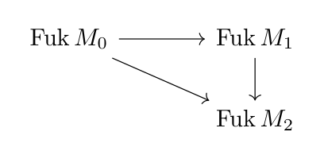
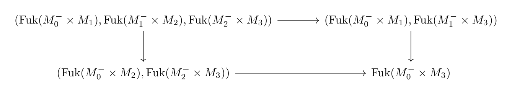

# Fukaya 的边界上链路线

> `functoriality/deriv/fukaya-transfer-route` ｜ track B ｜ draft

**目标**：重构 [Fuk17] 的路线：先把 Y-拼接曲线的奇点断裂解释为弯曲 $A_\infty$ 三模的曲率，再用边界上链转移（定理 1.5 + 命题 8.11）消失曲率，最后把结果提升为滤过 $A_\infty$-双函子（定理 1.8）。

**自测**：在一般闭辛流形上，Fukaya 如何用边界上链与双函子绕开 Y-映射紧化的困难，这和 MWW 路线差在哪里？

## 前提

- 一般闭辛流形（不再假设单调、最小 Maslov 指标 3），拉格朗日子流形只假定为浸入的。
- $L_{01}\subset M_0^-\times M_1$、$L_{12}\subset M_1^-\times M_2$ 为浸入拉格朗日子流形，分别配边界上链 $b_{01},b_{12}$。
- 纤维积 $L_{01}\circ L_{12}$ 横截截出且具有干净自交；$\Fuk$ 范畴依赖 [FOOO09b] 的经典技术。

## 步骤

1. **分析 Y-拼接曲线模空间的余维 1 断裂：发生在端部（对应 Floer 微分）、接缝上（对应每个拉格朗日对应的曲率），或三条接缝相交的奇点处。**  
   为什么：前两类是熟悉的；核心困难是第三类，它决定是否需要新的代数结构。  
   锚点：原书 p.37 §3.11（证据 A）

2. **三接缝奇点处的泡实际上是一个带三条平行接缝的柱面，接缝分别标记 $L_{01}$、$L_{12}$、$L_{01}\circ L_{12}$，其计数正是拼接 Floer 复形 $\CF^*(L_{01},L_{12},L_{01}\circ L_{12})$ 的微分。**  
   为什么：这解释了为什么 Y-映射的同构不能只靠「纤维积基本类给出闭链」的朴素想法。  
   锚点：原书 p.37 §3.11（证据 A）

3. **朴素构造失效：一般紧情形下 $L_{01}$、$L_{12}$ 只是浸入的，拼接 Floer 复形的微分平方可能不为 0（曲率），因此连闭链都没有意义。**  
   为什么：正确的代数结构是弯曲 Floer 代数上的弯曲 $A_\infty$ 三模：$d^2$ 与曲率作用之差被解释为曲率项。  
   锚点：原书 p.37 §3.11（证据 A）

4. **边界上链转移（定理 1.5 + 命题 8.11）：给定 $b_{01},b_{12}$ 与横截干净的纤维积，存在 $L_{01}\circ L_{12}$ 上的边界上链，其在规范等价意义下由「Yoneda 模与对应复合决定的模拟同构」刻画。**  
   为什么：边界上链消去曲率：配上 $b$ 后 $d_b^2=0$，闭链重新有意义；规范等价说明不同的 $b$ 只差 gauge 变换，不改变 Yoneda 模的拟同构类。  
   锚点：原书 p.37 §3.11（证据 A）

5. **结合 [Fuk17] 定理 9.1 与 LL 的 Y-映射：该边界上链的选取确定几何复合函子与函子复合之间的同伦等价。**  
   为什么：这一步把「代数上存在 $b$」翻译成「函子层面的同伦等价」，完成 (91) 与复合相容性。  
   锚点：原书 p.38 §3.11（证据 A）

6. **双函子（定理 1.8）：上述拟等价提升为滤过 $A_\infty$-双函子 $(\Fuk(M_0^-\times M_1),\Fuk(M_1^-\times M_2))\to\Fuk(M_0^-\times M_2)$，并在 $A_\infty$-三函子方形中存在指定同伦使其结合。**  
   为什么：证明第二部分的同伦只需一张新拼接曲面：带四个穿孔的亏格 0 曲线，取常数拼接映射计数为 1（最大值原理保证每条接缝上的曲线为常数）。  
   锚点：原书 p.38 §3.11（证据 A）

7. **与 MWW 比较：MWW 在标准单调下直接构造 $\Phi^\#$ 并用带收缩证同伦；Fukaya 把问题化为弯曲 $A_\infty$ 代数间弯曲双模的代数引理，绕开八字形泡的全部分析与几何困难。**  
   为什么：这是原文 Remark 3.26 的判断；代价是依赖 [FOOO09b] 的重型技术，且只得到规范等价/同伦意义下的函子性。  
   锚点：原书 p.38 §3.11（证据 A）

## 交换图

### 图 1：复合函子与函子复合的同伦等价三角（式93）



原文 §3.11 式(93)：三条边分别是 Φ_{L01}、Φ_{L12} 与 Φ_{L01∘L12}，原文未标箭头，此处保持原样。

```tikz
\begin{tikzcd}[column sep=large]
\Fuk M_0 \arrow[r] \arrow[dr] & \Fuk M_1 \arrow[d] \\
& \Fuk M_2
\end{tikzcd}
```

### 图 2：A∞-双函子结合性的方图（式95）



原文 §3.11 式(95)：原文把第一格拆成两行 gathered 排版，这里简化为单行；方图在同伦意义下交换（定理中指定该同伦）。

```tikz
\begin{tikzcd}[column sep=large,row sep=large]
(\Fuk(M_0^-\times M_1),\Fuk(M_1^-\times M_2),\Fuk(M_2^-\times M_3)) \arrow[r] \arrow[d] & (\Fuk(M_0^-\times M_1),\Fuk(M_1^-\times M_3)) \arrow[d] \\
(\Fuk(M_0^-\times M_2),\Fuk(M_2^-\times M_3)) \arrow[r] & \Fuk(M_0^-\times M_3)
\end{tikzcd}
```

## 结果

(91) 的函子 $\Phi_{L_{12}}:\Fuk M_1\to\Fuk M_2$ 存在且与复合相容（同伦等价意义）；进一步提升为滤过 $A_\infty$-双函子 (94)，其结合性在同伦意义下由 (95) 中指定的同伦给出。

## 缺口

- 定理 3.23、3.25 均为原文转述（[Fuk17] 定理 1.5 + 命题 8.11、定理 1.8），证明未给出；原文明确说所需经典技术超出本文范围。
- 边界上链的存在性依赖横截、干净自交与 [FOOO09b] 的技术；这些条件的严格表述本卡按原文转述，未展开。
- 双函子的相干性（高阶结合同伦）细节原文只给证明要点，未展开。

## 易错点

- 把边界上链当成无条件存在：需要纤维积横截截出、干净自交，以及 [FOOO09b] 的技术；否则只能停留在弯曲三模层面。
- 以为 Fukaya 路线给出普通 $\Fuk$ 范畴之间的严格函子：它是过滤/弯曲 $A_\infty$ 范畴之间、只到规范等价与同伦的函子性。
- 把定理 1.8 的结合性当成严格结合：它是「在同伦意义下结合」，并且需要在三函子方形中指定一个同伦。
- 忘记这一步绕开的对象：Y-映射奇点断裂的曲率被解释为弯曲三模的曲率项，而不是被忽略；忽略曲率会得到 $d^2\ne0$ 的错误复形。

## 参考与关联

- Abouzaid & Bottman, Functoriality in categorical symplectic geometry (arXiv:2210.11159v1)，§3.11，p.37–38（原书 p.37–38 §3.11）

关联：`functoriality/concept/fukaya-bifunctor`、`functoriality/concept/bounding-cochain`、`functoriality/concept/curved-a-infinity`、`functoriality/deriv/y-map-route`、`functoriality/deriv/bounding-cochain-construction`

来源说明：原书 p.37–38 §3.11（[Fuk17] 定理 1.5、命题 8.11、定理 1.8 的转述）；公式取自中译本 chapter3.tex。
