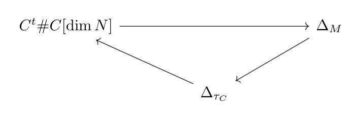
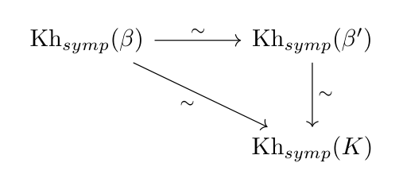

# Kh_symp ≅ Kh 的证明思路

> `functoriality/deriv/khovanov-matching` ｜ track D ｜ draft

**目标**：概述定理 5.4（转述 [AS19]）证明思路的骨架：从辫闭包表示出发，说明 Seidel–Smith 引理 44 如何解决 Markov 稳定化，以及为什么最终比较需要拼接 Floer 的对应论证。

**自测**：Seidel–Smith 的辛 Khovanov 同调要经过哪些步骤才能与 Khovanov 同调比较，关键障碍在哪里？

## 前提

- 定向纽结写成 $n$ 股辫 $\beta$ 的闭包；$\operatorname{Kh}_{symp}(\beta):=\HF^*(L_n^{\Cap},\Phi_\beta L_n^{\Cap})$。
- Markov 变换：共轭（由辛流形 $\mathcal S_n$ 中的哈密顿同痕实现）与稳定化（比较 $\mathcal S_n$ 与 $\mathcal S_{n+2}$ 的 Floer 群）。
- Seidel–Smith 引理 44：$\HF^*(L,L')\cong\HF^*(\cup_1L,\tau_2\cup_1L')$，其中 $\cup_1,\cup_2\subset\mathcal S_n^-\times\mathcal S_{n+1}$ 是以 $S^2$ 为纤维、沿 $\mathcal S_n$ 干净相交的拉格朗日对应。

## 步骤

1. **共轭不变性：$\mathcal S_n$ 中的哈密顿同痕把共轭的辫闭包联系起来，故 $\operatorname{Kh}_{symp}$ 对共轭不变。**  
   为什么：Markov 第一变换是共轭，而辛作用精确到哈密顿同痕，所以 Floer 上同调不变。  
   锚点：原书 p.55 §5.2（证据 A）

2. **稳定化不变性：用 $\mathcal S_n^-\times\mathcal S_{n+1}$ 中的拉格朗日对应 $\cup_1,\cup_2$ 与关于 $\cup_2$ 的纤维化 Dehn 扭转 $\tau_2$，命题 5.3 给出自然同构 $\HF^*(L,L')\cong\HF^*(\cup_1L,\tau_2\cup_1L')$。**  
   为什么：稳定化把 $n$ 股辫与 $n+2$ 股辫联系起来，而引理 44 正是比较这两侧 Floer 群的关键一步。  
   锚点：原书 p.55 §5.2（证据 A）

3. **由步骤 1、2，$\operatorname{Kh}_{symp}$ 对任意两个辫闭包表示给出同构的 Floer 群，因而是纽结不变量。**  
   为什么：任意两个辫闭包表示可由 Markov 变换联系，故只需逐条验证变换下的不变性。  
   锚点：原书 p.55 §5.2（证据 B）

4. **与 Khovanov 同调比较：由于 $\cup_i$ 非紧，直接使用伪全纯拼接映射理论困难；[AS16] 起的工作用推论 5.2 的一个版本把比较推进，最终 [AS19] 在特征 $0$、合并双分次后得到一致。**  
   为什么：原文明确说比较由 [AS19] 完成，并指出推论 5.2 的一个版本在其中起关键作用；具体论证本节不复述。  
   锚点：原书 p.55 §5.2（证据 A）

## 交换图

### 图 1：纤维化 Dehn 扭转的正合三角（式112）



原文 §5.1 式(112)（定理 5.1）：C^t#C→Δ_M 是 C 与 C^t 之间伴随的余单位；Khovanov 稳定化所用的 τ_2 是 C=∪_2 的特例。原文节点后的句点属排版，此处略去。

```tikz
\begin{tikzcd}[column sep=huge,row sep=large]
C^t\#C[\dim N] \arrow[rr] & & \Delta_M \arrow[dl] \\
& \Delta_{\tau_C} \arrow[ul] &
\end{tikzcd}
```

### 图 2：论证骨架：Markov 变换下的不变性



本图为论证骨架，非原文图：§5.2 没有交换图（只有辫闭包图 41）。两条斜边分别是共轭（Hamilton 同痕）与稳定化（引理 44 式(116)）。

```tikz
\begin{tikzcd}[column sep=large,row sep=large]
\operatorname{Kh}_{symp}(\beta) \arrow[r,"\sim"] \arrow[dr,"\sim"'] & \operatorname{Kh}_{symp}(\beta') \arrow[d,"\sim"] \\
& \operatorname{Kh}_{symp}(K)
\end{tikzcd}
```

## 结果

$\operatorname{Kh}_{symp}$ 是纽结不变量；在特征 $0$ 的域上、把双分次合并为单分次后，它与 Jones 多项式的 Khovanov 范畴化一致（定理 5.4，转述 [AS19]）。证明路线的两个支点是 Seidel–Smith 引理 44（稳定化）与拼接 Floer 的对应计算。

## 缺口

- [AS19] 的比较证明本节只转述结论，未复述细节；且结论要求特征 $0$、合并双分次。
- 拉格朗日对应 $\cup_i$ 非紧，直接使用伪全纯拼接理论有实质困难；本卡不把「引理 44 + Markov」当成完整证明。
- 原文没有在本节展开 [AS19] 的证明结构：本卡步骤 3、4 中「整体比较」的细节属于 [AS19]，超出本卡范围。

## 易错点

- 把 Kh_symp 与 Kh 直接等同：必须限定特征 $0$ 并把双分次合并为单分次。
- 以为引理 44 一条就够：它只处理稳定化，共轭不变性与整体比较另行处理。
- 把 $\cup_i$ 当成紧拉格朗日对应，从而以为拼接理论可以直接套用。

## 参考与关联

- Abouzaid & Bottman, Functoriality in categorical symplectic geometry (arXiv:2210.11159v1)，§5.2，p.55–55（原书 p.55 §5.2）

关联：`functoriality/concept/symplectic-khovanov`、`functoriality/concept/khovanov-homology`、`functoriality/concept/dehn-twist`

来源说明：据中译本 §5.2（p.55）转述；比较定理属 [AS19]，本节只给结论与路线骨架。
