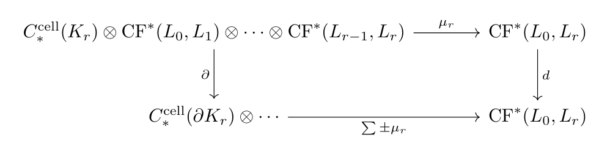
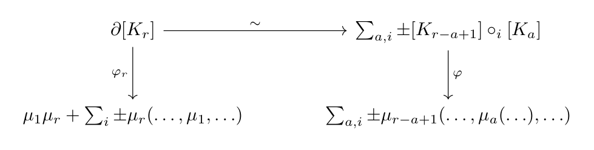

# 操作子原理的用法：胞腔链操作子给出 A∞ 结构

> `functoriality/deriv/operadic-construction` ｜ track A ｜ draft

**目标**：证明命题 thm:2.20 的逆向方向：从胞腔链操作子 C_*^cell(K)=(C_*^cell(K_r))_{r≥1} 上的范畴构造线性 A∞-范畴，并说明 A∞ 方程来自操作子相容性。

**自测**：胞腔链操作子 C_*^cell(K) 上的范畴为什么等价于线性 A∞-范畴，等价是如何构造的？

## 前提

- C 是 C_*^cell(K) 上的范畴：对象集、态射空间 hom(X,Y) 为链复形、复合运算 φ_r 如式(24)。
- A 与 C 有相同对象与相同态射空间；目标是定义 A 上的运算 μ_r 并验证 A∞ 方程。
- 结合多面体 K_r 的胞腔链 C_*^cell(K_r) 是 Ch 中的操作子，复合由连接圆盘树给出（§2.3）。

## 步骤

1. **定义 μ₁ 为链复形 hom(X_0,X_1) 上的微分。**  
   为什么：一元运算在操作子中由 K_1 承担；这里把微分归入目标范畴（链复形）结构。  
   锚点：原书 p.13（证据 A）

2. **对 r≥2，把基本类 [K_r] 代入式(26) 的链映射 φ_r 的第一个位置，得到 μ_r: hom(X_0,X_1)⊗…⊗hom(X_{r−1},X_r)→hom(X_0,X_r)（式(25)）。**  
   为什么：操作子提供的是「在 C 中作用」的运算，基本类把它压成一个具体的 r 元运算。  
   锚点：原书 p.14（证据 A）

3. **因 φ_r 是链映射，得到式(27)：±φ_r(∂[K_r],x_1,…,x_r) 与带 ∂x_i 的各项之和等于 ±∂φ_r([K_r],x_1,…,x_r)。**  
   为什么：这是链映射的定义展开，是后续所有边界项的来源。  
   锚点：原书 p.14（证据 A）

4. **用结合多面体的递归结构：∂[K_r] 的边界分解为各种内边收缩，对应式(28) 的第一项（2≤a≤r−1 的求和）；带 ∂x_i 的项整理后给出 μ₁ 相关项；结合操作子相容性得到式(28)。**  
   为什么：这一步是构造的核心：几何上的面偏序被翻译成代数上的插入求和。  
   锚点：原书 p.14–15（证据 A）

5. **把式(28) 移项整理即得第 r 个 A∞ 方程式(29)，故 A 是线性 A∞-范畴；反向地，由 A∞-范畴的 μ_r 与 [K_r] 的配对可重建 C 上的范畴。**  
   为什么：正向方向使等价成立；原文只详细写逆向，本卡补出正向的说明（后半句为 C 的判断）。  
   锚点：原书 p.15（证据 A）

## 交换图

### 图 1：论证骨架：μ_r 是链映射（式27）



本图为论证骨架，非原文图：原文 §2.3 只有式(25)--(28) 的链映射等式。

```tikz
\begin{tikzcd}[column sep=large,row sep=large]
C_*^{\mathrm{cell}}(K_r)\otimes\operatorname{CF}^*(L_0,L_1)\otimes\cdots\otimes\operatorname{CF}^*(L_{r-1},L_r) \arrow[r,"\mu_r"] \arrow[d,"\partial"'] & \operatorname{CF}^*(L_0,L_r) \arrow[d,"d"] \\
C_*^{\mathrm{cell}}(\partial K_r)\otimes\cdots \arrow[r,"\sum\pm\mu_r"'] & \operatorname{CF}^*(L_0,L_r)
\end{tikzcd}
```

### 图 2：论证骨架：结合多面体的边界给出 A∞ 方程（式28）



本图为论证骨架，非原文图；左列的边界项经操作子作用后给出 μ₁ 项与内边收缩项，合起来即式(28)。

```tikz
\begin{tikzcd}[column sep=large,row sep=large]
\partial[K_r] \arrow[r,"\sim"] \arrow[d,"\varphi_r"'] & \sum_{a,i}\pm[K_{r-a+1}]\circ_i[K_a] \arrow[d,"\varphi"] \\
\mu_1\mu_r+\sum_i\pm\mu_r(\ldots,\mu_1,\ldots) & \sum_{a,i}\pm\mu_{r-a+1}(\ldots,\mu_a(\ldots),\ldots)
\end{tikzcd}
```

## 结果

线性 A∞-范畴与操作子 C_*^cell(K) 上的范畴等价；A∞ 方程不再是额外公理，而是操作子相容性（结合多面体胞腔边界的递归分解）的翻译。

## 缺口

- 原文只证明逆向方向（从操作子上的范畴到 A∞-范畴），正向方向（从 A∞-范畴出发构造 C 上范畴并验证相容性）从略；本卡步骤 5 只作方向性说明。
- ∂[K_r] 的具体边界分解与符号（±）依赖定向线的平凡化，原文未逐项写出，本卡也不追符号。
- 命题的完整陈述需要处理 K_1 与微分的归属（注 thm:2.21）：μ₁ 被归入目标范畴结构，因此操作子只承载 r≥2 的运算；本卡沿用这一约定。
- 滤过与收敛性在 §2.3 的证明中未涉及（此时代数结构是纯组合的）；放到 Fukaya 几何中需补 §2.2 的收敛论证。

## 易错点

- 以为 $\\mu_r$ 是操作子 $\\mathcal C$ 的胞腔本身：$\\mu_r$ 是把基本类 $[K_r]$ 代入复合得到的，胞腔只是参数空间。
- 忘记 $\\mu_1$ 与其余运算不同类：$\\mu_1$ 次数 1，被归入目标范畴的微分，操作子只承载 $r\\ge2$ 的运算（注 thm:2.21）。
- 把式(28) 当成现成等式：它是借助结合多面体的递归结构才成立的，面偏序与括号化的对应不可省。

## 参考与关联

- Abouzaid & Bottman, Functoriality in categorical symplectic geometry (arXiv:2210.11159v1)，§2.3，p.12–15（原书 p.12–15 §2.3）

关联：`functoriality/concept/operad`、`functoriality/concept/operadic-principle`、`functoriality/concept/a-infinity-category`、`functoriality/deriv/fukaya-ainf-structure`

来源说明：原书 p.13–15 §2.3（命题 thm:2.20 与证明：式(25)、(26)、(27)、(28)、(29)；注 thm:2.21）；步骤 5 的正向说明为我们的判断（C）。
