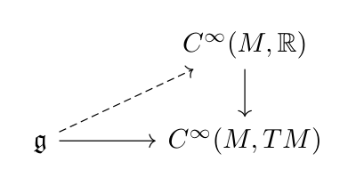
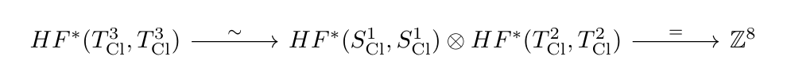

# 约化例子的带收缩同构计算

> `functoriality/deriv/reduction-clifford-example` ｜ track B ｜ draft

**目标**：重构 [WW10b] 定理 6.2.1 的计算：把 $\HF^*(T^n_{\mathrm{Cl}},T^n_{\mathrm{Cl}})$ 通过辛约化对应 $\Sigma_A$ 与带收缩同构 (62) 化为更低维情形，强归纳得 $\Z^{2^n}$。

**自测**：$T^n_{\mathrm{Cl}}$ 的自 Floer 上同调怎样用带收缩同构算出来，归纳步骤的关键一步在哪里？

## 前提

- $\CP^n$ 带归一化 Fubini–Study 形式，$T^n$ 作用在后 $n$ 个齐次坐标上，矩映射 $\mu([z])=-\tfrac12(|z_0|^2,\ldots,|z_n|^2)/\sum|z_j|^2$。
- 辛约化 $M/\!/G=\mu^{-1}(a)/G$ 与矩对应 $\Lambda_G\subset M/\!/G\times M^-$；对 $A\subsetneq\{1,\ldots,n\}$ 得到对应 $\Sigma_A=\CP^{n-\#A}\xrightarrow{\Sigma_A}\CP^n$。
- 默认几何假设（单调、最小 Maslov 指标 3、复合嵌入），从而带收缩同构 (62) 可用。

## 步骤

1. **写下 Clifford 环面 $T^n_{\mathrm{Cl}}=\{[z_0:\cdots:z_n]\mid |z_0|=\cdots=|z_n|\}\subset\CP^n$，以及 $\CP^n$ 标准作用的矩映射；由凸性定理，矩映射的像是原点与 $-\tfrac12e_i$ 张成的单纯形。**  
   为什么：矩多面体给出约化的水平集，是下一步构造对应的依据。  
   锚点：原书 p.34 §3.9（证据 A）

2. **构造约化对应 $\Sigma_A=\CP^n/\!/T^{\#A}$：其定义为 $\bigl([z_j]_{j\notin A},[z_0:\cdots:z_n]\bigr)$ 且 $|z_k|^2=\frac1{n+1}\sum_j|z_j|^2$ 对所有 $k\in A$ 成立。**  
   为什么：$\Sigma_A$ 是矩对应，因而是拉格朗日对应；它把 $\CP^{n-\#A}$ 与 $\CP^n$ 联系起来。  
   锚点：原书 p.34 §3.9（证据 A）

3. **把 $T^n_{\mathrm{Cl}}$ 写成低维环面与 $\Sigma_A$ 的复合：$T^1_{\mathrm{Cl}}$ 的条件与 $\Sigma_A$ 的等模条件合起来正好给出 $T^n_{\mathrm{Cl}}$ 的所有 $|z_j|$ 相等。**  
   为什么：这一步把「自 Floer 上同调」换成「广义对应链的拼接 Floer 上同调」，为使用 (62) 做准备。  
   锚点：原书 p.34 §3.9（证据 B）

4. **用带收缩同构 (62) 把链中的相邻两段收缩为几何复合：$\HF^*(T^n_{\mathrm{Cl}},T^n_{\mathrm{Cl}})$ 可写成 $S^1_{\mathrm{Cl}}$、$\Sigma_{(2,3)}$、$\Sigma_1^T$、$T^2_{\mathrm{Cl}}$ 的拼接群，再收缩为 $S^1_{\mathrm{Cl}}$、$T^1_{\mathrm{Cl}}\times T^2_{\mathrm{Cl}}$、$T^2_{\mathrm{Cl}}$ 的形式。**  
   为什么：(62) 要求嵌入复合；在这些射影空间的例子中复合确为嵌入，故可逐步收缩。  
   锚点：原书 p.34 §3.9（证据 B）

5. **继续化简为张量分解 $\HF^*(S^1_{\mathrm{Cl}},S^1_{\mathrm{Cl}})\otimes\HF^*(T^2_{\mathrm{Cl}},T^2_{\mathrm{Cl}})$，即 $\HF^*(T^n_{\mathrm{Cl}},T^n_{\mathrm{Cl}})\cong\HF^*(T^{n-1}_{\mathrm{Cl}},T^{n-1}_{\mathrm{Cl}})^{\otimes2}$。**  
   为什么：这是 fig:24 四个同构表达式的最后一步，原文称其为「直接的同构」；它把问题降一维。  
   锚点：原书 p.34 §3.9（证据 A）

6. **对 $n$ 作强归纳：$n=1$ 时 $\HF^*(S^1_{\mathrm{Cl}},S^1_{\mathrm{Cl}})\cong\Z^2$；归纳步用上一步的张量分解，得 $\HF^*(T^n_{\mathrm{Cl}})\cong\Z^{2^n}$。**  
   为什么：归纳的三角形/链式图来自 fig:24 中每次把复合对应替换为几何复合的那一步（即 (62)），不是三角范畴意义下的正合三角。  
   锚点：原书 p.34–35 §3.9（证据 A）

## 交换图

### 图 1：Hamilton 作用的等变提升数据（式80）



原文 §3.9 式(80)：实线箭头 X↦X^#，虚线是矩映射前提到的等变提升 X↦H_X。

```tikz
\begin{tikzcd}[column sep=large]
& C^\infty(M,\bR) \arrow[d] \\
\mathfrak g \arrow[r] \arrow[ur,dashed] & C^\infty(M,TM)
\end{tikzcd}
```

### 图 2：论证骨架：n=3 时的归纳步骤（图24）



本图为论证骨架，非原文图（原文图 24 是带四个表达式的示意图，不是 tikzcd）；这里取图中首尾两项，前两个同构本质上就是带收缩同构 (62)。

```tikz
\begin{tikzcd}[column sep=large]
\HF^*(T^3_{\mathrm{Cl}},T^3_{\mathrm{Cl}}) \arrow[r,"\sim"] & \HF^*(S^1_{\mathrm{Cl}},S^1_{\mathrm{Cl}})\otimes\HF^*(T^2_{\mathrm{Cl}},T^2_{\mathrm{Cl}}) \arrow[r,"="] & \bZ^{8}
\end{tikzcd}
```

## 结果

$\HF^*(T^n_{\mathrm{Cl}},T^n_{\mathrm{Cl}})\cong\HF^*(T^{n-1}_{\mathrm{Cl}},T^{n-1}_{\mathrm{Cl}})^{\otimes2}$，故 $\HF^*(T^n_{\mathrm{Cl}},T^n_{\mathrm{Cl}})\cong\Z^{2^n}$。

## 缺口

- fig:24 中四个表达式的具体写法是按图标签读出的（B），原文文字只给出首尾两项与「前两个同构本质上是 (62)、第三个直接」的说明；循环空间的一致性未逐字核实。
- 各步 (62) 所需「复合是嵌入的」在例子中应当成立，但原文未逐步验证；我们的检查是间接的。
- 约化对应的自旋结构与分次细节原文略过，边界上链均为零的假设也未逐项核对。

## 易错点

- 把带收缩同构 (62) 当成无条件可用：它需要单调性与嵌入复合；在更一般的闭辛流形上要换成带边界上链的 (63)。
- 把 $\Sigma_A$ 的复合当成普通拉格朗日交集：复合是纤维积的投影，且需横截性/嵌入性才落回拉格朗日。
- 把归纳步骤当成三角范畴的正合三角：图上的三角形链是复合对应的示意，不是正合三角公理。
- 搞错 $\Sigma_A$ 的指标集：$A$ 是固定模长的那组坐标，$n-\#A$ 才是约化后的维数。

## 参考与关联

- Abouzaid & Bottman, Functoriality in categorical symplectic geometry (arXiv:2210.11159v1)，§3.9，p.34–35（原书 p.34–35 §3.9）

关联：`functoriality/concept/clifford-torus`、`functoriality/concept/symplectic-reduction`、`functoriality/concept/strip-shrinking`、`functoriality/deriv/mww-composition`

来源说明：原书 p.34–35 §3.9（辛约化、对应 Σ_A、Clifford 环面计算，据 [WW10b] 定理 6.2.1）；公式取自中译本 chapter3.tex。
