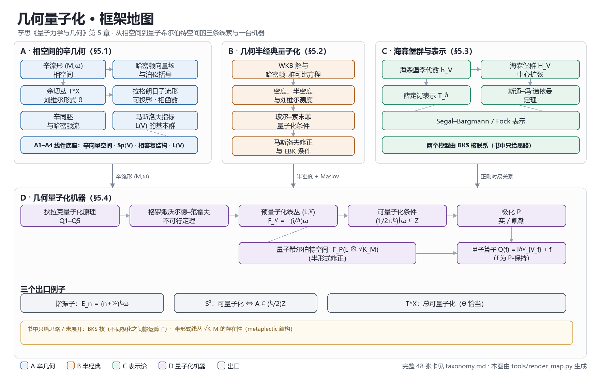

# 几何量子化 · 框架地图



（矢量版：[`map.svg`](map.svg)；本图由 [`tools/render_map.py`](tools/render_map.py) 生成，改图改脚本，不要手改 SVG。）

## 一句话

第 5 章的主线可以读成：**辛几何提供舞台，半经典与表示论给出两套「量子化应该长什么样」的样本，狄拉克原理给出目标清单，预量子化—极化—半形式三步把清单兑现。**

## 四条轨道

| 轨道 | 章节 | 在整章里的角色 | 卡片 |
|---|---|---|---|
| **A 相空间的辛几何** | §5.1 | 提供 $(M,\omega)$、哈密顿向量场、拉格朗日子流形与马斯洛夫指标——后面所有构造的语言 | A1–A10 |
| **B 几何半经典量子化** | §5.2 | 把 WKB 解升级为几何数据 $(L,\Omega)$，给出玻尔–索末菲与马斯洛夫修正——「老量子化」的严格版 | B1–B5 |
| **C 海森堡群与表示** | §5.3 | 把 $[x,p]=i\hbar$ 装进群表示，用斯通–冯·诺依曼定理说明模型唯一 | C1–C5 |
| **D 几何量子化机器** | §5.4 | 狄拉克 Q1–Q5 → 不可行定理 → 预量子化 → 整性 → 极化 → 半形式 → 算子 | D1–D7 |

## 三条线索怎样汇入 D

1. **A → D：舞台。** 辛流形 $(M,\omega)$ 与泊松括号是量子化的输入；预量子化线丛的曲率就是 $\omega$，整性条件积分的也是 $\omega$。
2. **B → D：半形式的来源。** WKB 的振幅不是函数而是半密度；焦散处的相位多值由 $\Theta^{1/4}$ 承担，这正是量子希尔伯特空间要张量 $\sqrt{K_M}$ 的原因。马斯洛夫修正的 $1/4$ 与谐振子 $(n+\tfrac12)\hbar\omega$ 是这条线最硬的证据。
3. **C → D：算子的模型。** 狄拉克 Q1–Q3 要的「自伴算子 + 正则对易关系」，在海森堡群的薛定谔表示里已经有一个现成答案；Q4 的泊松括号对应，则由预量子化的曲率条件实现。

## D 内部：五步机器

```text
狄拉克 Q1–Q5
   │  格罗嫩沃尔德–范霍夫：四次多项式上无解
   ▼  放宽 Q5（不再要求所有函数都被量子化）
预量子化 (L,∇),  F_∇ = −(i/ℏ)ω
   │  Q(f)=iℏ∇_{V_f}+f 满足 Q1–Q4，但空间太大
   ▼
整性条件 (1/2πℏ)∫_Σ ω ∈ Z   ← 决定 L 是否存在
   │
   ▼
极化 P（实 / 凯勒）           ← 砍掉一半变量
   │  Γ_P(L): ∇_X s = 0, X∈P
   ▼
半形式修正 L ⊗ √K_M          ← 补马斯洛夫相位
   │
   ▼
量子算子 Q(f)（f 为 P-保持）
```

每一步都解决前一步留下的一个问题，也都留下一个新的边界：

| 步骤 | 解决了什么 | 留下了什么 |
|---|---|---|
| 预量子化 | Q1–Q4；曲率给出泊松括号 | 空间 $L^2(M,\mathcal{L})$ 太大，$Q(f)$ 始终一阶 |
| 整性条件 | 线丛存在性的拓扑判据 | 有些辛流形根本不可量子化（如 $S^2$ 只允许离散 $A$） |
| 极化 | 自由度减半，出现「波函数」 | 极化不唯一；一般 $f$ 不再保持 $P$ |
| 半形式 | 焦散相位、$(n+\tfrac12)\hbar$ | $\sqrt{K_M}$ 的整体存在性需要 metaplectic 结构 |
| 量子算子 | 在 $P$-保持函数上定义 $Q(f)$ | 其余函数要靠 BKS 核在极化间搬移（书中只给思路） |

## 三个出口例子

- **谐振子**：$Q(\mathcal{H})=\hbar z\partial_z$ 给出 $n\hbar$；加半形式后变成 $(n+\tfrac12)\hbar\omega$。这是「为什么必须做半形式修正」的最小反例。
- **$S^2$**：$\int_{S^2}\omega=4\pi A$，可量子化 $\iff A\in(\hbar/2)\mathbb{Z}$。这是「整性条件真的会排除东西」的最小例子。
- **余切丛 $T^*X$**：$\omega=d\theta$ 恰当，永远可量子化；位置极化给出熟悉的 $L^2(X)$。

## 怎么读这张图

- **第一次读**：从左到右看三条线索，再看 D 的五个箭头；不要停在任何一个公式上，先建立「哪里来、到哪里去」。
- **第二次读**：选一条线索（A / B / C），沿着它走到 D，把沿途每张概念卡的「先自测」问题答一遍。
- **第三次读**：只看 D，遮住每个框的下半部分，自己说出「这一步解决什么、留下什么」，再对照上表。
- **教学**：用三条线索做三次 45 分钟的专题课，最后用 D 的流水线做一次总装；三个出口例子分别放在对应步骤后当堂练。

## 图上的缺口（书中未展开）

图中黄色虚线框标了两处，读的时候不要当成已补全：

1. **BKS 核**：不同极化（位置 / 动量 / 凯勒）的量子希尔伯特空间之间如何搬运算子。书中只说明「用 BKS 核联系」，没有构造。
2. **半形式线丛 $\sqrt{K_M}$ 的整体存在性**：一般辛流形上需要 metaplectic 结构（$w_2(M)=0$）；书中默认取到，例子（$T^*X$、$\mathbb{C}^n$、$S^2$）都满足。

## 与卡片总表的关系

地图只画主干与关键交叉，不画全部 48 张卡。完整清单、每张卡的 id、出处页码与源码行号见 [`taxonomy.md`](taxonomy.md)；需要按图索骥时，用概念卡里的 `related` 和例子卡里的 `concept_refs` 跳转。
