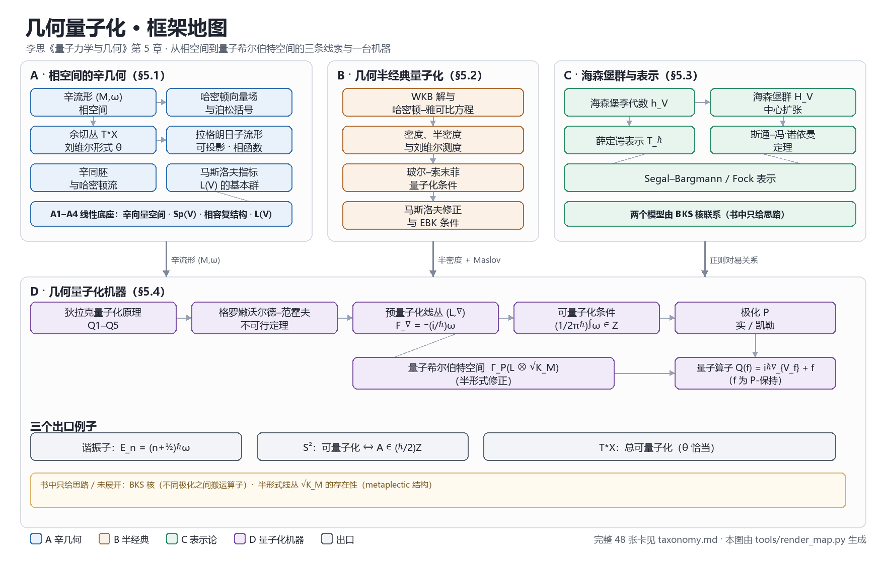

# 几何量子化资料卡（GeoQ Cards）

把李思《量子力学与几何》第 5 章「几何量子化」拆成 **48 张可以单独拿起来用的资料卡**：1 张总览、27 张概念卡、20 张例子卡。每张卡都按「先自测 → 定义 → 要点 → 公式 → 定理与证明 → 易错点 → 相关卡 → 出处」组织，例子卡则按「设定 → 计算 → 结果 → 复核」组织。目标不是替你把书读完，而是让你在离开书的情况下也能把这一章重新推一遍。

## 里面有什么

| 内容 | 数量 | 入口 |
|---|---|---|
| 总览卡（全章主线） | 1 | `cards/concepts/overview-geometric-quantization.json` |
| 概念卡（A 辛几何 / B 半经典 / C 表示论 / D 量子化机器） | 27 | `cards/concepts/` |
| 例子卡（书中 20 个编号例子，一张不落） | 20 | `cards/examples/` |
| 框架地图 | 1 | [`map.png`](map.png) / [`map.svg`](map.svg) / [`MAP.md`](MAP.md) |
| 卡片总表 | 1 | [`taxonomy.md`](taxonomy.md) |
| 数据规范 | 1 | [`SCHEMA.md`](SCHEMA.md) |
| 可读版（Markdown） | 48 | `md/concepts/`、`md/examples/` |
| 生产工作流 | 1 | [`workflow/PRODUCTION.md`](workflow/PRODUCTION.md) |

## 先看地图



地图把整章压成「三条线索 + 一台机器 + 三个出口」：

- **A 辛几何**提供相空间 $(M,\omega)$、哈密顿向量场与拉格朗日子流形；
- **B 半经典**把 WKB 解几何化为「拉格朗日子流形 + 半密度」，并给出玻尔–索末菲与马斯洛夫修正；
- **C 表示论**把正则对易关系装进海森堡群，用斯通–冯·诺依曼定理锁定模型；
- **D 量子化机器**依次是：狄拉克 Q1–Q5 → 格罗嫩沃尔德不可行 → 预量子化 → 整性条件 → 极化 → 半形式修正 → 量子算子；
- **出口**：谐振子 $(n+\tfrac12)\hbar\omega$、$S^2$ 的 $A\in(\hbar/2)\mathbb{Z}$、余切丛总可量子化。

## 资料卡怎么用

### 一张概念卡：10–20 分钟

1. **先自测**：只读标题和卡片顶部的「先自测」问题，合上材料，在纸上用自己的话答一遍。答不出是正常的，这一步是为了让大脑先产生缺口。
2. **读「一句话」**：检查你的直觉和卡片差在哪，不要背。
3. **读定义，抄符号**：把 $\omega$、$V_f$、$P$、$\Gamma_P$、$K_M$ 这些符号连同含义抄在一张纸上；这张纸是你这一章的「词典」。
4. **逐条要点**：每条要点停 30 秒，问自己「为什么需要这一条」。遇到公式先遮住下文自己推，再对照。
5. **定理与证明**：先只看 `statement`，尝试自己证；卡住时看 `steps`，每一步的 `why` 写的是「为什么这一步成立 / 为什么需要这一步」，这两件事不一样。
6. **易错点**：合上卡，把每条坑复述成一句「如果……就会错成……」。
7. **只跳 1–2 张相关卡**：`related` 是给你下一步用的，不是让你一次刷完。

### 一张例子卡：20–30 分钟

1. 读 `setup`，读到「要算什么」为止，**停下来自己算**。
2. 对照 `computation` 的每一步，重点看 `why`：这一步用了哪张概念卡的哪条性质。
3. 亲手执行 `check`。`check` 不是「再读一遍」，而是一个独立可执行的复核：代回原式、量纲、特例、数值、维数计数。
4. 如果结果和书上有出入，先查约定（$2\pi$、$\hbar$、符号），再查适用范围。

### 复习与教学

- **打印**：`md/concepts/*.md` 与 `md/examples/*.md` 是排版好的阅读版，可直接打印；每张卡自带出处与相关卡链接。
- **Anki**：正面用 `question`，背面用 `summary + definition.text + key_points`；例子卡正面用「这张卡练什么」，背面用 `result + check`。不要整段导入证明，证明适合在纸上重推。
- **每天 5 张 + 每周一次地图复盘**：周末只看 `map.png`，把本周卡片口头串成一条线；串不起来的地方就是下周的复习重点。

### 三条推荐路线

| 路线 | 顺序 | 适合 |
|---|---|---|
| 最短主线（半天） | 总览 → D1 狄拉克 → D3 预量子化 → D5 极化 → D6 半形式 → D7 量子算子 → 例子「谐振子半形式谱」 | 只想知道几何量子化在干什么 |
| 半经典路线 | A6 辛流形 → A8 余切丛 → A9 拉格朗日子流形 → B1 WKB → B2 半密度 → B3 玻尔–索末菲 → B4 马斯洛夫 → 例子「谐振子 EBK 谱」 | 从 WKB 与焦散进入 |
| 表示论路线 | C1 海森堡李代数 → C2 海森堡群 → C3 薛定谔表示 → C4 斯通–冯·诺依曼 → C5 Segal–Bargmann → D1 狄拉克 | 从「为什么是这些算子」进入 |

## 目录结构

```text
datasets/geoq/
├── README.md               # 本文件
├── MAP.md                  # 文字版地图与读图顺序
├── map.svg / map.png       # 框架地图（矢量 / 位图）
├── taxonomy.md             # 48 张卡总表：id、标题、轨道、出处页码
├── SCHEMA.md               # 卡片 JSON 字段规范
├── index.jsonl             # 一行一张卡的检索索引
├── cards/
│   ├── concepts/*.json     # 28 张（含总览）
│   └── examples/*.json     # 20 张
├── md/
│   ├── index.md            # 全部卡片目录
│   ├── concepts/*.md       # 阅读版
│   └── examples/*.md
├── tools/
│   ├── lint_geoq.py        # 结构与交叉引用校验
│   ├── audit_pages.py      # 逐卡核对源码行号与印刷页
│   ├── build_index.py      # 重建 index.jsonl
│   ├── render_md.py        # JSON → Markdown
│   └── render_map.py       # 重画地图
└── workflow/
    ├── PRODUCTION.md       # 这套卡是怎么生产出来的
    └── prompts/            # 起草与审校提示词
```

## 页码与引用约定

书中正文用 `% [原文 p.NNN]` 标记**原书印刷页**。本数据集统一：

- `sources.pages`：印刷页闭区间，第 5 章为 `[250, 296]`；
- `sources.pdf_pages`：PDF 页，等于印刷页 $+1$，即 `[251, 297]`；
- `sources.anchor`：源码定位，形如 `ch05a.tex:1024-1111`。

读电子版时若页码对不上，先看 PDF 阅读器显示的是印刷页还是文件页；两者差 1。

## 数据格式与校验

字段规范见 [`SCHEMA.md`](SCHEMA.md)。改完卡片后跑：

```bash
python tools/lint_geoq.py        # 结构、页码、交叉引用
python tools/audit_pages.py --src /path/to/SY07-03/chunks   # 按底本源码复核页码
python tools/build_index.py      # 重建 index.jsonl
python tools/render_md.py        # 重建 md/
python tools/render_map.py       # 重画 map.svg / map.png
```

`audit_pages.py` 需要底本 TeX 源码（版权原因不随数据集发布）；没有源码时会提示并跳过，其余检查不受影响。

`lint_geoq.py` 会检查：id 与文件名/目录一致、`track` 合法、`summary` 长度、`question` 是问句、`pages` 与 `pdf_pages` 相差 1、`complete` 证明至少两步且每步有 `why`、例子至少两步计算、`related` / `concept_refs` 都能解析到实际卡片。

## 版权与边界

- 本数据集是**改写**（`rights: "rewritten"`），不是原文翻译或复制：定义、证明、例子均用自己的话重新组织，公式照录，出处逐条标注。
- 只覆盖第 5 章；第 1–4 章与附录不在范围内。
- 书中「只给思路」的地方（BKS 核、$\sqrt{K_M}$ 的整体存在性）在卡片里明确标成缺口，不假装补全。
- 发现错误请直接改 JSON 并跑 lint；卡片 `status` 保持 `draft`：已经过两轮独立审校（A/B 轨、C/D 轨）与自动检查，但书中本身存疑的几处（p.276 归一化、p.280 变换指数、ch05b.tex:1426 符号）仍留给读者按 pitfalls 自行判断。
- 合规检查：另有脚本把每张卡的中文散文与底本逐字比对，保证不存在连续 20 字以上的相同片段（公式、术语名除外）；成果只发布改写卡，不收录原文或译文段落。

## 生产工作流

这套卡按「源码定位 → 卡片总表 → Schema → 示范卡 → 六路并行起草 → lint → 人工抽检 → 渲染 → 发布」生产，完整协议、质量门与可复用提示词见 [`workflow/PRODUCTION.md`](workflow/PRODUCTION.md)。
