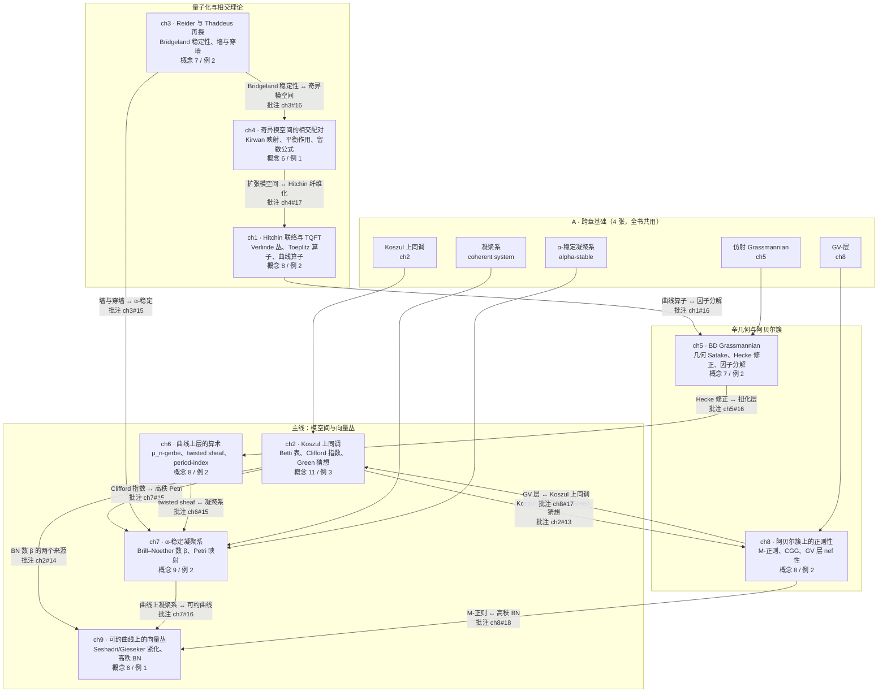

# 格拉斯曼资料卡 · 骨架图

这张图是整套卡的地图：**上面是模空间与向量丛这条主线（原书 pp. 25–120 / 中译 pp. 30–115），左下是量子化与相交理论（pp. 1–80 / 中译 pp. 7–81），右下是辛几何与阿贝尔簇正则性（pp. 81–168 / 中译 pp. 82–159），最右是可约曲线上的收尾（pp. 169–179 / 中译 pp. 160–170）**。箭头旁标的是「哪章哪条批注/哪张卡在讲这件事」。

概念卡与例子卡就是这条链上的节点与边；跨章依赖的 15 个具体点在工程文件 `产出\汇总\交叉引用.md` 里有逐条坐标。

## 三条阅读路线

| 路线 | 顺序 | 一句话 |
|---|---|---|
| 一、模空间与向量丛 | ch2 → ch7 → ch9 → ch6 | 从 Koszul 同调到凝聚系、可约曲线、Brauer 群：**「分类空间」这条线怎么一路推广**。 |
| 二、量子化与相交理论 | ch1 → ch3 → ch4 | 从 Hitchin 联络与 TQFT 到 Bridgeland 稳定性、奇异模空间的相交数：**「量子化 + 计数」这条线**。 |
| 三、辛几何与阿贝尔簇 | ch5 → ch8 | 从仿射 Grassmannian/几何 Satake 到 M-正则与 GV-层：**「辛结构 + Fourier–Mukai」这条线**。 |

## 每章入口卡

| 章 | 先读这张 | 再读这张 |
|---|---|---|
| ch1 | `grassmann/concept/hitchin-connection` | `grassmann/example/factorization-along-a-curve` |
| ch2 | `grassmann/concept/koszul-cohomology` | `grassmann/concept/clifford-index` |
| ch3 | `grassmann/concept/bridgeland-stability-condition` | `grassmann/example/s-half-dichotomy` |
| ch4 | `grassmann/concept/balanced-action` | `grassmann/concept/residue-formula-for-pairings` |
| ch5 | `grassmann/concept/affine-grassmannian` | `grassmann/concept/geometric-satake-correspondence` |
| ch6 | `grassmann/concept/gerbe-banded-by-mu-n` | `grassmann/concept/period-and-index` |
| ch7 | `grassmann/concept/coherent-system` | `grassmann/concept/alpha-stable-coherent-system` |
| ch8 | `grassmann/concept/gv-sheaf` | `grassmann/concept/m-regular-sheaf` |
| ch9 | `grassmann/concept/reducible-nodal-curve-and-dual-graph` | `grassmann/example/limit-linear-series-on-a-chain-of-five-elliptic-curves` |
