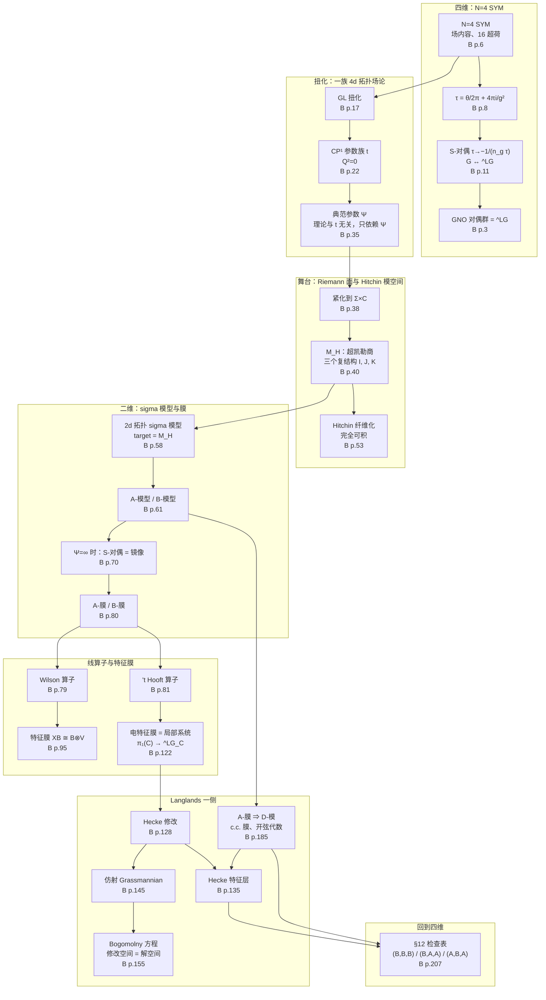

# K–W 2006 资料卡 · 骨架图

这张图是整套卡的地图：**上面是四维物理，中间是扭化与紧化，下面是二维几何，右下是 Langlands 一侧**。箭头旁标的是「哪一段原文（印刷页）在讲这件事」。概念卡与推导卡就是这条链上的节点与边。

## 怎么用这张图

- **第一次读**：从上往下走一遍，每个框点开对应的概念卡；框与框之间的箭头，点开对应的推导卡。
- **想补细节**：每张卡末尾都有「出处（印刷页）」，可以回 `B p.N` 那一页逐行对照。
- **想自测**：每张概念卡第一行是「先自测」问题，先不看卡面回答一遍。

## 图与卡、与原文的对应

| 图上节点 | 概念卡 | 原文页 |
|---|---|---|
| 4d 物理块 | `n4-sym-theory` `theta-angle` `s-duality` `gno-dual-group` `langlands-dual-group` | 2–16 |
| 扭化块 | `topological-twist` `topological-qft` `brst-operator` `cohomology` | 16–38 |
| 舞台块 | `riemann-surface` `higgs-bundle` `hitchin-moduli` `hyperkahler-quotient` `hitchin-fibration` | 38–56 |
| 二维块 | `a-model` `b-model` `mirror-symmetry` `a-brane` `b-brane` | 56–78 |
| 算子块 | `wilson-operator` `thooft-operator` `eigenbrane` | 78–123 |
| Langlands 块 | `hecke-operator` `affine-grassmannian` `bogomolny-equation` `d-module` `canonical-coisotropic-brane` | 123–207 |
| 汇合处 | `geometric-langlands` `hecke-eigensheaf` | 2–5, 207–222 |

## 三个最容易搭错的地方

1. **S-对偶 ≠ 只是 $\tau\mapsto-1/\tau$**：它同时换群 $G\leftrightarrow{}^L G$、换电与磁。
2. **$\mathcal M_H$ 的三个复结构不是三个流形**：同一个点集、三套全纯坐标；B-模型与 A-模型只是选了不同复结构。
3. **A-膜 ⇒ D-模不是函子性定理**：原文只对 c.c. A-膜单向构造，措辞是 will show + roughly speaking；这是 §11 的诚实边界。
