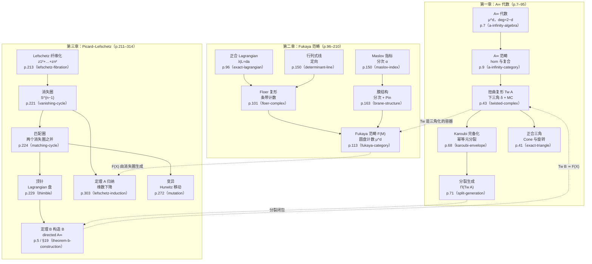

# Seidel 资料卡 · 骨架图

全书三章是一条流水线：**第一章把 A∞ 语言搭好，第二章把辛几何装进去，第三章用 Lefschetz 纤维化把它变成可计算的数据**。下图节点旁标的是原书印刷页；括号里是卡 id 的末段。

## 三章各回答什么

| 章 | 问题 | 关键机器 | 卡 |
|---|---|---|---|
| 第一章 | 链层次的复合不严格结合，怎么还能算？ | μ^d、Tw、Karoubi、分裂生成 | 6 概念 + 4 推导 |
| 第二章 | 辛流形的几何怎么变成 A∞ 范畴？ | 正合性、Floer 复形、Maslov、行列式线、膜结构 | 6 概念 |
| 第三章 | 怎么从 PL 数据真的算出 F(X)？ | 消失圈/匹配圈/顶针、归纳、directed A∞ | 4 概念 + 4 推导 |

## 读法

- 只想抓定理 A/B：先读 `lefschetz-induction`、`theorem-b-construction`，再回 `twisted-complex` 与 `fukaya-category` 补语言。
- 想补 A∞ 基础：按 A1 → A2 → A3 → A4 → A5 顺序；`exact-triangle` 可最后读。
- 想理解「为什么能算」：`vanishing-cycle` → `matching-cycle` → `thimble` → `mutation` → `lefschetz-induction`。
