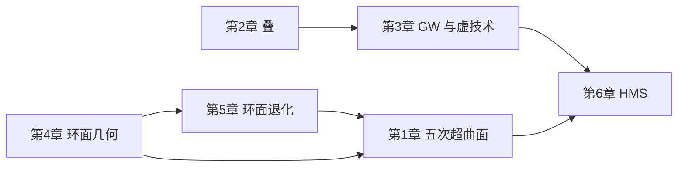

# Siebert《镜像对称》资料卡 · 覆盖矩阵

本书是 100 页讲义（原 PDF 印刷页 7–106）的译本裁切，篇幅小、章节密。下面这张矩阵回答的是「**哪一节要出什么类型的卡、覆盖哪些概念主题**」，不登记具体卡 id；卡片定稿后再把 id 回填，并在最后一列打勾。

记号：`✓` = 计划出这类卡；`—` = 不单独出卡（内容并进相邻卡）。

## 0. 总览

| 部分 | 印刷页 | track | 计划覆盖的节 / 主题数 | 状态 |
|---|---|---|---|---|
| 概览 | 7–9 | `A`、`O` | 6 | 完成（2 张 O + 1 张 A 引论） |
| 第 1 章 五次三维超曲面的镜像对称 | 10–23 | `A` | 11 | 完成（15 张 A，含概览引论） |
| 第 2 章 叠 | 24–41 | `B` | 9 | 完成（11 张） |
| 第 3 章 GW 与虚技术 | 42–58 | `C` | 6 | 完成（11 张） |
| 第 4 章 环面几何 | 59–80 | `D` | 10 | 完成（12 张） |
| 第 5 章 环面退化与镜像对称 | 81–94 | `E` | 6 | 完成（12 张） |
| 第 6 章 HMS 初探 | 95–106 | `F` | 5 | 完成（12 张） |

## 1. 概览（p.7–9）

| 节 / 主题 | 覆盖要点 | 概念 | 推导 | 勘误 |
|---|---|---|---|---|
| 计数镜像对称 | 计数型不变量如何配对：五次超曲面的 Hodge 数、镜像侧的计数对应 | ✓ | — | — |
| 拓扑扭曲 | 拓扑 A/B 扭曲；不变量在扭曲理论里如何组织 | ✓ | — | — |
| 有用的计算 | 哪些量真的可算（GW 不变量、周期积分），为什么值得算 | ✓ | — | — |
| 同调镜像对称 | HMS 的陈述形态，比数值镜像强在哪 | ✓ | — | — |
| 证明数值与同调镜像对称 | 两条证明路线与各自需要的机器 | ✓ | ✓ | — |
| 当前发展状况与课程安排 | 课程地图、各章依赖、未解决的问题 | ✓ | — | — |

## 2. 第 1 章 五次三维超曲面的镜像对称（p.10–23）

| 节 / 主题 | 覆盖要点 | 概念 | 推导 | 勘误 |
|---|---|---|---|---|
| 模空间维数与 h¹(Θ) | 五次超曲面模空间的维数；无穷小形变 = $H^1(X,\Theta)$ | ✓ | — | — |
| Hodge 菱形与 (1,1) 类；Lefschetz、弱 Lefschetz | 五次超曲面的 Hodge 数；(1,1) 类与超平面类的关系；弱 Lefschetz 条件 | ✓ | — | — |
| Lefschetz 超平面定理 | 用超平面切片把 $P^4$ 的上同调降到 $X$ | ✓ | ✓ | — |
| 镜像五次超曲面的构造（(Z/5)³ 商、射影消解、例外除子计数） | 商、消解、数例外除子，得到光滑三次超曲面 | ✓ | ✓ | — |
| Dwork 族与特殊纤维（A₁ 奇点、conifold、轨形点） | 单参数族的特殊纤维类型与判别方法 | ✓ | ✓ | — |
| Yukawa 耦合 A/B 模型 | 三点评函数；A 模型计数与 B 模型周期 | ✓ | ✓ | — |
| 全纯三形式与留数 | 用留数写出 $\\Omega$；极点、周期与积分轮换 | ✓ | — | — |
| 归一化 | 把周期与 Yukawa 耦合归一到同一标度 | — | ✓ | — |
| Picard–Fuchs 方程与 Griffiths 极点阶数约化 | 有限维约化推出二阶方程 | ✓ | ✓ | — |
| 典范坐标与镜像映射 | 用周期比值定义 $q$，写出镜像映射 | ✓ | ✓ | — |
| Griffiths 横截性与 c₃(z) | 横截性；三形式给出的三阶不变量 | ✓ | — | — |

## 3. 第 2 章 叠（p.24–41）

| 节 / 主题 | 覆盖要点 | 概念 | 推导 | 勘误 |
|---|---|---|---|---|
| 曲线模问题 | 为什么 $M_g$ 不能直接当概形；自同构造成的障碍 | ✓ | — | — |
| 群胚态射 | 群胚视角下的模问题与态射 | ✓ | — | — |
| 纤维积与笛卡尔图 | 2-范畴中的纤维积与笛卡尔方块 | ✓ | — | — |
| 叠的定义（平展拓扑、下降） | 平展覆盖、下降数据、叠的公理 | ✓ | ✓ | — |
| 叠的例子 | $BG$、商叠、曲线叠 | ✓ | — | — |
| 可表态射 | representable morphism 与对纤维积的保持 | ✓ | — | — |
| DM 叠的定义与分离性判据 | Deligne–Mumford 叠；对角可表态；分离性 | ✓ | ✓ | — |
| 稳定曲线 | 稳定曲线定义、自同构有限 | ✓ | — | — |
| $\\overline{M}_g$ 是 DM 叠 | 用稳定曲线与 DM 判据证明 | — | ✓ | — |

## 4. 第 3 章 GW 与虚技术（p.42–58）

| 节 / 主题 | 覆盖要点 | 概念 | 推导 | 勘误 |
|---|---|---|---|---|
| 稳定映射 | 稳定映射定义、GW 模空间的紧性来源 | ✓ | — | — |
| 超曲面亏格零 GW 不变量 | 五次超曲面的 genus-0 不变量与次数 | ✓ | ✓ | — |
| 相交理论插叙：proper push-forward / flat pull-back | 交积的定义与函子性 | ✓ | — | — |
| 相交理论插叙：切除、Weil/Cartier 除子 | 切除公式；除子与线丛的对应 | ✓ | — | — |
| 相交理论插叙：Chern 类、Segre 类、Gysin 拉回 | 计算工具与上同调推前 | ✓ | — | — |
| 障碍理论与虚拟基本类：基本思想、余切复形、Behrend–Fantechi | 障碍理论怎么给出虚基本类 | ✓ | ✓ | — |
| GW 的障碍理论与 GW 不变量 | 具体到 GW 模空间的障碍理论 | ✓ | ✓ | — |
| 形变不变性 | 不变量在形变下不变 | — | ✓ | — |

## 5. 第 4 章 环面几何（p.59–80）

| 节 / 主题 | 覆盖要点 | 概念 | 推导 | 勘误 |
|---|---|---|---|---|
| 幺半群与锥、Gordan 引理 | 尖锥、多面体、有限生成 | ✓ | — | — |
| 幺半群环与仿射环面簇 | $\\operatorname{Spec}\\,k[S]$ 与轨道 | ✓ | — | — |
| 环面分层 | 轨道–闭包分层结构 | ✓ | — | — |
| 扇与整体化 | 扇、粘合、整体环面簇 | ✓ | ✓ | — |
| P²、P^d 的例子 | 具体扇与除子 | ✓ | — | — |
| 扇的态射与环面态射 | 扇映射 ↔ 环面簇态射 | ✓ | ✓ | — |
| 环面簇范畴 | 范畴、纤维积、极限 | ✓ | — | — |
| 多胞体 → 环面簇（法扇） | 法扇构造与丰性 | ✓ | ✓ | — |
| Weil 除子与支撑函数 | 除子、支撑函数、多面体的对应 | ✓ | — | — |
| Cl、Cartier 除子、Picard 群、丰环面除子 | 除子类群、Picard 群与丰性判据 | ✓ | — | — |

## 6. 第 5 章 环面退化与镜像对称（p.81–94）

| 节 / 主题 | 覆盖要点 | 概念 | 推导 | 勘误 |
|---|---|---|---|---|
| Batyrev 构造（反身多胞体、Fano 环面簇、CY 超曲面、部分消解、镜像定理） | 从反身多胞体造镜像对；部分消解的作用 | ✓ | ✓ | — |
| Mumford 型环面退化 | 退化族与它的组合数据 | ✓ | — | — |
| Dwork 笔形与 A₁ 奇点 | 具体退化模型；A₁ 奇点如何出现 | ✓ | ✓ | — |
| 重构 | 从退化数据重建光滑族 | — | ✓ | — |
| 壁结构（壁、壁穿越、X°、相容性 / 折线、广义 θ 函数、X → Spec A） | 壁穿越、粘合、广义 θ 函数 | ✓ | ✓ | — |
| 内蕴镜像映射 | 不依赖坐标选择的镜像映射 | ✓ | ✓ | — |

## 7. 第 6 章 HMS 初探（p.95–106）

| 节 / 主题 | 覆盖要点 | 概念 | 推导 | 勘误 |
|---|---|---|---|---|
| A/B 模型与代数结构 | 两边的范畴、乘法与单位 | ✓ | — | — |
| Fukaya 范畴与「导出」Fukaya 范畴 | Fukaya 范畴、导出化与完备化 | ✓ | — | — |
| HMS 陈述 | 同调镜像对称的精确陈述 | ✓ | ✓ | — |
| dg 增强与同调扰动引理（Čech 模型） | dg 增强；HPL 与 Čech 模型 | ✓ | ✓ | — |
| Polishchuk 刚性定理（A_L、A∞ 结构、Hochschild 上闭链、bar/cobar 消解） | 刚性定理与证明工具 | ✓ | ✓ | — |

## 8. 章间依赖

- 第 1 章先用具体模型把「镜像」讲清楚，第 5 章再把它重构成内蕴构造：两处都会碰到镜像五次超曲面，但第 1 章只讲构造与计算，第 5 章只讲退化与重构，**不重复落卡**。
- 第 2、3 章是第 6 章的语言；第 4 章是第 5 章的语言。缺前者时，后者只能写成 `sketch`。

## 9. 取材边界（防止重复落卡）

| 主题 | 归轨 | 不在别的轨重复讲 |
|---|---|---|
| 镜像五次超曲面的显式构造、Picard–Fuchs、Yukawa | `A`（第 1 章） | `E` 只讲 Batyrev / 退化重构 |
| 叠、DM 叠、稳定曲线 | `B` | 第 3 章的模空间只引用结论 |
| GW 不变量、虚基本类、相交论 | `C` | 第 6 章不再重讲定义 |
| 扇、多胞体、环面除子 | `D` | 第 5 章只引用，不重建环面几何 |
| Batyrev、壁穿越、内蕴镜像映射 | `E` | 第 1 章不引用壁结构 |
| Fukaya 范畴、HMS、HPL、刚性定理 | `F` | 前五章只在必要时点名 |
| 术语裁决、课程地图、方法论 | `O` | 任何轨都可引用，但不重复定义 |

## 10. 进度

| 项 | 计划 | 已完成 |
|---|---|---|
| 概念卡 | 见各章 `✓` | 46 |
| 推导卡 | 见各章 `✓` | 14（97 步，61 条 gaps） |
| 勘误卡 | 随译稿修订逐条补 | 15（对应三校 32 行改动） |

> 说明：本节只记进度，不记统计口径；统计数字见 [README.md](README.md) 的「统计」节。具体卡 id 不回填到本表，按节检索请用 [index.jsonl](index.jsonl) 或 [md/index.md](md/index.md)。
>
> 定稿状态（2026-11-19）：75 张卡全部 `status: draft`，`lint_cards.py cards --strict` 0 error 0 warn；尚未逐卡人工复核，故不升 `reviewed`。
